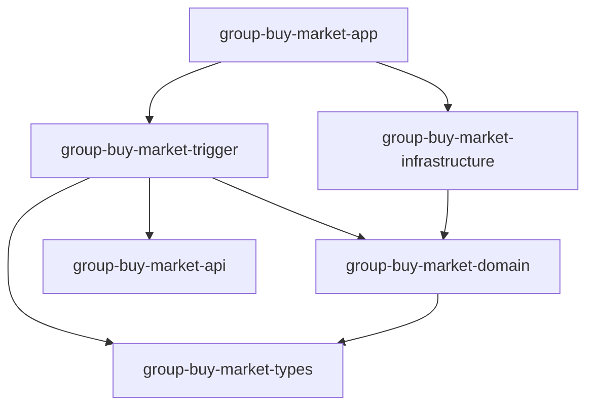

# 拼团项目协作规则

## ① 开始之前

- 使用中文；先执行 `git status --short`，保留用户已有改动。提交、推送需用户明确要求。
- 本仓库是用户手敲的学习工程，不是让代理代做的交付工程。修改业务实现前取得用户明确授权。
- `reference/` 和 `docs/orgin-tutorial/` 只读；对照参考分支使用 `git show`、`git diff`，不切换或改写参考工作区。
- 配置中的密码、地址等仅用于本地核对，不复制到教程。实验副本与运行产物放仓库外。

## ② 仓库地图

| 区域 | 职责 / 入口 |
| --- | --- |
| `group-buy-market-api` | 外部接口与 DTO |
| `group-buy-market-app` | 启动、Spring 配置、资源、现有测试 |
| `group-buy-market-domain` | activity、tag、trade 的业务模型、服务及仓储接口 |
| `group-buy-market-infrastructure` | 仓储实现、DAO、Redis 等基础设施 |
| `group-buy-market-trigger` | HTTP 等触发入口 |
| `group-buy-market-types` | 通用类型与设计模式框架 |
| `docs/study` | 带练教程；写作前读取当地 `AGENTS.md` |
| `docs/learning-guide.md` | 学习进度唯一记录；每次授课、验收、续课前读取 |
| `docs/branch-map.md` | 作者学习顺序及参考分支；定位章节时读取 |
| `docs/orgin-tutorial/AGENTS.md` | 原始教程索引；备课时据此读取对应原文 |
| `reference` | 只读成熟实现；进入前读取当地 `AGENTS.md` |

`reference/` 被现有 `.gitignore` 整体排除，其 `AGENTS.md` 仅本地生效；跨环境时仍以本文件的只读规则为底线，不为跟踪该文件自动修改忽略规则。

以下箭头表示编译依赖，不是运行时调用顺序。沿用现有 POM，不因教学另建分层：



禁止新增 domain 对 infrastructure、trigger、app 的反向依赖。领域通过自己定义的仓储接口使用基础设施。

## ③ 工作模式

| 区域 | 写作者 | 代理角色 |
| --- | --- | --- |
| 后端业务代码 | 用户手敲 | 导师、定位问题、审阅；获明确授权才代写 |
| 前端页面与交互 | AI 实现，用户读关键代码 | 用户已授权直接实现；验证后简讲请求、响应、渲染链路，不要求手敲样式 |
| 教学文档与进度 | 代理 | 读原文和对应分支、核对用户真实代码、写教程并记录验证证据 |
| 参考资料 | 原作者 | 只读对照 |

流程：教程 → 用户阅读、必要练习与自测 → 代理验收 → 用户修订 → 验收通过后明确汇报结论并停下 → 用户自行提交 Git → 用户确认已提交并要求继续后，才开始下一节。验收结论须区分已验证范围与未验证项；不能未核查就笼统说“代码没有问题”，也不在批改结束后自动备课或交付下一节。

## ④ 硬性规则

- 学习指南统一记录教学目标、章节边界、欠账和验收状态；其他索引与记忆只作指针，不另记一份进度。
- 先读用户真实文件再讲签名、路径与行为；以对应章节分支为准，不能把参考 master 的后续能力算到当前节。
- 章节命名及参考映射与原教程一一对应，默认按作者学习序号推进，不按小节号重排；用户明确确认的学习顺序调整以 `docs/learning-guide.md` 为准，不能用默认顺序覆盖该决定。
- 用户以 IDEA 读现有代码为主；卡住的机制另做小练习，不重抄整个项目。Java、Spring 基础随用随补。
- 每次只交付当前节；业务、库表、分层、模式、并发和事务都需结合具体场景讲清，不能只罗列类名。
- 只修改本次教学所需文件；发现历史缺口给出证据和影响，不顺手修业务代码。
- 原文含付费资料版权限制；教程为本地学习笔记，外发或公开源码、原文及其衍生材料前需核对授权。

## ⑤ 验证

- 汇报区分：通过 / 失败 / 跳过 / 未运行；测试条数必须来自实际输出。历史完成不等于本轮已验收。
- 在仓库外复制六模块和根 POM 再构建，避免污染用户工作区。复制代码不等于隔离数据库；业务测试必须使用独立测试库及 Redis 数据范围。
- 截至本轮备课，根 POM 目标为 Java 8；终端默认 Java 为 21。优先选本机已有 JDK 8，与 IDEA 的 Project SDK、运行 JRE、Maven Runner JRE 分别核对。
- `group-buy-market-app/pom.xml` 硬编码了 `skipTests=true`，`package` 成功不能证明测试执行；是否覆盖成功须看测试方法、数量及报告，不能仅凭参数推断。

在副本根目录使用的构建命令：

```bash
mvn -o -DskipTests package
```

判据：六模块及父工程均为 SUCCESS，最终 BUILD SUCCESS；本命令明确跳过测试，不计为测试通过。实测记录见当前复习课的“验证记录”；离线依赖不足时如实记录，不自动安装或改配置。

IDEA 验证：在确认独立测试数据后，选择教程指定的单个测试方法 Debug；记录输入、分支、结果与库表前后变化。不要直接运行整个 app 测试包，部分方法会写真实数据库、变更动态开关或持续等待。

涉及实现改动的验收应在副本中构建、执行对应及全量测试并做至少一个关键行的破坏性实验；环境不具备时记录未验证项，不宣称通过。
