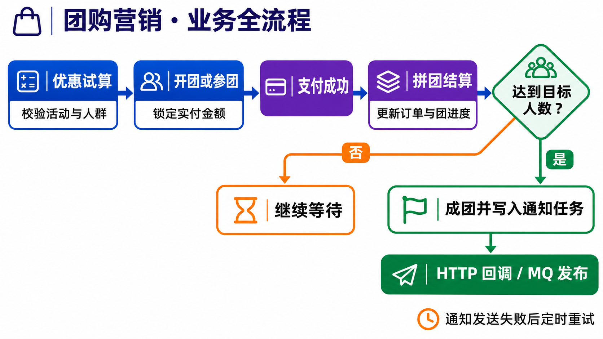
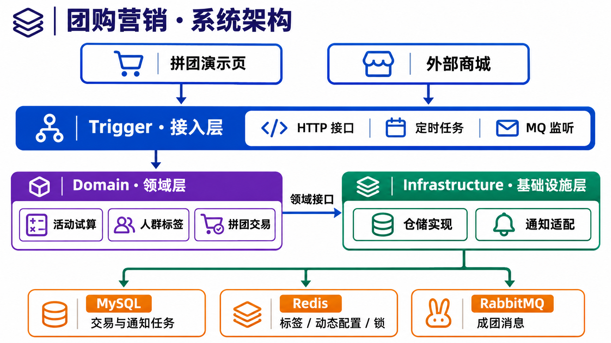
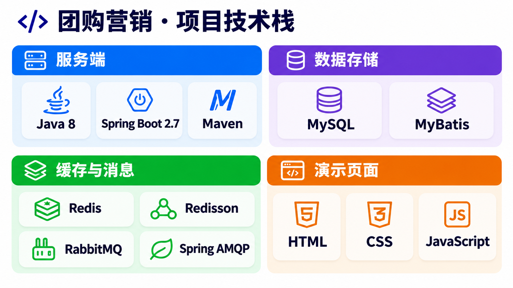

# 团购营销交易系统

## 项目介绍

面向电商拼团场景的营销交易服务，提供优惠试算、开团与参团、优惠锁单、支付后结算和成团通知。商城下单时取得锁定的实付金额，支付成功后提交结算，成团后接收 HTTP 回调或订阅 RabbitMQ 消息。

本仓自带拼团演示页，可通过模拟支付体验三人成团，并在后端日志查看成团通知。

## 业务全流程



- **试算与锁单**：规则树校验活动与人群资格，按优惠策略完成试算。锁单保存原价、优惠额和实付金额，同一用户以同一外部交易号重试时复用已有未支付单。
- **结算与通知**：在同一个 MySQL 事务内更新订单明细和团完成数，达到目标人数时更新团状态并写入通知任务。事务提交后发送通知，发送异常由定时任务按记录重试。

## 系统架构



图中箭头表示运行时调用。`trigger` 接入 HTTP、定时任务和 MQ 监听，`domain` 承载活动、人群和交易规则，`infrastructure` 实现领域定义的仓储及通知接口。`app` 负责启动和装配，`api` 定义对外接口与 DTO，`types` 提供通用类型与模式框架。

## 项目技术栈



## 本地启动指南

1. **准备环境**。安装 JDK 8 和 Maven，将 `JAVA_HOME` 指向 JDK 8，启动本地 MySQL、Redis 与 RabbitMQ。创建空的 `group_buy_market` 数据库并导入 [初始化 SQL](docs/dev-ops/mysql/sql/group_buy_market.sql)。脚本会重建同名表。若活动已过期，调整 `group_buy_activity` 中活动 `100123` 的起止时间。
2. **配置连接**。编辑 [application-dev.yml](group-buy-market-app/src/main/resources/application-dev.yml)，按本机环境填写 `spring.datasource`、`spring.rabbitmq` 和 `redis.sdk.config` 的连接参数。应用默认使用 `dev` 配置，端口为 `8091`。
3. **启动后端**。在 IDEA 中用 JDK 8 运行 `com.sirius.Application`，或在仓库根目录执行：

   ```bash
   mvn -DskipTests package
   java -jar group-buy-market-app/target/group-buy-market-app.jar
   ```

4. **打开演示页**。在 IDEA 中用浏览器打开 [login.html](docs/dev-ops/nginx/html/login.html)，以种子用户 `xfg01` 登录，选择开团并确认模拟支付。再用 `xfg02`、`xfg03` 参与同一个团并各自结算，三人结算后可在后端日志查看模拟商城收到的 HTTP 成团通知。
