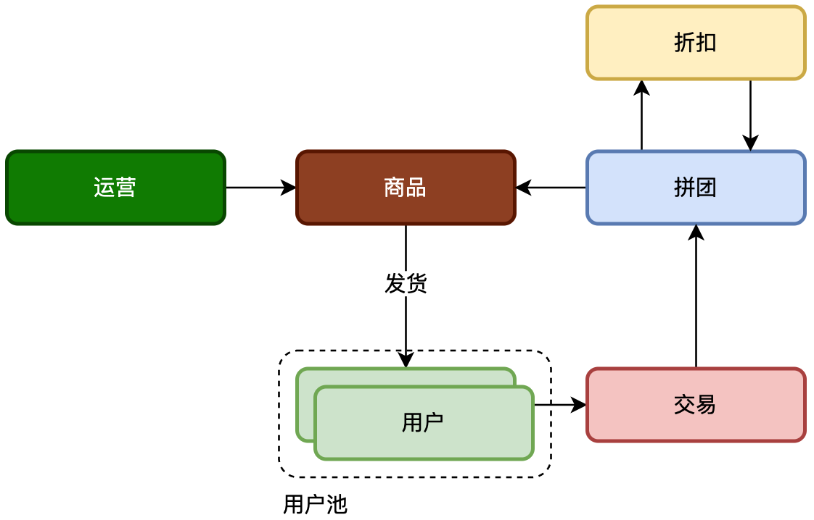
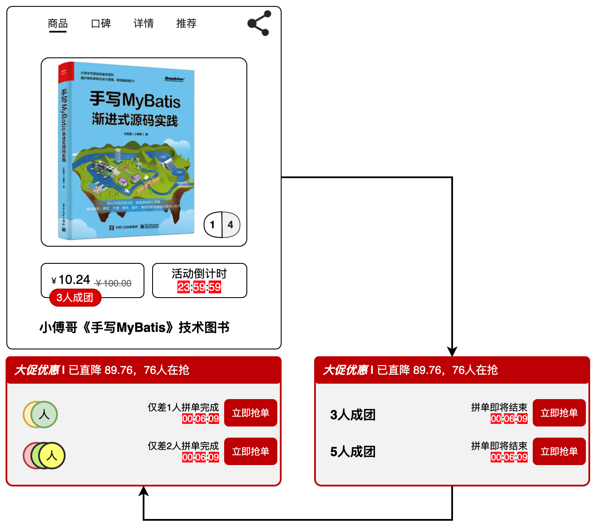
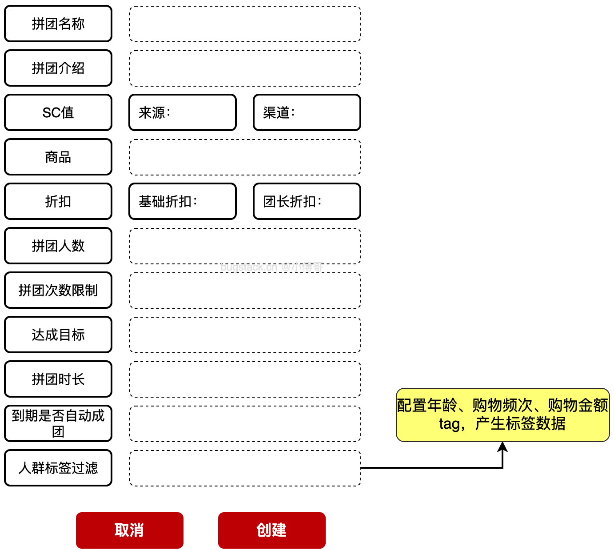
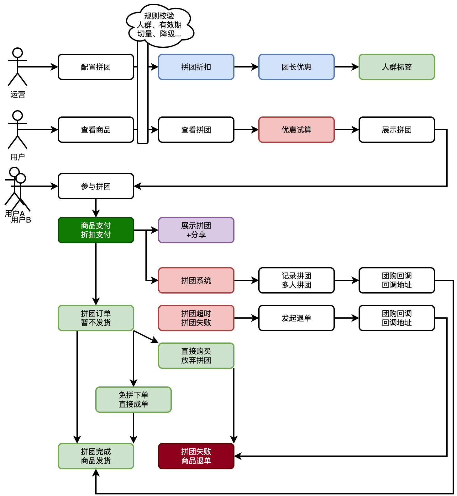

# 拼团需求分析

> 学习序号 1｜小节 1-1｜原文：https://articles.zsxq.com/id_kuh7su4b5ivz.html

**本章重点**：了解公司中开发模式，理解拼团的设计目的和设计目标。

- **本章重点**：★★★☆☆
- **课程视频**：[https://t.zsxq.com/1VRZq](https://t.zsxq.com/1VRZq)

---

**版权说明**：©本项目与星球签约合作，受[《中华人民共和国著作权法实施条例》](https://www.gov.cn/gongbao/content/2013/content_2339485.htm) 版权法保护，禁止任何理由和任何方式公开(public)源码、资料、视频等小傅哥发布的星球内容到Github、Gitee等各类平台，违反可追究进一步的法律责任。

作者：小傅哥

博客：[https://bugstack.cn](https://bugstack.cn)

> 沉淀、分享、成长，让自己和他人都能有所收获！😄

- 一、项目背景
- 二、产品方案
  - 1. 前端页面
  - 2. 运营管理
  - 3. 功能流程

大家好，我是技术UP主小傅哥。

今天是我们《拼团交易平台系统》项目学习的第1节，我们先从需求分析开始理解这样一个项目要做什么，要解决什么场景问题。同时也要知道研发是怎么承接的产品需求。

在互联网公司中，一个需求首先是从业务侧发起的盈利目标，拆分为不同的运营策略。再把对应的策略由产品经理设计为可以支撑市场运营操作完成盈利目标的具体项目。所以这里有一般有3个角色，包括；业务人员、运营人员、产品经理。他们分别在自己的岗位产生不同的资料，包括；MRD、BRD、PRD。
- 市场需求文档（MRD）： MRD是从市场的角度出发，描述目标市场的需求和机会。它通常包括目标客户群、市场趋势、竞争分析、市场机会、产品定位以及产品应该实现的市场目标等。MRD通常由产品经理或市场分析师编写，目的是定义产品应该解决的市场问题和满足的用户需求。
- 业务需求文档（BRD）： BRD更侧重于业务角度，描述业务目标、业务流程、业务规则、业务问题以及业务需求。它是从组织的业务视角来定义需求，包括业务背景、业务目标、影响分析、风险评估等。BRD通常由业务分析师编写，目的是确保项目解决了正确的业务问题，并与公司的业务战略保持一致。
- 产品需求文档（PRD）： PRD是更详细的文档，它根据MRD和BRD中确定的需求，具体描述产品的功能性和非功能性需求。PRD包括用户故事、用例、功能列表、性能要求、界面设计、用户体验等。PRD通常由产品经理编写，目的是为设计团队和开发团队提供一个明确的、详细的产品实现指南。

而研发最终看到的就是这份 PRD 文档，根据产品对 PRD 文档与各个负责的业务线研发进行的评审，让研发了解本次项目所需完成的工作。之后研发在会后根据 PRD 文档进行详细的设计和系统建模。这一部分前期的工作几乎占据了整个项目周期的50%以上的时间。所以研发写代码，只是众多环节中的一环。

接下来，我们来对本次的《拼团交易平台系统》进行需求分析，让大家细致的了解拼团的场景业务。你可以把这个过程就是当成你自己在承接一次产品需求，在学习的过程中把思考和扩展的点在评论区讨论，互相积累补充。

### 一、项目背景

> 拼团系统可以用于，《小型支付商城》、《OpenAI应用》，这类带有支付场景购买商品的系统。我们这里以这样两个系统作为使用场景作为举例。也可以作用于任何其他的交易类系统。

针对目前的`小型支付商城系统`、`OpenAI应用系统`，商品购买交易同比增速放缓，需要引入新的营销策略促进商品交易量。在交易数据统计分析中得到，市场存在同类竞品，商品价格设定低于目前我们的商品定价，所以用户购买意愿偏低。

所以为了盘活沉睡用户，需要适当降低商品价格。但为了达到传播的效果，所以需要引入拼团方式，以客带客，靠用户自身传播的方式进行交易拉新。这样的处理方式对比于 KOL，会让利商品价值到用户自身。【KOL 等同于抖音大主播直播卖货】

另一方面，通过本项目的增加，逐步完善功能产品和运营服务体系，优化整体的产品架构，增强市场竞争力。

### 二、产品方案

因为我们所实现的是一个平台类系统，可以满足各类交易场景的拼团需求接入。所以在实现这套系统时候，不要与其他系统耦合。并提供相关的研发侧对接标准。

此外我们要提供前端案例对接展示，满足后续其他系统，如；《小型支付商城》、《OpenAI应用》对接时候有可参考样例。

#### 1. 前端页面

- 进入商品页后，查询是否配置了拼团活动。并进行优惠试算，拼团成团价，最低优惠展示。
- 参与首次拼团、参与拼团中拼团。拼团完成则不在展示此条拼团。
- 所有参与中的拼团统计拼团人员。

#### 2. 运营管理

- 提供配置需要提供如图所示信息。
- 人群标签为提前设定标签类型，产生对应的人群数据。

#### 3. 功能流程

- 首先，由运营配置商品拼团活动，增加折扣方式。因为有人群标签的过滤，所以可以控制哪些人可参与拼团。
- 之后，用户可见拼团商品并参与拼团。用户可自主分享拼团或者等待拼团。因为拼团有非常大的折扣刺激用户自主分享，以此可以节省营销推广费用。
- 最后，拼团完成，触达商品发货。这里有两种，一种运营手段是拼团成团稀有性，必须打成拼团才可以。另外一种是虚拟拼团，无论是否打成，到时都完成拼团。

> 一般早期运营，先把商品价格促销大家，提高拼团的稀缺性。让大量用户知道拼团商品，之后调整为到期即可成团，只要参与就能拿到商品。
