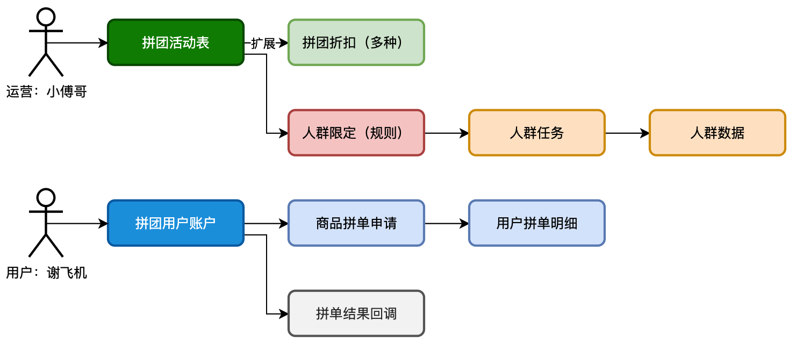
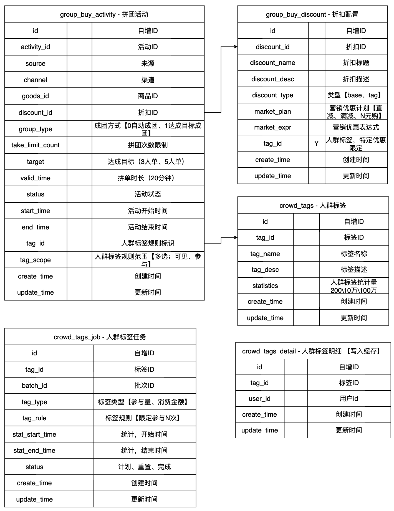
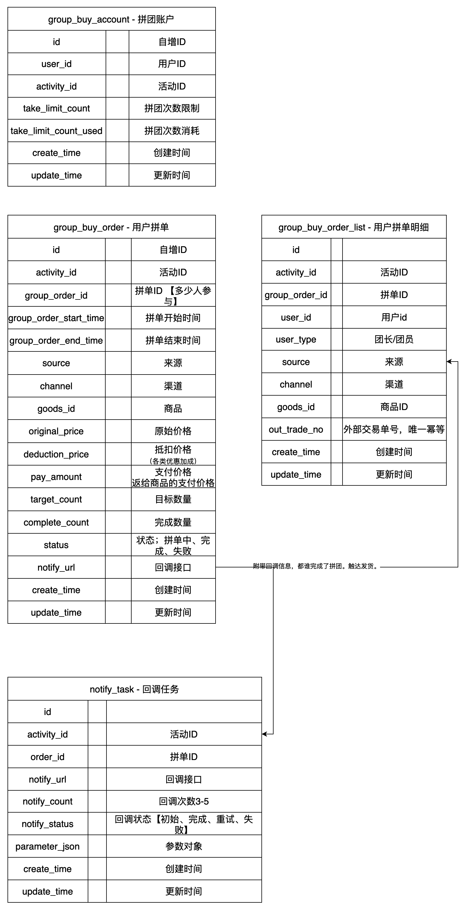

# 拼团库表设计

> 学习序号 2｜小节 1-2｜原文：https://articles.zsxq.com/id_rs6rawlik01l.html

**本章重点**：通过拼团业务，讲解拼团流程实现中，所需的库表结构。包括；运营视角的配置诉求、用户视角的使用诉求。

- **本章重点**：★★★☆☆
- **课程视频**：[https://t.zsxq.com/iteVm](https://t.zsxq.com/iteVm)

---

**版权说明**：©本项目与星球签约合作，受[《中华人民共和国著作权法实施条例》](https://www.gov.cn/gongbao/content/2013/content_2339485.htm) 版权法保护，禁止任何理由和任何方式公开(public)源码、资料、视频等小傅哥发布的星球内容到Github、Gitee等各类平台，违反可追究进一步的法律责任。

作者：小傅哥

博客：[https://bugstack.cn](https://bugstack.cn)

> 沉淀、分享、成长，让自己和他人都能有所收获！😄

- 一、本章诉求
- 二、库表关系
- 三、库表设计
  - 1. 拼团配置表
  - 2. 参与拼团表
- 四、读者作业

大家好，我是技术UP主小傅哥。

编程的代码是对数据逻辑的呈现，数据流转调度的好坏来自于数据结构设计的是否合理。而库表的设计就是对你过往学习数据结构知识的检测。

在库表设计时你需要了解整个业务执行过程，在这些过程中需要哪些数据作为支撑。合理的数据结构的库表设计，会让你的系统逻辑实现容易被人理解。反之，你可能要做大量的代码处理，也就是算法过程复杂度会变得很高。

这块知识的积累，最佳的手段就是多做实际的项目。从库表设计到编码实现，从编码实现反推库表合理性。做的多了，自然也就懂了。

### 一、本章诉求

通过拼团业务，讲解拼团流程实现中，所需的库表结构。包括；运营视角的配置诉求、用户视角的使用诉求。

只要你可以看懂库表设计，基本你也可以了解整个业务系统是如何实现的了。有了这样的积累，进入公司接触新的项目时，可以先从库表进行了解。知道它们的流转关系，之后在看系统设计和代码实现会更加清晰。

### 二、库表关系

在设计一套库表时，需要根据业务流程划分出大块的功能区，知道这些功能区的流转关系。

- 首先，站在运营的角度，要为这次拼团配置对应的拼团活动。那么就会涉及到；给哪个渠道的什么商品ID配置拼团，这样用户在进入商品页就可以看到带有拼团商品的信息了。之后要考虑，这个拼团的商品所提供的规则信息，包括；折扣、时间、人数等。还要拿到折扣的一个试算金额。这个试算出来的金额，就是告诉用户，通过拼团可以拿到的最低价格。
- 之后，站在用户的角度，是参与拼团。首次发起一个拼团与参与已存在的拼团进行数据的记录，达成拼团约定拼团人数后，开始进行通知。这个通知的设计站在平台角度可以提供回调，那么任何的系统也就都可以接入了。
- 另外，为了支撑这套库表，也会有人群的设计。人群是互联网公司中非常常用的手段，比如要把所有符合某个条件的用户ID，全部写入到一个特定的 Redis 记录中，之后就可以专门为这些人做特定的拼团活动了。
- 那么，拼团活动表，为什么会把折扣拆分出来呢。因为这里的折扣可能有多种迭代到一个拼团上。比如，给一个商品添加了直减10元的优惠，又对符合的人群id的用户，额外打9折，这样就有了2个折扣迭代。所以拆分出来会更好维护。这是对常变的元素和稳定的元素进行设计的思考。

> 你可以先尝试按照这样的分析进行库表设计，之后在看下文的内容。

### 三、库表设计

#### 1. 拼团配置表

如图，详细设计表；拼团活动表、折扣配置表、人群标签表、人群标签任务表、人群标签明细表。

- 拼团活动表：设定了拼团的成团规则，人群标签的使用可以限定哪些人可见，哪些人可参与。
- 折扣配置表：拆分出拼团优惠到一个新的表进行多条配置。如果折扣还有更多的复杂规则，则可以配置新的折扣规则表进行处理。
- 人群标签表：专门来做人群设计记录的，这3张表就是为了把符合规则的人群ID，也就是用户ID，全部跑任务到一个记录下进行使用。比如黑玫瑰人群、高净值人群、拼团履约率90%以上的人群等。

#### 2. 参与拼团表

如图，详细设计表；拼团账户表、用户拼单表、用户拼单明细、回调任务表。

- 拼团账户表：记录用户的拼团参与数据，一个是为了限制用户的参与拼团次数，另外是为了人群标签任务统计数据。
- 用户拼单表：当有用户发起首次拼单的时候，产生拼单id，并记录所需成团的拼单记录，另外是写上拼团的状态、唯一索引、回调接口等。这样拼团完成就可以回调对接的平台，通知完成了。【微信支付也是这样的设计，回调支付结果，这样的设计可以方便平台化对接】当再有用户参与后，则写入用户拼单明细表。直至达成拼团。
- 回调任务表：当拼团完成后，要做回调处理。但可能会有失败，所以加入任务的方式进行补偿。如果仍然失败，则需要对接的平台，自己查询拼团结果。

### 四、读者作业

- 简单作业：理解本节的拼团库表设计，理解每个字段的作用。把这些学习的内容在课程目录下点【写作业】，完成后，把你的作业链接放到本节的评论区。
- 复杂作业：思考这里的各类规则后续应该怎么编码实现，比如组合模式、easyRule、drools，这些内容可以检索了解，以及系统上该如何实现，并提交作业。
