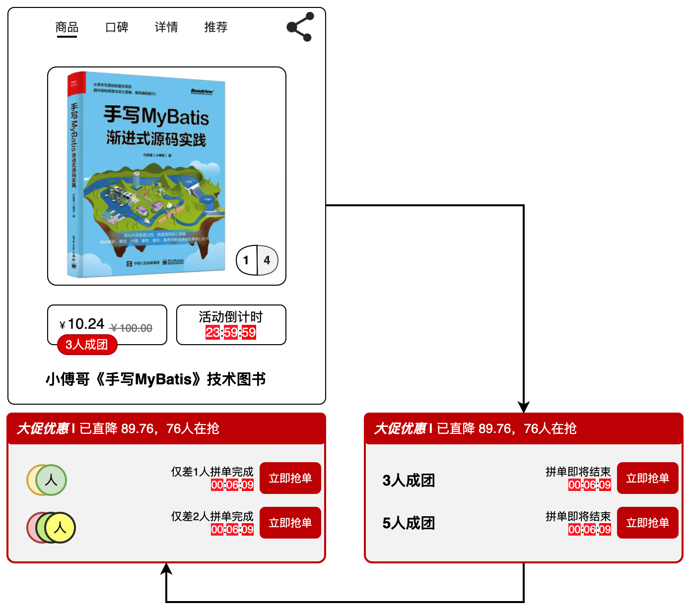
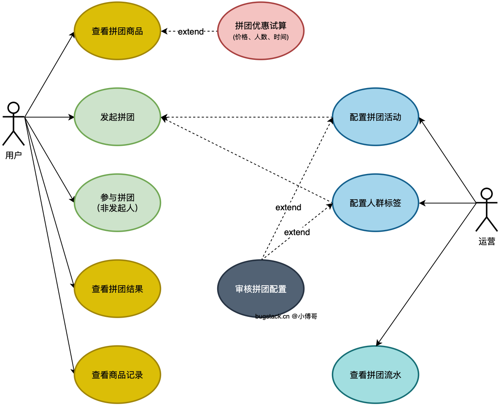
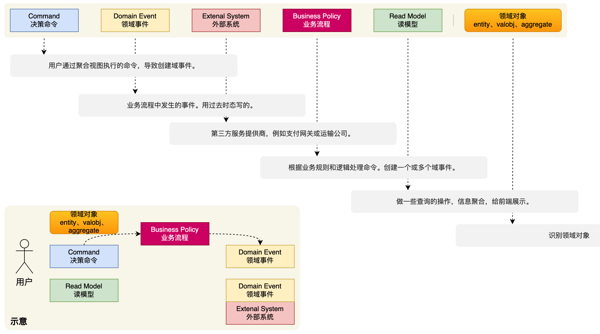
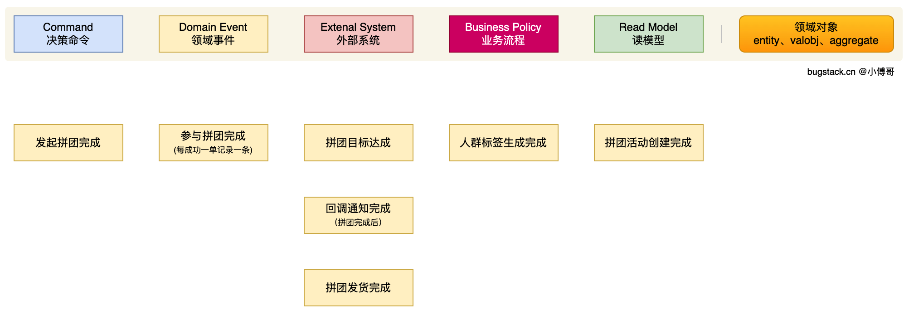
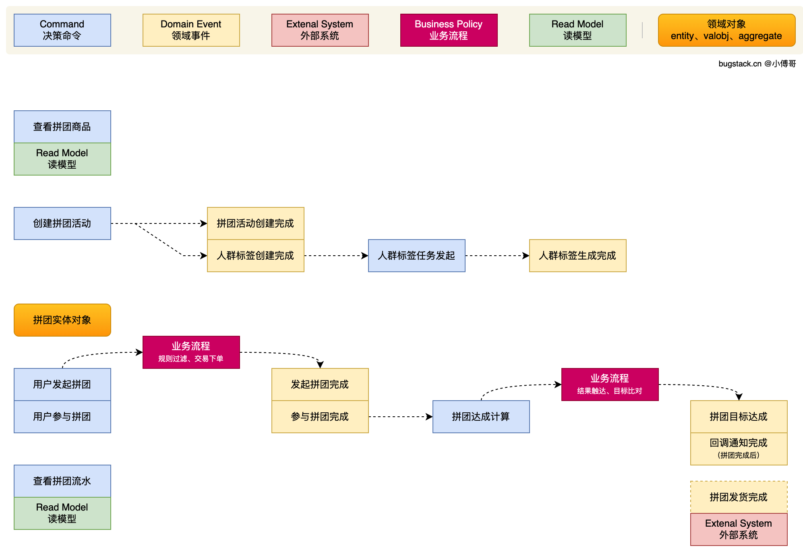
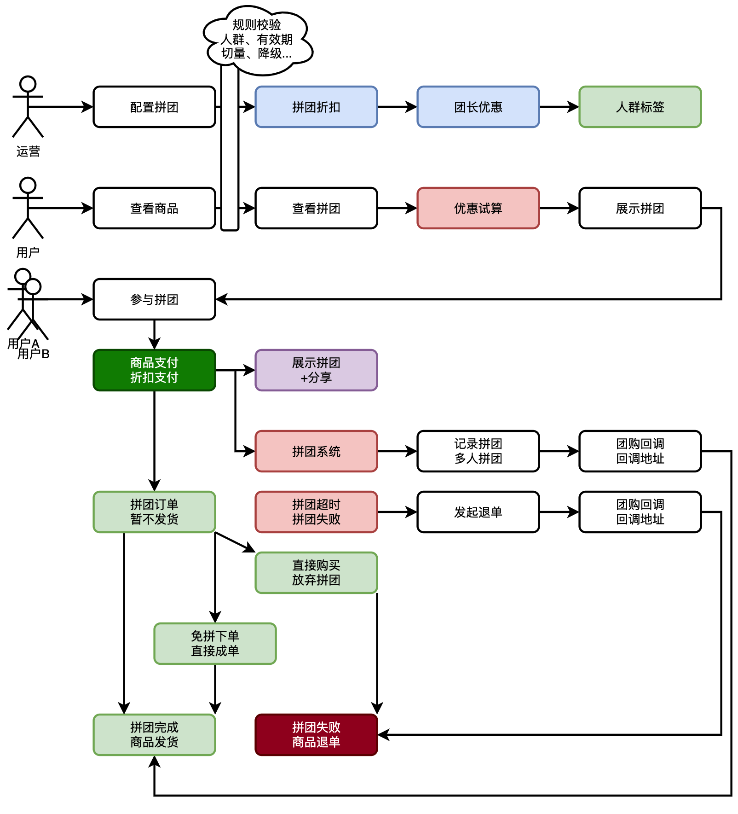
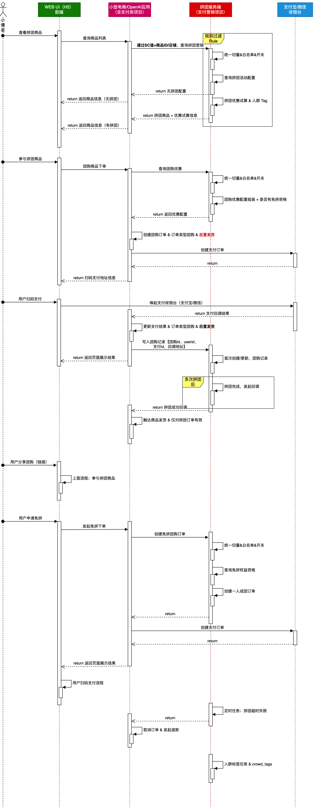
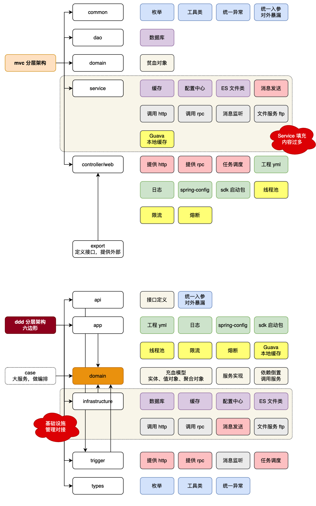

# 研发系统设计

> 学习序号 3｜小节 1-3｜原文：https://articles.zsxq.com/id_olbr3cmmfslw.html

**本章重点** ：通过对拼团需求的理解，进行研发系统设计。包括；用例图、系统建模、工程模型、功能流程、UML时序图。

- **本章重点** ：★★★★☆
- **课程视频** ：[https://t.zsxq.com/UoowL](https://t.zsxq.com/UoowL)

**版权说明** ：©本项目与星球签约合作，受[《中华人民共和国著作权法实施条例》](https://www.gov.cn/gongbao/content/2013/content_2339485.htm) 版权法保护，禁止任何理由和任何方式公开(public)源码、资料、视频等小傅哥发布的星球内容到Github、Gitee等各类平台，违反可追究进一步的法律责任。

作者：小傅哥

博客：[https://bugstack.cn](https://bugstack.cn)

> 沉淀、分享、成长，让自己和他人都能有所收获！😄

- 一、本章诉求
- 二、设计目的
- 三、业务模型
- 四、用户用例图
- 五、四色建模图
  - 1. 建模方法
  - 2. 寻找事件
  - 3. 划分领域
- 六、业务流程
  - 1. 流程图
  - 2. 时序图
- 七、系统架构
- 八、读者作业

大家好，我是技术UP主小傅哥。

对于程序员👨🏻‍💻来说，虽然写代码是最直接的工作体现，但工作可不是就只写代码。就一个产品功能需求而言，研发在参与评审后，还需要对需求进行功能的研发系统设计。

这个过程是比较消耗时间的，一般在2-3天完成，或者大型项目与外部对接的较多的情况，会需要3-5天以上。一般初级的开发在不具有系统的把控能力的时候，会考虑在工程中写伪代码的过程，来梳理系统设计。包括；涉及模块、功能流程、外部对接、接口字段等，全新的系统还要做架构的设计、分层的设计、模块的设计等。

那么对于小伙伴们学习的本节来说，就是一个全新的系统，我们可以全部的了解到系统设计所需的内容。

### 一、本章诉求

通过对拼团需求的理解，进行研发系统设计。包括；用例图、系统建模、工程模型、功能流程、UML时序图。另外像是库表设计已经在前面完成了，它也属于研发系统设计的一部分，提前做了这部分是为了让大家更好的理解系统需求。

### 二、设计目的

为什么，不上来就写代码？

在15年刚加入互联网大厂的时候，基本上是一上来就写代码。产品聊完需求，研发简单记录，之后就是打开工程直接编码了。需求是上午写的，代码是下午干的。这样对于刚起步阶段是比较合适的，可以快速迭代。

但随着公司的体系化越来越完整，一个小项目也变成一个个独立业务线的大项目，一个人开发也变成了一个团队开发。所有的系统功能的实现，一点点小问题，都可能是一个个大问题。甚至一个bug，一会时间就会被传到微博，之后就是一片的舆情和客诉。

所以，到了目前这个阶段，研发不能只是为了功能而直接开发。还要遵守一些列的流程，确保开发迭代的需求，都能平稳的交付。所以要有研发设计、要有评审、要有测试、要有预发、要有黑白名单验证和功能切量。

### 三、业务模型

接下来我们站在前面已经做的产品需求功能的评审、库表的设计下，做相关的研发系统设计；

- 对照这样一个页面图，我们来分析需求做系统设计是比较容易的。

### 四、用户用例图

用例图（英语：use case diagram）是用户与系统交互的最简表示形式，展现了用户和与他相关的用例之间的关系。通过用例图，人们可以获知系统不同种类的用户和用例。用例图也经常和其他图表配合使用。

- 用例图，也可以等同于是用户故事（英语：User story）（软件开发和项目管理中的常用术语），主旨是以日常语言或商务用语撰写句子，是一段简单的功能表述。以客户或使用者的观点撰写下有价值的功能、引导、框架来与使用者进行互动，进而推动工作进程。可以被认为是一种规格文件，但更精确而言，它代表客户的需求与方向。以该用户故事来反应对象在组织内的其工作职责、范围、需要进行的任务等。用户故事在敏捷开发方法中用来定义系统需要提供的功能和实现需求管理。
- 尽管用例本身会涉及大量细节和各种可能性，用例图却能提纲挈领地让人了解系统概况。它为“系统做什么”提供了简化了的图形表示，因此被誉为“搭建系统的蓝图”。

- 站在用户视角，会有；查看拼团商品、发起拼团、参与拼团、查看拼团结果、查看商品记录。
- 站在运营视角，会有；配置拼团活动、配置人群标签、审核拼团配置、查看拼团流水。

> 这样的用例图，它有点项目目标结果驱动，让你知道最终的产品形态要提供什么功能。所以有这样的一个指导是可以很好的完成后续的建模设计的。

### 五、四色建模图

在MVC的系统开发中，是很少做建模的事情的。因为它都是面向过程开发，过程就是一个流程需要什么就编写什么，但随着系统的复杂，会逐步发现，A流程、B流程、C流程，越来越多的流程加入，但这些流程中又存在了交叉、复用。也就是大家看到的 MVC 里的代码，总是一个功能，被复制了好多次，好多地方编写。所以使用 DDD 思想的情况，会对这些内容提前思考，进行建模设计，划分出领域。让一个个单元变得容易管理。

MVC 有点像睡大车店子（大通铺的一个大炕），DDD 划分了每家每户，每个床🛏睡着该睡的人。

#### 1. 建模方法

DDD 的建模过程，是以一个用户为起点，通过行为命令，发起行为动作，串联整个业务。而这个用户的起点最初来自于用例图的分析。用例图是用户与系统交互的最简表示形式，展现了用户和与他相关的用例之间的关系。通过用例图，我们可以分析出所有的行为动作。

在 DDD 中用于完成用户的行为命令和动作分析的过程，是一个四色建模的过程，也称作风暴模型。在使用 DDD 的标准对系统建模前，一堆人要先了解 DDD 的操作手段，这样才能让产品、研发、测试、运营等了解业务的伙伴，都能在同一个语言下完成系统建模。

此图是整个四色建模的指导图，通过寻找领域事件，发起事件命令，完成领域事件的过程，完成 DDD 工程建模。

- 蓝色 - 决策命令，是用户发起的行为动作，如；开始签到、开始抽奖、查看额度等。
- 黄色 - 领域事件，过去时态描述。如；签到完成、抽奖完成、奖品发放完成。它所阐述的都是这个领域要完成的终态。
- 粉色 - 外部系统，如你的系统需要调用外部的接口完成流程。
- 红色 - 业务流程，用于串联决策命令到领域事件，所实现的业务流程。一些简单的场景则直接有决策命令到领域事件就可以了。
- 绿色 - 只读模型，做一些读取数据的动作，没有写库的操作。
- 棕色 - 领域对象，每个决策命令的发起，都是含有一个对应的领域对象。

**👩🏻‍🏫敲黑板** 综上，左下角的示意图。是一个用户，通过一个策略命令，使用领域对象，通过业务流程，完成2个领域事件，调用1次外部接口个过程。我们在整个 DDD 建模过程中，就是在寻找这些节点。

更多关于建模的学习：[https://bugstack.cn/md/road-map/ddd-guide-02.html](https://bugstack.cn/md/road-map/ddd-guide-02.html)

#### 2. 寻找事件

寻找领域事件的过程，就是寻找系统中流程节点的结果态。什么结束了、什么完成了、什么终止。

其实这样的手段，也是一种目标结果驱动的手段，当有人为你指明了，你要去哪里，之后你会有更目标感的前进。

- 目前我们可以根据需求找到，如图中黄色部分的领域事件。包括；发起拼团完成、参与拼团完成、拼团目标达成、回调通知完成、拼团发货完成、人群标签生成完成、拼团活动创建完成。
- 如果后续我们在迭代新的功能的话，还会引入其他领域事件。你也可以思考，还可能存在什么领域事件。

#### 3. 划分领域

领域的划分是基于寻找领域事件之后，所有的领域事件都应该有一个对应的发起方，我们管这个叫决策命令。比如你去超时购物完成，是你媳妇发起的决策命令让你去买胖东来的0添加酱油。

那么，我们这里就要找到完成这些领域事件的决策命令；

- 蓝色为以用户维度的决策命令，你发出的所有命令，都会有一个对应的结果态承接。
- 如果是复杂的业务，要做一些列的流程，则会出现一个 Business Policy 业务流程。这个业务流程里可以通过设计模式来完成功能的设计。经过这样的处理，你的代码也会变得非常清晰。

### 六、业务流程

研发功能流程设计有一粗一细，粗的是流程图为了让大家快速的了解这些功能节点的串联关系，方便讲解的时候，可以让多方了解。细的是UML时序图，这个会把流程中的个细节体现出来，指导研发做功能实现。

#### 1. 流程图

分别以用户和运营视角，了解一套拼团的配置到用户的参与。

#### 2. 时序图

- 时序图，展示了整个拼团过程所涉及的系统模块和流转关系。这部分直接看图即可。

### 七、系统架构

DDD 是软件开发设计的一套指导思想，但不是直接决定了你如何编码，而是提供了对需求设计为研发提供编码指引的手段。所以，DDD 建模后，你可以使用3层架构 MVC 开发，也可以使用六边形架构、整洁架构、菱形架构开发。这也就是为什么有些人的简历上，专业技能栏里会有相关架构内容的体现。

在这方面，阿里最早推出的 cola 考拉🐨架构，就是整洁架构的代表。张毅老师推出的菱形架构，南向网关、北向网关，属于六边形这一类的架构。这些都是为了更好的落地 DDD 这套指导思想而出现的架构分层设计。

所以，DDD 是指导思想，帮助你建模设计，划分领域。六边形架构、整洁架构、菱形架构，是为了帮你落地知道思想到具体编码实现上。

那么，MVC 分层架构不也可以开发 DDD 知道思想的编码吗？可以，但相对来说不会那么优雅。MVC 的出现，并不是在有了分布式微服务之后，所以一些分布式资源模块的承载和领域思想的处理，在 MVC 中都是比较别扭的。所以，我们选择新的架构形态可以更好的承载 DDD 指导思想。

如图，展示了分布式微服务架构项目，各项开发过程中所需的资源在两套分层架构中的体现。

1. MVC 基本是把所有的内容都用服务来承载，无论是自身的服务，还是外部的服务。这样会导致维护的混乱，长期迭代成本的增加。
2. 六边形架构，对于MVC的劣势做了针对性的架构处理，合理的划分了各项资源在不同层的承载。domain 也更专注于领域功能的实现。也就是把以前的 service 内容，划分到 domain 中处理。

关于更多的 DDD 工程模型，可以从编程路书中学习；[https://bugstack.cn/md/road-map/ddd-guide-03.html](https://bugstack.cn/md/road-map/ddd-guide-03.html)

### 八、读者作业

- 简单作业：理解本节中需求的研发设计过程和内容，这会对你以后在职场工作有非常大的帮助。
- 复杂作业：深度理解 DDD 软件设计思想，六边形架构、整洁架构、菱形架构的设计思想。对文中提供的链接做扩展学习，这部分内容在 [bugstack.cn](https://bugstack.cn/) 编程路书中都有所提供。
