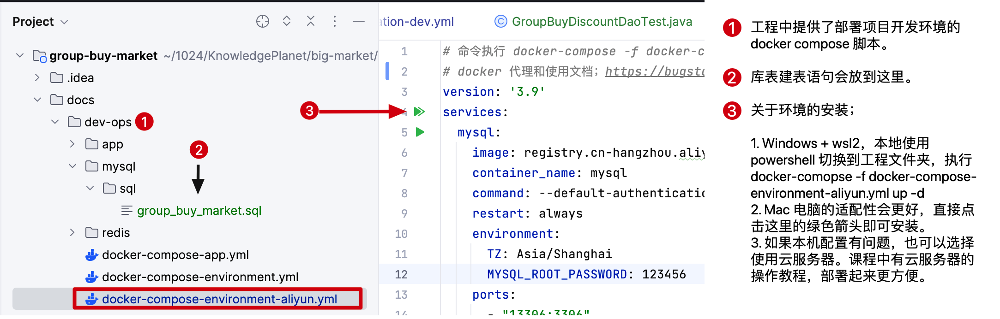
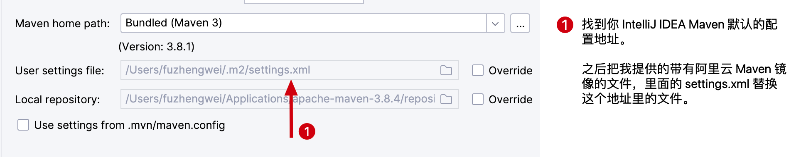
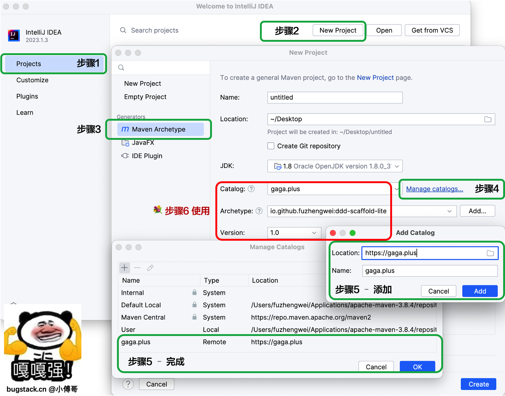
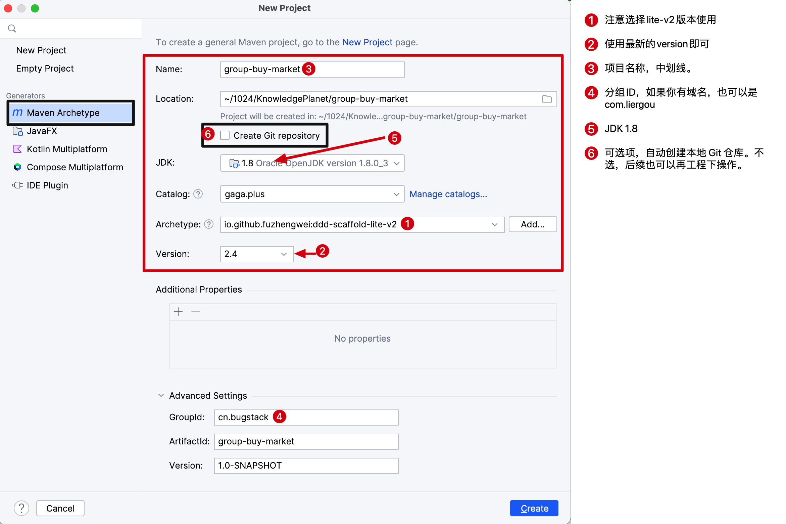
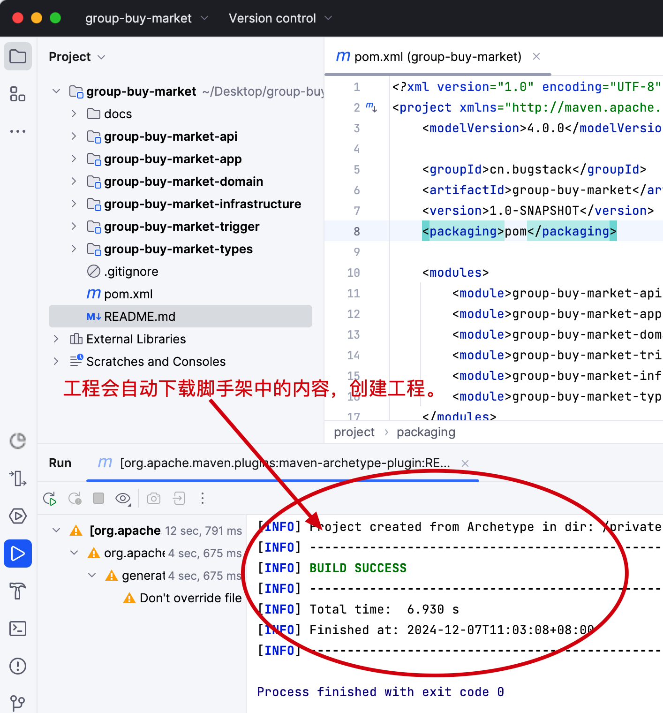
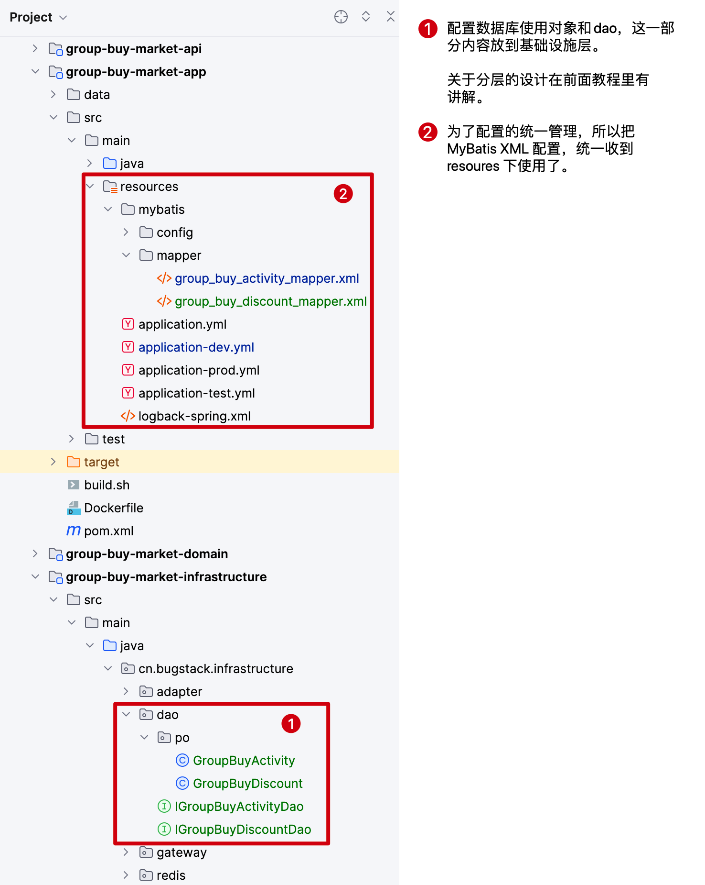

# 初始工程搭建

> 学习序号 4｜小节 2-1｜原文：https://articles.zsxq.com/id_9hqq2pxbbajr.html

**本章重点** ：教会小伙伴使用统一标准脚手架方式创建项目工程，并了解工程模块的分层用途。以及完成2张关于拼团互动库表的创建和使用。

- **本章重点** ：★★☆☆☆
- **本节分支：** [https://gitcode.net/KnowledgePlanet/group-buy-market/-/tree/241207-xfg-init-project](https://gitcode.net/KnowledgePlanet/group-buy-market/-/tree/241207-xfg-init-project)
- **课程视频** ：[https://t.zsxq.com/mT399](https://t.zsxq.com/mT399)

**版权说明** ：©本项目与星球签约合作，受[《中华人民共和国著作权法实施条例》](https://www.gov.cn/gongbao/content/2013/content_2339485.htm) 版权法保护，禁止任何理由和任何方式公开(public)源码、资料、视频等小傅哥发布的星球内容到Github、Gitee等各类平台，违反可追究进一步的法律责任。

作者：小傅哥

博客：[https://bugstack.cn](https://bugstack.cn)

> 沉淀、分享、成长，让自己和他人都能有所收获！😄

- 一、本章诉求
- 二、如何开始
  - 1. 前置学习
  - 2. 开始学习
  - 3. 环境安装
- 三、创建工程
  - 1. 配置脚手架
  - 2. 使用脚手架
- 四、导入库表
  - 1. 建表语句
  - 2. 工程配置
- 五、测试验证
  - 1. 拼团活动查询
  - 2. 拼团优惠查询
- 六、读者作业

大家好，我是技术UP主小傅哥。

可能不少小伙伴都学习过一些入门项目，简单的使用 IntelliJ IDEA 创建和使用。但对于在互联网公司中如何创建和使用一套新工程，往往是不清楚他们是使用了什么样的统一标准的。因为在公司中，那么多新项目要创建，不太可能让每个组的每个人都创建风格迥异的项目工程，这样对维护成本来说是非常大的。所以这里要建立工具和标准化。

所以，跟着小傅哥学习，不只是做项目。而是以互联网中大型公司标准化的方式来开发、设计、实现功能。

### 一、本章诉求

教会小伙伴使用统一标准脚手架方式创建项目工程，并了解工程模块的分层用途。以及完成2张关于拼团互动库表的创建和使用。

课程会循序渐进的从0到1，逐步带着大家完成项目的开发。开局只有一把 IntelliJ IDEA，完成项目后你可以学习到；业务、架构、设计、方案、配置、部署（Linux、Docker）等各项知识。

### 二、如何开始

站在读者视角，该怎么学习呢？这里做个必要说明和前置的知识提供。

#### 1. 前置学习

小伙伴在学习的时候，可以依照课程的方式进行创建项目、变更配置、启动测试。这里有一些前置学习，包括：Git、Maven、Docker、脚手架，课程已经准备好了，可以刷下；

- Git：[https://bugstack.cn/md/road-map/git.html](https://bugstack.cn/md/road-map/git.html)
- Maven：[https://bugstack.cn/md/road-map/maven.html](https://bugstack.cn/md/road-map/maven.html)
- Docker [https://bugstack.cn/md/road-map/docker-what.html](https://bugstack.cn/md/road-map/docker-what.html)
- 脚手架：[https://bugstack.cn/md/road-map/ddd-archetype-maven.html](https://bugstack.cn/md/road-map/ddd-archetype-maven.html)

另外课程会使用 Java JDK 1.8、Maven 3.8.x，软件已经提供好，可以直接下载；[https://t.zsxq.com/19Rnk98M0](https://t.zsxq.com/19Rnk98M0) - `附件内含有配置好阿里云镜像的 Maven`

#### 2. 开始学习

1. 你需要通过 git clone 命令，或者 IntelliJ IDEA 自动的检出工程方式，把项目工程检出到本地。关于如何使用Git检出项目，在前置学习里提供了教程。
2. 检出代码后，你可以通过 IntelliJ IDEA 打开项目，并按照每一节最开始说明的本节对应的代码分支，把工程代码切换到对应的这一节。
3. 接下来你可以通过课程的视频和小册以及提供的代码进行学习，并跟随课程每节要完成的内容，一步步操作。过程中可以参考课程的代码进行学习。如果自己的代码运行出问题的时候，可以运行课程的代码验证是环境问题还是个人代码问题。**另外注意运行课程代码，要修改对应的环境为你的本地环境，mysql、redis等**
4. 对于课程中每节涉及的库表，会放到工程 docs/dev-ops mysql 下。你可以每节学习创建一个新的库名称，之后导入。但要记得在工程 app/application-dev.yml 文件中修改对应的库名称。

#### 3. 环境安装

课程提供了使用 Docker 部署 MySQL、Redis 环境的脚本。因为使用 Docker 可以随时方便卸载，不会污染本地电脑的本机环境。而且后续部署 Linux 云服务器也会非常顺手。

关于环境的安装；



1. Windows + wsl2，本地使用 powershell 切换到工程文件夹，执行 `docker-compose -f docker-compose-environment-aliyun.yml up -d`
2. Mac 电脑的适配性会更好，直接点击这里的绿色箭头即可安装。
3. 如果本机配置有问题，也可以选择使用云服务器。课程中有云服务器的操作教程，部署起来更方便。云服务器教程：[https://bugstack.cn/md/road-map/linux.html](https://bugstack.cn/md/road-map/linux.html)

> 环境安装后就可以使用 MySql、Redis 链接工具使用了，也可以手动更新库表。

### 三、创建工程

本节会用到小傅哥开发好的在线 Maven 脚手架，用于创建项目工程。如下操作前，确保你的 IntelliJ IDEA 已经配置好了我提供的带有阿里云镜像 Maven，否则拉取脚手架会超时失败。如图操作。



#### 1. 配置脚手架



- 首先，你需要一个 IntelliJ IDEA 2021+ 版本，推荐使用社区版即可。即免费，也够用。
- 之后，如图把在线版的脚手架配置到 IntelliJ IDEA 中。这样大家使用的就是统一一套脚手架了。配置地址 [https://gaga.plus](https://gaga.plus)

#### 2. 使用脚手架

如图，配置后使用即可。





这样你就获得到了一个自动创建出来的工程结构。关于工程结构分层在前面已经介绍，这里也可以通过链接学习补充。[https://bugstack.cn/md/road-map/ddd-guide-03.html](https://bugstack.cn/md/road-map/ddd-guide-03.html) 关于分层定义如下；

- **接口定义-api** ：因为微服务中引用的 RPC 需要对外提供接口的描述信息，也就是调用方在使用的时候，需要引入 Jar 包，让调用方好能依赖接口的定义做代理。
- **应用封装-app** ：这是应用启动和配置的一层，如一些 aop 切面或者 config 配置，以及打包镜像都是在这一层处理。你可以把它理解为专门为了启动服务而存在的。
- **领域封装-domain** ：领域模型服务，是一个非常重要的模块。无论怎么做DDD的分层架构，domain 都是肯定存在的。在一层中会有一个个细分的领域服务，在每个服务包中会有【模型、仓库、服务】这样3部分。
- **仓储服务-infrastructure** ：基础层依赖于 domain 领域层，因为在 domain 层定义了仓储接口需要在基础层实现。这是依赖倒置的一种设计方式。
- **领域封装-trigger** ：触发器层，用于提供接口实现、消息接收、任务执行等。所以对于这样的操作，小傅哥把它叫做触发器层。
- **类型定义-types** ：通用类型定义层，在我们的系统开发中，会有很多类型的定义，包括；基本的 Response、Constants 和枚举。它会被其他的层进行引用使用。

### 四、导入库表

这一节我们先创建 `group_buy_activity - 拼团活动`、`group_buy_discount - 折扣配置`两个库表到工程中，并完成配置和使用。

#### 1. 建表语句

```
                CREATE database if NOT EXISTS `group_buy_market` default character set utf8mb4 collate utf8mb4_0900_ai_ci;
use `group_buy_market`;

# 转储表 group_buy_activity
# ------------------------------------------------------------

DROP TABLE IF EXISTS `group_buy_activity`;

CREATE TABLE `group_buy_activity` (
  `id` bigint(11) unsigned NOT NULL AUTO_INCREMENT COMMENT '自增',
  `activity_id` bigint(8) NOT NULL COMMENT '活动ID',
  `source` varchar(8) NOT NULL COMMENT '来源',
  `channel` varchar(8) NOT NULL COMMENT '渠道',
  `goods_id` varchar(12) NOT NULL COMMENT '商品ID',
  `discount_id` varchar(8) NOT NULL COMMENT '折扣ID',
  `group_type` tinyint(1) NOT NULL DEFAULT '0' COMMENT '拼团方式（0自动成团、1达成目标拼团）',
  `take_limit_count` int(4) NOT NULL DEFAULT '1' COMMENT '拼团次数限制',
  `target` int(5) NOT NULL DEFAULT '1' COMMENT '拼团目标',
  `valid_time` int(4) NOT NULL DEFAULT '15' COMMENT '拼团时长（分钟）',
  `status` tinyint(1) NOT NULL DEFAULT '0' COMMENT '活动状态（0创建、1生效、2过期、3废弃）',
  `start_time` datetime NOT NULL DEFAULT CURRENT_TIMESTAMP COMMENT '活动开始时间',
  `end_time` datetime NOT NULL DEFAULT CURRENT_TIMESTAMP COMMENT '活动结束时间',
  `tag_id` varchar(8) DEFAULT NULL COMMENT '人群标签规则标识',
  `tag_scope` varchar(4) DEFAULT NULL COMMENT '人群标签规则范围（多选；1可见限制、2参与限制）',
  `create_time` datetime NOT NULL DEFAULT CURRENT_TIMESTAMP COMMENT '创建时间',
  `update_time` datetime NOT NULL DEFAULT CURRENT_TIMESTAMP ON UPDATE CURRENT_TIMESTAMP COMMENT '更新时间',
  PRIMARY KEY (`id`),
  UNIQUE KEY `uq_activity_id` (`activity_id`)
) ENGINE=InnoDB DEFAULT CHARSET=utf8mb4 COMMENT='拼团活动';

LOCK TABLES `group_buy_activity` WRITE;
/*!40000 ALTER TABLE `group_buy_activity` DISABLE KEYS */;

INSERT INTO `group_buy_activity` (`id`, `activity_id`, `source`, `channel`, `goods_id`, `discount_id`, `group_type`, `take_limit_count`, `target`, `valid_time`, `status`, `start_time`, `end_time`, `tag_id`, `tag_scope`, `create_time`, `update_time`)
VALUES
 (1,100123,'s01','c01','9890001','25120207',0,1,1,15,0,'2024-12-07 10:19:40','2024-12-07 10:19:40','1','1','2024-12-07 10:19:40','2024-12-07 10:19:40');

/*!40000 ALTER TABLE `group_buy_activity` ENABLE KEYS */;
UNLOCK TABLES;


# 转储表 group_buy_discount
# ------------------------------------------------------------

DROP TABLE IF EXISTS `group_buy_discount`;

CREATE TABLE `group_buy_discount` (
  `id` bigint(11) unsigned NOT NULL AUTO_INCREMENT COMMENT '自增ID',
  `discount_id` int(8) NOT NULL COMMENT '折扣ID',
  `discount_name` varchar(64) NOT NULL COMMENT '折扣标题',
  `discount_desc` varchar(256) NOT NULL COMMENT '折扣描述',
  `discount_type` tinyint(1) NOT NULL DEFAULT '0' COMMENT '折扣类型（0:base、1:tag）',
  `market_plan` varchar(4) NOT NULL DEFAULT 'ZJ' COMMENT '营销优惠计划（ZJ:直减、MJ:满减、N元购）',
  `market_expr` varchar(32) NOT NULL COMMENT '营销优惠表达式',
  `tag_id` varchar(8) DEFAULT NULL COMMENT '人群标签，特定优惠限定',
  `create_time` datetime NOT NULL DEFAULT CURRENT_TIMESTAMP COMMENT '创建时间',
  `update_time` datetime NOT NULL DEFAULT CURRENT_TIMESTAMP ON UPDATE CURRENT_TIMESTAMP COMMENT '更新时间',
  PRIMARY KEY (`id`),
  UNIQUE KEY `uq_discount_id` (`discount_id`)
) ENGINE=InnoDB DEFAULT CHARSET=utf8mb4;

LOCK TABLES `group_buy_discount` WRITE;
/*!40000 ALTER TABLE `group_buy_discount` DISABLE KEYS */;

INSERT INTO `group_buy_discount` (`id`, `discount_id`, `discount_name`, `discount_desc`, `discount_type`, `market_plan`, `market_expr`, `tag_id`, `create_time`, `update_time`)
VALUES
 (1,9890001,'测试优惠','测试优惠',0,'ZJ','20',NULL,'2024-12-07 10:20:15','2024-12-07 10:20:15');

/*!40000 ALTER TABLE `group_buy_discount` ENABLE KEYS */;
UNLOCK TABLES;
```

- 课程的 Docker compose 脚本，会帮助你自动完成库表创建。如果遇到一些权限或者兼容问题，导致库表没有自动初始化到 MySQL 中，那么也可以手动处理，执行脚本导入到 MySQL 中。

#### 2. 工程配置



**application-dev.yml**

```
                # 数据库配置；启动时配置数据库资源信息
spring:
  datasource:
    username: root
    password: 123456
    url: jdbc:mysql://127.0.0.1:3306/group_buy_market?useUnicode=true&characterEncoding=utf8&autoReconnect=true&zeroDateTimeBehavior=convertToNull&serverTimezone=Asia/Shanghai&useSSL=true
    driver-class-name: com.mysql.cj.jdbc.Driver
  hikari:
    pool-name: Retail_HikariCP
    minimum-idle: 15 #最小空闲连接数量
    idle-timeout: 180000 #空闲连接存活最大时间，默认600000（10分钟）
    maximum-pool-size: 25 #连接池最大连接数，默认是10
    auto-commit: true  #此属性控制从池返回的连接的默认自动提交行为,默认值：true
    max-lifetime: 1800000 #此属性控制池中连接的最长生命周期，值0表示无限生命周期，默认1800000即30分钟
    connection-timeout: 30000 #数据库连接超时时间,默认30秒，即30000
    connection-test-query: SELECT 1
  type: com.zaxxer.hikari.HikariDataSource

# MyBatis 配置【如需使用记得打开】
mybatis:
  mapper-locations: classpath:/mybatis/mapper/*.xml
  config-location:  classpath:/mybatis/config/mybatis-config.xml
```

- 首先，在你的工程中，需要添加数据库对象、DAO，以及 Mapper 配置文件。
- 另外，注意 application-dev.yml 也要修改为你的数据库连接信息【库名、MySQL地址和端口，注意你是 3306 还是 13306 还是 3307】，同时打开 MyBatis 配置文件。

### 五、测试验证

在公司中大家写完代码，是不会直接提交的，还需要做功能的验证。也就是编写一些测试类。

#### 1. 拼团活动查询

```
                @Slf4j
@RunWith(SpringRunner.class)
@SpringBootTest
public class GroupBuyActivityDaoTest {

    @Resource
    private IGroupBuyActivityDao groupBuyActivityDao;

    @Test
    public void test_queryGroupBuyActivityList() {
        List<GroupBuyActivity> groupBuyActivities = groupBuyActivityDao.queryGroupBuyActivityList();
        log.info("测试结果:{}", JSON.toJSONString(groupBuyActivities));
    }

}
```

```
                24-12-07.11:49:59.518 [main            ] INFO  HikariDataSource       - HikariPool-1 - Starting...
24-12-07.11:49:59.880 [main            ] INFO  HikariDataSource       - HikariPool-1 - Start completed.
24-12-07.11:50:00.199 [main            ] INFO  GroupBuyActivityDaoTest - 测试结果:[{"activityId":100123,"activityName":"测试活动","channel":"c01","createTime":1733537980000,"discountId":"25120207","endTime":1733537980000,"goodsId":"9890001","groupType":0,"id":1,"source":"s01","startTime":1733537980000,"status":0,"tagId":"1","tagScope":"1","takeLimitCount":1,"target":1,"updateTime":1733543247000,"validTime":15}]
```

- 如上查询了数据库结果。验证通过。

#### 2. 拼团优惠查询

```
                @Slf4j
@RunWith(SpringRunner.class)
@SpringBootTest
public class GroupBuyDiscountDaoTest {

    @Resource
    private IGroupBuyDiscountDao groupBuyDiscountDao;

    @Test
    public void test_queryGroupBuyDiscountList(){
        List<GroupBuyDiscount> groupBuyDiscounts = groupBuyDiscountDao.queryGroupBuyDiscountList();
        log.info("测试结果:{}", JSON.toJSONString(groupBuyDiscounts));
    }

}
```

```
                24-12-07.11:50:20.926 [main            ] INFO  HikariDataSource       - HikariPool-1 - Starting...
24-12-07.11:50:21.254 [main            ] INFO  HikariDataSource       - HikariPool-1 - Start completed.
24-12-07.11:50:21.805 [main            ] INFO  GroupBuyDiscountDaoTest - 测试结果:[{"createTime":1733538015000,"discountDesc":"测试优惠","discountId":9890001,"discountName":"测试优惠","discountType":0,"id":1,"marketExpr":"20","marketPlan":"ZJ","updateTime":1733538015000}]
```

- 如上查询了数据库结果。验证通过。

### 六、读者作业

- 简单作业：完成工程的搭建和测试验证。理解工程分层结构。
- 复杂作业：再增加其他库表以及完成增删改查代码。
