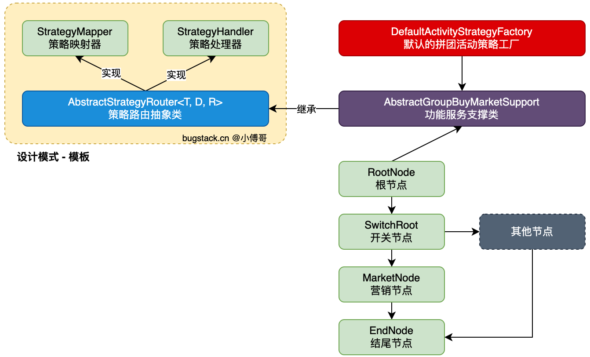
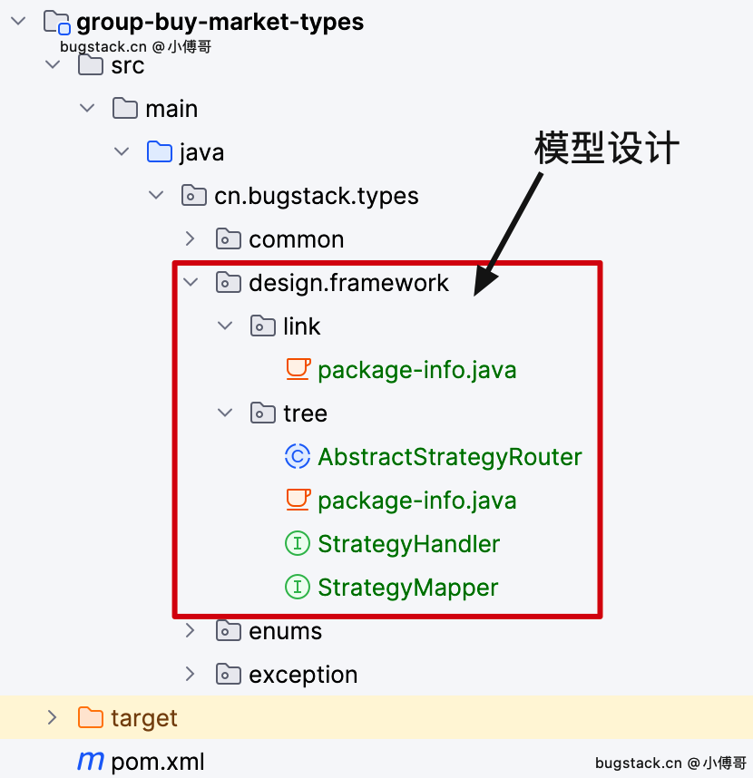
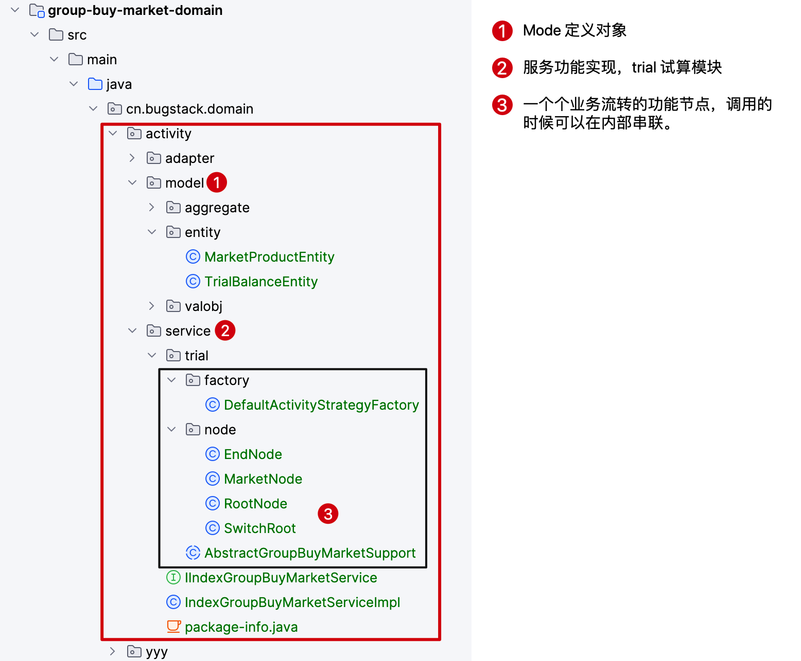

# 试算模型抽象模板设计

> 学习序号 5｜小节 2-2｜原文：https://articles.zsxq.com/id_tzf8bd3b621x.html

**本章重点** ：为了降低维护成本，本节通过定义设计模式的通用结构模板和引入抽象模型，解决了复杂场景中因不同开发导致的多样实现问题。

- **本章重点** ：★★☆☆☆
- **本节分支：** [https://gitcode.net/KnowledgePlanet/group-buy-market/-/tree/2-2-241214-xfg-design-framework](https://gitcode.net/KnowledgePlanet/group-buy-market/-/tree/2-2-241214-xfg-design-framework)
- **课程视频** ：[https://t.zsxq.com/fEB5s](https://t.zsxq.com/fEB5s)

**版权说明** ：©本项目与星球签约合作，受[《中华人民共和国著作权法实施条例》](https://www.gov.cn/gongbao/content/2013/content_2339485.htm) 版权法保护，禁止任何理由和任何方式公开(public)源码、资料、视频等小傅哥发布的星球内容到Github、Gitee等各类平台，违反可追究进一步的法律责任。

作者：小傅哥

博客：[https://bugstack.cn](https://bugstack.cn)

> 沉淀、分享、成长，让自己和他人都能有所收获！😄

大家好，我是技术UP主小傅哥。

编程能力突飞猛进的成长，往往都来自于对复杂业务场景的拆分解耦和设计模式运用过程锻炼。虽然有时候是同样的业务，但不同的编程方式，带来的思维锻炼也是不同的。

就像 CRUD 的方式写代码，只能让你了解业务流程，但不会提高工程建模能力和编程思维的提升。所以整个小傅哥带着你做的项目，都会循序渐进的为你从模型设计解决业务场景问题出发。既可以提高你的编程思维，也能锻炼你的编码能力。

### 一、本章诉求

在一个工程中，随着不断地承接业务需求逻辑的实现，会有很多复杂场景需要解决。这个时候就会引入设计模式进行解耦和实现，提高工程代码的扩展性。

但随着开发的场景越来越多，在各个service实现中会存在相同的设计模式，如果是不同的人开发，那么一个责任链，一个规则树，也会有非常多的实现方式。那么这样就会导致后面在进入开发的人，对已存在的代码，维护的成本就越来越高了。

所以，本节小傅哥带着大家先做设计模式抽象模板的通用结构定义，添加一个 tree规则树抽象模型，在引入到工程中进行使用。这样后续工程中就可以不断的定义通用的设计模式被不同的场景统一使用了。

### 二、模型设计

这是一种链式的多分支规则树模型结构，由功能节点自行决定后续流程的执行链路。它的设计比责任链的扩展性更好，自由度也更高。



- 首先，定义抽象的通用的规则树模型结构。涵盖；StrategyMapper - 策略映射器、StrategyHandler - 策略处理器、`AbstractStrategyRouter<T, D, R>` - 策略路由抽象类。通过泛型设计允许使用方可以自定义出入参和动态上下文，让抽象模板模型具有通用性。
- 之后，由使用方自定义出工厂、功能抽象类和一个个流程流转的节点。这些节点可以自由组装进行流转，相比于责任链它的实现方式更具有灵活性。

### 三、编码实现

#### 1. 模板定义

在项目工程的 types 模块中，添加通用设计模式模板。如果是公司里的项目工程，还可以单独提供一个通用的设计模式模板工程，这样每个项目都可以引入使用了。



- 目前，先添加 tree 规则树模型结构。后续随着开发需要在添加其他通用设计模式。

- 设计模式资料；[https://bugstack.cn/md/develop/design-pattern/2024-08-25-chain-tree.html](https://bugstack.cn/md/develop/design-pattern/2024-08-25-chain-tree.html)

##### 1.1 策略映射器

```
                public interface StrategyMapper<T, D, R> {

    /**
     * 获取待执行策略
     *
     * @param requestParameter 入参
     * @param dynamicContext   上下文
     * @return 返参
     * @throws Exception 异常
     */
    StrategyHandler<T, D, R> get(T requestParameter, D dynamicContext) throws Exception;

}
```

- StrategyMapper#get 方法用于获取每一个要执行的节点，相当于一个流程走完进入到下一个流程的过程。这在我们处理复杂的业务代码时是非常重要的，避免把所有逻辑都写到一个类的方法中。
- 泛型 T - 入参、D - 上下文、R - 返参。

##### 1.2 策略受理器

```
                public interface StrategyHandler<T, D, R> {

    StrategyHandler DEFAULT = (T, D) -> null;

    R apply(T requestParameter, D dynamicContext) throws Exception;

}
```

- StrategyHandler#apply 受理执行的业务流程。每个业务流程执行时，如果有数据是从前面节点到后面节点要使用的，那么可以填充到 dynamicContext 上下文中。

##### 1.3 策略路由器

```
                public abstract class AbstractStrategyRouter<T, D, R> implements StrategyMapper<T, D, R>, StrategyHandler<T, D, R> {

    @Getter
    @Setter
    protected StrategyHandler<T, D, R> defaultStrategyHandler = StrategyHandler.DEFAULT;

    public R router(T requestParameter, D dynamicContext) throws Exception {
        StrategyHandler<T, D, R> strategyHandler = get(requestParameter, dynamicContext);
        if(null != strategyHandler) return strategyHandler.apply(requestParameter, dynamicContext);
        return defaultStrategyHandler.apply(requestParameter, dynamicContext);
    }

}
```

- 通过调用策略映射器get方法，控制节点流程的走向。

#### 2. 首页试算

当一个用户进入到购物首页查看商品的优惠信息，我们可以把这个过程定义为试算过程。试算；试试算一下，这个用户进入到首页看这个商品的时候，商品的营销优惠信息。包括：原始价格、折扣价格、拼团目标、拼团时效、是否可见优惠、是否可参与拼团等，这些东西都是试算拿到的结果。

类似的，当你进入到一个信贷贷款的页面，也会告诉你分期多少，还款多少期，每期多少钱。这些东西也都是试算。



- 在 domain 领域层，实现拼团活动服务功能。model 是对象的定义，这个对象就类似于你在 mvc 中定义的 vo、req、res 这样的对象。只不过这里一般叫 xxxEntity 实体，它是一种面向对象的思维。
- trial 试算模块，把整个首页商品展示的信息都通过试算完成。后续会重点实现，本节先定义框架分层结构。
- 目前这里的代码还没有具体的实现代码，只有分层结构。可以直接参考工程的代码。

##### 2.1 营销商品实体信息

```
                @Data
@Builder
@AllArgsConstructor
@NoArgsConstructor
public class MarketProductEntity {

    /** 用户ID */
    private String userId;
    /** 商品ID */
    private String goodsId;
    /** 渠道 */
    private String source;
    /** 来源 */
    private String channel;

}
```

##### 2.2 试算结果实体对象

```
                @Data
@Builder
@AllArgsConstructor
@NoArgsConstructor
public class TrialBalanceEntity {

    /** 商品ID */
    private String goodsId;
    /** 商品名称 */
    private String goodsName;
    /** 原始价格 */
    private BigDecimal originalPrice;
    /** 折扣价格 */
    private BigDecimal deductionPrice;
    /** 拼团目标数量 */
    private Integer targetCount;
    /** 拼团开始时间 */
    private Date startTime;
    /** 拼团结束时间 */
    private Date endTime;
    /** 是否可见拼团 */
    private Boolean isVisible;
    /** 是否可参与进团 */
    private Boolean isEnable;

}
```

- 暂定一些试算的所需的结果，后续随着功能迭代再补充。

##### 2.3 举例节点实现

```
                @Slf4j
@Service
public class RootNode extends AbstractGroupBuyMarketSupport<MarketProductEntity, DefaultActivityStrategyFactory.DynamicContext, TrialBalanceEntity> {

    @Override
    public TrialBalanceEntity apply(MarketProductEntity requestParameter, DefaultActivityStrategyFactory.DynamicContext dynamicContext) throws Exception {
        return null;
    }

    @Override
    public StrategyHandler<MarketProductEntity, DefaultActivityStrategyFactory.DynamicContext, TrialBalanceEntity> get(MarketProductEntity requestParameter, DefaultActivityStrategyFactory.DynamicContext dynamicContext) throws Exception {
        return null;
    }

}
```

- 根节点，实现 AbstractGroupBuyMarketSupport 抽象类。这个抽象类目前是空实现，后续一些通用的方法会放入这个抽象类里。

### 四、读者作业

- 简单作业：理解本节的通用模板设计结构和使用。
- 复杂作业：可以尝试添加一些逻辑，让整个调用链路跑起来。
