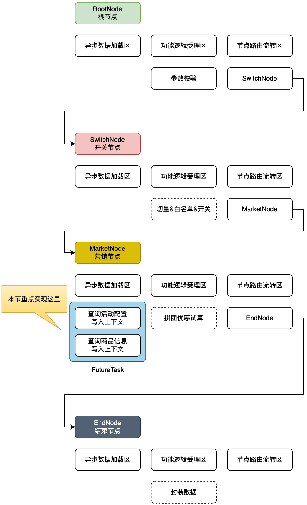
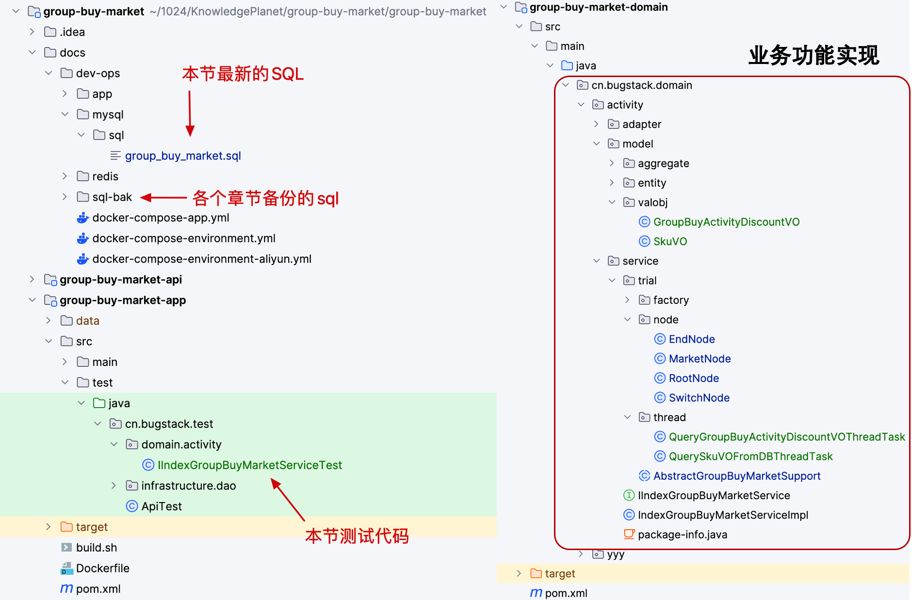

# 多线程异步数据加载

> 学习序号 6｜小节 2-3｜原文：https://articles.zsxq.com/id_oghwwt024h39.html

**本章重点** ：扩展规则树模型结构，增加异步数据加载区。将用于试算营销优惠的接口使用异步线程进行加载，之后写入上下文，用于后续的逻辑处理。

- **本章重点** ：★★★★☆
- **本节分支：**[https://gitcode.net/KnowledgePlanet/group-buy-market/-/tree/2-3-241221-xfg-multi-thread](https://gitcode.net/KnowledgePlanet/group-buy-market/-/tree/2-3-241221-xfg-multi-thread)
- **课程视频** ：[https://t.zsxq.com/UoiFa](https://t.zsxq.com/UoiFa)

**版权说明** ：©本项目与星球签约合作，受[《中华人民共和国著作权法实施条例》](https://www.gov.cn/gongbao/content/2013/content_2339485.htm) 版权法保护，禁止任何理由和任何方式公开(public)源码、资料、视频等小傅哥发布的星球内容到Github、Gitee等各类平台，违反可追究进一步的法律责任。

作者：小傅哥

博客：[https://bugstack.cn](https://bugstack.cn)

> 沉淀、分享、成长，让自己和他人都能有所收获！😄

- 一、本章诉求
- 二、模型链路
- 三、编码实现
  - 1. 工程结构
  - 2. 扩展模板 - 增加多线程模块
  - 3. 节点逻辑
- 四、测试验证
- 五、读者作业

大家好，我是技术UP主小傅哥。

在互联网公司中的业务功能开发，会非常重视接口的响应效率，一般整体的接口响应要控制在350毫秒，那么在每个细分领域的接口可能会被压缩到50~100毫秒。

这样的响应时间对于一些简单的接口到不会有什么影响，但如果是复杂较多的业务流程串联的接口，那么控制接口的响应时长就是一个非常大的挑战了。对于这样的情况，往往会引入异步线程加载数据的方式进行处理，之后在做统一的逻辑处理，这样就可以很好的降低接口响应时间。

### 一、本章诉求

扩展规则树模型结构，增加异步数据加载区。将用于试算营销优惠的接口使用异步线程进行加载，之后写入上下文，用于后续的逻辑处理。

这部分的模型设计是非常巧妙的，通过解耦逻辑和划分功能区，让代码具有了文档属性，看到对应的类和类下的方法区，就可以轻松的理解代码实现方式。这样的处理非常有利于后续功能的迭代。

### 二、模型链路

如图，为整个模型链路的执行过程图；



- 首先，对通用设计模式树结构扩展出异步数据加载区，这样可以把接口实现中所需的数据前置到异步数据加载区完成加载操作。以此提高接口的响应效率。
- 之后，本节串联功能节点，并在 MarketNode 节点，添加数据加载操作。
- 另外，注意本节需要新增加一个表 sku，也就是商品信息表，通过商品信息表获得当前商品的价格配置，以此来做商品的折扣计算。这块在实际生产中有两种实现方式，一种是每次都调用外部接口获取商品，另外一种是有商品统一同步库可以查询。我们这里先通过一个统一的商品库进行处理。那么后续谁要对接这个系统，就调用sku商品库，同步好商品即可。【库表已更新到工程下】

### 三、编码实现

#### 1. 工程结构



- 本节开始，增加 sql-bak 存放各个章节的 sql，方便大家随时用不同的 sql 做测试。本节你可以直接导入最新的 SQL 语句即可。
- domain 模块下，做功能逻辑实现。新增加了 thread 多线程模块，处理异步数据任务。

#### 2. 扩展模板 - 增加多线程模块

在 types 模块的 design 模型定义中，新增加抽象类设计多线程数据加载区。

```
                public abstract class AbstractMultiThreadStrategyRouter<T, D, R> implements StrategyMapper<T, D, R>, StrategyHandler<T, D, R> {

    @Getter
    @Setter
    protected StrategyHandler<T, D, R> defaultStrategyHandler = StrategyHandler.DEFAULT;

    public R router(T requestParameter, D dynamicContext) throws Exception {
        StrategyHandler<T, D, R> strategyHandler = get(requestParameter, dynamicContext);
        if(null != strategyHandler) return strategyHandler.apply(requestParameter, dynamicContext);
        return defaultStrategyHandler.apply(requestParameter, dynamicContext);
    }

    @Override
    public R apply(T requestParameter, D dynamicContext) throws Exception {
        // 异步加载数据
        multiThread(requestParameter, dynamicContext);
        // 业务流程受理
        return doApply(requestParameter, dynamicContext);
    }

    /**
     * 异步加载数据
     */
    protected abstract void multiThread(T requestParameter, D dynamicContext) throws ExecutionException, InterruptedException, TimeoutException;

    /**
     * 业务流程受理
     */
    protected abstract R doApply(T requestParameter, D dynamicContext) throws Exception;

}
```

- 主要是添加了一个 multiThread 方法，这个方法在执行 apply 受理业务功能逻辑实现前完成对数据的加载调用。
- 之后在提供一个 doApply 受理的抽象方法，让使用方完成这个方法的实现即可。
- 这块的逻辑对新人可能有点绕，你可以在本节最后的代码测试调试时进行验证。**debug 断点调试代码对编码来说非常重要**

#### 3. 节点逻辑

##### 3.1 RootNode

```
                @Slf4j
@Service
public class RootNode extends AbstractGroupBuyMarketSupport<MarketProductEntity, DefaultActivityStrategyFactory.DynamicContext, TrialBalanceEntity> {

    @Resource
    private SwitchNode switchNode;

    @Override
    protected TrialBalanceEntity doApply(MarketProductEntity requestParameter, DefaultActivityStrategyFactory.DynamicContext dynamicContext) throws Exception {
        log.info("拼团商品查询试算服务-RootNode userId:{} requestParameter:{}", requestParameter.getUserId(), JSON.toJSONString(requestParameter));
        // 参数判断
        if (StringUtils.isBlank(requestParameter.getUserId()) || StringUtils.isBlank(requestParameter.getGoodsId()) ||
                StringUtils.isBlank(requestParameter.getSource()) || StringUtils.isBlank(requestParameter.getChannel())) {
            throw new AppException(ResponseCode.ILLEGAL_PARAMETER.getCode(), ResponseCode.ILLEGAL_PARAMETER.getInfo());
        }
        return router(requestParameter, dynamicContext);
    }

    @Override
    public StrategyHandler<MarketProductEntity, DefaultActivityStrategyFactory.DynamicContext, TrialBalanceEntity> get(MarketProductEntity requestParameter, DefaultActivityStrategyFactory.DynamicContext dynamicContext) throws Exception {
        return switchNode;
    }

}
```

- 根节点一般会做数据的初始操作，信息判断，缓存处理等功能。

##### 4.2 SwitchNode

```
                @Slf4j
@Service
public class SwitchNode extends AbstractGroupBuyMarketSupport<MarketProductEntity, DefaultActivityStrategyFactory.DynamicContext, TrialBalanceEntity> {

    @Resource
    private MarketNode marketNode;

    @Override
    public TrialBalanceEntity doApply(MarketProductEntity requestParameter, DefaultActivityStrategyFactory.DynamicContext dynamicContext) throws Exception {
        return router(requestParameter, dynamicContext);
    }

    @Override
    public StrategyHandler<MarketProductEntity, DefaultActivityStrategyFactory.DynamicContext, TrialBalanceEntity> get(MarketProductEntity requestParameter, DefaultActivityStrategyFactory.DynamicContext dynamicContext) throws Exception {
        return marketNode;
    }

}
```

- 开关功能的节点在后续在做实现。

##### 4.3 MarketNode

这个节点是本节最重要实现的一个节点，让大家理解多线程在实际场景中的使用。

当你一个节点要执行业务逻辑时候，需要为这些业务逻辑准备接口、数据库、Redis、配置中心等各样的数据，但有些时候外部的接口依赖的很多，那么就不能一个个顺序的查询，这样会导致接口的时长很大。所以要多线程并行处理，那么所有的时长也就只是那个耗时最长的接口时长了。

首先，新增加异步 FutureTask 任务，完成对活动配置的查询，商品的查询。

```
                public class QueryGroupBuyActivityDiscountVOThreadTask implements Callable<GroupBuyActivityDiscountVO> {

    /**
     * 来源
     */
    private final String source;

    /**
     * 渠道
     */
    private final String channel;

    /**
     * 活动仓储
     */
    private final IActivityRepository activityRepository;

    public QueryGroupBuyActivityDiscountVOThreadTask(String source, String channel, IActivityRepository activityRepository) {
        this.source = source;
        this.channel = channel;
        this.activityRepository = activityRepository;
    }

    @Override
    public GroupBuyActivityDiscountVO call() throws Exception {
        return activityRepository.queryGroupBuyActivityDiscountVO(source, channel);
    }

}

public class QuerySkuVOFromDBThreadTask implements Callable<SkuVO> {

    private final String goodsId;

    private final IActivityRepository activityRepository;

    public QuerySkuVOFromDBThreadTask(String goodsId, IActivityRepository activityRepository) {
        this.goodsId = goodsId;
        this.activityRepository = activityRepository;
    }

    @Override
    public SkuVO call() throws Exception {
        return activityRepository.querySkuByGoodsId(goodsId);
    }

}
```

- 这里是两个实现了 Callable 接口的任务，分别查询不同的数据。
- 在实际的工作中，查询的不只是数据，还有很多其他方提供的RPC、HTTP接口。

接下来，我们就可以在 MarketNode 节点，来处理这些数据任务的调用操作。

```
                @Slf4j
@Service
public class MarketNode extends AbstractGroupBuyMarketSupport<MarketProductEntity, DefaultActivityStrategyFactory.DynamicContext, TrialBalanceEntity> {

    @Resource
    private ThreadPoolExecutor threadPoolExecutor;
    @Resource
    private EndNode endNode;

    @Override
    protected void multiThread(MarketProductEntity requestParameter, DefaultActivityStrategyFactory.DynamicContext dynamicContext) throws ExecutionException, InterruptedException, TimeoutException {
        // 异步查询活动配置
        QueryGroupBuyActivityDiscountVOThreadTask queryGroupBuyActivityDiscountVOThreadTask = new QueryGroupBuyActivityDiscountVOThreadTask(requestParameter.getSource(), requestParameter.getChannel(), repository);
        FutureTask<GroupBuyActivityDiscountVO> groupBuyActivityDiscountVOFutureTask = new FutureTask<>(queryGroupBuyActivityDiscountVOThreadTask);
        threadPoolExecutor.execute(groupBuyActivityDiscountVOFutureTask);

        // 异步查询商品信息 - 在实际生产中，商品有同步库或者调用接口查询。这里暂时使用DB方式查询。
        QuerySkuVOFromDBThreadTask querySkuVOFromDBThreadTask = new QuerySkuVOFromDBThreadTask(requestParameter.getGoodsId(), repository);
        FutureTask<SkuVO> skuVOFutureTask = new FutureTask<>(querySkuVOFromDBThreadTask);
        threadPoolExecutor.execute(skuVOFutureTask);

        // 写入上下文 - 对于一些复杂场景，获取数据的操作，有时候会在下N个节点获取，这样前置查询数据，可以提高接口响应效率
        dynamicContext.setGroupBuyActivityDiscountVO(groupBuyActivityDiscountVOFutureTask.get(timeout, TimeUnit.MINUTES));
        dynamicContext.setSkuVO(skuVOFutureTask.get(timeout, TimeUnit.MINUTES));

        log.info("拼团商品查询试算服务-MarketNode userId:{} 异步线程加载数据「GroupBuyActivityDiscountVO、SkuVO」完成", requestParameter.getUserId());
    }

    @Override
    public TrialBalanceEntity doApply(MarketProductEntity requestParameter, DefaultActivityStrategyFactory.DynamicContext dynamicContext) throws Exception {
        log.info("拼团商品查询试算服务-MarketNode userId:{} requestParameter:{}", requestParameter.getUserId(), JSON.toJSONString(requestParameter));

        // todo xfg 拼团优惠试算

        return router(requestParameter, dynamicContext);
    }

    @Override
    public StrategyHandler<MarketProductEntity, DefaultActivityStrategyFactory.DynamicContext, TrialBalanceEntity> get(MarketProductEntity requestParameter, DefaultActivityStrategyFactory.DynamicContext dynamicContext) throws Exception {
        return endNode;
    }

}
```

- multiThread 方法中，启动对异步数据的查询处理，之后在使用动态上下文承接数据。
- doApply 受理业务流程的实现放在后续在处理。
- threadPoolExecutor 线程池配置的是 CallerRunsPolicy 策略。当线程池中的任务队列已满，并且没有空闲线程可以执行新任务时，CallerRunsPolicy 会将任务回退到调用者线程中运行。这种策略适用于不希望丢失任务且可以接受调用者线程被阻塞的场景。【有时候面试不会直接问八股，而是结合这样的场景来问。】

##### 4.4 EndNode

用于封装最终返回的结果数据。

```
                @Slf4j
@Service
public class EndNode extends AbstractGroupBuyMarketSupport<MarketProductEntity, DefaultActivityStrategyFactory.DynamicContext, TrialBalanceEntity> {

    @Override
    public TrialBalanceEntity doApply(MarketProductEntity requestParameter, DefaultActivityStrategyFactory.DynamicContext dynamicContext) throws Exception {
        log.info("拼团商品查询试算服务-EndNode userId:{} requestParameter:{}", requestParameter.getUserId(), JSON.toJSONString(requestParameter));

        GroupBuyActivityDiscountVO groupBuyActivityDiscountVO = dynamicContext.getGroupBuyActivityDiscountVO();
        SkuVO skuVO = dynamicContext.getSkuVO();

        // 返回空结果
        return TrialBalanceEntity.builder()
                  .goodsId(skuVO.getGoodsId())
                  .goodsName(skuVO.getGoodsName())
                  .originalPrice(skuVO.getOriginalPrice())
                  .deductionPrice(new BigDecimal("0.00"))
                  .targetCount(groupBuyActivityDiscountVO.getTarget())
                  .startTime(groupBuyActivityDiscountVO.getStartTime())
                  .endTime(groupBuyActivityDiscountVO.getEndTime())
                  .isVisible(false)
                  .isEnable(false)
                  .build();
    }

    @Override
    public StrategyHandler<MarketProductEntity, DefaultActivityStrategyFactory.DynamicContext, TrialBalanceEntity> get(MarketProductEntity requestParameter, DefaultActivityStrategyFactory.DynamicContext dynamicContext) throws Exception {
        return defaultStrategyHandler;
    }

}
```

- 返回的数据可以由动态上下文中的结果进行封装。
- 暂时咱们这里只把可以获取到的数据做一个处理。关于优惠金额以及可见性等参数mock写入即可。

### 四、测试验证

```
                @Slf4j
@RunWith(SpringRunner.class)
@SpringBootTest
public class IIndexGroupBuyMarketServiceTest {

    @Resource
    private IIndexGroupBuyMarketService indexGroupBuyMarketService;

    @Test
    public void test_indexMarketTrial() throws Exception {
        MarketProductEntity marketProductEntity = new MarketProductEntity();
        marketProductEntity.setUserId("xiaofuge");
        marketProductEntity.setSource("s01");
        marketProductEntity.setChannel("c01");
        marketProductEntity.setGoodsId("9890001");

        TrialBalanceEntity trialBalanceEntity = indexGroupBuyMarketService.indexMarketTrial(marketProductEntity);
        log.info("请求参数:{}", JSON.toJSONString(marketProductEntity));
        log.info("返回结果:{}", JSON.toJSONString(trialBalanceEntity));
    }

}
```

```
                24-12-21.11:17:40.759 [main            ] INFO  RootNode               - 拼团商品查询试算服务-RootNode userId:xiaofuge requestParameter:{"channel":"c01","goodsId":"9890001","source":"s01","userId":"xiaofuge"}
24-12-21.11:17:40.823 [pool-2-thread-2 ] INFO  HikariDataSource       - HikariPool-1 - Starting...
24-12-21.11:17:41.117 [pool-2-thread-2 ] INFO  HikariDataSource       - HikariPool-1 - Start completed.
24-12-21.11:17:41.176 [main            ] INFO  MarketNode             - 拼团商品查询试算服务-MarketNode userId:xiaofuge requestParameter:{"channel":"c01","goodsId":"9890001","source":"s01","userId":"xiaofuge"}
24-12-21.11:17:41.176 [main            ] INFO  EndNode                - 拼团商品查询试算服务-EndNode userId:xiaofuge requestParameter:{"channel":"c01","goodsId":"9890001","source":"s01","userId":"xiaofuge"}
24-12-21.11:17:41.177 [main            ] INFO  IIndexGroupBuyMarketServiceTest - 请求参数:{"channel":"c01","goodsId":"9890001","source":"s01","userId":"xiaofuge"}
24-12-21.11:17:41.186 [main            ] INFO  IIndexGroupBuyMarketServiceTest - 返回结果:{"deductionPrice":0.00,"endTime":1733537980000,"goodsId":"9890001","goodsName":"《手写MyBatis：渐进式源码实践》","isEnable":false,"isVisible":false,"originalPrice":100.00,"startTime":1733537980000,"targetCount":1}
```

- 调用 *首页营销服务接口* 做功能逻辑的验证。
- 从测试结果看符合预期。

### 五、读者作业

- 简单作业：完成本节功能的实现，并可以运行验证。
- 复杂作业：理解设计模式、扩展检索线程池配置的各项参数并发到本课程的作业中。
