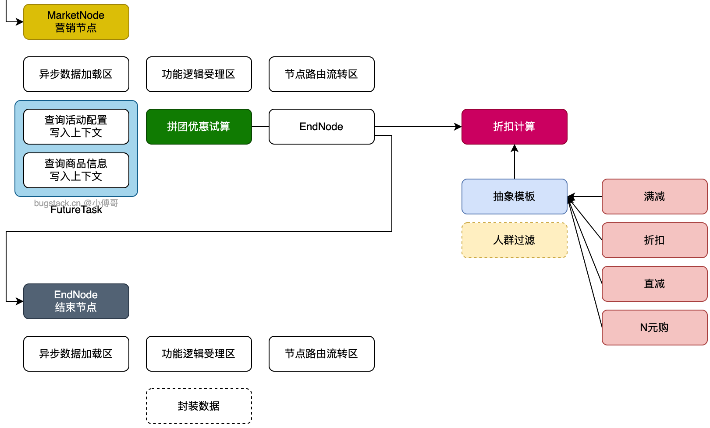
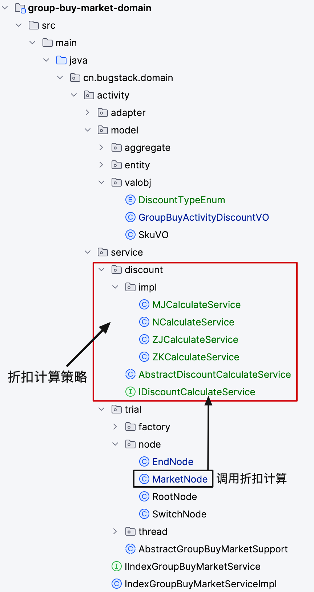
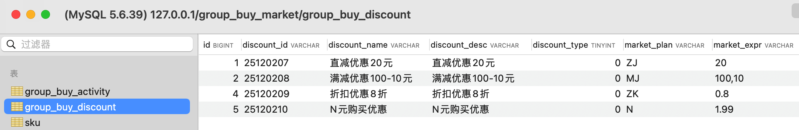

# 策略模式优惠折扣计算

> 学习序号 7｜小节 2-4｜原文：https://articles.zsxq.com/id_76rtxi18xl6g.html

**本章重点** ：通过策略模式处理多类型折扣方式的逻辑计算，同时设定抽象模板，用于扩展后续人群标签的过滤。

- **本章重点** ：★★★☆☆
- **本节分支：** [https://gitcode.net/KnowledgePlanet/group-buy-market/-/tree/2-4-241222-xfg-discount-calculate](https://gitcode.net/KnowledgePlanet/group-buy-market/-/tree/2-4-241222-xfg-discount-calculate)
- **课程视频** ：[https://t.zsxq.com/inWxL](https://t.zsxq.com/inWxL)

**版权说明** ：©本项目与星球签约合作，受[《中华人民共和国著作权法实施条例》](https://www.gov.cn/gongbao/content/2013/content_2339485.htm) 版权法保护，禁止任何理由和任何方式公开(public)源码、资料、视频等小傅哥发布的星球内容到Github、Gitee等各类平台，违反可追究进一步的法律责任。

作者：小傅哥

博客：[https://bugstack.cn](https://bugstack.cn)

> 沉淀、分享、成长，让自己和他人都能有所收获！😄

- 一、本章诉求
- 二、模型设计
- 三、编码实现
  - 1. 工程结构
  - 2. 折扣策略 - MJ、N、ZJ、ZK
  - 3. 营销调用
- 四、测试验证
- 五、读者作业

大家好，我是技术UP主小傅哥。

程序员的价值不在于只是完成业务需求，而是怎么架构系统、设计边界、凝练功能，让原本只是 CRUD 串联大量逻辑的代码，分区、分职责、用不同的策略模型承接。以此提高软件的交付质量，才是程序员的价值。

所以，我也从不敢说什么东西没有用。比如；DDD、设计模式，否则也不会有那么多我们日常使用源码框架，都有这些思想的体现了。

### 一、本章诉求

通过策略模式处理多类型折扣方式的逻辑计算，同时设定抽象模板，用于扩展后续人群标签的过滤。

不断的拆解功能逻辑边界的过程，比只是编写流水式代码要重要的多。在整个系统实现的过程中，要多体会这些思想。

### 二、模型设计

如图，继续在执行链路上像乐高积木一样拼装优惠折扣的计算逻辑；



- 首先，MarketNode 节点的数据异步加载工作已经在上一节完成，这一节开始使用这里的数据做折扣计算。
- 之后，折扣是在数据库中配置的，按照类型包括；ZJ - 直减、MJ - 满减、ZK - 折扣、N - n元购。那么这些不同的类型就可以用策略模型进行包装，每个实现类专门负责自己的逻辑计算。

### 三、编码实现

#### 1. 工程结构



- service 包下，增加 discount 折扣计算包，提供不同类型的折扣计算服务。
- 之后再 MarketNode 节点做逻辑调用。计算完结果后在写上下文，便于最后在 EndNode 节点填充。

#### 2. 折扣策略 - MJ、N、ZJ、ZK



折扣的方式可以有；ZJ、MJ、ZK、N，以及多种方式。这里的 market_expr 是计算的公式，比如 MJ - 满减这样的，就是满100元，减10元。

概念：像是这种营销折扣方式，是一种商家配置无券营销方式，用户是无感知券但可以使用优惠的。另外一种就是有券，用户主动拿到手里的券，自己选择消费方式。

##### 2.1 定义接口

```
                public interface IDiscountCalculateService {

    /**
     * 折扣计算
     *
     * @param userId           用户ID
     * @param originalPrice    商品原始价格
     * @param groupBuyDiscount 折扣计划配置
     * @return 商品优惠价格
     */
    BigDecimal calculate(String userId, BigDecimal originalPrice, GroupBuyActivityDiscountVO.GroupBuyDiscount groupBuyDiscount);

}
```

- 定义折扣计算的接口，包括用户ID、商品原始价格、折扣计划配置。
- 用户ID，主要用于后续做人群标签的过滤使用。

##### 2.2 抽象模板

```
                public abstract class AbstractDiscountCalculateService implements IDiscountCalculateService {

    @Override
    public BigDecimal calculate(String userId, BigDecimal originalPrice, GroupBuyActivityDiscountVO.GroupBuyDiscount groupBuyDiscount) {
        // 1. 人群标签过滤
        if (DiscountTypeEnum.TAG.equals(groupBuyDiscount.getDiscountType())){
            boolean isCrowdRange = filterTagId(userId, groupBuyDiscount.getTagId());
            if (!isCrowdRange) return originalPrice;
        }
        // 2. 折扣优惠计算
        return doCalculate(originalPrice, groupBuyDiscount);
    }

    // 人群过滤 - 限定人群优惠
    private boolean filterTagId(String userId, String tagId) {
        // todo xiaofuge 后续开发这部分
        return true;
    }

    protected abstract BigDecimal doCalculate(BigDecimal originalPrice, GroupBuyActivityDiscountVO.GroupBuyDiscount groupBuyDiscount);

}
```

- 定义抽象模板封装计算折扣优惠的执行过程。人群标签部分后续统一处理。

##### 2.3 折扣方法

```
                @Slf4j
@Service("MJ")
public class MJCalculateService extends AbstractDiscountCalculateService {

    @Override
    public BigDecimal doCalculate(BigDecimal originalPrice, GroupBuyActivityDiscountVO.GroupBuyDiscount groupBuyDiscount) {
        log.info("优惠策略折扣计算:{}", groupBuyDiscount.getDiscountType().getCode());

        // 折扣表达式 - 100,10 满100减10元
        String marketExpr = groupBuyDiscount.getMarketExpr();
        String[] split = marketExpr.split(Constants.SPLIT);
        BigDecimal x = new BigDecimal(split[0].trim());
        BigDecimal y = new BigDecimal(split[1].trim());

        // 不满足最低满减约束，则按照原价
        if (originalPrice.compareTo(x) < 0) {
            return originalPrice;
        }

        // 折扣价格
        BigDecimal deductionPrice = originalPrice.subtract(y);

        // 判断折扣后金额，最低支付1分钱
        if (deductionPrice.compareTo(BigDecimal.ZERO) <= 0) {
            return new BigDecimal("0.01");
        }

        return deductionPrice;
    }

}
```

- 这里举例其中一个，MJ 的折扣计算。其他的可以参考代码中的实现。
- 满减，拿到折扣的配置表达式，拆分 `100,10`，之后判断商品金额是否满足100元，满足100元则可以减去10元。不过这里要知道，如果商品最终折扣价格不足1分钱，要按照1分钱计算。

#### 3. 营销调用

```
                @Slf4j
@Service
public class MarketNode extends AbstractGroupBuyMarketSupport<MarketProductEntity, DefaultActivityStrategyFactory.DynamicContext, TrialBalanceEntity> {

    @Resource
    private ThreadPoolExecutor threadPoolExecutor;
    @Resource
    private EndNode endNode;

    /**
     * <a href="https://bugstack.cn/md/road-map/spring-dependency-injection.html">Spring 注入详细说明</a>
     */
    @Resource
    private Map<String, IDiscountCalculateService> discountCalculateServiceMap;

    @Override
    public TrialBalanceEntity doApply(MarketProductEntity requestParameter, DefaultActivityStrategyFactory.DynamicContext dynamicContext) throws Exception {
        log.info("拼团商品查询试算服务-MarketNode userId:{} requestParameter:{}", requestParameter.getUserId(), JSON.toJSONString(requestParameter));

        GroupBuyActivityDiscountVO groupBuyActivityDiscountVO = dynamicContext.getGroupBuyActivityDiscountVO();
        GroupBuyActivityDiscountVO.GroupBuyDiscount groupBuyDiscount = groupBuyActivityDiscountVO.getGroupBuyDiscount();

        SkuVO skuVO = dynamicContext.getSkuVO();

        IDiscountCalculateService discountCalculateService = discountCalculateServiceMap.get(groupBuyDiscount.getMarketPlan());
        if (null == discountCalculateService) {
            log.info("不存在{}类型的折扣计算服务，支持类型为:{}", groupBuyDiscount.getMarketPlan(), JSON.toJSONString(discountCalculateServiceMap.keySet()));
            throw new AppException(ResponseCode.E0001.getCode(), ResponseCode.E0001.getInfo());
        }

        // 折扣价格
        BigDecimal deductionPrice = discountCalculateService.calculate(requestParameter.getUserId(), skuVO.getOriginalPrice(), groupBuyDiscount);
        dynamicContext.setDeductionPrice(deductionPrice);

        return router(requestParameter, dynamicContext);
    }
    
    // ... 省略部分代码

}
```

- `private Map<String, IDiscountCalculateService> discountCalculateServiceMap;` 是一种 Spring 的Map 注入方式，会根据一个接口把所有的实现类都注入上，之后 Key 是 Bean 的名字。扩展学习；[https://bugstack.cn/md/road-map/spring-dependency-injection.html](https://bugstack.cn/md/road-map/spring-dependency-injection.html)
- 这样我们就可以根据数据库配置的折扣的类型来调用对应的策略，也就把 if...else 这样的判断代码给去掉了。

### 四、测试验证

```
                @Slf4j
@RunWith(SpringRunner.class)
@SpringBootTest
public class IIndexGroupBuyMarketServiceTest {

    @Resource
    private IIndexGroupBuyMarketService indexGroupBuyMarketService;

    @Test
    public void test_indexMarketTrial() throws Exception {
        MarketProductEntity marketProductEntity = new MarketProductEntity();
        marketProductEntity.setUserId("xiaofuge");
        marketProductEntity.setSource("s01");
        marketProductEntity.setChannel("c01");
        marketProductEntity.setGoodsId("9890001");

        TrialBalanceEntity trialBalanceEntity = indexGroupBuyMarketService.indexMarketTrial(marketProductEntity);
        log.info("请求参数:{}", JSON.toJSONString(marketProductEntity));
        log.info("返回结果:{}", JSON.toJSONString(trialBalanceEntity));
    }

}
```

```
                24-12-22.15:25:10.583 [main            ] INFO  RootNode               - 拼团商品查询试算服务-RootNode userId:xiaofuge requestParameter:{"channel":"c01","goodsId":"9890001","source":"s01","userId":"xiaofuge"}
24-12-22.15:25:10.632 [pool-2-thread-1 ] INFO  HikariDataSource       - HikariPool-1 - Starting...
24-12-22.15:25:10.962 [pool-2-thread-1 ] INFO  HikariDataSource       - HikariPool-1 - Start completed.
24-12-22.15:25:11.022 [main            ] INFO  MarketNode             - 拼团商品查询试算服务-MarketNode userId:xiaofuge 异步线程加载数据「GroupBuyActivityDiscountVO、SkuVO」完成
24-12-22.15:25:11.022 [main            ] INFO  MarketNode             - 拼团商品查询试算服务-MarketNode userId:xiaofuge requestParameter:{"channel":"c01","goodsId":"9890001","source":"s01","userId":"xiaofuge"}
24-12-22.15:25:11.022 [main            ] INFO  ZJCalculateService     - 优惠策略折扣计算:0
24-12-22.15:25:11.023 [main            ] INFO  EndNode                - 拼团商品查询试算服务-EndNode userId:xiaofuge requestParameter:{"channel":"c01","goodsId":"9890001","source":"s01","userId":"xiaofuge"}
24-12-22.15:25:11.024 [main            ] INFO  IIndexGroupBuyMarketServiceTest - 请求参数:{"channel":"c01","goodsId":"9890001","source":"s01","userId":"xiaofuge"}
24-12-22.15:25:11.032 [main            ] INFO  IIndexGroupBuyMarketServiceTest - 返回结果:{"deductionPrice":80.00,"endTime":1733537980000,"goodsId":"9890001","goodsName":"《手写MyBatis：渐进式源码实践》","isEnable":false,"isVisible":false,"originalPrice":100.00,"startTime":1733537980000,"targetCount":1}
```

- 直接使用原有的测试方法即可。目前数据库配置的是ID: 25120207 这个折扣，你还可以配置其他的几个进行测试。
- 从测试结果可以看到，原价 `originalPrice:100.00` 折扣 `deductionPrice:80.00`

### 五、读者作业

- 简单作业：理解本节的策略模式，以及完成调用结果。
- 复杂作业：策略模式的各个类中检查还有哪些公用的方法不，怎么抽取到抽象类中。
