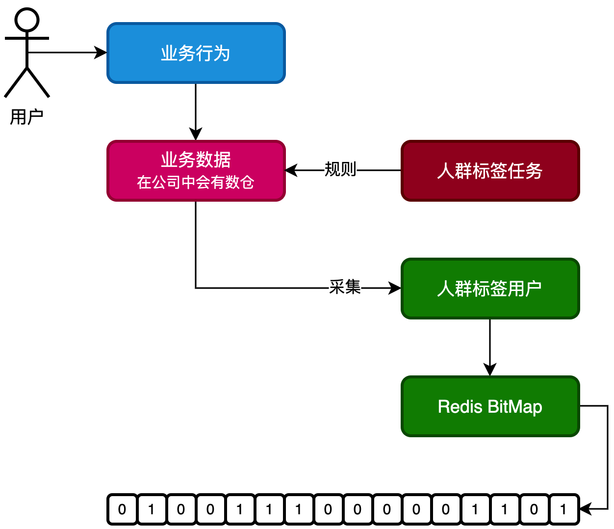
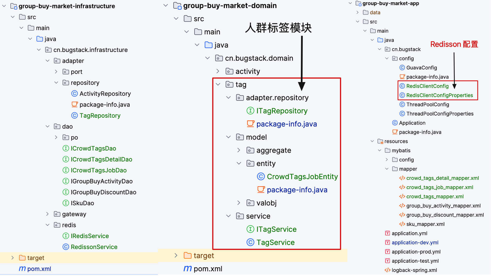
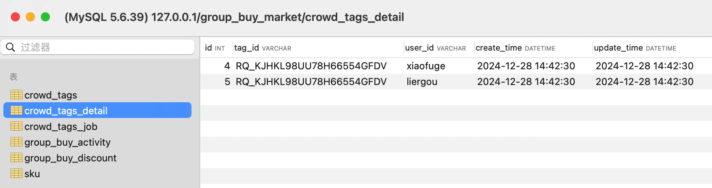

# 人群标签数据采集

> 学习序号 8｜小节 2-5｜原文：https://articles.zsxq.com/id_zl9c3gz8av14.html

**本章重点**  ：以轻量化的方式构建人群标签数据，将人群数据写入到 Redis BitMap 用于后续使用。

- **本章重点**  ：★★★☆☆
- **本节分支：**  [https://gitcode.net/KnowledgePlanet/group-buy-market/-/tree/2-5-241228-xfg-crowd-tags](https://gitcode.net/KnowledgePlanet/group-buy-market/-/tree/2-5-241228-xfg-crowd-tags)
- **课程视频**  ：[https://t.zsxq.com/sWPg0](https://t.zsxq.com/sWPg0)

**版权说明**  ：©本项目与星球签约合作，受[《中华人民共和国著作权法实施条例》](https://www.gov.cn/gongbao/content/2013/content_2339485.htm) 版权法保护，禁止任何理由和任何方式公开(public)源码、资料、视频等小傅哥发布的星球内容到Github、Gitee等各类平台，违反可追究进一步的法律责任。

作者：小傅哥

博客：[https://bugstack.cn](https://bugstack.cn)

> 沉淀、分享、成长，让自己和他人都能有所收获！😄

- 一、本章诉求
- 二、业务流程
- 三、编码实现
  - 1. 工程结构
  - 2. 人群任务
  - 3. 数据存储 - bitmap
- 四、测试验证
- 五、读者作业

大家好，我是技术UP主小傅哥。

在抖音里经常可能会刷到一些视频，说：“你搜白酒，如果出来的都是茅台、五粮液”，那么证明你是有钱人！

这个东西其实到不一定多准，但这里体现了一个技术上的东西叫做人群标签🏷，所有你的行为所产生的数据，都会被不同的标签类型统计。比如；年龄、性别、购物喜好、品类喜好、下单频次、浏览频次、搜索频次等。这些都会被归类为人群标签。

其实，还有一个。怎么感觉自己微信上聊天，过一会在京东、拼多多搜索，就出来了自己聊天时候的商品呢？这里一种是来自于输入法内容的获取，另外一个是广告联盟，这些商家的广告数据是互通的。你在一个地方搜索过，那么在进去到其他商城里就会展示出你搜索的数据。

所以，在互联网运营的手里中，你早已被圈定好该给你什么，才能刺激到你做什么。

### 一、本章诉求

以轻量化的方式构建人群标签数据，将人群数据写入到 Redis BitMap 用于后续使用。

在公司中，所有部门产生的业务数据都会回流到数仓，它有一个非常庞大的数据集市系统。之后这些数据会被量化分析师使用，通过 R 语言建模，执行模型任务，把符合模型所需的标签数据跑到一个新的指定表文件中，这些文件在通过加工存放到 Redis BitMap 进行使用。一般一个标签可能会有 50万、100万、500万的数据规模。

有了这些标签数据，运营人员就可以精准的对这些用户做定向活动投放，比如；特定的券、特定的通知等。以此达到更加精准的运营效果。

### 二、业务流程

虽然，我们不能像公司那样有那么大规模的数据量，但我们也可以仅使用拼团商品的数据，做人群标签的实现，让大家了解这样一个场景。



- 首先，人群标签是通过创建的采集任务所产生的数据。任务里包含了要采集业务中什么类型的数据规则。本项目中会采集拼团交易数据，不过本节还没有这类数据，所以先来模拟这部分数据。
- 之后，把采集的数据除了放数据库，还需要写入到 Redis 的 BitMap 中，这个数据结构比较适合高并发场景判断用户是否存在。

### 三、编码实现

- 本节需要新创建出 crowd_tags、crowd_tags_detail、crowd_tags_job 3张库表。你可以课程工程中导入。
- 引入 Redisson 配置，pom引入、app/config 增加配置、infrastructure 增加 Redisson 服务接口和实现类。

```
                <dependency>
    <groupId>org.redisson</groupId>
    <artifactId>redisson-spring-boot-starter</artifactId>
    <version>3.26.0</version>
</dependency>
```

#### 1. 工程结构



- infrastructure 基础设施层，增加人群标签仓储服务和3个操作人群标签的DAO操作，同时在增加一个 Redisson 操作接口和实现类（你可以直接复制课程的）。
- domain 领域层，增加 tag 人群标签领域，完成人群标签功能实现。
- app 应用启动层，配置 mapper、application-dev.yml、以及 config 下的 Redis 链接配置类。

> 基础配置类的可以直接参考课程代码。

#### 2. 人群任务

增加人群标签服务接口，并实现功能流程。

```
                @Slf4j
@Service
public class TagService implements ITagService {

    @Resource
    private ITagRepository repository;

    @Override
    public void execTagBatchJob(String tagId, String batchId) {
        log.info("人群标签批次任务 tagId:{} batchId:{}", tagId, batchId);

        // 1. 查询批次任务
        CrowdTagsJobEntity crowdTagsJobEntity = repository.queryCrowdTagsJobEntity(tagId, batchId);

        // 2. 采集用户数据 - 这部分需要采集用户的消费类数据，后续有用户发起拼单后再处理。

        // 3. 数据写入记录
        List<String> userIdList = new ArrayList<String>() {{
            add("xiaofuge");
            add("liergou");
        }};

        // 4. 一般人群标签的处理在公司中，会有专门的数据数仓团队通过脚本方式写入到数据库，就不用这样一个个或者批次来写。
        for (String userId : userIdList) {
            repository.addCrowdTagsUserId(tagId, userId);
        }

        // 5. 更新人群标签统计量
        repository.updateCrowdTagsStatistics(tagId, userIdList.size());
    }

}
```

- 通过采集人群标签任务获取人群数据，暂时没有这类业务数据，所以先模拟一个用户数据，你也可以调整这里的数据为你需要的。
- 采集数据后，`repository.addCrowdTagsUserId(tagId, userId);` 写入到数据库表。注意 addCrowdTagsUserId 方法，写入后还会做 BitMap 存储。
- 这些操作完成后，会更新统计量。注意，目前的统计量更新是不准的，因为执行 addCrowdTagsUserId 操作，会有主键冲突，主键冲突直接拦截不会抛异常。那么更新人群标签的统计量会继续增加。你可以思考下这里要怎么处理，课程后续也会继续处理。

#### 3. 数据存储 - bitmap

```
                @Override
public void addCrowdTagsUserId(String tagId, String userId) {
    CrowdTagsDetail crowdTagsDetailReq = new CrowdTagsDetail();
    crowdTagsDetailReq.setTagId(tagId);
    crowdTagsDetailReq.setUserId(userId);
    try {
        crowdTagsDetailDao.addCrowdTagsUserId(crowdTagsDetailReq);
        // 获取BitSet
        RBitSet bitSet = redisService.getBitSet(tagId);
        bitSet.set(redisService.getIndexFromUserId(userId), true);
    } catch (DuplicateKeyException ignore) {
        // 忽略唯一索引冲突
    }
}
```

- 执行完写库后，开始把数据写入到人群标签。
- 不过注意人群标签的存储不是字符串，所以要转行为长整型进行存放。
- **注意，数据库已经存在了数据，则不会在写入到redis。可以清空数据库记录在做测试。**

### 四、测试验证

```
                @Slf4j
@RunWith(SpringRunner.class)
@SpringBootTest
public class ITagServiceTest {

    @Resource
    private TagService tagService;
    @Resource
    private IRedisService redisService;

    @Test
    public void test_tag_job() {
        tagService.execTagBatchJob("RQ_KJHKL98UU78H66554GFDV", "10001");
    }

    @Test
    public void test_get_tag_bitmap() {
        RBitSet bitSet = redisService.getBitSet("RQ_KJHKL98UU78H66554GFDV");
        // 是否存在
        log.info("xiaofuge 存在，预期结果为 true，测试结果:{}", bitSet.get(redisService.getIndexFromUserId("xiaofuge")));
        log.info("gudebai 不存在，预期结果为 false，测试结果:{}", bitSet.get(redisService.getIndexFromUserId("gudebai")));
    }

}
```



```
                24-12-28.14:48:16.833 [main            ] INFO  ITagServiceTest        - xiaofuge 存在，测试结果:true
24-12-28.14:48:16.838 [main            ] INFO  ITagServiceTest        - gudebai 不存在，测试结果:false
```

- 测试方法，test_tag_job 执行人群标签任务。
- 测试方法，test_get_tag_bitmap 验证用户是否在人群标签范围内。

### 五、读者作业

- 简单作业：理解本节课程中的人群标签场景，并能运行验证结果。
- 复杂作业：把人群标签用到 `首页营销服务接口` 中使用。并检索关于 BitMap 的资料，多扩展积累，包括各个大厂的资料。这样会学习的更多。
