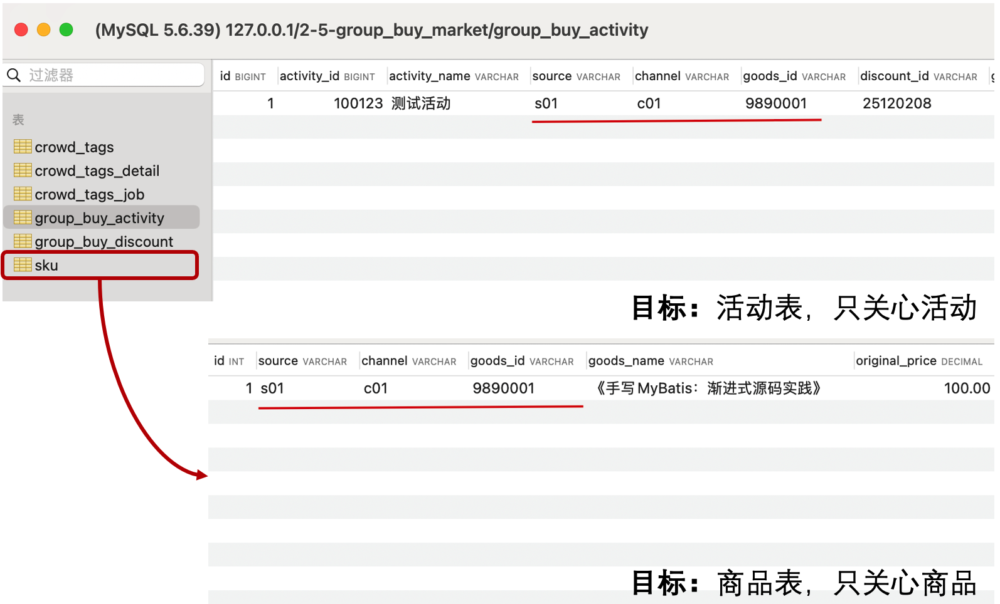
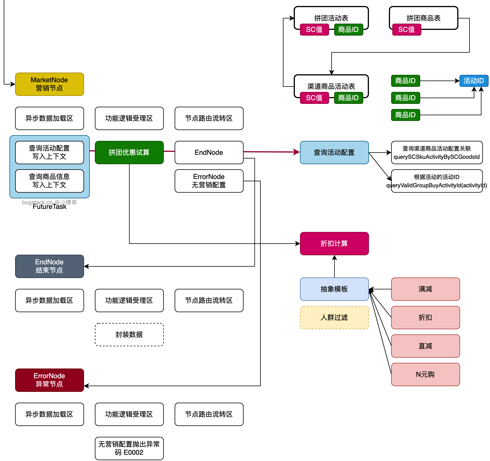
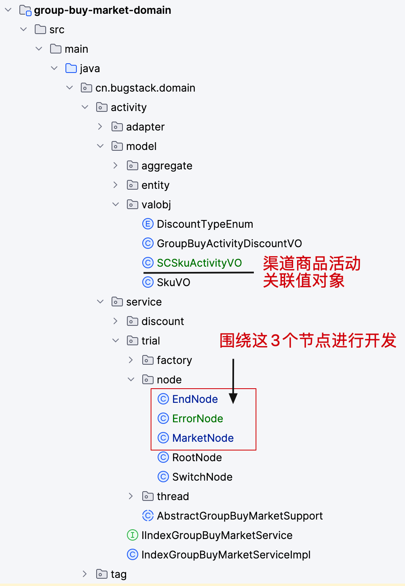

# 拆分库表关联关系

> 学习序号 9｜小节 2-6｜原文：https://articles.zsxq.com/id_695jhwno47z5.html

**本章重点** ：解耦拼团活动配置与商品ID的绑定关系，做一个新的库表解耦这部分流程。让商品可以自由配置活动，1:n

- **本章重点** ：★★★☆☆
- **本节分支：** [https://gitcode.net/KnowledgePlanet/group-buy-market/-/tree/2-6-250101-xfg-split-table](https://gitcode.net/KnowledgePlanet/group-buy-market/-/tree/2-6-250101-xfg-split-table)
- **课程视频** ：[https://t.zsxq.com/MyFI0](https://t.zsxq.com/MyFI0)

**版权说明** ：©本项目与星球签约合作，受[《中华人民共和国著作权法实施条例》](https://www.gov.cn/gongbao/content/2013/content_2339485.htm) 版权法保护，禁止任何理由和任何方式公开(public)源码、资料、视频等小傅哥发布的星球内容到Github、Gitee等各类平台，违反可追究进一步的法律责任。

作者：小傅哥

博客：[https://bugstack.cn](https://bugstack.cn)

> 沉淀、分享、成长，让自己和他人都能有所收获！😄

- 一、本章诉求
- 二、业务流程
- 三、编码实现
  - 1. 工程结构
  - 2. SC商品渠道DAO
  - 3. 修改查询营销配置
  - 4. 营销节点路由
  - 5. 异常兜底节点
- 四、测试验证
  - 1. 前置说明
  - 2. 单元测试
- 五、读者作业

大家好，我是技术UP主小傅哥。

有伙伴问，看视频写项目，能跟着完成，也能运行出结果。但怎样才算是真正的掌握了这个项目的内容呢？

多年的工作经验，要想掌握一个项目，只听分享、只看视频、只看文档，都是不行的，这些都只能让你了解但不是深入。只要上手写代码，一行行的完成需求逻辑，才能算是真正的掌握了这个项目。

所以，趁着项目不大，本节我们设定一个作业。我会给你讲解诉求和需要改动的功能点，你可以按照这样的流程来做编码和调试。完成后，在继续跟进课程学习，比对代码。当然如果你目前还处于小白阶段，也可以直接跟着课程学习。

### 一、本章诉求

在系统开始之初，简化功能设计，让拼团活动配置表直接耦合商品ID。也就是一个拼团活动，只关联一个商品ID。那么如果现在需要给10个商品，全配置一个相同的拼团活动，就没法配置了。总不能一个个全配置一遍。所以本节要对这块的内容做拆分解耦。



- group_buy_activity 拼团活动配置表中，融合了渠道和商品ID，属于和活动配置绑定了。
- sku 商品信息，已经包含了渠道SC值和商品ID。而商品表咱们前面提到过，它是由接入方同步的商品信息，也可以不走这里，直接用 RPC/HTTP 接口查询数据，所以 sku 表不适合绑定互动ID。
- 那么，就需要一个新的表来关联活动和商品信息配置，表名为 sc_sku_activity 必备字段；SC渠道、活动ID、商品ID。（自己创建库表后可以和课程的库表对比）
- 你可以根据这样的信息来创建你的库表，同时移除 group_buy_activity 表中 SC渠道值和商品ID。

### 二、业务流程

如图，整个改动流程的核心为让 MarketNode 节点的查询由原来方式改为先查询SC商品活动配置关联表，获得到活动ID，再查询活动信息。这期间如果有效的活动配置信息无，那么则走到 ErrorNode 节点，返回一个指定的错误码。



- 首先，你可以先通过如图的调用过程，理解本节要完成的编程动作。包括解耦后的新的库表关联关系。
- 之后，编码的时候异步多线程查询商品关联配置，如果配置的信息为空，或者不存在有效的活动，那么可以返回一个 null。当拿到null 以后，可以做判断进行路由，走到 ErrorNode 节点。「这部分代码一定自己尝试下，多思考。」

> 接下来往后是正式的关于编码的内容，你可以先尝试自己实现之后在看后面的代码部分。

### 三、编码实现

#### 1. 工程结构



- 功能主要以这3个节点进行开发，会涉及到关于数据库映射 PO、Mapper 的字段调整和新的映射关系添加。
- MarketNode 营销节点查询数据方式调整处理，在 QueryGroupBuyActivityDiscountVOThreadTask 中需要有一个 querySCSkuActivityBySCGoodsId 方法，来查询商品对应的活动配置。
- ErrorNode 节点，主要处理一些异常兜底的逻辑，比如查询不到对应的拼团活动配置，那么就要返回对应的错误码。

#### 2. SC商品渠道DAO

```
                @Mapper
public interface ISCSkuActivityDao {

    SCSkuActivity querySCSkuActivityBySCGoodsId(SCSkuActivity scSkuActivity);

}

<?xml version="1.0" encoding="UTF-8"?>
<!DOCTYPE mapper PUBLIC "-//mybatis.org//DTD Mapper 3.0//EN" "http://mybatis.org/dtd/mybatis-3-mapper.dtd">
<mapper namespace="cn.bugstack.infrastructure.dao.ISCSkuActivityDao">

    <resultMap id="dataMap" type="cn.bugstack.infrastructure.dao.po.SCSkuActivity">
        <id column="id" property="id"/>
        <result column="source" property="source"/>
        <result column="channel" property="channel"/>
        <result column="activity_id" property="activityId"/>
        <result column="goods_id" property="goodsId"/>
        <result column="create_time" property="createTime"/>
        <result column="update_time" property="updateTime"/>
    </resultMap>

    <select id="querySCSkuActivityBySCGoodsId" parameterType="cn.bugstack.infrastructure.dao.po.SCSkuActivity" resultMap="dataMap">
        select source, channel, activity_id, goods_id
        from sc_sku_activity
        where goods_id = #{goodsId}
    </select>

</mapper>
```

- 需要配置新的 DAO 方法，查询渠道商品活动ID配置信息。

#### 3. 修改查询营销配置

```
                public class QueryGroupBuyActivityDiscountVOThreadTask implements Callable<GroupBuyActivityDiscountVO> {

    /**
     * 来源
     */
    private final String source;

    /**
     * 渠道
     */
    private final String channel;

    /**
     * 商品ID
     */
    private final String goodsId;

    /**
     * 活动仓储
     */
    private final IActivityRepository activityRepository;

    public QueryGroupBuyActivityDiscountVOThreadTask(String source, String channel, String goodsId, IActivityRepository activityRepository) {
        this.source = source;
        this.channel = channel;
        this.goodsId = goodsId;
        this.activityRepository = activityRepository;
    }

    @Override
    public GroupBuyActivityDiscountVO call() throws Exception {
        // 查询渠道商品活动配置关联配置
        SCSkuActivityVO scSkuActivityVO = activityRepository.querySCSkuActivityBySCGoodsId(source, channel, goodsId);
        if (null == scSkuActivityVO) return null;
        // 查询活动配置
        return activityRepository.queryGroupBuyActivityDiscountVO(scSkuActivityVO.getActivityId());
    }

}
```

- 需要多增加一个查询 querySCSkuActivityBySCGoodsId 的操作，把对应的这个商品配置的活动ID查询出来。

#### 4. 营销节点路由

```
                public TrialBalanceEntity doApply(MarketProductEntity requestParameter, DefaultActivityStrategyFactory.DynamicContext dynamicContext) throws Exception {
    log.info("拼团商品查询试算服务-MarketNode userId:{} requestParameter:{}", requestParameter.getUserId(), JSON.toJSONString(requestParameter));
    // 获取上下文数据
    GroupBuyActivityDiscountVO groupBuyActivityDiscountVO = dynamicContext.getGroupBuyActivityDiscountVO();
    if (null == groupBuyActivityDiscountVO) {
        return router(requestParameter, dynamicContext);
    }
    GroupBuyActivityDiscountVO.GroupBuyDiscount groupBuyDiscount = groupBuyActivityDiscountVO.getGroupBuyDiscount();
    SkuVO skuVO = dynamicContext.getSkuVO();
    if (null == groupBuyDiscount || null == skuVO) {
        return router(requestParameter, dynamicContext);
    }
  
    // 优惠试算
    IDiscountCalculateService discountCalculateService = discountCalculateServiceMap.get(groupBuyDiscount.getMarketPlan());
    if (null == discountCalculateService) {
        log.info("不存在{}类型的折扣计算服务，支持类型为:{}", groupBuyDiscount.getMarketPlan(), JSON.toJSONString(discountCalculateServiceMap.keySet()));
        throw new AppException(ResponseCode.E0001.getCode(), ResponseCode.E0001.getInfo());
    }
    // 折扣价格
    BigDecimal deductionPrice = discountCalculateService.calculate(requestParameter.getUserId(), skuVO.getOriginalPrice(), groupBuyDiscount);
    dynamicContext.setDeductionPrice(deductionPrice);
    return router(requestParameter, dynamicContext);
}

@Override
public StrategyHandler<MarketProductEntity, DefaultActivityStrategyFactory.DynamicContext, TrialBalanceEntity> get(MarketProductEntity requestParameter, DefaultActivityStrategyFactory.DynamicContext dynamicContext) throws Exception {
    // 不存在配置的拼团活动，走异常节点
    if (null == dynamicContext.getGroupBuyActivityDiscountVO() || null == dynamicContext.getSkuVO()) {
        return errorNode;
    }
    return endNode;
}
```

- 判断 groupBuyActivityDiscountVO、groupBuyDiscount、skuVO，是否为空。如果为空则直接路由走到兜底节点。
- 这个兜底节点就是本节新增加的 ErrorNode 节点。

#### 5. 异常兜底节点

```
                @Slf4j
@Service
public class ErrorNode extends AbstractGroupBuyMarketSupport<MarketProductEntity, DefaultActivityStrategyFactory.DynamicContext, TrialBalanceEntity> {

    @Override
    protected TrialBalanceEntity doApply(MarketProductEntity requestParameter, DefaultActivityStrategyFactory.DynamicContext dynamicContext) throws Exception {
        log.info("拼团商品查询试算服务-NoMarketNode userId:{} requestParameter:{}", requestParameter.getUserId(), JSON.toJSONString(requestParameter));

        // 无营销配置
        if (null == dynamicContext.getGroupBuyActivityDiscountVO() || null == dynamicContext.getSkuVO()) {
            log.info("商品无拼团营销配置 {}", requestParameter.getGoodsId());
            throw new AppException(ResponseCode.E0002.getCode(), ResponseCode.E0002.getInfo());
        }

        return TrialBalanceEntity.builder().build();
    }

    @Override
    public StrategyHandler<MarketProductEntity, DefaultActivityStrategyFactory.DynamicContext, TrialBalanceEntity> get(MarketProductEntity requestParameter, DefaultActivityStrategyFactory.DynamicContext dynamicContext) throws Exception {
        return defaultStrategyHandler;
    }

}
```

- 异常兜底节点可以处理很多异常流程，包括；流程讲解、接口超时等。以及公司中运营配置的活动信息有误，也会走到一个兜底的流程。

### 四、测试验证

#### 1. 前置说明

- 导入本节的最新的库表SQL，库表结构有调整，新增加了库表和对应的数据。
- SQL 在本节分支的 `docs/dev-ops/mysql/sql` 下

```
                CREATE database if NOT EXISTS `group_buy_market` default character set utf8mb4 collate utf8mb4_0900_ai_ci;
use `group_buy_market`;
```

- 如果你是 mysql 5.6 ~ 5.7 删掉 `collate utf8mb4_0900_ai_ci`

#### 2. 单元测试

```
                @Slf4j
@RunWith(SpringRunner.class)
@SpringBootTest
public class IIndexGroupBuyMarketServiceTest {

    @Resource
    private IIndexGroupBuyMarketService indexGroupBuyMarketService;

    @Test
    public void test_indexMarketTrial() throws Exception {
        MarketProductEntity marketProductEntity = new MarketProductEntity();
        marketProductEntity.setUserId("xiaofuge");
        marketProductEntity.setSource("s01");
        marketProductEntity.setChannel("c01");
        marketProductEntity.setGoodsId("9890001");

        TrialBalanceEntity trialBalanceEntity = indexGroupBuyMarketService.indexMarketTrial(marketProductEntity);
        log.info("请求参数:{}", JSON.toJSONString(marketProductEntity));
        log.info("返回结果:{}", JSON.toJSONString(trialBalanceEntity));
    }

    @Test
    public void test_indexMarketTrial_error() throws Exception {
        MarketProductEntity marketProductEntity = new MarketProductEntity();
        marketProductEntity.setUserId("xiaofuge");
        marketProductEntity.setSource("s01");
        marketProductEntity.setChannel("c01");
        marketProductEntity.setGoodsId("9890002");

        TrialBalanceEntity trialBalanceEntity = indexGroupBuyMarketService.indexMarketTrial(marketProductEntity);
        log.info("请求参数:{}", JSON.toJSONString(marketProductEntity));
        log.info("返回结果:{}", JSON.toJSONString(trialBalanceEntity));
    }

}
```

**正确结果**

```
                25-01-01.15:28:02.006 [main            ] INFO  IIndexGroupBuyMarketServiceTest - 请求参数:{"channel":"c01","goodsId":"9890001","source":"s01","userId":"xiaofuge"}
25-01-01.15:28:02.014 [main            ] INFO  IIndexGroupBuyMarketServiceTest - 返回结果:{"deductionPrice":90.00,"endTime":1733537980000,"goodsId":"9890001","goodsName":"《手写MyBatis：渐进式源码实践》","isEnable":false,"isVisible":false,"originalPrice":100.00,"startTime":1733537980000,"targetCount":1}
```

**异常结果**

```
                25-01-01.17:14:21.891 [main            ] INFO  ErrorNode              - 商品无拼团营销配置 9890002

cn.bugstack.x.api.types.exception.XApiException{code='E0002', info='无拼团营销配置'}
 at cn.bugstack.domain.activity.service.trial.node.ErrorNode.doApply(ErrorNode.java:30)
 at cn.bugstack.domain.activity.service.trial.node.ErrorNode.doApply(ErrorNode.java:19)
```

- test_indexMarketTrial；测试存在活动流程
- test_indexMarketTrial_error；测试查询一个不存在的商品，那么也就查询不到对应的拼团活动配置。抛异常。

### 五、读者作业

- 简单作业：理解库表解耦的目的，完成课程编码。
- 复杂作业：根据本节诉求和业务流程，独立完成课程编码。
