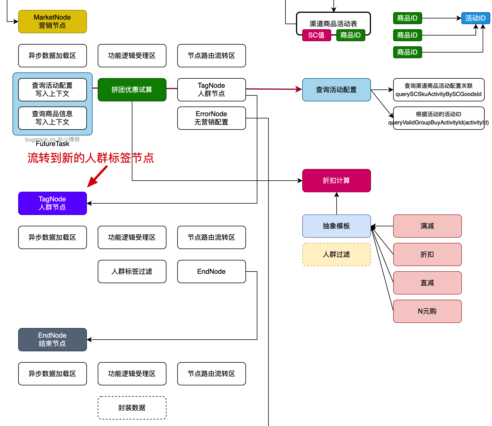
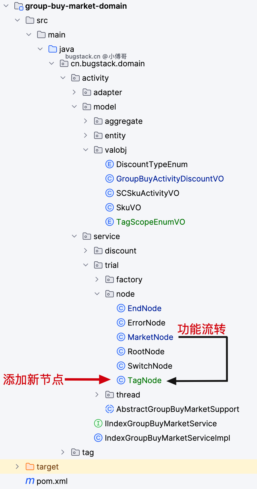
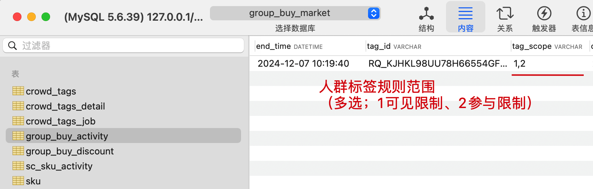
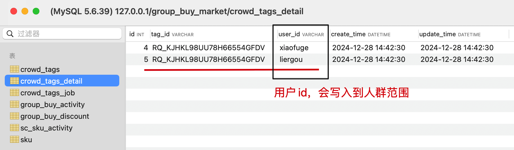

# 人群标签节点过滤

> 学习序号 10｜小节 2-7｜原文：https://articles.zsxq.com/id_21knk4dza0gh.html

**本章重点** ：在整个首页营销试算流程中，需要添加一个新的人群标签🏷节点 TagNode，来处理人群过滤的操作。

- **本章重点** ：★★☆☆☆
- **本节分支：** [https://gitcode.net/KnowledgePlanet/group-buy-market/-/tree/2-7-250102-xfg-tagNode](https://gitcode.net/KnowledgePlanet/group-buy-market/-/tree/2-7-250102-xfg-tagNode)
- **课程视频** ：[https://t.zsxq.com/E5VKd](https://t.zsxq.com/E5VKd)

**版权说明** ：©本项目与星球签约合作，受[《中华人民共和国著作权法实施条例》](https://www.gov.cn/gongbao/content/2013/content_2339485.htm) 版权法保护，禁止任何理由和任何方式公开(public)源码、资料、视频等小傅哥发布的星球内容到Github、Gitee等各类平台，违反可追究进一步的法律责任。

作者：小傅哥

博客：[https://bugstack.cn](https://bugstack.cn)

> 沉淀、分享、成长，让自己和他人都能有所收获！😄

- 一、本章诉求
- 二、业务流程
- 三、编码实现
  - 1. 工程结构
  - 2. 人群过滤
- 四、测试验证
- 五、读者作业

大家好，我是技术UP主小傅哥。

什么样的代码算好代码？做编程开发这么多年，我一直追求将代码简单化，让代码即是文档，看代码即可知道每一块功能的边界。因为一个功能开发出来，基本就要伴随着业务的发展一直持续下去。那么好的代码，就可以更好的维护，尤其是遇到问题的时候，可以快速定位。

### 一、本章诉求

在整个首页营销试算流程中，需要添加一个新的人群标签🏷节点 TagNode，来处理人群过滤的操作。

在本节你会看到目前的模型结构设计是非常容易添加出一个新的流程节点，同时对原有的功能不会有破坏性。这样既可以让我们更好的维护代码，也能方便持续的需求迭代。

### 二、业务流程

如图，增加 TagNode 节点，调整节点调用关系；



- 首先，添加一个新的 TagNode 节点，调整营销 MarketNode 节点完成业务功能后，流转到新的 TagNode 节点。
- 之后，在从个 TagNode 节点流转到 EndNode 结束节点。

### 三、编码实现

#### 1. 工程结构



- domain 领域层的 activity 活动领域下，trial 服务下 node 节点中添加 TagNode，之后再从 MarketNode 流转到 TagNode
- TagNode 节点重点处理人群标签的过滤操作。这部分的逻辑功能不多。基本上你到这里可以思考🤔，怎么判断处理。

#### 2. 人群过滤

##### 2.1 库表配置



- group_buy_activity 表中 tag_scope 中配置1,2 代表需要过滤人群，限制可见性和参与性。比如这里的配置表示，一个参加活动的用户，如果不再人群范围内，既不允许看见活动，也不允许参与活动。如果只配置2，那么表示通过人群的用户，能看见，但不能参与。
- 那么我们这里就要做人群过滤限制，就要拿到这个1,2值，之后判断处理。

##### 2.2 聚合方法

```
                public class GroupBuyActivityDiscountVO {

    /**
     * 活动ID
     */
    private Long activityId;
    /**
     * 活动名称
     */
    private String activityName;
    /**
     * 来源
     */
    private String source;
    /**
     * 渠道
     */
    private String channel;
    /**
     * 商品ID
     */
    private String goodsId;
    /**
     * 折扣配置
     */
    private GroupBuyDiscount groupBuyDiscount;
    /**
     * 拼团方式（0自动成团、1达成目标拼团）
     */
    private Integer groupType;
    /**
     * 拼团次数限制
     */
    private Integer takeLimitCount;
    /**
     * 拼团目标
     */
    private Integer target;
    /**
     * 拼团时长（分钟）
     */
    private Integer validTime;
    /**
     * 活动状态（0创建、1生效、2过期、3废弃）
     */
    private Integer status;
    /**
     * 活动开始时间
     */
    private Date startTime;
    /**
     * 活动结束时间
     */
    private Date endTime;
    /**
     * 人群标签规则标识
     */
    private String tagId;
    /**
     * 人群标签规则范围
     */
    private String tagScope;

    /**
     * 可见限制
     * 只要存在这样一个值，那么首次获得的默认值就是 false
     */
    public boolean isVisible() {
        String[] split = this.tagScope.split(Constants.SPLIT);
        if (split.length > 0 && Objects.equals(split[0], "1") && StringUtils.isNotBlank(split[0])) {
            return false;
        }
        return true;
    }

    /**
     * 参与限制
     * 只要存在这样一个值，那么首次获得的默认值就是 false
     */
    public boolean isEnable() {
        String[] split = this.tagScope.split(Constants.SPLIT);
        if (split.length == 2 && Objects.equals(split[1], "2") && StringUtils.isNotBlank(split[1])) {
            return false;
        }
        return true;
    }
    
    //... 省略部分代码
}    
```

- 可见限制；方法聚合到到类中，判断是否配置了1。如果配置了，那么默认这个对应的值的结果就是 false，之后在判断是否在人群范围内，如果在人群范围内则为 true。
- 参与限制；方法聚合到到类中，判断是否配置了2。如果配置了，那么默认这个对应的值的结果就是 false，之后在判断是否在人群范围内，如果在人群范围内则为 true。

##### 2.3 代码实现

```
                @Slf4j
@Service
public class TagNode extends AbstractGroupBuyMarketSupport<MarketProductEntity, DefaultActivityStrategyFactory.DynamicContext, TrialBalanceEntity> {

    @Resource
    private EndNode endNode;

    @Override
    protected TrialBalanceEntity doApply(MarketProductEntity requestParameter, DefaultActivityStrategyFactory.DynamicContext dynamicContext) throws Exception {
        // 获取拼团活动配置
        GroupBuyActivityDiscountVO groupBuyActivityDiscountVO = dynamicContext.getGroupBuyActivityDiscountVO();

        String tagId = groupBuyActivityDiscountVO.getTagId();
        boolean visible = groupBuyActivityDiscountVO.isVisible();
        boolean enable = groupBuyActivityDiscountVO.isEnable();

        // 人群标签配置为空，则走默认值
        if (StringUtils.isBlank(tagId)) {
            dynamicContext.setVisible(true);
            dynamicContext.setEnable(true);
            return router(requestParameter, dynamicContext);
        }

        // 是否在人群范围内；visible、enable 如果值为 ture 则表示没有配置拼团限制，那么就直接保证为 true 即可
        boolean isWithin = repository.isTagCrowdRange(tagId, requestParameter.getUserId());
        dynamicContext.setVisible(visible || isWithin);
        dynamicContext.setEnable(enable || isWithin);

        return router(requestParameter, dynamicContext);
    }

    @Override
    public StrategyHandler<MarketProductEntity, DefaultActivityStrategyFactory.DynamicContext, TrialBalanceEntity> get(MarketProductEntity requestParameter, DefaultActivityStrategyFactory.DynamicContext dynamicContext) throws Exception {
        return endNode;
    }

}
```

- 首先，判断 tagId 是否为空，如果为空则访问的可见性和参与性都为 true 即可。
- 之后，过滤人群标签，`isWithin` 为用户是否在人群范围内。`visible || isWithin`、`enable || isWithin` 只要有一个 true 则可以通过。

### 四、测试验证

```
                /**
 * 测试人群标签功能的时候，可以进入 ITagServiceTest#test_tag_job 执行人群写入
 */
@Test
public void test_indexMarketTrial() throws Exception {
    MarketProductEntity marketProductEntity = new MarketProductEntity();
    marketProductEntity.setUserId("xiaofuge");
    marketProductEntity.setSource("s01");
    marketProductEntity.setChannel("c01");
    marketProductEntity.setGoodsId("9890001");
    TrialBalanceEntity trialBalanceEntity = indexGroupBuyMarketService.indexMarketTrial(marketProductEntity);
    log.info("请求参数:{}", JSON.toJSONString(marketProductEntity));
    log.info("返回结果:{}", JSON.toJSONString(trialBalanceEntity));
}

@Test
public void test_indexMarketTrial_no_tag() throws Exception {
    MarketProductEntity marketProductEntity = new MarketProductEntity();
    marketProductEntity.setUserId("dacihua");
    marketProductEntity.setSource("s01");
    marketProductEntity.setChannel("c01");
    marketProductEntity.setGoodsId("9890001");
    TrialBalanceEntity trialBalanceEntity = indexGroupBuyMarketService.indexMarketTrial(marketProductEntity);
    log.info("请求参数:{}", JSON.toJSONString(marketProductEntity));
    log.info("返回结果:{}", JSON.toJSONString(trialBalanceEntity));
}
```



```
                25-01-02.16:31:15.210 [main            ] INFO  IIndexGroupBuyMarketServiceTest - 请求参数:{"channel":"c01","goodsId":"9890001","source":"s01","userId":"xiaofuge"}
25-01-02.16:31:15.219 [main            ] INFO  IIndexGroupBuyMarketServiceTest - 返回结果:{"deductionPrice":90.00,"endTime":1733537980000,"goodsId":"9890001","goodsName":"《手写MyBatis：渐进式源码实践》","isEnable":true,"isVisible":true,"originalPrice":100.00,"startTime":1733537980000,"targetCount":1}
```

- 用户ID人群范围的，`ITagServiceTest#test_tag_job` 需要先执行，这样可以把用户写入到Redis BitMap 人群标签内。这样在执行 `test_indexMarketTrial` 则会判断是否在人群范围内。
- test_indexMarketTrial 测试方法，`xiaofuge` 是在人群范围内的用户，则会返回 true 结果。
- test_indexMarketTrial_no_tag 测试方法，`dacihua` 不在人群范围内，则会返回 false 结果。

### 五、读者作业

- 简单作业：学习新功能添加时，通过节点方式编码逻辑，再配置流转方式。学习这样的设计思想和编码实现。
- 复杂作业：其实 TagNode 还可以在执行营销 MarketNode 前面执行，判断人群标签如果不可见，那么也可以不执行计算营销优惠。你可以尝试锻炼调整节点下。
