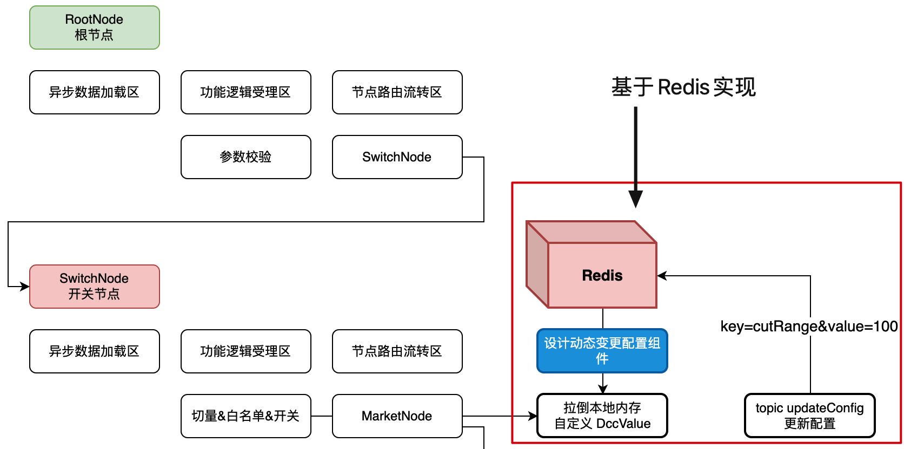
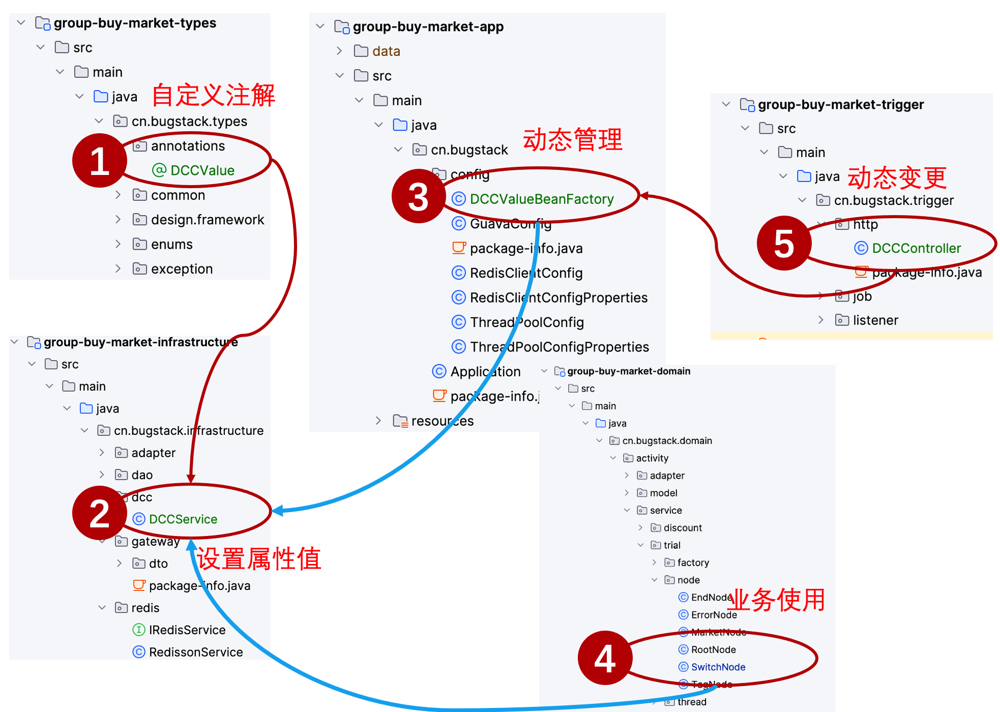
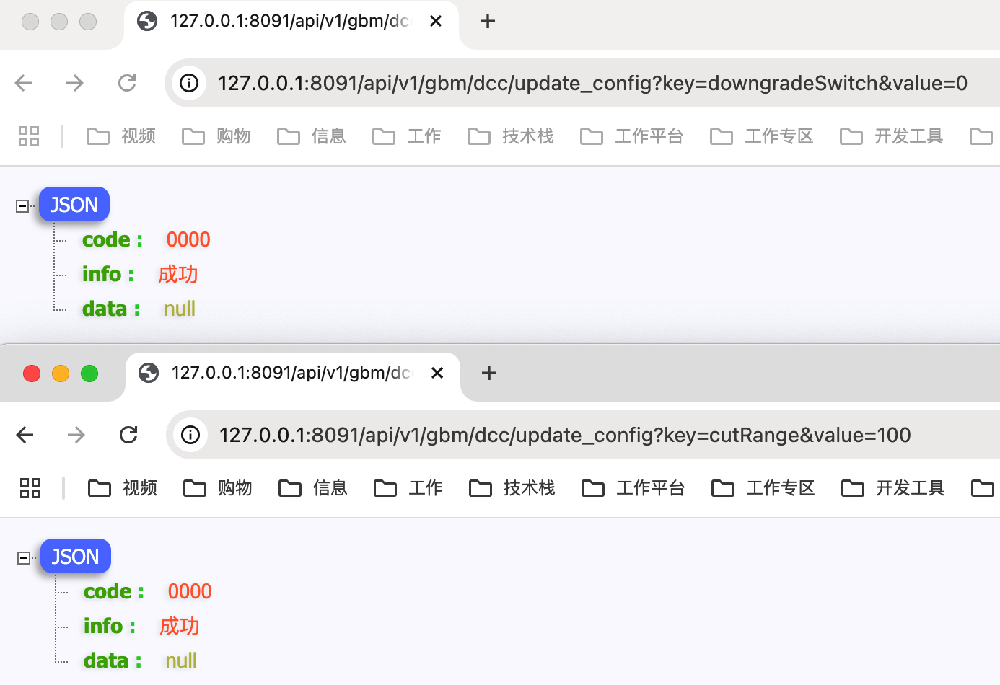

# 动态配置开关操作

> 学习序号 11｜小节 2-8｜原文：https://articles.zsxq.com/id_g11s9obc01ih.html

**本章重点** ：如何不停车就给汽车换个轮子？

- **本章重点** ：★★★★☆
- **本节分支：** [https://gitcode.net/KnowledgePlanet/group-buy-market/-/tree/2-8-250104-xfg-dcc](https://gitcode.net/KnowledgePlanet/group-buy-market/-/tree/2-8-250104-xfg-dcc)
- **课程视频** ：[https://t.zsxq.com/yHvNc](https://t.zsxq.com/yHvNc)

**版权说明** ：©本项目与星球签约合作，受[《中华人民共和国著作权法实施条例》](https://www.gov.cn/gongbao/content/2013/content_2339485.htm) 版权法保护，禁止任何理由和任何方式公开(public)源码、资料、视频等小傅哥发布的星球内容到Github、Gitee等各类平台，违反可追究进一步的法律责任。

作者：小傅哥

博客：[https://bugstack.cn](https://bugstack.cn)

> 沉淀、分享、成长，让自己和他人都能有所收获！😄

- 一、本章诉求
- 二、业务流程
- 三、编码实现
  - 1. 工程结构
  - 2. 自定义注解和使用
  - 3. 动态变更属性值
  - 4. 开关节点使用
- 四、测试验证
  - 1. 配置变更 - 启动服务
  - 2. 试算验证 - 单测方法
- 五、读者作业

大家好，我是技术UP主小傅哥。

在编程能力积累进阶的过程中，核心框架源码（Spring、MyBatis）的掌握是非常必要的过程之一。这些源码的组件学习后是可以帮助自身做业务功能逻辑的实现。

有些伙伴可能会觉得就做个业务开发，是不没有必要学习？🤔 其实不是的，对于源码这样的东西，往往是因为它并没有成为你熟悉的知识，所以也不会成为你设计的方案之一。当你熟练掌握后，会很巧妙的结合源码做自己的技术实现方案。

### 一、本章诉求

如何不停车就给汽车换个轮子？

这是互联网应用程序中经常干的事情，在程序运行过程中，直接动态变更某些属性配置。这些动态变更的配置包括降级和切量的开关，也包括一些功能程序的白名单用户测试。

那么对于配置中心，有 SpringCloud Config + Event Bus，也有 Nacos，还有各个大厂中会基于各类组件做的自研实现。那么本节我们先来做一个基于 Redis 发布/订阅处理动态配置的自研的实现，之后对于 SpringCloud 的动态配置变更已经有案例，小伙伴也可以学习。

案例：[https://bugstack.cn/md/road-map/springcloud-bus.html](https://bugstack.cn/md/road-map/springcloud-bus.html)

### 二、业务流程

如图，基于 Redis 实现一套动态配置中心 DCC 服务；Dynamic Config Control



- 注意，本节会涉及到 Spring源码、Java 动态配置的一些编码操作，属于组件类开发是思想。如本节实现的功能也可以被独立出一个工程组件开发后被业务系统引入使用。
- 方案，动态配置的处理可以使用 Zookeeper 的节点监听，也可以基于 Redis 的发布/订阅。本节咱们使用 Redis 这套方案，当你学习到后面的大营销项目，还会看到 Zookeeper 的实现方案。

### 三、编码实现

#### 1. 工程结构



- 步骤1；添加一个自定义注解，用于 Spring 扫描 Bean 对象的时候，可以直接管理这些配置了自定义注解的类的属性。
- 步骤2；给服务类的属性添加自定义注解。
- 步骤3；由 app 模块下的 config，添加一个动态配置管理的工厂🏭，会自动的完成属性信息的填充和动态变更操作。
- 步骤4；业务使用，会调用步骤2中的属性服务。当有配置操作变动的时候，则可以把配置信息直接刷新到内存属性上。
- 步骤5；配置的变更来自于这里，当调用 DCCController 时，会触发 Redis 的发布/订阅，动态值的变更，以此把类上的属性的值做变更。

> 如果你有一定的积累，可以尝试先做下这个方案。这比直接使用个 SpringCloud Config 更有意义。

#### 2. 自定义注解和使用

```
                @Retention(RetentionPolicy.RUNTIME)
@Target({ElementType.FIELD})
@Documented
public @interface DCCValue {

    String value() default "";

}

@Service
public class DCCService {

    /**
     * 降级开关 0关闭、1开启
     */
    @DCCValue("downgradeSwitch:0")
    private String downgradeSwitch;

    @DCCValue("cutRange:100")
    private String cutRange;

    public boolean isDowngradeSwitch() {
        return "1".equals(downgradeSwitch);
    }

    public boolean isCutRange(String userId) {
        // 计算哈希码的绝对值
        int hashCode = Math.abs(userId.hashCode());

        // 获取最后两位
        int lastTwoDigits = hashCode % 100;

        // 判断是否在切量范围内
        if (lastTwoDigits <= Integer.parseInt(cutRange)) {
            return true;
        }

        return false;
    }

}
```

- 首先，我们知道在类中的属性配置的值固定的，配置后一直在程序运行中都是一个值。
- 那么，我们为了可以让程序随着功能的验证，可以动态的调整这些属性的值，就需要引入一些手段，这些手段的目的就是可以动态调整属性值。问：Java 中怎么通过反射来处理属性值的变更。现在的八股，有时候就是以场景提问，考察你是否使用过。

#### 3. 动态变更属性值

```
                @Slf4j
@Configuration
public class DCCValueBeanFactory implements BeanPostProcessor {

    private static final String BASE_CONFIG_PATH = "group_buy_market_dcc_";

    private final RedissonClient redissonClient;

    private final Map<String, Object> dccObjGroup = new HashMap<>();

    public DCCValueBeanFactory(RedissonClient redissonClient) {
        this.redissonClient = redissonClient;
    }

    @Bean("dccTopic")
    public RTopic testRedisTopicListener(RedissonClient redissonClient) {
        RTopic topic = redissonClient.getTopic("group_buy_market_dcc");
        topic.addListener(String.class, (charSequence, s) -> {
            String[] split = s.split(Constants.SPLIT);

            // 获取值
            String attribute = split[0];
            String key = BASE_CONFIG_PATH + attribute;
            String value = split[1];

            // 设置值
            RBucket<String> bucket = redissonClient.getBucket(key);
            boolean exists = bucket.isExists();
            if (!exists) return;
            bucket.set(value);

            Object objBean = dccObjGroup.get(key);
            if (null == objBean) return;

            Class<?> objBeanClass = objBean.getClass();
            // 检查 objBean 是否是代理对象
            if (AopUtils.isAopProxy(objBean)) {
                // 获取代理对象的目标对象
                objBeanClass = AopUtils.getTargetClass(objBean);
            }

            try {
                // 1. getDeclaredField 方法用于获取指定类中声明的所有字段，包括私有字段、受保护字段和公共字段。
                // 2. getField 方法用于获取指定类中的公共字段，即只能获取到公共访问修饰符（public）的字段。
                Field field = objBeanClass.getDeclaredField(attribute);
                field.setAccessible(true);
                field.set(objBean, value);
                field.setAccessible(false);

                log.info("DCC 节点监听，动态设置值 {} {}", key, value);
            } catch (Exception e) {
                throw new RuntimeException(e);
            }
        });
        return topic;
    }

    @Override
    public Object postProcessAfterInitialization(Object bean, String beanName) throws BeansException {
        // 注意；增加 AOP 代理后，获得类的方式要通过 AopProxyUtils.getTargetClass(bean); 不能直接 bean.class 因为代理后类的结构发生变化，这样不能获得到自己的自定义注解了。
        Class<?> targetBeanClass = bean.getClass();
        Object targetBeanObject = bean;
        if (AopUtils.isAopProxy(bean)) {
            targetBeanClass = AopUtils.getTargetClass(bean);
            targetBeanObject = AopProxyUtils.getSingletonTarget(bean);
        }

        Field[] fields = targetBeanClass.getDeclaredFields();
        for (Field field : fields) {
            if (!field.isAnnotationPresent(DCCValue.class)) {
                continue;
            }

            DCCValue dccValue = field.getAnnotation(DCCValue.class);

            String value = dccValue.value();
            if (StringUtils.isBlank(value)) {
                throw new RuntimeException(field.getName() + " @DCCValue is not config value config case 「isSwitch/isSwitch:1」");
            }

            String[] splits = value.split(":");
            String key = BASE_CONFIG_PATH.concat(splits[0]);
            String defaultValue = splits.length == 2 ? splits[1] : null;

            // 设置值
            String setValue = defaultValue;

            try {
                // 如果为空则抛出异常
                if (StringUtils.isBlank(defaultValue)) {
                    throw new RuntimeException("dcc config error " + key + " is not null - 请配置默认值！");
                }

                // Redis 操作，判断配置Key是否存在，不存在则创建，存在则获取最新值
                RBucket<String> bucket = redissonClient.getBucket(key);
                boolean exists = bucket.isExists();
                if (!exists) {
                    bucket.set(defaultValue);
                } else {
                    setValue = bucket.get();
                }

                field.setAccessible(true);
                field.set(targetBeanObject, setValue);
                field.setAccessible(false);
            } catch (Exception e) {
                throw new RuntimeException(e);
            }

            dccObjGroup.put(key, targetBeanObject);
        }

        return bean;
    }

}
```

- DCCValueBeanFactory 实现了 BeanPostProcessor，这样我们就可以拿到 Spring 所有实例化后的 Bean 对象。*Spring 是扫描你所工程下所有的 Bean 对象，加载到它的容器里管理。*
- postProcessAfterInitialization 扫描所有的 Bean 对象，之后检查哪个类的属性加有 `@DCCValue` 注解，检测到后进行管理操作。
- `@DCCValue("downgradeSwitch:0")` 解析自定义注解配置值，一个是key，一个是默认的值。之后会从 redis 获取值，如果没有则走默认值。
- testRedisTopicListener 是一个监听 redis 发布/订阅消息的处理，之后动态设置 Redis 值，完事后更新类中 Redis 的属性值。

#### 4. 开关节点使用

```
                @Service
public class SwitchNode extends AbstractGroupBuyMarketSupport<MarketProductEntity, DefaultActivityStrategyFactory.DynamicContext, TrialBalanceEntity> {

    @Resource
    private MarketNode marketNode;

    @Override
    public TrialBalanceEntity doApply(MarketProductEntity requestParameter, DefaultActivityStrategyFactory.DynamicContext dynamicContext) throws Exception {
        log.info("拼团商品查询试算服务-SwitchNode userId:{} requestParameter:{}", requestParameter.getUserId(), JSON.toJSONString(requestParameter));

        // 根据用户ID切量
        String userId = requestParameter.getUserId();

        // 判断是否降级
        if (repository.downgradeSwitch()) {
            log.info("拼团活动降级拦截 {}", userId);
            throw new AppException(ResponseCode.E0003.getCode(), ResponseCode.E0003.getInfo());
        }

        // 切量范围判断
        if (!repository.cutRange(userId)) {
            log.info("拼团活动切量拦截 {}", userId);
            throw new AppException(ResponseCode.E0004.getCode(), ResponseCode.E0004.getInfo());
        }

        return router(requestParameter, dynamicContext);
    }

    @Override
    public StrategyHandler<MarketProductEntity, DefaultActivityStrategyFactory.DynamicContext, TrialBalanceEntity> get(MarketProductEntity requestParameter, DefaultActivityStrategyFactory.DynamicContext dynamicContext) throws Exception {
        return marketNode;
    }

}
```

- 进入开关节点，通过仓储 repository 获取对应的值。
- repository.downgradeSwitch() 判断是否降级。
- repository.cutRange(userId) 通过用户ID的哈希值最后2位，判断是否在100范围内，以此做切量处理。

### 四、测试验证

#### 1. 配置变更 - 启动服务

```
                 /\\ / ___'_ __ _ _(_)_ __  __ _ \ \ \ \
( ( )\___ | '_ | '_| | '_ \/ _` | \ \ \ \
 \\/  ___)| |_)| | | | | || (_| |  ) ) ) )
  '  |____| .__|_| |_|_| |_\__, | / / / /
 =========|_|==============|___/=/_/_/_/
 :: Spring Boot ::               (v2.7.12)
25-01-03.21:28:44.841 [main            ] INFO  [/]                    - Initializing Spring embedded WebApplicationContext
25-01-03.21:28:44.842 [main            ] INFO  ServletWebServerApplicationContext - Root WebApplicationContext: initialization completed in 3754 ms
25-01-03.21:28:46.752 [main            ] INFO  EndpointLinksResolver  - Exposing 1 endpoint(s) beneath base path '/actuator'
25-01-03.21:28:46.780 [main            ] INFO  Http11NioProtocol      - Starting ProtocolHandler ["http-nio-8091"]
25-01-03.21:28:46.797 [main            ] INFO  TomcatWebServer        - Tomcat started on port(s): 8091 (http) with context path ''
25-01-03.21:28:46.813 [main            ] INFO  Application            - Started Application in 6.667 seconds (JVM running for 7.229)
```

步骤1；启动服务，确保服务运行没问题，日志检查正常。 步骤2；浏览器访问接口，做值的变更。



```
                http://127.0.0.1:8091/api/v1/gbm/dcc/update_config?key=downgradeSwitch&value=0
http://127.0.0.1:8091/api/v1/gbm/dcc/update_config?key=cutRange&value=100
```

```
                25-01-03.21:30:11.412 [http-nio-8091-exec-1] INFO  DispatcherServlet      - Initializing Servlet 'dispatcherServlet'
25-01-03.21:30:11.414 [http-nio-8091-exec-1] INFO  DispatcherServlet      - Completed initialization in 2 ms
25-01-03.21:30:11.470 [http-nio-8091-exec-1] INFO  DCCController          - DCC 动态配置值变更 key:downgradeSwitch value:1
25-01-03.21:30:11.496 [redisson-3-7    ] INFO  DCCValueBeanFactory    - DCC 节点监听，动态设置值 group_buy_market_dcc_downgradeSwitch 1
25-01-03.21:30:30.931 [http-nio-8091-exec-2] INFO  DCCController          - DCC 动态配置值变更 key:cutRange value:100
25-01-03.21:30:30.952 [redisson-3-8    ] INFO  DCCValueBeanFactory    - DCC 节点监听，动态设置值 group_buy_market_dcc_cutRange 100
```

- downgradeSwitch 降级开关 0关闭、1开启
- cutRange 切量开关 100 是全通过

#### 2. 试算验证 - 单测方法

```
                @Test
public void test_indexMarketTrial() throws Exception {
    MarketProductEntity marketProductEntity = new MarketProductEntity();
    marketProductEntity.setUserId("xiaofuge");
    marketProductEntity.setSource("s01");
    marketProductEntity.setChannel("c01");
    marketProductEntity.setGoodsId("9890001");
    TrialBalanceEntity trialBalanceEntity = indexGroupBuyMarketService.indexMarketTrial(marketProductEntity);
    log.info("请求参数:{}", JSON.toJSONString(marketProductEntity));
    log.info("返回结果:{}", JSON.toJSONString(trialBalanceEntity));
}
```

```
                25-01-03.21:31:39.277 [main            ] INFO  SwitchNode             - 拼团商品查询试算服务-SwitchNode userId:xiaofuge requestParameter:{"channel":"c01","goodsId":"9890001","source":"s01","userId":"xiaofuge"}
25-01-03.21:31:39.291 [main            ] INFO  SwitchNode             - 拼团活动降级拦截 xiaofuge

cn.bugstack.x.api.types.exception.XApiException{code='E0003', info='拼团活动降级拦截'}
 at cn.bugstack.domain.activity.service.trial.node.SwitchNode.doApply(SwitchNode.java:38)
 at cn.bugstack.domain.activity.service.trial.node.SwitchNode.doApply(SwitchNode.java:21)
 cn.bugstack.x.api.types.exception.XApiException{code='E0004', info='拼团活动切量拦截'}
 at cn.bugstack.domain.activity.service.trial.node.SwitchNode.doApply(SwitchNode.java:44)
 at cn.bugstack.domain.activity.service.trial.node.SwitchNode.doApply(SwitchNode.java:21)
```

- downgradeSwitch = 1，运行后你会看到，`拼团活动降级拦截`的错误日志。
- downgradeSwitch = 0，cutRange = 0，你会看到，`拼团活动切量拦截`的错误日志。

### 五、读者作业

- 简单作业：理解关于动态配置的使用和实现方案，完成本节代码实现。
- 复杂作业：增加一个白名单用户的动态配置验证。
