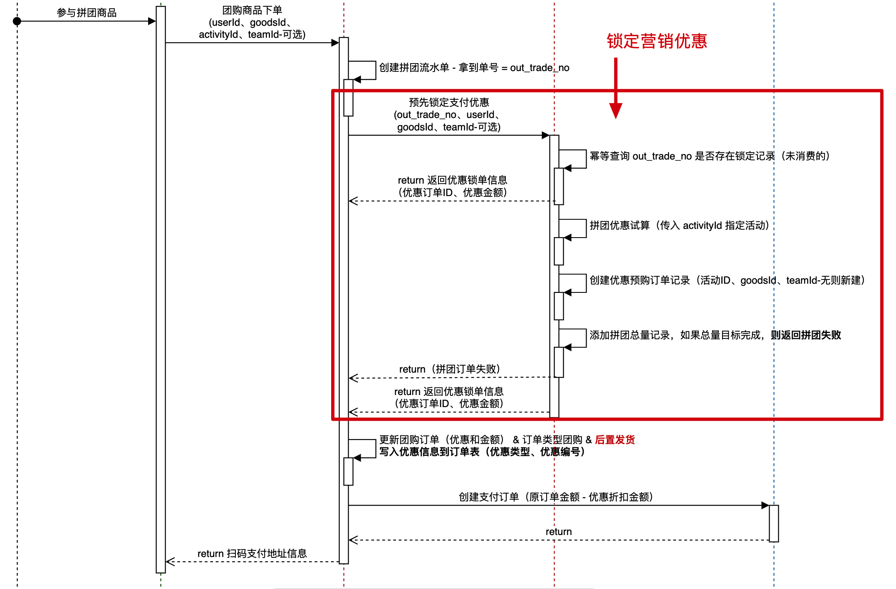
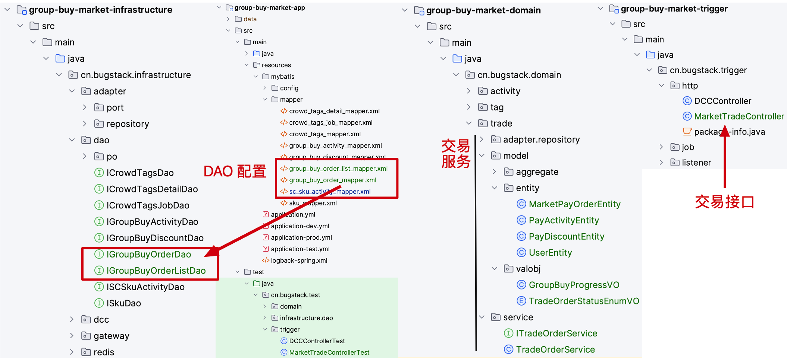
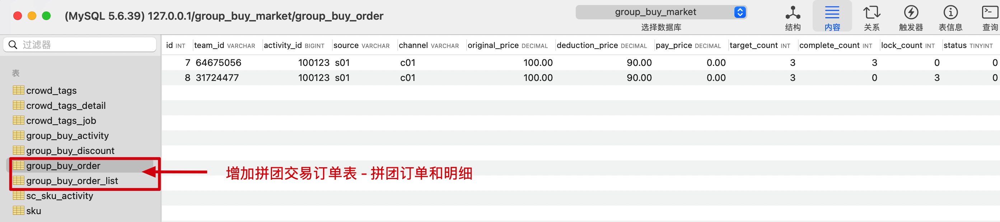

# 拼团交易营销锁单

> 学习序号 12｜小节 2-9｜原文：https://articles.zsxq.com/id_ek2pwwbf3mx5.html

**本章重点** ：拼团交易营销锁单，提前锁定营销优惠，生成一笔订单记录。

- **本章重点** ：★★★★☆
- **本节分支：** [https://gitcode.net/KnowledgePlanet/group-buy-market/-/tree/2-9-250111-xfg-trade](https://gitcode.net/KnowledgePlanet/group-buy-market/-/tree/2-9-250111-xfg-trade)
- **课程视频** ：[https://t.zsxq.com/csVlH](https://t.zsxq.com/csVlH)

**版权说明** ：©本项目与星球签约合作，受[《中华人民共和国著作权法实施条例》](https://www.gov.cn/gongbao/content/2013/content_2339485.htm) 版权法保护，禁止任何理由和任何方式公开(public)源码、资料、视频等小傅哥发布的星球内容到Github、Gitee等各类平台，违反可追究进一步的法律责任。

作者：小傅哥

博客：[https://bugstack.cn](https://bugstack.cn)

> 沉淀、分享、成长，让自己和他人都能有所收获！😄

- 一、本章诉求
- 二、业务流程
- 三、编程实现
  - 1. 工程结构
  - 2. 库表更新
  - 3. 基础操作
  - 4. 交易订单
  - 5. 服务接口
- 四、测试验证
  - 1. 锁单 - teamId is null
  - 2. 锁单 - teamId is not null
- 五、读者作业

大家好，我是技术UP主小傅哥。

在编程开发实现业务逻辑的过程中，头脑中可以有一个乐高积木的思想，考虑分拆逻辑聚合每一块业务。让这些业务具备良好的复用性。

尤其是复杂的下单过程，会有很多模块会被使用，所以这部分要想好你在整个下单过程中，会有哪些逻辑应该被聚合，怎么串联上下文。

### 一、本章诉求

当商城类系统接入拼团时，则需要在下单过程中使用一笔营销优惠。这里的营销优惠可以为；无券平台营销、有券消费营销、拼团折扣营销、积分抵扣营销等。

那么，当商城类系统接入使用下单时，则需要到拼团系统锁定一笔优惠，也就是占用一个名额。完事后，商城类系统继续操作支付交易的过程。

### 二、业务流程

如图，完善原有业务流程。



- 首先，团购的商品下单。下单过程分为创建流水单、锁定营销优惠（拼团、积分、券）、创建支付订单、唤起收银台支付、用户扫码支付、支付完成核销优惠等。
- 那么，这里用户以拼团方式下单，创建流水单完成后，需要与拼团系统交互，锁定营销优惠。更新流水单优惠金额和支付金额。接下来就可以创建支付单了（支付单需要最终的支付金额）。
- 注意，拼团表 group_buy_order 除了有目标量（target_count）、完成量（complete），还要有一个锁单量（lock_count），当锁单量达到目标量后，用户在此组织下，不能在参与拼团。直至这些用户支付完成达成拼团或者锁单超时回退支付营销，空出可参与锁单量，这样其他用户可以继续参与。

### 三、编程实现

#### 1. 工程结构



- 步骤1；添加数据库DAO配置，拼团订单、拼团明细操作。之后交给 repository 仓储使用。
- 步骤2；domain 领域层实现交易订单服务，创建拼团锁单操作，以及查询。
- 步骤3；trigger 层提供拼团交易接口服务，这里会串联 activity、trade 两个领域服务。目前的 trigger 替代了一部分 case 层的编排操作，如果是较大规模的系统，则可以单独提供一个 case 层。

#### 2. 库表更新



- 首先，新增加两张表；group_buy_order、group_buy_order_list 你可以从工程下 docs/dev-ops/mysq/sql 更新即可。
- 注意，库表设计中，添加了 team_id、lock_count，以及做了细化的处理。如果你前面学习库表设计，之后有了深入的理解，那么对这样的设计会有更深的理解。

#### 3. 基础操作

```
                @Mapper
public interface IGroupBuyOrderDao {

    void insert(GroupBuyOrder groupBuyOrder);

    int updateAddLockCount(String teamId);

    int updateSubtractionLockCount(String teamId);

    GroupBuyOrder queryGroupBuyProgress(String teamId);

}

@Mapper
public interface IGroupBuyOrderListDao {

    void insert(GroupBuyOrderList groupBuyOrderListReq);

    GroupBuyOrderList queryGroupBuyOrderRecordByOutTradeNo(GroupBuyOrderList groupBuyOrderListReq);

}
```

给2个新表提供新的 DAO 操作；

- IGroupBuyOrderDao 插入数据、更新锁单量、查询进度。
- IGroupBuyOrderListDao 插入拼单明细、查询交易记录。

#### 4. 交易订单

```
                @Slf4j
@Service
public class TradeOrderService implements ITradeOrderService {

    @Resource
    private ITradeRepository repository;

    @Override
    public MarketPayOrderEntity queryNoPayMarketPayOrderByOutTradeNo(String userId, String outTradeNo) {
        log.info("拼团交易-查询未支付营销订单:{} outTradeNo:{}", userId, outTradeNo);
        return repository.queryMarketPayOrderEntityByOutTradeNo(userId, outTradeNo);
    }

    @Override
    public GroupBuyProgressVO queryGroupBuyProgress(String teamId) {
        log.info("拼团交易-查询拼单进度:{}", teamId);
        return repository.queryGroupBuyProgress(teamId);
    }

    @Override
    public MarketPayOrderEntity lockMarketPayOrder(UserEntity userEntity, PayActivityEntity payActivityEntity, PayDiscountEntity payDiscountEntity) {
        log.info("拼团交易-锁定营销优惠支付订单:{} activityId:{} goodsId:{}", userEntity.getUserId(), payActivityEntity.getActivityId(), payDiscountEntity.getGoodsId());

        // 构建聚合对象
        GroupBuyOrderAggregate groupBuyOrderAggregate = GroupBuyOrderAggregate.builder()
                .userEntity(userEntity)
                .payActivityEntity(payActivityEntity)
                .payDiscountEntity(payDiscountEntity)
                .build();

        // 锁定聚合订单 - 这会用户只是下单还没有支付。后续会有2个流程；支付成功、超时未支付（回退）
        return repository.lockMarketPayOrder(groupBuyOrderAggregate);
    }

}
```

- 在交易订单中提供查询，包括；未支付营销订单、查询拼单进度和锁定营销优惠支付订单。
- 在 lockMarketPayOrder 有数据库事务操作。

```
                @Transactional(timeout = 500)
@Override
public MarketPayOrderEntity lockMarketPayOrder(GroupBuyOrderAggregate groupBuyOrderAggregate) {
    // 聚合对象信息
    UserEntity userEntity = groupBuyOrderAggregate.getUserEntity();
    PayActivityEntity payActivityEntity = groupBuyOrderAggregate.getPayActivityEntity();
    PayDiscountEntity payDiscountEntity = groupBuyOrderAggregate.getPayDiscountEntity();
    // 判断是否有团 - teamId 为空 - 新团、为不空 - 老团
    String teamId = payActivityEntity.getTeamId();
    if (StringUtils.isBlank(teamId)) {
        // 使用 RandomStringUtils.randomNumeric 替代公司里使用的雪花算法UUID
        teamId = RandomStringUtils.randomNumeric(8);
        // 构建拼团订单
        GroupBuyOrder groupBuyOrder = GroupBuyOrder.builder()
                .teamId(teamId)
                .activityId(payActivityEntity.getActivityId())
                .source(payDiscountEntity.getSource())
                .channel(payDiscountEntity.getChannel())
                .originalPrice(payDiscountEntity.getOriginalPrice())
                .deductionPrice(payDiscountEntity.getDeductionPrice())
                .payPrice(payDiscountEntity.getDeductionPrice().subtract(payDiscountEntity.getDeductionPrice()))
                .targetCount(payActivityEntity.getTargetCount())
                .completeCount(0)
                .lockCount(1)
                .build();
        // 写入记录
        groupBuyOrderDao.insert(groupBuyOrder);
    } else {
        // 更新记录 - 如果更新记录不等于1，则表示拼团已满，抛出异常
        int updateAddTargetCount = groupBuyOrderDao.updateAddLockCount(teamId);
        if (1 != updateAddTargetCount) {
            throw new AppException(ResponseCode.E0005);
        }
    }
    // 使用 RandomStringUtils.randomNumeric 替代公司里使用的雪花算法UUID
    String orderId = RandomStringUtils.randomNumeric(12);
    GroupBuyOrderList groupBuyOrderListReq = GroupBuyOrderList.builder()
            .userId(userEntity.getUserId())
            .teamId(teamId)
            .orderId(orderId)
            .activityId(payActivityEntity.getActivityId())
            .startTime(payActivityEntity.getStartTime())
            .endTime(payActivityEntity.getEndTime())
            .goodsId(payDiscountEntity.getGoodsId())
            .source(payDiscountEntity.getSource())
            .channel(payDiscountEntity.getChannel())
            .originalPrice(payDiscountEntity.getDeductionPrice())
            .deductionPrice(payDiscountEntity.getDeductionPrice())
            .status(TradeOrderStatusEnumVO.CREATE.getCode())
            .outTradeNo(payDiscountEntity.getOutTradeNo())
            .build();
    try {
        // 写入拼团记录
        groupBuyOrderListDao.insert(groupBuyOrderListReq);
    } catch (DuplicateKeyException e) {
        throw new AppException(ResponseCode.INDEX_EXCEPTION);
    }
    return MarketPayOrderEntity.builder()
            .orderId(orderId)
            .deductionPrice(payDiscountEntity.getDeductionPrice())
            .tradeOrderStatusEnumVO(TradeOrderStatusEnumVO.CREATE)
            .build();
}
```

- group_buy_order、group_buy_order_list，两个库表一个写入记录，一个更新记录。需要在一个事务中完成操作。

#### 5. 服务接口

```
                @Slf4j
@RestController()
@CrossOrigin("*")
@RequestMapping("/api/v1/gbm/trade/")
public class MarketTradeController implements IMarketTradeService {

    @Resource
    private IIndexGroupBuyMarketService indexGroupBuyMarketService;

    @Resource
    private ITradeOrderService tradeOrderService;

    @Override
    public Response<LockMarketPayOrderResponseDTO> lockMarketPayOrder(LockMarketPayOrderRequestDTO lockMarketPayOrderRequestDTO) {
        try {
            // 参数
            String userId = lockMarketPayOrderRequestDTO.getUserId();
            String source = lockMarketPayOrderRequestDTO.getSource();
            String channel = lockMarketPayOrderRequestDTO.getChannel();
            String goodsId = lockMarketPayOrderRequestDTO.getGoodsId();
            Long activityId = lockMarketPayOrderRequestDTO.getActivityId();
            String outTradeNo = lockMarketPayOrderRequestDTO.getOutTradeNo();
            String teamId = lockMarketPayOrderRequestDTO.getTeamId();

            log.info("营销交易锁单:{} LockMarketPayOrderRequestDTO:{}", userId, JSON.toJSONString(lockMarketPayOrderRequestDTO));

            if (StringUtils.isBlank(userId) || StringUtils.isBlank(source) || StringUtils.isBlank(channel) || StringUtils.isBlank(goodsId) || StringUtils.isBlank(goodsId) || null == activityId) {
                return Response.<LockMarketPayOrderResponseDTO>builder()
                        .code(ResponseCode.ILLEGAL_PARAMETER.getCode())
                        .info(ResponseCode.ILLEGAL_PARAMETER.getInfo())
                        .build();
            }

            // 查询 outTradeNo 是否已经存在交易记录
            MarketPayOrderEntity marketPayOrderEntity = tradeOrderService.queryNoPayMarketPayOrderByOutTradeNo(userId, outTradeNo);
            if (null != marketPayOrderEntity) {
                LockMarketPayOrderResponseDTO lockMarketPayOrderResponseDTO = LockMarketPayOrderResponseDTO.builder()
                        .orderId(marketPayOrderEntity.getOrderId())
                        .deductionPrice(marketPayOrderEntity.getDeductionPrice())
                        .tradeOrderStatus(marketPayOrderEntity.getTradeOrderStatusEnumVO().getCode())
                        .build();

                log.info("交易锁单记录(存在):{} marketPayOrderEntity:{}", userId, JSON.toJSONString(marketPayOrderEntity));
                return Response.<LockMarketPayOrderResponseDTO>builder()
                        .code(ResponseCode.SUCCESS.getCode())
                        .info(ResponseCode.SUCCESS.getInfo())
                        .data(lockMarketPayOrderResponseDTO)
                        .build();
            }

            // 判断拼团是否完成了目标
            if (null != teamId) {
                GroupBuyProgressVO groupBuyProgressVO = tradeOrderService.queryGroupBuyProgress(teamId);
                if (null != groupBuyProgressVO && Objects.equals(groupBuyProgressVO.getTargetCount(), groupBuyProgressVO.getLockCount())) {
                    log.info("交易锁单拦截-拼单目标已达成:{} {}", userId, teamId);
                    return Response.<LockMarketPayOrderResponseDTO>builder()
                            .code(ResponseCode.E0006.getCode())
                            .info(ResponseCode.E0006.getInfo())
                            .build();
                }
            }

            // 营销优惠试算
            TrialBalanceEntity trialBalanceEntity = indexGroupBuyMarketService.indexMarketTrial(MarketProductEntity.builder()
                    .userId(userId)
                    .source(source)
                    .channel(channel)
                    .goodsId(goodsId)
                    .activityId(activityId)
                    .build());

            GroupBuyActivityDiscountVO groupBuyActivityDiscountVO = trialBalanceEntity.getGroupBuyActivityDiscountVO();

            // 锁单
            marketPayOrderEntity = tradeOrderService.lockMarketPayOrder(
                    UserEntity.builder().userId(userId).build(),
                    PayActivityEntity.builder()
                            .teamId(teamId)
                            .activityId(activityId)
                            .activityName(groupBuyActivityDiscountVO.getActivityName())
                            .startTime(groupBuyActivityDiscountVO.getStartTime())
                            .endTime(groupBuyActivityDiscountVO.getEndTime())
                            .targetCount(groupBuyActivityDiscountVO.getTarget())
                            .build(),
                    PayDiscountEntity.builder()
                            .source(source)
                            .channel(channel)
                            .goodsId(goodsId)
                            .goodsName(trialBalanceEntity.getGoodsName())
                            .originalPrice(trialBalanceEntity.getOriginalPrice())
                            .deductionPrice(trialBalanceEntity.getDeductionPrice())
                            .outTradeNo(outTradeNo)
                            .build());

            log.info("交易锁单记录(新):{} marketPayOrderEntity:{}", userId, JSON.toJSONString(marketPayOrderEntity));

            // 返回结果
            return Response.<LockMarketPayOrderResponseDTO>builder()
                    .code(ResponseCode.SUCCESS.getCode())
                    .info(ResponseCode.SUCCESS.getInfo())
                    .data(LockMarketPayOrderResponseDTO.builder()
                            .orderId(marketPayOrderEntity.getOrderId())
                            .deductionPrice(marketPayOrderEntity.getDeductionPrice())
                            .tradeOrderStatus(marketPayOrderEntity.getTradeOrderStatusEnumVO().getCode())
                            .build())
                    .build();
        } catch (AppException e) {
            log.error("营销交易锁单业务异常:{} LockMarketPayOrderRequestDTO:{}", lockMarketPayOrderRequestDTO.getUserId(), JSON.toJSONString(lockMarketPayOrderRequestDTO), e);
            return Response.<LockMarketPayOrderResponseDTO>builder()
                    .code(e.getCode())
                    .info(e.getInfo())
                    .build();
        } catch (Exception e) {
            log.error("营销交易锁单服务失败:{} LockMarketPayOrderRequestDTO:{}", lockMarketPayOrderRequestDTO.getUserId(), JSON.toJSONString(lockMarketPayOrderRequestDTO), e);
            return Response.<LockMarketPayOrderResponseDTO>builder()
                    .code(ResponseCode.UN_ERROR.getCode())
                    .info(ResponseCode.UN_ERROR.getInfo())
                    .build();
        }
    }

}
```

- 首先，需要查询外部交易 outTradeNo 是否存在交易记录。如果存在未完成的订单，直接返回结果即可。这个是幂等的一个防护。如果不查询，最终也是会有数据库唯一索引拦截。
- 之后，判断拼团锁单是否完成目标量，如果已经完成了目标量则直接直接返回，让用户不能参与当前拼团。一般在并发情况下，如果多人选择一个拼团，那么查询拼团量可以有效拦截。如果没有拦截，最终访问数据，也会有数量判断拦截。注意这里会有数据库表的行级锁，如果tps量大，那么则需要加入 redis 操作库存量。
- 之后，开始做营销优惠试算。判断当前商品在拼团下应该优惠多少。确认完优惠后，开始锁单。最终返回给用户到界面展示，用户确认了支付所用到的营销优惠，那么在点击确认支付跳转收银台扫码支付即可。

### 四、测试验证

#### 1. 锁单 - teamId is null

```
                @Test
public void test_lockMarketPayOrder() {
    LockMarketPayOrderRequestDTO lockMarketPayOrderRequestDTO = new LockMarketPayOrderRequestDTO();
    lockMarketPayOrderRequestDTO.setUserId("xiaofuge");
    lockMarketPayOrderRequestDTO.setTeamId(null);
    lockMarketPayOrderRequestDTO.setActivityId(100123L);
    lockMarketPayOrderRequestDTO.setGoodsId("9890001");
    lockMarketPayOrderRequestDTO.setSource("s01");
    lockMarketPayOrderRequestDTO.setChannel("c01");
    lockMarketPayOrderRequestDTO.setOutTradeNo(RandomStringUtils.randomNumeric(12));
    Response<LockMarketPayOrderResponseDTO> lockMarketPayOrderResponseDTOResponse = marketTradeService.lockMarketPayOrder(lockMarketPayOrderRequestDTO);
    log.info("测试结果 req:{} res:{}", JSON.toJSONString(lockMarketPayOrderRequestDTO), JSON.toJSONString(lockMarketPayOrderResponseDTOResponse));
}
```

- 在第一次锁单后，会得到一个 teamId，你可以从数据库表中拿到。之后用 teamId 做下面的流程。

#### 2. 锁单 - teamId is not null

```
                @Test
public void test_lockMarketPayOrder_teamId_not_null() {
    LockMarketPayOrderRequestDTO lockMarketPayOrderRequestDTO = new LockMarketPayOrderRequestDTO();
    lockMarketPayOrderRequestDTO.setUserId("xiaofuge");
    lockMarketPayOrderRequestDTO.setTeamId("31724477");
    lockMarketPayOrderRequestDTO.setActivityId(100123L);
    lockMarketPayOrderRequestDTO.setGoodsId("9890001");
    lockMarketPayOrderRequestDTO.setSource("s01");
    lockMarketPayOrderRequestDTO.setChannel("c01");
    lockMarketPayOrderRequestDTO.setOutTradeNo(RandomStringUtils.randomNumeric(12));
    Response<LockMarketPayOrderResponseDTO> lockMarketPayOrderResponseDTOResponse = marketTradeService.lockMarketPayOrder(lockMarketPayOrderRequestDTO);
    log.info("测试结果 req:{} res:{}", JSON.toJSONString(lockMarketPayOrderRequestDTO), JSON.toJSONString(lockMarketPayOrderResponseDTOResponse));
}
```

```
                25-01-11.16:07:11.634 [main            ] INFO  TradeOrderService      - 拼团交易-查询拼单进度:31724477
25-01-11.16:07:11.637 [main            ] INFO  MarketTradeController  - 交易锁单拦截-拼单目标已达成:xiaofuge 31724477
25-01-11.16:07:11.642 [main            ] INFO  MarketTradeControllerTest - 测试结果 req:{"activityId":100123,"channel":"c01","goodsId":"9890001","outTradeNo":"147789525604","source":"s01","teamId":"31724477","userId":"xiaofuge"} res:{"code":"E0006","info":"拼团组队完结，锁单量已达成"}
```

- 连续执行此方法2次，完成拼团锁单目标量。再执行1次则会提示锁单量达成目标。

### 五、读者作业

- 简单作业：理解本节的业务流程，实现本节代码开发。
- 复杂作业：产生锁单记录时，活动配置还有一个时间限制，超时的订单是无效的。这部分可以添加上。另外，锁单后超时还有退单，扣减记录。这部分可以提前尝试。
