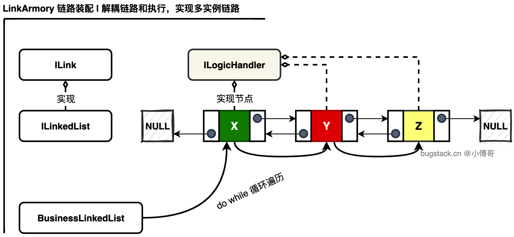
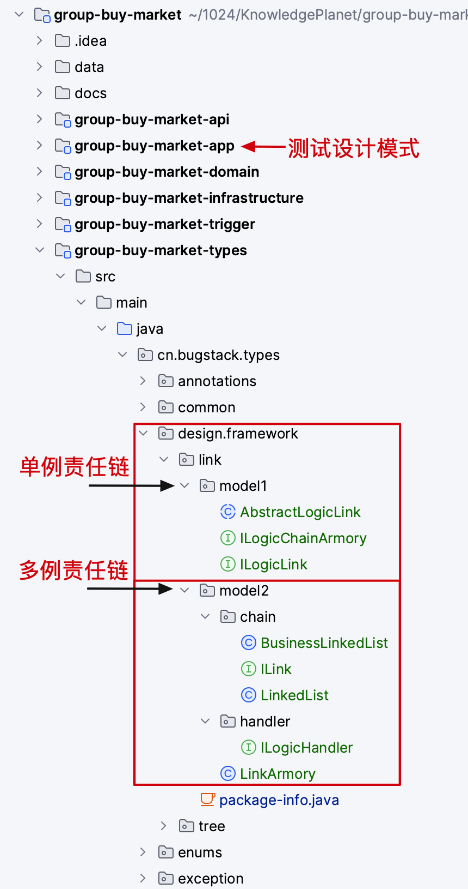

# 责任链抽象模板设计

> 学习序号 13｜小节 2-10｜原文：https://articles.zsxq.com/id_o7tll9alwbnx.html

**本章重点** ：设计通用的责任链实现方案，提供单例链和多例链，两种不同实现过程。

- **本章重点** ：★★★★☆
- **本节分支：** [https://gitcode.net/KnowledgePlanet/group-buy-market/-/tree/2-10-250118-xfg-link-design](https://gitcode.net/KnowledgePlanet/group-buy-market/-/tree/2-10-250118-xfg-link-design)
- **课程视频** ：[https://t.zsxq.com/Ao3ox](https://t.zsxq.com/Ao3ox)

**版权说明** ：©本项目与星球签约合作，受[《中华人民共和国著作权法实施条例》](https://www.gov.cn/gongbao/content/2013/content_2339485.htm) 版权法保护，禁止任何理由和任何方式公开(public)源码、资料、视频等小傅哥发布的星球内容到Github、Gitee等各类平台，违反可追究进一步的法律责任。

作者：小傅哥

博客：[https://bugstack.cn](https://bugstack.cn)

> 沉淀、分享、成长，让自己和他人都能有所收获！😄

大家好，我是小傅哥。

做开发了这么久，其实业务类的开发大部分都是串联流程，其实复杂度并不高。但之所以最后非常难理解，是写的人，驾驭能力不强，把工程写的越来越难以理解。

而如果想让工程实现的逻辑好理解，就要做好解耦设计。而这些解耦的流程大部分是具有通用性的，所以我们可以设计出能解决大部分通用业务场景的共性模型结构。

在之前小傅哥就带着大家设计了一个规则树的模型，本节我们借着项目的开发在设计一款通用的责任链模型结构。

### 一、本章诉求

在拼团交易的下单锁定优惠的过程中，以及后续的流程，都会有简单的规则串联。所以，我们先来提前做好通用的责任链模型结构，便于后续使用。

本节会涉及到链表的基础数据结构知识，可以提前补充学习；[https://bugstack.cn/md/algorithm/data-structures/2022-07-22-linked-list.html](https://bugstack.cn/md/algorithm/data-structures/2022-07-22-linked-list.html)

### 二、模型设计

责任链是一种简单的单链路结构，在工程中会有多个这样的单链，为了可以让不同的场景都能创建出自己的链，则需要解耦责任链的链路和执行，再有执行器处理。在本次实现中小傅哥会给大家体统两种责任链，让大家对照学习。设计如图；



- 如图，这是一种多实例对象责任链的设计结构，会使用到如 Java JDK 源码中 Link 的方式填写链路，之后再有业务链路处理链路执行。而每一个链路都会被填充一个逻辑处理器的实现类（ILogicHandler）来处理具体的业务。
- 那么，这样就很好的扩展了各种链路的使用诉求。我们可以结合代码来学习。

### 三、编码实现

#### 1. 工程结构



- 在 types -> design，提供 link 责任链。model1、model2
- model1，是通用的单例链，本身抽象类既可添加链路节点，又能做链路过程执行处理。
- model2，拆分了责任链和执行处理器，并由 LinkArmory 进行装配。这样就可以填充多例链。

#### 2. 单例链路

这是一套简单的单例链处理；

```
                public interface ILogicChainArmory<T, D, R> {

    ILogicLink<T, D, R> next();

    ILogicLink<T, D, R> appendNext(ILogicLink<T, D, R> next);

}

public interface ILogicLink<T, D, R> extends ILogicChainArmory<T, D, R> {

    R apply(T requestParameter, D dynamicContext) throws Exception;

}

public abstract class AbstractLogicLink<T, D, R> implements ILogicLink<T, D, R> {

    private ILogicLink<T, D, R> next;

    @Override
    public ILogicLink<T, D, R> next() {
        return next;
    }

    @Override
    public ILogicLink<T, D, R> appendNext(ILogicLink<T, D, R> next) {
        this.next = next;
        return next;
    }

    protected R next(T requestParameter, D dynamicContext) throws Exception {
        return next.apply(requestParameter, dynamicContext);
    }

}
```

- ILogicChainArmory 装配链，提供添加节点方法和获取节点。
- ILogicLink 继承 ILogicChainArmory，并提供一个受理业务逻辑的方法。
- AbstractLogicLink 的过程是封装添加节点和执行 next 下一个节点的方法。

那么，这里是由统一的类维护责任链，也就是一份责任链。如果有2个独立的链要处理，就需要使用到非单例的类进行填充，否则会修改同一份链。也就是 `ILogicLink<T, D, R> next `被几份链反复调整，也就不是一个单独的链了。

#### 3. 多例链路

多例链的设计要解耦链路和执行，把链路当做一个 LinkedList 列表处理，之后执行当做是单独的 for 循环。

##### 3.1 链表接口

```
                public interface ILink<E> {

    boolean add(E e);

    boolean addFirst(E e);

    boolean addLast(E e);

    boolean remove(Object o);

    E get(int index);

    void printLinkList();

}
```

##### 3.2 链表实现

```
                public class LinkedList<E> implements ILink<E> {

    /**
     * 责任链名称
     */
    private final String name;

    transient int size = 0;

    transient Node<E> first;

    transient Node<E> last;

    public LinkedList(String name) {
        this.name = name;
    }

    void linkFirst(E e) {
        final Node<E> f = first;
        final Node<E> newNode = new Node<>(null, e, f);
        first = newNode;
        if (f == null)
            last = newNode;
        else
            f.prev = newNode;
        size++;
    }

    void linkLast(E e) {
        final Node<E> l = last;
        final Node<E> newNode = new Node<>(l, e, null);
        last = newNode;
        if (l == null) {
            first = newNode;
        } else {
            l.next = newNode;
        }
        size++;
    }

    @Override
    public boolean add(E e) {
        linkLast(e);
        return true;
    }

    @Override
    public boolean addFirst(E e) {
        linkFirst(e);
        return true;
    }

    @Override
    public boolean addLast(E e) {
        linkLast(e);
        return true;
    }

    @Override
    public boolean remove(Object o) {
        if (o == null) {
            for (Node<E> x = first; x != null; x = x.next) {
                if (x.item == null) {
                    unlink(x);
                    return true;
                }
            }
        } else {
            for (Node<E> x = first; x != null; x = x.next) {
                if (o.equals(x.item)) {
                    unlink(x);
                    return true;
                }
            }
        }
        return false;
    }

    E unlink(Node<E> x) {
        final E element = x.item;
        final Node<E> next = x.next;
        final Node<E> prev = x.prev;

        if (prev == null) {
            first = next;
        } else {
            prev.next = next;
            x.prev = null;
        }

        if (next == null) {
            last = prev;
        } else {
            next.prev = prev;
            x.next = null;
        }

        x.item = null;
        size--;
        return element;
    }

    @Override
    public E get(int index) {
        return node(index).item;
    }

    Node<E> node(int index) {
        if (index < (size >> 1)) {
            Node<E> x = first;
            for (int i = 0; i < index; i++)
                x = x.next;
            return x;
        } else {
            Node<E> x = last;
            for (int i = size - 1; i > index; i--)
                x = x.prev;
            return x;
        }
    }

    public void printLinkList() {
        if (this.size == 0) {
            System.out.println("链表为空");
        } else {
            Node<E> temp = first;
            System.out.print("目前的列表，头节点：" + first.item + " 尾节点：" + last.item + " 整体：");
            while (temp != null) {
                System.out.print(temp.item + "，");
                temp = temp.next;
            }
            System.out.println();
        }
    }

    protected static class Node<E> {

        E item;
        Node<E> next;
        Node<E> prev;

        public Node(Node<E> prev, E element, Node<E> next) {
            this.item = element;
            this.next = next;
            this.prev = prev;
        }

    }

    public String getName() {
        return name;
    }

}
```

这部分可以参考数据结构：[https://bugstack.cn/md/algorithm/data-structures/2022-07-22-linked-list.html](https://bugstack.cn/md/algorithm/data-structures/2022-07-22-linked-list.html)

##### 3.3 业务链路

```
                public class BusinessLinkedList<T, D, R> extends LinkedList<ILogicHandler<T, D, R>> implements ILogicHandler<T, D, R> {

    public BusinessLinkedList(String name) {
        super(name);
    }

    @Override
    public R apply(T requestParameter, D dynamicContext) throws Exception {
        Node<ILogicHandler<T, D, R>> current = this.first;
        do {
            ILogicHandler<T, D, R> item = current.item;
            R apply = item.apply(requestParameter, dynamicContext);
            if (null != apply) return apply;

            current = current.next;
        } while (null != current);

        return null;
    }

}

public interface ILogicHandler<T, D, R> {

    default R next(T requestParameter, D dynamicContext) {
        return null;
    }

    R apply(T requestParameter, D dynamicContext) throws Exception;

}
```

- BusinessLinkedList 存在的意义是为了受理业务流程，循环遍历责任链。遍历的过程不只是这样，也可以实现 Iterable 来处理。
- 遍历的过程会以 apply 是否为空和链路是否走到最后来判断。apply 为空则表示当前 ILogicHandler 实现的节点的业务流程为空，放行到下一个节点。

##### 3.4 链路装配

```
                public class LinkArmory<T, D, R> {

    private final BusinessLinkedList<T, D, R> logicLink;

    @SafeVarargs
    public LinkArmory(String linkName, ILogicHandler<T, D, R>... logicHandlers) {
        logicLink = new BusinessLinkedList<>(linkName);
        for (ILogicHandler<T, D, R> logicHandler: logicHandlers){
            logicLink.add(logicHandler);
        }
    }

    public BusinessLinkedList<T, D, R> getLogicLink() {
        return logicLink;
    }

}
```

- 提供一个链路装配器，让调用方自行装配处理。

### 四、测试验证

#### 1. 单例链

```
                @Slf4j
@Service
public class RuleLogic101 extends AbstractLogicLink<String, Rule02TradeRuleFactory.DynamicContext, String>{

    @Override
    public String apply(String requestParameter, Rule02TradeRuleFactory.DynamicContext dynamicContext) throws Exception {

        log.info("link model01 RuleLogic101");

        return next(requestParameter, dynamicContext);
    }

}

@Slf4j
@Service
public class RuleLogic102 extends AbstractLogicLink<String, Rule02TradeRuleFactory.DynamicContext, String>{

    @Override
    public String apply(String requestParameter, Rule02TradeRuleFactory.DynamicContext dynamicContext) throws Exception {

        log.info("link model01 RuleLogic102");

        return "link model01 单实例链";
    }

}

@Service
public class Rule01TradeRuleFactory {

    @Resource
    private RuleLogic101 ruleLogic101;
    @Resource
    private RuleLogic102 ruleLogic102;

    public ILogicLink<String, Rule02TradeRuleFactory.DynamicContext, String> openLogicLink() {
        ruleLogic101.appendNext(ruleLogic102);
        return ruleLogic101;
    }

    @Data
    @Builder
    @AllArgsConstructor
    @NoArgsConstructor
    public static class DynamicContext {
        private String age;
    }

}
```

```
                @Slf4j
@RunWith(SpringRunner.class)
@SpringBootTest
public class Link01Test {

    @Resource
    public Rule01TradeRuleFactory rule01TradeRuleFactory;

    @Test
    public void test_model01_01() throws Exception {
        ILogicLink<String, Rule02TradeRuleFactory.DynamicContext, String> logicLink = rule01TradeRuleFactory.openLogicLink();
        String logic = logicLink.apply("123", new Rule02TradeRuleFactory.DynamicContext());
        log.info("测试结果:{}", JSON.toJSONString(logic));
    }

}
```

```
                25-01-18.14:50:25.089 [main            ] INFO  RuleLogic101           - link model01 RuleLogic101
25-01-18.14:50:25.089 [main            ] INFO  RuleLogic102           - link model01 RuleLogic102
25-01-18.14:50:25.382 [main            ] INFO  Link01Test             - 测试结果:"link model01 单实例链"
```

- 实现2个规则链路，之后由工厂装配。
- 之后在测试类 Link01Test 进行验证。

#### 2. 多例链

```
                @Slf4j
@Service
public class RuleLogic201 implements ILogicHandler<String, Rule02TradeRuleFactory.DynamicContext, XxxResponse> {

    public XxxResponse apply(String requestParameter, Rule02TradeRuleFactory.DynamicContext dynamicContext) throws Exception{

        log.info("link model02 RuleLogic201");

        return next(requestParameter, dynamicContext);
    }

}

@Slf4j
@Service
public class RuleLogic202 implements ILogicHandler<String, Rule02TradeRuleFactory.DynamicContext, XxxResponse> {

    public XxxResponse apply(String requestParameter, Rule02TradeRuleFactory.DynamicContext dynamicContext) throws Exception{

        log.info("link model02 RuleLogic202");

        return new XxxResponse("hi 小傅哥！");
    }

}

@Service
public class Rule02TradeRuleFactory {

    @Bean("demo01")
    public BusinessLinkedList<String, DynamicContext, XxxResponse> demo01(RuleLogic201 ruleLogic201, RuleLogic202 ruleLogic202) {

        LinkArmory<String, DynamicContext, XxxResponse> linkArmory = new LinkArmory<>("demo01", ruleLogic201, ruleLogic202);

        return linkArmory.getLogicLink();
    }

    @Bean("demo02")
    public BusinessLinkedList<String, DynamicContext, XxxResponse> demo02(RuleLogic202 ruleLogic202) {

        LinkArmory<String, DynamicContext, XxxResponse> linkArmory = new LinkArmory<>("demo02", ruleLogic202);

        return linkArmory.getLogicLink();
    }

    @Data
    @Builder
    @AllArgsConstructor
    @NoArgsConstructor
    public static class DynamicContext {
        private String age;
    }

}
```

```
                @Slf4j
@RunWith(SpringRunner.class)
@SpringBootTest
public class Link02Test {

    @Resource(name = "demo01")
    private BusinessLinkedList<String, Rule02TradeRuleFactory.DynamicContext, XxxResponse> businessLinkedList01;

    @Resource(name = "demo02")
    private BusinessLinkedList<String, Rule02TradeRuleFactory.DynamicContext, XxxResponse> businessLinkedList02;

    @Test
    public void test_model02_01() throws Exception {
        XxxResponse apply = businessLinkedList01.apply("123", new Rule02TradeRuleFactory.DynamicContext());
        log.info("测试结果:{}", JSON.toJSONString(apply));
    }

    @Test
    public void test_model02_02() throws Exception {
        XxxResponse apply = businessLinkedList02.apply("123", new Rule02TradeRuleFactory.DynamicContext());
        log.info("测试结果:{}", JSON.toJSONString(apply));
    }

}
```

```
                25-01-18.14:53:41.070 [main            ] INFO  RuleLogic201           - link model02 RuleLogic201
25-01-18.14:53:41.070 [main            ] INFO  RuleLogic202           - link model02 RuleLogic202
25-01-18.14:53:41.303 [main            ] INFO  Link02Test             - 测试结果:{"age":"hi 小傅哥！"}
```

- 多例链与单例链最大的区别在于，工厂里直接配置了两个 Bean 对象，组装不同的链路。每个链路只维护自己的流程。
- 之后在单测类里分别测试两套链路。测试结果符合预期。

**以上，就是两套责任链模板的设计和使用。后续我们将解决实际的业务场景问题，来使用这套东西。**

### 五、读者作业

- 简单作业：深入理解两套责任链的模型的设计和案例的使用，可以运行出课程结果。
- 复制作业：你是否还能在做一套多例链的实现方案。
