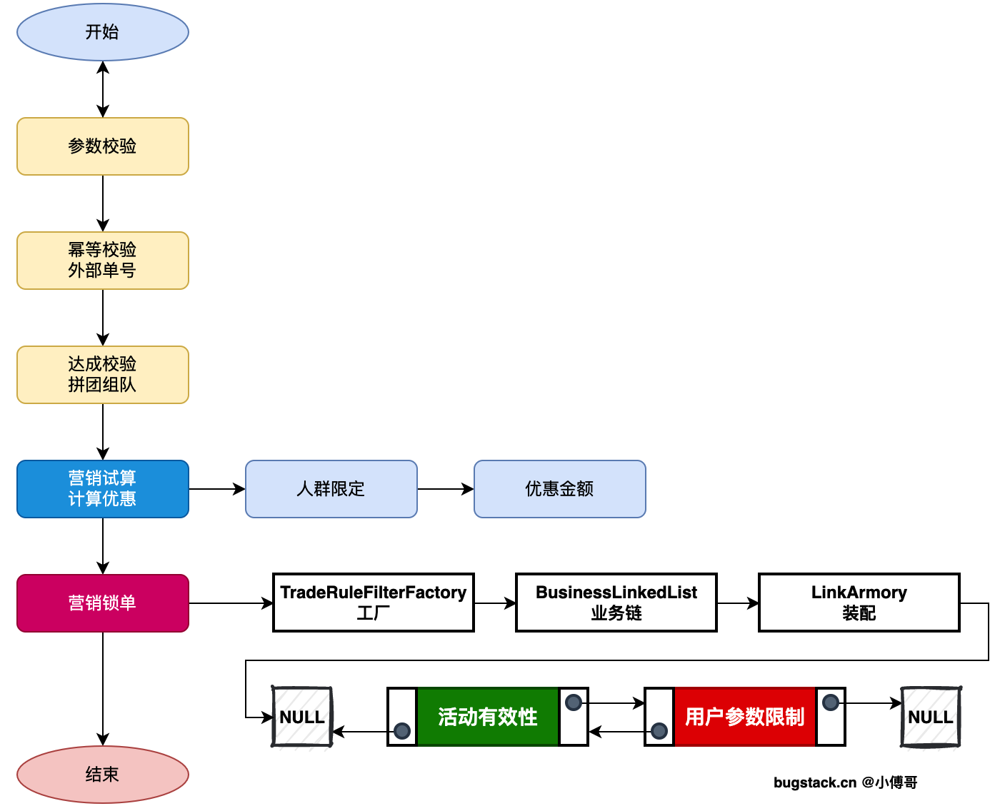
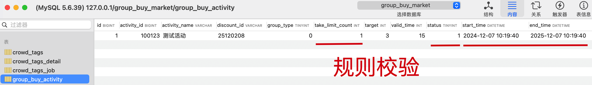
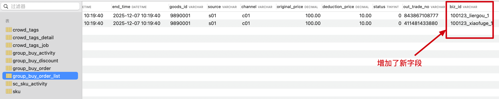
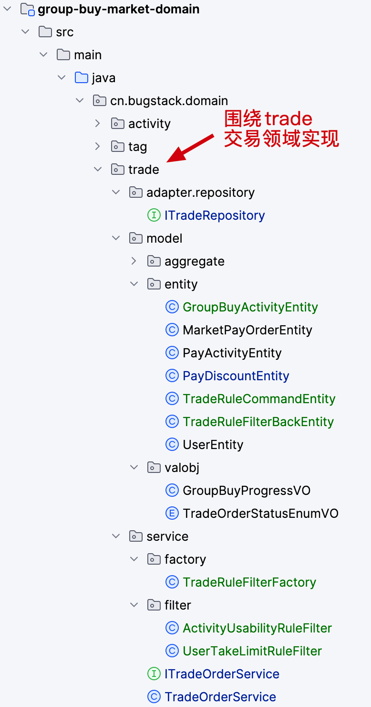
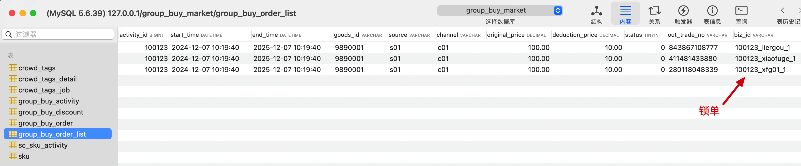

# 交易规则责任链过滤

> 学习序号 14｜小节 2-11｜原文：https://articles.zsxq.com/id_pr3utfa4bw4f.html

**本章重点** ：完善拼团交易营销锁单的流程，增加锁单流程中的规则处理。

- **本章重点** ：★★★★☆
- **本节分支：** [https://gitcode.net/KnowledgePlanet/group-buy-market/-/tree/2-11-250125-xfg-trade-rule-link](https://gitcode.net/KnowledgePlanet/group-buy-market/-/tree/2-11-250125-xfg-trade-rule-link)
- **课程视频** ：[https://t.zsxq.com/wxTw6](https://t.zsxq.com/wxTw6)

**版权说明** ：©本项目与星球签约合作，受[《中华人民共和国著作权法实施条例》](https://www.gov.cn/gongbao/content/2013/content_2339485.htm) 版权法保护，禁止任何理由和任何方式公开(public)源码、资料、视频等小傅哥发布的星球内容到Github、Gitee等各类平台，违反可追究进一步的法律责任。

作者：小傅哥

博客：[https://bugstack.cn](https://bugstack.cn)

> 沉淀、分享、成长，让自己和他人都能有所收获！😄

- 一、本章诉求
- 二、业务流程
- 三、编程实现
  - 1. 工程结构
  - 2. 功能修复（fix）
  - 3. 交易规则模型
- 四、测试验证
- 五、读者作业

大家好，我是小傅哥

为什么公司里有些人做了很多事情，写了很多代码，但到最后也没有多大的成绩呢？

其实很多时候就是太重复了，从刚开始对工程不理解，到能熟练上手以后，就从脑力活变成了体力活，一遍遍的重复自己。所以，就算是工作几年，也和前面刚开始工作差不多，就只是熟练了业务，但技术却没有提升。

所以，多提高编程思维，锻炼编码能力，一次次对工程进行抽象，提炼出骨架的核心设计，才是非常重要的。

### 一、本章诉求

完善拼团交易营销锁单的流程，增加锁单流程中的规则处理。

本节的规则过滤，会使用到前面章节设计的统一的设计模式框架中的责任链模式。对这类轻量的场景，一般只需要选择单链的执行模型即可，而与之对比的规则树，是适合于那种节点间的复杂分支流转。

### 二、业务流程

如图，增加交易规则处理；



- 在前面章节，我们实现了拼团锁单中，参数校验、幂等校验、达成校验，之后做了营销试算和营销锁单。
- 那么在本节，还需要对营销锁单继续完善，过滤拼团活动配置的规则。包括；活动的有效期、状态，以及个人参与拼团的次数。在实际公司中的项目里，还会有更多的规则要被处理。

### 三、编程实现

**注意；**



- 本节对库表进行了调整，新增加了字段。记得用课程代码下 docs/dev-ops/mysql/sql 下的文件，更新数据库表。

#### 1. 工程结构



- 本节会围绕 trade 领域内 service 服务下的规则进行实现。实现的过程会使用到前面章节定义的责任链模板。
- 注意；在学习代码中，查看工程中小傅哥提交代码的记录，这样你可以注意到全部代码变动细节。

#### 2. 功能修复（fix）

##### 2.1 营销优惠记录支付金额

```
                BigDecimal payPrice = discountCalculateService.calculate(requestParameter.getUserId(), skuVO.getOriginalPrice(), groupBuyDiscount);
dynamicContext.setDeductionPrice(skuVO.getOriginalPrice().subtract(payPrice));
dynamicContext.setPayPrice(payPrice);
```

- 为了更好的使用拼团营销试算，明确试算返回的优惠折扣和支付金额，为此在 拼团试算 MarketNode 节点，增加 payPrice 属性填写支付金额。

##### 2.2 营销优惠计算使用人群ID

```
                public abstract class AbstractDiscountCalculateService implements IDiscountCalculateService {

    @Resource
    protected IActivityRepository repository;

    @Override
    public BigDecimal calculate(String userId, BigDecimal originalPrice, GroupBuyActivityDiscountVO.GroupBuyDiscount groupBuyDiscount) {
        // 1. 人群标签过滤
        if (DiscountTypeEnum.TAG.equals(groupBuyDiscount.getDiscountType())){
            boolean isCrowdRange = filterTagId(userId, groupBuyDiscount.getTagId());
            if (!isCrowdRange) {
                log.info("折扣优惠计算拦截，用户不再优惠人群标签范围内 userId:{}", userId);
                return originalPrice;
            }
        }
        // 2. 折扣优惠计算
        return doCalculate(originalPrice, groupBuyDiscount);
    }

    // 人群过滤 - 限定人群优惠
    private boolean filterTagId(String userId, String tagId) {
        return repository.isTagCrowdRange(tagId, userId);
    }

    protected abstract BigDecimal doCalculate(BigDecimal originalPrice, GroupBuyActivityDiscountVO.GroupBuyDiscount groupBuyDiscount);

}
```

- 完善 AbstractDiscountCalculateService#filterTagId 中对人群标签的使用。

#### 3. 交易规则模型

##### 3.1 活动的可用性

```
                @Slf4j
@Service
public class ActivityUsabilityRuleFilter implements ILogicHandler<TradeRuleCommandEntity, TradeRuleFilterFactory.DynamicContext, TradeRuleFilterBackEntity> {

    @Resource
    private ITradeRepository repository;

    @Override
    public TradeRuleFilterBackEntity apply(TradeRuleCommandEntity requestParameter, TradeRuleFilterFactory.DynamicContext dynamicContext) throws Exception {
        log.info("交易规则过滤-活动的可用性校验{} activityId:{}", requestParameter.getUserId(), requestParameter.getActivityId());

        // 查询拼团活动
        GroupBuyActivityEntity groupBuyActivity = repository.queryGroupBuyActivityEntityByActivityId(requestParameter.getActivityId());

        // 校验；活动状态 - 可以抛业务异常code，或者把code写入到动态上下文dynamicContext中，最后获取。
        if (!ActivityStatusEnumVO.EFFECTIVE.equals(groupBuyActivity.getStatus())) {
            log.info("活动的可用性校验，非生效状态 activityId:{}", requestParameter.getActivityId());
            throw new AppException(ResponseCode.E0101);
        }

        // 校验；活动时间
        Date currentTime = new Date();
        if (currentTime.before(groupBuyActivity.getStartTime()) || currentTime.after(groupBuyActivity.getEndTime())) {
            log.info("活动的可用性校验，非可参与时间范围 activityId:{}", requestParameter.getActivityId());
            throw new AppException(ResponseCode.E0102);
        }

        // 写入动态上下文
        dynamicContext.setGroupBuyActivity(groupBuyActivity);

        // 走到下一个责任链节点
        return next(requestParameter, dynamicContext);
    }

}
```

- 活动可用性过滤活动的状态和时间。之后把活动数据写入到上下文中。

##### 3.2 用户参与限制

```
                @Slf4j
@Service
public class UserTakeLimitRuleFilter implements ILogicHandler<TradeRuleCommandEntity, TradeRuleFilterFactory.DynamicContext, TradeRuleFilterBackEntity> {

    @Resource
    private ITradeRepository repository;

    @Override
    public TradeRuleFilterBackEntity apply(TradeRuleCommandEntity requestParameter, TradeRuleFilterFactory.DynamicContext dynamicContext) throws Exception {
        log.info("交易规则过滤-用户参与次数校验{} activityId:{}", requestParameter.getUserId(), requestParameter.getActivityId());

        GroupBuyActivityEntity groupBuyActivity = dynamicContext.getGroupBuyActivity();

        // 查询用户在一个拼团活动上参与的次数
        Integer count = repository.queryOrderCountByActivityId(requestParameter.getActivityId(), requestParameter.getUserId());

        if (null != groupBuyActivity.getTakeLimitCount() && count >= groupBuyActivity.getTakeLimitCount()) {
            log.info("用户参与次数校验，已达可参与上限 activityId:{}", requestParameter.getActivityId());
            throw new AppException(ResponseCode.E0103);
        }

        return TradeRuleFilterBackEntity.builder()
                .userTakeOrderCount(count)
                .build();
    }

}
```

- 如果拼团活动配置了对用户的参与次数限制，那么需要在用户参与活动前，做好数量的校验拦截。
- 比如用户可以参与3次，那么库表里会记录3条数据；`活动ID_用户ID_1`、`活动ID_用户ID_2`、`活动ID_用户ID_3`，这样可以在库表层面做最强的防护拦截，不会让一个用户无限的参与活动。

##### 3.3 交易规则工厂

```
                @Slf4j
@Service
public class TradeRuleFilterFactory {

    @Bean("tradeRuleFilter")
    public BusinessLinkedList<TradeRuleCommandEntity, TradeRuleFilterFactory.DynamicContext, TradeRuleFilterBackEntity> tradeRuleFilter(ActivityUsabilityRuleFilter activityUsabilityRuleFilter, UserTakeLimitRuleFilter userTakeLimitRuleFilter) {
        // 组装链
        LinkArmory<TradeRuleCommandEntity, TradeRuleFilterFactory.DynamicContext, TradeRuleFilterBackEntity> linkArmory =
                new LinkArmory<>("交易规则过滤链", activityUsabilityRuleFilter, userTakeLimitRuleFilter);

        // 链对象
        return linkArmory.getLogicLink();
    }

    @Data
    @Builder
    @AllArgsConstructor
    @NoArgsConstructor
    public static class DynamicContext {

        private GroupBuyActivityEntity groupBuyActivity;

    }

}
```

- 责任链的规则创建完成后，就是在工厂类中构建责任链。
- 像是在实际的公司业务开发中，一个责任链会有很多这样的规则，因为要过滤用户的开户状态、授信状态、渠道状态、风控状态、额度状态等。那么这样的设计分层结构就非常好扩展和维护了。
- 此外，也不只是一个责任链，而是很多，他们根据不同的业务模型，比如；乡村交易、政企交易、校园交易、普户交易等，他们的规则流程也是不同的，那么为不同的流程，直接配置出对应的责任链，就可以快速的搭建符合的业务流程了，开发效率、维护效率都嘎嘎的，你的技术认可度也嘎嘎提高！

### 四、测试验证

```
                @Test
public void test_lockMarketPayOrder() {
    LockMarketPayOrderRequestDTO lockMarketPayOrderRequestDTO = new LockMarketPayOrderRequestDTO();
    lockMarketPayOrderRequestDTO.setUserId("xfg01");
    lockMarketPayOrderRequestDTO.setTeamId(null);
    lockMarketPayOrderRequestDTO.setActivityId(100123L);
    lockMarketPayOrderRequestDTO.setGoodsId("9890001");
    lockMarketPayOrderRequestDTO.setSource("s01");
    lockMarketPayOrderRequestDTO.setChannel("c01");
    lockMarketPayOrderRequestDTO.setOutTradeNo(RandomStringUtils.randomNumeric(12));
    Response<LockMarketPayOrderResponseDTO> lockMarketPayOrderResponseDTOResponse = marketTradeService.lockMarketPayOrder(lockMarketPayOrderRequestDTO);
    log.info("测试结果 req:{} res:{}", JSON.toJSONString(lockMarketPayOrderRequestDTO), JSON.toJSONString(lockMarketPayOrderResponseDTOResponse));
}
```

```
                25-01-25.18:13:36.007 [main            ] INFO  MarketTradeController  - 营销交易锁单:xfg01 LockMarketPayOrderRequestDTO:{"activityId":100123,"channel":"c01","goodsId":"9890001","outTradeNo":"280118048339","source":"s01","userId":"xfg01"}
25-01-25.18:13:36.008 [main            ] INFO  TradeOrderService      - 拼团交易-查询未支付营销订单:xfg01 outTradeNo:280118048339
25-01-25.18:13:36.048 [main            ] INFO  HikariDataSource       - HikariPool-1 - Starting...
25-01-25.18:13:36.389 [main            ] INFO  HikariDataSource       - HikariPool-1 - Start completed.
25-01-25.18:13:36.462 [main            ] INFO  RootNode               - 拼团商品查询试算服务-RootNode userId:xfg01 requestParameter:{"activityId":100123,"channel":"c01","goodsId":"9890001","source":"s01","userId":"xfg01"}
25-01-25.18:13:36.462 [main            ] INFO  SwitchNode             - 拼团商品查询试算服务-SwitchNode userId:xfg01 requestParameter:{"activityId":100123,"channel":"c01","goodsId":"9890001","source":"s01","userId":"xfg01"}
25-01-25.18:13:36.488 [main            ] INFO  MarketNode             - 拼团商品查询试算服务-MarketNode userId:xfg01 异步线程加载数据「GroupBuyActivityDiscountVO、SkuVO」完成
25-01-25.18:13:36.489 [main            ] INFO  MarketNode             - 拼团商品查询试算服务-MarketNode userId:xfg01 requestParameter:{"activityId":100123,"channel":"c01","goodsId":"9890001","source":"s01","userId":"xfg01"}
25-01-25.18:13:36.489 [main            ] INFO  MJCalculateService     - 优惠策略折扣计算:0
25-01-25.18:13:36.508 [main            ] INFO  EndNode                - 拼团商品查询试算服务-EndNode userId:xfg01 requestParameter:{"activityId":100123,"channel":"c01","goodsId":"9890001","source":"s01","userId":"xfg01"}
25-01-25.18:13:36.517 [main            ] INFO  TradeOrderService      - 拼团交易-锁定营销优惠支付订单:xfg01 activityId:100123 goodsId:9890001
25-01-25.18:13:36.519 [main            ] INFO  ActivityUsabilityRuleFilter - 交易规则过滤-活动的可用性校验xfg01 activityId:100123
25-01-25.18:13:36.526 [main            ] INFO  UserTakeLimitRuleFilter - 交易规则过滤-用户参与次数校验xfg01 activityId:100123
25-01-25.18:13:36.588 [main            ] INFO  MarketTradeController  - 交易锁单记录(新):xfg01 marketPayOrderEntity:{"deductionPrice":10.00,"orderId":"411465666692","tradeOrderStatusEnumVO":"CREATE"}
25-01-25.18:13:36.599 [main            ] INFO  MarketTradeControllerTest - 测试结果 req:{"activityId":100123,"channel":"c01","goodsId":"9890001","outTradeNo":"280118048339","source":"s01","userId":"xfg01"} res:{"code":"0000","data":{"deductionPrice":10.00,"orderId":"411465666692","tradeOrderStatus":0},"info":"成功"}
```



- xfg01 是已经加入人群标签的用户。
- 测试验证，营销锁单，写入数据。
- 本次开发流程中会对活动状态、有效期范围等都做了校验，你可以调整数据分别测试验证。

### 五、读者作业

- 简单作业：理解本节的业务流程，熟练使用责任链模型开发业务需求。
- 复杂作业：可以在增加一个新的责任链节点，校验一个你希望过滤的用户信息。
