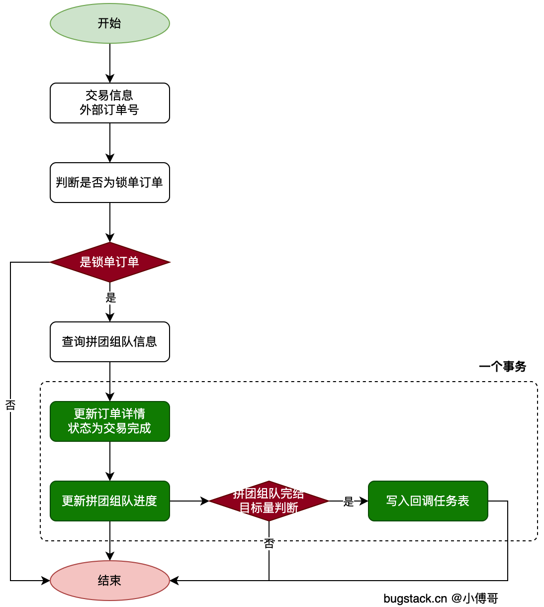
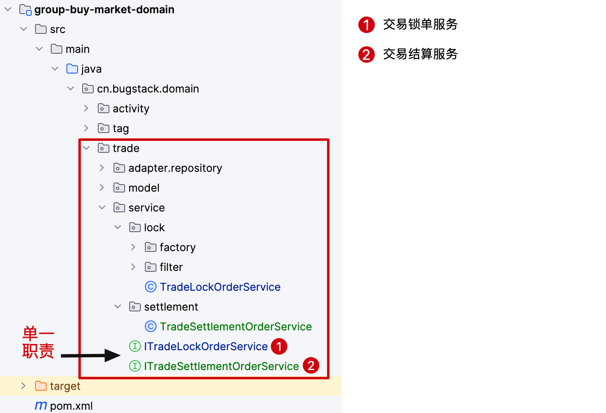
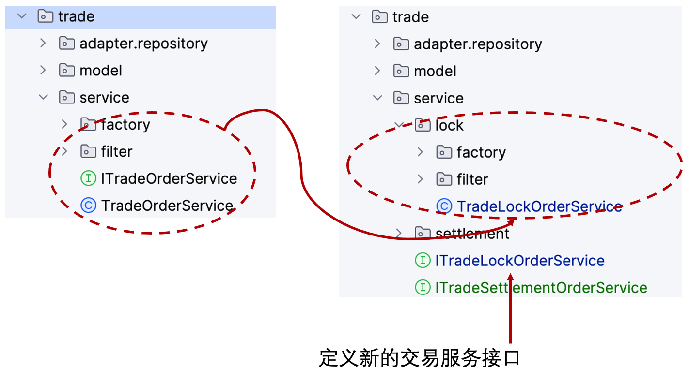
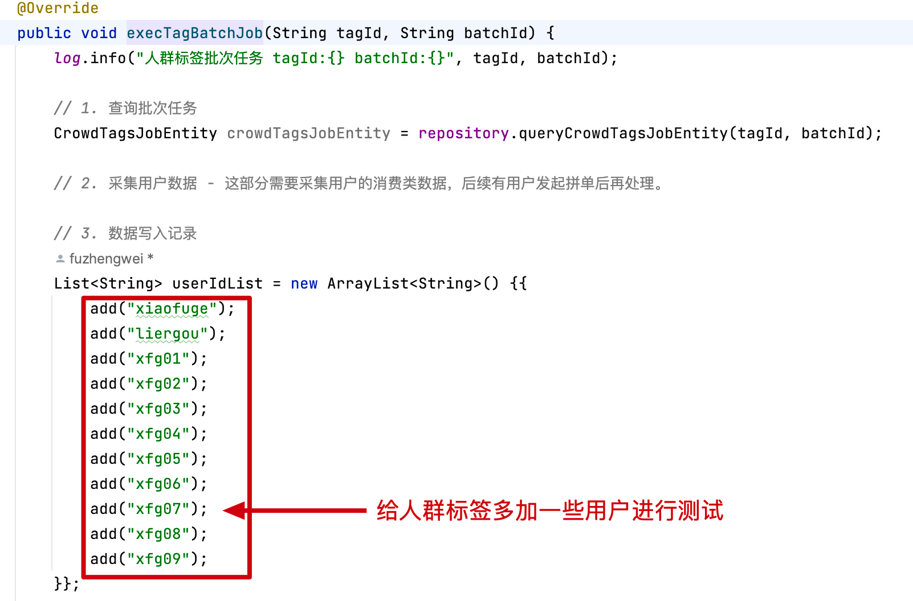
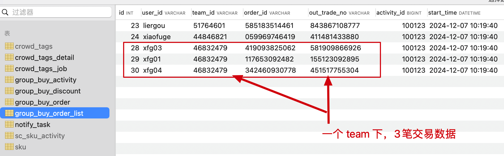
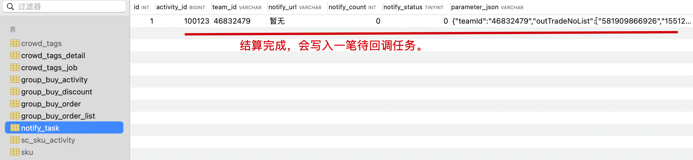

# 拼团组队结算统计

> 学习序号 15｜小节 2-12｜原文：https://articles.zsxq.com/id_6h8g7mp9mn5t.html

**本章重点** ：提供拼团交易结算服务，对支付完成的商品做拼团数量统计。

- **本章重点** ：★★★★☆
- **本节分支：** [https://gitcode.net/KnowledgePlanet/group-buy-market/-/tree/2-12-250128-xfg-trade-settlement](https://gitcode.net/KnowledgePlanet/group-buy-market/-/tree/2-12-250128-xfg-trade-settlement)
- **课程视频** ：[https://t.zsxq.com/89N6w](https://t.zsxq.com/89N6w)

**版权说明** ：©本项目与星球签约合作，受[《中华人民共和国著作权法实施条例》](https://www.gov.cn/gongbao/content/2013/content_2339485.htm) 版权法保护，禁止任何理由和任何方式公开(public)源码、资料、视频等小傅哥发布的星球内容到Github、Gitee等各类平台，违反可追究进一步的法律责任。

作者：小傅哥

博客：[https://bugstack.cn](https://bugstack.cn)

> 沉淀、分享、成长，让自己和他人都能有所收获！😄

- 一、本章诉求
- 二、业务流程
- 三、编码实现
  - 1. 工程结构
  - 2. 重构锁单
  - 3. 拼团结算
- 四、测试验证
  - 1. 前置说明
  - 2. 锁单测试
  - 2. 结算测试
- 五、读者作业

大家好，我是技术UP主小傅哥。

其实互联网大厂也是从草蜢阶段过来的，所以到现在才有这么大的技术债。几乎每年我们都要为工程制定体系化建设的计划，新的工程采用纯新的架构模型实现，旧的工程分为重构计划和工程内编码治理。

通过这样的手段，让工程一点点从严重的腐化中拆解出来。所以你在学习咱们的新项目时候，也会感受到不断的抽象和治理，让代码变得容易被理解和迭代。

### 一、本章诉求

首先，你可以回忆下咱们整个拼团业务的流程。

拼团的过程是用户在商城下单，锁定拼团优惠（也就是拼团系统里锁单的过程）。之后就是用户给这笔商品完成支付交易，交易后不会直接发货，直至拼团组队完成后才会发货。

那么，这里有一个流程，就是支付完成后，需要做拼团数量的统计结算。如，拼团需要3个用户一起下单，那么每完成一笔支付，就要给拼团的组队加上一笔记录。这个就是本节要实现的流程。

### 二、业务流程

如图，拼团结算流程。



- 首先，交易订单的营销结算，核心就是更新拼团队伍的参与人数数量。每完成一笔支付，就有一笔拼团进度数量+1。
- 之后，这里要知道，更新拼团订单的明细状态（交易完成）和更新拼团进度数量要在一个事务下完成。
- 另外，更新拼团的进度要判断，当前是否为最后一次拼团完结状态。比如计算剩余1个，即可完成拼团目标量，那么这最后一笔更新完成后，既是整个拼团队伍的进度完成了。

### 三、编码实现

#### 1. 工程结构



- 首先，重构交易分层，用类的名称，拆分交易中的业务场景。以此完成单一职责的划分。
- 之后，trade 领域下目前包括2部分服务，一个是营销交易锁单服务，另外一个是本节新增加的，营销交易结算服务。
- 重点，在于本节实现的营销交易结算服务，对每一笔支付记录的记账处理，直至完成拼团进度。

#### 2. 重构锁单

单一职责的特点在于一个类，主要关心一类服务的设计。单一职责的好处是；**降低复杂性** 、**提高可读性和可维护性** 、**提高复用性** 、**降低变更风险** 。



那么，我们使用单一职责来设计接口，它的特点在于，接口的命名即可看出做的业务属性，如；ITradePay、ITradeRefund、ITradeSettlement 等。如果说没有单一职责，那么这些pay、refund、settlement，就会被写到一个接口类里，这个类会随着业务的迭代，被充斥大量的业务逻辑，越往后越难维护。所以对于这类场景，我们要做单一职责设计。

> 这部分直接参考工程源码即可，代码逻辑没有变化，只是调整了分层接口和接口命名。

#### 3. 拼团结算

##### 3.1 定义接口

```
                public interface ITradeSettlementOrderService {

    /**
     * 营销结算
     * @param tradePaySuccessEntity 交易支付订单实体对象
     * @return 交易结算订单实体
     */
    TradePaySettlementEntity settlementMarketPayOrder(TradePaySuccessEntity tradePaySuccessEntity);

}
```

- 首先，依照于单一职责，设计出一个交易结算的服务。
- 之后，定义营销结算的方法。入参为交易支付的成功实体信息，出参为交易结算的实体。

##### 3.2 功能实现

```
                @Slf4j
@Service
public class TradeSettlementOrderService implements ITradeSettlementOrderService {

    @Resource
    private ITradeRepository repository;

    @Override
    public TradePaySettlementEntity settlementMarketPayOrder(TradePaySuccessEntity tradePaySuccessEntity) {
        log.info("拼团交易-支付订单结算:{} outTradeNo:{}", tradePaySuccessEntity.getUserId(), tradePaySuccessEntity.getOutTradeNo());
        // 1. 查询拼团信息
        MarketPayOrderEntity marketPayOrderEntity = repository.queryMarketPayOrderEntityByOutTradeNo(tradePaySuccessEntity.getUserId(), tradePaySuccessEntity.getOutTradeNo());
        if (null == marketPayOrderEntity) {
            log.info("不存在的外部交易单号或用户已退单，不需要做支付订单结算:{} outTradeNo:{}", tradePaySuccessEntity.getUserId(), tradePaySuccessEntity.getOutTradeNo());
            return null;
        }

        // 2. 查询组团信息
        GroupBuyTeamEntity groupBuyTeamEntity = repository.queryGroupBuyTeamByTeamId(marketPayOrderEntity.getTeamId());

        // 3. 构建聚合对象
        GroupBuyTeamSettlementAggregate groupBuyTeamSettlementAggregate = GroupBuyTeamSettlementAggregate.builder()
                .userEntity(UserEntity.builder().userId(tradePaySuccessEntity.getUserId()).build())
                .groupBuyTeamEntity(groupBuyTeamEntity)
                .tradePaySuccessEntity(tradePaySuccessEntity)
                .build();

        // 4. 拼团交易结算
        repository.settlementMarketPayOrder(groupBuyTeamSettlementAggregate);

        // 5. 返回结算信息 - 公司中开发这样的流程时候，会根据外部需要进行值的设置
        return TradePaySettlementEntity.builder()
                .source(tradePaySuccessEntity.getSource())
                .channel(tradePaySuccessEntity.getChannel())
                .userId(tradePaySuccessEntity.getUserId())
                .teamId(marketPayOrderEntity.getTeamId())
                .activityId(groupBuyTeamEntity.getActivityId())
                .outTradeNo(tradePaySuccessEntity.getOutTradeNo())
                .build();
    }

}
```

- 首先，结算的过程分为查询外部的交易单号是否为拼团锁单订单，也就是说，之前这笔交易单号，参与过有效的锁单。
- 另外，商城类系统调用营销的要过滤是否有营销类信息，如果没有则不调用，这样会减轻对拼团类系统接口的压力。
- 最后，构建聚合对象，调用仓储层的 settlementMarketPayOrder 完成拼团类数据落库。

##### 3.3 事务操作

```
                @Slf4j
@Repository
public class TradeRepository implements ITradeRepository {

    @Resource
    private IGroupBuyActivityDao groupBuyActivityDao;
    @Resource
    private IGroupBuyOrderDao groupBuyOrderDao;
    @Resource
    private IGroupBuyOrderListDao groupBuyOrderListDao;
    @Resource
    private INotifyTaskDao notifyTaskDao;

    // ... 省略部分代码

    @Transactional(timeout = 500)
    @Override
    public void settlementMarketPayOrder(GroupBuyTeamSettlementAggregate groupBuyTeamSettlementAggregate) {

        UserEntity userEntity = groupBuyTeamSettlementAggregate.getUserEntity();
        GroupBuyTeamEntity groupBuyTeamEntity = groupBuyTeamSettlementAggregate.getGroupBuyTeamEntity();
        TradePaySuccessEntity tradePaySuccessEntity = groupBuyTeamSettlementAggregate.getTradePaySuccessEntity();

        // 1. 更新拼团订单明细状态
        GroupBuyOrderList groupBuyOrderListReq = new GroupBuyOrderList();
        groupBuyOrderListReq.setUserId(userEntity.getUserId());
        groupBuyOrderListReq.setOutTradeNo(tradePaySuccessEntity.getOutTradeNo());
        int updateOrderListStatusCount = groupBuyOrderListDao.updateOrderStatus2COMPLETE(groupBuyOrderListReq);
        if (1 != updateOrderListStatusCount) {
            throw new AppException(ResponseCode.E0005);
        }

        // 2. 更新拼团达成数量
        int updateAddCount = groupBuyOrderDao.updateAddCompleteCount(groupBuyTeamEntity.getTeamId());
        if (1 != updateAddCount) {
            throw new AppException(ResponseCode.E0005);
        }

        // 3. 更新拼团完成状态
        if (groupBuyTeamEntity.getTargetCount() - groupBuyTeamEntity.getCompleteCount() == 1) {
            int updateOrderStatusCount = groupBuyOrderDao.updateOrderStatus2COMPLETE(groupBuyTeamEntity.getTeamId());
            if (1 != updateOrderStatusCount) {
                throw new AppException(ResponseCode.E0005);
            }

            // 查询拼团交易完成外部单号列表
            List<String> outTradeNoList = groupBuyOrderListDao.queryGroupBuyCompleteOrderOutTradeNoListByTeamId(groupBuyTeamEntity.getTeamId());

            // 拼团完成写入回调任务记录
            NotifyTask notifyTask = new NotifyTask();
            notifyTask.setActivityId(groupBuyTeamEntity.getActivityId());
            notifyTask.setTeamId(groupBuyTeamEntity.getTeamId());
            notifyTask.setNotifyUrl("暂无");
            notifyTask.setNotifyCount(0);
            notifyTask.setNotifyStatus(0);
            notifyTask.setParameterJson(JSON.toJSONString(new HashMap<String, Object>() {{
                put("teamId", groupBuyTeamEntity.getTeamId());
                put("outTradeNoList", outTradeNoList);
            }}));

            notifyTaskDao.insert(notifyTask);
        }

    }

}
```

- 交易结算的过程分为；更新拼团订单明细状态、更新拼团达成数量，之后要判断当前这笔结算是否为最后的结算，如果是，还需要写入回调任务。
- 这里的回调任务，是在拼团结束后，回调商城系统，通知拼团完成。之后商城系统要对已经支付完成的订单进行发货。【如果你做过支付类系统（星球里的小型支付商城、openai应用、蓝兔支付sdk），都有支付完成的回调，通知你支付结果】
- 关于回调的流程，后续在做处理。你也可以先尝试考虑下这个流程。

### 四、测试验证

#### 1. 前置说明



- 首先，给人群标签任务固定的写入一些用户数据，方便我们做测试。

#### 2. 锁单测试

```
                @Slf4j
@RunWith(SpringRunner.class)
@SpringBootTest
public class ITradeLockOrderServiceTest {

    @Resource
    private IIndexGroupBuyMarketService indexGroupBuyMarketService;

    @Resource
    private ITradeLockOrderService tradeOrderService;

    @Test
    public void test_lockMarketPayOrder() throws Exception {
        // 入参信息
        Long activityId = 100123L;
        String userId = "xiaofuge";
        String goodsId = "9890001";
        String source = "s01";
        String channel = "c01";
        String outTradeNo = "909000098111";

        // 1. 获取试算优惠，有【activityId】优先使用
        TrialBalanceEntity trialBalanceEntity = indexGroupBuyMarketService.indexMarketTrial(MarketProductEntity.builder()
                .userId(userId)
                .source(source)
                .channel(channel)
                .goodsId(goodsId)
                .activityId(activityId)
                .build());

        GroupBuyActivityDiscountVO groupBuyActivityDiscountVO = trialBalanceEntity.getGroupBuyActivityDiscountVO();

        // 查询 outTradeNo 是否已经存在交易记录
        MarketPayOrderEntity marketPayOrderEntityOld = tradeOrderService.queryNoPayMarketPayOrderByOutTradeNo(userId, outTradeNo);
        if (null != marketPayOrderEntityOld) {
            log.info("测试结果(Old):{}", JSON.toJSONString(marketPayOrderEntityOld));
            return;
        }

        // 2. 锁定，营销预支付订单；商品下单前，预购锁定。
        MarketPayOrderEntity marketPayOrderEntityNew = tradeOrderService.lockMarketPayOrder(
                UserEntity.builder().userId(userId).build(),
                PayActivityEntity.builder()
                        .teamId(null)
                        .activityId(groupBuyActivityDiscountVO.getActivityId())
                        .activityName(groupBuyActivityDiscountVO.getActivityName())
                        .startTime(groupBuyActivityDiscountVO.getStartTime())
                        .endTime(groupBuyActivityDiscountVO.getEndTime())
                        .targetCount(groupBuyActivityDiscountVO.getTarget())
                        .build(),
                PayDiscountEntity.builder()
                        .source(source)
                        .channel(channel)
                        .goodsId(goodsId)
                        .goodsName(trialBalanceEntity.getGoodsName())
                        .originalPrice(trialBalanceEntity.getOriginalPrice())
                        .deductionPrice(trialBalanceEntity.getDeductionPrice())
                        .outTradeNo(outTradeNo)
                        .build());

        log.info("测试结果(New):{}",JSON.toJSONString(marketPayOrderEntityNew));
    }

}
```



- 首先，你需要完成拼团锁单。也就是3个用户完成拼团，都进入锁单状态。这样这些锁单的用户订单，才能进入到结算操作。
- 之后，从数据库的写入记录可以看到，统一team拼团下，有3笔外部交易数据的单号。

#### 2. 结算测试

```
                @Slf4j
@RunWith(SpringRunner.class)
@SpringBootTest
public class TradeSettlementOrderServiceTest {

    @Resource
    private ITradeSettlementOrderService tradeSettlementOrderService;

    @Test
    public void test_settlementMarketPayOrder() {
        TradePaySuccessEntity tradePaySuccessEntity = new TradePaySuccessEntity();
        tradePaySuccessEntity.setSource("s01");
        tradePaySuccessEntity.setChannel("c01");
        tradePaySuccessEntity.setUserId("xfg04");
        tradePaySuccessEntity.setOutTradeNo("451517755304");
        TradePaySettlementEntity tradePaySettlementEntity = tradeSettlementOrderService.settlementMarketPayOrder(tradePaySuccessEntity);
        log.info("请求参数:{}", JSON.toJSONString(tradePaySuccessEntity));
        log.info("测试结果:{}", JSON.toJSONString(tradePaySettlementEntity));
    }

}
```



- 你需要分别用不同的userId 以及对应上 outTradeNo 来完成交易结算。
- 结算完成后，你可以查看是否有正确写入结算回调任务。这个任务后续会做处理，调用外部系统，通知拼团完成。注意；像是一个公司内部的系统对接，为了更好的效率和稳定性，也会通过mq来完成。结算完成后发mq，让商城类系统接收后做发货处理。

### 五、读者作业

- 简单作业：理解本节的业务场景、理解单一职责的使用。可以开发和调试运行代码。
- 复杂作业：尝试实现回调任务的处理，你需要一个job定时任务检测和调用接口。
