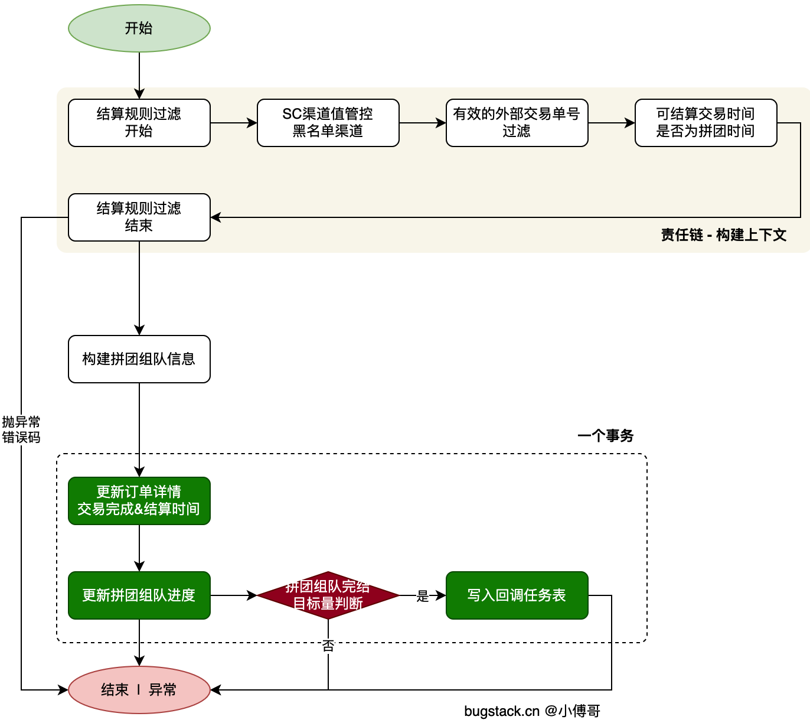
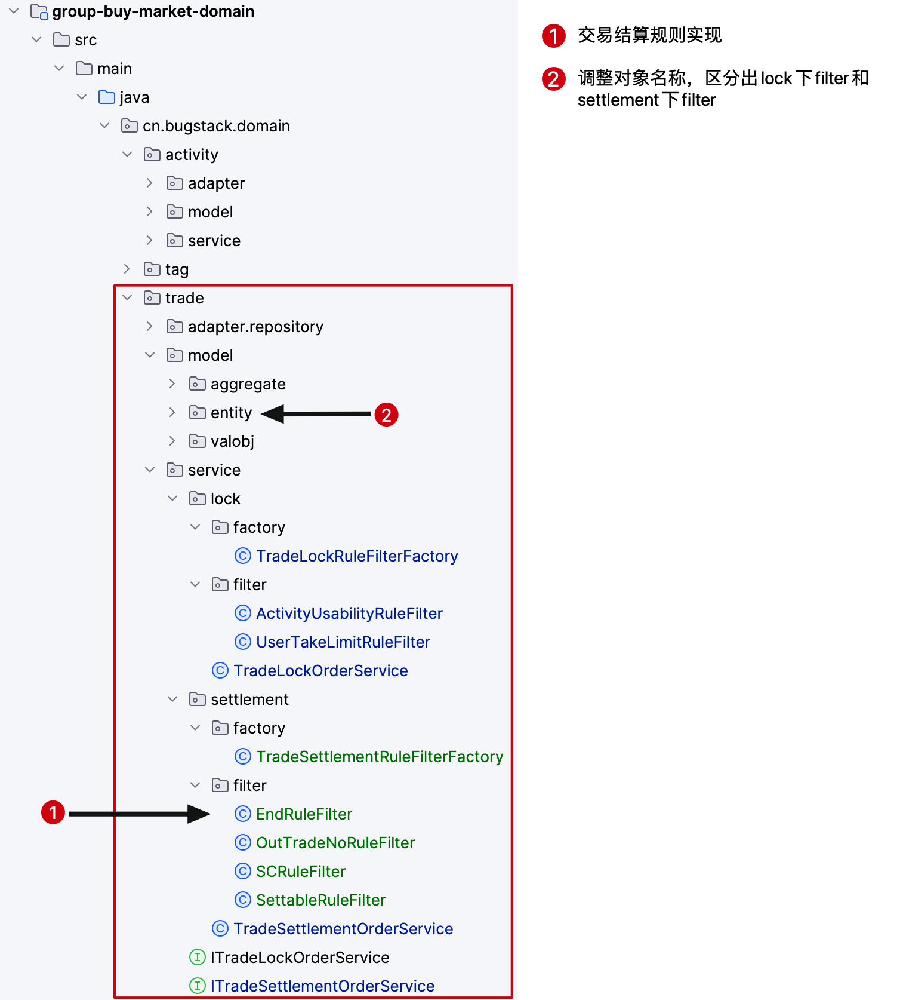
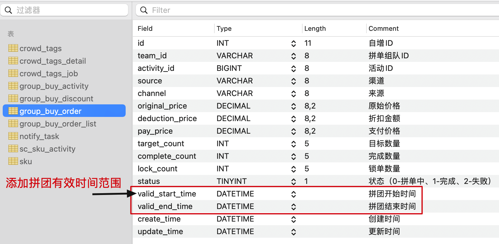
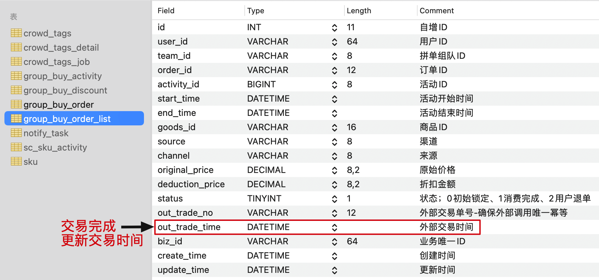
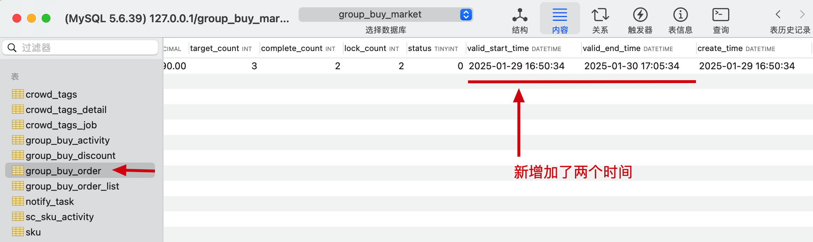
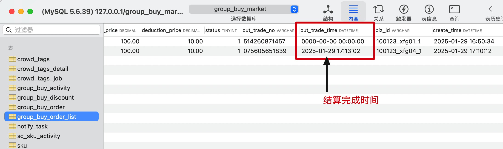

# 交易结算责任链过滤

> 学习序号 16｜小节 2-13｜原文：https://articles.zsxq.com/id_8lei3wc3g685.html

**本章重点** ：实现拼团交易规则过滤责任链，处理；SC渠道、订单有效性和时效性。

- **本章重点** ：★★★★☆
- **本节分支：** [https://gitcode.net/KnowledgePlanet/group-buy-market/-/tree/2-13-250129-xfg-settlement-rule](https://gitcode.net/KnowledgePlanet/group-buy-market/-/tree/2-13-250129-xfg-settlement-rule)
- **课程视频** ：[https://t.zsxq.com/ScKNa](https://t.zsxq.com/ScKNa)

**版权说明** ：©本项目与星球签约合作，受[《中华人民共和国著作权法实施条例》](https://www.gov.cn/gongbao/content/2013/content_2339485.htm) 版权法保护，禁止任何理由和任何方式公开(public)源码、资料、视频等小傅哥发布的星球内容到Github、Gitee等各类平台，违反可追究进一步的法律责任。

作者：小傅哥

博客：[https://bugstack.cn](https://bugstack.cn)

> 沉淀、分享、成长，让自己和他人都能有所收获！😄

- 一、本站诉求
- 二、业务流程
- 三、编码实现
  - 1. 工程结构
  - 2. 调整库表
  - 3. 结算规则
  - 4. 规则工厂
  - 5. 使用规则
- 四、测试验证
  - 1. 锁单
  - 2. 结算
- 五、读者作业

大家好，我是技术UP主小傅哥。

在我整个互联网编程的职业生涯中，有一段时间一个人负责了4-5个业务系统，还有3-4个技术类组件。领导看我有这么多系统，就给我招聘了几个人，让我把活分配出去。

但最开始我是比较抗拒的，因为这些系统已经非常手到擒来了，想做什么设计实现，也是能非常容易的迭代完成，并且随着每次的迭代也会做细腻的重构设计。

而我抗拒的原因是因为中间招聘的伙伴，有几次都是来了半年多又走了，系统又交接回来了。这个时候在对这个系统做实现时候，就会发现很多细节的地方，与预期非常不符。不过，后来也慢慢习惯了，增加了很多的评审、提供了的设计，让工程尽量别走型严重。

### 一、本站诉求

拼团交易结算的过程，需要一些列的规则过滤。包括；我们上一节提到的校验外部交易单的时间是否在拼团有效时间内，同时还有关于这笔外部交易单是否为有效的拼团锁单订单。另外像是 SC 渠道的有效性也需要在结算时进行校验。

所以，本节我们需要实现一套规则链，来处理这些业务规则。因为规则链已经被抽取为通用的模板了，那么本节使用起来会非常容易。

### 二、业务流程

如图，拼团交易结算流程设计；



- 首先，本节的重点在于新增加结算规则过滤的责任链，处理；SC渠道管控、有效的外部交易单号、结算实现是否为拼团时效内。
- 那么这里会有一些功能改造点；
  - 拼团表，group_buy_order 增加 valid_start_time（有效开始时间）、valid_end_time（有效结束时间） 字段。用于每笔交易结算时候，用结算时间判断是否匹配到拼团有效时间范围内。
  - 拼团明细，group_buy_order_list 增加 out_trade_time（交易时间） 字段，记录每笔结算的订单结算的时间。随着状态更新的时候更新。
  - trade 领域下，lock 锁单。实体对象，修改名称。TradeRuleCommandEntity -> TradeLockRuleCommandEntity,TradeRuleFilterBackEntity -> TradeLockRuleFilterBackEntity 增加了 Lock 标识。便于在添加 TradeSettlementRuleCommandEntity、TradeSettlementRuleFilterBackEntity 时更好理解。
  - PayActivityEntity 添加 validTime，GroupBuyTeamEntity 添加 validStartTime、validEndTime
  - trade 领域下，settlement 结算服务中，使用责任链模板，实现营销交易规则的过滤。SCRuleFilter（SC黑名单管控过滤 DCCService 配置新的属性 scBlacklist）、OutTradeNoRuleFilter（外部交易单号有效性过滤）、SettableRuleFilter（交易时间是否在拼团有效时间内过滤）、EndRuleFilter（结束节点封装返回数据）
  - 交易服务，TradePaySettlementEntity 调用 tradeSettlementRuleFilter 责任链方法，并返回相关的数据信息。
  - settlementMarketPayOrder 结算一个事务下操作，增加 updateOrderStatus2COMPLETE 更新时候添加 outTradeTime 时间。

### 三、编码实现

#### 1. 工程结构



- 首先，你在实现功能编码的时候，要先考虑清楚你的模型结构如何处理。如，本节要做一个结算规则的处理，那么这些规则你是想在一个类里写大量的方法用 `if...else` 还是怎么实现。
- 之后，你要开始思考。如果不使用 `if...else` 一层层判断，那么就要先思考这块的业务流程，可以被分为几块处理。把他们的边界思考好。
- 然后，从一个个类下手，用类实现边界。也就是用类来区分你原来在一个大方法中写的一片流程代码，而每个类的衔接，可以使用规则树模型、责任链模型等，衔接中间流转的调用过程。

#### 2. 调整库表

##### 2.1 group_buy_order



- 每一个拼团，都是从拼团活动表 group_buy_activity 获得的参与数据。也就是你在 group_buy_activity 活动有效时间范围内，在加上拼团时间。就是 group_buy_order 拼团的有效开始和结束时间。
- 把这样的数据写到 group_buy_order 表里，而不是每次都从活动表计算。是为了把即时性数据存库，避免以后调整活动时间，造成客诉不好排查。

##### 2.2 group_buy_order_list



- group_buy_order_list 添加一个拼团交易完成的时间，这样可以更好的知道用户是多久锁单，多久支付的。支付时候有等待的。便于以后做数据`量化`计算。

#### 3. 结算规则

##### 3.1 SCRuleFilter

```
                @Slf4j
@Service
public class SCRuleFilter implements ILogicHandler<TradeSettlementRuleCommandEntity, TradeSettlementRuleFilterFactory.DynamicContext, TradeSettlementRuleFilterBackEntity> {

    @Resource
    private ITradeRepository repository;

    @Override
    public TradeSettlementRuleFilterBackEntity apply(TradeSettlementRuleCommandEntity requestParameter, TradeSettlementRuleFilterFactory.DynamicContext dynamicContext) throws Exception {
        log.info("结算规则过滤-渠道黑名单校验{} outTradeNo:{}", requestParameter.getUserId(), requestParameter.getOutTradeNo());

        // sc 渠道黑名单拦截
        boolean intercept = repository.isSCBlackIntercept(requestParameter.getSource(), requestParameter.getChannel());
        if (intercept) {
            log.error("{}{} 渠道黑名单拦截", requestParameter.getSource(), requestParameter.getChannel());
            throw new AppException(ResponseCode.E0105);
        }

        return next(requestParameter, dynamicContext);
    }

}
```

##### 3.2 OutTradeNoRuleFilter

```
                @Slf4j
@Service
public class OutTradeNoRuleFilter implements ILogicHandler<TradeSettlementRuleCommandEntity, TradeSettlementRuleFilterFactory.DynamicContext, TradeSettlementRuleFilterBackEntity> {

    @Resource
    private ITradeRepository repository;

    @Override
    public TradeSettlementRuleFilterBackEntity apply(TradeSettlementRuleCommandEntity requestParameter, TradeSettlementRuleFilterFactory.DynamicContext dynamicContext) throws Exception {
        log.info("结算规则过滤-外部单号校验{} outTradeNo:{}", requestParameter.getUserId(), requestParameter.getOutTradeNo());

        // 查询拼团信息
        MarketPayOrderEntity marketPayOrderEntity = repository.queryMarketPayOrderEntityByOutTradeNo(requestParameter.getUserId(), requestParameter.getOutTradeNo());

        if (null == marketPayOrderEntity) {
            log.error("不存在的外部交易单号或用户已退单，不需要做支付订单结算:{} outTradeNo:{}", requestParameter.getUserId(), requestParameter.getOutTradeNo());
            throw new AppException(ResponseCode.E0104);
        }

        dynamicContext.setMarketPayOrderEntity(marketPayOrderEntity);

        return next(requestParameter, dynamicContext);
    }

}
```

##### 3.3 SettableRuleFilter

```
                @Slf4j
@Service
public class SettableRuleFilter implements ILogicHandler<TradeSettlementRuleCommandEntity, TradeSettlementRuleFilterFactory.DynamicContext, TradeSettlementRuleFilterBackEntity> {

    @Resource
    private ITradeRepository repository;

    @Override
    public TradeSettlementRuleFilterBackEntity apply(TradeSettlementRuleCommandEntity requestParameter, TradeSettlementRuleFilterFactory.DynamicContext dynamicContext) throws Exception {
        log.info("结算规则过滤-有效时间校验{} outTradeNo:{}", requestParameter.getUserId(), requestParameter.getOutTradeNo());

        // 上下文；获取数据
        MarketPayOrderEntity marketPayOrderEntity = dynamicContext.getMarketPayOrderEntity();

        // 查询拼团对象
        GroupBuyTeamEntity groupBuyTeamEntity = repository.queryGroupBuyTeamByTeamId(marketPayOrderEntity.getTeamId());

        // 外部交易时间 - 也就是用户支付完成的时间，这个时间要在拼团有效时间范围内
        Date outTradeTime = requestParameter.getOutTradeTime();

        // 判断，外部交易时间，要小于拼团结束时间。否则抛异常。
        if (!outTradeTime.before(groupBuyTeamEntity.getValidEndTime())) {
            log.error("订单交易时间不在拼团有效时间范围内");
            throw new AppException(ResponseCode.E0106);
        }

        // 设置上下文
        dynamicContext.setGroupBuyTeamEntity(groupBuyTeamEntity);

        return next(requestParameter, dynamicContext);
    }

}
```

##### 3.4 EndRuleFilter

```
                @Slf4j
@Service
public class EndRuleFilter implements ILogicHandler<TradeSettlementRuleCommandEntity, TradeSettlementRuleFilterFactory.DynamicContext, TradeSettlementRuleFilterBackEntity> {

    @Override
    public TradeSettlementRuleFilterBackEntity apply(TradeSettlementRuleCommandEntity requestParameter, TradeSettlementRuleFilterFactory.DynamicContext dynamicContext) throws Exception {
        log.info("结算规则过滤-结束节点{} outTradeNo:{}", requestParameter.getUserId(), requestParameter.getOutTradeNo());

        // 获取上下文对象
        GroupBuyTeamEntity groupBuyTeamEntity = dynamicContext.getGroupBuyTeamEntity();

        // 返回封装数据
        return TradeSettlementRuleFilterBackEntity.builder()
                .teamId(groupBuyTeamEntity.getTeamId())
                .activityId(groupBuyTeamEntity.getActivityId())
                .targetCount(groupBuyTeamEntity.getTargetCount())
                .completeCount(groupBuyTeamEntity.getCompleteCount())
                .lockCount(groupBuyTeamEntity.getLockCount())
                .status(groupBuyTeamEntity.getStatus())
                .validStartTime(groupBuyTeamEntity.getValidStartTime())
                .validEndTime(groupBuyTeamEntity.getValidEndTime())
                .build();
    }

}
```

#### 4. 规则工厂

```
                @Slf4j
@Service
public class TradeSettlementRuleFilterFactory {

    @Bean("tradeSettlementRuleFilter")
    public BusinessLinkedList<TradeSettlementRuleCommandEntity,
            TradeSettlementRuleFilterFactory.DynamicContext, TradeSettlementRuleFilterBackEntity> tradeSettlementRuleFilter(
            SCRuleFilter scRuleFilter,
            OutTradeNoRuleFilter outTradeNoRuleFilter,
            SettableRuleFilter settableRuleFilter,
            EndRuleFilter endRuleFilter) {

        // 组装链
        LinkArmory<TradeSettlementRuleCommandEntity, TradeSettlementRuleFilterFactory.DynamicContext, TradeSettlementRuleFilterBackEntity> linkArmory =
                new LinkArmory<>("交易结算规则过滤链", scRuleFilter, outTradeNoRuleFilter, settableRuleFilter, endRuleFilter);

        // 链对象
        return linkArmory.getLogicLink();
    }
    
    // ... 省略部分代码
}
```

- 规则工厂，负责把责任链进行串联。之后提供一个指定名称的规则 Bean 对象。

#### 5. 使用规则

```
                @Slf4j
@Service
public class TradeSettlementOrderService implements ITradeSettlementOrderService {

    @Resource
    private ITradeRepository repository;
    @Resource
    private BusinessLinkedList<TradeSettlementRuleCommandEntity, TradeSettlementRuleFilterFactory.DynamicContext, TradeSettlementRuleFilterBackEntity> tradeSettlementRuleFilter;

    @Override
    public TradePaySettlementEntity settlementMarketPayOrder(TradePaySuccessEntity tradePaySuccessEntity) throws Exception {
        log.info("拼团交易-支付订单结算:{} outTradeNo:{}", tradePaySuccessEntity.getUserId(), tradePaySuccessEntity.getOutTradeNo());
        // 1. 结算规则过滤
        TradeSettlementRuleFilterBackEntity tradeSettlementRuleFilterBackEntity = tradeSettlementRuleFilter.apply(
                TradeSettlementRuleCommandEntity.builder()
                        .source(tradePaySuccessEntity.getSource())
                        .channel(tradePaySuccessEntity.getChannel())
                        .userId(tradePaySuccessEntity.getUserId())
                        .outTradeNo(tradePaySuccessEntity.getOutTradeNo())
                        .outTradeTime(tradePaySuccessEntity.getOutTradeTime())
                        .build(),
                new TradeSettlementRuleFilterFactory.DynamicContext());

        String teamId = tradeSettlementRuleFilterBackEntity.getTeamId();

        // 2. 查询组团信息
        GroupBuyTeamEntity groupBuyTeamEntity = GroupBuyTeamEntity.builder()
                .teamId(tradeSettlementRuleFilterBackEntity.getTeamId())
                .activityId(tradeSettlementRuleFilterBackEntity.getActivityId())
                .targetCount(tradeSettlementRuleFilterBackEntity.getTargetCount())
                .completeCount(tradeSettlementRuleFilterBackEntity.getCompleteCount())
                .lockCount(tradeSettlementRuleFilterBackEntity.getLockCount())
                .status(tradeSettlementRuleFilterBackEntity.getStatus())
                .validStartTime(tradeSettlementRuleFilterBackEntity.getValidStartTime())
                .validEndTime(tradeSettlementRuleFilterBackEntity.getValidEndTime())
                .build();

        // 3. 构建聚合对象
        GroupBuyTeamSettlementAggregate groupBuyTeamSettlementAggregate = GroupBuyTeamSettlementAggregate.builder()
                .userEntity(UserEntity.builder().userId(tradePaySuccessEntity.getUserId()).build())
                .groupBuyTeamEntity(groupBuyTeamEntity)
                .tradePaySuccessEntity(tradePaySuccessEntity)
                .build();

        // 4. 拼团交易结算
        repository.settlementMarketPayOrder(groupBuyTeamSettlementAggregate);

        // 5. 返回结算信息 - 公司中开发这样的流程时候，会根据外部需要进行值的设置
        return TradePaySettlementEntity.builder()
                .source(tradePaySuccessEntity.getSource())
                .channel(tradePaySuccessEntity.getChannel())
                .userId(tradePaySuccessEntity.getUserId())
                .teamId(teamId)
                .activityId(groupBuyTeamEntity.getActivityId())
                .outTradeNo(tradePaySuccessEntity.getOutTradeNo())
                .build();
    }

}
```

- 营销结算服务 TradeSettlementOrderService，调整在于，不在这里判断外部交易单号是否有效了，而是统一收到责任链中实现。
- 另外规则链会返回所需的数据，以及返回了 `tradePaySuccessEntity.getOutTradeTime()` 交易时间。这个时间会在操作数据时候做更新。

> 其他的一些小的代码，可以直接参考源码 git 提交记录。以及可以看视频学习。

### 四、测试验证

#### 1. 锁单

```
                @Test
public void test_lockMarketPayOrder() {
    LockMarketPayOrderRequestDTO lockMarketPayOrderRequestDTO = new LockMarketPayOrderRequestDTO();
    lockMarketPayOrderRequestDTO.setUserId("xfg01");
    lockMarketPayOrderRequestDTO.setTeamId(null);
    lockMarketPayOrderRequestDTO.setActivityId(100123L);
    lockMarketPayOrderRequestDTO.setGoodsId("9890001");
    lockMarketPayOrderRequestDTO.setSource("s01");
    lockMarketPayOrderRequestDTO.setChannel("c01");
    lockMarketPayOrderRequestDTO.setOutTradeNo(RandomStringUtils.randomNumeric(12));
    Response<LockMarketPayOrderResponseDTO> lockMarketPayOrderResponseDTOResponse = marketTradeService.lockMarketPayOrder(lockMarketPayOrderRequestDTO);
    log.info("测试结果 req:{} res:{}", JSON.toJSONString(lockMarketPayOrderRequestDTO), JSON.toJSONString(lockMarketPayOrderResponseDTOResponse));
}
```



- 执行完毕后，你可以看下活动里的 valid_time 加上拼团的开始时间，之后写入到用户拼团时间里。
- 这个 valid_time 可以加长一些，方便测试。

#### 2. 结算

```
                @Test
public void test_settlementMarketPayOrder() throws Exception {
    TradePaySuccessEntity tradePaySuccessEntity = new TradePaySuccessEntity();
    tradePaySuccessEntity.setSource("s01");
    tradePaySuccessEntity.setChannel("c01");
    tradePaySuccessEntity.setUserId("xfg04");
    tradePaySuccessEntity.setOutTradeNo("075605651839");
    tradePaySuccessEntity.setOutTradeTime(new Date());
    TradePaySettlementEntity tradePaySettlementEntity = tradeSettlementOrderService.settlementMarketPayOrder(tradePaySuccessEntity);
    log.info("请求参数:{}", JSON.toJSONString(tradePaySuccessEntity));
    log.info("测试结果:{}", JSON.toJSONString(tradePaySettlementEntity));
}
```



- 结算完成一笔后，会看到 out_trade_time 的更新。
- 注意；`tradePaySuccessEntity.setOutTradeTime(new Date());`需要新增加入参，这个参数会从交易完成的商城系统提供。

> 另外，整个责任链实现新增加了很多的错误码，*E0104*、*E0105*、*E0106*，你可以尝试验证。

### 五、读者作业

- 简单作业：理解本节流程，实现本节代码，可以顺利调试运行。并能解决过程中出现的小bug。
- 复杂作业：本节用一个新的功能引入，串联了很多节点的动作处理，让大家更熟悉业务流程。那么现在，你可以考虑下，如果我们要控制结算的金额，必须走单独的拼团交易优惠，不能叠加优惠。应该怎么处理。这是一个扩展作业，可以尝试。
