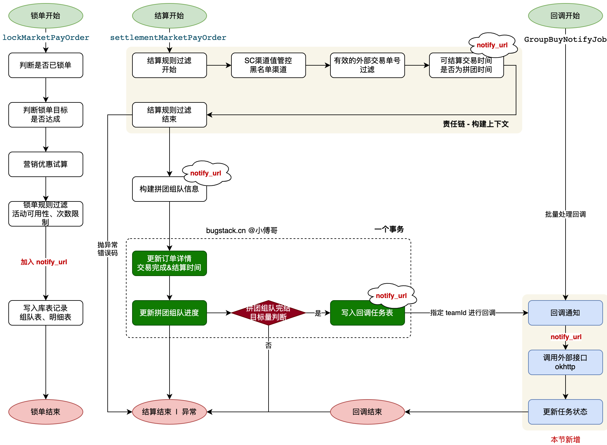
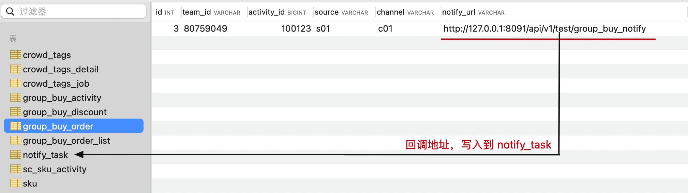
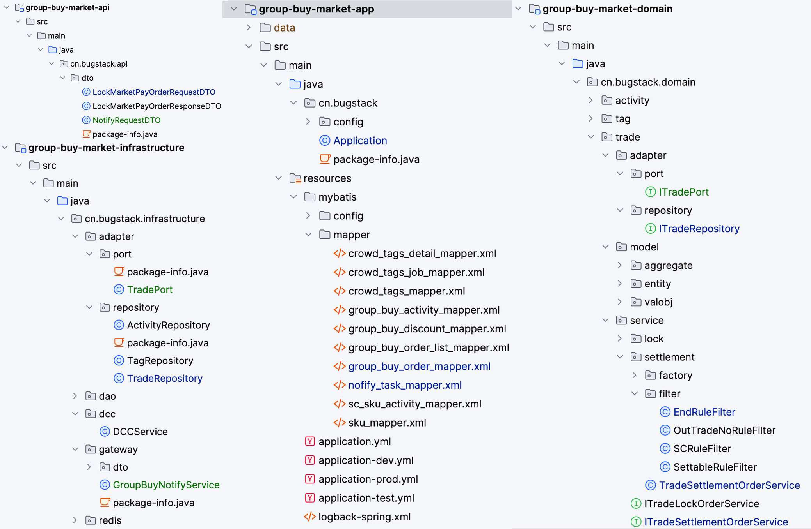
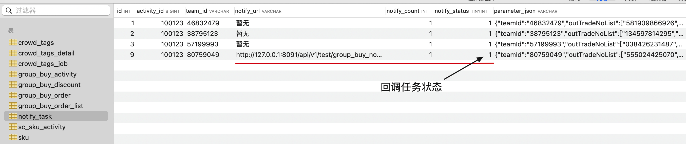

# 拼团回调通知任务

> 学习序号 17｜小节 2-14｜原文：https://articles.zsxq.com/id_mw5rpnlwf93l.html

**本章重点** ：为拼团组队交易结算完结后，实现一个回调通知的任务处理。告知另外的微服务系统可以进行后续的流程了。

- **本章重点** ：★★★★☆
- **本节分支：** [https://gitcode.net/KnowledgePlanet/group-buy-market/-/tree/2-14-250131-xfg-notify-job](https://gitcode.net/KnowledgePlanet/group-buy-market/-/tree/2-14-250131-xfg-notify-job)
- **课程视频** ：[https://t.zsxq.com/ysSyW](https://t.zsxq.com/ysSyW)

**版权说明** ：©本项目与星球签约合作，受[《中华人民共和国著作权法实施条例》](https://www.gov.cn/gongbao/content/2013/content_2339485.htm) 版权法保护，禁止任何理由和任何方式公开(public)源码、资料、视频等小傅哥发布的星球内容到Github、Gitee等各类平台，违反可追究进一步的法律责任。

作者：小傅哥

博客：[https://bugstack.cn](https://bugstack.cn)

> 沉淀、分享、成长，让自己和他人都能有所收获！😄

- 一、本章诉求
- 二、业务流程
- 三、编码实现
  - 1. 工程结构
  - 2. 库表变更
  - 3. 锁单写入 - notify_url
  - 4. 结算处理 - notify_url
  - 5. 回调网关 - okhttp
  - 6. 回调封装
  - 7. 调用处理
- 四、测试验证
  - 0. 前置
  - 1. 锁单
  - 2. 结算
- 五、读者作业

### 一、本章诉求

在微服务设计中，当一个微服务系统的流程结束后，要通知下一个微服务系统。这个通知的过程，可以是 RPC、MQ，也可以是 HTTP 方式。

RPC、MQ，这一类的都是需要有一个公用的注册中心，它的技术架构比较适合于公司内部的统一系统使用。如果是有和外部其他系统的对接，通常我们会使用 HTTP 这样统一标准协议的接口进行使用。

那么，本章节要为拼团组队交易结算完结后，实现一个回调通知的任务处理。告知另外的微服务系统可以进行后续的流程了。

注意：微信支付，支付宝支付，也是在完成支付后，做的这样的回调处理。

### 二、业务流程

如图，拼团结算组队完成，回调通知；



- 首先，本节的重点在拼团成团后，实现回调通知流程。回调的过程，需要在用户锁单时需要增加一个回调的地址，并在拼团完结后发起回调。
- 那么，这里的一些功能改造点；
  - `group_buy_order` 在设计的时候有一个 `notify_url` 回调地址，本节我们修改库表添加上这个字段。并对工程中的 `dao&po&mapper` 操作，增加 `notify_url` 字段。
  - MarketTradeController 营销交易服务，lockMarketPayOrder 锁单接口入参对象，增加 notifyUrl 回调地址。并有 PayDiscountEntity 对象透传到 `TradeRepository#lockMarketPayOrder` 仓储操作。这样写到 `group_buy_order` 表就有回调地址了，等做回调操作的时候，就可以把这个地址写入到回调任务表中。
  - `TradeSettlementOrderService#settlementMarketPayOrder` 结算服务，需要把锁单记录中的 notify_url 拿到，放到 GroupBuyTeamEntity 中，这样在写入 notify_task 表记录的时候就可以把 notify_url 一起写入进去了。
  - 基于 okhttp 框架，封装对 http 接口的调用。用于处理调用外部其他微服务，实现回调通知的处理。因为外部的接口是随着每个服务调用拼团写入进来的 http 请求地址，所以在封装这部分调用的时候，要允许动态透传请求地址。实现类写到 infrastructure 基础设置层的 gateway 调用外部网关层。实现类；`GroupBuyNotifyService` 提供方法；`groupBuyNotify`
  - 在交易结算服务类 ITradeSettlementOrderService，定义执行结算回调通知接口，包括；`execSettlementNotifyJob()、execSettlementNotifyJob(String teamId)` 一个是有入参的，一个无入参。这样可以指定给某个拼团队伍做结算。结算的过程就是调用 `GroupBuyNotifyService#groupBuyNotify` 完成回调通知，并根据返回的结果更新 notify_task 表状态记录（成功、失败、重试），并记录回调次数，小于5次的时候都可以继续回调。
  - 回调通知，可以分为两个阶段处理。一个是拼团完成后立即执行，另外一个任务补偿。立即执行是为了提供时效性，但因为远程的 http 调用受网络和服务的影响可能会失败，所以要增加一个任务补偿来做定时检查。其中立即执行在 `TradeSettlementOrderService#settlementMarketPayOrder -> settlementMarketPayOrder` 处理。另外定时任务在 `GroupBuyNotifyJob` 处理。
  - 测试接口，`trigger/http` 下，增加 `TestApiClientController` 接口实现类，提供回调接口服务。这个是模拟的其他的微服务，将来要提供的接口。

### 三、编码实现

#### 1. 工程结构



- 首先，这是涉及本次改动的一些类。我们要实现的功能就是串联出 notify_url 并做回调通知处理。

#### 2. 库表变更



- 新的库表语句已经更新到工程下，docs/dev-ops/mysql/sql 下。
- 在 group_buy_order 表增加 notify_url 字段，写入回调地址。

#### 3. 锁单写入 - notify_url

```
                @Slf4j
@Repository
public class TradeRepository implements ITradeRepository {

    @Resource
    private IGroupBuyActivityDao groupBuyActivityDao;
    @Resource
    private IGroupBuyOrderDao groupBuyOrderDao;
    @Resource
    private IGroupBuyOrderListDao groupBuyOrderListDao;
    @Resource
    private INotifyTaskDao notifyTaskDao;
    @Resource
    private DCCService dccService;

    // ... 省略部分代码

    @Transactional(timeout = 500)
    @Override
    public MarketPayOrderEntity lockMarketPayOrder(GroupBuyOrderAggregate groupBuyOrderAggregate) {
        // 聚合对象信息
        UserEntity userEntity = groupBuyOrderAggregate.getUserEntity();
        PayActivityEntity payActivityEntity = groupBuyOrderAggregate.getPayActivityEntity();
        PayDiscountEntity payDiscountEntity = groupBuyOrderAggregate.getPayDiscountEntity();
        Integer userTakeOrderCount = groupBuyOrderAggregate.getUserTakeOrderCount();

        // 判断是否有团 - teamId 为空 - 新团、为不空 - 老团
        String teamId = payActivityEntity.getTeamId();
        if (StringUtils.isBlank(teamId)) {
            // 使用 RandomStringUtils.randomNumeric 替代公司里使用的雪花算法UUID
            teamId = RandomStringUtils.randomNumeric(8);
            // 日期处理
            Date currentDate = new Date();
            Calendar calendar = Calendar.getInstance();
            calendar.setTime(currentDate);
            calendar.add(Calendar.MINUTE, payActivityEntity.getValidTime());

            // 构建拼团订单
            GroupBuyOrder groupBuyOrder = GroupBuyOrder.builder()
                    .teamId(teamId)
                    .activityId(payActivityEntity.getActivityId())
                    .source(payDiscountEntity.getSource())
                    .channel(payDiscountEntity.getChannel())
                    .originalPrice(payDiscountEntity.getOriginalPrice())
                    .deductionPrice(payDiscountEntity.getDeductionPrice())
                    .payPrice(payDiscountEntity.getPayPrice())
                    .targetCount(payActivityEntity.getTargetCount())
                    .completeCount(0)
                    .lockCount(1)
                    .validStartTime(currentDate)
                    .validEndTime(calendar.getTime())
                    .notifyUrl(payDiscountEntity.getNotifyUrl())
                    .build();

            // 写入记录
            groupBuyOrderDao.insert(groupBuyOrder);
        } else {
            // 更新记录 - 如果更新记录不等于1，则表示拼团已满，抛出异常
            int updateAddTargetCount = groupBuyOrderDao.updateAddLockCount(teamId);
            if (1 != updateAddTargetCount) {
                throw new AppException(ResponseCode.E0005);
            }
        }

        // 使用 RandomStringUtils.randomNumeric 替代公司里使用的雪花算法UUID
        String orderId = RandomStringUtils.randomNumeric(12);
        GroupBuyOrderList groupBuyOrderListReq = GroupBuyOrderList.builder()
                .userId(userEntity.getUserId())
                .teamId(teamId)
                .orderId(orderId)
                .activityId(payActivityEntity.getActivityId())
                .startTime(payActivityEntity.getStartTime())
                .endTime(payActivityEntity.getEndTime())
                .goodsId(payDiscountEntity.getGoodsId())
                .source(payDiscountEntity.getSource())
                .channel(payDiscountEntity.getChannel())
                .originalPrice(payDiscountEntity.getOriginalPrice())
                .deductionPrice(payDiscountEntity.getDeductionPrice())
                .status(TradeOrderStatusEnumVO.CREATE.getCode())
                .outTradeNo(payDiscountEntity.getOutTradeNo())
                // 构建 bizId 唯一值；活动id_用户id_参与次数累加
                .bizId(payActivityEntity.getActivityId() + Constants.UNDERLINE + userEntity.getUserId() + Constants.UNDERLINE + (userTakeOrderCount + 1))
                .build();
        try {
            // 写入拼团记录
            groupBuyOrderListDao.insert(groupBuyOrderListReq);
        } catch (DuplicateKeyException e) {
            throw new AppException(ResponseCode.INDEX_EXCEPTION);
        }

        return MarketPayOrderEntity.builder()
                .orderId(orderId)
                .deductionPrice(payDiscountEntity.getDeductionPrice())
                .tradeOrderStatusEnumVO(TradeOrderStatusEnumVO.CREATE)
                .build();
    }  
  
  // ... 省略部分代码

}
```

- lockMarketPayOrder 方法中，从 PayDiscountEntity 获取 NotifyUrl 写入到拼团组队记录中。`groupBuyOrderDao.insert(groupBuyOrder);`

#### 4. 结算处理 - notify_url

```
                @Slf4j
@Repository
public class TradeRepository implements ITradeRepository {

    @Resource
    private IGroupBuyActivityDao groupBuyActivityDao;
    @Resource
    private IGroupBuyOrderDao groupBuyOrderDao;
    @Resource
    private IGroupBuyOrderListDao groupBuyOrderListDao;
    @Resource
    private INotifyTaskDao notifyTaskDao;
    @Resource
    private DCCService dccService;

    // ... 省略部分代码
  
    @Transactional(timeout = 500)
    @Override
    public void settlementMarketPayOrder(GroupBuyTeamSettlementAggregate groupBuyTeamSettlementAggregate) {

        UserEntity userEntity = groupBuyTeamSettlementAggregate.getUserEntity();
        GroupBuyTeamEntity groupBuyTeamEntity = groupBuyTeamSettlementAggregate.getGroupBuyTeamEntity();
        TradePaySuccessEntity tradePaySuccessEntity = groupBuyTeamSettlementAggregate.getTradePaySuccessEntity();

        // 1. 更新拼团订单明细状态
        GroupBuyOrderList groupBuyOrderListReq = new GroupBuyOrderList();
        groupBuyOrderListReq.setUserId(userEntity.getUserId());
        groupBuyOrderListReq.setOutTradeNo(tradePaySuccessEntity.getOutTradeNo());
        groupBuyOrderListReq.setOutTradeTime(tradePaySuccessEntity.getOutTradeTime());

        int updateOrderListStatusCount = groupBuyOrderListDao.updateOrderStatus2COMPLETE(groupBuyOrderListReq);
        if (1 != updateOrderListStatusCount) {
            throw new AppException(ResponseCode.UPDATE_ZERO);
        }

        // 2. 更新拼团达成数量
        int updateAddCount = groupBuyOrderDao.updateAddCompleteCount(groupBuyTeamEntity.getTeamId());
        if (1 != updateAddCount) {
            throw new AppException(ResponseCode.UPDATE_ZERO);
        }

        // 3. 更新拼团完成状态
        if (groupBuyTeamEntity.getTargetCount() - groupBuyTeamEntity.getCompleteCount() == 1) {
            int updateOrderStatusCount = groupBuyOrderDao.updateOrderStatus2COMPLETE(groupBuyTeamEntity.getTeamId());
            if (1 != updateOrderStatusCount) {
                throw new AppException(ResponseCode.UPDATE_ZERO);
            }

            // 查询拼团交易完成外部单号列表
            List<String> outTradeNoList = groupBuyOrderListDao.queryGroupBuyCompleteOrderOutTradeNoListByTeamId(groupBuyTeamEntity.getTeamId());

            // 拼团完成写入回调任务记录
            NotifyTask notifyTask = new NotifyTask();
            notifyTask.setActivityId(groupBuyTeamEntity.getActivityId());
            notifyTask.setTeamId(groupBuyTeamEntity.getTeamId());
            notifyTask.setNotifyUrl(groupBuyTeamEntity.getNotifyUrl());
            notifyTask.setNotifyCount(0);
            notifyTask.setNotifyStatus(0);

            notifyTask.setParameterJson(JSON.toJSONString(new HashMap<String, Object>() {{
                put("teamId", groupBuyTeamEntity.getTeamId());
                put("outTradeNoList", outTradeNoList);
            }}));

            notifyTaskDao.insert(notifyTask);
        }

    }
  
  // ... 省略部分代码

}
```

- settlementMarketPayOrder 方法，从 GroupBuyTeamEntity 拼团记录获取到 notify_url 写入到 NotifyTask 表记录中。

#### 5. 回调网关 - okhttp

```
                @Slf4j
@Service
public class GroupBuyNotifyService {

    @Resource
    private OkHttpClient okHttpClient;

    public String groupBuyNotify(String apiUrl, String notifyRequestDTOJSON) throws Exception {
        try {
            // 1. 构建参数
            MediaType mediaType = MediaType.parse("application/json");
            RequestBody body = RequestBody.create(mediaType, notifyRequestDTOJSON);
            Request request = new Request.Builder()
                    .url(apiUrl)
                    .post(body)
                    .addHeader("content-type", "application/json")
                    .build();

            // 2. 调用接口
            Response response = okHttpClient.newCall(request).execute();

            // 3. 返回结果
            return response.body().string();
        } catch (Exception e) {
            log.error("拼团回调 HTTP 接口服务异常 {}", apiUrl, e);
            throw new AppException(ResponseCode.HTTP_EXCEPTION);
        }
    }

}
```

- 回调服务，在基础设置层的 gateway 中实现。用于动态调用外部的接口，进行回调通知。

#### 6. 回调封装

```
                @Slf4j
@Service
public class TradeSettlementOrderService implements ITradeSettlementOrderService {

    @Resource
    private ITradeRepository repository;
    @Resource
    private ITradePort port;

    @Resource
    private BusinessLinkedList<TradeSettlementRuleCommandEntity, TradeSettlementRuleFilterFactory.DynamicContext, TradeSettlementRuleFilterBackEntity> tradeSettlementRuleFilter;

  // ... 省略部分方法

    @Override
    public Map<String, Integer> execSettlementNotifyJob() throws Exception {
        log.info("拼团交易-执行结算通知任务");

        // 查询未执行任务
        List<NotifyTaskEntity> notifyTaskEntityList = repository.queryUnExecutedNotifyTaskList();

        return execSettlementNotifyJob(notifyTaskEntityList);
    }

    @Override
    public Map<String, Integer> execSettlementNotifyJob(String teamId) throws Exception {
        log.info("拼团交易-执行结算通知回调，指定 teamId:{}", teamId);
        List<NotifyTaskEntity> notifyTaskEntityList = repository.queryUnExecutedNotifyTaskList(teamId);
        return execSettlementNotifyJob(notifyTaskEntityList);
    }

    private Map<String, Integer> execSettlementNotifyJob(List<NotifyTaskEntity> notifyTaskEntityList) throws Exception {
        int successCount = 0, errorCount = 0, retryCount = 0;
        for (NotifyTaskEntity notifyTask : notifyTaskEntityList) {
            // 回调处理 success 成功，error 失败
            String response = port.groupBuyNotify(notifyTask);

            // 更新状态判断&变更数据库表回调任务状态
            if (NotifyTaskHTTPEnumVO.SUCCESS.getCode().equals(response)) {
                int updateCount = repository.updateNotifyTaskStatusSuccess(notifyTask.getTeamId());
                if (1 == updateCount) {
                    successCount += 1;
                }
            } else if (NotifyTaskHTTPEnumVO.ERROR.getCode().equals(response)) {
                if (notifyTask.getNotifyCount() < 5) {
                    int updateCount = repository.updateNotifyTaskStatusError(notifyTask.getTeamId());
                    if (1 == updateCount) {
                        errorCount += 1;
                    }
                } else {
                    int updateCount = repository.updateNotifyTaskStatusRetry(notifyTask.getTeamId());
                    if (1 == updateCount) {
                        retryCount += 1;
                    }
                }
            }
        }

        Map<String, Integer> resultMap = new HashMap<>();
        resultMap.put("waitCount", notifyTaskEntityList.size());
        resultMap.put("successCount", successCount);
        resultMap.put("errorCount", errorCount);
        resultMap.put("retryCount", retryCount);

        return resultMap;
    }

}
```

- `execSettlementNotifyJob(List<NotifyTaskEntity> notifyTaskEntityList)` 回调任务，调用 `port.groupBuyNotify(notifyTask);` 回调服务。
- 根据回调服务返回的结果，更新回调任务表记录。包括；调用了几次、成功的状态。

#### 7. 调用处理

##### 7.1 直接调用

```
                @Slf4j
@Service
public class TradeSettlementOrderService implements ITradeSettlementOrderService {

    @Resource
    private ITradeRepository repository;
    @Resource
    private ITradePort port;

    @Resource
    private BusinessLinkedList<TradeSettlementRuleCommandEntity, TradeSettlementRuleFilterFactory.DynamicContext, TradeSettlementRuleFilterBackEntity> tradeSettlementRuleFilter;

    @Override
    public TradePaySettlementEntity settlementMarketPayOrder(TradePaySuccessEntity tradePaySuccessEntity) throws Exception {
        log.info("拼团交易-支付订单结算:{} outTradeNo:{}", tradePaySuccessEntity.getUserId(), tradePaySuccessEntity.getOutTradeNo());
        // 1. 结算规则过滤
        TradeSettlementRuleFilterBackEntity tradeSettlementRuleFilterBackEntity = tradeSettlementRuleFilter.apply(
                TradeSettlementRuleCommandEntity.builder()
                        .source(tradePaySuccessEntity.getSource())
                        .channel(tradePaySuccessEntity.getChannel())
                        .userId(tradePaySuccessEntity.getUserId())
                        .outTradeNo(tradePaySuccessEntity.getOutTradeNo())
                        .outTradeTime(tradePaySuccessEntity.getOutTradeTime())
                        .build(),
                new TradeSettlementRuleFilterFactory.DynamicContext());

        String teamId = tradeSettlementRuleFilterBackEntity.getTeamId();

        // 2. 查询组团信息
        GroupBuyTeamEntity groupBuyTeamEntity = GroupBuyTeamEntity.builder()
                .teamId(tradeSettlementRuleFilterBackEntity.getTeamId())
                .activityId(tradeSettlementRuleFilterBackEntity.getActivityId())
                .targetCount(tradeSettlementRuleFilterBackEntity.getTargetCount())
                .completeCount(tradeSettlementRuleFilterBackEntity.getCompleteCount())
                .lockCount(tradeSettlementRuleFilterBackEntity.getLockCount())
                .status(tradeSettlementRuleFilterBackEntity.getStatus())
                .validStartTime(tradeSettlementRuleFilterBackEntity.getValidStartTime())
                .validEndTime(tradeSettlementRuleFilterBackEntity.getValidEndTime())
                .notifyUrl(tradeSettlementRuleFilterBackEntity.getNotifyUrl())
                .build();

        // 3. 构建聚合对象
        GroupBuyTeamSettlementAggregate groupBuyTeamSettlementAggregate = GroupBuyTeamSettlementAggregate.builder()
                .userEntity(UserEntity.builder().userId(tradePaySuccessEntity.getUserId()).build())
                .groupBuyTeamEntity(groupBuyTeamEntity)
                .tradePaySuccessEntity(tradePaySuccessEntity)
                .build();

        // 4. 拼团交易结算
        repository.settlementMarketPayOrder(groupBuyTeamSettlementAggregate);

        // 5. 组队回调处理 - 处理失败也会有定时任务补偿，通过这样的方式，可以减轻任务调度，提高时效性
        Map<String, Integer> notifyResultMap = execSettlementNotifyJob(teamId);
        log.info("回调通知拼团完结 result:{}", JSON.toJSONString(notifyResultMap));

        // 6. 返回结算信息 - 公司中开发这样的流程时候，会根据外部需要进行值的设置
        return TradePaySettlementEntity.builder()
                .source(tradePaySuccessEntity.getSource())
                .channel(tradePaySuccessEntity.getChannel())
                .userId(tradePaySuccessEntity.getUserId())
                .teamId(teamId)
                .activityId(groupBuyTeamEntity.getActivityId())
                .outTradeNo(tradePaySuccessEntity.getOutTradeNo())
                .build();
    }
    
    // ... 省略部分代码

}
```

- `Map<String, Integer> notifyResultMap = execSettlementNotifyJob(teamId);` 回调通知处理。这步失败也没关系，后续会有定时任务处理。

##### 7.2 任务补偿

```
                @Slf4j
@Service
public class GroupBuyNotifyJob {

    @Resource
    private ITradeSettlementOrderService tradeSettlementOrderService;

    @Scheduled(cron = "0/15 * * * * ?")
    public void exec() {
        try {
            Map<String, Integer> result = tradeSettlementOrderService.execSettlementNotifyJob();
            log.info("定时任务，回调通知拼团完结任务 result:{}", JSON.toJSONString(result));
        } catch (Exception e) {
            log.error("定时任务，回调通知拼团完结任务失败", e);
        }
    }

}
```

- 首先，app 下的 Application 类，要添加一个 `@EnableScheduling` 注解，这样才能使用任务。
- 之后，trigger 下的 job 包下，创建 GroupBuyNotifyJob 回调任务，调用回调通知。

### 四、测试验证

#### 0. 前置

```
                @Slf4j
@RestController()
@CrossOrigin("*")
@RequestMapping("/api/v1/test/")
public class TestApiClientController {

    /**
     * 模拟回调案例
     *
     * @param notifyRequestDTO 通知回调参数
     * @return success 成功，error 失败
     */
    @RequestMapping(value = "group_buy_notify", method = RequestMethod.POST)
    public String groupBuyNotify(@RequestBody NotifyRequestDTO notifyRequestDTO) {
        log.info("模拟测试第三方服务接收拼团回调 {}", JSON.toJSONString(notifyRequestDTO));

        return "success";
    }

}
```

- 这里因为暂时还没有和其他系统对接，所以要模拟一个外部的回调接口。
- 接口地址：`http://127.0.0.1:8091/api/v1/test/group_buy_notify`

#### 1. 锁单

```
                @Test
public void test_lockMarketPayOrder() {
    LockMarketPayOrderRequestDTO lockMarketPayOrderRequestDTO = new LockMarketPayOrderRequestDTO();
    lockMarketPayOrderRequestDTO.setUserId("xfg01");
    lockMarketPayOrderRequestDTO.setTeamId(null);
    lockMarketPayOrderRequestDTO.setActivityId(100123L);
    lockMarketPayOrderRequestDTO.setGoodsId("9890001");
    lockMarketPayOrderRequestDTO.setSource("s01");
    lockMarketPayOrderRequestDTO.setChannel("c01");
    lockMarketPayOrderRequestDTO.setOutTradeNo(RandomStringUtils.randomNumeric(12));
    lockMarketPayOrderRequestDTO.setNotifyUrl("http://127.0.0.1:8091/api/v1/test/group_buy_notify");
    Response<LockMarketPayOrderResponseDTO> lockMarketPayOrderResponseDTOResponse = marketTradeService.lockMarketPayOrder(lockMarketPayOrderRequestDTO);
    log.info("测试结果 req:{} res:{}", JSON.toJSONString(lockMarketPayOrderRequestDTO), JSON.toJSONString(lockMarketPayOrderResponseDTOResponse));
}
```

- 首先，要进行3笔锁单，锁单的时候，第一笔没有 teamId，后面2比要写入 teamId。
- 另外，本节的测试要加入一个 notify_url 地址。

#### 2. 结算

```
                @Test
public void test_settlementMarketPayOrder() throws Exception {
    TradePaySuccessEntity tradePaySuccessEntity = new TradePaySuccessEntity();
    tradePaySuccessEntity.setSource("s01");
    tradePaySuccessEntity.setChannel("c01");
    tradePaySuccessEntity.setUserId("xfg03");
    tradePaySuccessEntity.setOutTradeNo("536311764349");
    tradePaySuccessEntity.setOutTradeTime(new Date());
    TradePaySettlementEntity tradePaySettlementEntity = tradeSettlementOrderService.settlementMarketPayOrder(tradePaySuccessEntity);
    log.info("请求参数:{}", JSON.toJSONString(tradePaySuccessEntity));
    log.info("测试结果:{}", JSON.toJSONString(tradePaySettlementEntity));
}
```

```
                25-01-31.17:35:15.002 [scheduling-1    ] INFO  TradeSettlementOrderService - 拼团交易-执行结算通知任务
25-01-31.17:35:15.014 [pool-2-thread-1 ] INFO  TradeSettlementOrderService - 拼团交易-执行结算通知回调，指定 teamId:80759049
25-01-31.17:35:15.030 [scheduling-1    ] INFO  GroupBuyNotifyJob      - 定时任务，回调通知拼团完结任务 result:{"retryCount":0,"successCount":1,"waitCount":1,"errorCount":0}
25-01-31.17:35:15.052 [main            ] INFO  TradeSettlementOrderServiceTest - 请求参数:{"channel":"c01","outTradeNo":"536311764349","outTradeTime":"2025-01-31 17:35:14.49","source":"s01","userId":"xfg03"}
25-01-31.17:35:15.062 [main            ] INFO  TradeSettlementOrderServiceTest - 测试结果:{"activityId":100123,"channel":"c01","outTradeNo":"536311764349","source":"s01","teamId":"80759049","userId":"xfg03"}
```



- 锁单3笔后，结算3笔。当结算到第3笔，会看到回调通知的处理。`你可以在回调通知的代码里打上断点。`
- 另外你还可以测试，定时任务也会处理回调。只需要把库表的数据状态修改下（notify_status = 0，notify_url 都修改为 `http://127.0.0.1:8091/api/v1/test/group_buy_notify`），就可以被定时任务扫描执行了。

### 五、读者作业

- 简单作业：理解本节回调通知的业务，掌握整个流程实现，可以用 draw.io 绘制整个流程。
- 复杂作业：如果连续5次回调都失败了，也就不会在回调了。这个时候就需要外部调用放来手动查询是否拼团完成，你可以尝试提供下这个接口。
