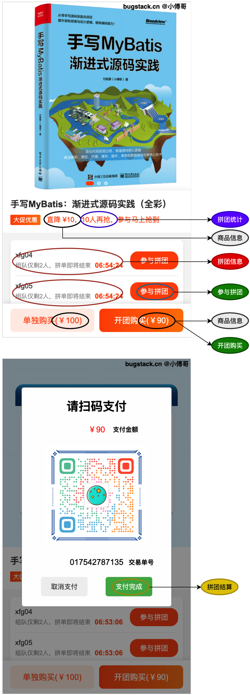
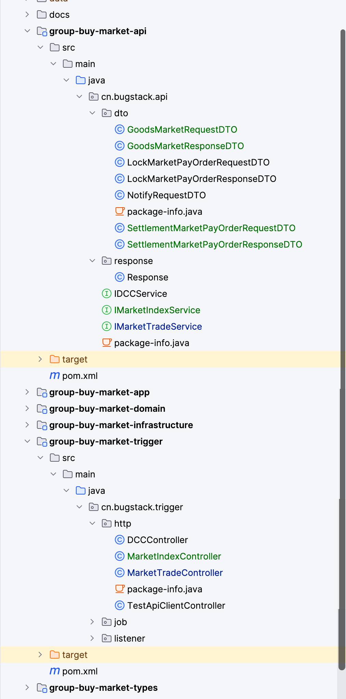
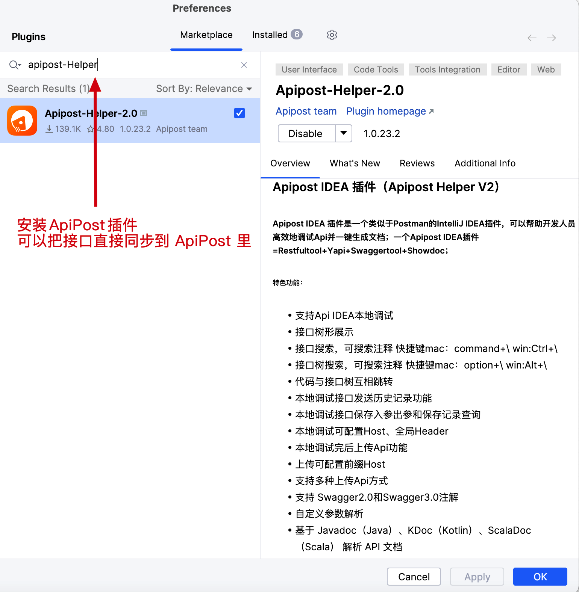
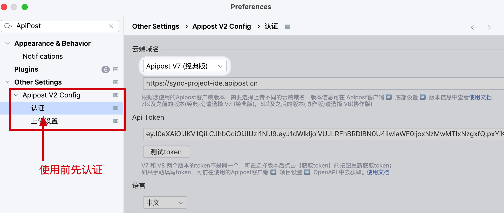
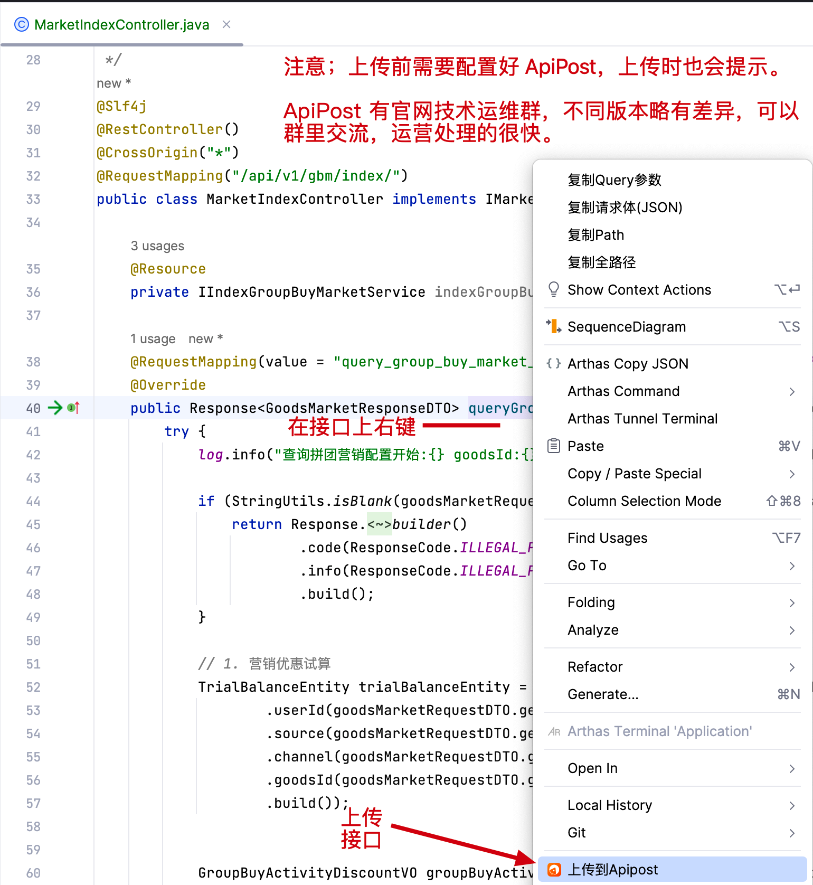
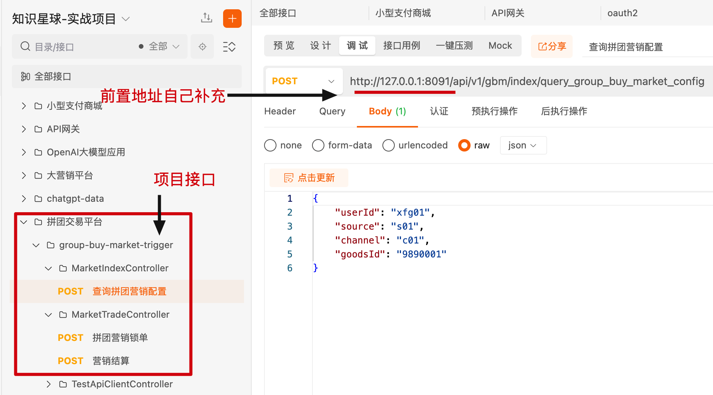
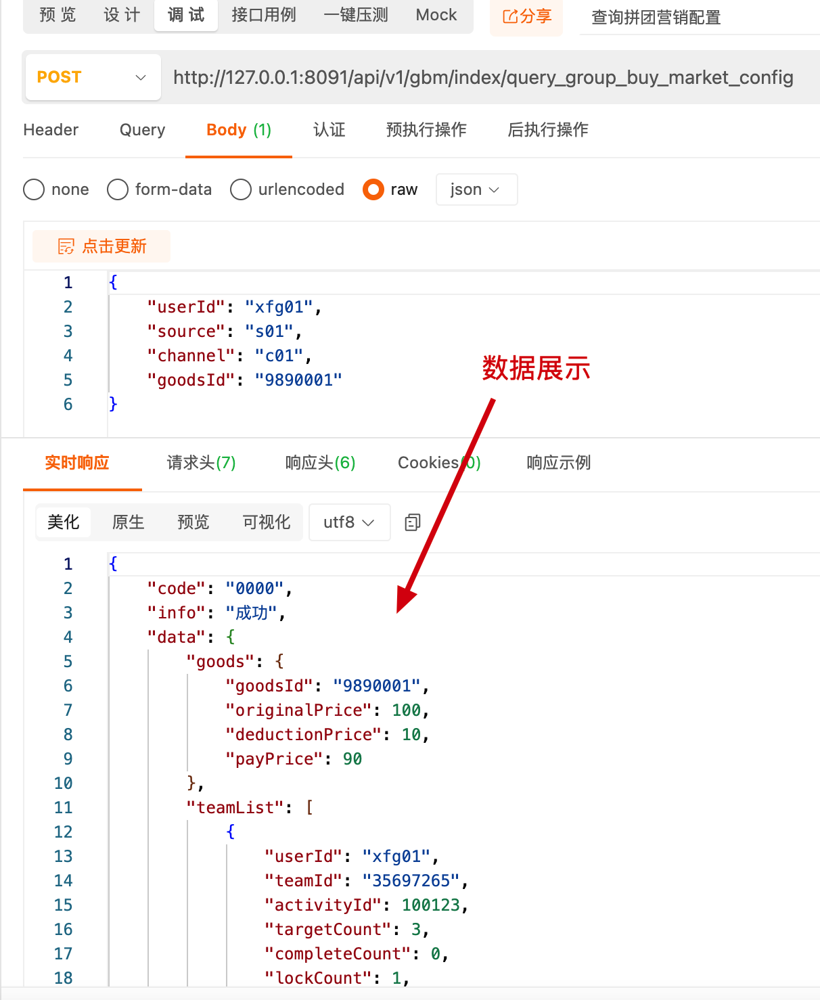

# 根据UI展示封装接口

> 学习序号 19｜小节 2-15｜原文：https://articles.zsxq.com/id_testl3kz27ac.html

**本章重点** ：根据在上一节使用 DeepSeek 实现的拼团 UI，设计并实现所需的服务端接口。

- **本章重点** ：★★★☆☆
- **本节分支：** [https://gitcode.net/KnowledgePlanet/group-buy-market/-/tree/2-15-250203-xfg-ui-http](https://gitcode.net/KnowledgePlanet/group-buy-market/-/tree/2-15-250203-xfg-ui-http)
- **课程视频** ：[https://t.zsxq.com/2C7df](https://t.zsxq.com/2C7df)

**版权说明** ：©本项目与星球签约合作，受[《中华人民共和国著作权法实施条例》](https://www.gov.cn/gongbao/content/2013/content_2339485.htm) 版权法保护，禁止任何理由和任何方式公开(public)源码、资料、视频等小傅哥发布的星球内容到Github、Gitee等各类平台，违反可追究进一步的法律责任。

作者：小傅哥

博客：[https://bugstack.cn](https://bugstack.cn)

> 沉淀、分享、成长，让自己和他人都能有所收获！😄

- 一、本章诉求
- 二、接口分析
- 三、编码实现
  - 1. 工程结构
  - 2. 首页 - 拼团营销配置接口
  - 3. 交易 - 结算接口
- 四、上传接口
  - 1. 安装插件
  - 2. 认证插件
  - 3. 上传接口
  - 4. 查看接口
- 五、测试验证
  - 1. 启动服务
  - 2. 调用接口
- 六、读者作业

### 一、本章诉求

根据在上一节使用 DeepSeek 实现的拼团 UI，设计并实现所需的服务端接口。

在互联网公司里的开发过程也是这样，产品在评审期间，会提供 UI 工程师做好的设计图，研发拿到设计图后，提供所需的接口提供相应的字段。

### 二、接口分析

如图，根据UI分析所需接口数据；



- 紫色圈；10人再抢，是拼团的统计数据。类似的还有总共开多少团、成功的拼团等，如果有展示需求，都可以在拼团统计中给出。
- 灰色圈；商品信息，商品金额、优惠金额、支付金额等。
- 绿色圈；参与拼团，UI 调用的操作是锁单的处理。在完整的流程中是调用商城类系统，发起交易，之后由商城类系统进行营销锁单。我们这里模拟，所以从前端开始锁单。
- 黄色券；这里不是真实对接扫码支付，所以要点支付完成，才能触发拼团结算。所以这里需要调用拼团里的结算接口。

### 三、编码实现

#### 1. 工程结构



- api 模块增加 IMarketIndexService 服务接口，封装首页信息查询。
- trigger 模块实现 IMarketIndexService 接口的首页数据查询，以及在 MarketTradeController 实现结算接口。

#### 2. 首页 - 拼团营销配置接口

##### 2.1 定义对象

```
                @Data
@Builder
@AllArgsConstructor
@NoArgsConstructor
public class GoodsMarketResponseDTO {

    // 商品信息
    private Goods goods;
    // 组队信息（1个个人的置顶、2个随机的「获取10个，随机取2个」）
    private List<Team> teamList;
    // 组队统计
    private TeamStatistic teamStatistic;

    /**
     * 商品信息
     */
    @Data
    @Builder
    @AllArgsConstructor
    @NoArgsConstructor
    public static class Goods {
        // 商品ID
        private String goodsId;
        // 原始价格
        private BigDecimal originalPrice;
        // 折扣金额
        private BigDecimal deductionPrice;
        // 支付价格
        private BigDecimal payPrice;
    }

    /**
     * 组队信息
     */
    @Data
    @Builder
    @AllArgsConstructor
    @NoArgsConstructor
    public static class Team {
        // 用户ID
        private String userId;
        // 拼单组队ID
        private String teamId;
        // 活动ID
        private Long activityId;
        // 目标数量
        private Integer targetCount;
        // 完成数量
        private Integer completeCount;
        // 锁单数量
        private Integer lockCount;
        // 拼团开始时间 - 参与拼团时间
        private Date validStartTime;
        // 拼团结束时间 - 拼团有效时长
        private Date validEndTime;
        // 倒计时(字符串) validEndTime - validStartTime
        private String validTimeCountdown;
        /** 外部交易单号-确保外部调用唯一幂等 */
        private String outTradeNo;

        public static String differenceDateTime2Str(Date validStartTime, Date validEndTime) {
            if (validStartTime == null || validEndTime == null) {
                return "无效的时间";
            }

            long diffInMilliseconds = validEndTime.getTime() - validStartTime.getTime();

            if (diffInMilliseconds < 0) {
                return "已结束";
            }

            long seconds = TimeUnit.MILLISECONDS.toSeconds(diffInMilliseconds) % 60;
            long minutes = TimeUnit.MILLISECONDS.toMinutes(diffInMilliseconds) % 60;
            long hours = TimeUnit.MILLISECONDS.toHours(diffInMilliseconds) % 24;
            long days = TimeUnit.MILLISECONDS.toDays(diffInMilliseconds);

            return String.format("%02d:%02d:%02d", hours, minutes, seconds);
        }

    }

    /**
     * 组队统计
     */
    @Data
    @Builder
    @AllArgsConstructor
    @NoArgsConstructor
    public static class TeamStatistic {
        // 开团队伍数量
        private Integer allTeamCount;
        // 成团队伍数量
        private Integer allTeamCompleteCount;
        // 参团人数总量 - 一个商品的总参团人数
        private Integer allTeamUserCount;
    }

}
```

- 首先，这里要注意，不要把页面的所有要的属性，都用一个个属性字段平铺到类中，那样以后维护会非常复杂。要思考这些属性的归属问题，定义不同的对象承载。
- 之后，根据页面诉求，定义三个对象；Goods - 商品、Team - 拼团、TeamStatistic - 统计。

##### 2.2 定义接口

```
                public interface IMarketIndexService {

    /**
     * 查询拼团营销配置
     *
     * @param goodsMarketRequestDTO 营销商品信息
     * @return 营销配置信息
     */
    Response<GoodsMarketResponseDTO> queryGroupBuyMarketConfig(GoodsMarketRequestDTO goodsMarketRequestDTO)
}
```

##### 2.3 实现接口

```
                package cn.bugstack.trigger.http;

import cn.bugstack.api.IMarketIndexService;
import cn.bugstack.api.dto.GoodsMarketRequestDTO;
import cn.bugstack.api.dto.GoodsMarketResponseDTO;
import cn.bugstack.api.response.Response;
import cn.bugstack.domain.activity.model.entity.MarketProductEntity;
import cn.bugstack.domain.activity.model.entity.TrialBalanceEntity;
import cn.bugstack.domain.activity.model.entity.UserGroupBuyOrderDetailEntity;
import cn.bugstack.domain.activity.model.valobj.GroupBuyActivityDiscountVO;
import cn.bugstack.domain.activity.model.valobj.TeamStatisticVO;
import cn.bugstack.domain.activity.service.IIndexGroupBuyMarketService;
import cn.bugstack.types.enums.ResponseCode;
import com.alibaba.fastjson.JSON;
import lombok.extern.slf4j.Slf4j;
import org.apache.commons.lang3.StringUtils;
import org.springframework.web.bind.annotation.*;

import javax.annotation.Resource;
import java.util.ArrayList;
import java.util.Date;
import java.util.List;

/**
 * @author Fuzhengwei bugstack.cn @小傅哥
 * @description 营销首页服务
 * @create 2025-02-02 16:03
 */
@Slf4j
@RestController()
@CrossOrigin("*")
@RequestMapping("/api/v1/gbm/index/")
public class MarketIndexController implements IMarketIndexService {

    @Resource
    private IIndexGroupBuyMarketService indexGroupBuyMarketService;

    @RequestMapping(value = "query_group_buy_market_config", method = RequestMethod.POST)
    @Override
    public Response<GoodsMarketResponseDTO> queryGroupBuyMarketConfig(@RequestBody GoodsMarketRequestDTO goodsMarketRequestDTO) {
        try {
            log.info("查询拼团营销配置开始:{} goodsId:{}", goodsMarketRequestDTO.getUserId(), goodsMarketRequestDTO.getGoodsId());

            if (StringUtils.isBlank(goodsMarketRequestDTO.getUserId()) || StringUtils.isBlank(goodsMarketRequestDTO.getSource()) || StringUtils.isBlank(goodsMarketRequestDTO.getChannel()) || StringUtils.isBlank(goodsMarketRequestDTO.getGoodsId())) {
                return Response.<GoodsMarketResponseDTO>builder()
                        .code(ResponseCode.ILLEGAL_PARAMETER.getCode())
                        .info(ResponseCode.ILLEGAL_PARAMETER.getInfo())
                        .build();
            }

            // 1. 营销优惠试算
            TrialBalanceEntity trialBalanceEntity = indexGroupBuyMarketService.indexMarketTrial(MarketProductEntity.builder()
                    .userId(goodsMarketRequestDTO.getUserId())
                    .source(goodsMarketRequestDTO.getSource())
                    .channel(goodsMarketRequestDTO.getChannel())
                    .goodsId(goodsMarketRequestDTO.getGoodsId())
                    .build());


            GroupBuyActivityDiscountVO groupBuyActivityDiscountVO = trialBalanceEntity.getGroupBuyActivityDiscountVO();
            Long activityId = groupBuyActivityDiscountVO.getActivityId();

            // 2. 查询拼团组队
            List<UserGroupBuyOrderDetailEntity> userGroupBuyOrderDetailEntities = indexGroupBuyMarketService.queryInProgressUserGroupBuyOrderDetailList(activityId, goodsMarketRequestDTO.getUserId(), 1, 2);

            // 3. 统计拼团数据
            TeamStatisticVO teamStatisticVO = indexGroupBuyMarketService.queryTeamStatisticByActivityId(activityId);

            GoodsMarketResponseDTO.Goods goods = GoodsMarketResponseDTO.Goods.builder()
                    .goodsId(trialBalanceEntity.getGoodsId())
                    .originalPrice(trialBalanceEntity.getOriginalPrice())
                    .deductionPrice(trialBalanceEntity.getDeductionPrice())
                    .payPrice(trialBalanceEntity.getPayPrice())
                    .build();

            List<GoodsMarketResponseDTO.Team> teams = new ArrayList<>();
            if (null != userGroupBuyOrderDetailEntities && !userGroupBuyOrderDetailEntities.isEmpty()) {
                for (UserGroupBuyOrderDetailEntity userGroupBuyOrderDetailEntity : userGroupBuyOrderDetailEntities) {
                    GoodsMarketResponseDTO.Team team = GoodsMarketResponseDTO.Team.builder()
                            .userId(userGroupBuyOrderDetailEntity.getUserId())
                            .teamId(userGroupBuyOrderDetailEntity.getTeamId())
                            .activityId(userGroupBuyOrderDetailEntity.getActivityId())
                            .targetCount(userGroupBuyOrderDetailEntity.getTargetCount())
                            .completeCount(userGroupBuyOrderDetailEntity.getCompleteCount())
                            .lockCount(userGroupBuyOrderDetailEntity.getLockCount())
                            .validStartTime(userGroupBuyOrderDetailEntity.getValidStartTime())
                            .validEndTime(userGroupBuyOrderDetailEntity.getValidEndTime())
                            .validTimeCountdown(GoodsMarketResponseDTO.Team.differenceDateTime2Str(new Date(), userGroupBuyOrderDetailEntity.getValidEndTime()))
                            .outTradeNo(userGroupBuyOrderDetailEntity.getOutTradeNo())
                            .build();
                    teams.add(team);
                }
            }

            GoodsMarketResponseDTO.TeamStatistic teamStatistic = GoodsMarketResponseDTO.TeamStatistic.builder()
                    .allTeamCount(teamStatisticVO.getAllTeamCount())
                    .allTeamCompleteCount(teamStatisticVO.getAllTeamCompleteCount())
                    .allTeamUserCount(teamStatisticVO.getAllTeamUserCount())
                    .build();

            Response<GoodsMarketResponseDTO> response = Response.<GoodsMarketResponseDTO>builder()
                    .code(ResponseCode.SUCCESS.getCode())
                    .info(ResponseCode.SUCCESS.getInfo())
                    .data(GoodsMarketResponseDTO.builder()
                            .goods(goods)
                            .teamList(teams)
                            .teamStatistic(teamStatistic)
                            .build())
                    .build();

            log.info("查询拼团营销配置完成:{} goodsId:{} response:{}", goodsMarketRequestDTO.getUserId(), goodsMarketRequestDTO.getGoodsId(), JSON.toJSONString(response));

            return response;
        } catch (Exception e) {
            log.error("查询拼团营销配置失败:{} goodsId:{}", goodsMarketRequestDTO.getUserId(), goodsMarketRequestDTO.getGoodsId(), e);
            return Response.<GoodsMarketResponseDTO>builder()
                    .code(ResponseCode.UN_ERROR.getCode())
                    .info(ResponseCode.UN_ERROR.getInfo())
                    .build();
        }
    }

}
```

- 接口的查询组装数据主要分为3部分；`营销优惠试算`、`查询拼团组队`、`统计拼团数据`。
- 其中，`查询拼团组队` 分为优先查询一个，个人的一条拼团数据显示在最上面。之后在随机查询2条其他人的拼团数据。查询的过程要先查询个人的明细数据，之后从明细数据获得拼团队伍teamId，在查询拼团队伍的信息，最后组装数据。随机查询可以查询2倍量的数据，之后在随机获取需要的量的数据。

##### 2.4 数据组装

```
                @Repository
public class ActivityRepository implements IActivityRepository {

    @Resource
    private IGroupBuyActivityDao groupBuyActivityDao;
    @Resource
    private IGroupBuyDiscountDao groupBuyDiscountDao;
    @Resource
    private ISkuDao skuDao;
    @Resource
    private ISCSkuActivityDao skuActivityDao;
    @Resource
    private IRedisService redisService;
    @Resource
    private DCCService dccService;
    @Resource
    private IGroupBuyOrderDao groupBuyOrderDao;
    @Resource
    private IGroupBuyOrderListDao groupBuyOrderListDao;

    // ... 省略部分代码
    
    @Override
    public List<UserGroupBuyOrderDetailEntity> queryInProgressUserGroupBuyOrderDetailListByOwner(Long activityId, String userId, Integer ownerCount) {
        // 1. 根据用户ID、活动ID，查询用户参与的拼团队伍
        GroupBuyOrderList groupBuyOrderListReq = new GroupBuyOrderList();
        groupBuyOrderListReq.setActivityId(activityId);
        groupBuyOrderListReq.setUserId(userId);
        groupBuyOrderListReq.setCount(ownerCount);
        List<GroupBuyOrderList> groupBuyOrderLists = groupBuyOrderListDao.queryInProgressUserGroupBuyOrderDetailListByUserId(groupBuyOrderListReq);
        if (null == groupBuyOrderLists || groupBuyOrderLists.isEmpty()) return null;

        // 2. 过滤队伍获取 TeamId
        Set<String> teamIds = groupBuyOrderLists.stream()
                .map(GroupBuyOrderList::getTeamId)
                .filter(teamId -> teamId != null && !teamId.isEmpty()) // 过滤非空和非空字符串
                .collect(Collectors.toSet());

        // 3. 查询队伍明细，组装Map结构
        List<GroupBuyOrder> groupBuyOrders = groupBuyOrderDao.queryGroupBuyProgressByTeamIds(teamIds);
        if (null == groupBuyOrders || groupBuyOrders.isEmpty()) return null;

        Map<String, GroupBuyOrder> groupBuyOrderMap = groupBuyOrders.stream()
                .collect(Collectors.toMap(GroupBuyOrder::getTeamId, order -> order));

        // 4. 转换数据
        List<UserGroupBuyOrderDetailEntity> userGroupBuyOrderDetailEntities = new ArrayList<>();
        for (GroupBuyOrderList groupBuyOrderList : groupBuyOrderLists) {
            String teamId = groupBuyOrderList.getTeamId();
            GroupBuyOrder groupBuyOrder = groupBuyOrderMap.get(teamId);
            if (null == groupBuyOrder) continue;

            UserGroupBuyOrderDetailEntity userGroupBuyOrderDetailEntity = UserGroupBuyOrderDetailEntity.builder()
                    .userId(groupBuyOrderList.getUserId())
                    .teamId(groupBuyOrder.getTeamId())
                    .activityId(groupBuyOrder.getActivityId())
                    .targetCount(groupBuyOrder.getTargetCount())
                    .completeCount(groupBuyOrder.getCompleteCount())
                    .lockCount(groupBuyOrder.getLockCount())
                    .validStartTime(groupBuyOrder.getValidStartTime())
                    .validEndTime(groupBuyOrder.getValidEndTime())
                    .outTradeNo(groupBuyOrderList.getOutTradeNo())
                    .build();

            userGroupBuyOrderDetailEntities.add(userGroupBuyOrderDetailEntity);
        }

        return userGroupBuyOrderDetailEntities;
    }

    @Override
    public List<UserGroupBuyOrderDetailEntity> queryInProgressUserGroupBuyOrderDetailListByRandom(Long activityId, String userId, Integer randomCount) {
        // 1. 根据用户ID、活动ID，查询用户参与的拼团队伍
        GroupBuyOrderList groupBuyOrderListReq = new GroupBuyOrderList();
        groupBuyOrderListReq.setActivityId(activityId);
        groupBuyOrderListReq.setUserId(userId);
        groupBuyOrderListReq.setCount(randomCount * 2); // 查询2倍的量，之后其中 randomCount 数量
        List<GroupBuyOrderList> groupBuyOrderLists = groupBuyOrderListDao.queryInProgressUserGroupBuyOrderDetailListByRandom(groupBuyOrderListReq);
        if (null == groupBuyOrderLists || groupBuyOrderLists.isEmpty()) return null;

        // 判断总量是否大于 randomCount
        if (groupBuyOrderLists.size() > randomCount) {
            // 随机打乱列表
            Collections.shuffle(groupBuyOrderLists);
            // 获取前 randomCount 个元素
            groupBuyOrderLists = groupBuyOrderLists.subList(0, randomCount);
        }

        // 2. 过滤队伍获取 TeamId
        Set<String> teamIds = groupBuyOrderLists.stream()
                .map(GroupBuyOrderList::getTeamId)
                .filter(teamId -> teamId != null && !teamId.isEmpty()) // 过滤非空和非空字符串
                .collect(Collectors.toSet());

        // 3. 查询队伍明细，组装Map结构
        List<GroupBuyOrder> groupBuyOrders = groupBuyOrderDao.queryGroupBuyProgressByTeamIds(teamIds);
        if (null == groupBuyOrders || groupBuyOrders.isEmpty()) return null;

        Map<String, GroupBuyOrder> groupBuyOrderMap = groupBuyOrders.stream()
                .collect(Collectors.toMap(GroupBuyOrder::getTeamId, order -> order));

        // 4. 转换数据
        List<UserGroupBuyOrderDetailEntity> userGroupBuyOrderDetailEntities = new ArrayList<>();
        for (GroupBuyOrderList groupBuyOrderList : groupBuyOrderLists) {
            String teamId = groupBuyOrderList.getTeamId();
            GroupBuyOrder groupBuyOrder = groupBuyOrderMap.get(teamId);
            if (null == groupBuyOrder) continue;

            UserGroupBuyOrderDetailEntity userGroupBuyOrderDetailEntity = UserGroupBuyOrderDetailEntity.builder()
                    .userId(groupBuyOrderList.getUserId())
                    .teamId(groupBuyOrder.getTeamId())
                    .activityId(groupBuyOrder.getActivityId())
                    .targetCount(groupBuyOrder.getTargetCount())
                    .completeCount(groupBuyOrder.getCompleteCount())
                    .lockCount(groupBuyOrder.getLockCount())
                    .validStartTime(groupBuyOrder.getValidStartTime())
                    .validEndTime(groupBuyOrder.getValidEndTime())
                    .build();

            userGroupBuyOrderDetailEntities.add(userGroupBuyOrderDetailEntity);
        }

        return userGroupBuyOrderDetailEntities;
    }

    @Override
    public TeamStatisticVO queryTeamStatisticByActivityId(Long activityId) {
        // 1. 根据活动ID查询拼团队伍
        List<GroupBuyOrderList> groupBuyOrderLists = groupBuyOrderListDao.queryInProgressUserGroupBuyOrderDetailListByActivityId(activityId);

        // 2. 过滤队伍获取 TeamId
        Set<String> teamIds = groupBuyOrderLists.stream()
                .map(GroupBuyOrderList::getTeamId)
                .filter(teamId -> teamId != null && !teamId.isEmpty()) // 过滤非空和非空字符串
                .collect(Collectors.toSet());

        // 3. 统计数据
        Integer allTeamCount = groupBuyOrderDao.queryAllTeamCount(teamIds);
        Integer allTeamCompleteCount = groupBuyOrderDao.queryAllTeamCompleteCount(teamIds);
        Integer allTeamUserCount = groupBuyOrderDao.queryAllUserCount(teamIds);

        // 4. 构建对象
        return TeamStatisticVO.builder()
                .allTeamCount(allTeamCount)
                .allTeamCompleteCount(allTeamCompleteCount)
                .allTeamUserCount(allTeamUserCount)
                .build();
    }

}
```

- queryInProgressUserGroupBuyOrderDetailListByOwner，组装个人用户数据。
- queryInProgressUserGroupBuyOrderDetailListByRandom，随机组装非个人用户数据。
- queryTeamStatisticByActivityId，拼团队伍统计。
- 这些数据的查询，也可以用 Redis 缓存优化以及使用定时任务+异步消息统计好，查询的时候直接使用。

#### 3. 交易 - 结算接口

```
                @Slf4j
@RestController()
@CrossOrigin("*")
@RequestMapping("/api/v1/gbm/trade/")
public class MarketTradeController implements IMarketTradeService {

    @Resource
    private IIndexGroupBuyMarketService indexGroupBuyMarketService;
    @Resource
    private ITradeLockOrderService tradeOrderService;
    @Resource
    private ITradeSettlementOrderService tradeSettlementOrderService;

    // ... 省略部分代码

    @RequestMapping(value = "settlement_market_pay_order", method = RequestMethod.POST)
    @Override
    public Response<SettlementMarketPayOrderResponseDTO> settlementMarketPayOrder(@RequestBody SettlementMarketPayOrderRequestDTO requestDTO) {
        try {
            log.info("营销交易组队结算开始:{} outTradeNo:{}", requestDTO.getUserId(), requestDTO.getOutTradeNo());

            if (StringUtils.isBlank(requestDTO.getUserId()) || StringUtils.isBlank(requestDTO.getSource()) || StringUtils.isBlank(requestDTO.getChannel()) || StringUtils.isBlank(requestDTO.getOutTradeNo()) || null == requestDTO.getOutTradeTime()) {
                return Response.<SettlementMarketPayOrderResponseDTO>builder()
                        .code(ResponseCode.ILLEGAL_PARAMETER.getCode())
                        .info(ResponseCode.ILLEGAL_PARAMETER.getInfo())
                        .build();
            }

            // 1. 结算服务
            TradePaySettlementEntity tradePaySettlementEntity = tradeSettlementOrderService.settlementMarketPayOrder(TradePaySuccessEntity.builder()
                    .source(requestDTO.getSource())
                    .channel(requestDTO.getChannel())
                    .userId(requestDTO.getUserId())
                    .outTradeNo(requestDTO.getOutTradeNo())
                    .outTradeTime(requestDTO.getOutTradeTime())
                    .build());

            SettlementMarketPayOrderResponseDTO responseDTO = SettlementMarketPayOrderResponseDTO.builder()
                        .userId(tradePaySettlementEntity.getUserId())
                        .teamId(tradePaySettlementEntity.getTeamId())
                        .activityId(tradePaySettlementEntity.getActivityId())
                        .outTradeNo(tradePaySettlementEntity.getOutTradeNo())
                        .build();

            // 返回结果
            Response<SettlementMarketPayOrderResponseDTO> response = Response.<SettlementMarketPayOrderResponseDTO>builder()
                    .code(ResponseCode.SUCCESS.getCode())
                    .info(ResponseCode.SUCCESS.getInfo())
                    .data(SettlementMarketPayOrderResponseDTO.builder()
                            .userId(tradePaySettlementEntity.getUserId())
                            .teamId(tradePaySettlementEntity.getTeamId())
                            .activityId(tradePaySettlementEntity.getActivityId())
                            .outTradeNo(tradePaySettlementEntity.getOutTradeNo())
                            .build())
                    .build();

            log.info("营销交易组队结算完成:{} outTradeNo:{} response:{}", requestDTO.getUserId(), requestDTO.getOutTradeNo(), JSON.toJSONString(response));

            return response;
        } catch (AppException e) {
            log.error("营销交易组队结算异常:{} LockMarketPayOrderRequestDTO:{}", requestDTO.getUserId(), JSON.toJSONString(requestDTO), e);
            return Response.<SettlementMarketPayOrderResponseDTO>builder()
                    .code(e.getCode())
                    .info(e.getInfo())
                    .build();
        }catch (Exception e) {
            log.error("营销交易组队结算失败:{} LockMarketPayOrderRequestDTO:{}", requestDTO.getUserId(), JSON.toJSONString(requestDTO), e);
            return Response.<SettlementMarketPayOrderResponseDTO>builder()
                    .code(ResponseCode.UN_ERROR.getCode())
                    .info(ResponseCode.UN_ERROR.getInfo())
                    .build();
        }
    }

}
```

- settlementMarketPayOrder 为结算接口，这个接口就是对领域服务 settlementMarketPayOrder 包装即可。

### 四、上传接口

ApiPost + IntelliJ IDEA ApiPost 插件，可以很方便的把接口同步到 ApiPost，这样就减少手动去处理了，而且更加准确。

#### 1. 安装插件



- 搜索插件；`Apipost-Helper-2.0`
- 插件地址；[https://plugins.jetbrains.com/plugin/22676-apipost-helper-2-0](https://plugins.jetbrains.com/plugin/22676-apipost-helper-2-0)

#### 2. 认证插件



- 如图提示，认证插件即可。如果遇到不可处理问题，可以在 ApiPost 加客服进入技术运维群。

#### 3. 上传接口



- 在你需要上传的接口，右键点击`上传到 ApiPost`，如果后期插件调整不在上传，可以加入官方群。

#### 4. 查看接口



- 上传后，登录本地的 ApiPost 软件，只要登录的是一个账号，就可以看到你上传的接口了。
- 在服务端启动后，可以测试验证这些接口。

### 五、测试验证

#### 1. 启动服务

```
                  .   ____          _            __ _ _
 /\\ / ___'_ __ _ _(_)_ __  __ _ \ \ \ \
( ( )\___ | '_ | '_| | '_ \/ _` | \ \ \ \
 \\/  ___)| |_)| | | | | || (_| |  ) ) ) )
  '  |____| .__|_| |_|_| |_\__, | / / / /
 =========|_|==============|___/=/_/_/_/
 :: Spring Boot ::               (v2.7.12)

25-02-03.09:54:37.668 [main            ] INFO  Application            - Starting Application using Java 1.8.0_311 on MacBook-Pro.local with PID 72174 (/Users/fuzhengwei/1024/KnowledgePlanet/group-buy-market/group-buy-market/group-buy-market-app/target/classes started by fuzhengwei in /Users/fuzhengwei/1024/KnowledgePlanet/group-buy-market/group-buy-market)
WebApplicationContext
25-02-03.09:54:41.779 [main            ] INFO  ServletWebServerApplicationContext - Root WebApplicationContext: initialization completed in 4038 ms
25-02-03.09:54:44.438 [main            ] INFO  EndpointLinksResolver  - Exposing 1 endpoint(s) beneath base path '/actuator'
25-02-03.09:54:44.490 [main            ] INFO  Http11NioProtocol      - Starting ProtocolHandler ["http-nio-8091"]
25-02-03.09:54:44.515 [main            ] INFO  TomcatWebServer        - Tomcat started on port(s): 8091 (http) with context path ''
25-02-03.09:54:44.544 [main            ] INFO  Application            - Started Application in 7.728 seconds (JVM running for 8.684)
```

#### 2. 调用接口



你可以分别验证这些接口，并查看返回的数据。这些数据后面就会被使用到 UI 进行对接。

### 六、读者作业

- 简单作业：理解通过UI分析接口，设计接口，并实现接口，以及运行测试。
- 复杂作业：尝试优化接口的查询从 Redis 缓存中获取，提高接口性能。
