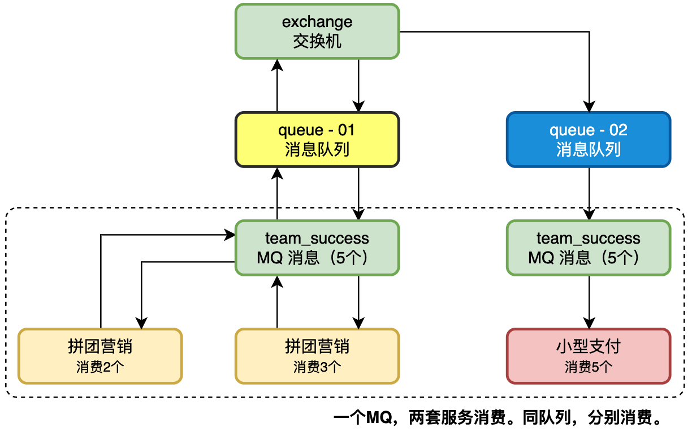
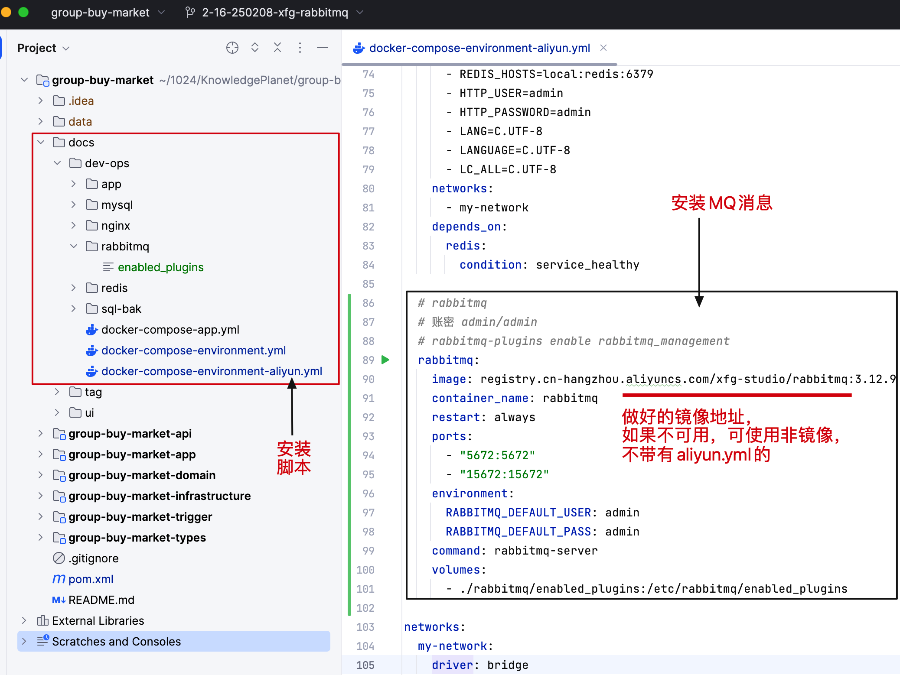
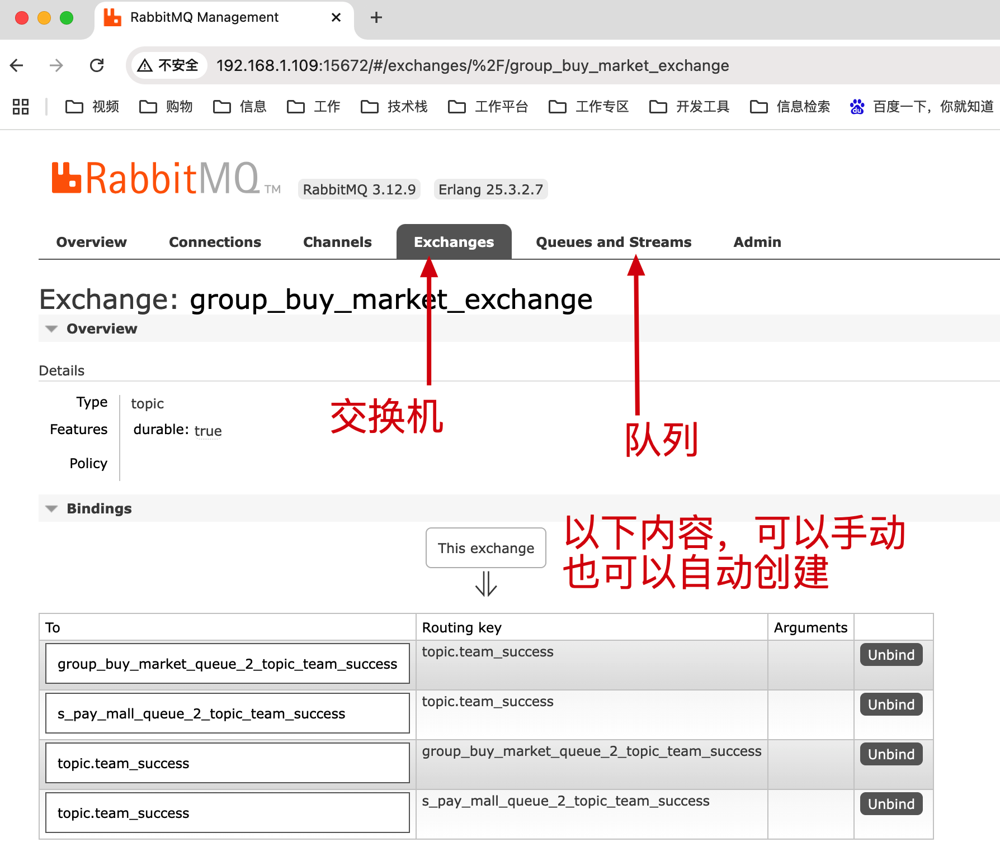
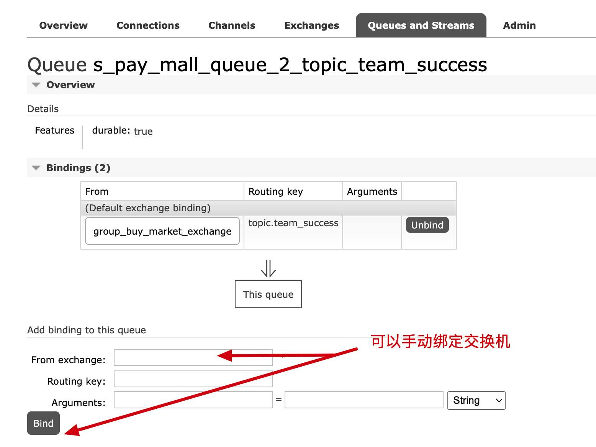
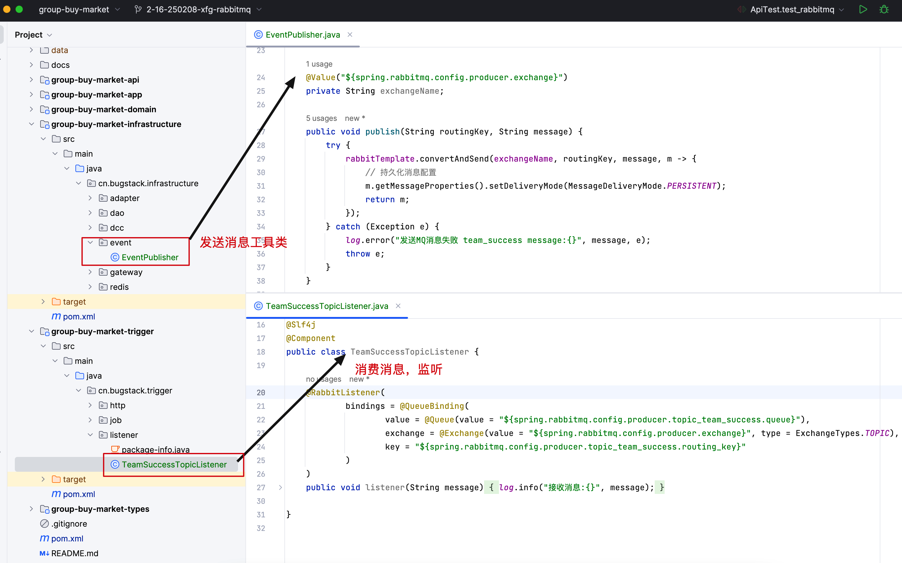
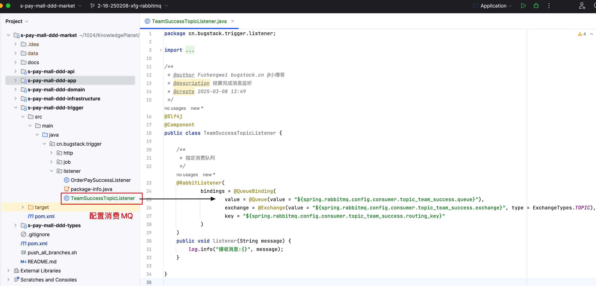
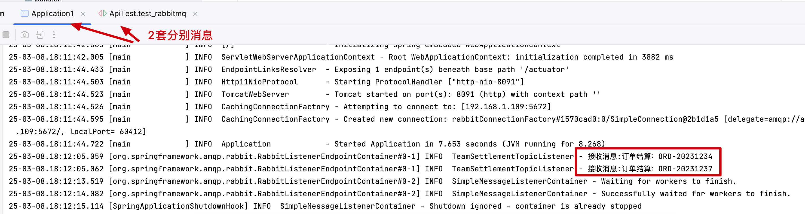
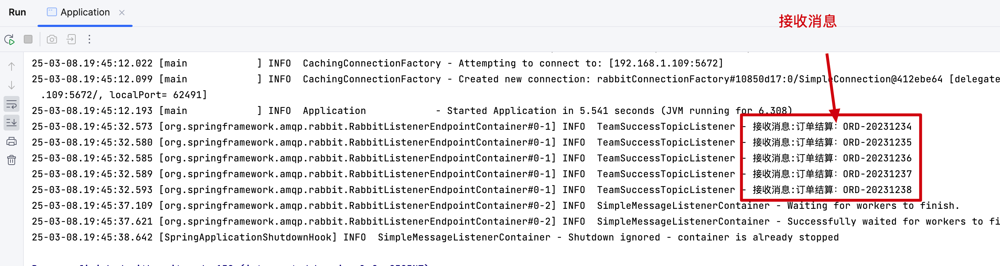

# 引入RabbitMQ分布式多端消费

> 学习序号 30｜小节 2-16｜原文：https://articles.zsxq.com/id_ba5e31cmb2uu.html

**本章重点** ：引入 RabbitMQ 分布式技术框架，实现分布式消息消费和多服务消费的能力。

**本章重点** ：★★★☆☆

**本节分支：** [https://gitcode.net/KnowledgePlanet/group-buy-market/-/tree/2-16-250208-xfg-rabbitmq](https://gitcode.net/KnowledgePlanet/group-buy-market/-/tree/2-16-250208-xfg-rabbitmq)

**课程视频** ：[https://t.zsxq.com/mipvF](https://t.zsxq.com/mipvF)

**版权说明** ：©本项目与星球签约合作，受[《中华人民共和国著作权法实施条例》](https://www.gov.cn/gongbao/content/2013/content_2339485.htm) 版权法保护，禁止任何理由和任何方式公开(public)源码、资料、视频等小傅哥发布的星球内容到Github、Gitee等各类平台，违反可追究进一步的法律责任。

作者：小傅哥

博客：[https://bugstack.cn](https://bugstack.cn)

> 沉淀、分享、成长，让自己和他人都能有所收获！😄

- 一、本章诉求
- 二、业务流程
- 三、编码实现
  - 1. 环境安装
  - 2. 引入POM
  - 3. 文件配置
  - 4. 代码配置
- 四、测试验证
  - 1. 生产者 - 拼团
  - 2. 消费者 - 支付
- 五、读者作业

### 一、本章诉求

引入 RabbitMQ 分布式技术框架，实现分布式消息消费和多服务消费的能力。

消息，是一种解耦服务间直接（http/rpc）调用的手段，以发送消息和接收消息的模式，完成业务流程的异步化处理。

**RabbitMQ基础教程** ：[https://bugstack.cn/md/road-map/rabbitmq.html](https://bugstack.cn/md/road-map/rabbitmq.html)

### 二、业务流程

在互联网公司中，往往一个微服务发送出来的 MQ，除了自己接收消费处理自己的业务流程，也会有很多其他微服务进行消费。那么这里就会有一个 Topic，被多个应用消费的配置。如图；



- 以拼团发送结算完成消息举例，拼团是负载均衡部署了2套服务，发送的MQ消息，由小型支付对接。
- 那么，负载均衡的拼团服务，发送MQ后，自己的2套微服务，会分别接收到消息。另外一套小型支付，假设只部署了一套，那么这里会消费5个MQ消息。
- 注意，以 RabbitMQ举例，这里会需要使用到同一套交换机，同一个路由Key，但队列要分别每个服务配置不同的。同时消息支持持久化，也就是拼团发送的MQ消息，即使小型支付服务暂时没有启动，也可以在启动后消费队列里的MQ消息。

### 三、编码实现

#### 1. 环境安装



- 你可以通过 `docker-compose-environment-aliyun.yml` 安装 RabbitMQ 服务。aliyun.yml 是做的代理地址，万一将来哪天不可用，可把 `registry.cn-hangzhou.aliyuncs.com/xfg-studio/rabbitmq:3.12.9`替换为 `rabbitmq:3.12.9`
- 如果你是虚拟机、云服务器等，记得把 rabbitmq 文件以上传使用。

#### 2. 引入POM

```
                <!-- rabbitmq https://mvnrepository.com/artifact/org.springframework.boot/spring-boot-starter-amqp -->
<dependency>
    <groupId>org.springframework.boot</groupId>
    <artifactId>spring-boot-starter-amqp</artifactId>
    <version>3.2.0</version>
</dependency>
```

- 要在使用 MQ 的 module 模块下，增加 rabbitmq 配置。这样才能使用对应的方法。`group-buy-market-infrastructure`、`group-buy-market-trigger`、`group-buy-market-app` 都要引入。

#### 3. 文件配置





- 登录，RabbitMQ 管理后台；[http://192.168.1.109:15672/](http://192.168.1.109:15672/) - 替换为你的 IP，账号密码为 `docker-compose-environment-aliyun.yml` 配置的账密。
- 如图，为 RabbitMQ 的交换机和队列。

##### 2.1 生产者 - 拼团

**group-buy-market拼团营销项目** ：

```
                # 数据库配置；启动时配置数据库资源信息
spring:
  rabbitmq:
    addresses: 192.168.1.109
    port: 5672
    username: admin
    password: admin
    listener:
      simple:
        prefetch: 1 # 每次投递n个消息，消费完在投递n个
    template:
      delivery-mode: persistent # 确保全局默认设置为持久化（可选）
    # 消息配置
    config:
      # 生产者
      producer:
        # 绑定交换机，统一一套交换机
        exchange: group_buy_market_exchange
        # 消息主题配置；路由key、队列
        topic_team_success:
          # 消息主题
          routing_key: topic.team_success
          # 消费队列
          queue: group_buy_market_queue_2_topic_team_success
```

- 首先，spring.rabbitmq 下的 config 为自定义配置，我们在这里配置MQ消息生产者信息。
- 之后，一整套服务，可以使用一个交换机。`group_buy_market_exchange`
- 然后，一个消息使用一个队列。topic_team_success 是 MQ 消息，下面配置了队列和路由key。

##### 2.2 消费者 - 支付

**s-pay-mall-ddd-market小型支付项目** ：

```
              spring:
# RabbitMQ
rabbitmq:
  addresses: 192.168.1.109
  port: 5672
  username: admin
  password: admin
  listener:
    simple:
      prefetch: 1 # 每次投递n个消息，消费完在投递n个
  template:
    delivery-mode: persistent # 确保全局默认设置为持久化（可选）
  # 消息配置
  config:
    consumer:
      # 消费 topic 主题，team_success
      topic_team_success:
        # 绑定交换机 - 消息提供者的交换机
        exchange: group_buy_market_exchange
        # 消息主题
        routing_key: topic.team_success
        # 消费队列 - 每个系统有自己的消费队列
        queue: s_pay_mall_queue_2_topic_team_success
```

- 首先，spring.rabbitmq 下的 config 为自定义配置，我们在这里配置MQ消息消费者信息。
- 之后，consumer 下，topic_team_success 这个消息，要指定一套交换机，一套消息主题的路由key，但要使用自己的队列。这个队列就像水桶，分别装 MQ 消息。

#### 4. 代码配置

##### 4.1 生产者 - 拼团



- 配置 EventPublisher 发送消息的工具类。
- 配置 TeamSuccessTopicListener 监听消息的工具类。

##### 4.2 消费者 - 支付



- 配置 TeamSuccessTopicListener 监听消息的工具类。

### 四、测试验证

首先，直接启动 group-buy-market Application，这样就相当于和单测时候的服务，构成了一个负载。MQ 会被分别消费（拼团+小型支付）。

#### 1. 生产者 - 拼团

```
                @Slf4j
@RunWith(SpringRunner.class)
@SpringBootTest
public class ApiTest {

    @Resource
    private EventPublisher publisher;

    @Value("${spring.rabbitmq.config.producer.topic_team_success.routing_key}")
    private String routingKey;

    @Test
    public void test_rabbitmq() throws InterruptedException {
        CountDownLatch countDownLatch = new CountDownLatch(1);

        publisher.publish(routingKey, "订单结算：ORD-20231234");
        publisher.publish(routingKey, "订单结算：ORD-20231235");
        publisher.publish(routingKey, "订单结算：ORD-20231236");
        publisher.publish(routingKey, "订单结算：ORD-20231237");
        publisher.publish(routingKey, "订单结算：ORD-20231238");

        // 等待，消息消费。测试后，可主动关闭。
        countDownLatch.await();
    }

}
```



- 模拟生产消息。Application、ApiTest，启动的服务，分别消费MQ消息。

#### 2. 消费者 - 支付



- 小型支付商城，接收到了5个MQ消息。

### 五、读者作业

- 简单作业：完成 RabbitMQ 基础教程和本节的 MQ 多套服务使用的案例。
- 复杂作业：尝试完成拼团回调，为MQ方式进行消费处理流程。
