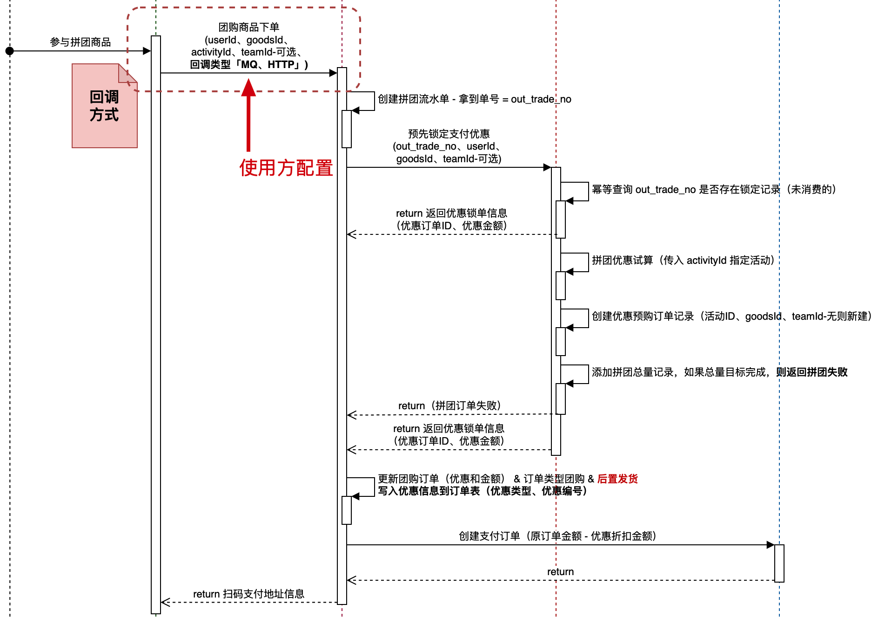
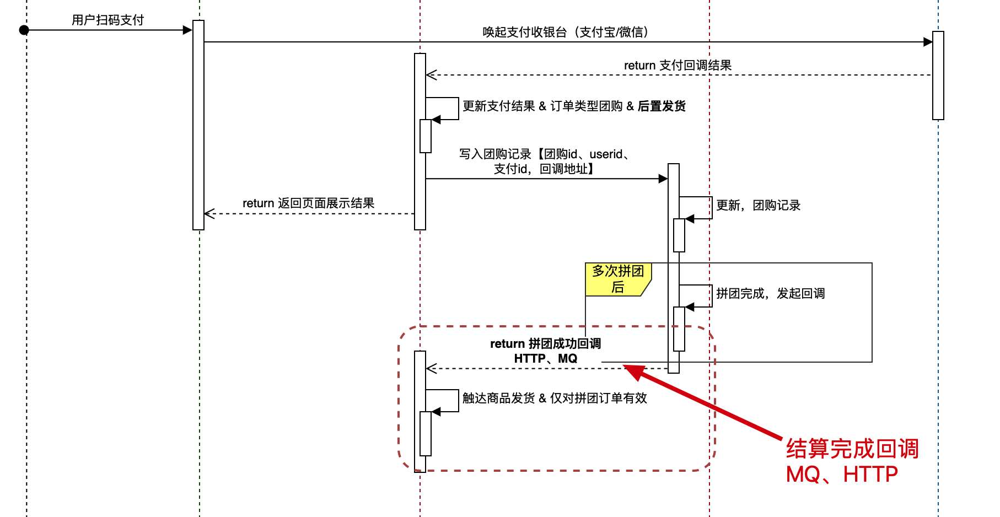
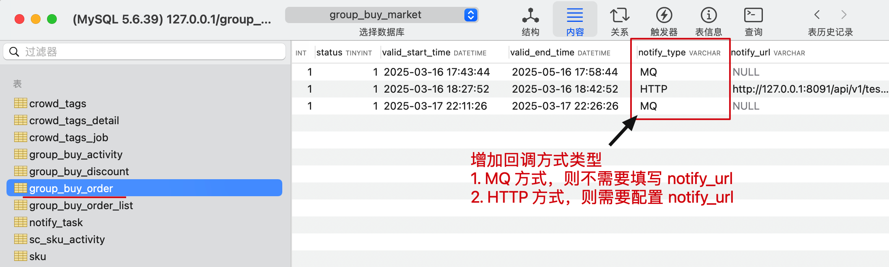
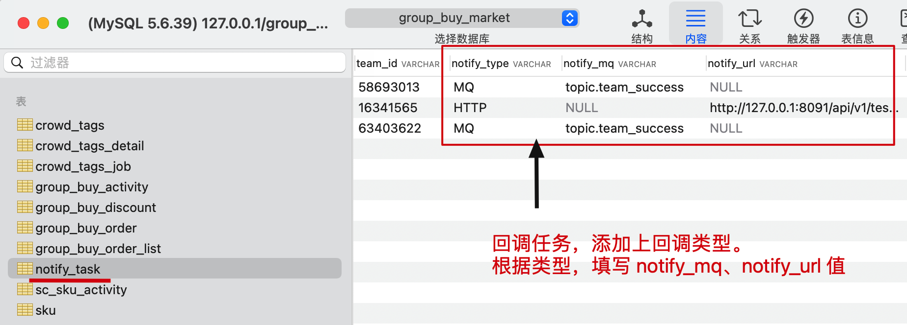

# 发送MQ结算消息

> 学习序号 31｜小节 2-17｜原文：https://articles.zsxq.com/id_f9d3ohg0qnhz.html

**本章重点** ：增加拼团结算完成 MQ 触达方式，HTTP、MQ 触达，由调用方通过入参类型决定。

**本章重点** ：★★★★☆

**本节分支** ： [https://gitcode.net/KnowledgePlanet/group-buy-market/-/tree/2-17-xfg-task-mq](https://gitcode.net/KnowledgePlanet/group-buy-market/-/tree/2-17-xfg-task-mq)

**课程视频** ：[https://t.zsxq.com/OtfX8](https://t.zsxq.com/OtfX8)

**版权说明** ：©本项目与星球签约合作，受[《中华人民共和国著作权法实施条例》](https://www.gov.cn/gongbao/content/2013/content_2339485.htm) 版权法保护，禁止任何理由和任何方式公开(public)源码、资料、视频等小傅哥发布的星球内容到Github、Gitee等各类平台，违反可追究进一步的法律责任。

作者：小傅哥

博客：[https://bugstack.cn](https://bugstack.cn)

> 沉淀、分享、成长，让自己和他人都能有所收获！😄

- 一、本章诉求
- 二、业务流程
- 三、编码实现
  - 1. 库表修改
  - 2. 锁单链路
  - 3. 结算链路
- 四、测试验证
  - 1. 锁单
  - 2. 结算
- 五、读者作业

### 一、本章诉求

增加拼团结算完成 MQ 触达方式，HTTP、MQ 触达，由调用方通过入参类型决定。

MQ 一般用在企业内的微服务系统间通信，因为企业内的微服务，共用了一套的 MQ 注册中心，MQ 可以更加高效的触达和分布式部署。而对于企业外的调用，与我们完全不是一个公司的系统，那么不再同一个微服务环境内，则需要通过 HTTP 方式这样标准的协议调用。如；支付宝支付完成回调、微信公众号发送消息后的回调，都是基于 HTTP 的方式实现。

### 二、业务流程

如图，HTTP、MQ，由调用方配置使用那种方式进行处理。



- 用户创建营销锁单时，选择MQ、HTTP回调方式。这个类型会被写入到对应的拼团订单记录里。



- 拼团完成结算后，在根据写入到拼团订单的记录，回调的方式，来回调通知结算。

### 三、编码实现

#### 1. 库表修改

对应的SQL语句已经放到本节工程分支下，可以下载更新数据库表。

##### 1.1 拼团组队订单 group_buy_order



##### 1.2 拼团回调任务 notify_task



#### 2. 锁单链路

##### 2.1 研发设计

1. MarketTradeController#lockMarketPayOrder 营销锁单方法入口，LockMarketPayOrderRequestDTO 入参对象增加 NotifyConfigVO 回调配置。也就是让调用方自己设置入参的回调类型。在 LockMarketPayOrderRequestDTO 类中会内聚一些方法，方便参数设置。
2. ITradeLockOrderService#lockMarketPayOrder 领域方法，PayDiscountEntity 也需要添加 NotifyConfigVO 对象。只不过这个对象要放在 trade 领域下的值对象里。
3. 数据库操作；GroupBuyOrder 添加回调类型，group_buy_order_mapper.xml 映射回调字段以及插入、查询时，都要增加 notify_type 字段。
4. TradeRepository#lockMarketPayOrder 锁单仓储存储时，设置字段值 `.notifyType(notifyConfigVO.getNotifyType().getCode())` 写入到库里 `groupBuyOrderDao.insert(groupBuyOrder);` 这样用户在锁单的时候，就把要回调的类型写入进来了。

##### 2.2 核心代码

**锁单入参对象**

```
                @RequestMapping(value = "lock_market_pay_order", method = RequestMethod.POST)
@Override
public Response<LockMarketPayOrderResponseDTO> lockMarketPayOrder(@RequestBody LockMarketPayOrderRequestDTO requestDTO) {

//... 省略部分代码

marketPayOrderEntity = tradeOrderService.lockMarketPayOrder(
        UserEntity.builder().userId(userId).build(),
        PayActivityEntity.builder()
                .teamId(teamId)
                .activityId(activityId)
                .activityName(groupBuyActivityDiscountVO.getActivityName())
                .startTime(groupBuyActivityDiscountVO.getStartTime())
                .endTime(groupBuyActivityDiscountVO.getEndTime())
                .validTime(groupBuyActivityDiscountVO.getValidTime())
                .targetCount(groupBuyActivityDiscountVO.getTarget())
                .build(),
        PayDiscountEntity.builder()
                .source(source)
                .channel(channel)
                .goodsId(goodsId)
                .goodsName(trialBalanceEntity.getGoodsName())
                .originalPrice(trialBalanceEntity.getOriginalPrice())
                .deductionPrice(trialBalanceEntity.getDeductionPrice())
                .payPrice(trialBalanceEntity.getPayPrice())
                .outTradeNo(outTradeNo)
                .notifyConfigVO(
                        // 构建回调通知对象
                        NotifyConfigVO.builder()
                                .notifyType(NotifyTypeEnumVO.valueOf(notifyConfigVO.getNotifyType()))
                                .notifyMQ(notifyConfigVO.getNotifyMQ())
                                .notifyUrl(notifyConfigVO.getNotifyUrl())
                                .build())
                .build());
  // ... 省略部分代码               
}                
```

- 注意入参值的构建 NotifyConfigVO，透传到数据库操作。

**写入库表**

```
                @Slf4j
@Repository
public class TradeRepository implements ITradeRepository {    
  
   // 省略部分代码
  
    @Transactional(timeout = 500)
    @Override
    public MarketPayOrderEntity lockMarketPayOrder(GroupBuyOrderAggregate groupBuyOrderAggregate) {
        // 聚合对象信息
        UserEntity userEntity = groupBuyOrderAggregate.getUserEntity();
        PayActivityEntity payActivityEntity = groupBuyOrderAggregate.getPayActivityEntity();
        PayDiscountEntity payDiscountEntity = groupBuyOrderAggregate.getPayDiscountEntity();
        NotifyConfigVO notifyConfigVO = payDiscountEntity.getNotifyConfigVO();
        Integer userTakeOrderCount = groupBuyOrderAggregate.getUserTakeOrderCount();

        // 判断是否有团 - teamId 为空 - 新团、为不空 - 老团
        String teamId = payActivityEntity.getTeamId();
        if (StringUtils.isBlank(teamId)) {
            // 使用 RandomStringUtils.randomNumeric 替代公司里使用的雪花算法UUID
            teamId = RandomStringUtils.randomNumeric(8);
            // 日期处理
            Date currentDate = new Date();
            Calendar calendar = Calendar.getInstance();
            calendar.setTime(currentDate);
            calendar.add(Calendar.MINUTE, payActivityEntity.getValidTime());

            // 构建拼团订单
            GroupBuyOrder groupBuyOrder = GroupBuyOrder.builder()
                    .teamId(teamId)
                    .activityId(payActivityEntity.getActivityId())
                    .source(payDiscountEntity.getSource())
                    .channel(payDiscountEntity.getChannel())
                    .originalPrice(payDiscountEntity.getOriginalPrice())
                    .deductionPrice(payDiscountEntity.getDeductionPrice())
                    .payPrice(payDiscountEntity.getPayPrice())
                    .targetCount(payActivityEntity.getTargetCount())
                    .completeCount(0)
                    .lockCount(1)
                    .validStartTime(currentDate)
                    .validEndTime(calendar.getTime())
                    .notifyType(notifyConfigVO.getNotifyType().getCode())
                    .notifyUrl(notifyConfigVO.getNotifyUrl())
                    .build();

            // 写入记录
            groupBuyOrderDao.insert(groupBuyOrder);
        } else {
            // 更新记录 - 如果更新记录不等于1，则表示拼团已满，抛出异常
            int updateAddTargetCount = groupBuyOrderDao.updateAddLockCount(teamId);
            if (1 != updateAddTargetCount) {
                throw new AppException(ResponseCode.E0005);
            }
        }

        // 使用 RandomStringUtils.randomNumeric 替代公司里使用的雪花算法UUID
        String orderId = RandomStringUtils.randomNumeric(12);
        GroupBuyOrderList groupBuyOrderListReq = GroupBuyOrderList.builder()
                .userId(userEntity.getUserId())
                .teamId(teamId)
                .orderId(orderId)
                .activityId(payActivityEntity.getActivityId())
                .startTime(payActivityEntity.getStartTime())
                .endTime(payActivityEntity.getEndTime())
                .goodsId(payDiscountEntity.getGoodsId())
                .source(payDiscountEntity.getSource())
                .channel(payDiscountEntity.getChannel())
                .originalPrice(payDiscountEntity.getOriginalPrice())
                .deductionPrice(payDiscountEntity.getDeductionPrice())
                .payPrice(payDiscountEntity.getPayPrice())
                .status(TradeOrderStatusEnumVO.CREATE.getCode())
                .outTradeNo(payDiscountEntity.getOutTradeNo())
                // 构建 bizId 唯一值；活动id_用户id_参与次数累加
                .bizId(payActivityEntity.getActivityId() + Constants.UNDERLINE + userEntity.getUserId() + Constants.UNDERLINE + (userTakeOrderCount + 1))
                .build();
        try {
            // 写入拼团记录
            groupBuyOrderListDao.insert(groupBuyOrderListReq);
        } catch (DuplicateKeyException e) {
            throw new AppException(ResponseCode.INDEX_EXCEPTION);
        }

        return MarketPayOrderEntity.builder()
                .orderId(orderId)
                .originalPrice(payDiscountEntity.getOriginalPrice())
                .deductionPrice(payDiscountEntity.getDeductionPrice())
                .payPrice(payDiscountEntity.getPayPrice())
                .tradeOrderStatusEnumVO(TradeOrderStatusEnumVO.CREATE)
                .build();
    }
  
  }
```

- `.notifyType(notifyConfigVO.getNotifyType().getCode())` 注意，写入拼团组队订单透传回调类型。

#### 3. 结算链路

##### 2.1 研发设计

1. 拼团结算的过程，会先过滤 filter，在 `SettableRuleFilter` 过滤器中，执行拼团对象查询时候，在仓储层组装出拼团回调配置数据。
2. TradeRepository#settlementMarketPayOrder 结算入库数据，按照不同的回调类型，写入进 notify_task 表中。
3. 根据拼团交易结算是否完成，使用多线程异步执行发送MQ或者HTTP回调。这部分异步操作就好，即时触达。即时失败了，也会有任务兜底操作。
4. TradePort 执行任务分为HTTP、MQ，来触达回调。

##### 2.2 核心代码

**拼团查询**

```
                @Slf4j
@Repository
public class TradeRepository implements ITradeRepository {

    @Override
    public GroupBuyTeamEntity queryGroupBuyTeamByTeamId(String teamId) {
        GroupBuyOrder groupBuyOrder = groupBuyOrderDao.queryGroupBuyTeamByTeamId(teamId);
        return GroupBuyTeamEntity.builder()
                .teamId(groupBuyOrder.getTeamId())
                .activityId(groupBuyOrder.getActivityId())
                .targetCount(groupBuyOrder.getTargetCount())
                .completeCount(groupBuyOrder.getCompleteCount())
                .lockCount(groupBuyOrder.getLockCount())
                .status(GroupBuyOrderEnumVO.valueOf(groupBuyOrder.getStatus()))
                .validStartTime(groupBuyOrder.getValidStartTime())
                .validEndTime(groupBuyOrder.getValidEndTime())
                .notifyConfigVO(NotifyConfigVO.builder()
                        .notifyType(NotifyTypeEnumVO.valueOf(groupBuyOrder.getNotifyType()))
                        .notifyUrl(groupBuyOrder.getNotifyUrl())
                        // MQ 是固定的
                        .notifyMQ(topic_team_success)
                        .build())
                .build();
    }
    
}    
```

- 查询出拼团数据，这里要返回拼团的回调类型。
- 回调 MQ 是固定的，不需要外部透彻。

**回调任务**

```
                @Slf4j
@Repository
public class TradeRepository implements ITradeRepository {
    // ... 省略部分代码
  
  @Transactional(timeout = 500)
    @Override
    public NotifyTaskEntity settlementMarketPayOrder(GroupBuyTeamSettlementAggregate groupBuyTeamSettlementAggregate) {

        UserEntity userEntity = groupBuyTeamSettlementAggregate.getUserEntity();
        GroupBuyTeamEntity groupBuyTeamEntity = groupBuyTeamSettlementAggregate.getGroupBuyTeamEntity();
        NotifyConfigVO notifyConfigVO = groupBuyTeamEntity.getNotifyConfigVO();
        TradePaySuccessEntity tradePaySuccessEntity = groupBuyTeamSettlementAggregate.getTradePaySuccessEntity();

        // 1. 更新拼团订单明细状态
        GroupBuyOrderList groupBuyOrderListReq = new GroupBuyOrderList();
        groupBuyOrderListReq.setUserId(userEntity.getUserId());
        groupBuyOrderListReq.setOutTradeNo(tradePaySuccessEntity.getOutTradeNo());
        groupBuyOrderListReq.setOutTradeTime(tradePaySuccessEntity.getOutTradeTime());

        int updateOrderListStatusCount = groupBuyOrderListDao.updateOrderStatus2COMPLETE(groupBuyOrderListReq);
        if (1 != updateOrderListStatusCount) {
            throw new AppException(ResponseCode.UPDATE_ZERO);
        }

        // 2. 更新拼团达成数量
        int updateAddCount = groupBuyOrderDao.updateAddCompleteCount(groupBuyTeamEntity.getTeamId());
        if (1 != updateAddCount) {
            throw new AppException(ResponseCode.UPDATE_ZERO);
        }

        // 3. 更新拼团完成状态
        if (groupBuyTeamEntity.getTargetCount() - groupBuyTeamEntity.getCompleteCount() == 1) {
            int updateOrderStatusCount = groupBuyOrderDao.updateOrderStatus2COMPLETE(groupBuyTeamEntity.getTeamId());
            if (1 != updateOrderStatusCount) {
                throw new AppException(ResponseCode.UPDATE_ZERO);
            }

            // 查询拼团交易完成外部单号列表
            List<String> outTradeNoList = groupBuyOrderListDao.queryGroupBuyCompleteOrderOutTradeNoListByTeamId(groupBuyTeamEntity.getTeamId());

            // 拼团完成写入回调任务记录
            NotifyTask notifyTask = new NotifyTask();
            notifyTask.setActivityId(groupBuyTeamEntity.getActivityId());
            notifyTask.setTeamId(groupBuyTeamEntity.getTeamId());
            notifyTask.setNotifyType(notifyConfigVO.getNotifyType().getCode());
            notifyTask.setNotifyMQ(NotifyTypeEnumVO.MQ.equals(notifyConfigVO.getNotifyType()) ? notifyConfigVO.getNotifyMQ() : null);
            notifyTask.setNotifyUrl(NotifyTypeEnumVO.HTTP.equals(notifyConfigVO.getNotifyType()) ? notifyConfigVO.getNotifyUrl() : null);
            notifyTask.setNotifyCount(0);
            notifyTask.setNotifyStatus(0);

            notifyTask.setParameterJson(JSON.toJSONString(new HashMap<String, Object>() {{
                put("teamId", groupBuyTeamEntity.getTeamId());
                put("outTradeNoList", outTradeNoList);
            }}));

            notifyTaskDao.insert(notifyTask);

            return NotifyTaskEntity.builder()
                    .teamId(notifyTask.getTeamId())
                    .notifyType(notifyTask.getNotifyType())
                    .notifyMQ(notifyTask.getNotifyMQ())
                    .notifyUrl(notifyTask.getNotifyUrl())
                    .notifyCount(notifyTask.getNotifyCount())
                    .parameterJson(notifyTask.getParameterJson())
                    .build();
        }

        return null;
    }
    // 省略部分代码
} 
```

- 这部分主要就是往 notifyTaskDao.insert(notifyTask); 写入数据的时候，要判断好写入的回调类型。因为任务还要被执行选择不同的类型来发MQ或者调用HTTP接口。

**异步任务**

```
                @Slf4j
@Service
public class TradeSettlementOrderService implements ITradeSettlementOrderService {
  
    @Override
    public TradePaySettlementEntity settlementMarketPayOrder(TradePaySuccessEntity tradePaySuccessEntity) throws Exception {
        log.info("拼团交易-支付订单结算:{} outTradeNo:{}", tradePaySuccessEntity.getUserId(), tradePaySuccessEntity.getOutTradeNo());
        // 1. 结算规则过滤
        TradeSettlementRuleFilterBackEntity tradeSettlementRuleFilterBackEntity = tradeSettlementRuleFilter.apply(
                TradeSettlementRuleCommandEntity.builder()
                        .source(tradePaySuccessEntity.getSource())
                        .channel(tradePaySuccessEntity.getChannel())
                        .userId(tradePaySuccessEntity.getUserId())
                        .outTradeNo(tradePaySuccessEntity.getOutTradeNo())
                        .outTradeTime(tradePaySuccessEntity.getOutTradeTime())
                        .build(),
                new TradeSettlementRuleFilterFactory.DynamicContext());

        String teamId = tradeSettlementRuleFilterBackEntity.getTeamId();

        // 2. 查询组团信息
        GroupBuyTeamEntity groupBuyTeamEntity = GroupBuyTeamEntity.builder()
                .teamId(tradeSettlementRuleFilterBackEntity.getTeamId())
                .activityId(tradeSettlementRuleFilterBackEntity.getActivityId())
                .targetCount(tradeSettlementRuleFilterBackEntity.getTargetCount())
                .completeCount(tradeSettlementRuleFilterBackEntity.getCompleteCount())
                .lockCount(tradeSettlementRuleFilterBackEntity.getLockCount())
                .status(tradeSettlementRuleFilterBackEntity.getStatus())
                .validStartTime(tradeSettlementRuleFilterBackEntity.getValidStartTime())
                .validEndTime(tradeSettlementRuleFilterBackEntity.getValidEndTime())
                .notifyConfigVO(tradeSettlementRuleFilterBackEntity.getNotifyConfigVO())
                .build();

        // 3. 构建聚合对象
        GroupBuyTeamSettlementAggregate groupBuyTeamSettlementAggregate = GroupBuyTeamSettlementAggregate.builder()
                .userEntity(UserEntity.builder().userId(tradePaySuccessEntity.getUserId()).build())
                .groupBuyTeamEntity(groupBuyTeamEntity)
                .tradePaySuccessEntity(tradePaySuccessEntity)
                .build();

        // 4. 拼团交易结算
        NotifyTaskEntity notifyTaskEntity = repository.settlementMarketPayOrder(groupBuyTeamSettlementAggregate);

        // 5. 组队回调处理 - 处理失败也会有定时任务补偿，通过这样的方式，可以减轻任务调度，提高时效性
        if (null != notifyTaskEntity) {
            threadPoolExecutor.execute(() -> {
                Map<String, Integer> notifyResultMap = null;
                try {
                    notifyResultMap = execSettlementNotifyJob(notifyTaskEntity);
                    log.info("回调通知拼团完结 result:{}", JSON.toJSONString(notifyResultMap));
                } catch (Exception e) {
                    log.error("回调通知拼团完结失败 result:{}", JSON.toJSONString(notifyResultMap), e);
                    throw new AppException(e.getMessage());
                }
            });
        }

        // 6. 返回结算信息 - 公司中开发这样的流程时候，会根据外部需要进行值的设置
        return TradePaySettlementEntity.builder()
                .source(tradePaySuccessEntity.getSource())
                .channel(tradePaySuccessEntity.getChannel())
                .userId(tradePaySuccessEntity.getUserId())
                .teamId(teamId)
                .activityId(groupBuyTeamEntity.getActivityId())
                .outTradeNo(tradePaySuccessEntity.getOutTradeNo())
                .build();
    }
}
```

- 引入多线程，异步执行结算任务。

**触达回调**

```
                @Service
public class TradePort implements ITradePort {

    @Resource
    private GroupBuyNotifyService groupBuyNotifyService;
    @Resource
    private IRedisService redisService;
    @Resource
    private EventPublisher publisher;

    @Override
    public String groupBuyNotify(NotifyTaskEntity notifyTask) throws Exception {
        RLock lock = redisService.getLock(notifyTask.lockKey());
        try {
            // group-buy-market 拼团服务端会被部署到多台应用服务器上，那么就会有很多任务一起执行。这个时候要进行抢占，避免被多次执行
            if (lock.tryLock(3, 0, TimeUnit.SECONDS)) {
                try {
                    // 回调方式 HTTP
                    if (NotifyTypeEnumVO.HTTP.getCode().equals(notifyTask.getNotifyType())) {
                        // 无效的 notifyUrl 则直接返回成功
                        if (StringUtils.isBlank(notifyTask.getNotifyUrl()) || "暂无".equals(notifyTask.getNotifyUrl())) {
                            return NotifyTaskHTTPEnumVO.SUCCESS.getCode();
                        }
                        return groupBuyNotifyService.groupBuyNotify(notifyTask.getNotifyUrl(), notifyTask.getParameterJson());
                    }

                    // 回调方式 MQ
                    if (NotifyTypeEnumVO.MQ.getCode().equals(notifyTask.getNotifyType())) {
                        publisher.publish(notifyTask.getNotifyMQ(), notifyTask.getParameterJson());
                        return NotifyTaskHTTPEnumVO.SUCCESS.getCode();
                    }
                } finally {
                    if (lock.isLocked() && lock.isHeldByCurrentThread()) {
                        lock.unlock();
                    }
                }
            }
            return NotifyTaskHTTPEnumVO.NULL.getCode();
        } catch (Exception e) {
            Thread.currentThread().interrupt();
            return NotifyTaskHTTPEnumVO.NULL.getCode();
        }
    }

}
```

- 这部分会根据 HTTP、MQ，分别以不同的方式进行触达。如果还有其他回调方式，可以考虑使用策略模式封装。

### 四、测试验证

**注意** ：测试前更新数据库表数据。

#### 1. 锁单

```
                @Slf4j
@RunWith(SpringRunner.class)
@SpringBootTest
public class MarketTradeControllerTest {

    @Resource
    private IMarketTradeService marketTradeService;

    @Test
    public void test_lockMarketPayOrder_mq() throws InterruptedException {
        LockMarketPayOrderRequestDTO lockMarketPayOrderRequestDTO = new LockMarketPayOrderRequestDTO();
        lockMarketPayOrderRequestDTO.setUserId("xfg03");
        lockMarketPayOrderRequestDTO.setTeamId(null);
        lockMarketPayOrderRequestDTO.setActivityId(100123L);
        lockMarketPayOrderRequestDTO.setGoodsId("9890001");
        lockMarketPayOrderRequestDTO.setSource("s01");
        lockMarketPayOrderRequestDTO.setChannel("c01");
        lockMarketPayOrderRequestDTO.setNotifyMQ();
        lockMarketPayOrderRequestDTO.setOutTradeNo(RandomStringUtils.randomNumeric(12));

        Response<LockMarketPayOrderResponseDTO> lockMarketPayOrderResponseDTOResponse = marketTradeService.lockMarketPayOrder(lockMarketPayOrderRequestDTO);

        log.info("测试结果 req:{} res:{}", JSON.toJSONString(lockMarketPayOrderRequestDTO), JSON.toJSONString(lockMarketPayOrderResponseDTOResponse));
    }
}   

// 聚合方法

// 兼容配置
public void setNotifyUrl(String url) {
    NotifyConfigVO notifyConfigVO = new NotifyConfigVO();
    notifyConfigVO.setNotifyType("HTTP");
    notifyConfigVO.setNotifyUrl(url);
    this.notifyConfigVO = notifyConfigVO;
}
// 兼容配置 - MQ不需要指定，系统会发统一MQ消息
public void setNotifyMQ() {
    NotifyConfigVO notifyConfigVO = new NotifyConfigVO();
    notifyConfigVO.setNotifyType("MQ");
    this.notifyConfigVO = notifyConfigVO;
}
```

```
                25-03-22.10:48:37.328 [main            ] INFO  TradeLockOrderService  - 拼团交易-锁定营销优惠支付订单:xfg03 activityId:100123 goodsId:9890001
25-03-22.10:48:37.329 [main            ] INFO  ActivityUsabilityRuleFilter - 交易规则过滤-活动的可用性校验xfg03 activityId:100123
25-03-22.10:48:37.332 [main            ] INFO  UserTakeLimitRuleFilter - 交易规则过滤-用户参与次数校验xfg03 activityId:100123
25-03-22.10:48:37.369 [main            ] INFO  MarketTradeController  - 交易锁单记录(新):xfg03 marketPayOrderEntity:{"deductionPrice":20.00,"orderId":"782703527016","originalPrice":100.00,"payPrice":80.00,"tradeOrderStatusEnumVO":"CREATE"}
25-03-22.10:48:37.376 [main            ] INFO  MarketTradeControllerTest - 测试结果 req:{"activityId":100123,"channel":"c01","goodsId":"9890001","notifyConfigVO":{"notifyType":"MQ"},"outTradeNo":"008981724008","source":"s01","userId":"xfg03"} res:{"code":"0000","data":{"deductionPrice":20.00,"orderId":"782703527016","originalPrice":100.00,"payPrice":80.00,"tradeOrderStatus":0},"info":"成功"}
```

- 通过 setNotifyMQ 方式，可以直接设定回调方式。而且可以兼容之前的 setNotifyUrl 方式，自动的配置上 HTTP 属性。这样的设计方式，可以有效的兼容旧版逻辑，不让外部有过多的升级动作。
- HTTP 的方式也可以回调测试，确保新逻辑增加后，旧逻辑依旧有效。

#### 2. 结算

```
                @Slf4j
@RunWith(SpringRunner.class)
@SpringBootTest
public class TradeSettlementOrderServiceTest {

    @Resource
    private ITradeSettlementOrderService tradeSettlementOrderService;

    @Test
    public void test_settlementMarketPayOrder() throws Exception {
        TradePaySuccessEntity tradePaySuccessEntity = new TradePaySuccessEntity();
        tradePaySuccessEntity.setSource("s01");
        tradePaySuccessEntity.setChannel("c01");
        tradePaySuccessEntity.setUserId("xfg03");
        tradePaySuccessEntity.setOutTradeNo("904941690333");
        tradePaySuccessEntity.setOutTradeTime(new Date());
        TradePaySettlementEntity tradePaySettlementEntity = tradeSettlementOrderService.settlementMarketPayOrder(tradePaySuccessEntity);
        log.info("请求参数:{}", JSON.toJSONString(tradePaySuccessEntity));
        log.info("测试结果:{}", JSON.toJSONString(tradePaySettlementEntity));

        // 暂停，等待MQ消息。处理完后，手动关闭程序
        new CountDownLatch(1).await();
    }

}
```

```
                25-03-22.10:50:02.915 [main            ] INFO  EndRuleFilter          - 结算规则过滤-结束节点xfg03 outTradeNo:008981724008
25-03-22.10:50:03.140 [pool-2-thread-1 ] INFO  TradeSettlementOrderService - 拼团交易-执行结算通知回调，指定 teamId:44784629 notifyTaskEntity:{"notifyCount":0,"notifyMQ":"topic.team_success","notifyType":"MQ","parameterJson":"{\"teamId\":\"44784629\",\"outTradeNoList\":[\"008981724008\"]}","teamId":"44784629"}
25-03-22.10:50:03.143 [main            ] INFO  TradeSettlementOrderServiceTest - 请求参数:{"channel":"c01","outTradeNo":"008981724008","outTradeTime":"2025-03-22 10:50:02.646","source":"s01","userId":"xfg03"}
25-03-22.10:50:03.146 [main            ] INFO  TradeSettlementOrderServiceTest - 测试结果:{"activityId":100123,"channel":"c01","outTradeNo":"008981724008","source":"s01","teamId":"44784629","userId":"xfg03"}
25-03-22.10:50:03.190 [org.springframework.amqp.rabbit.RabbitListenerEndpointContainer#0-1] INFO  TeamSuccessTopicListener - 接收消息:{"teamId":"44784629","outTradeNoList":["008981724008"]}
25-03-22.10:50:03.204 [pool-2-thread-1 ] INFO  TradeSettlementOrderService - 回调通知拼团完结 result:{"retryCount":0,"successCount":1,"waitCount":1,"errorCount":0}
```

- setOutTradeNo 是锁单时产生的数据，需要复制进来。
- `new CountDownLatch(1).await();` 暂停等待MQ消费。
- 从测试日志，可以看到接收到MQ消息；TeamSuccessTopicListener

### 五、读者作业

- 简单作业：理解本节业务和流程，以及设计到的技术点，使用 DeepSeek 来对各项知识点学习。
- 复杂作业：尝试在小型支付商城里接收MQ消息，完成MQ消费和结算，替换 HTTP 操作。
