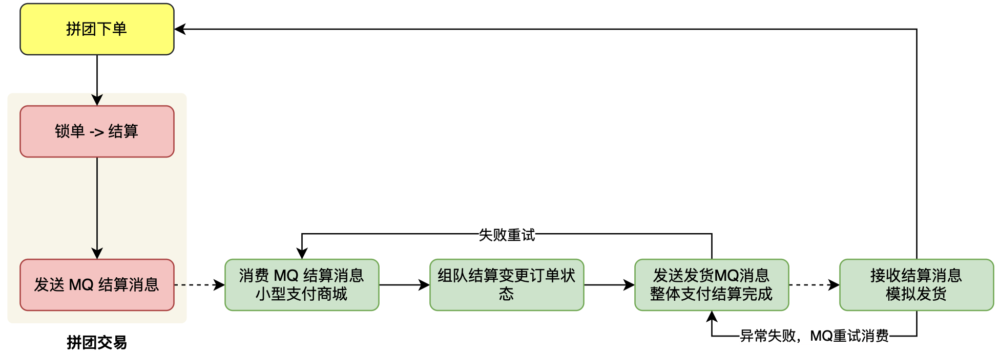
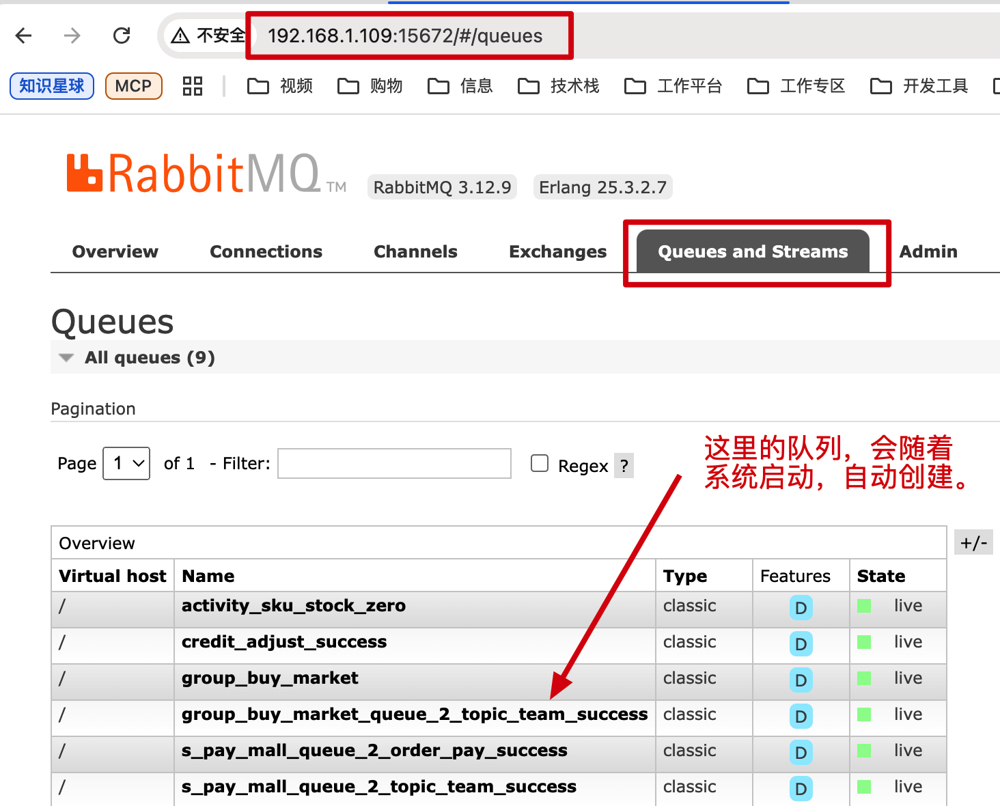
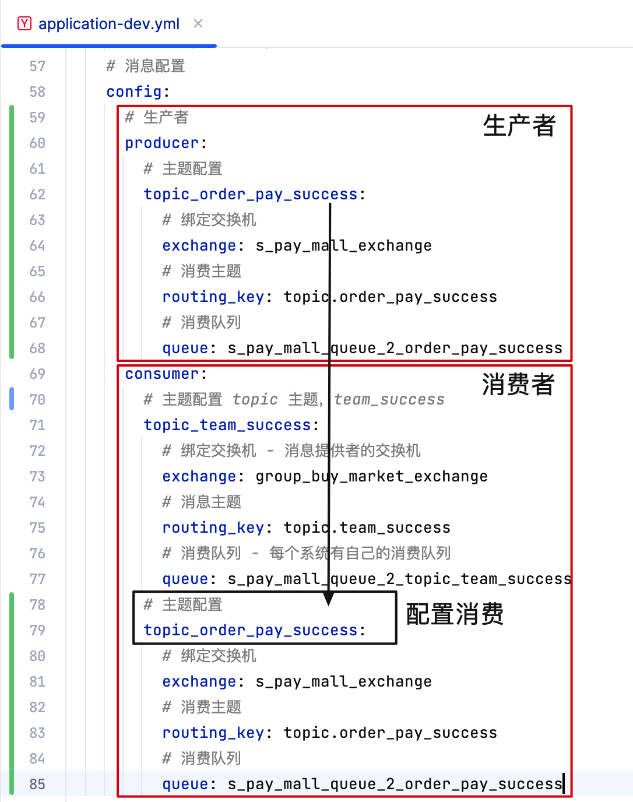
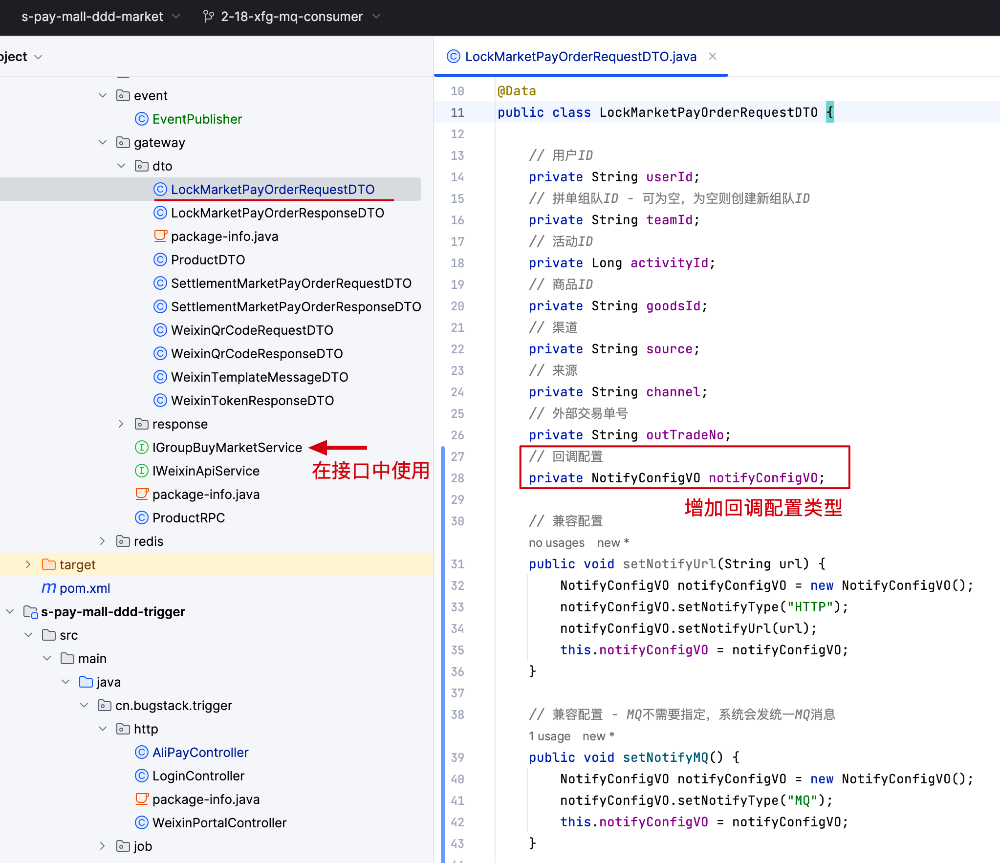
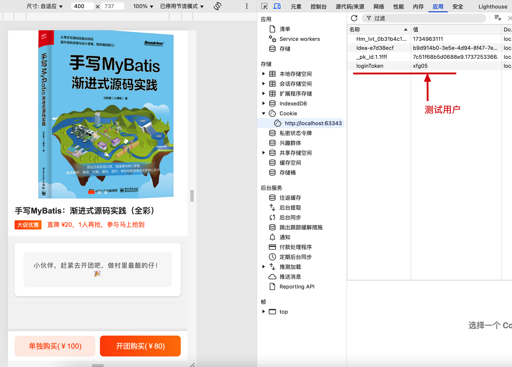
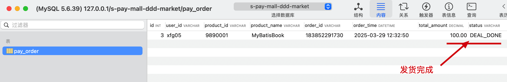
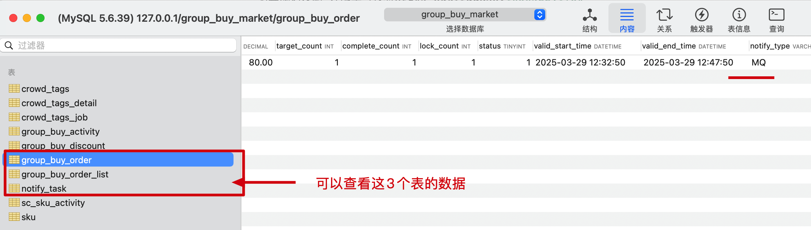

# 消费MQ结算消息

> 学习序号 32｜小节 2-18｜原文：https://articles.zsxq.com/id_06ncvug9qup8.html

**本章重点** ：完善小型支付商城对拼团组队结算消息的处理，同时完成小型支付商城中支付交易结算消息的处理。

**本章重点** ：★★★☆☆

**本节分支** ：[https://gitcode.net/KnowledgePlanet/s-pay-mall-ddd-market/-/tree/2-18-xfg-mq-consumer](https://gitcode.net/KnowledgePlanet/s-pay-mall-ddd-market/-/tree/2-18-xfg-mq-consumer)

**课程视频** ：[https://t.zsxq.com/rclqJ](https://t.zsxq.com/rclqJ)

**版权说明** ：©本项目与星球签约合作，受[《中华人民共和国著作权法实施条例》](https://www.gov.cn/gongbao/content/2013/content_2339485.htm) 版权法保护，禁止任何理由和任何方式公开(public)源码、资料、视频等小傅哥发布的星球内容到Github、Gitee等各类平台，违反可追究进一步的法律责任。

作者：小傅哥

博客：[https://bugstack.cn](https://bugstack.cn)

> 沉淀、分享、成长，让自己和他人都能有所收获！😄

- 一、本章诉求
- 二、业务流程
- 三、编码实现
  - 1. RabbitMQ 后台
  - 2. 消费结算消息
  - 3. 增加支付结算MQ
  - 4. 锁单API对接
- 四、测试验证
  - 1. 功能测试
  - 2. 流程测试
- 五、读者作业

### 一、本章诉求

完善小型支付商城对拼团组队结算消息的处理，同时完成小型支付商城中支付交易结算消息的处理。这样我们整个系统就都具备分布式部署的能力了。也就是多个应用实例同时部署，一个MQ在一个应用实例消费宕机，可以被其他应用实例继续拉取消费。

### 二、业务流程

如图，MQ 在小型支付和拼团的执行流程。



- MQ 具有解耦、消峰，最终一致性的特性。所以很多的分布式设计中，都会引入 MQ 来解耦复杂的业务流程，除了数据库事务处理外的流程节点，则由 MQ 进行驱动。
- 从拼团下单到锁单结算，完成后触达MQ消费。之后由小型支付商城消费 MQ 结算消息，变更订单状态，之后触达下一个支付结算的动作。在接收支付结算完成模拟发货。第二个MQ的发送不用写数据库任务来补偿，如果发MQ失败了，就直接抛异常重试继续发就可以。

### 三、编码实现

#### 1. RabbitMQ 后台



- [http://192.168.1.109:15672/#/queues](http://192.168.1.109:15672/#/queues) - 修改为你的地址进入。
- 这里的交换机（Exchanges）、队列会随着系统启动使用创建。你也可以手动创建。

#### 2. 消费结算消息

```
                @Slf4j
@Component
public class TeamSuccessTopicListener {

    @Resource
    private IOrderService orderService;

    /**
     * 指定消费队列
     */
    @RabbitListener(
            bindings = @QueueBinding(
                    value = @Queue(value = "${spring.rabbitmq.config.consumer.topic_team_success.queue}"),
                    exchange = @Exchange(value = "${spring.rabbitmq.config.consumer.topic_team_success.exchange}", type = ExchangeTypes.TOPIC),
                    key = "${spring.rabbitmq.config.consumer.topic_team_success.routing_key}"
            )
    )
    public void listener(String message) {
        try {
            NotifyRequestDTO requestDTO = JSON.parseObject(message, NotifyRequestDTO.class);
            log.info("拼团回调，组队完成，结算开始 {}", JSON.toJSONString(requestDTO));
            // 营销结算
            orderService.changeOrderMarketSettlement(requestDTO.getOutTradeNoList());
        } catch (Exception e) {
            log.error("拼团回调，组队完成，结算失败 {}", message, e);
            throw e;
        }
    }

}
```

- 在 listener 监听方法内，调用营销结算。这个营销结算其实就是以前 http 回调里的操作。现在迁移过来。

#### 3. 增加支付结算MQ

这一部分，我们要在小型支付系统自己发送支付完成结算的MQ，在消费这个MQ。通过这个方式替换掉原来依赖于 Guava 的发布订阅模型。因为 Guava 没法让不同实例间负载消费（也就是A1应用发送的消息，A2应用不能消费。而分布式架构技术栈 MQ 是可以的）。



- 生产者，topic_order_pay_success，是订单结算消息。分别在使用拼团和没有使用拼团结算发送消息。
- 消费者，topic_order_pay_success，消费触达结算动作。另外一个拼团组队成功的消息则是前面已经对接的。

##### 3.1 发送，支付成功结算消息

**添加事件消息发送方法**

```
                @Slf4j
@Component
public class EventPublisher {

    @Autowired
    private RabbitTemplate rabbitTemplate;

    @Value("${spring.rabbitmq.config.producer.topic_order_pay_success.exchange}")
    private String exchangeName;

    public void publish(String routingKey, String message) {
        try {
            rabbitTemplate.convertAndSend(exchangeName, routingKey, message, m -> {
                // 持久化消息配置
                m.getMessageProperties().setDeliveryMode(MessageDeliveryMode.PERSISTENT);
                return m;
            });
        } catch (Exception e) {
            log.error("发送MQ消息失败 routingKey:{} message:{}", routingKey, message, e);
            throw e;
        }
    }

}
```

- 这个类放到 s-pay-mall-ddd-infrastructure 下的 event 中。

**发送MQ消息**

```
                @Override
public void changeOrderPaySuccess(String orderId, Date payTime) {
    PayOrder payOrderReq = new PayOrder();
    payOrderReq.setOrderId(orderId);
    payOrderReq.setStatus(OrderStatusVO.PAY_SUCCESS.getCode());
    payOrderReq.setPayTime(payTime);
    orderDao.changeOrderPaySuccess(payOrderReq);
    // 不走拼团营销的直接结算发货
    BaseEvent.EventMessage<PaySuccessMessageEvent.PaySuccessMessage> paySuccessMessageEventMessage = paySuccessMessageEvent.buildEventMessage(
            PaySuccessMessageEvent.PaySuccessMessage.builder()
                    .tradeNo(orderId)
                    .build());
    PaySuccessMessageEvent.PaySuccessMessage paySuccessMessage = paySuccessMessageEventMessage.getData();
    // 旧版发送消息方式
    // eventBus.post(JSON.toJSONString(paySuccessMessage));
    eventPublisher.publish(paySuccessMessageEvent.topic(), JSON.toJSONString(paySuccessMessage));
}

@Override
public void changeOrderMarketSettlement(List<String> outTradeNoList) {
    // 更新拼团结算状态
    orderDao.changeOrderMarketSettlement(outTradeNoList);
    // 循环成功发送消息 - 一般在公司的场景里，还会有job任务扫描超时没有结算的订单，查询订单状态。查询对方服务端的接口，会被限制一次查询多少，频次多少。
    outTradeNoList.forEach(outTradeNo -> {
        BaseEvent.EventMessage<PaySuccessMessageEvent.PaySuccessMessage> paySuccessMessageEventMessage = paySuccessMessageEvent.buildEventMessage(
                PaySuccessMessageEvent.PaySuccessMessage.builder()
                        .tradeNo(outTradeNo)
                        .build());
        PaySuccessMessageEvent.PaySuccessMessage paySuccessMessage = paySuccessMessageEventMessage.getData();
        // 旧版发送消息方式
        // eventBus.post(JSON.toJSONString(paySuccessMessage));
        eventPublisher.publish(paySuccessMessageEvent.topic(), JSON.toJSONString(paySuccessMessage));
    });
}
```

- 两处发送 MQ 的操作。

##### 3.2 消费，支付成功结算消息

```
                @Slf4j
@Component
public class OrderPaySuccessListener {

    @Resource
    private IGoodsService goodsService;

    // @Subscribe - 旧版发布订阅方式
    @RabbitListener(
            bindings = @QueueBinding(
                    value = @Queue(value = "${spring.rabbitmq.config.consumer.topic_order_pay_success.queue}"),
                    exchange = @Exchange(value = "${spring.rabbitmq.config.consumer.topic_order_pay_success.exchange}", type = ExchangeTypes.TOPIC),
                    key = "${spring.rabbitmq.config.consumer.topic_order_pay_success.routing_key}"
            )
    )
    public void listener(String paySuccessMessageJson) {
        try {
            log.info("收到支付成功消息 {}", paySuccessMessageJson);

            PaySuccessMessageEvent.PaySuccessMessage paySuccessMessage = JSON.parseObject(paySuccessMessageJson, PaySuccessMessageEvent.PaySuccessMessage.class);

            log.info("模拟发货（如；发货、充值、开户员、返利），单号:{}", paySuccessMessage.getTradeNo());

            // 变更订单状态 - 发货完成&结算
            goodsService.changeOrderDealDone(paySuccessMessage.getTradeNo());

            // 可以打开测试，MQ 消费失败，会抛异常，之后重试消费。这个也是最终执行的重要手段。
            // throw new RuntimeException("重试消费");
        } catch (Exception e) {
            log.error("收到支付成功消息失败 {}", paySuccessMessageJson,e);
            throw e;
        }
    }

}
```

#### 4. 锁单API对接

拼团的锁单增加了使用MQ、HTTP不同方式进行处理。所以这部分要处理下对接的接口，增加MQ的配置。

##### 4.1 配置请求对象



需要在原有的 LockMarketPayOrderRequestDTO 请求对象，新增加回调配置。 - 这个配置类也就是拼团 API 模块下的配置类。

##### 4.2 使用请求对象

```
                @Slf4j
@Component
public class ProductPort implements IProductPort {

    @Value("${app.config.group-buy-market.source}")
    private String source;
    @Value("${app.config.group-buy-market.chanel}")
    private String chanel;
    @Value("${app.config.group-buy-market.notify-url}")
    private String notifyUrl;

    private final ProductRPC productRPC;

    private final IGroupBuyMarketService groupBuyMarketService;

    @Override
    public MarketPayDiscountEntity lockMarketPayOrder(String userId, String teamId, Long activityId, String productId, String orderId) {
        // 请求参数
        LockMarketPayOrderRequestDTO requestDTO = new LockMarketPayOrderRequestDTO();
        requestDTO.setUserId(userId);
        requestDTO.setTeamId(teamId);
        requestDTO.setGoodsId(productId);
        requestDTO.setActivityId(activityId);
        requestDTO.setSource(source);
        requestDTO.setChannel(chanel);
        requestDTO.setOutTradeNo(orderId);
//        requestDTO.setNotifyUrl(notifyUrl);
        requestDTO.setNotifyMQ();

        try {
            // 营销锁单
            Call<Response<LockMarketPayOrderResponseDTO>> call = groupBuyMarketService.lockMarketPayOrder(requestDTO);

            // 获取结果
            Response<LockMarketPayOrderResponseDTO> response = call.execute().body();
            log.info("营销锁单{} requestDTO:{} responseDTO:{}", userId, JSON.toJSONString(requestDTO), JSON.toJSONString(response));
            if (null == response) return null;

            // 异常判断
            if (!"0000".equals(response.getCode())) {
                throw new AppException(response.getCode(), response.getInfo());
            }

            LockMarketPayOrderResponseDTO responseDTO = response.getData();

            // 获取拼团优惠
            return MarketPayDiscountEntity.builder()
                    .originalPrice(responseDTO.getOriginalPrice())
                    .deductionPrice(responseDTO.getDeductionPrice())
                    .payPrice(responseDTO.getPayPrice())
                    .build();
        } catch (Exception e) {
            log.error("营销锁单失败{}", userId, e);
            return null;
        }
    }

}
```

- `requestDTO.setNotifyMQ();` 增加使用 MQ 方式进行对接。

### 四、测试验证

#### 1. 功能测试

- 启动 s-pay-mall-ddd-market 确保运行没问题。如果要调试，可以 debug 方式启动，并在新增代码部分打断点。
- 单测方法1，锁单，拼团发起锁单操作。
- 单测方法1，结算，拼团发起结算操作。

##### 1.1 锁单

```
                @Test
public void test_lockMarketPayOrder_mq() throws InterruptedException {
    LockMarketPayOrderRequestDTO lockMarketPayOrderRequestDTO = new LockMarketPayOrderRequestDTO();
    lockMarketPayOrderRequestDTO.setUserId("xfg01");
    lockMarketPayOrderRequestDTO.setTeamId(null);
    lockMarketPayOrderRequestDTO.setActivityId(100123L);
    lockMarketPayOrderRequestDTO.setGoodsId("9890001");
    lockMarketPayOrderRequestDTO.setSource("s01");
    lockMarketPayOrderRequestDTO.setChannel("c01");
    lockMarketPayOrderRequestDTO.setNotifyMQ();
    lockMarketPayOrderRequestDTO.setOutTradeNo(RandomStringUtils.randomNumeric(12));
    Response<LockMarketPayOrderResponseDTO> lockMarketPayOrderResponseDTOResponse = marketTradeService.lockMarketPayOrder(lockMarketPayOrderRequestDTO);
    log.info("测试结果 req:{} res:{}", JSON.toJSONString(lockMarketPayOrderRequestDTO), JSON.toJSONString(lockMarketPayOrderResponseDTOResponse));
}
```

- 指定测试用户，发起锁单。

##### 1.2 结算

```
                @Test
public void test_settlementMarketPayOrder() throws Exception {
    TradePaySuccessEntity tradePaySuccessEntity = new TradePaySuccessEntity();
    tradePaySuccessEntity.setSource("s01");
    tradePaySuccessEntity.setChannel("c01");
    tradePaySuccessEntity.setUserId("xfg01");
    tradePaySuccessEntity.setOutTradeNo("537455032540");
    tradePaySuccessEntity.setOutTradeTime(new Date());
    TradePaySettlementEntity tradePaySettlementEntity = tradeSettlementOrderService.settlementMarketPayOrder(tradePaySuccessEntity);
    log.info("请求参数:{}", JSON.toJSONString(tradePaySuccessEntity));
    log.info("测试结果:{}", JSON.toJSONString(tradePaySettlementEntity));
    // 暂停，等待MQ消息。处理完后，手动关闭程序
    new CountDownLatch(1).await();
}
```

- 填写对应的 OutTradeNo 进行结算操作。
- 之后你就可以在小型支付的MQ消费端看到MQ的接收。【视频里演示这块操作】

#### 2. 流程测试

首先，启动拼团、小型支付商城。之后访问前端页面。记得要开启付费的 natapp 或者其他内网穿透服务。



- 浏览前端页面（与前面的课程方式一样，IntelliJ IDEA 点开，本地浏览）。
- 这个时候开团下单，之后支付结算。完事后，查看日志和数据库数据。

##### 2.1 日志：小型支付

```
                25-03-29.12:32:50.235 [http-nio-8080-exec-3] INFO  AliPayController       - 商品下单，根据商品ID创建支付单完成 userId:xfg05 productId:9890001 orderId:183852291730
25-03-29.12:33:28.256 [http-nio-8080-exec-4] INFO  AliPayController       - 支付回调，消息接收 TRADE_SUCCESS
25-03-29.12:33:28.257 [http-nio-8080-exec-4] INFO  AliPayController       - 支付回调，交易名称: MyBatisBook
25-03-29.12:33:28.257 [http-nio-8080-exec-4] INFO  AliPayController       - 支付回调，交易状态: TRADE_SUCCESS
25-03-29.12:33:28.257 [http-nio-8080-exec-4] INFO  AliPayController       - 支付回调，支付宝交易凭证号: 2025032922001413370505302686
25-03-29.12:33:28.257 [http-nio-8080-exec-4] INFO  AliPayController       - 支付回调，商户订单号: 183852291730
25-03-29.12:33:28.257 [http-nio-8080-exec-4] INFO  AliPayController       - 支付回调，交易金额: 80.00
25-03-29.12:33:28.257 [http-nio-8080-exec-4] INFO  AliPayController       - 支付回调，买家在支付宝唯一id: 2088722024513370
25-03-29.12:33:28.257 [http-nio-8080-exec-4] INFO  AliPayController       - 支付回调，买家付款时间: 2025-03-29 12:33:26
25-03-29.12:33:28.257 [http-nio-8080-exec-4] INFO  AliPayController       - 支付回调，买家付款金额: 80.00
25-03-29.12:33:28.257 [http-nio-8080-exec-4] INFO  AliPayController       - 支付回调，支付回调，更新订单 183852291730
25-03-29.12:33:28.854 [http-nio-8080-exec-4] INFO  ProductPort            - 营销结算xfg05 requestDTO:{"channel":"c01","outTradeNo":"183852291730","outTradeTime":1743222806000,"source":"s01","userId":"xfg05"} responseDTO:{"code":"0000","data":{"activityId":100123,"outTradeNo":"183852291730","teamId":"45338842","userId":"xfg05"},"info":"成功"}
25-03-29.12:33:29.380 [org.springframework.amqp.rabbit.RabbitListenerEndpointContainer#1-1] INFO  TeamSuccessTopicListener - 拼团回调，组队完成，结算开始 {"outTradeNoList":["183852291730"],"teamId":"45338842"}
25-03-29.12:33:29.472 [org.springframework.amqp.rabbit.RabbitListenerEndpointContainer#0-1] INFO  OrderPaySuccessListener - 收到支付成功消息 {"tradeNo":"183852291730"}
25-03-29.12:33:29.478 [org.springframework.amqp.rabbit.RabbitListenerEndpointContainer#0-1] INFO  OrderPaySuccessListener - 模拟发货（如；发货、充值、开户员、返利），单号:183852291730
```

##### 2.2 日志：拼团营销

```
                25-03-29.12:33:28.387 [http-nio-8091-exec-4] INFO  MarketTradeController  - 营销交易组队结算开始:xfg05 outTradeNo:183852291730
25-03-29.12:33:28.410 [http-nio-8091-exec-4] INFO  TradeSettlementOrderService - 拼团交易-支付订单结算:xfg05 outTradeNo:183852291730
25-03-29.12:33:28.427 [http-nio-8091-exec-4] INFO  SCRuleFilter           - 结算规则过滤-渠道黑名单校验xfg05 outTradeNo:183852291730
25-03-29.12:33:28.444 [http-nio-8091-exec-4] INFO  OutTradeNoRuleFilter   - 结算规则过滤-外部单号校验xfg05 outTradeNo:183852291730
25-03-29.12:33:28.457 [http-nio-8091-exec-4] INFO  SettableRuleFilter     - 结算规则过滤-有效时间校验xfg05 outTradeNo:183852291730
25-03-29.12:33:28.616 [http-nio-8091-exec-4] INFO  EndRuleFilter          - 结算规则过滤-结束节点xfg05 outTradeNo:183852291730
25-03-29.12:33:28.821 [http-nio-8091-exec-4] INFO  MarketTradeController  - 营销交易组队结算完成:xfg05 outTradeNo:183852291730 response:{"code":"0000","data":{"activityId":100123,"outTradeNo":"183852291730","teamId":"45338842","userId":"xfg05"},"info":"成功"}
25-03-29.12:33:28.822 [pool-2-thread-10] INFO  TradeSettlementOrderService - 拼团交易-执行结算通知回调，指定 teamId:45338842 notifyTaskEntity:{"notifyCount":0,"notifyMQ":"topic.team_success","notifyType":"MQ","parameterJson":"{\"teamId\":\"45338842\",\"outTradeNoList\":[\"183852291730\"]}","teamId":"45338842"}
25-03-29.12:33:29.364 [org.springframework.amqp.rabbit.RabbitListenerEndpointContainer#0-1] INFO  TeamSuccessTopicListener - 接收消息:{"teamId":"45338842","outTradeNoList":["183852291730"]}
25-03-29.12:33:29.379 [pool-2-thread-10] INFO  TradeSettlementOrderService - 回调通知拼团完结 result:{"retryCount":0,"successCount":1,"waitCount":1,"errorCount":0}
```

##### 2.3 数据 - 库表数据





- 检查拼团和小型支付的数据，已经落进去了。

### 五、读者作业

- 简单作业：理解本节流程，完成功能开发，可以测试运行出结果。
- 复杂作业：尝试完成项目的打包、构建，云服务器部署。负载部署多个实例消费 MQ。
