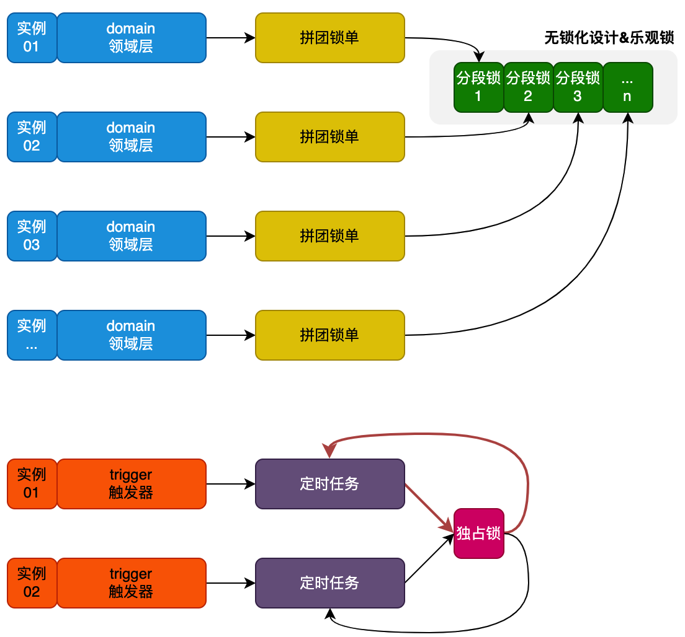
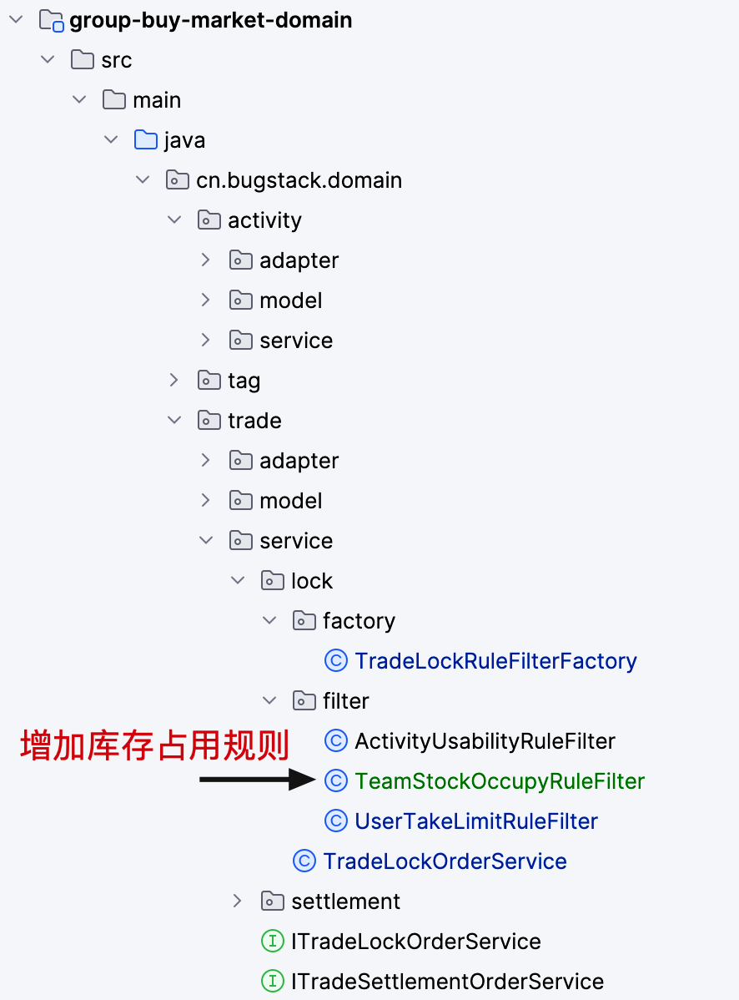
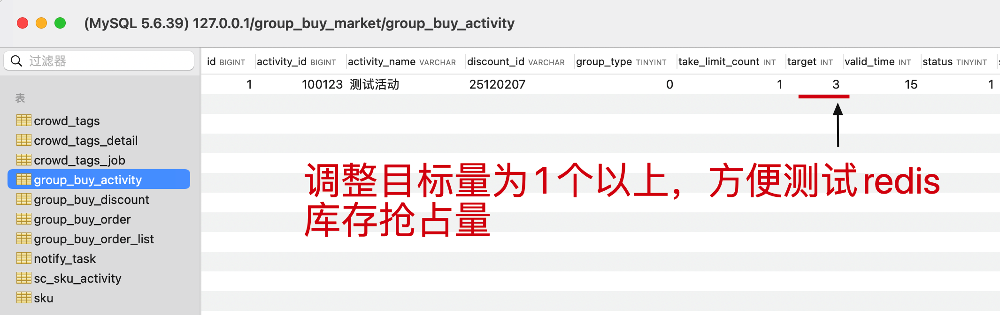
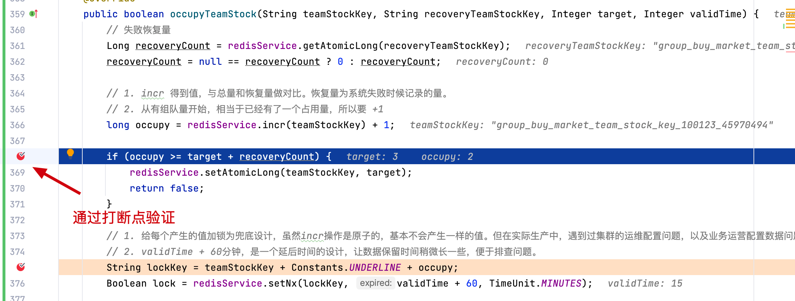

# 独占锁和无锁化场景运用

> 学习序号 33｜小节 2-19｜原文：https://articles.zsxq.com/id_qd9r07u9wgeg.html

**本章重点** ：以独占锁和无锁化设计，分别解决任务执行互备抢占和锁单库存抢占处理。

**本章重点** ：★★★☆☆

**本节分支** ：[https://gitcode.net/KnowledgePlanet/group-buy-market/-/tree/2-19-xfg-redis-lock](https://gitcode.net/KnowledgePlanet/group-buy-market/-/tree/2-19-xfg-redis-lock)

**课程视频** ：[https://t.zsxq.com/o7toC](https://t.zsxq.com/o7toC)

**版权说明** ：©本项目与星球签约合作，受[《中华人民共和国著作权法实施条例》](https://www.gov.cn/gongbao/content/2013/content_2339485.htm) 版权法保护，禁止任何理由和任何方式公开(public)源码、资料、视频等小傅哥发布的星球内容到Github、Gitee等各类平台，违反可追究进一步的法律责任。

作者：小傅哥

博客：[https://bugstack.cn](https://bugstack.cn)

> 沉淀、分享、成长，让自己和他人都能有所收获！😄

- 一、本章诉求
- 二、业务流程
- 三、编码实现
  - 1. 独占锁
  - 2. 无锁化（乐观锁）
- 四、测试验证
  - 1. 库表配置
  - 2. 锁单第1笔
  - 3. 锁单第2笔
- 五、读者作业

### 一、本章诉求

以独占锁抢占方式，迭代拼团结算通知互备执行任务。再以无锁化设计，处理用户拼团锁单，库存抢占处理，降低对数据库的行锁压力，提高整体吞吐量。

### 二、业务流程

如图，两种锁应对的场景；



- 分段锁，颗粒度缩小到库存维度。先加（incr）后锁的操作，是一种无锁化设计。锁的目的只是作为兜底。这类似于我们操作账户，操作完写一条流水。incr 操作是原子的，基本不会产生一样的值。但在实际生产中，遇到过集群的运维配置问题，以及业务运营配置数据问题，导致 incr 得到的值相同。
- 独占锁，在分布式架构系统设计中，会有多个实例部署。这些实例都会做job任务的执行，为了保障既能让任务互备，同时不要重复执行。这里要加独占锁，谁抢占到谁执行。执行完成后，释放锁，下一轮继续抢占。

### 三、编码实现

#### 1. 独占锁

```
                @Slf4j
@Service
public class GroupBuyNotifyJob {

    @Resource
    private ITradeSettlementOrderService tradeSettlementOrderService;

    @Resource
    private RedissonClient redissonClient;

    @Scheduled(cron = "0 0 0 * * ?")
    public void exec() {
        // 为什么加锁？分布式应用N台机器部署互备（一个应用实例挂了，还有另外可用的），任务调度会有N个同时执行，那么这里需要增加抢占机制，谁抢占到谁就执行。完毕后，下一轮继续抢占。
        RLock lock = redissonClient.getLock("group_buy_market_notify_job_exec");
        try {
            boolean isLocked = lock.tryLock(3, 0, TimeUnit.SECONDS);
            if (!isLocked) return;

            Map<String, Integer> result = tradeSettlementOrderService.execSettlementNotifyJob();
            log.info("定时任务，回调通知拼团完结任务 result:{}", JSON.toJSONString(result));
        } catch (Exception e) {
            log.error("定时任务，回调通知拼团完结任务失败", e);
        } finally {
            if (lock.isLocked() && lock.isHeldByCurrentThread()) {
                lock.unlock();
            }
        }
    }

}
```

- 在执行任务时，要抢占一个锁，谁抢占到谁就执行。
- 这种独占锁的设计，也是大家最为常用的。但有一些场景是不适合使用的，比如，集中式库存的抢占，这类场景如果使用独占锁，就会出现排队现象，所有的竞争用户都要等待上一个释放锁才能继续执行。这样会大大的降低系统的吞吐量。

#### 2. 无锁化（乐观锁）

##### 2.1 变更部分



在 trade 交易下，锁单 filter 过滤中，添加一个组队库存占用规则过滤。再有了设计的使用后，你会发现，想扩展新的功能既不会污染织染的逻辑，也不会让加入就得大量做 if···else 判断。而是非常优雅的加入，之后在 TradeLockRuleFilterFactory 配置上即可。

##### 2.2 责任链 - 组队库存规则

```
                @Slf4j
@Service
public class TeamStockOccupyRuleFilter implements ILogicHandler<TradeLockRuleCommandEntity, TradeLockRuleFilterFactory.DynamicContext, TradeLockRuleFilterBackEntity> {

    @Resource
    private ITradeRepository repository;

    @Override
    public TradeLockRuleFilterBackEntity apply(TradeLockRuleCommandEntity requestParameter, TradeLockRuleFilterFactory.DynamicContext dynamicContext) throws Exception {
        log.info("交易规则过滤-组队库存校验{} activityId:{}", requestParameter.getUserId(), requestParameter.getActivityId());

        // 1. teamId 为空，则为首次开团，不做拼团组队目标量库存限制
        String teamId = requestParameter.getTeamId();
        if (StringUtils.isBlank(teamId)) {
            return TradeLockRuleFilterBackEntity.builder()
                    .userTakeOrderCount(dynamicContext.getUserTakeOrderCount())
                    .build();
        }

        // 2. 抢占库存；通过抢占 Redis 缓存库存，来降低对数据库的操作压力。
        GroupBuyActivityEntity groupBuyActivity = dynamicContext.getGroupBuyActivity();
        Integer target = groupBuyActivity.getTarget();
        Integer validTime = groupBuyActivity.getValidTime();
        String teamStockKey = dynamicContext.generateTeamStockKey(teamId);
        String recoveryTeamStockKey = dynamicContext.generateRecoveryTeamStockKey(teamId);

        boolean status = repository.occupyTeamStock(teamStockKey, recoveryTeamStockKey, target, validTime);

        if (!status) {
            log.warn("交易规则过滤-组队库存校验{} activityId:{} 抢占失败:{}", requestParameter.getUserId(), requestParameter.getActivityId(), teamStockKey);
            throw new AppException(ResponseCode.E0008);
        }

        return TradeLockRuleFilterBackEntity.builder()
                .userTakeOrderCount(dynamicContext.getUserTakeOrderCount())
                .recoveryTeamStockKey(recoveryTeamStockKey)
                .build();
    }

}
```

- 首先，如果 teamId 为空，则不需要做库存的抢占。抢占库存是在一个 team 已经创建完成后，再有用户开始参与抢占时候，这个时候要做库存的缓存扣减处理。
- 之后，从上下文中获取到组队的目标量，有效期时间，以及组队的key和恢复量key。这个恢复量的用途是我们扣了redis中组队的任务缓存，但这个时候，发生异常了。那么我们要记录一个这样的数据。等做库存使用对比量的时候，可以用 target 目标量 + 恢复量一起来比。

##### 2.3 占用库存

```
                @Slf4j
@Repository
public class TradeRepository implements ITradeRepository {

    @Override
    public boolean occupyTeamStock(String teamStockKey, String recoveryTeamStockKey, Integer target, Integer validTime) {
        // 失败恢复量
        Long recoveryCount = redisService.getAtomicLong(recoveryTeamStockKey);
        recoveryCount = null == recoveryCount ? 0 : recoveryCount;

        // 1. incr 得到值，与总量和恢复量做对比。恢复量为系统失败时候记录的量。
        // 2. 从有组队量开始，相当于已经有了一个占用量，所以要 +1
        long occupy = redisService.incr(teamStockKey) + 1;

        if (occupy >= target + recoveryCount) {
            redisService.setAtomicLong(teamStockKey, target);
            return false;
        }

        // 1. 给每个产生的值加锁为兜底设计，虽然incr操作是原子的，基本不会产生一样的值。但在实际生产中，遇到过集群的运维配置问题，以及业务运营配置数据问题，导致incr得到的值相同。
        // 2. validTime + 60分钟，是一个延后时间的设计，让数据保留时间稍微长一些，便于排查问题。
        String lockKey = teamStockKey + Constants.UNDERLINE + occupy;
        Boolean lock = redisService.setNx(lockKey, validTime + 60, TimeUnit.MINUTES);

        if (!lock) {
            log.info("组队库存加锁失败 {}", lockKey);
        }

        return lock;
    }
  
}
```

- occupyTeamStock 占用库存操作，先获取恢复量。之后和 target 目标量 + recoveryCount 恢复量做对比。
- 库存扣减后，添加一个锁，这个锁不会影响整体效率。只是一个兜底操作。如注释说明。

##### 2.4 恢复记录

```
                @Override
public void recoveryTeamStock(String recoveryTeamStockKey, Integer validTime) {
    // 首次组队拼团，是没有 teamId 的，所以不需要这个做处理。
    if (StringUtils.isBlank(recoveryTeamStockKey)) return;
    redisService.incr(recoveryTeamStockKey);
}
```

- 如果 recoveryTeamStockKey 为空，则表示没有组队信息，这个时候即使发生异常，也不用处理库存恢复记录。
- 之后做incr记录库存恢复量。

##### 2.5 责任链配置

```
                @Slf4j
@Service
public class TradeLockRuleFilterFactory {

    @Bean("tradeRuleFilter")
    public BusinessLinkedList<TradeLockRuleCommandEntity, TradeLockRuleFilterFactory.DynamicContext, TradeLockRuleFilterBackEntity> tradeRuleFilter(
            ActivityUsabilityRuleFilter activityUsabilityRuleFilter,
            UserTakeLimitRuleFilter userTakeLimitRuleFilter,
            TeamStockOccupyRuleFilter teamStockOccupyRuleFilter) {

        // 组装链
        LinkArmory<TradeLockRuleCommandEntity, TradeLockRuleFilterFactory.DynamicContext, TradeLockRuleFilterBackEntity> linkArmory =
                new LinkArmory<>("交易规则过滤链",
                        activityUsabilityRuleFilter,
                        userTakeLimitRuleFilter,
                        teamStockOccupyRuleFilter);

        // 链对象
        return linkArmory.getLogicLink();
    }
}
```

- 我们实现的一个新的规则（teamStockOccupyRuleFilter），只要配置到工程中即可。
- 所以，即使你用AI编码，但不告诉它要在什么框架结构下编码，实现出什么编码。他可能给你的大概率也是CRUD。

### 四、测试验证

#### 1. 库表配置



- 调整拼团活动目标量为3个，便于测试库存的抢占。

#### 2. 锁单第1笔

```
                @Test
public void test_lockMarketPayOrder() {
    LockMarketPayOrderRequestDTO lockMarketPayOrderRequestDTO = new LockMarketPayOrderRequestDTO();
    lockMarketPayOrderRequestDTO.setUserId("xfg03");
    lockMarketPayOrderRequestDTO.setTeamId(null);
    lockMarketPayOrderRequestDTO.setActivityId(100123L);
    lockMarketPayOrderRequestDTO.setGoodsId("9890001");
    lockMarketPayOrderRequestDTO.setSource("s01");
    lockMarketPayOrderRequestDTO.setChannel("c01");
    lockMarketPayOrderRequestDTO.setNotifyUrl("http://127.0.0.1:8091/api/v1/test/group_buy_notify");
    lockMarketPayOrderRequestDTO.setOutTradeNo(RandomStringUtils.randomNumeric(12));
    Response<LockMarketPayOrderResponseDTO> lockMarketPayOrderResponseDTOResponse = marketTradeService.lockMarketPayOrder(lockMarketPayOrderRequestDTO);
    log.info("测试结果 req:{} res:{}", JSON.toJSONString(lockMarketPayOrderRequestDTO), JSON.toJSONString(lockMarketPayOrderResponseDTOResponse));
}
```

- 第1笔，没有 teamId。

#### 3. 锁单第2笔

```
                @Test
public void test_lockMarketPayOrder_teamId_not_null() {
    LockMarketPayOrderRequestDTO lockMarketPayOrderRequestDTO = new LockMarketPayOrderRequestDTO();
    lockMarketPayOrderRequestDTO.setUserId("xfg04");
    lockMarketPayOrderRequestDTO.setTeamId("04732580");
    lockMarketPayOrderRequestDTO.setActivityId(100123L);
    lockMarketPayOrderRequestDTO.setGoodsId("9890001");
    lockMarketPayOrderRequestDTO.setSource("s01");
    lockMarketPayOrderRequestDTO.setChannel("c01");
    lockMarketPayOrderRequestDTO.setNotifyUrl("http://127.0.0.1:8091/api/v1/test/group_buy_notify");
    lockMarketPayOrderRequestDTO.setOutTradeNo(RandomStringUtils.randomNumeric(12));
    Response<LockMarketPayOrderResponseDTO> lockMarketPayOrderResponseDTOResponse = marketTradeService.lockMarketPayOrder(lockMarketPayOrderRequestDTO);
    log.info("测试结果 req:{} res:{}", JSON.toJSONString(lockMarketPayOrderRequestDTO), JSON.toJSONString(lockMarketPayOrderResponseDTOResponse));
}
```



- 在第一笔锁单后，拿到组队ID，之后第2笔开始锁单。
- 通过打断点，可以看到进入后，判断占用量和总量的对比值。

### 五、读者作业

- 简单作业：完成本节内容，学习独占锁和无锁化设计的使用场景。
- 复杂作业：尝试完成项目中其他场景可以加锁的地方。
