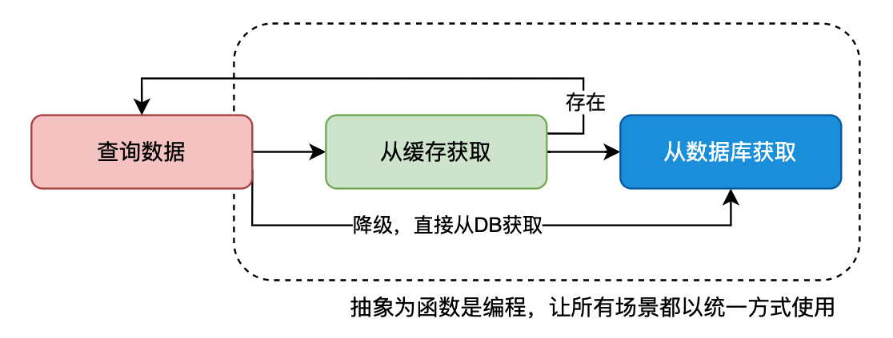
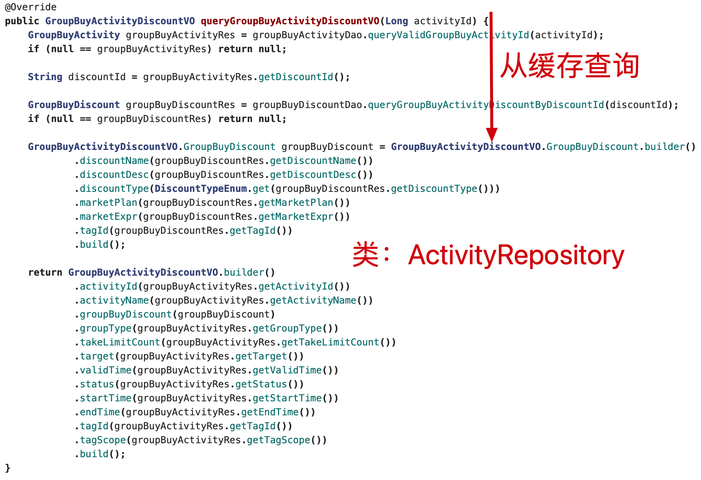

# 函数式数据缓存和降级到DB处理

> 学习序号 34｜小节 2-20｜原文：https://articles.zsxq.com/id_iif5k6tcx23o.html

**本章重点** ：以查询活动配置为场景，增加缓存处理。同时使用降级服务，控制走缓存还是走DB数据库。并把这部分功能统一抽象成函数式编程。

**本章重点** ：★★★☆☆

**本节分支** ：[https://gitcode.net/KnowledgePlanet/group-buy-market/-/tree/2-20-xfg-redis-cache](https://gitcode.net/KnowledgePlanet/group-buy-market/-/tree/2-20-xfg-redis-cache)

**课程视频** ：[https://t.zsxq.com/6IYJ6](https://t.zsxq.com/6IYJ6)

**版权说明** ：©本项目与星球签约合作，受[《中华人民共和国著作权法实施条例》](https://www.gov.cn/gongbao/content/2013/content_2339485.htm) 版权法保护，禁止任何理由和任何方式公开(public)源码、资料、视频等小傅哥发布的星球内容到Github、Gitee等各类平台，违反可追究进一步的法律责任。

作者：小傅哥

博客：[https://bugstack.cn](https://bugstack.cn)

> 沉淀、分享、成长，让自己和他人都能有所收获！😄

- 一、本章诉求
- 二、功能流程
- 三、编码实现
  - 1. 实现目标
  - 2. 缓存处理
  - 3. 函数编程
  - 4. 抽象方法
  - 5. 方法使用
- 四、测试验证
- 五、读者作业

### 一、本章诉求

以查询活动配置为场景，增加缓存处理。同时使用降级服务，控制走缓存还是走DB数据库。并把这部分功能统一抽象成函数式编程。

### 二、功能流程

如图，缓存和降级的使用；



- 首先，在日常的业务场景中，很多高频使用的数据，都是从 Redis 缓存获取。如果缓存不存在，才会从数据库读取。
- 之后，也会给缓存配置降级，如果缓存有问题，或者要做一些验证，必须从库里读取，则会动态的配置，让当时的操作从数据库获取。
- 注意，整个操作过程，缓存、降级、数据库，是一整条代码编程。如果在每个方法里都加这样的内容，就会显得很臃肿，所以一般会抽象一个方法，使用函数式的方式进行编程，降低使用者的编码量。**这个技巧很重要**

### 三、编码实现

#### 1. 实现目标



- 首先，以 ActivityRepository 场景举例，两个 dao 操作从数据库查询，改为从 Redis 缓存获取。如果缓存不存在，则从数据库查询后写入缓存。
- 之后，要添加上降级逻辑的处理，如果此时不需要从缓存获取，则直接从数据库获取。
- 另外，要抽象操作缓存、降级的模块到共用的抽象类。**降级已在前面章节讲解过，本节使用即可**

#### 2. 缓存处理

```
                @Service
public class DCCService {

    @DCCValue("cacheSwitch:0")
    private String cacheOpenSwitch;
    

    /**
     * 缓存开启开关，0为开启，1为关闭
     */
    public boolean isCacheOpenSwitch(){
        return "0".equals(cacheOpenSwitch);
    }

}    
```

- 降级开关，缓存开启。

```
                GroupBuyActivity groupBuyActivityRes = null;
if (dccService.isCacheOpenSwitch()) {
    String groupBuyActivityCacheKey = GroupBuyActivity.cacheRedisKey(activityId);
    groupBuyActivityRes = redisService.getValue(groupBuyActivityCacheKey);
    if (null == groupBuyActivityRes) {
        groupBuyActivityRes = groupBuyActivityDao.queryValidGroupBuyActivityId(activityId);
        if (null == groupBuyActivityRes) return null;
        redisService.setValue(groupBuyActivityCacheKey, groupBuyActivityRes);
    }
} else {
    groupBuyActivityRes = groupBuyActivityDao.queryValidGroupBuyActivityId(activityId);
}
```

- 判断缓存降级开关。如果是降级的，则直接走DB查询操作。非降级，则走 Redis 缓存，缓存为空则从数据库查询后写入缓存。
- 这样的代码看着并没有什么问题，但如果大量的这样在程序中编写，就会变得很恶心🤮，以后修改也麻烦。所以要做抽象的设计处理。

#### 3. 函数编程

```
                @Test
public void test_Supplier(){
    // 创建一个 Supplier 实例，返回一个字符串
    Supplier<String> stringSupplier = () -> "Hello, XFG!";
    // 使用 get() 方法获取 Supplier 提供的值
    String result = stringSupplier.get();
    // 输出结果
    System.out.println(result);
    // 另一个示例，使用 Supplier 提供当前时间
    Supplier<Long> currentTimeSupplier = System::currentTimeMillis;
    // 获取当前时间
    Long currentTime = currentTimeSupplier.get();
    // 输出当前时间
    System.out.println("Current time in milliseconds: " + currentTime);
}
```

- 这里要介绍一个函数 `Supplier`，它的作用是帮你延迟执行代码块。如，你想调用一个 dao.query() 如果这样写那么就直接调用了，现在通过 Supplier.get 可以在你需要的时候调用。
- 好，那么这么一个东西有啥用途呢。如，我们使用缓存、查询DB、降级判断，这个代码如果被抽象出来，那么必然会有一个问题，就是所有使用方都有自己的 dao.query 怎么抽象呢，那么就要让大家的 dao.query 作为参数使用 Supplier 传递到抽象类的方法里，方法里来执行操作。

#### 4. 抽象方法

```
                public abstract class AbstractRepository {

    private final Logger logger = LoggerFactory.getLogger(AbstractRepository.class);

    @Resource
    protected IRedisService redisService;
    
    @Resource
    protected DCCService dccService;

    /**
     * 通用缓存处理方法
     * 优先从缓存获取，缓存不存在则从数据库获取并写入缓存
     *
     * @param cacheKey      缓存键
     * @param dbFallback    数据库查询函数
     * @param <T>           返回类型
     * @return              查询结果
     */
    protected <T> T getFromCacheOrDb(String cacheKey, Supplier<T> dbFallback) {
        // 判断是否开启缓存
        if (dccService.isCacheOpenSwitch()) {
            // 从缓存获取
            T cacheResult = redisService.getValue(cacheKey);
            // 缓存存在则直接返回
            if (null != cacheResult) {
                return cacheResult;
            }
            // 缓存不存在则从数据库获取
            T dbResult = dbFallback.get();
            // 数据库查询结果为空则直接返回
            if (null == dbResult) {
                return null;
            }
            // 写入缓存
            redisService.setValue(cacheKey, dbResult);
            return dbResult;
        } else {
            // 缓存未开启，直接从数据库获取
            logger.warn("缓存降级 {}", cacheKey);
            return dbFallback.get();
        }
    }
  
}
```

- 首先，增加 AbstractRepository 抽象类，让所有需要使用缓存、降级一套判断的，都继承这个抽象类。
- 之后，提供 getFromCacheOrDb 方法，在这个方法中判断走降级、走缓存的处理。`Supplier<T> dbFallback` 就可以帮助我们在需要的地方，完成 get 操作执行传入进来的代码块。

#### 5. 方法使用

```
                @Override
public GroupBuyActivityDiscountVO queryGroupBuyActivityDiscountVO(Long activityId) {
    // 优先从缓存获取&写缓存，注意如果实现了后台配置，在更新时要更库，删缓存。
    String groupBuyActivityCacheKey = GroupBuyActivity.cacheRedisKey(activityId);
    GroupBuyActivity groupBuyActivityRes = getFromCacheOrDb(groupBuyActivityCacheKey, 
            () -> groupBuyActivityDao.queryValidGroupBuyActivityId(activityId));
    if (null == groupBuyActivityRes) return null;
    String discountId = groupBuyActivityRes.getDiscountId();
  
    // 优先从缓存获取&写缓存
    String groupBuyDiscountCacheKey = GroupBuyDiscount.cacheRedisKey(discountId);
    GroupBuyDiscount groupBuyDiscountRes = getFromCacheOrDb(groupBuyDiscountCacheKey,
            () -> groupBuyDiscountDao.queryGroupBuyActivityDiscountByDiscountId(discountId));
    if (null == groupBuyDiscountRes) return null;
  
  // ... 省略部分代码
}
```

- 现在我们使用缓存的方式则直接从 getFromCacheOrDb 抽象父类的方法获取。并把我们要执行的代码库函数的方式透传过去。

### 四、测试验证

```
                @Test
public void test_indexMarketTrial_no_tag() throws Exception {
    MarketProductEntity marketProductEntity = new MarketProductEntity();
    marketProductEntity.setUserId("dacihua");
    marketProductEntity.setSource("s01");
    marketProductEntity.setChannel("c01");
    marketProductEntity.setGoodsId("9890001");
    TrialBalanceEntity trialBalanceEntity = indexGroupBuyMarketService.indexMarketTrial(marketProductEntity);
    log.info("请求参数:{}", JSON.toJSONString(marketProductEntity));
    log.info("返回结果:{}", JSON.toJSONString(trialBalanceEntity));
}
```

- 通过测试方法，验证试算。这个过程可以走到 `queryGroupBuyActivityDiscountVO` 查询缓存数据的操作。
- 测试过程重要，要在新增加编码的地方打断点调试验证。**视频里有这块的操作可以参考**

### 五、读者作业

- 简单作业：完成本节的流程，实现功能的验证。
- 复杂作业：尝试给其他地方添加缓存和降级。
