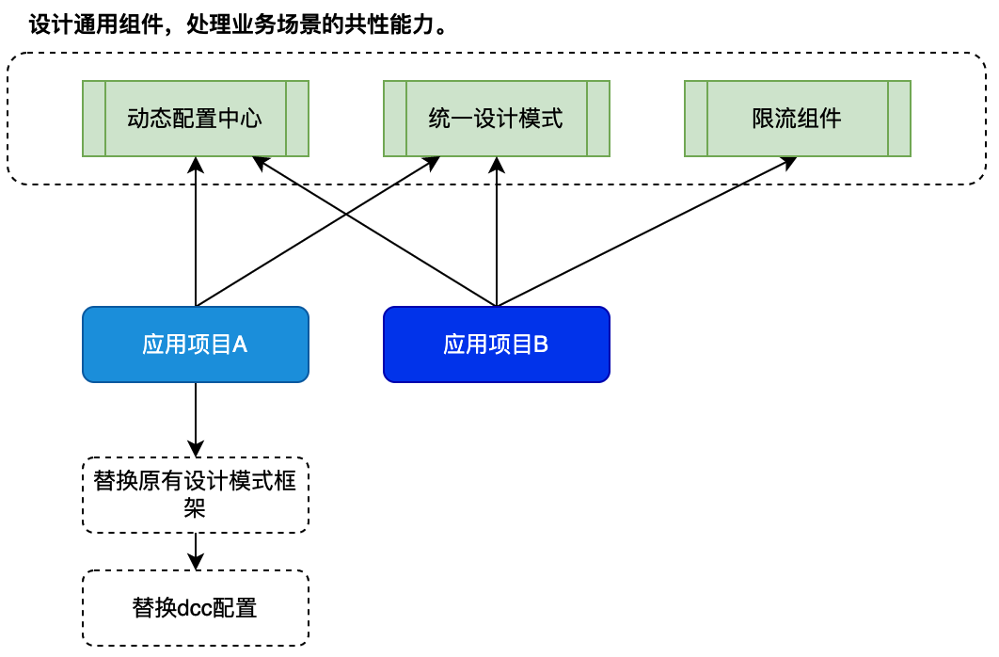
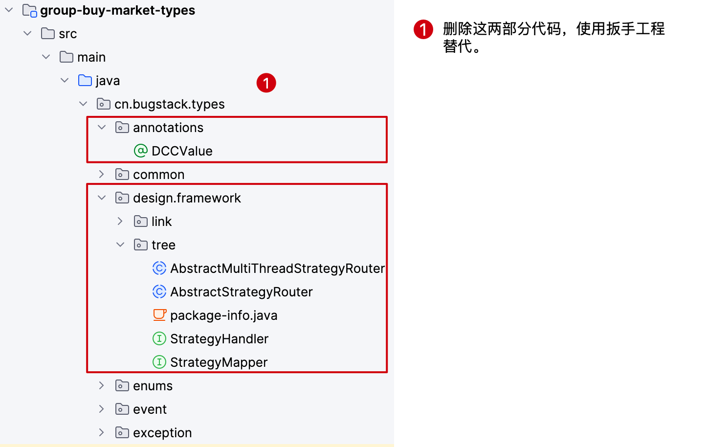
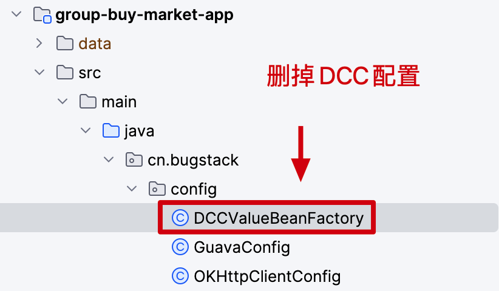
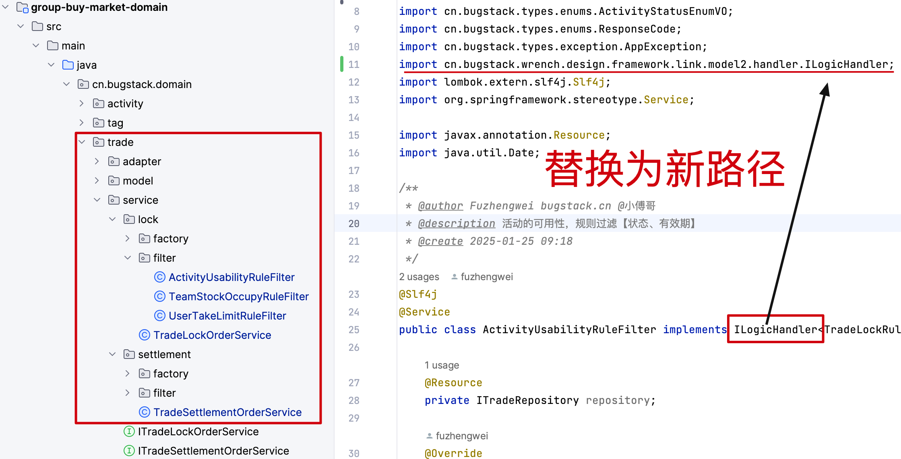
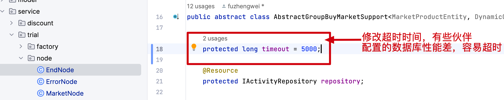
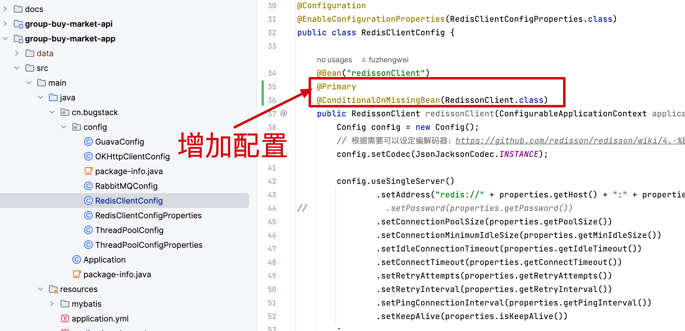
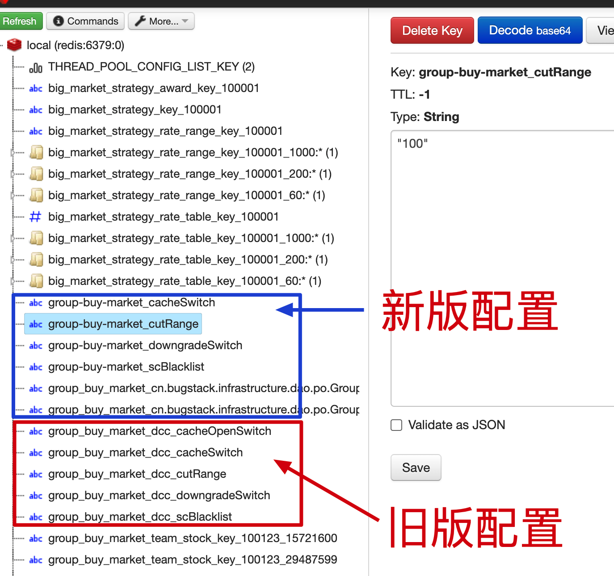

# 引入扳手工程

> 学习序号 35｜小节 2-21｜原文：https://articles.zsxq.com/id_7f98eqnvw932.html

**本章重点** ：引入星球内的《通用技术组件 - 🔧扳手工程》到拼团系统中，替代原本在拼团系统编写的设计模式框架和动态配置（DCC）服务。

**本章重点** ：★★★☆☆

**本节分支** ：[https://gitcode.net/KnowledgePlanet/group-buy-market/-/tree/2-21-xfg-introduce-wrench](https://gitcode.net/KnowledgePlanet/group-buy-market/-/tree/2-21-xfg-introduce-wrench)

**课程视频** ：[https://t.zsxq.com/lqZKr](https://t.zsxq.com/lqZKr)

**版权说明** ：©本项目与星球签约合作，受[《中华人民共和国著作权法实施条例》](https://www.gov.cn/gongbao/content/2013/content_2339485.htm) 版权法保护，禁止任何理由和任何方式公开(public)源码、资料、视频等小傅哥发布的星球内容到Github、Gitee等各类平台，违反可追究进一步的法律责任。

作者：小傅哥

博客：[https://bugstack.cn](https://bugstack.cn)

> 沉淀、分享、成长，让自己和他人都能有所收获！😄

- 一、本章诉求
- 二、功能流程
- 三、编码实现
  - 1. 引入pom
  - 2. 替换代码
  - 3. 其他改动
- 四、测试验证
  - 1. 试算测试
  - 2. 查看redis数据
- 五、读者作业

### 一、本章诉求

引入星球内的[《通用技术组件 - 🔧扳手工程》](https://t.zsxq.com/o7IBm)到拼团系统中，替代原本在拼团系统编写的设计模式框架和动态配置（DCC）服务。

那为什么要引入这一个扳手工程呢？

其实你可以想象下，在互联网公司中，有非常多的业务系统。这些业务系统都需要，解决一些非业务场景的共性问题。如，通用的设计模式，共用的错误码，统一的动态配置中心等等。当你进入公司以后，会发现这样的场景非常多。

所以，你学习本节不只是完成功能，而是吸收了同类的这样场景的设计方案，以后遇到各类这样的问题，都可以考虑做成一个独立的技术组件，让业务系统引入使用。

> 建议，学习扳手工程（1-3节）后在开始下面的内容。这样会很清楚扳手工程的一个设计和实现手段。

### 二、功能流程

如图，替换拼团工程中的通用能力；



- 首先，要在工程中引入扳手工程的清单pom配置。在本节课程之前，已经把扳手工程发布到 maven 中心仓库，可以直接使用。地址：[https://mvnrepository.com/artifact/cn.bugstack.wrench/xfg-wrench-bom/3.0.0](https://mvnrepository.com/artifact/cn.bugstack.wrench/xfg-wrench-bom/3.0.0)
- 之后，删掉 group-buy-market 工程 types 下；设计模式（design/framework）、dcc（annotations/DccValue + DCCValueBeanFactory）。删除后，工程 install 会报错。这个时候就引入 xfg-wrench 扳手工程内提供的框架和组件即可。

### 三、编码实现

#### 1. 引入pom

##### 1.1 根目录下 pom

```
                <!-- 扳手工程，如果拉取失败。可以自己构建（下载后，用 idea 打开，点击 install） https://gitcode.net/KnowledgePlanet/ai-agent-station -->
<dependency>
    <groupId>cn.bugstack.wrench</groupId>
    <artifactId>xfg-wrench-bom</artifactId>
    <version>3.0.0</version>
    <type>pom</type>
    <scope>import</scope>
</dependency>
```

- 在 group-buy-market 工程根目录下，pom.xml 添加扳手工程的清单配置。这个配置的作用是为了在工程模块下其他的 pom 里引入各项组件的时候，不在需要管理版本，由扳手工程的 bom 清单来统一管理。
- 注意，万一拉取失败，可以使用 Intellij IDEA 打开扳手工程，[https://gitcode.net/KnowledgePlanet/ai-agent-station](https://gitcode.net/KnowledgePlanet/ai-agent-station) 右侧 M 里，点击 install 本地构建（注意版本号一致）。这样也可以引入。

##### 1.2 domain 下引入框架（设计模式）

```
                <!-- 扳手工程；设计模式框架 -->
<dependency>
    <groupId>cn.bugstack.wrench</groupId>
    <artifactId>xfg-wrench-starter-design-framework</artifactId>
</dependency>
```

- 在 domain 下的 pom.xml 中添加设计模式框架。替代原本 domain 依赖于 types 下的设计模式框架。
- 代码结构完全一致，只是更换了引入的包的路径。需要全部更换，更换后点击 install 对于没更换成功会报错。

##### 1.3 infrastructure 下引入框架（dcc）

```
                <dependency>
    <groupId>cn.bugstack.wrench</groupId>
    <artifactId>xfg-wrench-starter-dynamic-config-center</artifactId>
</dependency>
```

- 基础设施层的 dcc 配置，依赖的是 types 下的枚举值（`@DCCValue`）。在引入扳手工程框架后，进行替换。

#### 2. 替换代码

##### 2.1 删除旧替换



- 在引入扳手工程后，可以直接把 types 层下的这部分代码干掉。这样工程会直接报错提示，也可以install 下，会提示出来缺少代码地方。对于缺少的代码，通过引入扳手工程即可。



- 删掉 `DCCValueBeanFactory` 配置，这部分不用引入了。扳手工程会自动启动。

##### 2.2 替换新代码



- 替换路径的地方有很多，随着你在 group-buy-market 工程中，点击 install 后，报错的地方，都要替换。每次修改完，如果没有提示，就继续点击 install。直至所有的地方都修改完。

#### 3. 其他改动

##### 3.1 超时时间



- 修改这里的超时时间，避免因数据库配置的服务器性能低，导致查询数据失败。

##### 3.2 yml 配置

application-dev.yml

```
                # 扳手工程；通用配置组件「配置中心、设计模式框架、限流服务」
xfg:
  wrench:
    config:
      system: group-buy-market
      register:
        host: 192.168.1.108
        port: 16379
```

- 新增加一个扳手工程的配置，系统名称设置为 `group-buy-market`

##### 3.3 增加注入配置



- 增加 `@Primary` 、`@ConditionalOnMissingBean(RedissonClient.class)` 避免因扳手工程也有 redissonClient 导致冲突。

### 四、测试验证

#### 1. 试算测试

```
                @Slf4j
@RunWith(SpringRunner.class)
@SpringBootTest
public class IIndexGroupBuyMarketServiceTest {

    @Resource
    private IIndexGroupBuyMarketService indexGroupBuyMarketService;

    /**
     * 测试人群标签功能的时候，可以进入 ITagServiceTest#test_tag_job 执行人群写入
     */
    @Test
    public void test_indexMarketTrial() throws Exception {
        MarketProductEntity marketProductEntity = new MarketProductEntity();
        marketProductEntity.setUserId("xiaofuge");
        marketProductEntity.setSource("s01");
        marketProductEntity.setChannel("c01");
        marketProductEntity.setGoodsId("9890001");

        TrialBalanceEntity trialBalanceEntity = indexGroupBuyMarketService.indexMarketTrial(marketProductEntity);
        log.info("请求参数:{}", JSON.toJSONString(marketProductEntity));
        log.info("返回结果:{}", JSON.toJSONString(trialBalanceEntity));
    }
  
}  
```

```
                25-05-25.09:25:44.315 [main            ] INFO  IIndexGroupBuyMarketServiceTest - 请求参数:{"channel":"c01","goodsId":"9890001","source":"s01","userId":"xiaofuge"}
25-05-25.09:25:44.339 [main            ] INFO  IIndexGroupBuyMarketServiceTest - 返回结果:{"deductionPrice":20.00,"endTime":1891304380000,"goodsId":"9890001","goodsName":"《手写MyBatis：渐进式源码实践》","groupBuyActivityDiscountVO":{"activityId":100123,"activityName":"测试活动","enable":true,"endTime":1891304380000,"groupBuyDiscount":{"discountDesc":"测试优惠","discountName":"测试优惠","discountType":"BASE","marketExpr":"20","marketPlan":"ZJ"},"groupType":0,"startTime":1733537980000,"status":1,"tagId":"1","tagScope":"1","takeLimitCount":1,"target":3,"validTime":15,"visible":false},"isEnable":true,"isVisible":true,"originalPrice":100.00,"payPrice":80.00,"startTime":1733537980000,"targetCount":3}
```

#### 2. 查看redis数据



- 登录 redis 管理控制台，查询数据。切量、开关、名单等都已经可以在控制台看见了。

### 五、读者作业

- 简单作业：理解本节的设计方案，代码配置，可以使用 ai 工具深入理解各项配置信息，很有助于面试。
- 复杂作业：尝试完成扳手工程中，限流的配置。也建议在扳手工程中开发新功能，接入到拼团项目。
