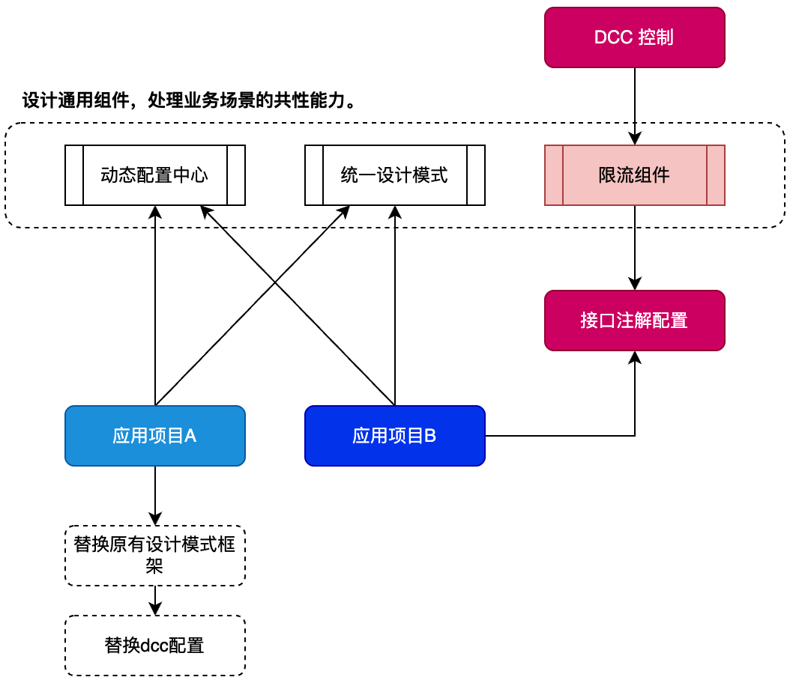
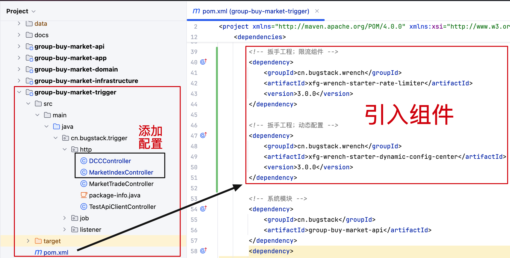
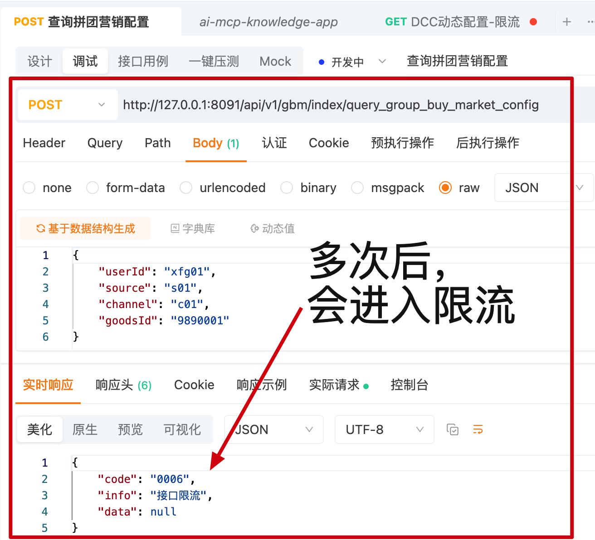
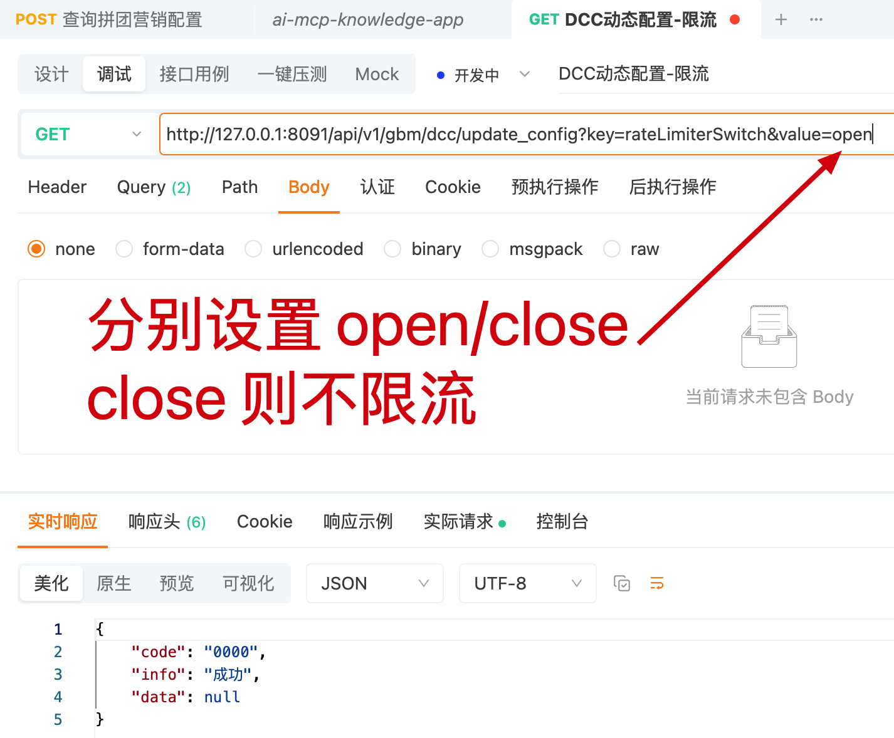

# 动态限流配置

> 学习序号 36｜小节 2-22｜原文：https://articles.zsxq.com/id_ikxwvmc7it84.html

**本章重点** ：通过在拼团项目系统中，引入的[《通用技术组件 - 🔧扳手工程》](https://t.zsxq.com/o7IBm)，使用其带有的动态限流组件，在拼团系统中配置使用。让通过 DCC 动态控制是否限流，让接口支持动态限流配置。

**本章重点** ：★★★☆☆

**本节分支** ：[https://gitcode.net/KnowledgePlanet/group-buy-market/-/tree/2-22-xfg-wrench-rate-limiter](https://gitcode.net/KnowledgePlanet/group-buy-market/-/tree/2-22-xfg-wrench-rate-limiter)

**课程视频** ：[https://t.zsxq.com/Iazmx](https://t.zsxq.com/Iazmx)

**版权说明** ：©本项目与星球签约合作，受[《中华人民共和国著作权法实施条例》](https://www.gov.cn/gongbao/content/2013/content_2339485.htm) 版权法保护，禁止任何理由和任何方式公开(public)源码、资料、视频等小傅哥发布的星球内容到Github、Gitee等各类平台，违反可追究进一步的法律责任。

作者：小傅哥

博客：[https://bugstack.cn](https://bugstack.cn)

> 沉淀、分享、成长，让自己和他人都能有所收获！😄

- 一、本章诉求
- 二、功能流程
- 三、编码实现
  - 1. 引入pom
  - 2. 接口限流
  - 3. 动态控制
- 四、测试验证
  - 1. ApiPost 连续访问接口
  - 2. 动态限流操作
- 五、读者作业

### 一、本章诉求

通过在拼团项目系统中，引入的[《通用技术组件 - 🔧扳手工程》](https://t.zsxq.com/o7IBm)，使用其带有的动态限流组件，在拼团系统中配置使用。让通过 DCC 动态控制是否限流，让接口支持动态限流配置。

本节的代码量不多，主要是因为我们已经在`扳手工程`中完成了动态限流的设计和开发，到拼团系统中直接使用即可。建议学习本节内容时，前置的学习下扳手工程。

### 二、功能流程

如图，在接口方法中配置动态限流能力；



- 首先，如，动态配置中心，统一设计模式，限流组件，都是在扳手工程内的引入的 bom 清单中。当需要使用限流组件时，直接在项目对应的模块下，引入pom即可。
- 之后，限流组件的动态控制，依赖的是动态配置中心。所以，在使用限流组件时，则需要顺序的引入下动态配置中心。这里还有另外一种做法，如 Spring AI 发布框架组件时候，提供3层关系结构。包括；功能件、自动装配件、整合 Starter 件。那么我们这里如果想让用户更简单的使用限流组件，而不需要关心是否要引入动态配置中心组件，则可以为限流组件，发布一个带有动态配置中心的pom文件的组件，这样用户就不需要单独引入了。

### 三、编码实现

#### 1. 引入pom



- 首先，在工程的 trigger 模块下，引入 pom 配置，之后就可以在 MarketIndexController 对应的接口上配置动态限流操作。
- 另外，因为 DCCController 的作用是操作动态处理 DCC 配置的，通过接口调用推送消息，完成配置变更。如动态限流，open/close 开关。
- 注意，DCCController 的使用，后续可以放到扳手工程，提供一个控制页面来操作。获取到注册上来的服务，并对服务发起配置变更。

#### 2. 接口限流

```
                @Slf4j
@RestController()
@CrossOrigin("*")
@RequestMapping("/api/v1/gbm/index/")
public class MarketIndexController implements IMarketIndexService {

    @Resource
    private IIndexGroupBuyMarketService indexGroupBuyMarketService;

    @RateLimiterAccessInterceptor(key = "userId", fallbackMethod = "queryGroupBuyMarketConfigFallBack", permitsPerSecond = 1.0d, blacklistCount = 1)
    @RequestMapping(value = "query_group_buy_market_config", method = RequestMethod.POST)
    @Override
    public Response<GoodsMarketResponseDTO> queryGroupBuyMarketConfig(@RequestBody GoodsMarketRequestDTO requestDTO) {
        try {
            log.info("查询拼团营销配置开始:{} goodsId:{}", requestDTO.getUserId(), requestDTO.getGoodsId());

            if (StringUtils.isBlank(requestDTO.getUserId()) || StringUtils.isBlank(requestDTO.getSource()) || StringUtils.isBlank(requestDTO.getChannel()) || StringUtils.isBlank(requestDTO.getGoodsId())) {
                return Response.<GoodsMarketResponseDTO>builder()
                        .code(ResponseCode.ILLEGAL_PARAMETER.getCode())
                        .info(ResponseCode.ILLEGAL_PARAMETER.getInfo())
                        .build();
            }

      // ... 省略部分代码
          
            log.info("查询拼团营销配置完成:{} goodsId:{} response:{}", requestDTO.getUserId(), requestDTO.getGoodsId(), JSON.toJSONString(response));

            return response;
        } catch (Exception e) {
            log.error("查询拼团营销配置失败:{} goodsId:{}", requestDTO.getUserId(), requestDTO.getGoodsId(), e);
            return Response.<GoodsMarketResponseDTO>builder()
                    .code(ResponseCode.UN_ERROR.getCode())
                    .info(ResponseCode.UN_ERROR.getInfo())
                    .build();
        }
    }

    public Response<GoodsMarketResponseDTO> queryGroupBuyMarketConfigFallBack(@RequestBody GoodsMarketRequestDTO requestDTO) {
        log.error("查询拼团营销配置限流:{}", requestDTO.getUserId());
        return Response.<GoodsMarketResponseDTO>builder()
                .code(ResponseCode.RATE_LIMITER.getCode())
                .info(ResponseCode.RATE_LIMITER.getInfo())
                .build();
    }

}
```

- 增加，`@RateLimiterAccessInterceptor` 注解配置，并设置限流参数，以及回调方法。
  - permitsPerSecond - 限制频次（每秒请求次数）
  - blacklistCount - 黑名单拦截（多少次限制后加入黑名单）0 不限制
  - fallbackMethod - 拦截后的执行方法
- queryGroupBuyMarketConfigFallBack 是一个回调方法，并增加了，RATE_LIMITER 一个限流枚举值。
- 这部分限流的具体实现，可以到扳手工程中学习，有详细的设计和实现讲解。**[《通用技术组件-🔧扳手工程》第4节：动态限流](https://t.zsxq.com/iEQw8)**

#### 3. 动态控制

```
                @Slf4j
@RestController()
@CrossOrigin("*")
@RequestMapping("/api/v1/gbm/dcc/")
public class DCCController implements IDCCService {

    @Resource(name = "dynamicConfigCenterRedisTopic")
    private RTopic dccTopic;

    /**
     * 动态值变更
     * <p>
     * curl http://127.0.0.1:8091/api/v1/gbm/dcc/update_config?key=downgradeSwitch&value=1
     * curl http://127.0.0.1:8091/api/v1/gbm/dcc/update_config?key=cutRange&value=0
     * curl http://127.0.0.1:8091/api/v1/gbm/dcc/update_config?key=rateLimiterSwitch&value=close
     */
    @RequestMapping(value = "update_config", method = RequestMethod.GET)
    @Override
    public Response<Boolean> updateConfig(@RequestParam String key, @RequestParam String value) {
        try {
            log.info("DCC 动态配置值变更 key:{} value:{}", key, value);
            dccTopic.publish(new AttributeVO(key, value));
            return Response.<Boolean>builder()
                    .code(ResponseCode.SUCCESS.getCode())
                    .info(ResponseCode.SUCCESS.getInfo())
                    .build();
        } catch (Exception e) {
            log.error("DCC 动态配置值变更失败 key:{} value:{}", key, value, e);
            return Response.<Boolean>builder()
                    .code(ResponseCode.UN_ERROR.getCode())
                    .info(ResponseCode.UN_ERROR.getInfo())
                    .build();
        }
    }

}
```

- DCCController 是前面课程一直有的控制类，本节把 publish 发布的入参对象，换为 `new AttributeVO(key, value)` 其他的没有变化。

### 四、测试验证

#### 1. ApiPost 连续访问接口



```
                curl --request POST \
  --url http://127.0.0.1:8091/api/v1/gbm/index/query_group_buy_market_config \
  --header 'Accept: */*' \
  --header 'Accept-Encoding: gzip, deflate, br' \
  --header 'Cache-Control: no-cache' \
  --header 'Connection: keep-alive' \
  --header 'Content-Type: application/json' \
  --header 'Host: 127.0.0.1:8091' \
  --header 'User-Agent: PostmanRuntime-ApipostRuntime/1.1.0' \
  --data '{
    "userId": "xfg01",
    "source": "s01",
    "channel": "c01",
    "goodsId": "9890001"
}'
```

```
                25-06-07.10:46:27.909 [http-nio-8091-exec-10] INFO  MarketIndexController  - 查询拼团营销配置完成:xfg01 goodsId:9890001 response:{"code":"0000","data":{"activityId":100123,"goods":{"deductionPrice":20.00,"goodsId":"9890001","originalPrice":100.00,"payPrice":80.00},"teamList":[],"teamStatistic":{"allTeamCompleteCount":0,"allTeamCount":2,"allTeamUserCount":4}},"info":"成功"}
25-06-07.10:46:31.032 [http-nio-8091-exec-1] INFO  DCCController          - DCC 动态配置值变更 key:rateLimiterSwitch value:open
25-06-07.10:46:31.047 [redisson-3-10   ] INFO  DynamicConfigCenterAdjustListener - xfg-wrench dcc config attribute:rateLimiterSwitch value:open
25-06-07.10:46:31.061 [redisson-3-10   ] INFO  DynamicConfigCenterAutoConfig - DCC 节点监听，动态设置值 group-buy-market_rateLimiterSwitch open
25-06-07.10:46:32.671 [http-nio-8091-exec-2] INFO  DCCController          - DCC 动态配置值变更 key:rateLimiterSwitch value:open
25-06-07.10:46:32.684 [redisson-3-11   ] INFO  DynamicConfigCenterAdjustListener - xfg-wrench dcc config attribute:rateLimiterSwitch value:open
25-06-07.10:46:32.694 [redisson-3-11   ] INFO  DynamicConfigCenterAutoConfig - DCC 节点监听，动态设置值 group-buy-market_rateLimiterSwitch open
25-06-07.10:46:34.217 [http-nio-8091-exec-3] INFO  RateLimiterAOP         - aop attr xfg01
25-06-07.10:46:34.217 [http-nio-8091-exec-3] INFO  RateLimiterAOP         - 限流-黑名单拦截(24h)：xfg01
25-06-07.10:46:34.217 [http-nio-8091-exec-3] ERROR MarketIndexController  - 查询拼团营销配置限流:xfg01
25-06-07.10:46:35.184 [http-nio-8091-exec-4] INFO  RateLimiterAOP         - aop attr xfg01
25-06-07.10:46:35.184 [http-nio-8091-exec-4] INFO  RateLimiterAOP         - 限流-黑名单拦截(24h)：xfg01
25-06-07.10:46:35.184 [http-nio-8091-exec-4] ERROR MarketIndexController  - 查询拼团营销配置限流:xfg01
```

- 通过 ApiPost 连续访问接口，会看到限流提示。
- 你可以把接口导入到 ApiPost 等工具内验证，也可以通过 Intellij IDEA 安装 ApiPost 插件上传接口到 ApiPost 软件中。

#### 2. 动态限流操作



```
              curl --request GET \
--url 'http://127.0.0.1:8091/api/v1/gbm/dcc/update_config?key=rateLimiterSwitch&value=open' \
--header 'Accept: */*' \
--header 'Accept-Encoding: gzip, deflate, br' \
--header 'Cache-Control: no-cache' \
--header 'Connection: keep-alive' \
--header 'Host: 127.0.0.1:8091' \
--header 'User-Agent: PostmanRuntime-ApipostRuntime/1.1.0'
```

- 动态修改 open/close 值，设置是否限流操作。
- 当连续访问接口限流后，可以修改value 为 close 不限流，在访问接口验证。

### 五、读者作业

- 简单作业：理解本节功能流程，检索相关大厂的限流操作，以及限流业务场景一些事故。之后对项目内的其他接口配置限流并验证。
- 复杂作业：尝试修改扳手工程，增加一个 admin 模块，来管理限流的操作，也就是一个 ERP 控制台实现。结合 tare.ai 这部分实现下。
