# ELK AI MCP 检索

> 学习序号 37｜小节 2-23｜原文：https://articles.zsxq.com/id_o22u4kgj5ewb.html

**本章重点**  ：为拼团项目增加 ELK 分布式日志采集和查询系统，以及通过 AI MCP 的方式，检索系统运行日志和数据分析。

**本章重点**  ：★★★☆☆

**本节分支**  ：[https://gitcode.net/KnowledgePlanet/group-buy-market/-/tree/2-23-xfg-elk-ai-mcp](https://gitcode.net/KnowledgePlanet/group-buy-market/-/tree/2-23-xfg-elk-ai-mcp)

**课程视频**  ：[https://t.zsxq.com/6BHXt](https://t.zsxq.com/6BHXt)

**版权说明**  ：©本项目与星球签约合作，受[《中华人民共和国著作权法实施条例》](https://www.gov.cn/gongbao/content/2013/content_2339485.htm) 版权法保护，禁止任何理由和任何方式公开(public)源码、资料、视频等小傅哥发布的星球内容到Github、Gitee等各类平台，违反可追究进一步的法律责任。

作者：小傅哥

博客：[https://bugstack.cn](https://bugstack.cn)

> 沉淀、分享、成长，让自己和他人都能有所收获！😄

- 一、本章诉求
- 二、框架介绍
- 三、环境配置
  - 1. 安装脚本
  - 2. 部署效果
- 四、代码配置
  - 1. pom 配置
  - 2. 增加 Trace-Id 配置
  - 3. application-dev.yml 上报日志地址配置
  - 4. logback-spring.xml 日志文件上报配置
- 五、ELk使用
  - 1. 检查上报
  - 2. 创建索引
  - 3. 查看日志
- 六、AI MCP 检索日志
  - 1. 环境说明
  - 2. 客户端使用
  - 3. 代码调用
- 七、读者作业

### 一、本章诉求

为拼团项目增加 ELK 分布式日志采集和查询系统，以及通过 AI MCP 的方式，检索系统运行日志和数据分析。

系统的运行日志，是排查系统问题的重要手段，尤其是分布式复杂系统，一次行为请求会执行多个接口查询。这些接口查询会被分布式系统承接，到不同的服务节点上执行。因此分布式日志就非常有用，可以串联出在哪个系统上执行的，并拿到全部日志进行分析。

### 二、框架介绍

Elastic Stack 技术栈，别是 `Elasticsearch`、`Logstash`、`Kibana` 组成，简称 ELK 是一套针对日志数据做解决方案的框架。它使您能够聚合来自所有系统和应用程序的日志，分析这些日志，并创建可视化来进行应用程序和基础设施监控、更快的故障排除、安全分析等。

- E = Elasticsearch：Elasticsearch 是在 Apache Lucene 上构建的分布式搜索和分析引擎。对各种语言、高性能和无架构 JSON 文档的支持使 Elasticsearch 成为各种日志分析和搜索使用案例的理想选择。
- L = Logstash：Logstash 是一个开源数据摄取工具，允许您从各种来源收集数据，转换数据，并将数据发送到您希望的目标。通过预构建的筛选器和对 200 多种插件的支持，Logstash 使用户能够轻松摄取数据，无论数据源或类型如何。
- K = Kibana：Kibana 是一种数据可视化和挖掘工具，可以用于日志和时间序列分析、应用程序监控和运营智能使用案例。它提供了强大且易用的功能，例如直方图、线形图、饼图、热图和内置的地理空间支持。此外，付费的 Kibana 还有 x-pack-jdbc 可以使用，让你就像使用 MyBatis 操作 MySQL 数据库一样操作 Elasticsearch 数据。

综上，3个组件的组合使用。由 Logstash 将摄取、转换数据并将其发送到 Elasticsearch 为摄取的数据编制索引，并且分析和搜索这些数据。最终 Kibana 会将分析结果可视化。也就是你可以在 Kibana 上实时看到系统的运行日志。

### 三、环境配置

ELK 日志框架，需要在 Docker 环境安装 Elasticsearch、Logstash、Kibana，3个服务。这3个框架都已经提供了 Docker compose 安装脚本，可以直接执行安装。

注意：如果 Docker 拉取失败，可以配置镜像。[https://t.zsxq.com/2DGGY](https://t.zsxq.com/2DGGY)

#### 1. 安装脚本

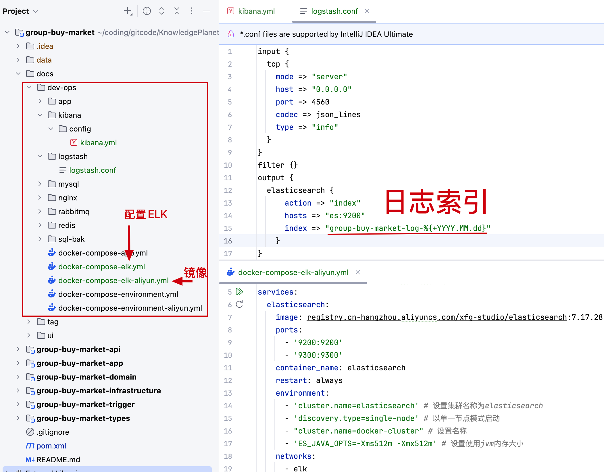

- 如图，在本节工程下，dev-ops 里，新增加了 elk yml 配置文件。可以直接执行安装即可（Windows、Mac、云服务）。关于 Docker 使用教程：[https://t.zsxq.com/19osWS4qj](https://t.zsxq.com/19osWS4qj)
- 注意，如果 Docker 配置了镜像，直接用 elk.yml 如果没有配置镜像，可以使用 elk-aliyun.yml

#### 2. 部署效果

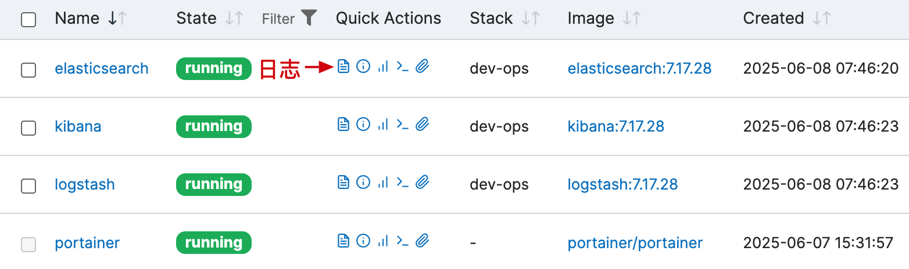

- 地址：[http://127.0.0.1:9000/#!/2/docker/containers](http://127.0.0.1:9000/#!/2/docker/containers)
- 部署后，在 portainer 管理端，就可以看见 elasticsearch、kibana、logstash，三个服务了。如果 State 状态不正常，可以进入日志查看。

### 四、代码配置

#### 1. pom 配置

```
                <!-- 上报日志 ELK -->
<dependency>
    <groupId>net.logstash.logback</groupId>
    <artifactId>logstash-logback-encoder</artifactId>
    <version>7.3</version>
</dependency>
```

- 首先，在工程的根目录引入。这样用于确定版本号。
- 之后，还需要在 app 模块下，引入。引入的时候去掉 `<version>7.3</version>`

#### 2. 增加 Trace-Id 配置

```
                @Component
public class TraceIdFilter extends OncePerRequestFilter {

    private static final String TRACE_ID = "trace-id";

    @Override
    protected void doFilterInternal(@NotNull HttpServletRequest request, @NotNull HttpServletResponse response, FilterChain filterChain)
            throws ServletException, IOException {
        try {
            String traceId = UUID.randomUUID().toString();
            MDC.put(TRACE_ID, traceId);
            filterChain.doFilter(request, response);
        } finally {
            MDC.clear();
        }
    }

}
```

- 分布式系统下，需要增加 traceId 作为分布式日志串联使用。
- 这里使用了 UUID 工具生成 traceId，企业中还会使用雪花算法来配置。

#### 3. application-dev.yml 上报日志地址配置

```
                # 日志；logstash部署的服务器IP
logstash:
  host: 127.0.0.1
```

- 如果你的服务是在服务端的，则配置为公网IP。后续部署项目的时候，我们还会把这个地址，配置到 docker-compose-app.yml 中。

#### 4. logback-spring.xml 日志文件上报配置

```
                <!-- 上报日志；ELK -->
<springProperty name="LOG_STASH_HOST" scope="context" source="logstash.host" defaultValue="127.0.0.1"/>

<!--输出到logstash的appender-->
<appender name="LOGSTASH" class="net.logstash.logback.appender.LogstashTcpSocketAppender">
    <!--可以访问的logstash日志收集端口-->
    <destination>${LOG_STASH_HOST}:4560</destination>
    <encoder charset="UTF-8" class="net.logstash.logback.encoder.LogstashEncoder"/>
</appender>

<root level="info">
    <appender-ref ref="CONSOLE"/>
    <!-- 异步日志-INFO -->
    <appender-ref ref="ASYNC_FILE_INFO"/>
    <!-- 异步日志-ERROR -->
    <appender-ref ref="ASYNC_FILE_ERROR"/>
    <!-- 上报日志-ELK -->
    <appender-ref ref="LOGSTASH"/>
</root>
```

- 增加 LOGSTASH 的 appender 配置，并把这个配置放到 root 下，这样就可以上报日志。
- 星球里还有一个项目是自己开发的上报日志，做全链路透视业务监控。感兴趣这部分可以学习下；[https://t.zsxq.com/CVzpL](https://t.zsxq.com/CVzpL)

### 五、ELk使用

开始下面的操作之前，需要启动 SpringBoot 服务，访问接口，让系统产生一些运行日志。

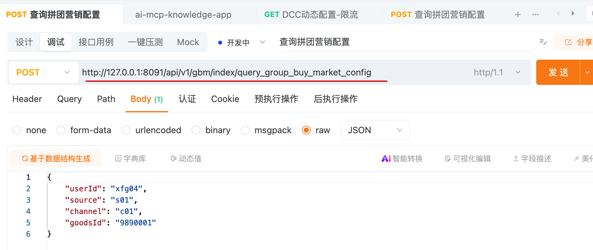

```
                25-06-08.08:05:08.441 [http-nio-8091-exec-2] INFO  ZJCalculateService     -b601d8d5-ff62-4adb-8260-16d8b6af53ef 优惠策略折扣计算:0
25-06-08.08:05:08.445 [http-nio-8091-exec-2] INFO  EndNode                -b601d8d5-ff62-4adb-8260-16d8b6af53ef 拼团商品查询试算服务-EndNode userId:xfg04 requestParameter:{"channel":"c01","goodsId":"9890001","source":"s01","userId":"xfg04"}
25-06-08.08:05:08.451 [http-nio-8091-exec-2] INFO  MarketIndexController  -b601d8d5-ff62-4adb-8260-16d8b6af53ef 查询拼团营销配置完成:xfg04 goodsId:9890001 response:{"code":"0000","data":{"activityId":100123,"goods":{"deductionPrice":20.00,"goodsId":"9890001","originalPrice":100.00,"payPrice":80.00},"teamList":[],"teamStatistic":{"allTeamCompleteCount":0,"allTeamCount":2,"allTeamUserCount":4}},"info":"成功"}
```

- 确保系统运行成功。
- 可以更换 userId 多访问几次系统，多产生一些日志，以及一些限流日志。

#### 1. 检查上报

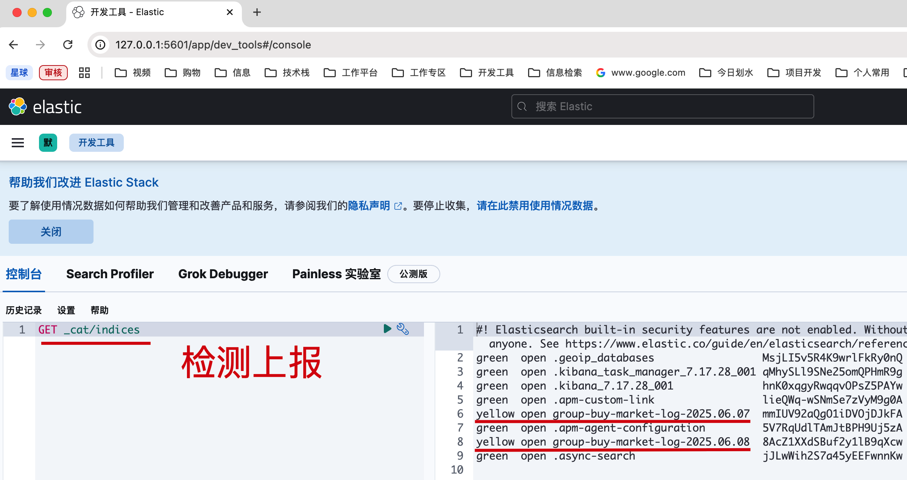

- 地址：[http://127.0.0.1:5601/app/dev_tools#/console](http://127.0.0.1:5601/app/dev_tools#/console)
- 操作：进入到左侧的菜单栏，Management 开发工具中。点击 `GET _cat/indices` 执行查看上报情况。

#### 2. 创建索引

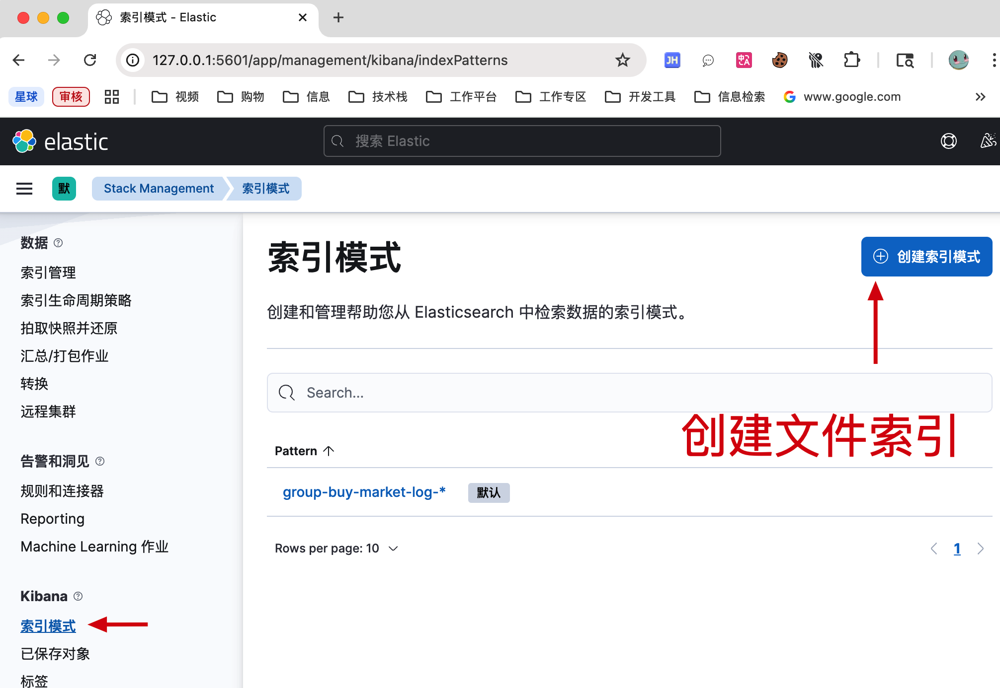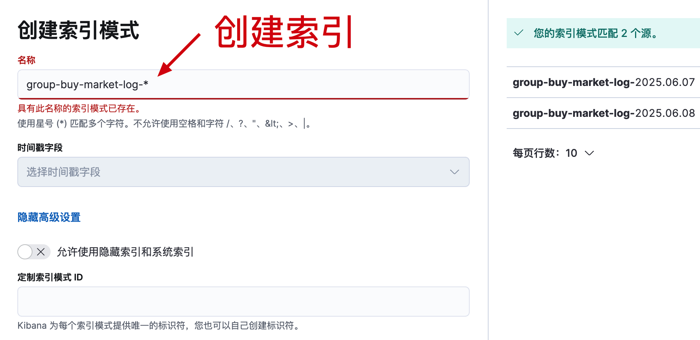

- 首先，进入到 [http://127.0.0.1:5601/app/management](http://127.0.0.1:5601/app/management) 下。之后点击进入**索引模式**  。
- 之后，创建索引 `group-buy-market-log-*` 通配符索引。

#### 3. 查看日志

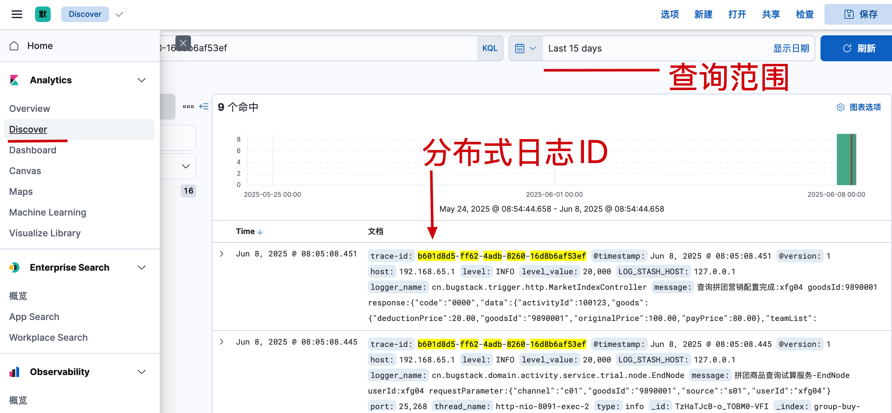

- 地址：[http://127.0.0.1:5601/app/discover](http://127.0.0.1:5601/app/discover) - 如果首次进入也会提示创建索引。之后选择对应的日期查询日志。

### 六、AI MCP 检索日志

AI MCP 是星球内的另外一套项目，《DeepSeek RAG、MCP、Agent》智能体，课程。课程里有讲解如何开发和使用 MCP 服务，以及构建 Agent 智能体。地址：[https://t.zsxq.com/GwNZp](https://t.zsxq.com/GwNZp) - `感兴趣的伙伴可以进入学习`

这里小傅哥选择一个 ElasticSearch MCP 服务，对接到咱们的 ELK 日志上，通过对接的 MCP 服务帮我们检索日志。

#### 1. 环境说明

- AI 对话客户端；[https://claude.ai/download](https://claude.ai/download) - 不非得使用这个客户端。像是 trae.ai、cursor 等，能配置 mcp 服务的都可以的。
- 发码平台：[https://sms-activate.io/](https://sms-activate.io/) - `claude.ai 注册需要使用`
- node 环境，需要 v18+ [https://nodejs.org/en/download](https://nodejs.org/en/download)
- mcp 服务01；[https://github.com/modelcontextprotocol/servers/tree/main/src/filesystem](https://github.com/modelcontextprotocol/servers/tree/main/src/filesystem)
- mcp 服务02；[https://github.com/elastic/mcp-server-elasticsearch](https://github.com/elastic/mcp-server-elasticsearch)
- mcp 服务03；[https://github.com/awesimon/elasticsearch-mcp](https://github.com/awesimon/elasticsearch-mcp)

#### 2. 客户端使用

##### 2.1 配置文件

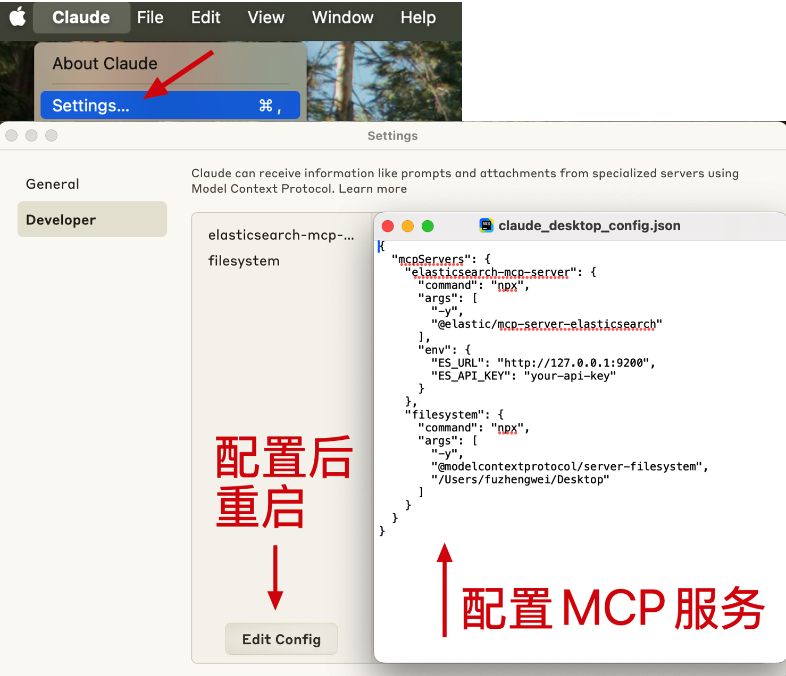

```
                {
  "mcpServers": {
    "elasticsearch-mcp-server": {
      "command": "npx",
      "args": [
        "-y",
        "@elastic/mcp-server-elasticsearch"
      ],
      "env": {
        "ES_URL": "http://127.0.0.1:9200",
        "ES_API_KEY": "your-api-key"
      }
    },
    "filesystem": {
      "command": "npx",
      "args": [
        "-y",
        "@modelcontextprotocol/server-filesystem",
        "/Users/fuzhengwei/Desktop"
      ]
    }
  }
}
```

- 配置后要重启客户端。注意 `/Users/fuzhengwei/Desktop` 更换为你的文件夹。
- 如果 es mcp 不可用，可以用这套；  [https://github.com/awesimon/elasticsearch-mcp](https://github.com/awesimon/elasticsearch-mcp)  {   "mcpServers": {     "elasticsearch-mcp": {       "command": "npx",       "args": [         "-y",         "@awesome-ai/elasticsearch-mcp"       ],       "env": {         "ES_HOST": "https://es-node1:9200,https://es-node2:9200,https://es-node3:9200",         "ES_API_KEY": "your-api-key"       }     }   } }

##### 2.2 对话提问

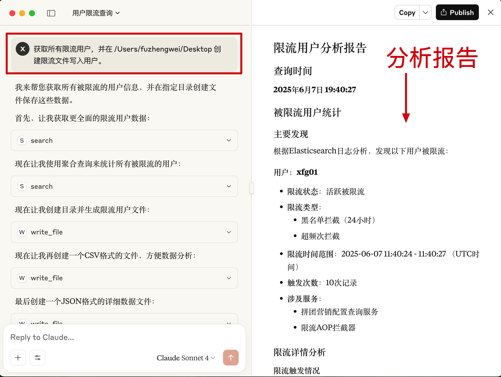

- 对话提问：`获取所有限流用户，并在 /Users/fuzhengwei/Desktop 创建限流文件写入用户。`
- 这样他就可以通过 ES 查询我们产生的日志数据，并给出分析报告。

##### 2.3 日志文件

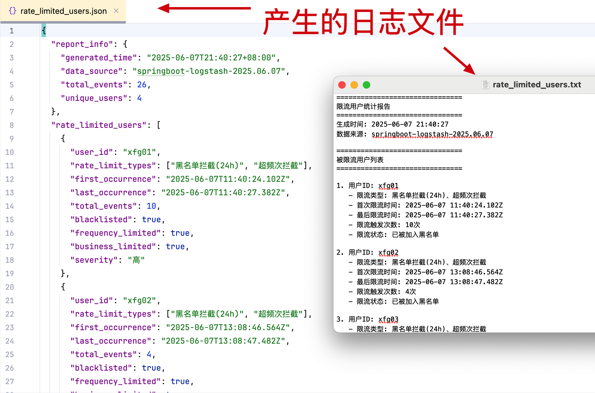

- 打开产生的日志文件，可以把限流的用户拉取出来。方便我们分析提供问题。

#### 3. 代码调用

这部分涉及到星球的 AI Agent 项目，工程地址：[https://gitcode.net/KnowledgePlanet/ai-agent-station-study](https://gitcode.net/KnowledgePlanet/ai-agent-station-study)

```
                package cn.bugstack.ai.test.spring.ai;

@Slf4j
@RunWith(SpringRunner.class)
@SpringBootTest
public class AiAgentMCPESTest {

    private ChatModel chatModel;

    private ChatClient chatClient;

    @Resource
    private PgVectorStore vectorStore;

    public static final String CHAT_MEMORY_CONVERSATION_ID_KEY = "chat_memory_conversation_id";
    public static final String CHAT_MEMORY_RETRIEVE_SIZE_KEY = "chat_memory_response_size";

    @Before
    public void init() {

        OpenAiApi openAiApi = OpenAiApi.builder()
                .baseUrl("https://apis.itedus.cn")
                .apiKey("sk-vo81adWzUz1G0LBQ1cF1B804A1E04aC****  *可联系小傅哥申请")
                .completionsPath("v1/chat/completions")
                .embeddingsPath("v1/embeddings")
                .build();

        chatModel = OpenAiChatModel.builder()
                .openAiApi(openAiApi)
                .defaultOptions(OpenAiChatOptions.builder()
                        .model("gpt-4.1-mini")
                        .toolCallbacks(new SyncMcpToolCallbackProvider(stdioMcpClientElasticsearch()).getToolCallbacks())
                        .build())
                .build();
    }

    @Test
    public void test_chat_model_call() {
        Prompt prompt = Prompt.builder()
                .messages(new UserMessage(
                        """
                                有哪些工具可以使用
                                """))
                .build();

        ChatResponse chatResponse = chatModel.call(prompt);

        log.info("测试结果(call):{}", JSON.toJSONString(chatResponse));
    }

    @Test
    public void test_chat_model_call_es() {
        Prompt prompt = Prompt.builder()
                .messages(new UserMessage(
                        """ 
                                查询xfg01日志，DSL 语句；
                                {
                                  `index`: `springboot-logstash-2025.06.07`,
                                  `queryBody`: {
                                    `size`: 10,
                                    `sort`: [
                                      {
                                        `@timestamp`: {
                                          `order`: `desc`
                                        }
                                      }
                                    ],
                                    `query`: {
                                      `match`: {
                                        `message`: `xfg01`
                                      }
                                    }
                                  }
                                }
                                """))
                .build();

        ChatResponse chatResponse = chatModel.call(prompt);

        log.info("测试结果(call):{}", JSON.toJSONString(chatResponse));
    }

    /**
     * https://sai.baidu.com/server/Elasticsearch%2520MCP%2520Server/awesimon?id=02d6b7e9091355b91fed045b9c80dede
     * https://github.com/elastic/mcp-server-elasticsearch
     */
    public McpSyncClient stdioMcpClientElasticsearch() {

        Map<String, String> env = new HashMap<>();
        env.put("ES_URL","http://127.0.0.1:9200");
        env.put("ES_API_KEY","none");

        var stdioParams = ServerParameters.builder("npx")
                .args("-y", "@elastic/mcp-server-elasticsearch")
                .env(env)
                .build();

        var mcpClient = McpClient.sync(new StdioClientTransport(stdioParams))
                .requestTimeout(Duration.ofSeconds(100)).build();

        var init = mcpClient.initialize();

        System.out.println("Stdio MCP Initialized: " + init);

        return mcpClient;

    }

}
```

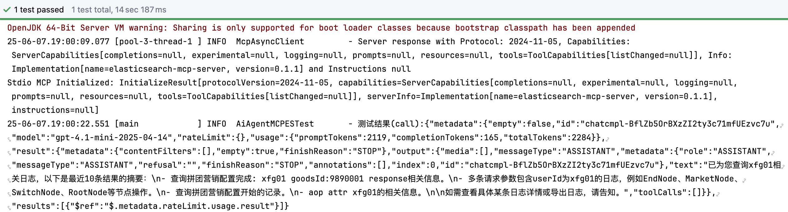

- 以上代码，就是对接的 mcp 服务，以及通过 `查询xfg01日志，DSL 语句；` 来操作 ES。

### 七、读者作业

- 简单作业：完成 ELK 日志配置和查询，以及使用任意一个 AI 客户端，完成 MCP 服务的配置和使用。
- 复杂作业：可以思考除了 ES 通过 MCP 查询日志，还有哪些系统的监控类配置，可以配置后通过 MCP 调用，并做系统的问题排查使用。
