# 系统监控 AI MCP 分析

> 学习序号 38｜小节 2-24｜原文：https://articles.zsxq.com/id_crvweautk8c0.html

**本章重点**  ：为拼团系统配置**普罗米修斯**  监控，并使用 AI MCP 工具，分析监控数据。通过这样的学习，让大家了解到企业里如何使用 AI 在软件工程方面的提效。

**本章重点**  ：★★★☆☆

**本节分支**  ：[https://gitcode.net/KnowledgePlanet/group-buy-market/-/tree/2-24-xfg-grafana-ai-mcp](https://gitcode.net/KnowledgePlanet/group-buy-market/-/tree/2-24-xfg-grafana-ai-mcp)

**课程视频**  ：[https://t.zsxq.com/afbln](https://t.zsxq.com/afbln)

**版权说明**  ：©本项目与星球签约合作，受[《中华人民共和国著作权法实施条例》](https://www.gov.cn/gongbao/content/2013/content_2339485.htm) 版权法保护，禁止任何理由和任何方式公开(public)源码、资料、视频等小傅哥发布的星球内容到Github、Gitee等各类平台，违反可追究进一步的法律责任。

作者：小傅哥

博客：[https://bugstack.cn](https://bugstack.cn)

> 沉淀、分享、成长，让自己和他人都能有所收获！😄

- 一、本章诉求
- 二、功能流程
- 三、监控配置
  - 1. 系统工程
  - 2. 启动系统（验证上报）
  - 3. 启动监控
  - 4. 配置面板
- 四、AI MCP 分析
  - 1. 获取监控 API Key
  - 2. 配置文件
  - 3. Ai 客户端配置
  - 4. Ai 客户端使用
- 五、课程作业

### 一、本章诉求

为拼团系统配置`普罗米修斯`监控，并使用 AI MCP 工具，分析监控数据。通过这样的学习，让大家了解到企业里如何使用 AI 在软件工程方面的提效。

现在的互联网公司内，在每个大的业务部门，都陆续的开始搭建了 AI 团队。专门为本团队的业务系统做关于 AI 提效方面的开发。像是智能巡检、系统监控、代码开发、PRD文档评审、代码评审、智能客服等，都是 AI 方面的应用。

### 二、功能流程

如图，整个功能流程如下；

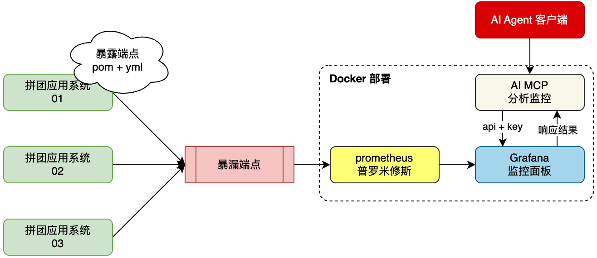

- 首先，拼团应用系统，需要配置对应的监控暴漏端点，这样的目的是为了把数据暴漏出去。注意，对外使用要增加上验证权限，避免数据暴漏出去。
- 之后，进入普罗米修斯和监控面板的配置文件，修改对应的配置，主要是IP、数据库文件等（课程下有说明），之后通过 Docker 启动，普罗米修斯 + 监控面板 + AI MCP 服务端，这样的目的是为了采集来自于系统的暴漏端点数据。
- 最后，监控相关配置完成后，调用拼团系统接口，产生一些业务数据。之后通过 AI 客户端，配置 MCP 服务，这样就可以通过 AI 客户端分析系统监控情况了。

### 三、监控配置

#### 1. 系统工程

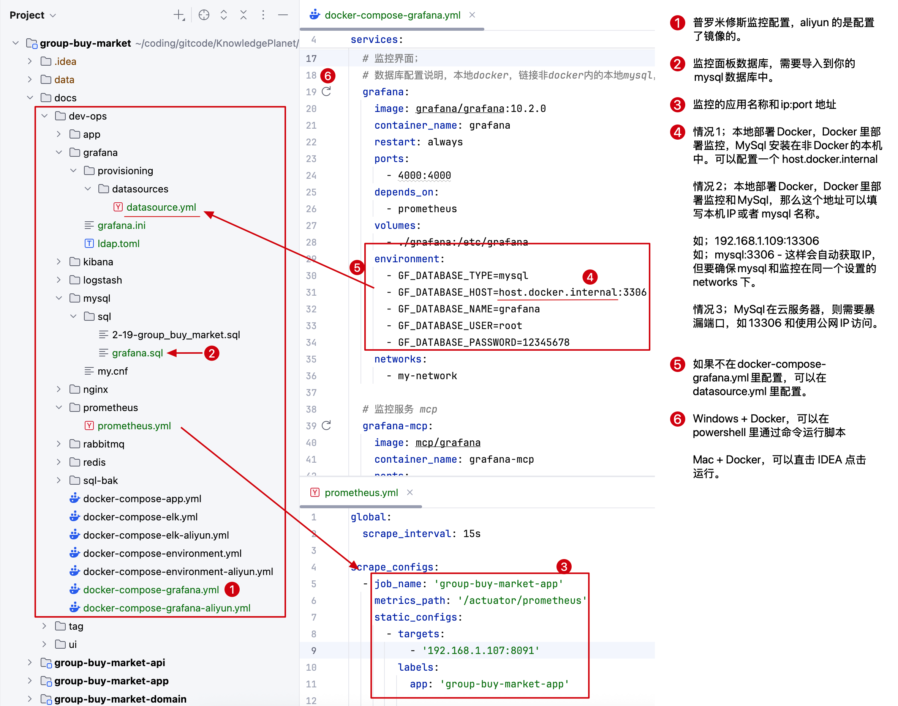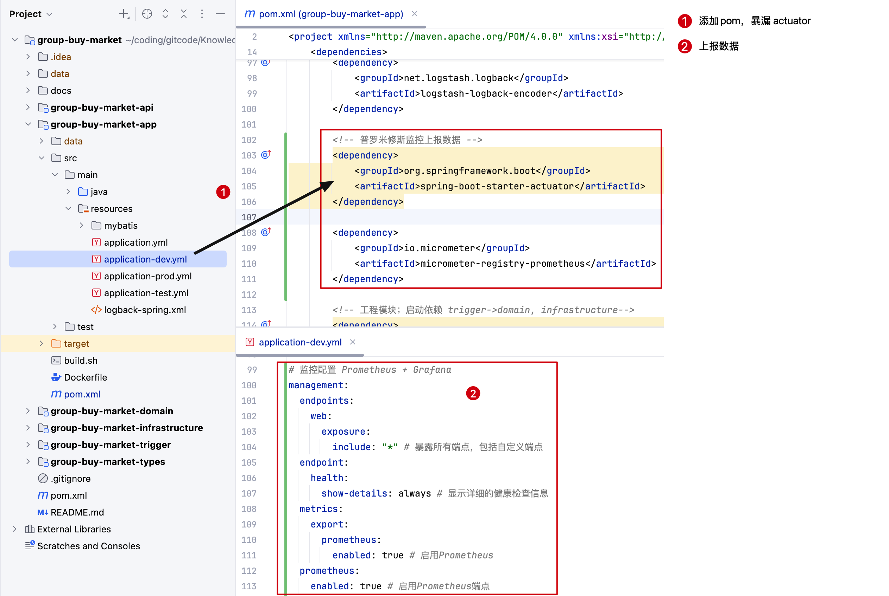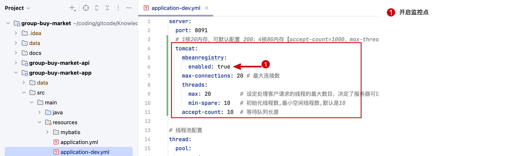

- 首先，为整个工程添加普罗米修斯监控的配置操作。通过 Docker 方式进行部署。
- 之后，在系统的 group-buy-market-app 下，添加 pom 引入，以及 application-dev.yml 中，添加监控节点上报数据操作。
- 另外，还要在 application-dev.yml 添加 tomcat enabled 允许采集。
- 注意，有IP的地方，要换成你的本地点IP，否则不能采集。

> 以上这部分可以参考课程源码，对比配置你的系统监控。

#### 2. 启动系统（验证上报）

启动拼团系统，验证数据上报。

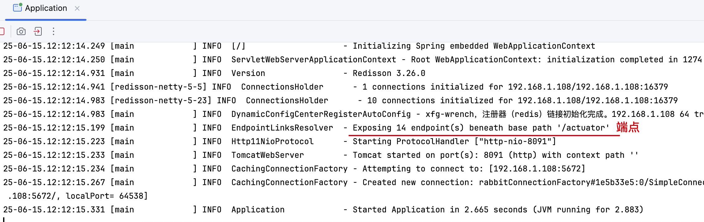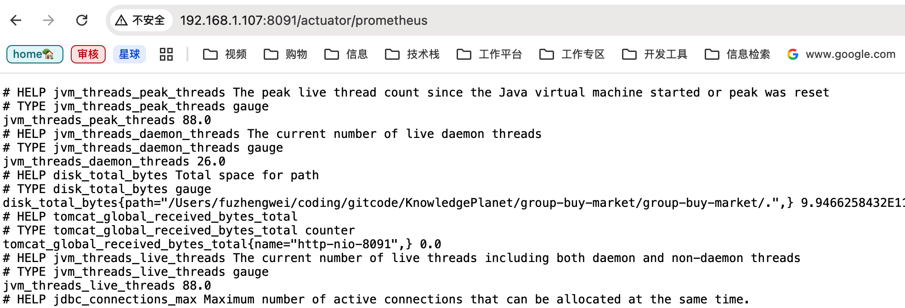

- 首先，观察启动系统后，有一个 /actuator 表明可以上报数据。
- 之后，访问接口，[http://127.0.0.1:8091/actuator/prometheus](http://127.0.0.1:8091/actuator/prometheus) 确保浏览器有数据返回。

#### 3. 启动监控

确保你已经安装了 Docker，并启动了普罗米修斯监控；

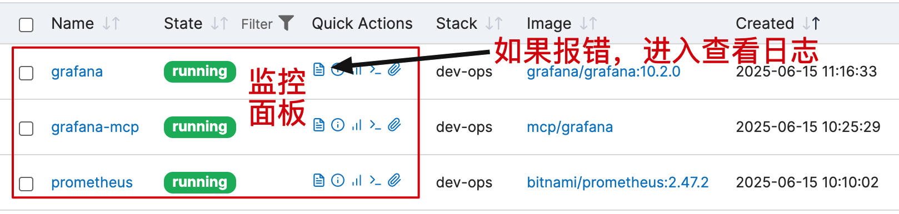

- 访问：[http://127.0.0.1:9000/#!/2/docker/containers](http://127.0.0.1:9000/#!/2/docker/containers)
- prometheus 是对应采集数据的数据源，类似的 mysql、es，都是一种数据源，通过数据源推送上来的数据进行监控。
- grafana 是监控面板，对采集的数据，可以配置不同的报表展示。
- grafana-mcp 是一个通过使用 AI MCP 的方式，获取 grafana 面板数据的操作，这样 AI 就能介入分析了。

#### 4. 配置面板

##### 4.1 设置面板

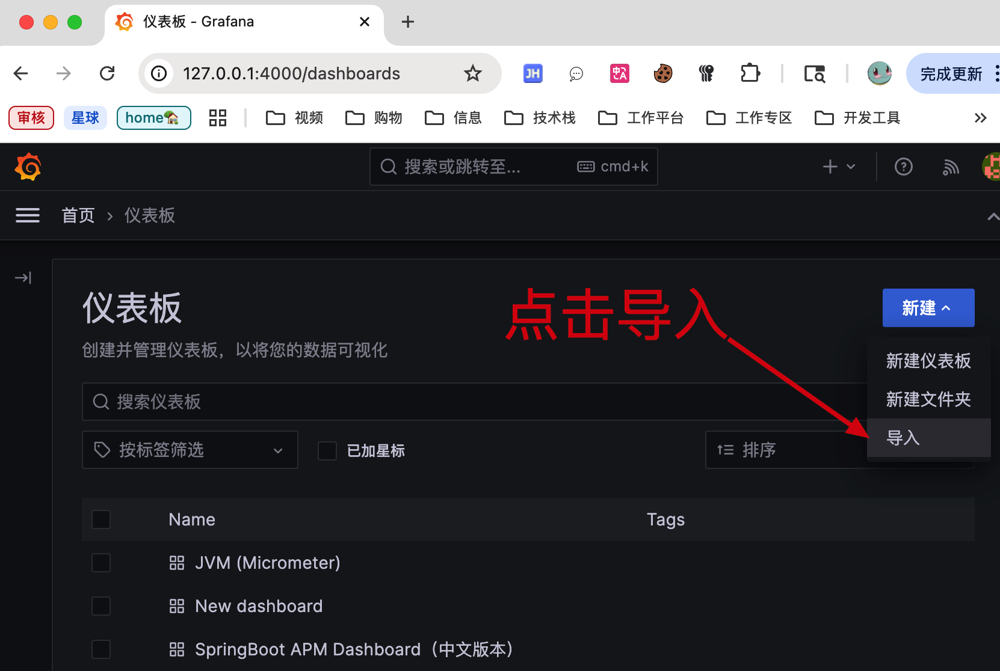

##### 4.2 添加面板

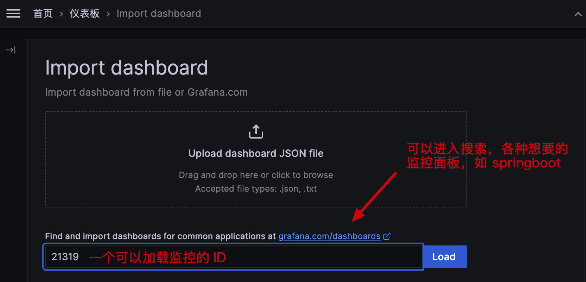

##### 4.3 查看面板

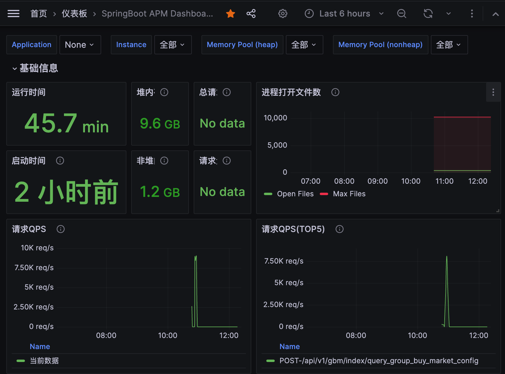

以上配置完成后，可以请求拼团系统接口，用于健康系统采集。也可以使用 ApiPost/Jmeter 进行压测。教程：[https://bugstack.cn/md/road-map/jmeter.html](https://bugstack.cn/md/road-map/jmeter.html)

> 这部分课程有视频操作，可以对照视频来看。

### 四、AI MCP 分析

#### 1. 获取监控 API Key

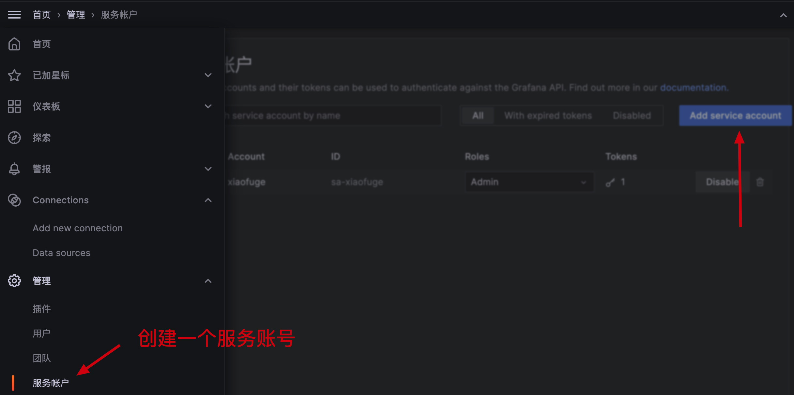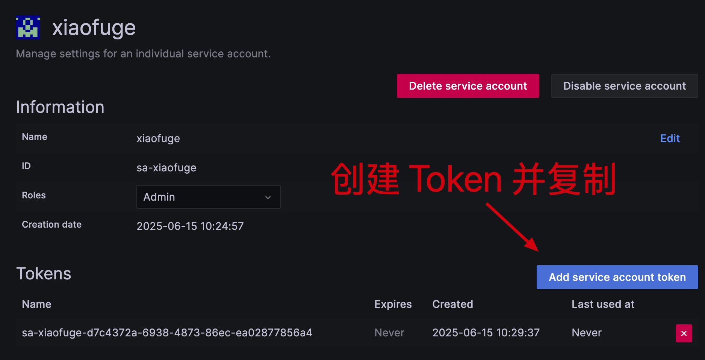

- 创建一个 Token 并复制，MCP 服务对接需要使用。

#### 2. 配置文件

```
                {
  "mcpServers": {
    "grafana": {
      "command": "docker",
      "args": [
        "run",
        "--rm",
        "-i",
        "-e",
        "GRAFANA_URL",
        "-e",
        "GRAFANA_API_KEY",
        "mcp/grafana",
        "-t",
        "stdio"
      ],
      "env": {
        "GRAFANA_URL": "http://192.168.1.107:4000",
        "GRAFANA_API_KEY": "glsa_xKV5NS4EieXtae2whZmaMQvvbVkYGA7L_83db2a3b"
      }
    }
  }
}
```

- 注意，GRAFANA_URL 修改为你的 IP 地址。GRAFANA_API_KEY 是你生成的 Token

#### 3. Ai 客户端配置

##### 3.1 Claude

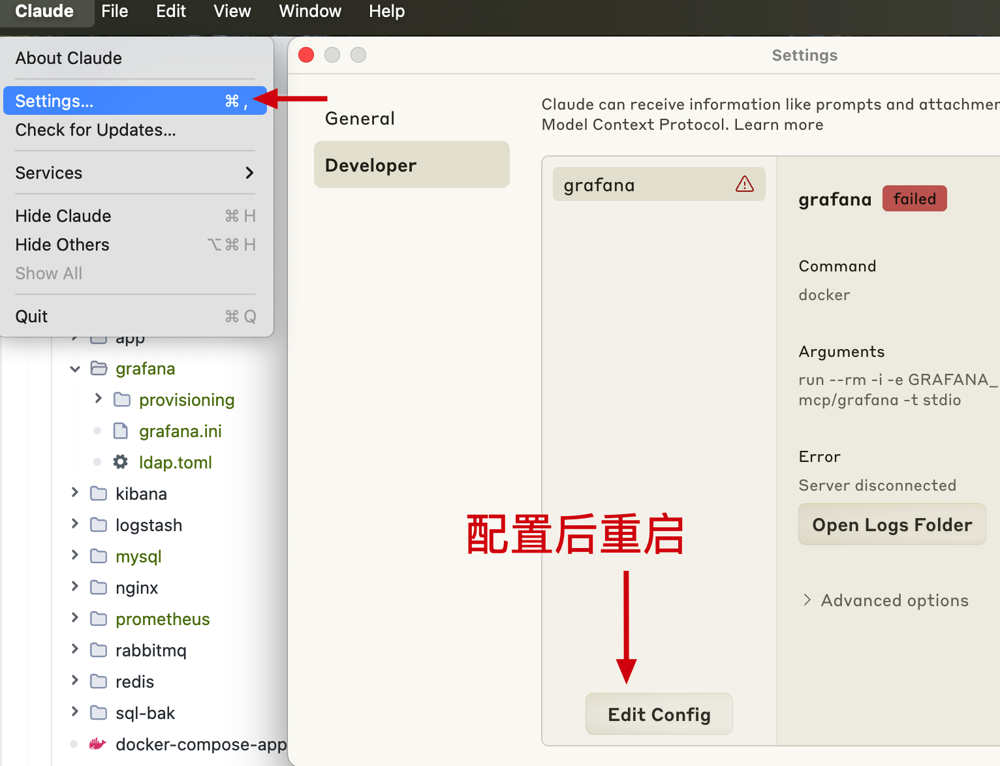

##### 3.2 Trae

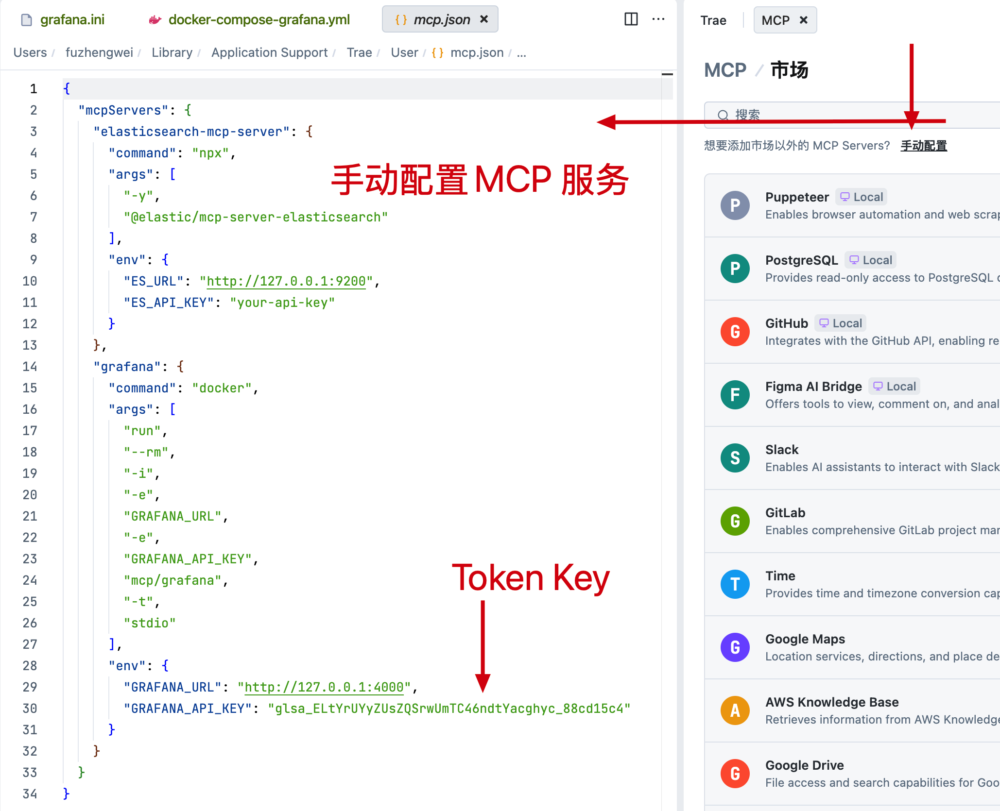

#### 4. Ai 客户端使用

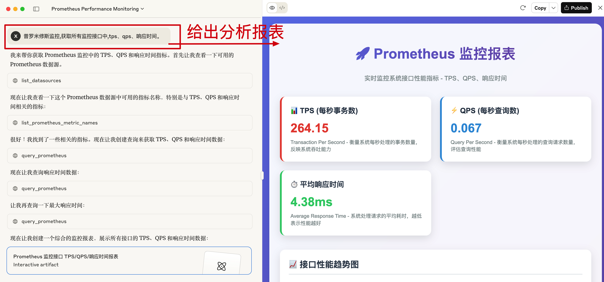

- 提问：`普罗米修斯监控,获取所有监控接口中,tps、qps、响应时间。`
- 提问：`获取普罗米修斯监控数据，分析系统运行状况。给出图表展示。`

### 五、课程作业

- 简单作业：完成本节的监控配置和Ai 分析使用。
- 复杂作业：结合上一节的 ES 日志 MCP 服务，做一个系统异常的案例，通过 Ai 工具分析出来。这样面试也有的讲。
