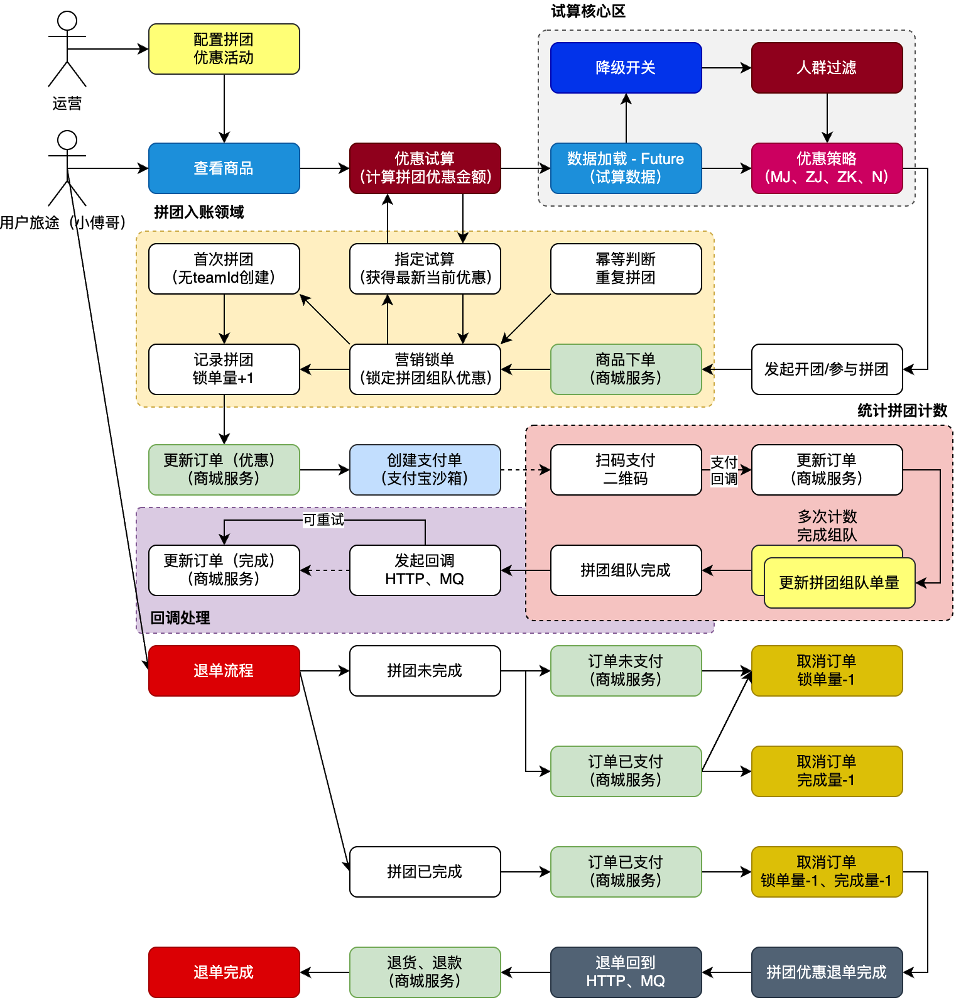
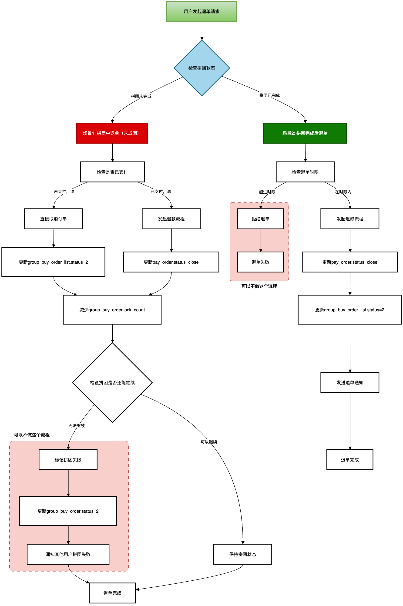
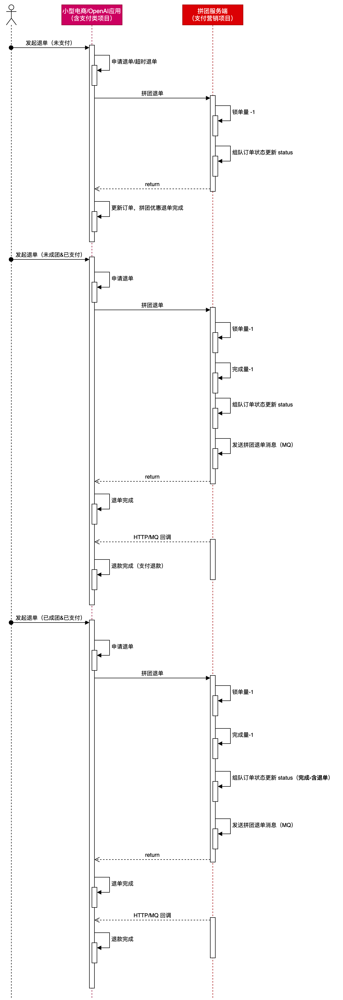

# 逆向流程场景分析

> 学习序号 39｜小节 2-25｜原文：https://articles.zsxq.com/id_n3mdxr80t7qc.html

**本章重点** ：分析全流程，设计逆向场景，为后续做开发准备。本节无代码变更。

**本章重点** ：★★★☆☆

**本节分支** ：[https://gitcode.net/KnowledgePlanet/group-buy-market/-/tree/2-25-xfg-reverse-process-analysis](https://gitcode.net/KnowledgePlanet/group-buy-market/-/tree/2-25-xfg-reverse-process-analysis)

**课程视频** ：[https://t.zsxq.com/pcRVc](https://t.zsxq.com/pcRVc)

**版权说明** ：©本项目与星球签约合作，受[《中华人民共和国著作权法实施条例》](https://www.gov.cn/gongbao/content/2013/content_2339485.htm) 版权法保护，禁止任何理由和任何方式公开(public)源码、资料、视频等小傅哥发布的星球内容到Github、Gitee等各类平台，违反可追究进一步的法律责任。

作者：小傅哥

博客：[https://bugstack.cn](https://bugstack.cn)

> 沉淀、分享、成长，让自己和他人都能有所收获！😄

- 一、本章诉求
- 二、功能流程
- 三、逆向流程
- 四、开发流程
- 五、读者作业

### 一、本章诉求

对于拼团这样的业务场景，有正向流程的下单，就有逆向流程退单。基本你在各类应用 APP 中，如；商城、外卖、出行、票务等，都是可以下单或者退单的。这也是一个互联网toc业务场景中，非常常见的流程。

所以，从这一节开始，我们将进入逆向流程的分析和后续的功能实现。先有这一节的场景分析，让小白伙伴知道这样一个流程，之后在详细设计和编码也会更加容易。

建议；学习这一节的时候，可以看看其他的应用类 APP 他们的退单流程都发生了什么动作，这些知识点以及不同的处理方式，都可以作为你学习后的对项目扩展实现的增强点。

### 二、功能流程

如图，以用户旅途视角来看整个拼团流程。

- 首先，我们来回顾下前面章节，完成的业务流程。从运营配置拼团活动，到用户从「小型支付商城（对接的一个场景）」，开始查看带有拼团优惠的上，进行试算，过滤规则。再到参与拼团，完成下单和一系列的流程处理。之后是拼团对于支付收单的入账计算，达成拼团目标后，回调（HTTP/MQ）商城服务，完成整个交易过程。
- 那么，从本节开始，我们要考虑的是如何处理逆向流程，也就是退单的过程。退单分为当前过程中，拼团是否完成，未完成则根据是否支付了，取消锁单量和完成量。如果拼团已完成，则取消锁单量和完成量，拼团优惠释放后，则回调商城（refundGroupBuySuccess）,完成退单退货服务。
- 一般，对于已经完成拼团的，有用户退单是不会对其他用户已经完成交易的进行退单的，会造成很差的体验。这部分成本往往由商家和平台分摊，毕竟平台的目的是为了卖货。

### 三、逆向流程

有了整个拼团业务场景流程的理解，我们在着重看下**用户发起退款** 的逆向流程。

- 首先，逆向的流程，要分析用户是在哪个流程节点下进行中断行为。包括3个场景；
  - 参与拼团，完成锁单，未支付。
  - 参与拼团，完成锁单，已支付。拼团未组队完成。
  - 参与拼团，完成锁单，已支付。拼团已组队完成。
- 场景1，对于未支付，基本是超时退单场景，因为用户本身就未支付，也不会在发起其他动作了。另外这个场景，如果超时关单的临界点用户支付了，还需要做逆向退款，告诉用户优惠过期，重新参与。否则这一单可能没法完成拼团组队，恰巧这会拼团组队已经有其他用户锁单了。
- 场景2，对于已支付，未完成的，则发起退掉拼团营销优惠，之后退款。另外一个方式是先退款，拿到退款在退拼团组队。这样两个方式，一种是优先个人，另外一个是优先组队团队。两种方式都有，也可以通过拼团活动配置策略，来配置优先级。
- 场景3，对于已支付，已完成的，则可以先退掉用户的支付，之后在退拼团的完成量。如果此时拼团已完成，则可以记录拼团为完成含退单，并记录退单量，但不允许其他用户在参与了。因为整个组队已经整体完成了组队，并结算完成了。

所以，综上在发生逆向时，可以先退拼团，也可以先退个人支付款，两种方式都是可以实现的。

### 四、开发流程

如图，为用户退款的实现流程设计。

- 第1段流程；发起退单，未支付。更新拼团锁单量，以及完成小型支付退单。
- 第2段流程；发起退单，未成团&已支付。更新拼团锁单量，完成量，这会拼团还没有成团，可以继续等待其他用户参与拼团。这个过程拼团要发送MQ，小型支付接收后，处理退款。
- 第3段流程；发起退单，已成团&已支付。更新拼团锁单量，完成量，当前拼团已完成组队，不必给其他用户退到，也不允许其他用户参与拼团。所以可以给组队的拼团订单更新为`完成-含退单`，之后要发MQ消息，小型支付接收后，处理退款。

综上，就是整个逆向流程的业务流程分析，可以深入的理解下。后续将对照本节的分析来实现拼图的后续功能实现。

### 五、读者作业

- 简单作业：结合实际业务场景（各类互联网app应用，商城、出行、外卖等），来理解逆向退单流程。
- 复杂作业：尝试思考怎么在系统工程中实现逆向流程，并可以拉个分支，编写一些代码。
