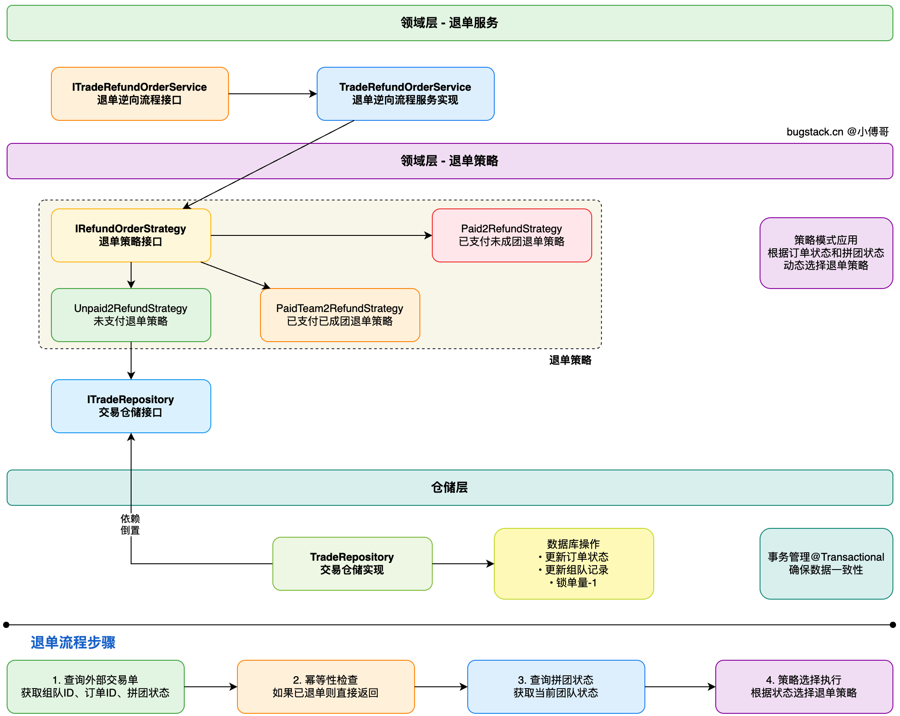
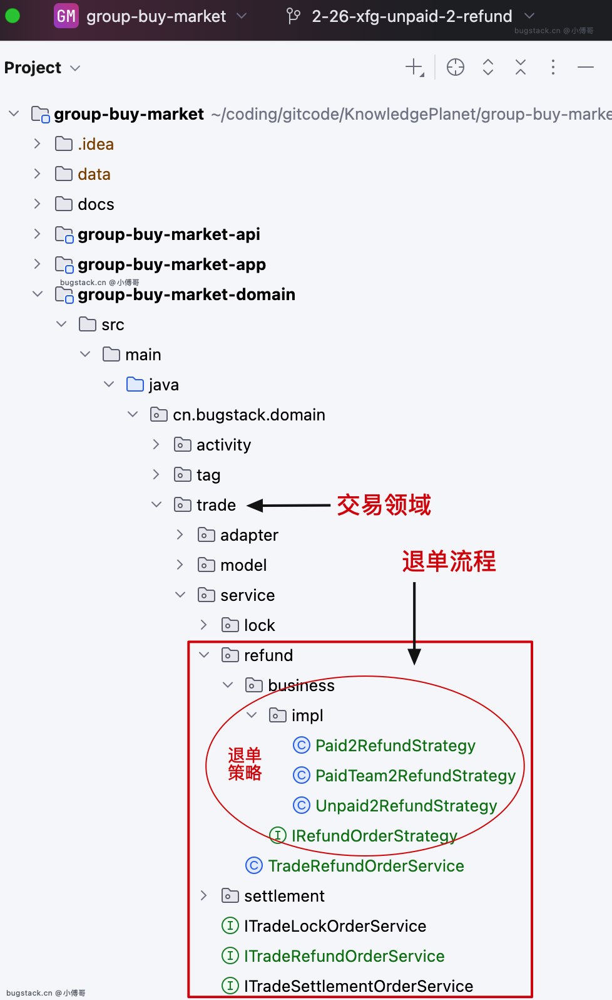
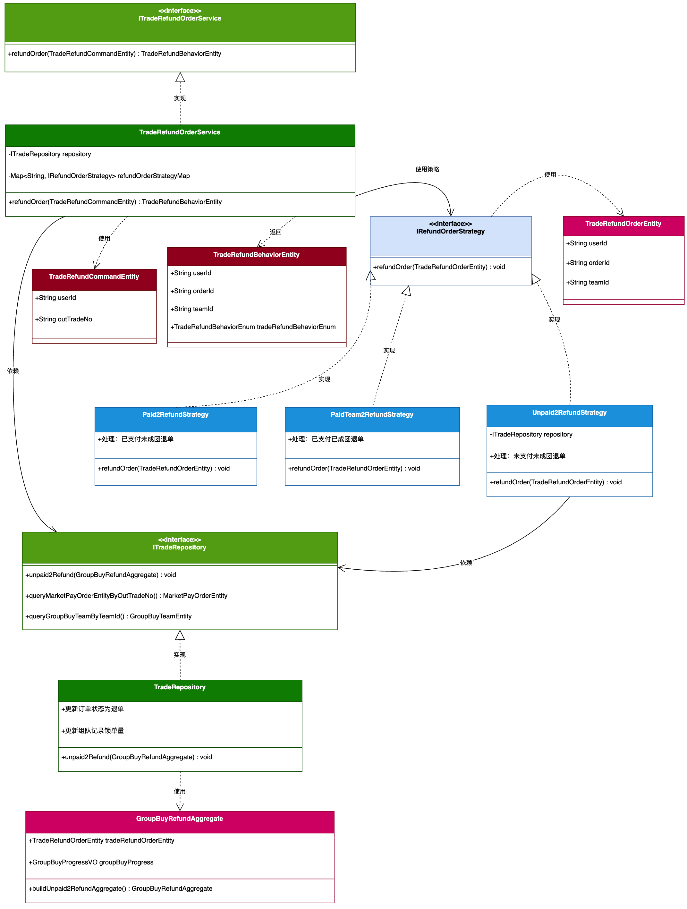
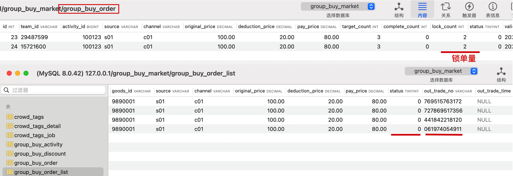

# 未支付退单流程（枚举策略模式应用）

> 学习序号 40｜小节 2-26｜原文：https://articles.zsxq.com/id_4he6zdfw7xmd.html

**本章重点** ：构建退单流程，使用枚举策略调用退单各项流程。

**本章重点** ：★★★☆☆

**本节分支** ：[https://gitcode.net/KnowledgePlanet/group-buy-market/-/tree/2-26-xfg-unpaid-2-refund](https://gitcode.net/KnowledgePlanet/group-buy-market/-/tree/2-26-xfg-unpaid-2-refund)

**课程视频** ：[https://t.zsxq.com/MVr1a](https://t.zsxq.com/MVr1a)

**版权说明** ：©本项目与星球签约合作，受[《中华人民共和国著作权法实施条例》](https://www.gov.cn/gongbao/content/2013/content_2339485.htm) 版权法保护，禁止任何理由和任何方式公开(public)源码、资料、视频等小傅哥发布的星球内容到Github、Gitee等各类平台，违反可追究进一步的法律责任。

作者：小傅哥

博客：[https://bugstack.cn](https://bugstack.cn)

> 沉淀、分享、成长，让自己和他人都能有所收获！😄

- 一、本章诉求
- 二、功能流程
- 三、编码实现
  - 1. 工程结构
  - 2. 类的关系
  - 3. 编码实现
- 四、测试验证
  - 1. 库表数据
  - 2. 测试方法
- 五、读者作业

### 一、本章诉求

退单，分为退掉拼团组队记录和外部对接的商城（也可以是其他平台）退单。当前我们在处理的流程为退掉拼团的组队记录，在这部分流程中，还包括；`未支付退单`、`已支付未成团退单`、`已支付已成团退单`。

本节我们先来串联`未支付退单`部分，搭建此部分的领域功能服务逻辑，以及编写出退单策略框架结构。整体的功能实现，后续还会引入责任链进行优化处理。可以先对照使用责任链和不使用时候的代码实现方式。

### 二、功能流程

如图，退单流程设计领域结构。



- 首先，在 trade 领域层，新增加一个逆向流程接口，之后在领域层增加退单策略。
- 之后，退单策略分为三个实现类，`未支付退单`、`已支付未成团退单`、`已支付已成团退单`，本节先实现其中未支付退单。由未支付退单，一定是这个人参与了锁单，但拼团未完成。
- 最后，在仓储层实现实现对数据库的事务操作。更新退单记录，更新拼团锁单量扣减。
- 此外，本部分在后续章节还要迭代，使用设计模式的方式优化实现逻辑。因为整个退单的步骤也比较多，还包括了后需要发送 MQ 消息的过程。

### 三、编码实现

#### 1. 工程结构



- 如图，在 domain 领域层，trade 交易领域下，增加 refund 逆向退单流程。
- 这部分退单，涵盖了退单的接口，方法，以及所需的 model 中的对象。另外 adapter 适配器层，还包括本次新增加的退单逻辑处理。

#### 2. 类的关系

如图，是整个功能实现的代码结构；



- 首先，定义出 ITradeRefundOrderService 接口，并增加一个退单方法。以及对应的出入参。
- 之后，编写退单策略方法 IRefundOrderStrategy，之后分别实现对应的3个实现类。
- 其中，第3个实现类，Unpaid2RefundStrategy 在本节优先处理。完成退单的操作。

#### 3. 编码实现

##### 3.1 修改说明

1. TradeRepository#queryMarketPayOrderEntityByOutTradeNo 此方法对应的 mapper.xml 文件，sql 去掉 status = 0 的限制。用于查询退单类数据，查询数据后，做自己的逻辑处理。那么对应的方法需要增加判断。MarketTradeController#lockMarketPayOrder 对 `tradeOrderService.queryNoPayMarketPayOrderByOutTradeNo(userId, outTradeNo)` 查询结果，需要判断初始创建 `TradeOrderStatusEnumVO.CREATE.equals(marketPayOrderEntity.getTradeOrderStatusEnumVO())`。另外 OutTradeNoRuleFilter#apply 需要增加判断非初始创建 `!TradeOrderStatusEnumVO.CREATE.equals(marketPayOrderEntity.getTradeOrderStatusEnumVO())`。
2. 增加退单策略方法接口 `IRefundOrderStrategy` 分别创建对应的三个实现类；Unpaid2RefundStrategy、Paid2RefundStrategy、PaidTeam2RefundStrategy。
3. 新增加枚举；RefundTypeEnumVO，编写 UNPAID_UNLOCK、PAID_UNFORMED、PAID_FORMED 枚举值。用于调用到对应的三个实现类。
4. TradeOrderStatusEnumVO 枚举值 CLOSE info 修改为 `用户退单`
5. 增加 ITradeRefundOrderService 接口和对应的实现类，用于查询申请退单的外部单号，是否退单，已退单则返回幂等操作。之后查询拼团状态，是否已完成拼团。综合结果，对于未支付的，未完成拼团的，则调用到 Unpaid2RefundStrategy 未支付退单策略。
6. 退单请求需要增加 TradeRefundCommandEntity、TradeRefundBehaviorEntity 两个实现类，用于处理退单的结果。

##### 3.2 对象定义 - 领域对象

```
                public class TradeRefundCommandEntity {

    /**
     * 用户ID
     */
    private String userId;

    /**
     * 外部交易单号
     */
    private String outTradeNo;

    /** 渠道 */
    private String source;

    /** 来源 */
    private String channel;

}
```

- 创建申请退单的实体对象，退单是由外部发起的，所以要有对应的用户ID、外部交易单号、渠道信息。

```
                public class TradeRefundBehaviorEntity {

    /**
     * 用户ID
     */
    private String userId;

    /**
     * 订单ID
     */
    private String orderId;

    /**
     * 组队ID
     */
    private String teamId;

    /**
     * 行为枚举
     */
    private TradeRefundBehaviorEnum tradeRefundBehaviorEnum;

    @Getter
    @AllArgsConstructor
    @NoArgsConstructor
    public enum TradeRefundBehaviorEnum {

        SUCCESS("success", "成功"),
        REPEAT("repeat", "重复"),
        FAIL("fail", "失败"),

        ;

        private String code;
        private String info;
    }

}
```

- 退单完成后，反馈给请求方，退单信息。用于对方判断和保留数据。
- 这里的退单，分为成功、失败，和重复请求。如果已退单过，则返回重复。

##### 3.3 退单策略

```
                public interface IRefundOrderStrategy {

    void refundOrder(TradeRefundOrderEntity tradeRefundOrderEntity);

}

public class Unpaid2RefundStrategy implements IRefundOrderStrategy {

    @Resource
    private ITradeRepository repository;

    @Override
    public void refundOrder(TradeRefundOrderEntity tradeRefundOrderEntity) {
        log.info("退单；未支付，未成团 userId:{} teamId:{} orderId:{}", tradeRefundOrderEntity.getUserId(), tradeRefundOrderEntity.getTeamId(), tradeRefundOrderEntity.getOrderId());
        repository.unpaid2Refund(GroupBuyRefundAggregate.buildUnpaid2RefundAggregate(tradeRefundOrderEntity, -1));
    }

}
```

- IRefundOrderStrategy 是退单策略接口，这里体现了其中一种未支付退单。
- 退单到这块的流程，就是调用到数据库进行记录变更操作。`repository.unpaid2Refund` 一个事务下操作数据库，可以直接看课程代码。

##### 3.4 退单操作 - 普通循环

```
                public interface ITradeRefundOrderService {

    TradeRefundBehaviorEntity refundOrder(TradeRefundCommandEntity tradeRefundCommandEntity);

}

@Service
public class TradeRefundOrderService implements ITradeRefundOrderService {

    private final ITradeRepository repository;

    private final Map<String, IRefundOrderStrategy> refundOrderStrategyMap;

    public TradeRefundOrderService(ITradeRepository repository, Map<String, IRefundOrderStrategy> refundOrderStrategyMap) {
        this.repository = repository;
        this.refundOrderStrategyMap = refundOrderStrategyMap;
    }

    @Override
    public TradeRefundBehaviorEntity refundOrder(TradeRefundCommandEntity tradeRefundCommandEntity) {
        log.info("逆向流程，退单操作 userId:{} outTradeNo:{}", tradeRefundCommandEntity.getUserId(), tradeRefundCommandEntity.getOutTradeNo());

        // 1. 查询外部交易单，组队id、orderId、拼团状态
        MarketPayOrderEntity marketPayOrderEntity = repository.queryMarketPayOrderEntityByOutTradeNo(tradeRefundCommandEntity.getUserId(), tradeRefundCommandEntity.getOutTradeNo());
        TradeOrderStatusEnumVO tradeOrderStatusEnumVO = marketPayOrderEntity.getTradeOrderStatusEnumVO();
        String teamId = marketPayOrderEntity.getTeamId();
        String orderId = marketPayOrderEntity.getOrderId();

        // 返回幂等，已完成退单
        if (TradeOrderStatusEnumVO.CLOSE.equals(tradeOrderStatusEnumVO)) {
            log.info("逆向流程，退单操作(幂等-重复退单) userId:{} outTradeNo:{}", tradeRefundCommandEntity.getUserId(), tradeRefundCommandEntity.getOutTradeNo());
            return TradeRefundBehaviorEntity.builder()
                    .userId(tradeRefundCommandEntity.getUserId())
                    .orderId(orderId)
                    .teamId(teamId)
                    .tradeRefundBehaviorEnum(TradeRefundBehaviorEntity.TradeRefundBehaviorEnum.REPEAT)
                    .build();
        }

        // 2. 查询拼团状态
        GroupBuyTeamEntity groupBuyTeamEntity = repository.queryGroupBuyTeamByTeamId(teamId);
        GroupBuyOrderEnumVO groupBuyOrderEnumVO = groupBuyTeamEntity.getStatus();

        // 3. 状态类型判断
        if (GroupBuyOrderEnumVO.PROGRESS.equals(groupBuyOrderEnumVO) && TradeOrderStatusEnumVO.CREATE.equals(tradeOrderStatusEnumVO)) {
            IRefundOrderStrategy refundOrderStrategy = refundOrderStrategyMap.get(RefundTypeEnumVO.UNPAID_UNLOCK.getStrategy());
            refundOrderStrategy.refundOrder(TradeRefundOrderEntity.builder()
                    .userId(tradeRefundCommandEntity.getUserId())
                    .orderId(orderId)
                    .teamId(teamId)
                    .build());
        } else {
            // todo xfg 其他场景待处理
        }

        return TradeRefundBehaviorEntity.builder()
                .userId(tradeRefundCommandEntity.getUserId())
                .orderId(orderId)
                .teamId(teamId)
                .tradeRefundBehaviorEnum(TradeRefundBehaviorEntity.TradeRefundBehaviorEnum.SUCCESS)
                .build();
    }

}
```

- 首先，进入方法要先查询是否已经退单过。已退单过的，则返回给调用方重复操作。
- 之后，查询拼团状态，是否完成拼团。以上信息查询后，可以判断出需要调用哪个策略。

##### 3.5 退单操作 - 枚举策略

###### 3.5.1 策略方式

```
                package cn.bugstack.domain.trade.model.valobj;

import cn.bugstack.domain.trade.model.entity.TradeRefundOrderEntity;
import cn.bugstack.types.enums.GroupBuyOrderEnumVO;
import lombok.AllArgsConstructor;
import lombok.Getter;
import lombok.NoArgsConstructor;

import java.util.Arrays;

/**
 * 退单类型枚举
 *
 * @author xiaofuge bugstack.cn @小傅哥
 * 2025/7/11 18:59
 */
@Getter
@AllArgsConstructor
@NoArgsConstructor
public enum RefundTypeEnumVO {

    UNPAID_UNLOCK("unpaid_unlock", "unpaid2RefundStrategy", "未支付，未成团") {
        @Override
        public boolean matches(GroupBuyOrderEnumVO groupBuyOrderEnumVO, TradeOrderStatusEnumVO tradeOrderStatusEnumVO) {
            return GroupBuyOrderEnumVO.PROGRESS.equals(groupBuyOrderEnumVO) && TradeOrderStatusEnumVO.CREATE.equals(tradeOrderStatusEnumVO);
        }
    },
    
    PAID_UNFORMED("paid_unformed", "paid2RefundStrategy", "已支付，未成团") {
        @Override
        public boolean matches(GroupBuyOrderEnumVO groupBuyOrderEnumVO, TradeOrderStatusEnumVO tradeOrderStatusEnumVO) {
            return GroupBuyOrderEnumVO.PROGRESS.equals(groupBuyOrderEnumVO) && TradeOrderStatusEnumVO.COMPLETE.equals(tradeOrderStatusEnumVO);
        }
    },
    
    PAID_FORMED("paid_formed", "paidTeam2RefundStrategy", "已支付，已成团") {
        @Override
        public boolean matches(GroupBuyOrderEnumVO groupBuyOrderEnumVO, TradeOrderStatusEnumVO tradeOrderStatusEnumVO) {
            return GroupBuyOrderEnumVO.COMPLETE.equals(groupBuyOrderEnumVO) && TradeOrderStatusEnumVO.COMPLETE.equals(tradeOrderStatusEnumVO);
        }
    },
    ;

    private String code;
    private String strategy;
    private String info;

    /**
     * 抽象方法，由每个枚举值实现自己的匹配逻辑
     */
    public abstract boolean matches(GroupBuyOrderEnumVO groupBuyOrderEnumVO, TradeOrderStatusEnumVO tradeOrderStatusEnumVO);

    /**
     * 根据状态组合获取对应的退款策略枚举
     */
    public static RefundTypeEnumVO getRefundStrategy(GroupBuyOrderEnumVO groupBuyOrderEnumVO, TradeOrderStatusEnumVO tradeOrderStatusEnumVO) {
        return Arrays.stream(values())
                .filter(refundType -> refundType.matches(groupBuyOrderEnumVO, tradeOrderStatusEnumVO))
                .findFirst()
                .orElseThrow(() -> new RuntimeException("不支持的退款状态组合: groupBuyOrderStatus=" + groupBuyOrderEnumVO + ", tradeOrderStatus=" + tradeOrderStatusEnumVO));
    }

    public static RefundTypeEnumVO valueOf(Integer code) {
        switch (code) {
            case 1:
                return UNPAID_UNLOCK;
            case 2:
                return PAID_UNFORMED;
            case 3:
                return PAID_FORMED;
        }
        throw new RuntimeException("退单类型枚举值不存在: " + code);
    }

}
```

- 这是一种基于枚举类实现的策略模式方法，把逻辑的处理聚合到枚举类中。一次请求调用，即可获得对应的枚举结果。

###### 3.5.2 退单方法

```
                public class TradeRefundOrderService implements ITradeRefundOrderService {

    private final ITradeRepository repository;

    private final Map<String, IRefundOrderStrategy> refundOrderStrategyMap;

    public TradeRefundOrderService(ITradeRepository repository, Map<String, IRefundOrderStrategy> refundOrderStrategyMap) {
        this.repository = repository;
        this.refundOrderStrategyMap = refundOrderStrategyMap;
    }

    @Override
    public TradeRefundBehaviorEntity refundOrder(TradeRefundCommandEntity tradeRefundCommandEntity) {
        log.info("逆向流程，退单操作 userId:{} outTradeNo:{}", tradeRefundCommandEntity.getUserId(), tradeRefundCommandEntity.getOutTradeNo());

        // 1. 查询外部交易单，组队id、orderId、拼团状态
        MarketPayOrderEntity marketPayOrderEntity = repository.queryMarketPayOrderEntityByOutTradeNo(tradeRefundCommandEntity.getUserId(), tradeRefundCommandEntity.getOutTradeNo());
        TradeOrderStatusEnumVO tradeOrderStatusEnumVO = marketPayOrderEntity.getTradeOrderStatusEnumVO();
        String teamId = marketPayOrderEntity.getTeamId();
        String orderId = marketPayOrderEntity.getOrderId();

        // 返回幂等，已完成退单
        if (TradeOrderStatusEnumVO.CLOSE.equals(tradeOrderStatusEnumVO)) {
            log.info("逆向流程，退单操作(幂等-重复退单) userId:{} outTradeNo:{}", tradeRefundCommandEntity.getUserId(), tradeRefundCommandEntity.getOutTradeNo());
            return TradeRefundBehaviorEntity.builder()
                    .userId(tradeRefundCommandEntity.getUserId())
                    .orderId(orderId)
                    .teamId(teamId)
                    .tradeRefundBehaviorEnum(TradeRefundBehaviorEntity.TradeRefundBehaviorEnum.REPEAT)
                    .build();
        }

        // 2. 查询拼团状态
        GroupBuyTeamEntity groupBuyTeamEntity = repository.queryGroupBuyTeamByTeamId(teamId);
        GroupBuyOrderEnumVO groupBuyOrderEnumVO = groupBuyTeamEntity.getStatus();

        // 3. 状态类型判断 - 使用策略模式获取退款类型
        RefundTypeEnumVO refundType = RefundTypeEnumVO.getRefundStrategy(groupBuyOrderEnumVO, tradeOrderStatusEnumVO);
        IRefundOrderStrategy refundOrderStrategy = refundOrderStrategyMap.get(refundType.getStrategy());
        refundOrderStrategy.refundOrder(TradeRefundOrderEntity.builder()
                .userId(tradeRefundCommandEntity.getUserId())
                .orderId(orderId)
                .teamId(teamId)
                .build());

        return TradeRefundBehaviorEntity.builder()
                .userId(tradeRefundCommandEntity.getUserId())
                .orderId(orderId)
                .teamId(teamId)
                .tradeRefundBehaviorEnum(TradeRefundBehaviorEntity.TradeRefundBehaviorEnum.SUCCESS)
                .build();
    }

}
```

- 首先，进入方法要先查询是否已经退单过。已退单过的，则返回给调用方重复操作。

##### 3.6 数据库操作

```
                @Transactional(timeout = 5000)
public void unpaid2Refund(GroupBuyRefundAggregate groupBuyRefundAggregate) {
    TradeRefundOrderEntity tradeRefundOrderEntity = groupBuyRefundAggregate.getTradeRefundOrderEntity();
    GroupBuyProgressVO groupBuyProgress = groupBuyRefundAggregate.getGroupBuyProgress();
    
    GroupBuyOrderList groupBuyOrderListReq = new GroupBuyOrderList();
    // 保留userId，企业中往往会根据 userId 作为分库分表路由键，如果将来做分库分表也可以方便处理
    groupBuyOrderListReq.setUserId(tradeRefundOrderEntity.getUserId());
    groupBuyOrderListReq.setOrderId(tradeRefundOrderEntity.getOrderId());
    
    int updateUnpaid2RefundCount = groupBuyOrderListDao.unpaid2Refund(groupBuyOrderListReq);
    if (1 != updateUnpaid2RefundCount) {
        log.error("逆向流程，更新订单状态(退单)失败 {} {}", tradeRefundOrderEntity.getUserId(), tradeRefundOrderEntity.getOrderId());
        throw new AppException(ResponseCode.UPDATE_ZERO);
    }
  
    GroupBuyOrder groupBuyOrderReq = new GroupBuyOrder();
    groupBuyOrderReq.setTeamId(tradeRefundOrderEntity.getTeamId());
    groupBuyOrderReq.setLockCount(groupBuyProgress.getLockCount());
  
    int updateTeamUnpaid2Refund = groupBuyOrderDao.unpaid2Refund(groupBuyOrderReq);
    if (1 != updateTeamUnpaid2Refund) {
        log.error("逆向流程，更新组队记录(退单)失败 {} {}", tradeRefundOrderEntity.getUserId(), tradeRefundOrderEntity.getOrderId());
        throw new AppException(ResponseCode.UPDATE_ZERO);
    }
    // 逆向后，还要处理 redis recoveryCount 恢复了，这部分最后统一处理
}
```

- 需要同时修改2个表，因此这里开启事务操作 `@Transactional(timeout = 5000)` 注意，有些伙伴的库表在其他地方，调用很耗时，可以修改 timeout 大一些。
- 后续还有 redis 恢复量的处理，需要后续实现。

### 四、测试验证

#### 1. 库表数据



注意，库表数据。我们要对 out_trade_no = `061974054911` 进行退单操作。

#### 2. 测试方法

```
                @Slf4j
@RunWith(SpringRunner.class)
@SpringBootTest
public class ITradeRefundOrderServiceTest {

    @Resource
    private ITradeRefundOrderService tradeRefundOrderService;

    @Test
    public void test_refundOrder() {
        TradeRefundCommandEntity tradeRefundCommandEntity = TradeRefundCommandEntity.builder()
                .userId("xfg02")
                .outTradeNo("061974054911")
                .source("s01")
                .channel("c01")
                .build();

        TradeRefundBehaviorEntity tradeRefundBehaviorEntity = tradeRefundOrderService.refundOrder(tradeRefundCommandEntity);

        log.info("请求参数:{}", JSON.toJSONString(tradeRefundCommandEntity));
        log.info("测试结果:{}", JSON.toJSONString(tradeRefundBehaviorEntity));
    }

}
```

```
                25-07-12.11:42:36.613 [main            ] INFO  TradeRefundOrderService - 逆向流程，退单操作 userId:xfg02 outTradeNo:061974054911
25-07-12.11:42:36.627 [main            ] INFO  HikariDataSource       - Retail_HikariCP - Starting...
25-07-12.11:42:36.767 [main            ] INFO  HikariDataSource       - Retail_HikariCP - Start completed.
25-07-12.11:42:36.789 [main            ] INFO  Unpaid2RefundStrategy  - 退单；未支付，未成团 userId:xfg02 teamId:15721600 orderId:630306594433
25-07-12.11:42:36.869 [main            ] INFO  ITradeRefundOrderServiceTest - 请求参数:{"channel":"c01","outTradeNo":"061974054911","source":"s01","userId":"xfg02"}
25-07-12.11:42:36.871 [main            ] INFO  ITradeRefundOrderServiceTest - 测试结果:{"orderId":"630306594433","teamId":"15721600","tradeRefundBehaviorEnum":"SUCCESS","userId":"xfg02"}
```

- 测试结果，如预期。退单完成，数据库表记录修改完成。

### 五、读者作业

- 简单作业：理解本节业务流程，完成代码编写和测试，可以使用 trae.ai 等 AI 工具，对代码进行分析，可以获得更多理解。
- 复杂作业：尝试完成退单的其他策略，通过这样的方式锻炼下思维和编码。
