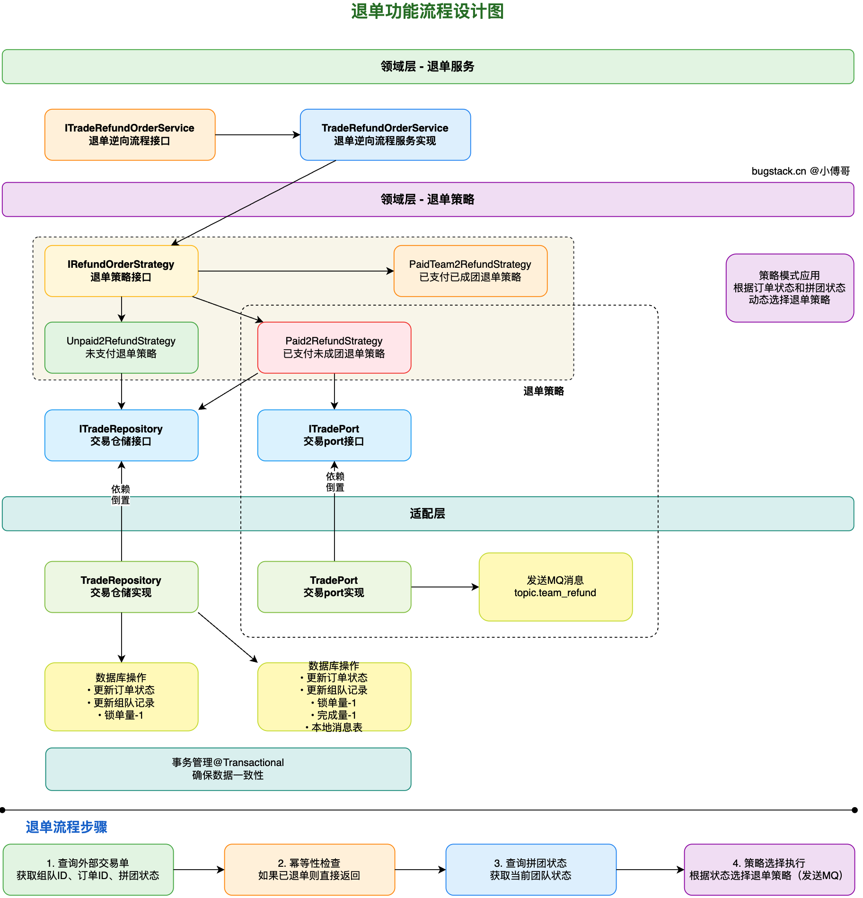
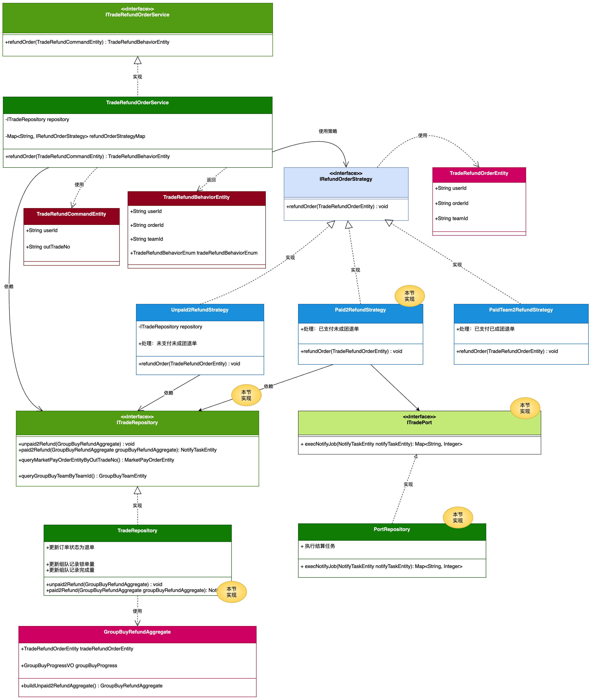
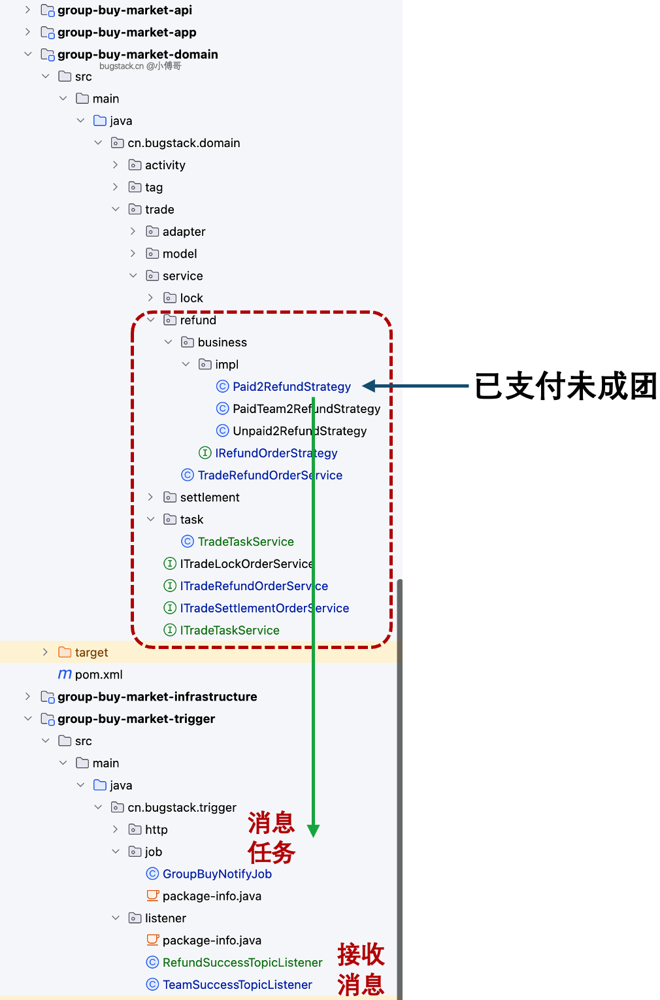
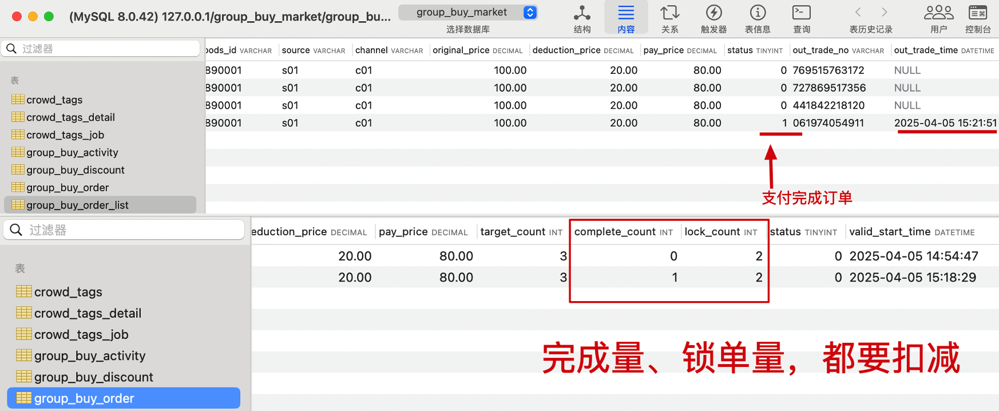

# 已支付未成团退单

> 学习序号 41｜小节 2-27｜原文：https://articles.zsxq.com/id_to4g9ki78dow.html

**本章重点** ：继续扩展退单业务，处理已支付未成团退单操作

**本章重点** ：★★★☆☆

**本节分支** ：[https://gitcode.net/KnowledgePlanet/group-buy-market/-/tree/2-27-xfg-paid-2-refund](https://gitcode.net/KnowledgePlanet/group-buy-market/-/tree/2-27-xfg-paid-2-refund)

**课程视频** ：[https://t.zsxq.com/319Es](https://t.zsxq.com/319Es)

**版权说明** ：©本项目与星球签约合作，受[《中华人民共和国著作权法实施条例》](https://www.gov.cn/gongbao/content/2013/content_2339485.htm) 版权法保护，禁止任何理由和任何方式公开(public)源码、资料、视频等小傅哥发布的星球内容到Github、Gitee等各类平台，违反可追究进一步的法律责任。

作者：小傅哥

博客：[https://bugstack.cn](https://bugstack.cn)

> 沉淀、分享、成长，让自己和他人都能有所收获！😄

- 一、本章诉求
- 二、功能流程
- 三、编码实现
  - 1. 工程结构
  - 2. 类的关系
  - 3. 功能开发
- 四、测试验证
  - 1. 库表数据
  - 2. 测试方法
- 五、读者作业

### 一、本章诉求

继续迭代退单流程，处理已支付未成团退单。

而对于已支付未成团的退单，拼团退单完成后，需要驱动退款流程。也就是另外一个项目（小型支付）在用户发起退单后，需要先把优惠逆向处理掉，之后等待逆向完成进行支付退款。

那么，为什么不是项目（小型支付）调用完拼团，就直接退款呢。其实是做直接退款的，但有时候会出现一个临界的异常。如，调用拼团退掉优惠完成后，rpc/http 请求返回结果，可能因为网络超时，导致项目（小型支付）拿不到结果。这个时候，一种是可以重试，另外一种是可以等待MQ消息，驱动后续流程。而在大厂中，MQ消息驱动，是更为常见的使用方式。

### 二、功能流程

如图，退单流程设计领域结构。



- 首先，整体我们设计了3个退单策略，`未支付退单策略`、`已支付未成团退单策略`、`已支付已成团退单策略`。在这几个章节，会陆续的处理。
- 之后，结合上一节的`未支付退单策略`，本节继续实现`已支付未成团退单策略`。不过这里有一个差异，需要写一个本地消息表，对于已支付的退单，要发送一个退单完成的MQ消息。其实后续`未支付退单策略`也要补充这个MQ，用于恢复参与拼团量。
- 另外，因为这里也用到了，MQ 的发送和任务补偿。所以要把之前写到 trade 结算里的任务发送操作，抽取一个接口方法，进行共用。

### 三、编码实现

#### 1. 工程结构



- 首先，以实现已支付未成团流程，操作数据库表，变更 group_buy_order_list 订单记录，修改 group_buy_order 组队表 complete_count、lock_count 量。
- 之后，把以前实现的 task 服务，抽取单独模块。因为 settlement、refund 模块，都要进行发送 MQ 操作。
- 另外，在 trigger 的 listener 模块下，监听退单消息。后续开发这部分，恢复拼团组队量。

#### 2. 类的关系

如图，是整个功能实现的代码结构，所有添加本节实现的，为新增的内容和变更的点；



- 首先，以 Paid2RefundStrategy 未支付退单策略为入口，完成数据库表订单明细和组队记录的调整。
- 之后，对于发送 MQ 的操作，放到了 ITradePort 中处理。具体可以看工程代码。

#### 3. 功能开发

##### 3.1 修改说明

1. 新增加 ITradeTaskService 把原本在 ITradeSettlementOrderService 中的关于本地消息表任务的操作，提取出来。方便在退单流程中也可以使用。
2. 在 Paid2RefundStrategy 方法中，实现`已支付，未成团`退单流程，并通过 repository 操作数据库，完成 groupBuyOrderListDao 订单明细记录状态调整，groupBuyOrderDao.paid2Refund 锁单量，完成量的扣减。此外要增加写入本地消息表 task 用于补偿发送 MQ 消息。
3. Paid2RefundStrategy 完成 repository 操作后，写完本地消息表。则开始使用线程池方式，调用 tradeTaskService 进行任务的发送。
4. trigger 下增加 RefundSuccessTopicListener 用于接收退单完成消息的监听。后续会接收消息，做拼团锁单量的逆向处理。

##### 3.2 抽取方法 - 本地消息表

```
                public interface ITradeTaskService {

    /**
     * 执行结算通知任务
     *
     * @return 结算数量
     * @throws Exception 异常
     */
    Map<String, Integer> execNotifyJob() throws Exception;

    /**
     * 执行结算通知任务
     *
     * @param teamId 指定结算组ID
     * @return 结算数量
     * @throws Exception 异常
     */
    Map<String, Integer> execNotifyJob(String teamId) throws Exception;

    /**
     * 执行结算通知任务
     *
     * @param notifyTaskEntity 通知任务对象
     * @return 结算数量
     * @throws Exception 异常
     */
    Map<String, Integer> execNotifyJob(NotifyTaskEntity notifyTaskEntity) throws Exception;

}
```

- 在 domain 的 trade 下，增加 task 包，来实现 ITradeTaskService 方法。这样便于整个领域内共用 task 消息表。
- 如果说，task 是所有系统都是共用的，还可以抽取成独立的组件，让各个系统引入使用。

##### 3.3 退单实现 - 已成团，未成团

```
                @Service("paid2RefundStrategy")
public class Paid2RefundStrategy implements IRefundOrderStrategy {

    @Resource
    private ITradeRepository repository;

    @Resource
    private ITradePort port;

    @Resource
    private ITradeTaskService tradeTaskService;

    @Resource
    private ThreadPoolExecutor threadPoolExecutor;

    @Override
    public void refundOrder(TradeRefundOrderEntity tradeRefundOrderEntity) throws Exception {
        log.info("退单；已支付，未成团 userId:{} teamId:{} orderId:{}", tradeRefundOrderEntity.getUserId(), tradeRefundOrderEntity.getTeamId(), tradeRefundOrderEntity.getOrderId());

        // 1. 退单，已支付&未成团
        NotifyTaskEntity notifyTaskEntity = repository.paid2Refund(GroupBuyRefundAggregate.buildPaid2RefundAggregate(tradeRefundOrderEntity, -1, -1));

        // 2. 发送MQ消息
        if (null != notifyTaskEntity) {
            threadPoolExecutor.execute(() -> {
                Map<String, Integer> notifyResultMap = null;
                try {
                    notifyResultMap = tradeTaskService.execNotifyJob(notifyTaskEntity);
                    log.info("回调通知交易退单 result:{}", JSON.toJSONString(notifyResultMap));
                } catch (Exception e) {
                    log.error("回调通知交易退单失败 result:{}", JSON.toJSONString(notifyResultMap), e);
                    throw new AppException(e.getMessage());
                }
            });
        }
    }

}
```

- 在 Paid2RefundStrategy 实现内，调用 paid2Refund 操作，处理数据库表操作。
- 之后完成本地消息表的处理。

##### 3.4 数据库操作

**cn.bugstack.infrastructure.adapter.repository.TradeRepository**

```
                @Override
@Transactional(timeout = 5000)
public NotifyTaskEntity paid2Refund(GroupBuyRefundAggregate groupBuyRefundAggregate) {
    TradeRefundOrderEntity tradeRefundOrderEntity = groupBuyRefundAggregate.getTradeRefundOrderEntity();
    GroupBuyProgressVO groupBuyProgress = groupBuyRefundAggregate.getGroupBuyProgress();
    GroupBuyOrderList groupBuyOrderListReq = new GroupBuyOrderList();
    // 保留userId，企业中往往会根据 userId 作为分库分表路由键，如果将来做分库分表也可以方便处理
    groupBuyOrderListReq.setUserId(tradeRefundOrderEntity.getUserId());
    groupBuyOrderListReq.setOrderId(tradeRefundOrderEntity.getOrderId());
    
    int updatePaid2RefundCount = groupBuyOrderListDao.paid2Refund(groupBuyOrderListReq);
    if (1 != updatePaid2RefundCount) {
        log.error("逆向流程-paid2Refund，更新订单状态(退单)失败 {} {}", tradeRefundOrderEntity.getUserId(), tradeRefundOrderEntity.getOrderId());
        throw new AppException(ResponseCode.UPDATE_ZERO);
    }
    GroupBuyOrder groupBuyOrderReq = new GroupBuyOrder();
    groupBuyOrderReq.setTeamId(tradeRefundOrderEntity.getTeamId());
    groupBuyOrderReq.setLockCount(groupBuyProgress.getLockCount());
    groupBuyOrderReq.setCompleteCount(groupBuyProgress.getCompleteCount());
    
    int updateTeamPaid2Refund = groupBuyOrderDao.paid2Refund(groupBuyOrderReq);
    if (1 != updateTeamPaid2Refund) {
        log.error("逆向流程-paid2Refund，更新组队记录(退单)失败 {} {}", tradeRefundOrderEntity.getUserId(), tradeRefundOrderEntity.getOrderId());
        throw new AppException(ResponseCode.UPDATE_ZERO);
    }
   
    // 本地消息任务表
    NotifyTask notifyTask = new NotifyTask();
    notifyTask.setActivityId(tradeRefundOrderEntity.getActivityId());
    notifyTask.setTeamId(tradeRefundOrderEntity.getTeamId());
    notifyTask.setNotifyType(NotifyTypeEnumVO.MQ.getCode());
    notifyTask.setNotifyMQ(topic_team_refund);
    notifyTask.setNotifyCount(0);
    notifyTask.setNotifyStatus(0);
    notifyTask.setParameterJson(JSON.toJSONString(new HashMap<String, Object>() {{
        put("type", RefundTypeEnumVO.PAID_UNFORMED.getCode());
        put("userId", tradeRefundOrderEntity.getUserId());
        put("teamId", tradeRefundOrderEntity.getTeamId());
        put("orderId", tradeRefundOrderEntity.getOrderId());
        put("activityId", tradeRefundOrderEntity.getActivityId());
    }}));
  
    notifyTaskDao.insert(notifyTask);
    return NotifyTaskEntity.builder()
            .teamId(notifyTask.getTeamId())
            .notifyType(notifyTask.getNotifyType())
            .notifyMQ(notifyTask.getNotifyMQ())
            .notifyCount(notifyTask.getNotifyCount())
            .parameterJson(notifyTask.getParameterJson())
            .build();
}
```

- 操作数据库表记录的变更和写task任务。
- 注意消息里添加了 type 标识类型，后续不同场景的 MQ 可以标识出来。

### 四、测试验证

#### 1. 库表数据



- 注意，测试前要对数据库表数据调整，订单是已经支付完成的。status = 1，组队订单 complete_count 要有完成量， lock_count 要有锁单量。

#### 2. 测试方法

```
                @Slf4j
@RunWith(SpringRunner.class)
@SpringBootTest
public class ITradeRefundOrderServiceTest {

    @Resource
    private ITradeRefundOrderService tradeRefundOrderService;

    @Test
    public void test_refundOrder() throws Exception {
        TradeRefundCommandEntity tradeRefundCommandEntity = TradeRefundCommandEntity.builder()
                .userId("xfg02")
                .outTradeNo("061974054911")
                .source("s01")
                .channel("c01")
                .build();

        TradeRefundBehaviorEntity tradeRefundBehaviorEntity = tradeRefundOrderService.refundOrder(tradeRefundCommandEntity);

        log.info("请求参数:{}", JSON.toJSONString(tradeRefundCommandEntity));
        log.info("测试结果:{}", JSON.toJSONString(tradeRefundBehaviorEntity));

        // 暂停，等待MQ消息。处理完后，手动关闭程序
        new CountDownLatch(1).await();
    }

}
```

```
                16:54:44,177 |-WARN in net.logstash.logback.appender.LogstashTcpSocketAppender[LOGSTASH] - Log destination 127.0.0.1:4560: Waiting 29271ms before attempting reconnection.
25-07-13.16:54:46.751 [main            ] INFO  ITradeRefundOrderServiceTest - 请求参数:{"channel":"c01","outTradeNo":"061974054911","source":"s01","userId":"xfg02"}
25-07-13.16:54:46.752 [pool-2-thread-1 ] INFO  TradeTaskService       - 拼团交易-执行回调通知回调，指定 teamId:15721600 notifyTaskEntity:{"notifyCount":0,"notifyMQ":"topic.team_refund","notifyType":"MQ","parameterJson":"{\"activityId\":100123,\"orderId\":\"630306594433\",\"teamId\":\"15721600\",\"userId\":\"xfg02\"}","teamId":"15721600"}
25-07-13.16:54:49.345 [main            ] INFO  ITradeRefundOrderServiceTest - 测试结果:{"orderId":"630306594433","teamId":"15721600","tradeRefundBehaviorEnum":"SUCCESS","userId":"xfg02"}
25-07-13.16:54:52.687 [org.springframework.amqp.rabbit.RabbitListenerEndpointContainer#0-1] INFO  RefundSuccessTopicListener - 接收消息（退单成功）:{"activityId":100123,"orderId":"630306594433","teamId":"15721600","userId":"xfg02"}
25-07-13.16:54:52.710 [pool-2-thread-1 ] INFO  Paid2RefundStrategy    - 回调通知交易退单 result:{"retryCount":0,"successCount":1,"waitCount":1,"errorCount":0}
```

- 还是使用 test_refundOrder 完成退单即可，但要加一个 `new CountDownLatch(1).await()` 让程序暂停。因为后续还需要等着 mq 的接收。也就是 RefundSuccessTopicListener 监听接收。
- 如测试结果，测试完成后，可以接收到 MQ `接收消息（退单成功）`

### 五、读者作业

- 简单作业：厘清流程，完成本节功能开发。以及可以验证MQ消费。
- 复杂作业：通过接收的MQ消息，进行恢复可用的锁单量，便于其他用户消费使用。
