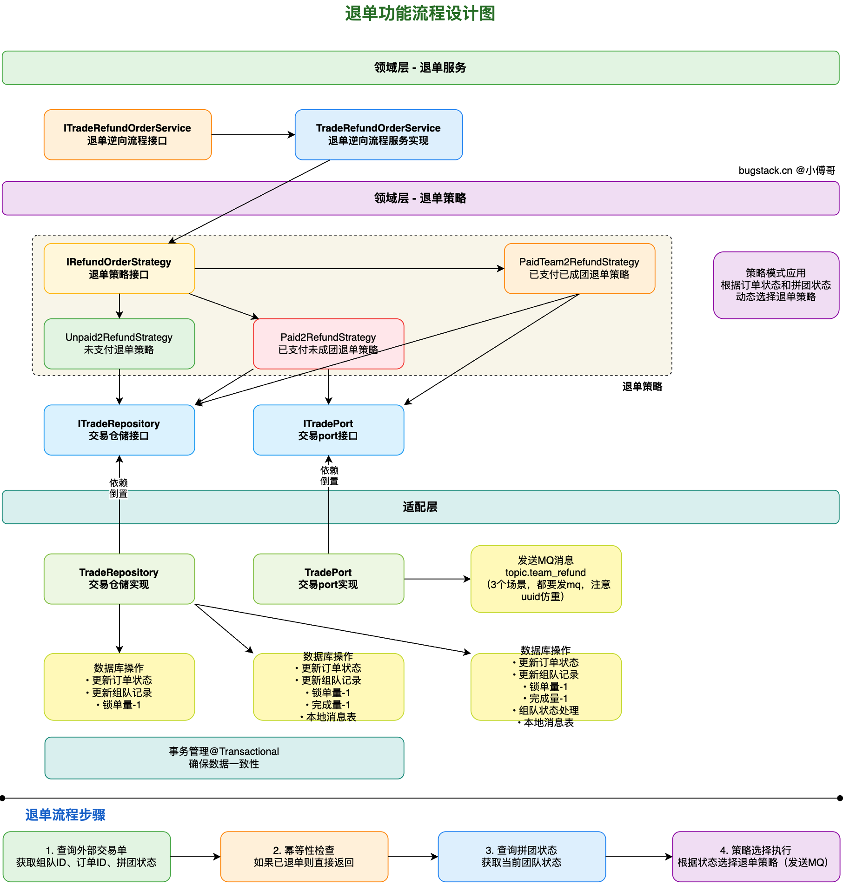
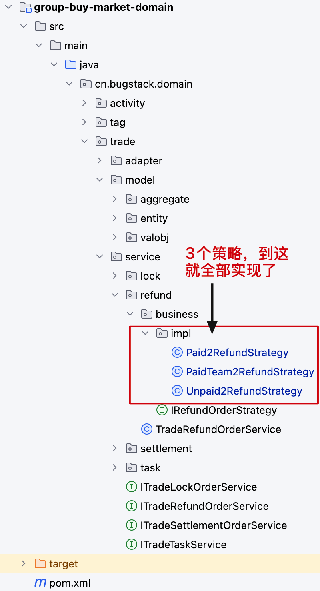
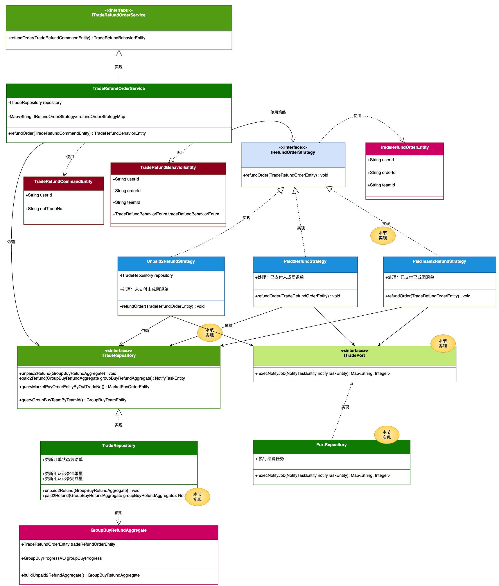
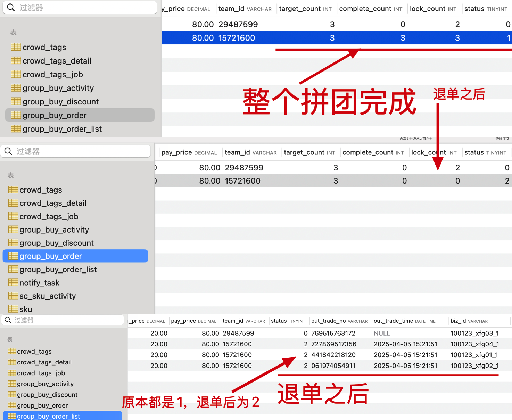

# 已支付已成团退单

> 学习序号 42｜小节 2-28｜原文：https://articles.zsxq.com/id_ggdw0dufxmcd.html

**本章重点**  ：本章节是退单流程中最后一个步骤，对已支付，已成团状态的订单进行退单操作。

**本章重点**  ：★★★☆☆

**本节分支**  : [https://gitcode.net/KnowledgePlanet/group-buy-market/-/tree/2-28-xfg-paid-team-2-refund](https://gitcode.net/KnowledgePlanet/group-buy-market/-/tree/2-28-xfg-paid-team-2-refund)

**课程视频**  : [https://t.zsxq.com/PI7bY](https://t.zsxq.com/PI7bY)

**版权说明**  ：©本项目与星球签约合作，受[《中华人民共和国著作权法实施条例》](https://www.gov.cn/gongbao/content/2013/content_2339485.htm) 版权法保护，禁止任何理由和任何方式公开(public)源码、资料、视频等小傅哥发布的星球内容到Github、Gitee等各类平台，违反可追究进一步的法律责任。

作者：小傅哥

博客：[https://bugstack.cn](https://bugstack.cn)

> 沉淀、分享、成长，让自己和他人都能有所收获！😄

- 一、本章诉求
- 二、功能流程
- 三、编码实现
  - 1. 工程结构
  - 2. 类的关系
  - 3. 功能开发
- 四、功能测试
  - 1. 库表数据
  - 2. 测试方法
- 五、读者作业

### 一、本章诉求

本章节是退单流程中最后一个步骤，对已支付，已成团状态的订单进行退单操作。

通过我们在前面的流程分析，已成团的退单，则只退个人单，不会影响到全局所有人的订单。那么这里如果一个拼团有多人退单，哪怕整个队伍只有一个人没有退单，也是可以的。

注意，这类的业务流程，主要受公司的产品设计的流程影响。如果一些特点的任务，一人退单，全队解散。那么就要针对不同类型的退单，做不同的策略实现。这块可以思考下。

### 二、功能流程

如图，退单流程设计领域结构。



- 如图，本节扩展实现第3个操作，`已支付已成团退单策略`的处理。
- 注意，所有的退单策略，都要发MQ，本节把未支付未成团，也添加上MQ的发送。但要注意，添加MQ，他们都属于同一类，task 任务表要增加类型区分和 uuid 字段仿重。

### 三、编码实现

#### 1. 工程结构



- 关于退单的工程领域，策略设计，已经在前面章节讲解过。本节扩展实现完`已支付已成团`，那么这部分的策略实现就完结了。

#### 2. 类的关系

如图，是整个功能实现的代码结构，所有添加本节实现的，为新增的内容和变更的点；



- 首先，以 PaidTeam2RefundStrategy 已支付已成团，策略为入口，完成数据库表订单明细和组队记录的调整。
- 之后，对于发送 MQ 的操作，放到了 ITradePort 中处理。具体可以看工程代码。
- 另外，本节还补充了，未支付未成团的 MQ 发送，这个用于后续我们处理锁单量的恢复。

#### 3. 功能开发

##### 3.1 修改说明

- 首先，给 NotifyTask 本地消息表，增加 NotifyCategory - 回调类型、Uuid - 唯一仿重，两个字段。这里因为一个拼团的队伍，可能会有多个用户退单。那么，都写 task 消息表，按照原来的仿重方式，就没法发送更多消息了。
- 之后，为 Unpaid2RefundStrategy 未支付，未成团，增加一个发送 MQ 的操作。目前你可以看到这几个策略都有相同的发送 MQ 操作。那么可以提取一个抽象类，让几个策略模式继承，之后在抽象类里提供公用的方法。
- 然后，实现 PaidTeam2RefundStrategy 已支付，已成团策略。注意，PaidTeam2RefundStrategy 退单操作，包括了最后一笔退单，当进入最后一笔退单的时候，要把整个拼团更新为失败。调整，RefundTypeEnumVO 对应 PAID_FORMED 枚举策略方法，多次退单后，需要兼容 COMPLETE_FAIL 完成且含有失败的拼团组队。`GroupBuyOrderEnumVO 增加枚举值 COMPLETE_FAIL`
- 另外，NotifyTaskEntity 增加 lockKey 从 uuid 获取唯一标识。

##### 3.2 已成团流程

```
                public class PaidTeam2RefundStrategy implements IRefundOrderStrategy {

    @Resource
    private ITradeRepository repository;

    @Resource
    private ITradeTaskService tradeTaskService;

    @Resource
    private ThreadPoolExecutor threadPoolExecutor;

    @Override
    public void refundOrder(TradeRefundOrderEntity tradeRefundOrderEntity) {
        log.info("退单；已支付，已成团 userId:{} teamId:{} orderId:{}", tradeRefundOrderEntity.getUserId(), tradeRefundOrderEntity.getTeamId(), tradeRefundOrderEntity.getOrderId());

        GroupBuyTeamEntity groupBuyTeamEntity = repository.queryGroupBuyTeamByTeamId(tradeRefundOrderEntity.getTeamId());
        Integer completeCount = groupBuyTeamEntity.getCompleteCount();

        // 最后一笔也退单，则更新拼团订单为失败
        GroupBuyOrderEnumVO groupBuyOrderEnumVO = 1 == completeCount ? GroupBuyOrderEnumVO.FAIL : GroupBuyOrderEnumVO.COMPLETE_FAIL;

        // 1. 退单，已支付&已成团
        NotifyTaskEntity notifyTaskEntity = repository.paidTeam2Refund(GroupBuyRefundAggregate.buildPaidTeam2RefundAggregate(tradeRefundOrderEntity, -1, -1, groupBuyOrderEnumVO));

        // 2. 发送MQ消息
        if (null != notifyTaskEntity) {
            threadPoolExecutor.execute(() -> {
                Map<String, Integer> notifyResultMap = null;
                try {
                    notifyResultMap = tradeTaskService.execNotifyJob(notifyTaskEntity);
                    log.info("回调通知交易退单(已支付，已成团) result:{}", JSON.toJSONString(notifyResultMap));
                } catch (Exception e) {
                    log.error("回调通知交易退单失败(已支付，已成团) result:{}", JSON.toJSONString(notifyResultMap), e);
                    throw new AppException(e.getMessage());
                }
            });
        }

    }

}
```

- 退单操作，需要检查拼团是否已经是最后一笔退单操作，两种退单操作，对于数据库的状态更新略有不同。
- 对已成团策略，进行逻辑实现。发送 MQ 都是一样的处理过程。
- 临界情况，当多人发起退单时，可能会存在都更新拼团为退单，但有一个人先完成了退单，另外一个人也要退单的时候，其实这笔拼团组队要退单的是失败。那么就会失败，失败后需要用户重新退单（这步骤也可以由调用方重新发起退单）。

##### 3.3 数据库操作

```
                @Slf4j
@Repository
public class TradeRepository implements ITradeRepository {

    @Resource
    private IGroupBuyActivityDao groupBuyActivityDao;
    @Resource
    private IGroupBuyOrderDao groupBuyOrderDao;
    @Resource
    private IGroupBuyOrderListDao groupBuyOrderListDao;
    @Resource
    private INotifyTaskDao notifyTaskDao;
    @Resource
    private DCCService dccService;

    @Value("${spring.rabbitmq.config.producer.topic_team_success.routing_key}")
    private String topic_team_success;

    @Value("${spring.rabbitmq.config.producer.topic_team_refund.routing_key}")
    private String topic_team_refund;

    @Resource
    private IRedisService redisService;
    
    // ... 省略部分代码
    
   @Override
    @Transactional(timeout = 5000)
    public NotifyTaskEntity paidTeam2Refund(GroupBuyRefundAggregate groupBuyRefundAggregate) {
        TradeRefundOrderEntity tradeRefundOrderEntity = groupBuyRefundAggregate.getTradeRefundOrderEntity();
        GroupBuyProgressVO groupBuyProgress = groupBuyRefundAggregate.getGroupBuyProgress();
        GroupBuyOrderEnumVO groupBuyOrderEnumVO = groupBuyRefundAggregate.getGroupBuyOrderEnumVO();

        GroupBuyOrderList groupBuyOrderListReq = new GroupBuyOrderList();
        // 保留userId，企业中往往会根据 userId 作为分库分表路由键，如果将来做分库分表也可以方便处理
        groupBuyOrderListReq.setUserId(tradeRefundOrderEntity.getUserId());
        groupBuyOrderListReq.setOrderId(tradeRefundOrderEntity.getOrderId());

        int updatePaid2RefundCount = groupBuyOrderListDao.paidTeam2Refund(groupBuyOrderListReq);
        if (1 != updatePaid2RefundCount) {
            log.error("逆向流程-paidTeam2Refund，更新订单状态(退单)失败 {} {}", tradeRefundOrderEntity.getUserId(), tradeRefundOrderEntity.getOrderId());
            throw new AppException(ResponseCode.UPDATE_ZERO);
        }

        GroupBuyOrder groupBuyOrderReq = new GroupBuyOrder();
        groupBuyOrderReq.setTeamId(tradeRefundOrderEntity.getTeamId());
        groupBuyOrderReq.setLockCount(groupBuyProgress.getLockCount());
        groupBuyOrderReq.setCompleteCount(groupBuyProgress.getCompleteCount());

        // 根据拼团组队量更新状态。组队最后一个人->更新组队失败，组队还有其他人->更新组队完成含退单
        if (GroupBuyOrderEnumVO.COMPLETE_FAIL.equals(groupBuyOrderEnumVO)) {
            int updateTeamPaid2Refund = groupBuyOrderDao.paidTeam2Refund(groupBuyOrderReq);
            if (1 != updateTeamPaid2Refund) {
                log.error("逆向流程-paidTeam2Refund，更新组队记录(退单)失败 {} {}", tradeRefundOrderEntity.getUserId(), tradeRefundOrderEntity.getOrderId());
                throw new AppException(ResponseCode.UPDATE_ZERO);
            }
        } else if (GroupBuyOrderEnumVO.FAIL.equals(groupBuyOrderEnumVO)){
            int updateTeamPaid2RefundFail = groupBuyOrderDao.paidTeam2RefundFail(groupBuyOrderReq);
            if (1 != updateTeamPaid2RefundFail) {
                log.error("逆向流程-updateTeamPaid2RefundFail，更新组队记录(退单)失败 {} {}", tradeRefundOrderEntity.getUserId(), tradeRefundOrderEntity.getOrderId());
                throw new AppException(ResponseCode.UPDATE_ZERO);
            }
        }

        // 本地消息任务表
        NotifyTask notifyTask = new NotifyTask();
        notifyTask.setActivityId(tradeRefundOrderEntity.getActivityId());
        notifyTask.setTeamId(tradeRefundOrderEntity.getTeamId());
        notifyTask.setNotifyCategory(TaskNotifyCategoryEnumVO.TRADE_PAID_TEAM2REFUND.getCode());
        notifyTask.setNotifyType(NotifyTypeEnumVO.MQ.getCode());
        notifyTask.setNotifyMQ(topic_team_refund);
        notifyTask.setNotifyCount(0);
        notifyTask.setNotifyStatus(0);
        notifyTask.setUuid(tradeRefundOrderEntity.getTeamId() + Constants.UNDERLINE + TaskNotifyCategoryEnumVO.TRADE_PAID_TEAM2REFUND.getCode() + Constants.UNDERLINE + tradeRefundOrderEntity.getOrderId());

        notifyTask.setParameterJson(JSON.toJSONString(new HashMap<String, Object>() {{
            put("type", RefundTypeEnumVO.PAID_FORMED.getCode());
            put("userId", tradeRefundOrderEntity.getUserId());
            put("teamId", tradeRefundOrderEntity.getTeamId());
            put("orderId", tradeRefundOrderEntity.getOrderId());
            put("activityId", tradeRefundOrderEntity.getActivityId());
        }}));

        notifyTaskDao.insert(notifyTask);

        return NotifyTaskEntity.builder()
                .teamId(notifyTask.getTeamId())
                .notifyType(notifyTask.getNotifyType())
                .notifyMQ(notifyTask.getNotifyMQ())
                .notifyCount(notifyTask.getNotifyCount())
                .parameterJson(notifyTask.getParameterJson())
                .build();
    }

}
```

- 这部分的处理，基本一致。之后写入 task 任务。对于 task 任务，已经添加上了新字段；`setNotifyCategory`、`setUuid`，其他几个任务操作也都补充这些字段。
- 根据拼团组队量更新状态。组队最后一个人->更新组队失败，组队还有其他人->更新组队完成含退单

```
                <update id="paidTeam2Refund" parameterType="cn.bugstack.infrastructure.dao.po.GroupBuyOrderList">
    update group_buy_order_list
    set status = 2, update_time = now()
    where
        user_id = #{userId} and
        order_id = #{orderId} and
        status = 1
</update>

<update id="paidTeam2Refund" parameterType="cn.bugstack.infrastructure.dao.po.GroupBuyOrder">
    update group_buy_order
    set lock_count = lock_count + #{lockCount},
    complete_count = complete_count + #{completeCount},
    status = 3,
    update_time= now()
    where
    team_id = #{teamId} and (status = 1 or status = 3) and complete_count > 1
</update>

<update id="paidTeam2RefundFail" parameterType="cn.bugstack.infrastructure.dao.po.GroupBuyOrder">
    update group_buy_order
    set lock_count = lock_count + #{lockCount},
    complete_count = complete_count + #{completeCount},
    status = 2,
    update_time= now()
    where
    team_id = #{teamId} and (status = 1 or status = 3) and complete_count = 1
</update>
```

- 之后是对应的两个 SQL 操作，注意 paidTeam2Refund 拼团的状态变更，因为可能会存在多笔订单退单。
- 退单情况1；complete_count > 1，还没有进入退单临界所有人都要退完的情况。那么从 status = 1 调整为3
- 退单情况2；complete_count = 1，临界退单，最后一笔退单，拼团单子更新为失败即可。

### 四、功能测试

#### 1. 库表数据



- 注意，测试前要对数据库表数据调整，拼团组队完成。准备3笔退单数据。也可以导入本节最新sql。

#### 2. 测试方法

```
                @Slf4j
@RunWith(SpringRunner.class)
@SpringBootTest
public class ITradeRefundOrderServiceTest {

    @Resource
    private ITradeRefundOrderService tradeRefundOrderService;

    @Test
    public void test_refundOrder_01() throws Exception {
        TradeRefundCommandEntity tradeRefundCommandEntity = TradeRefundCommandEntity.builder()
                .userId("xfg04")
                .outTradeNo("727869517356")
                .source("s01")
                .channel("c01")
                .build();

        TradeRefundBehaviorEntity tradeRefundBehaviorEntity = tradeRefundOrderService.refundOrder(tradeRefundCommandEntity);

        log.info("请求参数:{}", JSON.toJSONString(tradeRefundCommandEntity));
        log.info("测试结果:{}", JSON.toJSONString(tradeRefundBehaviorEntity));

        // 暂停，等待MQ消息。处理完后，手动关闭程序
        new CountDownLatch(1).await();
    }

    @Test
    public void test_refundOrder_02() throws Exception {
        TradeRefundCommandEntity tradeRefundCommandEntity = TradeRefundCommandEntity.builder()
                .userId("xfg01")
                .outTradeNo("441842218120")
                .source("s01")
                .channel("c01")
                .build();

        TradeRefundBehaviorEntity tradeRefundBehaviorEntity = tradeRefundOrderService.refundOrder(tradeRefundCommandEntity);

        log.info("请求参数:{}", JSON.toJSONString(tradeRefundCommandEntity));
        log.info("测试结果:{}", JSON.toJSONString(tradeRefundBehaviorEntity));

        // 暂停，等待MQ消息。处理完后，手动关闭程序
        new CountDownLatch(1).await();
    }

    @Test
    public void test_refundOrder_03() throws Exception {
        TradeRefundCommandEntity tradeRefundCommandEntity = TradeRefundCommandEntity.builder()
                .userId("xfg02")
                .outTradeNo("061974054911")
                .source("s01")
                .channel("c01")
                .build();

        TradeRefundBehaviorEntity tradeRefundBehaviorEntity = tradeRefundOrderService.refundOrder(tradeRefundCommandEntity);

        log.info("请求参数:{}", JSON.toJSONString(tradeRefundCommandEntity));
        log.info("测试结果:{}", JSON.toJSONString(tradeRefundBehaviorEntity));

        // 暂停，等待MQ消息。处理完后，手动关闭程序
        new CountDownLatch(1).await();
    }

}
```

- 分别进行3笔退单，退单过程中debug调试。
- 直至全部退单完成，观察日志和数据库表变化。

### 五、读者作业

- 简单作业：梳理完成的所有退单流程，并可以验证对应的运行结果。
- 复杂作业：接收MQ消息，完成锁单量的恢复，或者你可以继续往后做其他流程，如小型支付的退单&退款。
