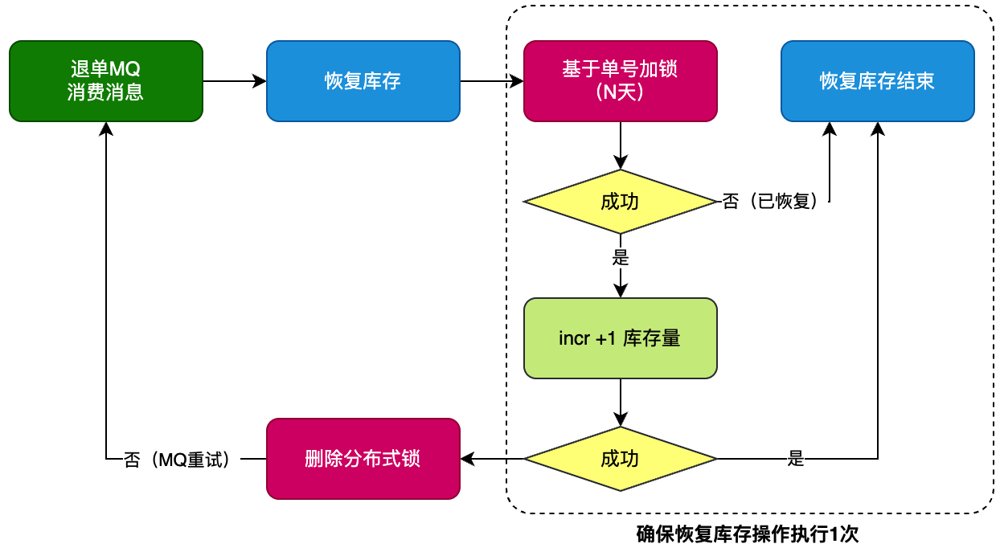
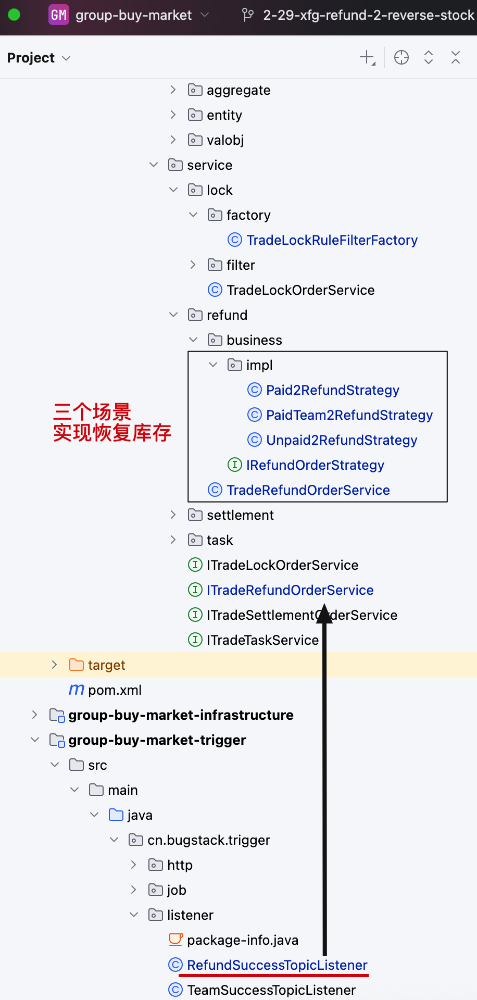
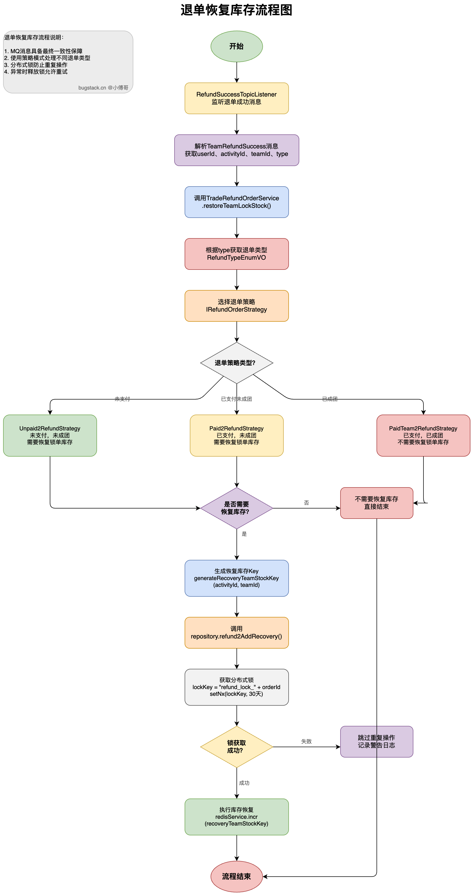
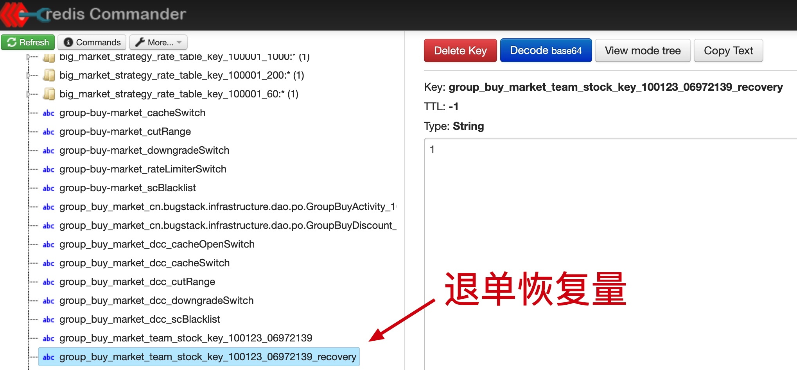

# 退单锁单量恢复

> 学习序号 43｜小节 2-29｜原文：https://articles.zsxq.com/id_4xc5s02pwsh4.html

**本章重点**   ：接收拼团组队退单消息，驱动锁单量redis库存恢复操作。

**本章重点**   ：★★★☆☆

**本节分支**   ：[https://gitcode.net/KnowledgePlanet/group-buy-market/-/tree/2-29-xfg-refund-2-reverse-stock](https://gitcode.net/KnowledgePlanet/group-buy-market/-/tree/2-29-xfg-refund-2-reverse-stock)

**课程视频**   :  [https://t.zsxq.com/o8Sz5](https://t.zsxq.com/o8Sz5)

**版权说明**   ：©本项目与星球签约合作，受[《中华人民共和国著作权法实施条例》](https://www.gov.cn/gongbao/content/2013/content_2339485.htm) 版权法保护，禁止任何理由和任何方式公开(public)源码、资料、视频等小傅哥发布的星球内容到Github、Gitee等各类平台，违反可追究进一步的法律责任。

作者：小傅哥

博客：[https://bugstack.cn](https://bugstack.cn)

> 沉淀、分享、成长，让自己和他人都能有所收获！😄

- 一、本章诉求
- 二、功能流程
- 三、编码实现
  - 1. 工程结构
  - 2. 类的关系
  - 3. 功能开发
  - 3.3 消费调用
- 四、功能测试
- 五、读者作业

### 一、本章诉求

接收拼团组队退单消息，驱动锁单量redis库存恢复操作。这是一个数据库和缓存数据一致性的设计，在很多场景都非常实用。

### 二、功能流程

如图，退单恢复库存核心流程；



- 首先，退单恢复库存最重要的就是数据一致性。数据库中已经变更完 lock 锁单记录了，之后就是更新 redis 缓存的量。
- 那么，这里为了保证更新 redis 是一致性库存的，且成功的。所以需要添加一个分布式锁，来维护，确保不会被重复更新。
- 所以，当加锁失败则表示重复恢复库存，如果incr 失败，则删掉分布式锁，抛异常，让 MQ 重试。这个概率很低，但也需要添加，以保证整体的可靠性。

### 三、编码实现

#### 1. 工程结构



- 从 RefundSuccessTopicListener 开始，接收拼团退单消息，之后调用退单服务中本次要新增加的逆向 redis 锁单库存方法。
- 之后，以 IRefundOrderStrategy 策略接口增加逆向库存的策略方法。这里，`未支付&未成团`、`已支付&未成团`，都要进行锁单量的恢复。而`已支付&已成团`则不需要处理恢复锁单量库存，因为这笔拼团不需要再有新用户参与了。

#### 2. 类的关系

如图，是整个退单恢复库存功能所涉及的流程；



- 如图所示，监听消息，调用退单策略，之后分为不同类型的退单对应的库存恢复策略进行处理。
- 如果已经恢复过的库存，以及已成团的，则不再处理库存恢复动作。

#### 3. 功能开发

##### 3.1 修改说明

- MQ消息监听层，新增 `RefundSuccessTopicListener.java` 监听器，监听退单成功消息并调用库存恢复服务，包含异常处理和MQ重试机制。
- 服务接口层，新增 `ITradeRefundOrderService.java` 接口，定义退单处理和库存恢复两个核心方法。
- 退单策略层，新增 `IRefundOrderStrategy.java` 策略接口及三个实现类： `Unpaid2RefundStrategy.java` （未支付退单，更新锁单量并恢复库存）、 `Paid2RefundStrategy.java` （已支付未成团退单，更新锁单量和完成量并恢复库存）、 `PaidTeam2RefundStrategy.java` （已支付已成团退单，更新订单状态但不恢复库存）。
- 仓储层，在 `ITradeRepository.java` 接口新增四个方法，在 `TradeRepository.java` 实现类中核心新增 refund2AddRecovery 方法，使用分布式锁（30天过期）防止重复恢复库存，通过Redis incr操作恢复库存并提供异常处理机制。
- 工具类层，在 `TradeLockRuleFilterFactory.java` 新增 generateRecoveryTeamStockKey 方法，生成格式为 `"group_buy_market_team_stock_key_" + activityId + "_" + teamId + "_recovery"` 的恢复库存key。
- 测试层，新增 `ITradeReverseStockServiceTest.java` 测试类，包含退单流程、锁单流程和锁单恢复流程的完整测试场景。
- fix，TradeRepository.unpaid2Refund 中，`put("type", RefundTypeEnumVO.UNPAID_UNLOCK.getCode());` 类型修复，原本填充的类型有误。

整个流程通过数据库事务、本地消息表、分布式锁和MQ重试机制保障最终一致性，使用订单级别锁和重复检测实现幂等性，采用策略模式根据退单类型选择不同处理逻辑，确保库存恢复的准确性和可靠性。

##### 3.2 逆向库存

```
                public interface IRefundOrderStrategy {

    void refundOrder(TradeRefundOrderEntity tradeRefundOrderEntity) throws Exception;

    void reverseStock(TeamRefundSuccess teamRefundSuccess) throws Exception;

}

@Override
public void reverseStock(TeamRefundSuccess teamRefundSuccess) throws Exception {
    log.info("退单；恢复锁单量 - 未支付，未成团，但有锁单记录，要恢复锁单库存 {} {} {}", teamRefundSuccess.getUserId(), teamRefundSuccess.getActivityId(), teamRefundSuccess.getTeamId());
    // 1. 恢复库存key
    String recoveryTeamStockKey = TradeLockRuleFilterFactory.generateRecoveryTeamStockKey(teamRefundSuccess.getActivityId(), teamRefundSuccess.getTeamId());
    // 2. 退单恢复「未支付，未成团，但有锁单记录，要恢复锁单库存」
    repository.refund2AddRecovery(recoveryTeamStockKey, teamRefundSuccess.getOrderId());
}

@Override
public void refund2AddRecovery(String recoveryTeamStockKey, String orderId) {
    // 如果恢复库存key为空，直接返回
    if (StringUtils.isBlank(recoveryTeamStockKey) || StringUtils.isBlank(orderId)) {
        return;
    }
    // 使用orderId作为锁的key，避免同一订单重复恢复库存
    String lockKey = "refund_lock_" + orderId;
    
    // 尝试获取分布式锁，防止重复操作 30天过期
    Boolean lockAcquired = redisService.setNx(lockKey, 30 * 24 * 60 * 60 * 1000L, TimeUnit.MINUTES);
    
    if (!lockAcquired) {
        log.warn("订单 {} 恢复库存操作已在进行中，跳过重复操作", orderId);
        return;
    }
    try {
        // 在锁保护下执行库存恢复操作
        redisService.incr(recoveryTeamStockKey);
        log.info("订单 {} 恢复库存成功，恢复库存key: {}", orderId, recoveryTeamStockKey);
    } catch (Exception e) {
        log.error("订单 {} 恢复库存失败，恢复库存key: {}", orderId, recoveryTeamStockKey, e);
        // 如果抛异常则释放锁，允许MQ重新消费恢复库存
        redisService.remove(lockKey);
        throw e;
    }
}
```

这段代码实现了退单恢复库存的核心逻辑，主要包含三个部分：

1. 策略接口定义 ： IRefundOrderStrategy 接口定义了两个核心方法： refundOrder 处理退单业务逻辑， reverseStock 负责恢复库存操作。这是典型的策略模式设计，允许不同类型的退单（未支付、已支付未成团、已支付已成团）有不同的处理策略。
2. 库存恢复策略实现 ： reverseStock 方法的实现（以未支付退单为例）首先生成恢复库存的Redis键名（格式为"group_buy_market_team_stock_key_活动ID_团队ID_recovery"），然后调用仓储层的 refund2AddRecovery 方法执行实际的库存恢复操作。
3. 分布式锁保护的库存恢复 ： refund2AddRecovery 方法是整个流程的核心，它通过以下步骤确保库存恢复的安全性和幂等性：
  - 参数校验：检查恢复库存键和订单ID是否为空
  - 分布式锁机制：使用"refund_lock_" + 订单ID作为锁键，设置30天过期时间
  - 重复操作防护：获取锁失败则记录警告日志并跳过操作
  - 库存恢复操作：在锁保护下调用Redis的incr操作增加库存计数
  - 异常处理：发生异常时释放锁并重新抛出异常，允许MQ重试消费

这种设计确保了即使在分布式系统中，同一订单的库存恢复也只会执行一次，同时通过MQ重试机制和分布式锁的配合使用，实现了库存恢复的最终一致性。

#### 3.3 消费调用

```
                public class RefundSuccessTopicListener {

    @Resource
    private ITradeRefundOrderService tradeRefundOrderService;

    /**
     * 此流程具备最终一致性；
     * 1. 数据库锁单量恢复完成，本地消息表补偿MQ，确保MQ消息一定会发送。
     * 2. MQ 消息消费，恢复锁单量库存。库存时添加分布式锁，确保不会重复操作。
     * 3. MQ 消息重试，确保在失败情况下，可以重复消息，又因为有分布式锁的处理，可以确保重复消费也不会重复添加锁单量库粗。
     */
    @RabbitListener(
            bindings = @QueueBinding(
                    value = @Queue(value = "${spring.rabbitmq.config.producer.topic_team_refund.queue}"),
                    exchange = @Exchange(value = "${spring.rabbitmq.config.producer.exchange}", type = ExchangeTypes.TOPIC),
                    key = "${spring.rabbitmq.config.producer.topic_team_refund.routing_key}"
            )
    )
    public void listener(String message) {
        log.info("接收消息（退单成功）- 恢复拼团队伍锁单量:{}", message);
        TeamRefundSuccess teamRefundSuccess = JSON.parseObject(message, TeamRefundSuccess.class);
        try {
            tradeRefundOrderService.restoreTeamLockStock(teamRefundSuccess);
        } catch (Exception e) {
            log.info("接收消息（退单成功）- 恢复拼团队伍锁单量失败:{}", message, e);
            // 抛异常，mq消息会重试
            throw new RuntimeException(e);
        }
    }

}

@Override
public void restoreTeamLockStock(TeamRefundSuccess teamRefundSuccess) throws Exception {
    log.info("逆向流程，恢复锁单量 userId:{} activityId:{} teamId:{}", teamRefundSuccess.getUserId(), teamRefundSuccess.getActivityId(), teamRefundSuccess.getTeamId());
    String type = teamRefundSuccess.getType();
    // 根据枚举值获取对应的退单类型
    RefundTypeEnumVO refundTypeEnumVO = RefundTypeEnumVO.getRefundTypeEnumVOByCode(type);
    IRefundOrderStrategy refundOrderStrategy = refundOrderStrategyMap.get(refundTypeEnumVO.getStrategy());
    // 逆向库存操作，恢复锁单量
    refundOrderStrategy.reverseStock(teamRefundSuccess);
}
```

这段代码展示了退单恢复库存的完整MQ消息处理流程，主要包含两个核心部分：

**MQ消息监听器（RefundSuccessTopicListener）**

功能职责 ：监听退单成功的MQ消息并触发库存恢复流程

关键特性 ：

- 使用 @RabbitListener 注解监听指定的RabbitMQ队列（topic_team_refund）
- 采用Topic类型的Exchange进行消息路由
- 通过配置文件动态获取队列名、交换机名和路由键 处理流程 ：

1. 接收字符串格式的MQ消息
2. 将消息反序列化为 TeamRefundSuccess 对象
3. 调用 tradeRefundOrderService.restoreTeamLockStock() 方法处理库存恢复
4. 异常处理：捕获异常后重新抛出 RuntimeException ，触发MQ重试机制 最终一致性保障 ：

- 数据库锁单量恢复完成后，通过本地消息表补偿机制确保MQ消息必定发送
- MQ消息消费时使用分布式锁防止重复操作
- MQ重试机制配合分布式锁确保重复消费不会重复恢复库存

**库存恢复服务实现（restoreTeamLockStock方法）**

功能职责 ：根据退单类型选择相应的策略执行库存恢复

策略模式应用 ：

1. 从 TeamRefundSuccess 消息中提取退单类型（type字段）
2. 通过 RefundTypeEnumVO.getRefundTypeEnumVOByCode() 方法将类型码转换为枚举对象
3. 从策略映射表 refundOrderStrategyMap 中获取对应的策略实现
4. 调用策略的 reverseStock() 方法执行具体的库存恢复逻辑 设计优势 ：

- 解耦性 ：MQ监听器只负责消息接收和异常处理，具体业务逻辑委托给服务层
- 扩展性 ：通过策略模式支持不同类型的退单处理，新增退单类型只需实现对应策略
- 可靠性 ：多层次的异常处理和重试机制确保库存恢复的最终一致性
- 幂等性 ：分布式锁机制确保同一订单的库存恢复操作只执行一次

这种设计模式在分布式系统中非常常见，通过MQ异步处理、策略模式和分布式锁的组合使用，实现了高可用、高可靠的库存恢复机制。

### 四、功能测试

```
                @Slf4j
@RunWith(SpringRunner.class)
@SpringBootTest
public class ITradeReverseStockServiceTest {

    @Resource
    private ITradeRefundOrderService tradeRefundOrderService;

    @Resource
    private IMarketTradeService marketTradeService;

    @Test
    public void test_refundOrder() throws Exception {
        TradeRefundCommandEntity tradeRefundCommandEntity = TradeRefundCommandEntity.builder()
                .userId("xfg403")
                .outTradeNo("831254441190")
                .source("s01")
                .channel("c01")
                .build();

        TradeRefundBehaviorEntity tradeRefundBehaviorEntity = tradeRefundOrderService.refundOrder(tradeRefundCommandEntity);

        log.info("请求参数:{}", JSON.toJSONString(tradeRefundCommandEntity));
        log.info("测试结果:{}", JSON.toJSONString(tradeRefundBehaviorEntity));

        // 暂停，等待MQ消息。处理完后，手动关闭程序
        new CountDownLatch(1).await();
    }

    @Test
    public void test_lockMarketPayOrder() throws InterruptedException {
        String teamId = null;
        for (int i = 1; i < 4; i++) {
            LockMarketPayOrderRequestDTO lockMarketPayOrderRequestDTO = new LockMarketPayOrderRequestDTO();
            lockMarketPayOrderRequestDTO.setUserId("xfg40" + i);
            lockMarketPayOrderRequestDTO.setTeamId(teamId);
            lockMarketPayOrderRequestDTO.setActivityId(100123L);
            lockMarketPayOrderRequestDTO.setGoodsId("9890001");
            lockMarketPayOrderRequestDTO.setSource("s01");
            lockMarketPayOrderRequestDTO.setChannel("c01");
            lockMarketPayOrderRequestDTO.setNotifyMQ();
            lockMarketPayOrderRequestDTO.setOutTradeNo(RandomStringUtils.randomNumeric(12));

            Response<LockMarketPayOrderResponseDTO> lockMarketPayOrderResponseDTOResponse = marketTradeService.lockMarketPayOrder(lockMarketPayOrderRequestDTO);
            teamId = lockMarketPayOrderResponseDTOResponse.getData().getTeamId();

            log.info("第{}笔，测试结果 req:{} res:{}", i, JSON.toJSONString(lockMarketPayOrderRequestDTO), JSON.toJSONString(lockMarketPayOrderResponseDTOResponse));
        }

    }

    @Test
    public void test_lockMarketPayOrder_reverse() throws InterruptedException {
        LockMarketPayOrderRequestDTO lockMarketPayOrderRequestDTO = new LockMarketPayOrderRequestDTO();
        lockMarketPayOrderRequestDTO.setUserId("xfg404");
        lockMarketPayOrderRequestDTO.setTeamId("06972139");
        lockMarketPayOrderRequestDTO.setActivityId(100123L);
        lockMarketPayOrderRequestDTO.setGoodsId("9890001");
        lockMarketPayOrderRequestDTO.setSource("s01");
        lockMarketPayOrderRequestDTO.setChannel("c01");
        lockMarketPayOrderRequestDTO.setNotifyMQ();
        lockMarketPayOrderRequestDTO.setOutTradeNo(RandomStringUtils.randomNumeric(12));

        Response<LockMarketPayOrderResponseDTO> lockMarketPayOrderResponseDTOResponse = marketTradeService.lockMarketPayOrder(lockMarketPayOrderRequestDTO);

        log.info("测试结果 req:{} res:{}", JSON.toJSONString(lockMarketPayOrderRequestDTO), JSON.toJSONString(lockMarketPayOrderResponseDTOResponse));
    }

}
```

```
                25-07-29.11:01:11.572 [main            ] INFO  Unpaid2RefundStrategy  - 退单；未支付，未成团 userId:xfg403 teamId:06972139 orderId:360158010927
25-07-29.11:01:11.646 [main            ] INFO  ITradeReverseStockServiceTest - 请求参数:{"channel":"c01","outTradeNo":"831254441190","source":"s01","userId":"xfg403"}
25-07-29.11:01:11.647 [pool-2-thread-1 ] INFO  TradeTaskService       - 拼团交易-执行回调通知回调，指定 teamId:06972139 notifyTaskEntity:{"notifyCount":0,"notifyMQ":"topic.team_refund","notifyType":"MQ","parameterJson":"{\"activityId\":100123,\"orderId\":\"360158010927\",\"teamId\":\"06972139\",\"type\":\"unpaid_unlock\",\"userId\":\"xfg403\"}","teamId":"06972139","uuid":"06972139_trade_unpaid2refund_360158010927"}
25-07-29.11:01:11.648 [main            ] INFO  ITradeReverseStockServiceTest - 测试结果:{"orderId":"360158010927","teamId":"06972139","tradeRefundBehaviorEnum":"SUCCESS","userId":"xfg403"}
25-07-29.11:01:11.675 [org.springframework.amqp.rabbit.RabbitListenerEndpointContainer#0-1] INFO  RefundSuccessTopicListener - 接收消息（退单成功）- 恢复拼团队伍锁单量:{"activityId":100123,"orderId":"360158010927","teamId":"06972139","type":"unpaid_unlock","userId":"xfg403"}
25-07-29.11:01:11.684 [org.springframework.amqp.rabbit.RabbitListenerEndpointContainer#0-1] INFO  TradeRefundOrderService - 逆向流程，恢复锁单量 userId:xfg403 activityId:100123 teamId:06972139
25-07-29.11:01:11.684 [org.springframework.amqp.rabbit.RabbitListenerEndpointContainer#0-1] INFO  Unpaid2RefundStrategy  - 退单；恢复锁单量 - 未支付，未成团，但有锁单记录，要恢复锁单库存 xfg403 100123 06972139
25-07-29.11:01:11.686 [pool-2-thread-1 ] INFO  Unpaid2RefundStrategy  - 回调通知交易退单(未支付，未成团) result:{"retryCount":0,"successCount":1,"waitCount":1,"errorCount":0}
25-07-29.11:01:11.696 [org.springframework.amqp.rabbit.RabbitListenerEndpointContainer#0-1] INFO  TradeRepository        - 订单 360158010927 恢复库存成功，恢复库存key: group_buy_market_team_stock_key_100123_06972139_recovery
```



此测试过程分为3个步骤；marketTradeService.lockMarketPayOrder 额外增加了 teamId 返回字段，方便测试。

1. 首先执行，test_lockMarketPayOrder，做一套拼团组队操作，`"xfg40" + i` 每次可以调整 `xfg10\xfg20...`
2. 之后执行，test_refundOrder，注意要填写 userId、outTradeNo，进行一个退单操作。恢复锁单库存。
3. 最后执行，test_lockMarketPayOrder_reverse，teamId 要填写上，也就是给这个组队在进行一次拼团操作。

### 五、读者作业

- 简单作业：完成本节逆向退单恢复锁单量库存的处理，并只能单测验证功能通过。
- 复杂作业：你可以完成一个从小型支付发起退单，也可以完成一个把目前的退单整个流程代码，使用设计模式（责任链+抽象类）优化。
