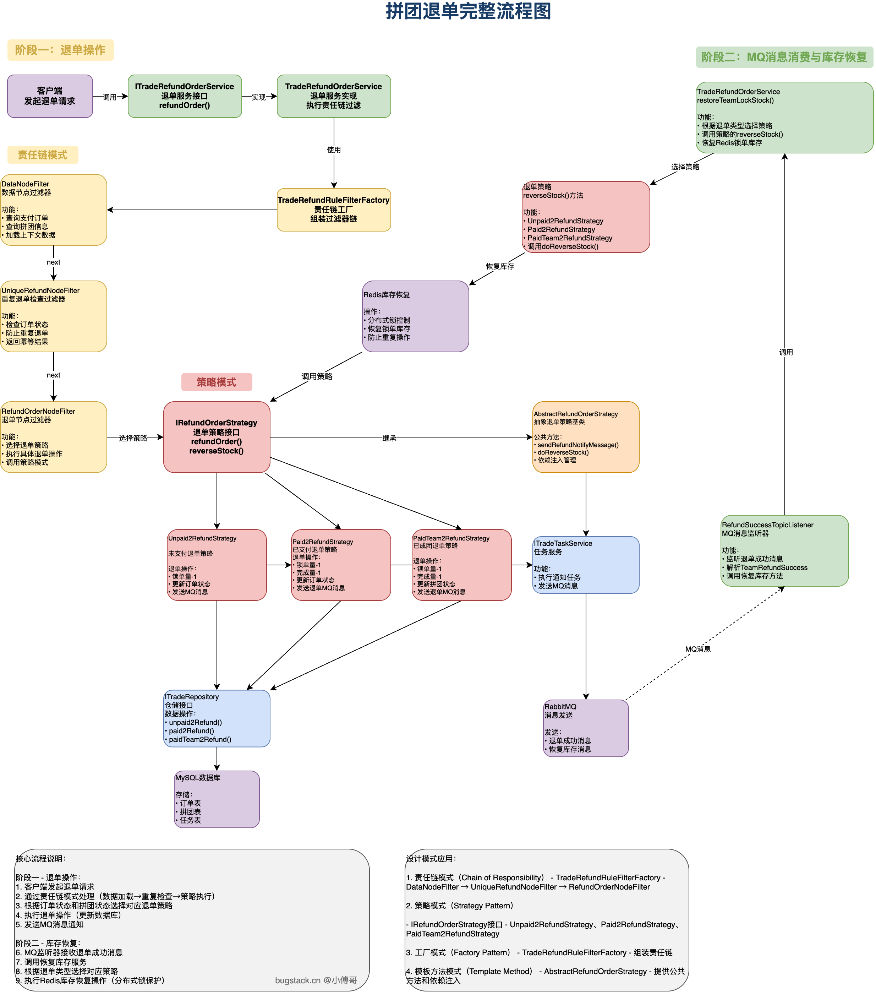
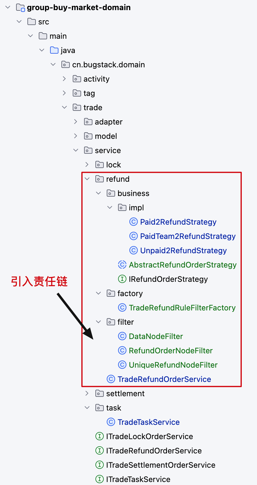
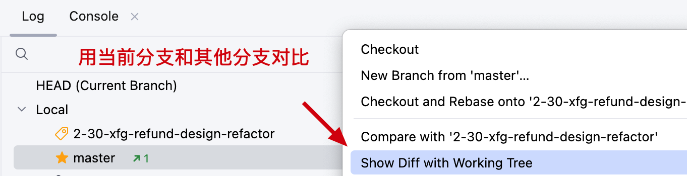
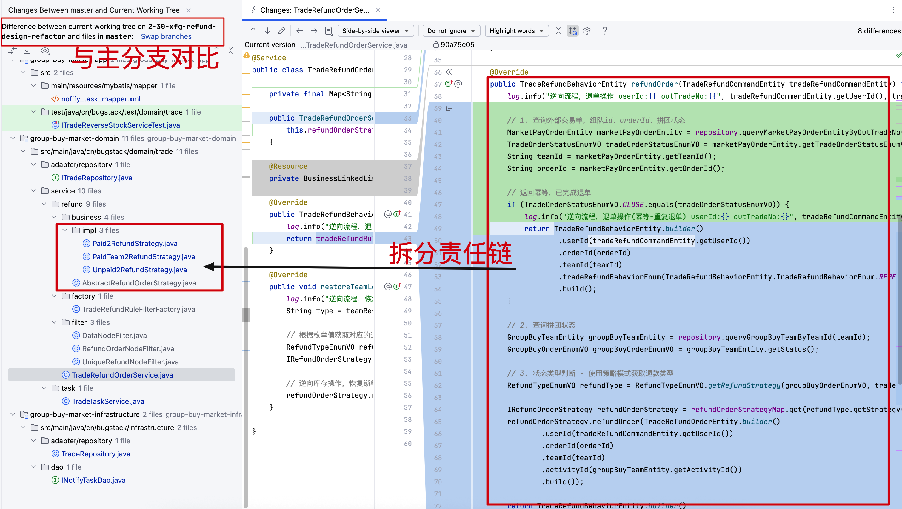

# 设计模式重构退单

> 学习序号 44｜小节 2-30｜原文：https://articles.zsxq.com/id_s8v7468t1t9o.html

**本章重点**  ：通过设计模式重构现有退单流程。

**本章重点**  ：★★★☆☆

**本节分支**  : [https://gitcode.net/KnowledgePlanet/group-buy-market/-/tree/2-30-xfg-refund-design-refactor](https://gitcode.net/KnowledgePlanet/group-buy-market/-/tree/2-30-xfg-refund-design-refactor)

**课程视频**  : [https://t.zsxq.com/TsTt5](https://t.zsxq.com/TsTt5)

**版权说明**  ：©本项目与星球签约合作，受[《中华人民共和国著作权法实施条例》](https://www.gov.cn/gongbao/content/2013/content_2339485.htm) 版权法保护，禁止任何理由和任何方式公开(public)源码、资料、视频等小傅哥发布的星球内容到Github、Gitee等各类平台，违反可追究进一步的法律责任。

作者：小傅哥

博客：[https://bugstack.cn](https://bugstack.cn)

> 沉淀、分享、成长，让自己和他人都能有所收获！😄

- 一、本章诉求
- 二、功能流程
- 三、编码实现
  - 1. 工程结构
  - 2. 功能开发
- 四、功能测试
- 五、读者作业

### 一、本章诉求

通过设计模式重构现有退单流程。

在整个退单的功能实现的过程中，是没有过多引入设计模式的，更多的是以完成功能流程为主。那么本节我们则使用责任链、抽象类、工厂，来把目前的退单流程设计进行优化调整。

这样做的目的是为了让小白伙伴，具备了业务流程的理解和对应代码功能的开发基础上，在学习使用设计模式来优化流程代码，会更加得心应手！

### 二、功能流程

如图，整个退单通过设计模式优化的结构；



- 第一条退单链路，以工厂🏭方式获取执行责任链，责任链的作用是拆分原有的流程结构，分节点进行逐步处理。之后到退单的具体操作，则根据枚举策略，拿到对应执行的退单策略模式，完成退单动作。退单执行后发送MQ消息，驱动后续流程。
- 第二条消息消息，从接收 MQ 开始，以 MQ 消息中的策略类型进行库存恢复操作。这部分保持原有的走对应的策略即可。

### 三、编码实现

#### 1. 工程结构



- 首先，引用责任链设计模式，把原本 TradeRefundOrderService 里面的方法逻辑拆分为一个个独立的 NodeFilter 进行过滤执行。
- 之后，采用 factory 工厂模式，对外提供责任链执行链路。
- 另外，business 下的策略类，也有一些共用方法，我们提取到抽象类 AbstractRefundOrderStrategy 进行处理。做到共用。

#### 2. 功能开发

##### 2.1 修改说明

- 退单，TradeRefundOrderService - 新增退单服务主入口，实现责任链模式调用和策略模式的库存恢复功能。
- 策略，AbstractRefundOrderStrategy 抽象基类 - 新增策略模式抽象基类，提供依赖注入、异步MQ消息发送和通用库存恢复逻辑。
- 责任链，TradeRefundRuleFilterFactory - 新增责任链工厂，组装数据加载、重复检查、退单执行三个过滤器。
- 责任链，DataNodeFilter - 新增数据节点过滤器，负责查询外部交易单和拼团状态数据加载。
- 责任链，UniqueRefundNodeFilter - 新增重复退单检查过滤器，实现幂等性控制防止重复退单。
- 责任链，RefundOrderNodeFilter - 新增退单节点过滤器，根据订单状态和拼团状态选择对应退单策略并执行。
- 任务，TradeTaskService.execNotifyJob 方法 repository.updateNotifyTaskStatusSuccess(notifyTask); 调整入参，需要增加 uuid 作为任务的执行条件，避免重复处理。

##### 2.2 拆分责任链



选择当前分之主分支（或者其他的）进行对比。



- 对比可以看到，拆分 refundOrder 中的过程式编码，为责任链过程。查询部分为 DataNodeFilter 节点、幂等判断为 UniqueRefundNodeFilter 节点，其余流程为 RefundOrderNodeFilter 节点。
- 这部分可以参考具体的工程代码，拆分的这些节点，没有额外新增的代码。

##### 2.3 调用责任链

```
                public class TradeRefundRuleFilterFactory {

    @Bean("tradeRefundRuleFilter")
    public BusinessLinkedList<TradeRefundCommandEntity, TradeRefundRuleFilterFactory.DynamicContext, TradeRefundBehaviorEntity> tradeRefundRuleFilter(
            DataNodeFilter dataNodeFilter,
            UniqueRefundNodeFilter uniqueRefundNodeFilter,
            RefundOrderNodeFilter refundOrderNodeFilter) {

        // 组装链
        LinkArmory<TradeRefundCommandEntity, TradeRefundRuleFilterFactory.DynamicContext, TradeRefundBehaviorEntity> linkArmory =
                new LinkArmory<>("退单规则过滤链",
                        dataNodeFilter,
                        uniqueRefundNodeFilter,
                        refundOrderNodeFilter);

        // 链对象
        return linkArmory.getLogicLink();
    }

    @Data
    @Builder
    @AllArgsConstructor
    @NoArgsConstructor
    public static class DynamicContext {

        private MarketPayOrderEntity marketPayOrderEntity;

        private GroupBuyTeamEntity groupBuyTeamEntity;

    }

}
```

- 通过工厂🏭模型，封装责任链。获取一个业务链路调用集合。

```
                public class TradeRefundOrderService implements ITradeRefundOrderService {

    private final Map<String, IRefundOrderStrategy> refundOrderStrategyMap;

    public TradeRefundOrderService(Map<String, IRefundOrderStrategy> refundOrderStrategyMap) {
        this.refundOrderStrategyMap = refundOrderStrategyMap;
    }

    @Resource
    private BusinessLinkedList<TradeRefundCommandEntity, TradeRefundRuleFilterFactory.DynamicContext, TradeRefundBehaviorEntity> tradeRefundRuleFilter;

    @Override
    public TradeRefundBehaviorEntity refundOrder(TradeRefundCommandEntity tradeRefundCommandEntity) throws Exception {
        log.info("逆向流程，退单操作 userId:{} outTradeNo:{}", tradeRefundCommandEntity.getUserId(), tradeRefundCommandEntity.getOutTradeNo());
        return tradeRefundRuleFilter.apply(tradeRefundCommandEntity, new TradeRefundRuleFilterFactory.DynamicContext());
    }

    @Override
    public void restoreTeamLockStock(TeamRefundSuccess teamRefundSuccess) throws Exception {
        log.info("逆向流程，恢复锁单量 userId:{} activityId:{} teamId:{}", teamRefundSuccess.getUserId(), teamRefundSuccess.getActivityId(), teamRefundSuccess.getTeamId());
        String type = teamRefundSuccess.getType();

        // 根据枚举值获取对应的退单类型
        RefundTypeEnumVO refundTypeEnumVO = RefundTypeEnumVO.getRefundTypeEnumVOByCode(type);
        IRefundOrderStrategy refundOrderStrategy = refundOrderStrategyMap.get(refundTypeEnumVO.getStrategy());

        // 逆向库存操作，恢复锁单量
        refundOrderStrategy.reverseStock(teamRefundSuccess);
    }

}
```

- 之后，TradeRefundOrderService.refundOrder 下，就可以调用责任链模型。

##### 2.4 为退单策略，提取抽象类

```
                public abstract class AbstractRefundOrderStrategy implements IRefundOrderStrategy {

    @Resource
    protected ITradeRepository repository;

    @Resource
    protected ITradeTaskService tradeTaskService;

    @Resource
    protected ThreadPoolExecutor threadPoolExecutor;

    /**
     * 异步发送MQ消息
     * @param notifyTaskEntity 通知任务实体
     * @param refundType 退单类型描述
     */
    protected void sendRefundNotifyMessage(NotifyTaskEntity notifyTaskEntity, String refundType) {
        if (null != notifyTaskEntity) {
            threadPoolExecutor.execute(() -> {
                Map<String, Integer> notifyResultMap = null;
                try {
                    notifyResultMap = tradeTaskService.execNotifyJob(notifyTaskEntity);
                    log.info("回调通知交易退单({}) result:{}", refundType, JSON.toJSONString(notifyResultMap));
                } catch (Exception e) {
                    log.error("回调通知交易退单失败({}) result:{}", refundType, JSON.toJSONString(notifyResultMap), e);
                    throw new AppException(e.getMessage());
                }
            });
        }
    }

    /**
     * 通用库存恢复逻辑
     * @param teamRefundSuccess 团队退单成功信息
     * @param refundType 退单类型描述
     * @throws Exception 异常
     */
    protected void doReverseStock(TeamRefundSuccess teamRefundSuccess, String refundType) throws Exception {
        log.info("退单；恢复锁单量 - {} {} {} {}", refundType, teamRefundSuccess.getUserId(), teamRefundSuccess.getActivityId(), teamRefundSuccess.getTeamId());
        // 1. 恢复库存key
        String recoveryTeamStockKey = TradeLockRuleFilterFactory.generateRecoveryTeamStockKey(teamRefundSuccess.getActivityId(), teamRefundSuccess.getTeamId());
        // 2. 退单恢复库存
        repository.refund2AddRecovery(recoveryTeamStockKey, teamRefundSuccess.getOrderId());
    }

}
```

- Unpaid2RefundStrategy、Paid2RefundStrategy、PaidTeam2RefundStrategy，这3个策略实现类中，有都有共用的发 MQ 操作，以及退单逆向库存的处理。那么可以抽取一个公用的抽象类，把公用方法提取出来。

```
                public class Unpaid2RefundStrategy extends AbstractRefundOrderStrategy {

    @Override
    public void refundOrder(TradeRefundOrderEntity tradeRefundOrderEntity) {
        log.info("退单；未支付，未成团 userId:{} teamId:{} orderId:{}", tradeRefundOrderEntity.getUserId(), tradeRefundOrderEntity.getTeamId(), tradeRefundOrderEntity.getOrderId());
        // 1. 退单；未支付，未成团
        NotifyTaskEntity notifyTaskEntity = repository.unpaid2Refund(GroupBuyRefundAggregate.buildUnpaid2RefundAggregate(tradeRefundOrderEntity, -1));

        // 2. 发送MQ消息 - 发送MQ，恢复锁单库存量使用
        sendRefundNotifyMessage(notifyTaskEntity, "未支付，未成团");
    }

    @Override
    public void reverseStock(TeamRefundSuccess teamRefundSuccess) throws Exception {
        doReverseStock(teamRefundSuccess, "未支付，未成团，但有锁单记录，要恢复锁单库存");
    }

}
```

- 提取后，其中的一个调用方式。其他的也都类似。

##### 2.5 任务处理（fix，增加 uuid）

```
                private Map<String, Integer> execNotifyJob(List<NotifyTaskEntity> notifyTaskEntityList) throws Exception {
    int successCount = 0, errorCount = 0, retryCount = 0;
    for (NotifyTaskEntity notifyTask : notifyTaskEntityList) {
        // 回调处理 success 成功，error 失败
        String response = port.groupBuyNotify(notifyTask);
        // 更新状态判断&变更数据库表回调任务状态
        if (NotifyTaskHTTPEnumVO.SUCCESS.getCode().equals(response)) {
            int updateCount = repository.updateNotifyTaskStatusSuccess(notifyTask);
            if (1 == updateCount) {
                successCount += 1;
            }
        } else if (NotifyTaskHTTPEnumVO.ERROR.getCode().equals(response)) {
            if (notifyTask.getNotifyCount() > 4) {
                int updateCount = repository.updateNotifyTaskStatusError(notifyTask);
                if (1 == updateCount) {
                    errorCount += 1;
                }
            } else {
                int updateCount = repository.updateNotifyTaskStatusRetry(notifyTask);
                if (1 == updateCount) {
                    retryCount += 1;
                }
            }
        }
    }
    Map<String, Integer> resultMap = new HashMap<>();
    resultMap.put("waitCount", notifyTaskEntityList.size());
    resultMap.put("successCount", successCount);
    resultMap.put("errorCount", errorCount);
    resultMap.put("retryCount", retryCount);
    return resultMap;
}
```

- 原本 updateNotifyTaskStatusSuccess 只传了一个 teamId，但目前 teamId 下有多种（退单）的消息发送，所以除了 teamId 作为条件，还需要使用 uuid 作为条件，确保唯一性。

```
                <update id="updateNotifyTaskStatusSuccess" parameterType="cn.bugstack.infrastructure.dao.po.NotifyTask">
    update notify_task
    set notify_count = notify_count + 1, notify_status = 1, update_time = now()
    where team_id = #{teamId} and uuid = #{uuid}
</update>
  
<update id="updateNotifyTaskStatusError" parameterType="cn.bugstack.infrastructure.dao.po.NotifyTask">
    update notify_task
    set notify_count = notify_count + 1, notify_status = 3, update_time = now()
    where team_id = #{teamId} and uuid = #{uuid}
</update>
  
<update id="updateNotifyTaskStatusRetry" parameterType="cn.bugstack.infrastructure.dao.po.NotifyTask">
    update notify_task
    set notify_count = notify_count + 1, notify_status = 2, update_time = now()
    where team_id = #{teamId} and uuid = #{uuid}
</update>
```

- 这块对应的操作，会修改到 SQL 语句。

### 四、功能测试

```
                @Slf4j
@RunWith(SpringRunner.class)
@SpringBootTest
public class ITradeReverseStockServiceTest {

    @Resource
    private ITradeRefundOrderService tradeRefundOrderService;

    @Resource
    private IMarketTradeService marketTradeService;

    @Test
    public void test_refundOrder() throws Exception {
        TradeRefundCommandEntity tradeRefundCommandEntity = TradeRefundCommandEntity.builder()
                .userId("xfg803")
                .outTradeNo("356654963071")
                .source("s01")
                .channel("c01")
                .build();

        TradeRefundBehaviorEntity tradeRefundBehaviorEntity = tradeRefundOrderService.refundOrder(tradeRefundCommandEntity);

        log.info("请求参数:{}", JSON.toJSONString(tradeRefundCommandEntity));
        log.info("测试结果:{}", JSON.toJSONString(tradeRefundBehaviorEntity));

        // 暂停，等待MQ消息。处理完后，手动关闭程序
        new CountDownLatch(1).await();
    }

    @Test
    public void test_lockMarketPayOrder() throws InterruptedException {
        String teamId = null;
        for (int i = 1; i < 4; i++) {
            LockMarketPayOrderRequestDTO lockMarketPayOrderRequestDTO = new LockMarketPayOrderRequestDTO();
            lockMarketPayOrderRequestDTO.setUserId("xfg80" + i);
            lockMarketPayOrderRequestDTO.setTeamId(teamId);
            lockMarketPayOrderRequestDTO.setActivityId(100123L);
            lockMarketPayOrderRequestDTO.setGoodsId("9890001");
            lockMarketPayOrderRequestDTO.setSource("s01");
            lockMarketPayOrderRequestDTO.setChannel("c01");
            lockMarketPayOrderRequestDTO.setNotifyMQ();
            lockMarketPayOrderRequestDTO.setOutTradeNo(RandomStringUtils.randomNumeric(12));

            Response<LockMarketPayOrderResponseDTO> lockMarketPayOrderResponseDTOResponse = marketTradeService.lockMarketPayOrder(lockMarketPayOrderRequestDTO);
            teamId = lockMarketPayOrderResponseDTOResponse.getData().getTeamId();

            log.info("第{}笔，测试结果 req:{} res:{}", i, JSON.toJSONString(lockMarketPayOrderRequestDTO), JSON.toJSONString(lockMarketPayOrderResponseDTOResponse));
        }

    }

    @Test
    public void test_lockMarketPayOrder_reverse() throws InterruptedException {
        LockMarketPayOrderRequestDTO lockMarketPayOrderRequestDTO = new LockMarketPayOrderRequestDTO();
        lockMarketPayOrderRequestDTO.setUserId("xfg804");
        lockMarketPayOrderRequestDTO.setTeamId("23165018");
        lockMarketPayOrderRequestDTO.setActivityId(100123L);
        lockMarketPayOrderRequestDTO.setGoodsId("9890001");
        lockMarketPayOrderRequestDTO.setSource("s01");
        lockMarketPayOrderRequestDTO.setChannel("c01");
        lockMarketPayOrderRequestDTO.setNotifyMQ();
        lockMarketPayOrderRequestDTO.setOutTradeNo(RandomStringUtils.randomNumeric(12));

        Response<LockMarketPayOrderResponseDTO> lockMarketPayOrderResponseDTOResponse = marketTradeService.lockMarketPayOrder(lockMarketPayOrderRequestDTO);

        log.info("测试结果 req:{} res:{}", JSON.toJSONString(lockMarketPayOrderRequestDTO), JSON.toJSONString(lockMarketPayOrderResponseDTOResponse));
    }

}
```

- 本节继续沿用上一节的测试类即可，重构后的代码，保证原有功能逻辑没问题就可以。

### 五、读者作业

- 简单作业：理解设计模式的用途，逐步培养设计模式思维解决复杂场景问题。并完成本节代码开发和测试运行。
- 复杂作业：提供出退单的接口，和job定时任务退单，为后续对接小型支付做准备。
