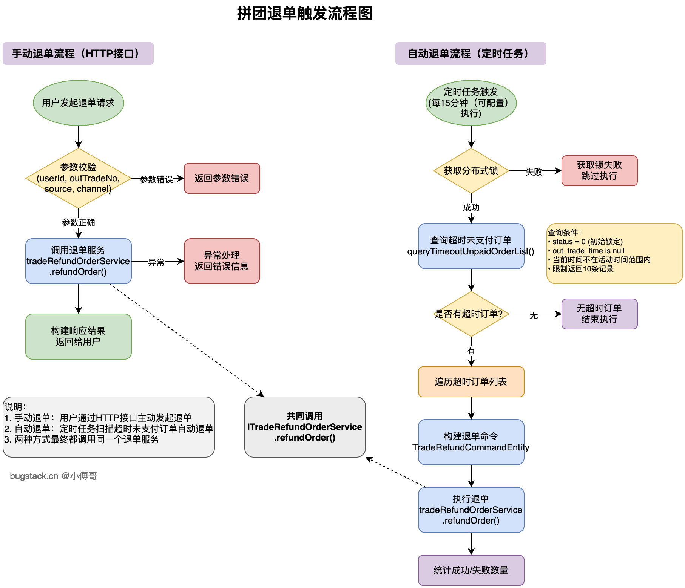
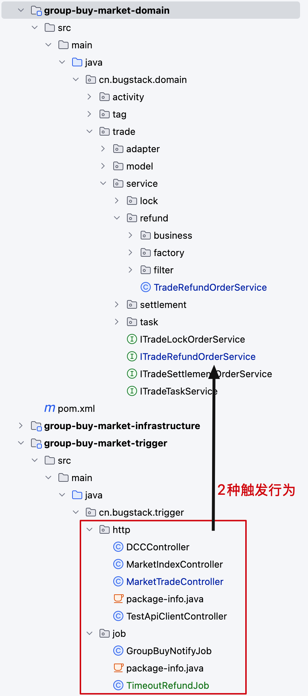
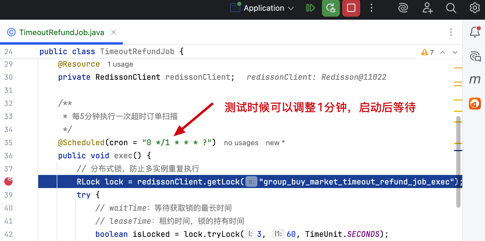
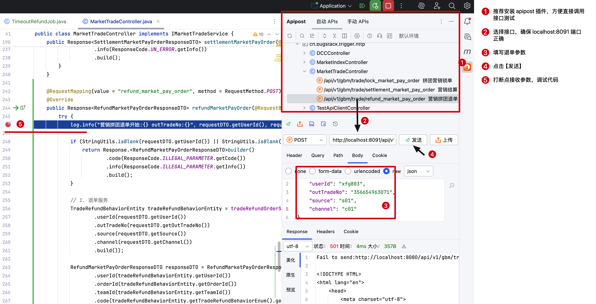

# 退订接口和定时任务

> 学习序号 45｜小节 2-31｜原文：https://articles.zsxq.com/id_uazxusi0finu.html

**本章重点**  ：在触发器层实现调度逻辑，一个是退单的 HTTP 服务接口实现，另外一个是 Job 定时任务处理。

**本章重点**  ：★★★☆☆

**本节分支**  : [https://gitcode.net/KnowledgePlanet/group-buy-market/-/tree/2-31-xfg-refund-intf-job](https://gitcode.net/KnowledgePlanet/group-buy-market/-/tree/2-31-xfg-refund-intf-job)

**课程视频**  : [https://t.zsxq.com/Ga9uG](https://t.zsxq.com/Ga9uG)

**版权说明**  ：©本项目与星球签约合作，受[《中华人民共和国著作权法实施条例》](https://www.gov.cn/gongbao/content/2013/content_2339485.htm) 版权法保护，禁止任何理由和任何方式公开(public)源码、资料、视频等小傅哥发布的星球内容到Github、Gitee等各类平台，违反可追究进一步的法律责任。

作者：小傅哥

博客：[https://bugstack.cn](https://bugstack.cn)

> 沉淀、分享、成长，让自己和他人都能有所收获！😄

- 一、本章诉求
- 二、功能流程
- 三、编码实现
  - 1. 工程结构
  - 2. 功能实现
  - 2.3 补充修改
- 四、功能测试
  - 1. 任务测试
  - 2. 接口测试
- 五、读者作业

### 一、本章诉求

在触发器层实现调度逻辑，一个是退单的 HTTP 服务接口实现，另外一个是 Job 定时任务处理。

HTTP 退单接口为的是给外部系统（小型支付）调用使用，Job 任务则是定时检查是否有参与拼团锁单，但超时没有完成支付的进行拼团组队的，则进行自动退单处理。

### 二、功能流程

如图，退单触发条件流程图；



- 退单的触发流程分为2类，一个是定时任务处理，自动扫描未完成订单，另外一个是提供接口，让外部调用方进行处理。

### 三、编码实现

#### 1. 工程结构



- trigger；触发器，一个抽象的词语，类似点炮仗🧨，多种方式，都可以理解为触发。

- http，外部接口调用，提供了退单接口，包装的就是 ITradeRefundOrderService 服务。

- job，定时任务调度，扫描数据库中锁单未支付订单，之后调用退单服务。

#### 2. 功能实现

##### 2.1 修改说明

- 在 MarketTradeController 服务中，增加 `Response<RefundMarketPayOrderResponseDTO> refundMarketPayOrder(RefundMarketPayOrderRequestDTO requestDTO);` 退单服务接口。这部分的流程其实比较简单，主要是Service 功能用接口方式封装出去。
- 增加 TimeoutRefundJob 任务，通过新增加 `tradeRefundOrderService.queryTimeoutUnpaidOrderList();` 方法，扫描出未支付订单，之后调用 `tradeRefundOrderService.refundOrder(refundCommand);` 进行退单操作。
- 补充开发，MQ 消息对象 TeamRefundSuccess，增加 `outTradeNo` 用于小型支付接收退单的时候，可以拿此单号处理。

##### 2.2 退单接口（http）

```
                @RequestMapping(value = "refund_market_pay_order", method = RequestMethod.POST)
@Override
public Response<RefundMarketPayOrderResponseDTO> refundMarketPayOrder(@RequestBody RefundMarketPayOrderRequestDTO requestDTO) {
    try {
        log.info("营销拼团退单开始:{} outTradeNo:{}", requestDTO.getUserId(), requestDTO.getOutTradeNo());
        if (StringUtils.isBlank(requestDTO.getUserId()) || StringUtils.isBlank(requestDTO.getOutTradeNo()) || StringUtils.isBlank(requestDTO.getSource()) || StringUtils.isBlank(requestDTO.getChannel())) {
            return Response.<RefundMarketPayOrderResponseDTO>builder()
                    .code(ResponseCode.ILLEGAL_PARAMETER.getCode())
                    .info(ResponseCode.ILLEGAL_PARAMETER.getInfo())
                    .build();
        }
      
        // 1. 退单服务
        TradeRefundBehaviorEntity tradeRefundBehaviorEntity = tradeRefundOrderService.refundOrder(TradeRefundCommandEntity.builder()
                .userId(requestDTO.getUserId())
                .outTradeNo(requestDTO.getOutTradeNo())
                .source(requestDTO.getSource())
                .channel(requestDTO.getChannel())
                .build());
        RefundMarketPayOrderResponseDTO responseDTO = RefundMarketPayOrderResponseDTO.builder()
                .userId(tradeRefundBehaviorEntity.getUserId())
                .orderId(tradeRefundBehaviorEntity.getOrderId())
                .teamId(tradeRefundBehaviorEntity.getTeamId())
                .code(tradeRefundBehaviorEntity.getTradeRefundBehaviorEnum().getCode())
                .info(tradeRefundBehaviorEntity.getTradeRefundBehaviorEnum().getInfo())
                .build();
        
        // 返回结果
        Response<RefundMarketPayOrderResponseDTO> response = Response.<RefundMarketPayOrderResponseDTO>builder()
                .code(ResponseCode.SUCCESS.getCode())
                .info(ResponseCode.SUCCESS.getInfo())
                .data(responseDTO)
                .build();
        log.info("营销拼团退单完成:{} outTradeNo:{} response:{}", requestDTO.getUserId(), requestDTO.getOutTradeNo(), JSON.toJSONString(response));
        return response;
    } catch (AppException e) {
        log.error("营销拼团退单异常:{} RefundMarketPayOrderRequestDTO:{}", requestDTO.getUserId(), JSON.toJSONString(requestDTO), e);
        return Response.<RefundMarketPayOrderResponseDTO>builder()
                .code(e.getCode())
                .info(e.getInfo())
                .build();
    } catch (Exception e) {
        log.error("营销拼团退单失败:{} RefundMarketPayOrderRequestDTO:{}", requestDTO.getUserId(), JSON.toJSONString(requestDTO), e);
        return Response.<RefundMarketPayOrderResponseDTO>builder()
                .code(ResponseCode.UN_ERROR.getCode())
                .info(ResponseCode.UN_ERROR.getInfo())
                .build();
    }
}
```

- 这部分的实现比较简单，主要是增加 RefundMarketPayOrderRequestDTO、RefundMarketPayOrderResponseDTO，两个对象，来封装对 `tradeRefundOrderService.refundOrder` 接口的调用即可。

##### 2.3 退单任务（job）

```
                @Slf4j
@Service
public class TimeoutRefundJob {

    @Resource
    private ITradeRefundOrderService tradeRefundOrderService;

    @Resource
    private RedissonClient redissonClient;

    /**
     * 每5分钟执行一次超时订单扫描
     */
    @Scheduled(cron = "0 */15 * * * ?")
    public void exec() {
        // 分布式锁，防止多实例重复执行
        RLock lock = redissonClient.getLock("group_buy_market_timeout_refund_job_exec");
        try {
            // waitTime：等待获取锁的最长时间
            // leaseTime：租约时间，锁的持有时间
            boolean isLocked = lock.tryLock(3, 60, TimeUnit.SECONDS);
            if (!isLocked) {
                log.info("超时退单定时任务，获取锁失败，跳过本次执行");
                return;
            }

            log.info("超时退单定时任务开始执行");
            
            // 查询超时未支付订单列表
            List<UserGroupBuyOrderDetailEntity> timeoutOrderList = tradeRefundOrderService.queryTimeoutUnpaidOrderList();
            if (timeoutOrderList == null || timeoutOrderList.isEmpty()) {
                log.info("超时退单定时任务，未发现超时未支付订单");
                return;
            }

            log.info("超时退单定时任务，发现超时未支付订单数量：{}", timeoutOrderList.size());
            
            int successCount = 0;
            int failCount = 0;
            
            // 遍历处理每个超时订单
            for (UserGroupBuyOrderDetailEntity orderDetail : timeoutOrderList) {
                try {
                    // 构建退单命令
                    TradeRefundCommandEntity refundCommand = TradeRefundCommandEntity.builder()
                            .userId(orderDetail.getUserId())
                            .outTradeNo(orderDetail.getOutTradeNo())
                            .source(orderDetail.getSource())
                            .channel(orderDetail.getChannel())
                            .build();
                    
                    // 执行退单
                    tradeRefundOrderService.refundOrder(refundCommand);
                    successCount++;
                    
                    log.info("超时订单退单成功，用户ID：{}，交易单号：{}", orderDetail.getUserId(), orderDetail.getOutTradeNo());
                    
                } catch (Exception e) {
                    failCount++;
                    log.error("超时订单退单失败，用户ID：{}，交易单号：{}，错误信息：{}", 
                            orderDetail.getUserId(), orderDetail.getOutTradeNo(), e.getMessage(), e);
                }
            }
            
            log.info("超时退单定时任务执行完成，成功：{}，失败：{}", successCount, failCount);
            
        } catch (Exception e) {
            log.error("超时退单定时任务执行异常", e);
        } finally {
            if (lock.isLocked() && lock.isHeldByCurrentThread()) {
                lock.unlock();
            }
        }
    }

}
```

- `redissonClient.getLock("group_buy_market_timeout_refund_job_exec");` 是一个分布式锁，避免互备的任务，抢占多次执行。
- `tradeRefundOrderService.queryTimeoutUnpaidOrderList()` 是封装的一个新的查询数据订单的接口。之后执行 `tradeRefundOrderService.refundOrder(refundCommand);` 退单操作。
- `@Scheduled(cron = "0 */15 * * * ?")`，可以自己调整下时间，不非得5分钟或者15分钟。

#### 2.3 补充修改

**TradeRepository.java**

```
                notifyTask.setParameterJson(JSON.toJSONString(new HashMap<String, Object>() {{
    put("type", RefundTypeEnumVO.UNPAID_UNLOCK.getCode());
    put("userId", tradeRefundOrderEntity.getUserId());
    put("teamId", tradeRefundOrderEntity.getTeamId());
    put("orderId", tradeRefundOrderEntity.getOrderId());
    put("outTradeNo", tradeRefundOrderEntity.getOutTradeNo());
    put("activityId", tradeRefundOrderEntity.getActivityId());
}}));
```

- 检查交易仓储层中关于 MQ 消息的构建，增加一条 outTradeNo 消息的发送。

### 四、功能测试

#### 1. 任务测试



- 可以调整定时任务时间，1分钟，这样启动服务后会更快的进来。之后你就可以调试了。

#### 2. 接口测试



- 通过 ApiPost IDEA 插件，调用程序接口进行测试验证。

### 五、读者作业

- 简单作业：根据功能诉求，完成本节的接口和定时任务开发。
- 复杂作业：尝试和小型支付完成退单的对接。
