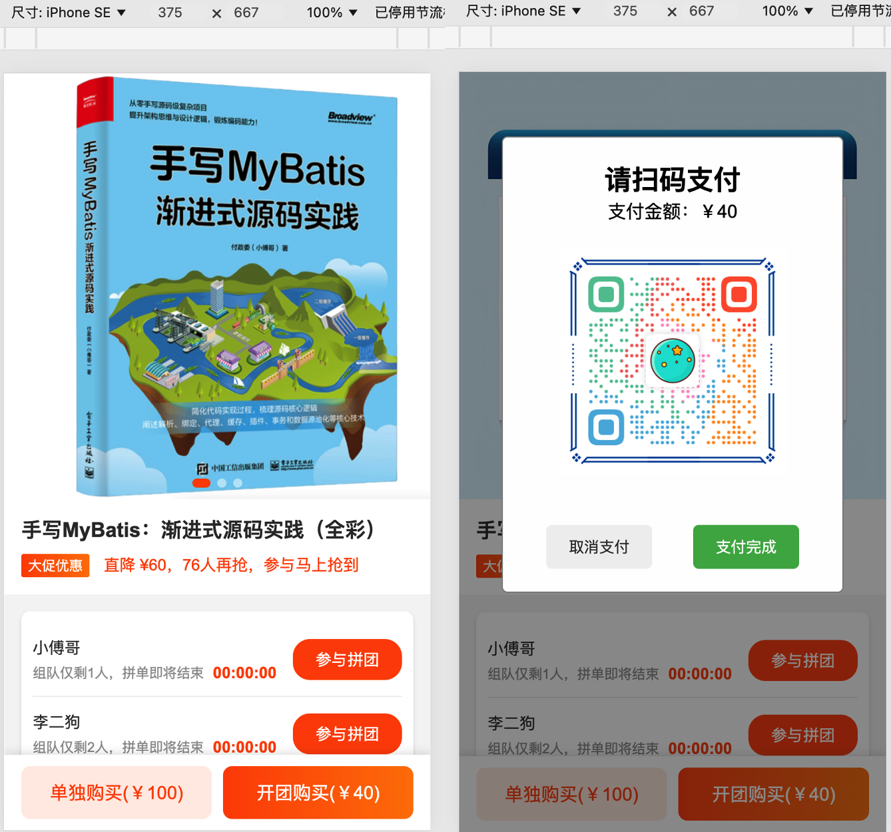
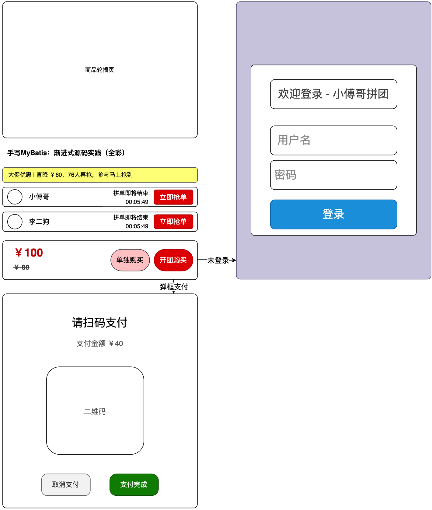
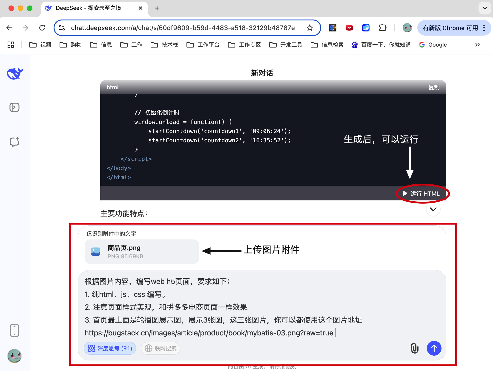
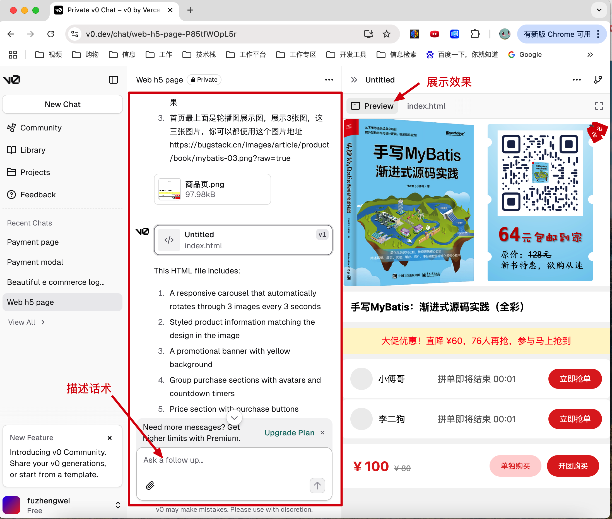
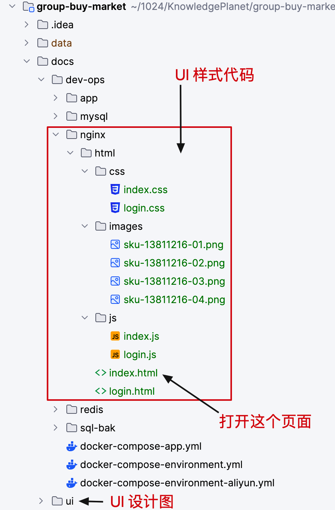
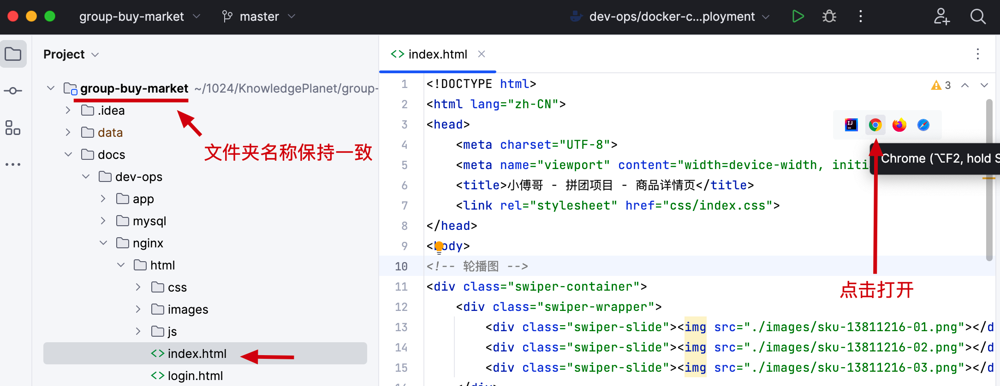

# DeepSeek设计拼团UI

> 学习序号 18｜小节 3-1｜原文：https://articles.zsxq.com/id_ulp68a0lurtp.html

**本章重点** ：结合 DeepSeek 等同类型 OpenAI 产品设计拼团 UI

- **本章重点** ：★★☆☆☆
- **本节分支：** [https://gitcode.net/KnowledgePlanet/group-buy-market/-/tree/3-1-250202-xfg-ui](https://gitcode.net/KnowledgePlanet/group-buy-market/-/tree/3-1-250202-xfg-ui)
- **课程视频** ：[https://t.zsxq.com/0ef6r](https://t.zsxq.com/0ef6r)

**版权说明** ：©本项目与星球签约合作，受[《中华人民共和国著作权法实施条例》](https://www.gov.cn/gongbao/content/2013/content_2339485.htm) 版权法保护，禁止任何理由和任何方式公开(public)源码、资料、视频等小傅哥发布的星球内容到Github、Gitee等各类平台，违反可追究进一步的法律责任。

作者：小傅哥

博客：[https://bugstack.cn](https://bugstack.cn)

> 沉淀、分享、成长，让自己和他人都能有所收获！😄

- 一、本章诉求
- 二、UI 效果展示
- 二、UI 原搞设计
- 三、UI 原搞还原
  - 1. DeepSeek
  - 2. v0.dev
- 四、UI 代码使用
- 五、读者作业

大家好，我是技术UP主小傅哥。

国外比较擅长做创新，国内比较适合做应用。但好在这次在 OpenAI 的赛道上，横空出世了一个 DeepSeek，与过往的几个 OpenAI 产品相比，这次是可以和 ChatGPT 掰掰手腕了。

那 OpenAI 会抢了程序员的饭碗吗？🤔 首先，我认为是不会。就像 OpenAI 也会给你讲医学知识，那你敢自己开刀吗？OpenAI 也能讲法律知识，你能出去给人家当律师吗？甚至，在你没有某方面知识积累的时候，你也没法提出更专业的问题和完善类的资料。

其实都不能，OpenAI 的作用是让强的人更强，厉害的人更厉害。本身在哪一方面有积累，那么就能运用这些积累的知识借助 OpenAI 这个伙伴，把它做的更好。

### 一、本章诉求

结合 DeepSeek 等同类型 OpenAI 产品设计拼团 UI。

在我体验过的整个 OpenAI 产品中，以前 ChatGPT 4o 系列模型对代码的需求的理解是不错的，可以给还原出比较好的 UI 样式。不过这次在体验了 DeepSeek 后，它也可以还原出很不错的 UI 样式。

> 本节要做一个简单对接的流程设计，关于商品下单支付这部分会模拟，暂时不走商城类系统。

### 二、UI 效果展示

按照本节的实现，最终你会得到一个这样的效果。



### 二、UI 原搞设计

目前的这些 OpenAI 产品都是带有图片识别的，我们要想做好一个好看的UI，就需要先画一个草图。



- 本次要设计的UI有3个图；`商品详情页`、`登录页`、`弹出扫码支付页`。
- 商品详情页；展示商品信息、拼团优惠、参与拼团的用户列表详情、购买按钮。点击「抢单、购买」按钮，则先检测是否登录，未登录则跳登录页。
- 登录页；拼团需要不同的用户一起参与，所以设计了简单的登录页，登录后信息直接存储到浏览器里。登录后跳回到商品详情页。登录页面要增加话术；`提供登录逻辑，登录后写入浏览器 cookie，并跳转会商品详情页。`这部分代码也可以参考课程提供的，手动添加也可以。
- 弹窗支付页；点击购买后，弹出一个支付页面。这里用于点击**支付完成** ，我们可以触发结算处理。

### 三、UI 原搞还原

首先，你需要把UI稿的设计图，分别截图；`商品详情页`、`登录页`、`弹出扫码支付页`，这些页面要单独生成。**UI的原搞放到工程docs/ui下，可以本地打开**

话术；

```
                根据图片内容，编写web h5页面，要求如下；
1. 纯 html、js、css 编写，请写在一个文件里。
2. 注意页面样式美观，和拼多多电商页面一样效果
3. 首页最上面是轮播图展示图，展示3张图，这三张图片，你可以都使用这个图片地址 https://bugstack.cn/images/article/product/book/mybatis-03.png?raw=true 
```

- 你可以每次按需调整样式的话术，它会根据你的诉求进行编写调整。
- 在生成 `商品详情页` 生成后，截图 `弹出扫码支付页`，并复制商品详情页生成的代码，告诉 OpenAI 工具，生成界面在点击购买的时候，添加 `弹出扫码支付页`
- 注意：这份话术是做一个 Web h5 页面，谷歌浏览器要 F12，并调整为手机效果。

#### 1. DeepSeek

地址：[https://chat.deepseek.com/](https://chat.deepseek.com/)



- 生成后可以看到 HTML 文件，并点击运行展示效果。对于运行的效果如果不满意，可以继续调整。

#### 2. v0.dev

地址：[https://v0.dev/](https://v0.dev/)



- v0.dev 是另外一款 openai 工具，也可以根据图片生成UI。

> 另外还有很多 openai 工具也都可以生成，像是星球里做的 openai 应用项目，使用的 gpt-4o 模型、chatglm 模型，也都可以实现 UI 还原。

### 四、UI 代码使用

复制使用 OpenAI 还原的 UI 代码，放到 `group-buy-market docs/dev-ops/nginx/html` 下面。





- 首先，放到 nginx 目录下，是为了后续我们做项目部署的时候，直接就可以交给 Nginx 转发管理了。
- 之后，生成后你就可以在 IntelliJ IDEA 中，右侧浮层有几个浏览器的logo，点击打开 index.html 文件了。本地就能看到效果。

### 五、读者作业

- 简单作业：可以理解本节流程，能打开 IntelliJ IDEA 中的代码，在浏览器查看展示效果。
- 复杂作业：根据原搞UI，页面存在的元素信息，设计一套你的专属UI样式，包括结构、配色、效果。并能点击登录和跳转。这样你就将来使用的时候，就完全是自己的展示了和其他人都不一样。
