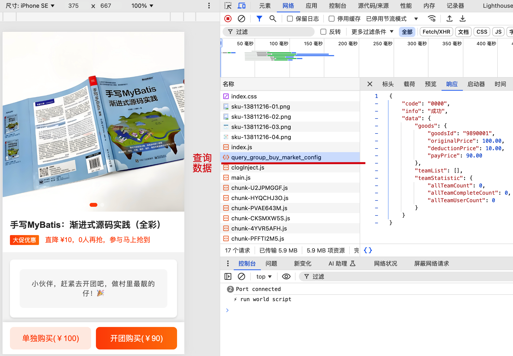
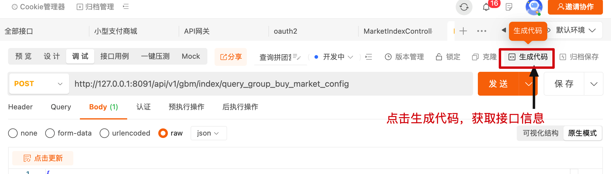
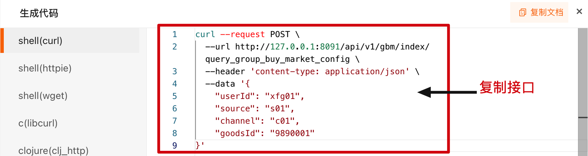
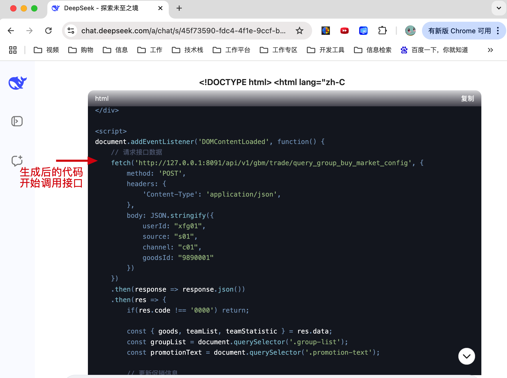
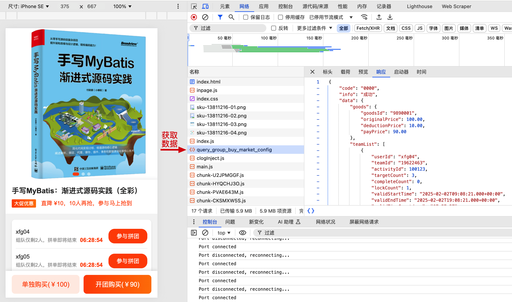
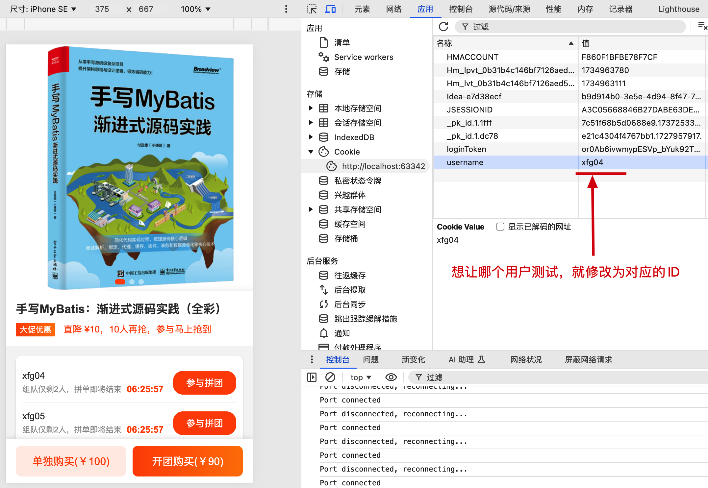

# DeepSeek处理UI与接口对接

> 学习序号 20｜小节 3-2｜原文：https://articles.zsxq.com/id_qkofzbsubgib.html

**本章重点** ：结合 DeepSeek 等同类型 OpenAI 产品，辅助完成 UI 与服务端接口的对接。

- **本章重点** ：★★☆☆☆
- **本节分支：** [https://gitcode.net/KnowledgePlanet/group-buy-market/-/tree/3-2-250203-xfg-ui-2-interface](https://gitcode.net/KnowledgePlanet/group-buy-market/-/tree/3-2-250203-xfg-ui-2-interface)
- **课程视频** ：[https://t.zsxq.com/qKjOi](https://t.zsxq.com/qKjOi)

**版权说明** ：©本项目与星球签约合作，受[《中华人民共和国著作权法实施条例》](https://www.gov.cn/gongbao/content/2013/content_2339485.htm) 版权法保护，禁止任何理由和任何方式公开(public)源码、资料、视频等小傅哥发布的星球内容到Github、Gitee等各类平台，违反可追究进一步的法律责任。

作者：小傅哥

博客：[https://bugstack.cn](https://bugstack.cn)

> 沉淀、分享、成长，让自己和他人都能有所收获！😄

- 一、本章诉求
- 二、效果展示
- 三、接口对接
  - 1. 复制接口
  - 2. 组装话术
  - 3. 生成结果
  - 4. 完整代码
- 四、效果测试
  - 1. 预制数据
  - 2. 拼团测试
- 五、读者作业

大家好，我是技术UP主小傅哥。

OpenAI 适合什么场景的编程？我觉得前端算一个，为什么呢？

前端相对于后端，没有数据库、缓存、RPC、MQ、任务调度等等一系列的复杂组件运用，而更多的工作都是在既定路线上的重复处理。所以，它的场景就更适合 OpenAI 一次的加载和理解，并给出正确性更高的编码实现，从而减轻开发人员的工作量。

在有这类的 OpenAI 产品后，我在开发前端代码上，确实更加得心应手了。

### 一、本章诉求

结合 DeepSeek 等同类型 OpenAI 产品，辅助完成 UI 与服务端接口的对接。

前端的 UI 已经明确，服务端的接口已经开发完成，他们中间没有什么额外的复杂逻辑了。只要告诉 OpenAI 调用接口，并明确出 UI 中位置的内容展示是来自于接口里的位置，那么就可以完成自动化的对接。

### 二、效果展示



- UI 与 服务端接口完整对接后，可以看到数据接口数据的使用，并渲染到前端页面。
- 在没有用户参与拼团的时候，首次展示引导用户开启拼团。

### 三、接口对接

#### 1. 复制接口

从 ApiPost 中复制接口信息；



- 首先，点击你要使用的接口，点击生成代码。
- 之后，复制 curl，后续发给 OpenAI 可以识别接口信息。

#### 2. 组装话术

```
                <!DOCTYPE html>
<html lang="zh-CN">
<head>
    <meta charset="UTF-8">
    <meta name="viewport" content="width=device-width, initial-scale=1.0">
    <title>小傅哥 - 拼团项目 - 商品详情页</title>
    <link rel="stylesheet" href="css/index.css">
</head>
<body>
<!-- 轮播图 -->
<div class="swiper-container">
    <div class="swiper-wrapper">
        <div class="swiper-slide"></div>
        <div class="swiper-slide"></div>
        <div class="swiper-slide"></div>
    </div>
    <div class="swiper-pagination"></div>
</div>

<!-- 商品信息 -->
<div class="product-info">
    <h1 class="product-title">手写MyBatis：渐进式源码实践（全彩）</h1>
    <span class="promotion-tag">大促优惠</span>
    <span class="promotion-text">直降 ¥60，76人再抢，参与马上抢到</span>
</div>

<!-- 修改后的拼单列表结构 -->
<div class="group-list">
    <div class="group-item">
        <div>
            <div class="user-info">小傅哥</div>
            <div class="group-status">
                <span>组队仅剩1人，拼单即将结束</span>
                <span class="countdown">00:05:49</span>
            </div>
        </div>
        <div class="right">
            <button class="group-btn" data-price="40">参与拼团</button>
        </div>
    </div>
    <div class="group-item">
        <div>
            <div class="user-info">李二狗</div>
            <div class="group-status">
                <span>组队仅剩2人，拼单即将结束</span>
                <span class="countdown">00:05:49</span>
            </div>
        </div>
        <div class="right">
            <button class="group-btn" data-price="40">参与拼团</button>
        </div>
    </div>
    <div class="group-item">
        <div>
            <div class="user-info">张冰嘎</div>
            <div class="group-status">
                <span>组队仅剩1人，拼单即将结束</span>
                <span class="countdown">00:05:49</span>
            </div>
        </div>
        <div class="right">
            <button class="group-btn" data-price="40">参与拼团</button>
        </div>
    </div>
</div>

<!-- 空白区域 -->
<div class="area"></div>

<!-- 底部操作栏 -->
<div class="action-bar">
    <button class="action-btn buy-alone" data-price="100">单独购买(￥100)</button>
    <button class="action-btn group-buy" data-price="40">开团购买(￥40)</button>
</div>

<!-- 支付弹窗 -->
<div id="paymentModal" class="modal">
    <div class="modal-content">
        <h2>请扫码支付</h2>
        <p id="paymentAmount"></p>
        
        <div class="button-group">
            <button id="cancelPayment">取消支付</button>
            <button id="completePayment">支付完成</button>
        </div>
    </div>
</div>

<script src="js/index.js"></script>
</body>
</html>

根据要求修改以上 html 代码；
1. 对接接口 curl --request GET \
  --url http://127.0.0.1:8091/api/v1/gbm/trade/query_group_buy_market_config \
  --header 'content-type: application/json' \
  --data '{
    "userId": "xfg01",
    "source": "s01",
    "channel": "c01",
    "goodsId": "9890001"
}'
2. 接口返回 json 为；
{
 "code": "0000",
 "data": {
  "goods": {
   "deductionPrice": 10.00,
   "goodsId": "9890001",
   "originalPrice": 100.00,
   "payPrice": 90.00
  },
  "teamList": [{
   "activityId": 100123,
   "completeCount": 0,
   "lockCount": 1,
   "targetCount": 3,
   "teamId": "83992827",
   "userId": "xfg06",
   "validEndTime": 1738486321000,
   "validStartTime": 1738482721000,
   "validTimeCountdown": "1:00:00"
  }, {
   "activityId": 100123,
   "completeCount": 0,
   "lockCount": 1,
   "targetCount": 3,
   "teamId": "44597681",
   "userId": "xfg08",
   "validEndTime": 1738486354000,
   "validStartTime": 1738482754000,
   "validTimeCountdown": "1:00:00"
  }],
  "teamStatistic": {
   "allTeamCompleteCount": 1,
   "allTeamCount": 7,
   "allTeamUserCount": 9
  }
 },
 "info": "成功"
}

3. 直降60元，从 deductionPrice 获取
4. 76人再抢，从 allTeamUserCount 获取
5. 参与拼团的列表数据从 teamList 获取，其中仅剩1人、2人这样的数据，从 targetCount - lockCount 获取。倒计时从 validTimeCountdown 获取。
6. 单独购买 金额从 originalPrice 获取，开团购买金额从 payPrice 获取
7. 如果 teamList 为 null 的时候，则在页面展示 小伙伴，赶紧去开团吧，做村里最靓的仔。
```

- 这部分内容，包括之前生成的 html 代码，之后在后面补充描述话术。描述的内容包括把 json 数据也一起贴给 OpenAI。
- 之后是告诉 OpenAI 这些值分别从哪里获取，也就是和页面匹配上。这些动作处理完后，你会得到 DeepSeek 给你提供的最终的代码。

#### 3. 生成结果



- 当 DeepSeek 执行完成后，你就拿到最终的代码。如果生成的和预期有差异可以重新生成，以及手动调整。
- 另外的调用的交易的接口、支付完成结算的接口，也可以这样的发给 DeepSeek 进行处理。

#### 4. 完整代码



```
                <!DOCTYPE html>
<html lang="zh-CN">
<head>
    <meta charset="UTF-8">
    <meta name="viewport" content="width=device-width, initial-scale=1.0">
    <title>小傅哥 - 拼团项目 - 商品详情页</title>
    <link rel="stylesheet" href="css/index.css">

</head>
<body>
<!-- 轮播图 -->
<div class="swiper-container">
    <div class="swiper-wrapper">
        <div class="swiper-slide"></div>
        <div class="swiper-slide"></div>
        <div class="swiper-slide"></div>
    </div>
    <div class="swiper-pagination"></div>
</div>

<!-- 商品信息 -->
<div class="product-info">
    <h1 class="product-title">手写MyBatis：渐进式源码实践（全彩）</h1>
    <span class="promotion-tag">大促优惠</span>
    <span class="promotion-text"></span> <!-- 动态填充促销文本 -->
</div>

<!-- 拼单列表容器 -->
<div class="group-list">
    <!-- 动态生成拼团列表 -->
</div>

<!-- 空白区域 -->
<div class="area"></div>

<!-- 底部操作栏 -->
<div class="action-bar">
    <button class="action-btn buy-alone"></button>
    <button class="action-btn group-buy"></button>
</div>

<!-- 支付弹窗 -->
<div id="paymentModal" class="modal">
    <div class="modal-content">
        <h2>请扫码支付</h2>
        <br/>
        <p id="paymentAmount" style="color:red;"></p>
        
        <p id="outTradeNo"></p>
        <div class="button-group">
            <button id="cancelPayment">取消支付</button>
            <button id="completePayment">支付完成</button>
        </div>
    </div>
</div>
<script src="js/index.js"></script>
<script>
document.addEventListener('DOMContentLoaded', function() {
    // 根据测试诉求，设置基础地址
    var baseUrl = "http://127.0.0.1:8091";

    // 获取信息
    var userId = getCookie("username");
    if (!userId) {
        window.location.href = "login.html"; // 跳转到登录页
        return;
    }

    // 定义交易单号，如果交易单号不为空，则当前用户已参与拼团交易
    let outTradeNo = "";

    // 请求接口数据
    fetch(baseUrl + '/api/v1/gbm/index/query_group_buy_market_config', {
        method: 'POST',
        headers: {
            'Content-Type': 'application/json',
        },
        body: JSON.stringify({
            userId: userId,
            source: "s01",
            channel: "c01",
            goodsId: "9890001"
        })
    })
    .then(response => response.json())
    .then(res => {
        if(res.code !== '0000') return;

        const { goods, teamList, teamStatistic } = res.data;
        const groupList = document.querySelector('.group-list');
        const promotionText = document.querySelector('.promotion-text');

        // 更新促销信息
        promotionText.textContent = `直降 ¥${goods.deductionPrice.toFixed(0)}，${teamStatistic.allTeamUserCount}人再抢，参与马上抢到`;

        // 清空并生成拼团列表
        groupList.innerHTML = '';

        if (teamList.length === 0) {
            groupList.innerHTML = `
                <div class="group-item empty-tips">
                    <div class="tips-content">
                        小伙伴，赶紧去开团吧，做村里最靓的仔！🎉
                    </div>
                </div>
            `;
        } else {
            teamList.forEach(team => {
                const remaining = team.targetCount - team.lockCount;
                // 判断当前用户ID是否为登录用户ID
                if(userId == team.userId){
                    outTradeNo = team.outTradeNo;
                }

                groupList.innerHTML += `
                    <div class="group-item">
                        <div>
                            <div class="user-info" data-teamId="${team.teamId}">${team.userId}</div>
                            <div class="group-status">
                                <span>组队仅剩${remaining}人，拼单即将结束</span>
                                <span class="countdown">${team.validTimeCountdown}</span>
                            </div>
                        </div>
                        <div class="right">
                            <button class="group-btn" data-price="${goods.payPrice.toFixed(0)}">参与拼团</button>
                        </div>
                    </div>
                `;
            });
        }

        // 更新底部按钮
        const buyAloneBtn = document.querySelector('.buy-alone');
        const groupBuyBtn = document.querySelector('.group-buy');
        buyAloneBtn.textContent = `单独购买(￥${goods.originalPrice.toFixed(0)})`;
        buyAloneBtn.dataset.price = goods.originalPrice;
        groupBuyBtn.textContent = `开团购买(￥${goods.payPrice.toFixed(0)})`;
        groupBuyBtn.dataset.price = goods.payPrice;

        // 绑定支付事件[拼团购买]
        document.querySelectorAll('.group-btn, .group-buy').forEach(btn => {
            btn.addEventListener('click', function() {

                // 如果有值，则直接展示支付按钮
                if(outTradeNo) {
                    // 显示支付弹窗
                    document.getElementById('paymentAmount').textContent =
                        `￥${this.dataset.price}`;
                    document.getElementById('outTradeNo').textContent =
                        outTradeNo;
                    document.getElementById('paymentModal').style.display = 'block';
                    return;
                }

                // 获取拼团ID
                let teamId = null;
                if (this.classList.contains('group-btn')) {
                    const groupItem = this.closest('.group-item');
                    const userInfo = groupItem.querySelector('.user-info');
                    teamId = userInfo.dataset.teamid;
                }

                outTradeNo = generateRandomNumber(12);

                // 构造请求数据（假设activityId和goodsId从按钮dataset获取）
                const postData = {
                    userId: userId,
                    teamId: teamId,
                    activityId: 100123,
                    goodsId: "9890001",
                    source: "s01",
                    channel: "c01",
                    outTradeNo: outTradeNo,
                    notifyUrl: baseUrl + "/api/v1/test/group_buy_notify"
                };

                // 调用支付接口
                fetch(baseUrl + '/api/v1/gbm/trade/lock_market_pay_order', {
                    method: 'POST',
                    headers: {
                        'content-type': 'application/json'
                    },
                    body: JSON.stringify(postData)
                })
                .then(response => response.json())
                .then(res => {
                    if (res.code !== '0000') {
                        // 失败，清空交易ID
                        outTradeNo = null;
                        alert(res.code + "：" +res.info);
                        return;
                    }

                    // 显示支付弹窗
                    document.getElementById('paymentAmount').textContent =
                        `￥${this.dataset.price}`;
                    document.getElementById('outTradeNo').textContent =
                        outTradeNo;
                    document.getElementById('paymentModal').style.display = 'block';
                })
                .catch(error => {
                    console.error('支付请求失败:', error);
                });
            });
        });

        // 启动倒计时
        document.querySelectorAll('.countdown').forEach(el => {
            new Countdown(el, el.textContent);
        });

    });

  // 支付模块
  const modal = document.getElementById("paymentModal")
  const paymentAmount = document.getElementById("paymentAmount")
  const cancelPayment = document.getElementById("cancelPayment")
  const completePayment = document.getElementById("completePayment")

  // 获取所有的按钮
  const buttons = document.querySelectorAll(".buy-alone")

  // 为每个按钮添加点击事件
  buttons.forEach((button) => {
    button.addEventListener("click", function () {
      var userId = getCookie("username");
      if (!userId) {
          window.location.href = "login.html"; // 跳转到登录页
          return;
      }

      const price = this.getAttribute("data-price")
      showPaymentModal(price)
    })
  })

  // 显示支付弹窗
  function showPaymentModal(price) {
    paymentAmount.textContent = `支付金额：￥${price}`
    modal.style.display = "block"
  }

  // 隐藏支付弹窗
  function hidePaymentModal() {
    modal.style.display = "none"
  }

  // 取消支付
  cancelPayment.addEventListener("click", hidePaymentModal)

  // 支付完成
  completePayment.addEventListener("click", () => {
    // 生成符合要求的交易时间格式
    const formatTime = date => date.toISOString()
        .replace(/T/, ' ')
        .replace(/\..+/, '')
        .substr(0, 19);

    // 构造请求参数
    const postData = {
        source: "s01",       // 保持与锁定订单时一致
        channel: "c01",      // 保持与锁定订单时一致
        userId: userId,
        outTradeNo: outTradeNo,
        outTradeTime: new Date()
    };

    // 调用结算接口
    fetch(baseUrl + '/api/v1/gbm/trade/settlement_market_pay_order', {
        method: 'POST',
        headers: {
            'content-type': 'application/json'
        },
        body: JSON.stringify(postData)
    })
    .then(response => response.json())
    .then(res => {
        if (res.code === '0000') {
            alert('支付&结算成功！');
            window.location.reload(); // 支付成功后刷新页面
        } else {
            alert(`支付&结算失败：${res.info || '未知错误'}`);
        }
    })
    .catch(error => {
        console.error('接口请求失败:', error);
        alert('网络异常，请检查连接');
    })
    .finally(() => {
        hidePaymentModal(); // 始终关闭弹窗
    });

  })

  // 点击弹窗外部关闭弹窗
  window.addEventListener("click", (event) => {
    if (event.target == modal) {
      hidePaymentModal()
    }
  })

});
</script>

</body>
</html>
```

- DeepSeek 生成的代码，做了少量的调整。你可以参考这部分代码以及 index.js 中的代码。

### 四、效果测试

#### 1. 预制数据

```
                @Slf4j
@RunWith(SpringRunner.class)
@SpringBootTest
public class MarketTradeControllerTest {

    @Resource
    private IMarketTradeService marketTradeService;

    @Test
    public void test_lockMarketPayOrder_list() {
        for (int i = 1; i < 3; i++) {
            LockMarketPayOrderRequestDTO lockMarketPayOrderRequestDTO = new LockMarketPayOrderRequestDTO();
            lockMarketPayOrderRequestDTO.setUserId("xfg0" + i);
            lockMarketPayOrderRequestDTO.setTeamId(null);
            lockMarketPayOrderRequestDTO.setActivityId(100123L);
            lockMarketPayOrderRequestDTO.setGoodsId("9890001");
            lockMarketPayOrderRequestDTO.setSource("s01");
            lockMarketPayOrderRequestDTO.setChannel("c01");
            lockMarketPayOrderRequestDTO.setNotifyUrl("http://127.0.0.1:8091/api/v1/test/group_buy_notify");
            lockMarketPayOrderRequestDTO.setOutTradeNo(RandomStringUtils.randomNumeric(12));

            Response<LockMarketPayOrderResponseDTO> lockMarketPayOrderResponseDTOResponse = marketTradeService.lockMarketPayOrder(lockMarketPayOrderRequestDTO);

            log.info("测试结果 req:{} res:{}", JSON.toJSONString(lockMarketPayOrderRequestDTO), JSON.toJSONString(lockMarketPayOrderResponseDTOResponse));
        }

    }

}
```

- 你可以通过 group-buy-market 的单测方法，写入几条数据【确保数据库表 group_buy_order_list 做了清空处理】。

#### 2. 拼团测试



- 拼团，就是让不同的用户，参与一个队伍完成结算。那么，我们就可以分别设置 username 进行验证。【手动设置的过程，和重新登录一个新用户一样】
- 如，你生成了 xfg01、 xfg02、 xfg03（或者不生成也可以，在页面操作），之后登录 xfg04，并用 xfg04 参与拼团或者开团购买。之后在点击支付完成，这样就完成了当前用户的拼团，当在有一个用户 xfg05 也加入了 xfg04 的拼团，凑够了3笔结算，就可以完成拼团组队了。【**这部分可以参考视频演示，你会更加清楚** 】

### 五、读者作业

- 简单作业：熟练使用 DeepSeek 完成 UI 与服务端接口的对接，并能操作拼团验证。
- 复杂作业：在你设计的 UI 再提供了一个结算结果查询页面，这样用户就能看到自己的拼团记录了。这样一个流程串联下来，也能更加清楚拼团的流程了。
