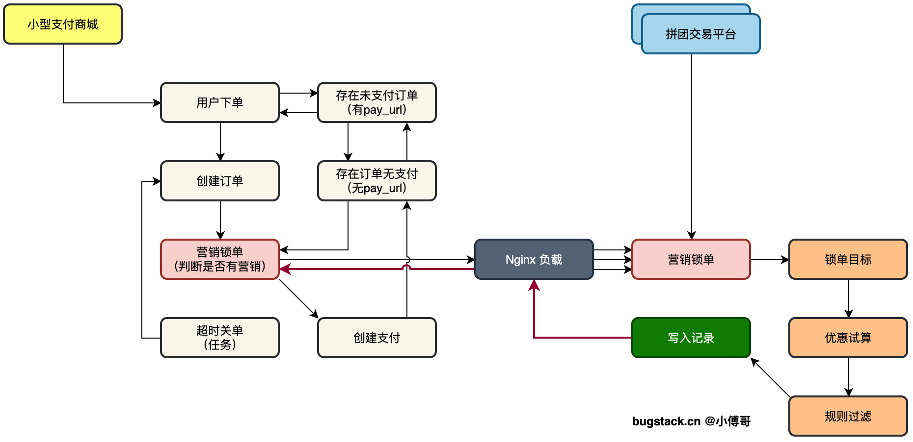
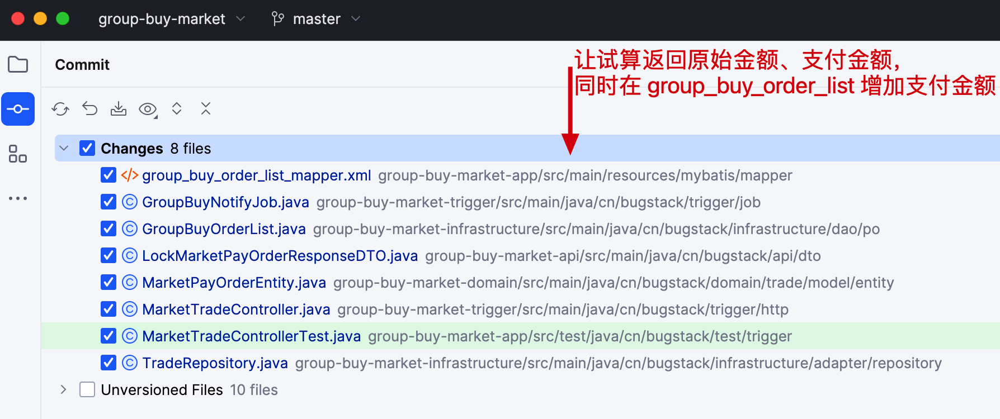
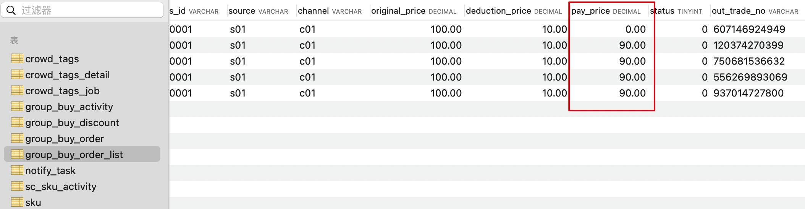
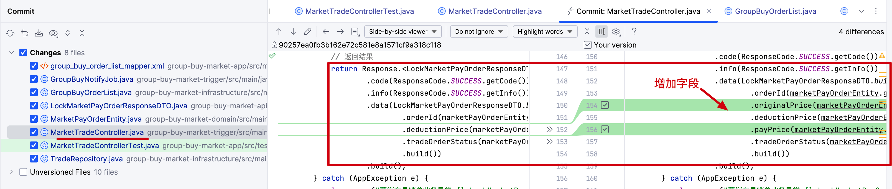
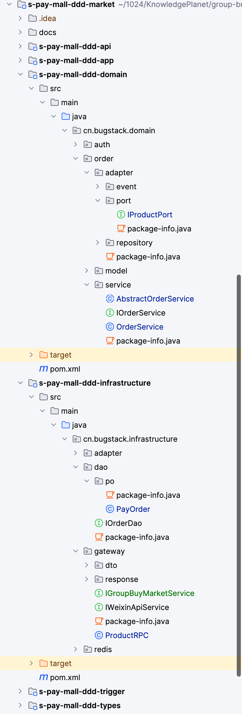
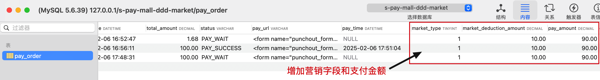
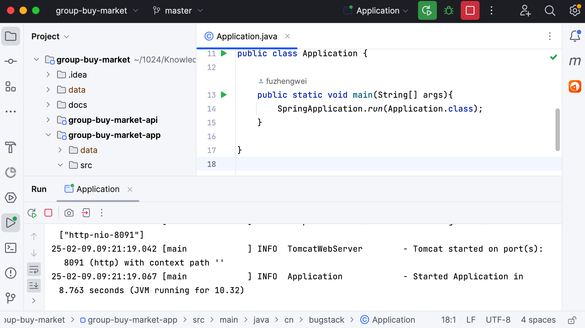
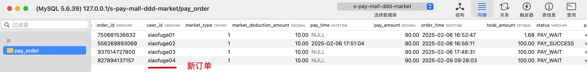

# 小商城对接营销锁单

> 学习序号 25｜小节 3-3｜原文：https://articles.zsxq.com/id_xfu3zb2ecn9z.html

**本章重点** ：微服务接口对接，处理下单过程中的拼团营销优惠锁单流程。

- **本章重点** ：★★★★☆
- **本节分支：**
  - [https://gitcode.net/KnowledgePlanet/group-buy-market/-/tree/3-3-250209-xfg-s-pay-mall-lock-order](https://gitcode.net/KnowledgePlanet/group-buy-market/-/tree/3-3-250209-xfg-s-pay-mall-lock-order)
  - [https://gitcode.net/KnowledgePlanet/s-pay-mall-ddd-market/-/tree/3-3-250209-xfg-s-pay-mall-lock-order](https://gitcode.net/KnowledgePlanet/s-pay-mall-ddd-market/-/tree/3-3-250209-xfg-s-pay-mall-lock-order)
- **课程视频** ：[https://t.zsxq.com/1QJTP](https://t.zsxq.com/1QJTP)

**版权说明** ：©本项目与星球签约合作，受[《中华人民共和国著作权法实施条例》](https://www.gov.cn/gongbao/content/2013/content_2339485.htm) 版权法保护，禁止任何理由和任何方式公开(public)源码、资料、视频等小傅哥发布的星球内容到Github、Gitee等各类平台，违反可追究进一步的法律责任。

作者：小傅哥

博客：[https://bugstack.cn](https://bugstack.cn)

> 沉淀、分享、成长，让自己和他人都能有所收获！😄

- 一、本章诉求
- 二、业务流程
- 三、编码实现 - 拼团系统
  - 1. 工程结构
  - 2. 锁单方法
- 三、编码实现 - 小型商城
  - 1. 工程结构
  - 2. 接口对接
  - 3. 增加字段
  - 4. 订单服务
  - 5. 商品信息
- 四、测试验证
  - 1. 前置说明
  - 2. 启动 - 营销服务
  - 3. 测试 - 拼团交易
- 五、读者作业

### 一、本章诉求

从本章开始，我们会进入到2套系统的对接，陆续完成星球「码农会锁」里的`小型支付商城`与`拼团`在业务流程层面完成接口对接。

通过这样的学习，你可以积累到关于微服务间是如何通信和流程衔接的。在这公司里也是非常常见的设计和开发方式。

那么，本节我们先来完成商品下单过程中，营销锁单的接口对接。小型支付商城选择的是 `s-pay-mall-ddd` 工程，单独拿出一套命名为 `s-pay-mall-ddd-market` 方便大家学习。

**前置学习** ；在开始这部分对接前，需要对星球的《小型支付商城系统》有所学习。课程地址：[https://t.zsxq.com/3X9GA](https://t.zsxq.com/3X9GA)

### 二、业务流程

如图，两套微服务对接节点；



- 左侧，小型支付商城，用户下单过程。增加一个营销锁单，从营销锁单中获取拼团营销拿到的优惠价格。之后小型商城继续往下走，创建支付订单。
- 右侧，拼团交易平台，提供营销锁单流程，锁单目标、优惠试算，规则过滤，最终落库和返回结果（订单ID、原始价格、折扣金额、支付金额、订单状态）。
- 功能改造点；
  - 【拼团系统】lockMarketPayOrder 营销拼团锁单，增加返回字段值。原来只返回了优惠金额，为了方便使用方不需要自己在做计算，可以直接返回，原始价格、折扣金额、支付金额。这样的话，拼团就需要在 group_buy_order_list 表增加 pay_price，这样就更方便的拿到这个值了。
  - 【小型商城】基于 Retrofit2，在 infrastructure 基础设施层，封装对拼团接口的对接。`Call<Response<LockMarketPayOrderResponseDTO>> lockMarketPayOrder(@Body LockMarketPayOrderRequestDTO requestDTO);` 并在 app 启动层的配置里，修改 `Retrofit2Config` 提供 `groupBuyMarketService` 服务。
  - 【小型商城】对 AliPayController#createPayOrder 创建订单服务的接口入参类，添加拼团队伍ID、活动ID、营销标识。如果前端前端没有拿到拼团活动信息则传递无营销。
  - 【小型商城】对 AbstractOrderService#createOrder 创建订单的过程中，通过 port 端口，添加 `port.lockMarketPayOrder(userId, teamId, activityId, productId, orderId);` 锁单。
  - 【小型商城】对于锁单返回的支付金额，为拼团交易订单金额。最终营销标识、优惠金额、支付金额，都会更新到 pay_order 表中，这个表要增加这样3个字段。

### 三、编码实现 - 拼团系统

#### 1. 工程结构





- 对营销锁单操作，增加返回支付金额字段。这个字段是来自于试算是拼团折扣掉优惠金额产生，之后记录到 group_buy_order 表
- 那么为了方便获取和使用，查询未支付订单明细时，也可以直接获取。那么这里要对 group_buy_order_list 增加 pay_price 字段。
- 功能实现部分就是把这个字段串联起来即可。

#### 2. 锁单方法



- Git 操作，查看对比分支变化。 [https://bugstack.cn/md/road-map/git.html#_5-3-4-%E6%9F%A5%E7%9C%8B%E5%AF%B9%E6%AF%94](https://bugstack.cn/md/road-map/git.html#_5-3-4-%E6%9F%A5%E7%9C%8B%E5%AF%B9%E6%AF%94)

```
                public class LockMarketPayOrderResponseDTO {

    /** 预购订单ID */
    private String orderId;
    /** 原始价格 */
    private BigDecimal originalPrice;
    /** 折扣金额 */
    private BigDecimal deductionPrice;
    /** 支付金额 */
    private BigDecimal payPrice;
    /** 交易订单状态 */
    private Integer tradeOrderStatus;

}
```

- 可以沿着返回对象所需的新增加金额字段，查看代码变动。这部分改动不大。

### 三、编码实现 - 小型商城

#### 1. 工程结构



- 首先，在基础设施层（infrastructure）gateway 通过 retrofit2 对接 http 接口方式，增加对接拼团营销服务接口。
- 然后，扩展 PayOrder 库表，增加营销信息，营销折扣金额。这样才可以记录这笔订单走了营销。
- 最后，在 order 订单服务中，AbstractOrderService 抽象类增加营销锁单流程。

#### 2. 接口对接

```
                public interface IGroupBuyMarketService {

    /**
     * 营销锁单
     *
     * @param requestDTO 锁单商品信息
     * @return 锁单结果信息
     */
    @POST("api/v1/gbm/trade/lock_market_pay_order")
    Call<Response<LockMarketPayOrderResponseDTO>> lockMarketPayOrder(@Body LockMarketPayOrderRequestDTO requestDTO);

}

@Slf4j
@Configuration
public class Retrofit2Config {

    @Value("${app.config.group-buy-market.api-url}")
    private String groupBuyMarketApiUrl;

    @Bean
    public IGroupBuyMarketService groupBuyMarketService() {
        Retrofit retrofit = new Retrofit.Builder()
                .baseUrl(groupBuyMarketApiUrl)
                .addConverterFactory(JacksonConverterFactory.create()).build();

        return retrofit.create(IGroupBuyMarketService.class);
    }

}
```

- 首先，要把对接的接口以 retrofit2 方式进行包装。
- 之后，在 Retrofit2Config 类中，添加 groupBuyMarketService 服务 Bean 对象。

#### 3. 增加字段

##### 3.1 库表字段



- 库表要增加营销字段和支付金额，营销锁单后，在订单表增加相关的信息。
- 库表SQL已经在工程下提供了，`s-pay-mall-ddd-market/docs/dev-ops/mysql/sql`

##### 3.2 持久化对象

```
                public class PayOrder {

    // 自增ID
    private Long id;
    // 用户ID
    private String userId;
    // 商品ID
    private String productId;
    // 商品名称
    private String productName;
    // 订单ID
    private String orderId;
    // 下单时间
    private Date orderTime;
    // 订单金额
    private BigDecimal totalAmount;
    // 订单状态；create-创建完成、pay_wait-等待支付、pay_success-支付成功、deal_done-交易完成、close-订单关单
    private String status;
    // 支付信息
    private String payUrl;
    // 支付时间
    private Date payTime;
    // 营销类型；0无营销、1拼团营销
    private Integer marketType;
    // 营销金额；优惠金额
    private BigDecimal marketDeductionAmount;
    // 支付金额
    private BigDecimal payAmount;
    // 创建时间
    private Date createTime;
    // 更新时间
    private Date updateTime;

}
```

- 订单持久化对象，增加，marketType、marketDeductionAmount、payAmount 字段。

##### 3.3 SQL语句调整

```
                <insert id="insert" parameterType="cn.bugstack.infrastructure.dao.po.PayOrder">
    insert into pay_order(
    user_id, product_id, product_name, order_id, order_time,
    total_amount, status, market_type, market_deduction_amount, pay_amount, create_time, update_time)
    values(
    #{userId}, #{productId}, #{productName}, #{orderId}, #{orderTime},
    #{totalAmount}, #{status}, #{marketType}, #{marketDeductionAmount}, #{payAmount}, now(), now())
</insert>
      
<update id="updateOrderPayInfo" parameterType="cn.bugstack.infrastructure.dao.po.PayOrder">
    update pay_order set pay_url = #{payUrl}, status = #{status},
    market_type = #{marketType}, market_deduction_amount = #{marketDeductionAmount}, pay_amount = #{payAmount},
    update_time = now()
    where order_id = #{orderId}
</update>      
```

- insert、updateOrderPayInfo，增加对 marketType、marketDeductionAmount、payAmount 字段的处理。

#### 4. 订单服务

```
                @Slf4j
public abstract class AbstractOrderService implements IOrderService {

    protected final IOrderRepository repository;

    protected final IProductPort port;

    public AbstractOrderService(IOrderRepository repository, IProductPort port) {
        this.repository = repository;
        this.port = port;
    }

    @Override
    public PayOrderEntity createOrder(ShopCartEntity shopCartEntity) throws Exception {
        // 1. 查询当前用户是否存在掉单和未支付订单
        OrderEntity unpaidOrderEntity = repository.queryUnPayOrder(shopCartEntity);

        if (null != unpaidOrderEntity && OrderStatusVO.PAY_WAIT.equals(unpaidOrderEntity.getOrderStatusVO())) {
            log.info("创建订单-存在，已存在未支付订单。userId:{} productId:{} orderId:{}", shopCartEntity.getUserId(), shopCartEntity.getProductId(), unpaidOrderEntity.getOrderId());
            return PayOrderEntity.builder()
                    .orderId(unpaidOrderEntity.getOrderId())
                    .payUrl(unpaidOrderEntity.getPayUrl())
                    .build();
        } else if (null != unpaidOrderEntity && OrderStatusVO.CREATE.equals(unpaidOrderEntity.getOrderStatusVO())) {
            log.info("创建订单-存在，存在未创建支付单订单，创建支付单开始 userId:{} productId:{} orderId:{}", shopCartEntity.getUserId(), shopCartEntity.getProductId(), unpaidOrderEntity.getOrderId());
            Integer marketType = unpaidOrderEntity.getMarketType();
            BigDecimal marketDeductionAmount = unpaidOrderEntity.getMarketDeductionAmount();

            PayOrderEntity payOrderEntity = null;

            if (MarketTypeVO.GROUP_BUY_MARKET.getCode().equals(marketType) && null == marketDeductionAmount) {
                MarketPayDiscountEntity marketPayDiscountEntity = this.lockMarketPayOrder(shopCartEntity.getUserId(),
                        shopCartEntity.getTeamId(),
                        shopCartEntity.getActivityId(),
                        shopCartEntity.getProductId(),
                        unpaidOrderEntity.getOrderId());

                payOrderEntity = doPrepayOrder(shopCartEntity.getUserId(), shopCartEntity.getProductId(),
                        unpaidOrderEntity.getProductName(), unpaidOrderEntity.getOrderId(), unpaidOrderEntity.getTotalAmount(), marketPayDiscountEntity);
            } else {
                payOrderEntity = doPrepayOrder(shopCartEntity.getUserId(), shopCartEntity.getProductId(),
                        unpaidOrderEntity.getProductName(), unpaidOrderEntity.getOrderId(), unpaidOrderEntity.getTotalAmount());
            }

            return PayOrderEntity.builder()
                    .orderId(payOrderEntity.getOrderId())
                    .payUrl(payOrderEntity.getPayUrl())
                    .build();
        }

        // 查询商品信息
        ProductEntity productEntity = port.queryProductByProductId(shopCartEntity.getProductId());

        // 订单实体信息
        OrderEntity orderEntity = CreateOrderAggregate.buildOrderEntity(productEntity.getProductId(), productEntity.getProductName(), shopCartEntity.getMarketTypeVO().getCode());

        // 订单聚合对象
        CreateOrderAggregate orderAggregate = CreateOrderAggregate.builder()
                .userId(shopCartEntity.getUserId())
                .productEntity(productEntity)
                .orderEntity(orderEntity)
                .build();

        // 创建本地订单
        this.doSaveOrder(orderAggregate);

        // 发起营销锁单
        MarketPayDiscountEntity marketPayDiscountEntity = null;
        if (MarketTypeVO.GROUP_BUY_MARKET.equals(shopCartEntity.getMarketTypeVO())) {
            marketPayDiscountEntity = this.lockMarketPayOrder(shopCartEntity.getUserId(),
                    shopCartEntity.getTeamId(),
                    shopCartEntity.getActivityId(),
                    shopCartEntity.getProductId(),
                    orderEntity.getOrderId());
        }

        // 创建支付订单
        PayOrderEntity payOrderEntity = doPrepayOrder(shopCartEntity.getUserId(),
                productEntity.getProductId(),
                productEntity.getProductName(),
                orderEntity.getOrderId(),
                productEntity.getPrice(),
                marketPayDiscountEntity);

        log.info("创建订单-完成，生成支付单。userId: {} orderId: {} payUrl: {}", shopCartEntity.getUserId(), orderEntity.getOrderId(), payOrderEntity.getPayUrl());

        return PayOrderEntity.builder()
                .orderId(orderEntity.getOrderId())
                .payUrl(payOrderEntity.getPayUrl())
                .build();
    }

    protected abstract void doSaveOrder(CreateOrderAggregate orderAggregate);

    protected abstract MarketPayDiscountEntity lockMarketPayOrder(String userId, String teamId, Long activityId, String productId, String orderId);

    protected abstract PayOrderEntity doPrepayOrder(String userId, String productId, String productName, String orderId, BigDecimal totalAmount) throws AlipayApiException;

    protected abstract PayOrderEntity doPrepayOrder(String userId, String productId, String productName, String orderId, BigDecimal totalAmount, MarketPayDiscountEntity marketPayDiscountEntity) throws AlipayApiException;

}
```

- 增加营销锁单步骤。一个是查询订单不存在支付信息，通知有营销标识，但无营销优惠时，重新发起锁单。另外一个就是创建本地订单后，发起锁单操作。并把 MarketPayDiscountEntity 放入到创建支付订单中。
- 记得要在 `AliPayController#createPayOrder` CreatePayRequestDTO 入参增加营销信息；拼团队伍ID、活动ID、营销标识。

#### 5. 商品信息

```
                @Service
public class ProductRPC {

    public ProductDTO queryProductByProductId(String productId){
        ProductDTO productVO = new ProductDTO();
        productVO.setProductId(productId);
        productVO.setProductName("MyBatisBook");
        productVO.setProductDesc("MyBatisBook");
        productVO.setPrice(new BigDecimal("100.00"));
        return productVO;
    }

}
```

- 商品名称修改为英文，支付金额修改为 100.00 和拼团里保持一致。

### 四、测试验证

#### 1. 前置说明

- 更新 s-pay-mall-ddd-market SQL
- 更新 group-buy-market SQL
- s-pay-mall-ddd-market application-dev.yml 增加配置。主要是 group-buy-market 营销部分对接的配置。

```
                # 应用配置
app:
  config:
    # 版本，方便通过接口版本升级
    api-version: v1
    # 跨域，开发阶段可以设置为 * 不限制
    cross-origin: '*'
    # SC 渠道配置 - 拼团对接渠道值、回调通知
    group-buy-market:
      api-url: http://127.0.0.1:8091
      notify-url: http://127.0.0.1:8080/api/v1/test/group_buy_notify
      source: s01
      chanel: c01
```

- api-url 是调用营销服务的根地址。如果你的端口不是这样的，记得修改。
- notify-url 是调用营销拼单结束后，回调的地址。
- source、chanel 是对接的渠道信息。

#### 2. 启动 - 营销服务



- 检查启动日志，运行正常。

#### 3. 测试 - 拼团交易

```
                @Slf4j
@RunWith(SpringRunner.class)
@SpringBootTest
public class OrderServiceTest {

    @Resource
    private IOrderService orderService;

    @Test
    public void test_createOrder() throws Exception {
        ShopCartEntity shopCartEntity = new ShopCartEntity();
        shopCartEntity.setUserId("xiaofuge04"); // 每次测试用个新的id就可以，不限制人群的情况下，可以随意编写。
        shopCartEntity.setProductId("9890001");
        shopCartEntity.setTeamId(null);
        shopCartEntity.setActivityId(100123L);
        shopCartEntity.setMarketTypeVO(MarketTypeVO.GROUP_BUY_MARKET);

        PayOrderEntity payOrderEntity = orderService.createOrder(shopCartEntity);

        log.info("请求参数:{}", JSON.toJSONString(shopCartEntity));
        log.info("测试结果:{}", JSON.toJSONString(payOrderEntity));
    }

}
```

```
                25-02-09.09:28:04.512 [main            ] INFO  ProductPort            - 营销锁单xiaofuge04 requestDTO:{"activityId":100123,"channel":"c01","goodsId":"9890001","notifyUrl":"http://127.0.0.1:8080/api/v1/test/group_buy_notify","outTradeNo":"827894137157","source":"s01","userId":"xiaofuge04"} responseDTO:{"code":"0000","data":{"deductionPrice":10.00,"orderId":"317281190746","originalPrice":100.00,"payPrice":90.00,"tradeOrderStatus":0},"info":"成功"}
25-02-09.09:28:04.543 [main            ] INFO  AbstractOrderService   - 创建订单-完成，生成支付单。userId: xiaofuge04 orderId: 827894137157 payUrl: <form name="punchout_form" method="post"
```



- 填写商品信息、用户ID，商品信息ID要和拼团里配置的一样。之后要注意你的 ProductRPC 中设置的商品金额也要保持一样。
- 创建完成后，日志会有锁单记录，之后可以检查数据库表信息。有一笔新的带有营销的订单。同时你还可以检查拼团的库表数据。

### 五、读者作业

- 简单作业：理解微服务对接，完成小型支付到拼团的锁单流程接口对接。
- 复杂作业：可以尝试完成营销结算流程，思考下这块的流程如何对接。
