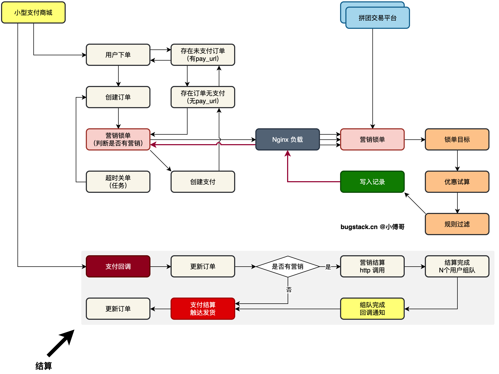
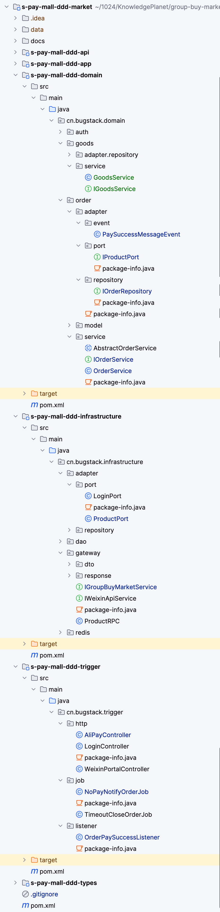
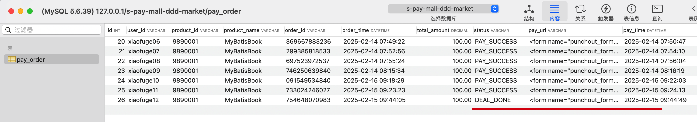

# 小商城对接营销结算

> 学习序号 26｜小节 3-4｜原文：https://articles.zsxq.com/id_94trcvenn89o.html

**本章重点** ：处理小型支付商城在用户完成支付后，调用拼团营销组队结算，并接收组队完成的回调消息执行后续交易结算发货。

- **本章重点** ：★★★★☆
- **本节分支：** [https://gitcode.net/KnowledgePlanet/s-pay-mall-ddd-market/-/tree/3-4-250215-xfg-s-pay-mall-settlement-order](https://gitcode.net/KnowledgePlanet/s-pay-mall-ddd-market/-/tree/3-4-250215-xfg-s-pay-mall-settlement-order)
- **课程视频** ：[https://t.zsxq.com/0V186](https://t.zsxq.com/0V186)

**版权说明** ：©本项目与星球签约合作，受[《中华人民共和国著作权法实施条例》](https://www.gov.cn/gongbao/content/2013/content_2339485.htm) 版权法保护，禁止任何理由和任何方式公开(public)源码、资料、视频等小傅哥发布的星球内容到Github、Gitee等各类平台，违反可追究进一步的法律责任。

作者：小傅哥

博客：[https://bugstack.cn](https://bugstack.cn)

> 沉淀、分享、成长，让自己和他人都能有所收获！😄

- 一、本章诉求
- 二、业务流程
- 三、编码实现
  - 1. 工程结构
  - 2. 支付回调
  - 3. 结算接口
  - 4. 拼团回调
  - 5. 模拟发货
- 四、测试验证
  - 1. 前置说明
  - 2. 启动 - 营销服务
  - 3. 启动 - 小型商城
  - 3. 测试 - 创建&支付订单
- 五、读者作业

## 一、本章诉求

处理小型支付商城在用户完成支付后，调用拼团营销组队结算，并接收组队完成的回调消息执行后续交易结算发货。—— `这里一个是拼团结算，一个是交易结算`

也就是说每一笔用户支付完成，拼团组队也就有一人推进了组队的进度，直至组队完成，即可回调交易系统进行通知组队完成，进行后续发货流程。

### 二、业务流程

如图，拼团交易结算流程；



- 上半部分，是拼团交易过程，进行营销锁单。是咱们上一节实现的。
- 下办部分，是拼团结算过程，进行营销结算。本节我们要做的新流程。
- 功能改造点；
  - 基础设施层 infrastructure gateway 下的 IGroupBuyMarketService 增加营销拼团结算方法（顺便加入拼团中DTO对象）。
  - 修改 OrderService#changeOrderPaySuccess 方法，判断订单是否有营销，无营销的继续走老流程。有营销则通过 port 适配调用基础设施层拼团的结算方法。
  - 在 trigger 层，AliPayController 增加 groupBuyNotify 回调方法。并把地址配置到 application-dev.yml 中。这样拼团系统在接收小型商城的用户订单组队完成后，就可以接收回调方法了。
  - domain order 领域服务，增加 changeOrderMarketSettlement 修改订单状态方法，增加一个拼团结算的状态。之后发送MQ消息，这个时候就每一笔分别结算发货了。
  - domain 领域服务，增加 goods 商品领域，模拟发货和修改订单状态。这个方法交给，OrderPaySuccessListener 接收到结算消息后进行调用。
  - 注意；为了方便拼团测试，我们可以把拼团活动的组队人数修改为1个。

### 三、编码实现

#### 1. 工程结构



- 首先，梳理代码的时候，可以以 AliPayController 的一条支付回调接口串联拼团营销结算。
- 之后，是以新增接口拼团结算回调为入口，串联拼团完结后更新订单状态和发货的操作。
- 最终，把相关链路上的逻辑串联起来即可。

#### 2. 支付回调

**cn.bugstack.domain.order.service.OrderService**

```
                @Override
public void changeOrderPaySuccess(String orderId, Date payTime) {
    OrderEntity orderEntity = repository.queryOrderByOrderId(orderId);
    if (null == orderEntity) return;
    if (MarketTypeVO.GROUP_BUY_MARKET.getCode().equals(orderEntity.getMarketType())) {
        repository.changeMarketOrderPaySuccess(orderId);
        // 发起营销结算。这个过程可以是http/rpc直接调用，也可以发一个商城交易支付完成的消息，之后拼团系统自己接收做结算。
        port.settlementMarketPayOrder(orderEntity.getUserId(), orderId, payTime);
        // 注意；在公司中，发起结算的http/rpc调用可能会失败，这个时候还会有增加job任务补偿。条件为，检查一笔走了拼团的订单，超过n分钟后，仍然没有做拼团结算状态变更。
        // 我们这里失败了，会抛异常，借助支付宝回调/job来重试。你可以单独实现一个独立的job来处理。
    } else {
        repository.changeOrderPaySuccess(orderId, payTime);
    }
}
```

- 支付回调要根据是否走了营销拼团，如果没有走，那么直接发货。如果走了拼团，则要先调用拼团做结算处理。

#### 3. 结算接口

```
                public interface IGroupBuyMarketService {

    /**
     * 营销锁单
     *
     * @param requestDTO 锁单商品信息
     * @return 锁单结果信息
     */
    @POST("api/v1/gbm/trade/lock_market_pay_order")
    Call<Response<LockMarketPayOrderResponseDTO>> lockMarketPayOrder(@Body LockMarketPayOrderRequestDTO requestDTO);

    /**
     * 营销结算
     *
     * @param requestDTO 结算商品信息
     * @return 结算结果信息
     */
    @POST("api/v1/gbm/trade/settlement_market_pay_order")
    Call<Response<SettlementMarketPayOrderResponseDTO>> settlementMarketPayOrder(@Body SettlementMarketPayOrderRequestDTO requestDTO);

}
```

```
                @Override
public void settlementMarketPayOrder(String userId, String orderId, Date orderTime) {
    SettlementMarketPayOrderRequestDTO requestDTO = new SettlementMarketPayOrderRequestDTO();
    requestDTO.setSource(source);
    requestDTO.setChannel(chanel);
    requestDTO.setUserId(userId);
    requestDTO.setOutTradeNo(orderId);
    requestDTO.setOutTradeTime(orderTime);
    try {
        Call<Response<SettlementMarketPayOrderResponseDTO>> call = groupBuyMarketService.settlementMarketPayOrder(requestDTO);
        // 获取结果
        Response<SettlementMarketPayOrderResponseDTO> response = call.execute().body();
        log.info("营销结算{} requestDTO:{} responseDTO:{}", userId, JSON.toJSONString(requestDTO), JSON.toJSONString(response));
        if (null == response) return;
        // 异常判断
        if (!"0000".equals(response.getCode())) {
            throw new AppException(response.getCode(), response.getInfo());
        }
    } catch (Exception e) {
        log.error("营销结算失败{}", userId, e);
    }
}
```

- 封装结算接口的调用。

#### 4. 拼团回调

```
                @Slf4j
@RestController()
@CrossOrigin("*")
@RequestMapping("/api/v1/alipay/")
public class AliPayController implements IPayService {

    @Value("${alipay.alipay_public_key}")
    private String alipayPublicKey;

    @Resource
    private IOrderService orderService;

    @RequestMapping(value = "group_buy_notify", method = RequestMethod.POST)
    @Override
    public String groupBuyNotify(@RequestBody NotifyRequestDTO requestDTO) {
        log.info("拼团回调，组队完成，结算开始 {}", JSON.toJSONString(requestDTO));
        try {
            // 营销结算
            orderService.changeOrderMarketSettlement(requestDTO.getOutTradeNoList());
            return "success";
        } catch (Exception e) {
            log.info("拼团回调，组队完成，结算失败 {}", JSON.toJSONString(requestDTO));
            return "error";
        }
    }
  
}
```

- 在 AliPayController 增加拼团回调接口，接收到回调以后，调用本地的营销结算。

```
                @Override
public void changeOrderMarketSettlement(List<String> outTradeNoList) {
    // 更新拼团结算状态
    orderDao.changeOrderMarketSettlement(outTradeNoList);
  
    // 循环成功发送消息 - 一般在公司的场景里，还会有job任务扫描超时没有结算的订单，查询订单状态。查询对方服务端的接口，会被限制一次查询多少，频次多少。
    outTradeNoList.forEach(outTradeNo -> {
        BaseEvent.EventMessage<PaySuccessMessageEvent.PaySuccessMessage> paySuccessMessageEventMessage = paySuccessMessageEvent.buildEventMessage(
                PaySuccessMessageEvent.PaySuccessMessage.builder()
                        .tradeNo(outTradeNo)
                        .build());
        PaySuccessMessageEvent.PaySuccessMessage paySuccessMessage = paySuccessMessageEventMessage.getData();
        eventBus.post(JSON.toJSONString(paySuccessMessage));
    });
}
```

- 营销结算会更新拼团订单的状态，之后发送支付结算消息。
- 可以看到，在有了拼团营销介入后，给用户结算的动作就往后了。如果没有拼团，则用户支付完成后，直接发货。
- 如果你参与过拼多多的一些活动，在你支付完成或者邀请好友完成，会给你提示你的商品已经打包，你的商品正准备发货，其实啥都没做，就是一些提示而已，直至你完成了所有动作，才会真的给你发货。

#### 5. 模拟发货

```
                @Slf4j
@Component
public class OrderPaySuccessListener {

    @Resource
    private IGoodsService goodsService;

    @Subscribe
    public void handleEvent(String paySuccessMessageJson) {
        log.info("收到支付成功消息 {}", paySuccessMessageJson);

        PaySuccessMessageEvent.PaySuccessMessage paySuccessMessage = JSON.parseObject(paySuccessMessageJson, PaySuccessMessageEvent.PaySuccessMessage.class);

        log.info("模拟发货（如；发货、充值、开户员、返利），单号:{}", paySuccessMessage.getTradeNo());

        // 变更订单状态 - 发货完成&结算
        goodsService.changeOrderDealDone(paySuccessMessage.getTradeNo());
    }

}
```

- 新增加一个 goods 商品领域，来处理商品模拟发货。这里其实就是修改了订单的状态。如果你做了一些虚拟的，比如获取积分，那么这块就要给用户充值完积分和变更订单状态。

### 四、测试验证

#### 1. 前置说明

- 拼团，group_buy_market 库表只是调整了，拼团活动 25120208 完成目标 target 为1，方便测试。一个人即可成团。
- 商城，pay_order 没有字段变化，只是 OrderStatusVO#MARKET 增加了过程中的枚举，标识订单在营销结算拼团组队完成。

```
                # 应用配置
app:
  config:
    # 版本，方便通过接口版本升级
    api-version: v1
    # 跨域，开发阶段可以设置为 * 不限制
    cross-origin: '*'
    # SC 渠道配置 - 拼团对接渠道值、回调通知
    group-buy-market:
      api-url: http://127.0.0.1:8091
      notify-url: http://127.0.0.1:8080/api/v1/alipay/group_buy_notify
      source: s01
      chanel: c01
```

- 修改 group-buy-market 的回调地址，为本节新增方法。

#### 2. 启动 - 营销服务

```
                  .   ____          _            __ _ _
 /\\ / ___'_ __ _ _(_)_ __  __ _ \ \ \ \
( ( )\___ | '_ | '_| | '_ \/ _` | \ \ \ \
 \\/  ___)| |_)| | | | | || (_| |  ) ) ) )
  '  |____| .__|_| |_|_| |_\__, | / / / /
 =========|_|==============|___/=/_/_/_/
 :: Spring Boot ::               (v2.7.12)

25-02-15.09:01:46.269 [main            ] INFO  Application            - Starting Application using Java 1.8.0_311 on MacBook-Pro.local with PID 45078 
25-02-15.09:44:50.479 [http-nio-8091-exec-7] INFO  MarketTradeController  - 营销交易组队结算开始:xiaofuge12 outTradeNo:754648070983
25-02-15.09:44:50.494 [http-nio-8091-exec-7] INFO  TradeSettlementOrderService - 拼团交易-支付订单结算:xiaofuge12 outTradeNo:754648070983
25-02-15.09:44:50.498 [http-nio-8091-exec-7] INFO  SCRuleFilter           - 结算规则过滤-渠道黑名单校验xiaofuge12 outTradeNo:754648070983
25-02-15.09:44:50.516 [http-nio-8091-exec-7] INFO  OutTradeNoRuleFilter   - 结算规则过滤-外部单号校验xiaofuge12 outTradeNo:754648070983
25-02-15.09:44:50.518 [http-nio-8091-exec-7] INFO  SettableRuleFilter     - 结算规则过滤-有效时间校验xiaofuge12 outTradeNo:754648070983
25-02-15.09:44:50.561 [http-nio-8091-exec-7] INFO  EndRuleFilter          - 结算规则过滤-结束节点xiaofuge12 outTradeNo:754648070983
25-02-15.09:44:50.672 [http-nio-8091-exec-7] INFO  TradeSettlementOrderService - 拼团交易-执行结算通知回调，指定 teamId:48146000
25-02-15.09:44:57.009 [http-nio-8091-exec-7] INFO  TradeSettlementOrderService - 回调通知拼团完结 result:{"retryCount":0,"successCount":1,"waitCount":1,"errorCount":0}
25-02-15.09:44:57.030 [http-nio-8091-exec-7] INFO  MarketTradeController  - 营销交易组队结算完成:xiaofuge12 outTradeNo:754648070983 response:{"code":"0000","data":{"activityId":100123,"outTradeNo":"754648070983","teamId":"48146000","userId":"xiaofuge12"},"info":"成功"}
```

- group-buy-market 直接启动运行即可。启动后在测试小型支付商城的时候，会看到相关的日志。

#### 3. 启动 - 小型商城

```
                  .   ____          _            __ _ _
 /\\ / ___'_ __ _ _(_)_ __  __ _ \ \ \ \
( ( )\___ | '_ | '_| | '_ \/ _` | \ \ \ \
 \\/  ___)| |_)| | | | | || (_| |  ) ) ) )
  '  |____| .__|_| |_|_| |_\__, | / / / /
 =========|_|==============|___/=/_/_/_/
 :: Spring Boot ::               (v2.7.12)

25-02-15.09:43:30.941 [main            ] INFO  Application            - Starting Application using Java 1.8.0_311 on MacBook-Pro.local with PID 45713 (/Users/fuzhengwei/1024/KnowledgePlanet/group-buy-market/s-pay-mall-ddd-market/s-pay-mall-ddd-app/target/classes started by fuzhengwei in /Users/fuzhengwei/1024/KnowledgePlanet/group-buy-market/s-pay-mall-ddd-market)
25-02-15.09:43:30.945 [main            ] INFO  Application            - The following 1 profile is active: "dev"
25-02-15.09:44:49.610 [http-nio-8080-exec-1] INFO  AliPayController       - 支付回调，消息接收 TRADE_SUCCESS
25-02-15.09:44:49.624 [http-nio-8080-exec-1] INFO  AliPayController       - 支付回调，交易名称: MyBatisBook
25-02-15.09:44:49.624 [http-nio-8080-exec-1] INFO  AliPayController       - 支付回调，交易状态: TRADE_SUCCESS
25-02-15.09:44:49.624 [http-nio-8080-exec-1] INFO  AliPayController       - 支付回调，支付宝交易凭证号: 2025021522001413370504869321
25-02-15.09:44:49.624 [http-nio-8080-exec-1] INFO  AliPayController       - 支付回调，商户订单号: 754648070983
25-02-15.09:44:49.624 [http-nio-8080-exec-1] INFO  AliPayController       - 支付回调，交易金额: 90.00
25-02-15.09:44:49.624 [http-nio-8080-exec-1] INFO  AliPayController       - 支付回调，买家在支付宝唯一id: 2088722024513370
25-02-15.09:44:49.625 [http-nio-8080-exec-1] INFO  AliPayController       - 支付回调，买家付款时间: 2025-02-15 09:44:47
25-02-15.09:44:49.625 [http-nio-8080-exec-1] INFO  AliPayController       - 支付回调，买家付款金额: 90.00
25-02-15.09:44:49.625 [http-nio-8080-exec-1] INFO  AliPayController       - 支付回调，支付回调，更新订单 754648070983
25-02-15.09:44:51.001 [scheduling-1    ] INFO  NoPayNotifyOrderJob    - 任务；检测未接收到或未正确处理的支付回调通知
25-02-15.09:44:51.247 [http-nio-8080-exec-2] INFO  AliPayController       - 拼团回调，组队完成，结算开始 {"outTradeNoList":["754648070983"],"teamId":"48146000"}
25-02-15.09:44:56.790 [scheduling-1    ] INFO  NoPayNotifyOrderJob    - 任务；检测未接收到或未正确处理的支付回调通知
25-02-15.09:44:56.851 [http-nio-8080-exec-2] INFO  OrderPaySuccessListener - 收到支付成功消息 {"tradeNo":"754648070983"}
```

- 启动小型商城是为了让支付宝交易完成和拼团组队完成可以进行回调。
- 同时记得开启 natapp，相关 natapp 的使用已经在小型商城里讲解过。

#### 3. 测试 - 创建&支付订单

```
                @Slf4j
@RunWith(SpringRunner.class)
@SpringBootTest
public class OrderServiceTest {

    @Resource
    private IOrderService orderService;

    @Test
    public void test_createOrder() throws Exception {
        ShopCartEntity shopCartEntity = new ShopCartEntity();
        shopCartEntity.setUserId("xiaofuge12");
        shopCartEntity.setProductId("9890001");
        shopCartEntity.setTeamId(null);
        shopCartEntity.setActivityId(100123L);
        shopCartEntity.setMarketTypeVO(MarketTypeVO.GROUP_BUY_MARKET);

        PayOrderEntity payOrderEntity = orderService.createOrder(shopCartEntity);

        log.info("请求参数:{}", JSON.toJSONString(shopCartEntity));
        log.info("测试结果:{}", JSON.toJSONString(payOrderEntity));
    }

}
```



- 注意；每次测试可以更换下 userId，因为拼团限制了一个用于一个活动只能参与一次。
- 创建完订单后，在数据库表中复制支付信息，粘贴到 docs/nginx/html form.html 中，点击浏览器打开，会跳转支付宝沙箱，进行支付。这块的步骤涉及小型支付商城和支付宝沙箱的对接。
- 完成支付后，你就可以看到 `启动 - 小型商城` 里的日志内容了，以及数据库表数据的变化。

### 五、读者作业

- 简单作业：厘清本节业务流程，完成本节的支付拼团结算的对接。可以多实操几遍。
- 复杂作业：尝试完成前端页面流程的对接，这部分后续章节也会做。可以先自己尝试下。
