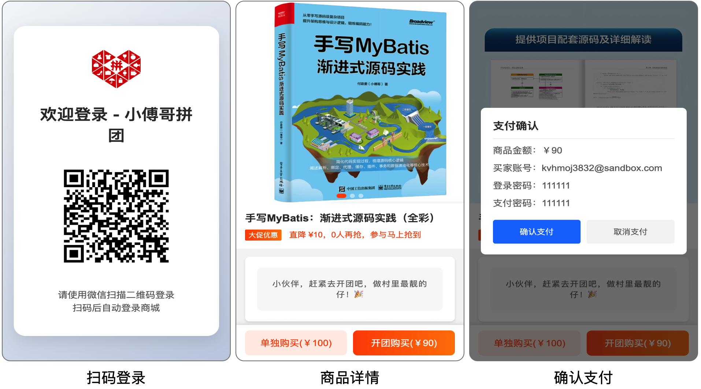
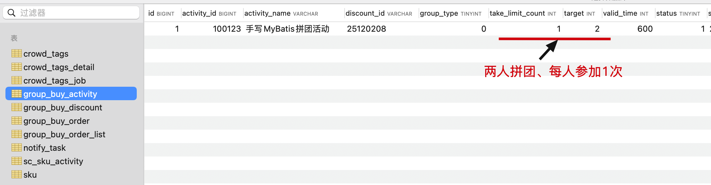
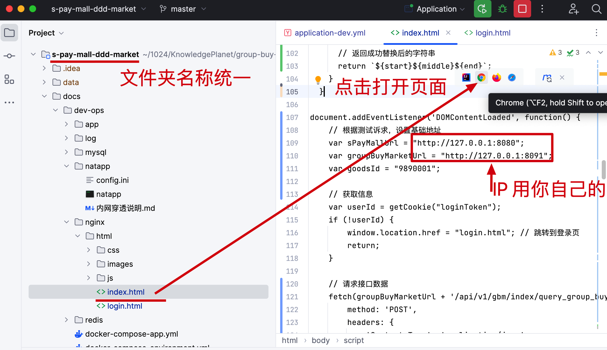

# 小商城UI与接口对接

> 学习序号 27｜小节 3-5｜原文：https://articles.zsxq.com/id_akgz1xjo9fkt.html

**本章重点** ：基于 DeepSeek/OpenAI 处理小型支付商城UI与接口的对接

- **本章重点** ：★★★★☆
- **本节分支：** [https://gitcode.net/KnowledgePlanet/s-pay-mall-ddd-market/-/tree/3-5-250216-xfg-s-pay-mall-ui](https://gitcode.net/KnowledgePlanet/s-pay-mall-ddd-market/-/tree/3-5-250216-xfg-s-pay-mall-ui)
- **课程视频** ：[https://t.zsxq.com/jPjFC](https://t.zsxq.com/jPjFC)

**版权说明** ：©本项目与星球签约合作，受[《中华人民共和国著作权法实施条例》](https://www.gov.cn/gongbao/content/2013/content_2339485.htm) 版权法保护，禁止任何理由和任何方式公开(public)源码、资料、视频等小傅哥发布的星球内容到Github、Gitee等各类平台，违反可追究进一步的法律责任。

作者：小傅哥

博客：[https://bugstack.cn](https://bugstack.cn)

> 沉淀、分享、成长，让自己和他人都能有所收获！😄

- 一、本章诉求
- 二、效果展示
- 三、接口对接
  - 1. 前置改动
  - 2. 绑定事件 - 商品下单
  - 3. 用户登录
- 四、效果测试
  - 1. 拼团系统 - 启动
  - 2. 商城系统 - 启动
  - 3. 访问页面
- 五、读者作业

### 一、本章诉求

基于 DeepSeek/OpenAI 等AI产品，把UI代码、接口代码，增加逻辑描述，一起喂给AI，来处理小型支付商城UI与接口的对接。

在前面章节我们开发了一款静态页面UI，直接和拼团后端对接。这回走正式的逻辑，下单将走到小型支付商城，由商城后端处理锁单和结算。之后和前端页面UI对接。

这是一次微服务的前后端全流程衔接，支付商城和拼团营销，就是2个微服务系统。学到这块，你即可以实践的方式理解微服务，而哪些RPC、MQ、xxl-job、分库分表等，则是为每个微服务提供分布式负载能力的技术。这些东西将在后续章节展开。

### 二、效果展示



- UI 与小型支付商城对接后，可以扫码登录，确认支付时走支付宝沙箱登录。
- 这样就是一个完整的，商品营销下单支付，再到结算的流程了。

### 三、接口对接

#### 1. 前置改动

- group-buy-market 拼团 MarketIndexController#queryGroupBuyMarketConfig 接口，GoodsMarketResponseDTO 类增加 `Long activityId;` 字段返回。
- s-pay-mall-ddd-market 小型支付商城 AliPayController#createPayOrder 接口，ShopCartEntity 增加 activityId 透传。

#### 2. 绑定事件 - 商品下单

```
                // 根据测试诉求，设置基础地址
var sPayMallUrl = "http://127.0.0.1:8080";
var groupBuyMarketUrl = "http://127.0.0.1:8091";
var goodsId = "9890001";

// 绑定支付事件[拼团购买]
document.querySelectorAll('.group-btn, .group-buy').forEach(btn => {
    btn.addEventListener('click', function() {
        const button = this;
        const price = button.dataset.price;
        // 获取拼团ID
        let teamId = null;
        if (this.classList.contains('group-btn')) {
            const groupItem = this.closest('.group-item');
            const userInfo = groupItem.querySelector('.user-info');
            teamId = userInfo.dataset.teamid;
        }
        var url = sPayMallUrl + '/api/v1/alipay/create_pay_order';
        var requestBody = {
             userId: userId,
             productId: goods.goodsId,
             teamId: teamId,
             activityId: activityId,
             marketType: 1
        };
        fetch(url, {
            method: 'POST',
            headers: {
                'Content-Type': 'application/json'
            },
            body: JSON.stringify(requestBody) // 将请求体转换为JSON字符串
        })
        .then(response => response.json()) // 解析JSON格式的响应
        .then(json => {
            if (json.code === "0000") { // 假设成功的code是"0000"
                document.querySelectorAll('form').forEach(form => form.remove());
                document.body.insertAdjacentHTML('beforeend', json.data);
                showPaymentConfirm(goods.payPrice);
            } else {
                console.error('Error:', json.info); // 输出错误信息
            }
        })
        .catch(error => console.error('Error:', error));
    });
});

// 绑定支付事件[单独购买]
document.querySelectorAll('.buy-alone').forEach(btn => {
    btn.addEventListener('click', function() {
        const button = this;
        const price = button.dataset.price;
        var requestBody = {
             userId: userId,
             productId: goods.goodsId,
             marketType: 0
        };
        fetch(sPayMallUrl + '/api/v1/alipay/create_pay_order', {
            method: 'POST',
            headers: {
                'Content-Type': 'application/json'
            },
            body: JSON.stringify(requestBody) // 将请求体转换为JSON字符串
        })
        .then(response => response.json()) // 解析JSON格式的响应
        .then(json => {
            if (json.code === "0000") { // 假设成功的code是"0000"
                document.querySelectorAll('form').forEach(form => form.remove());
                document.body.insertAdjacentHTML('beforeend', json.data);
                showPaymentConfirm(goods.payPrice);
            } else {
                console.error('Error:', json.info); // 输出错误信息
            }
        })
        .catch(error => console.error('Error:', error));
    });
});
```

- groupBuyMarketUrl 是拼团系统的服务接口，查询拼团信息，可以直接走拼团系统。`在公司中如果商城类系统有自己的很多逻辑，则会把这样的接口，让商城类系统重新包装。`
- sPayMallUrl 就是小型支付商城的服务地址，把这个地址和接口，绑定到下单按钮上。
- 拼团下单，teamId、activityId、marketType = 1，要传入相关的值，并设定是营销拼团下单。
- 单独下单，不需要透传 teamId、activityId，只需要传 marketType = 0 就可以了。

#### 3. 用户登录

```
                var sPayMallUrl = "http://127.0.0.1:8080";
document.addEventListener("DOMContentLoaded", function() {
    // 获取二维码 ticket
    fetch(sPayMallUrl + '/api/v1/login/weixin_qrcode_ticket')
        .then(response => response.json())
        .then(data => {
            if (data.code === "0000") {
                const ticket = data.data;
                const qrCodeImg = document.getElementById('qr-code-img');
                qrCodeImg.src = `https://mp.weixin.qq.com/cgi-bin/showqrcode?ticket=${ticket}`;
                qrCodeImg.classList.remove('pulse');
                // 开始轮询检查登录状态
                const intervalId = setInterval(() => {
                    checkLoginStatus(ticket, intervalId);
                }, 3000); // 每3秒检查一次
            } else {
                console.error('获取二维码 ticket 失败:', data.info);
            }
        })
        .catch(error => {
            console.error('请求失败:', error);
        });
    function checkLoginStatus(ticket, intervalId) {
        fetch(sPayMallUrl + `/api/v1/login/check_login?ticket=${ticket}`)
            .then(response => response.json())
            .then(data => {
                if (data.code === "0000") {
                    console.info("login success");
                    // 停止轮询
                    clearInterval(intervalId);
                    // 保存登录 token 到 cookie，设置有效期为30天
                    setCookie('loginToken', data.data, 30);
                    // 在这里可以重定向到登录后的页面
                    window.location.href = 'index.html'; // 假设登录成功后跳转到首页
                } else {
                    console.info("login wait");
                }
            })
            .catch(error => {
                console.error('请求失败:', error);
            });
    }
    function setCookie(name, value, days) {
        const date = new Date();
        date.setTime(date.getTime() + (days * 24 * 60 * 60 * 1000));
        const expires = "expires=" + date.toUTCString();
        document.cookie = name + "=" + value + ";" + expires + ";path=/";
    }
});
```

- 扫码登录这部分来自于原来的小型支付商城对接，之后本节的代码是发给了 DeepSeek/OpenAI 让对 UI 做了优化。

### 四、效果测试

#### 1. 拼团系统 - 启动



- 拼团系统，修改库表数据，方便测试。

```
                  .   ____          _            __ _ _
 /\\ / ___'_ __ _ _(_)_ __  __ _ \ \ \ \
( ( )\___ | '_ | '_| | '_ \/ _` | \ \ \ \
 \\/  ___)| |_)| | | | | || (_| |  ) ) ) )
  '  |____| .__|_| |_|_| |_\__, | / / / /
 =========|_|==============|___/=/_/_/_/
 :: Spring Boot ::               (v2.7.12)

25-02-16.14:46:24.906 [main            ] INFO  Application            - Starting Application using Java 1.8.0_311 on MacBook-Pro.local with PID 58821 
"userId":"or0Ab6ivwmypESVp_bYuk92T6SvU"}
25-02-16.14:47:17.592 [http-nio-8091-exec-2] INFO  MJCalculateService     - 优惠策略折扣计算:0
25-02-16.14:47:17.592 [http-nio-8091-exec-2] INFO  EndNode                - 拼团商品查询试算服务-EndNode userId:or0Ab6ivwmypESVp_bYuk92T6SvU requestParameter:{"channel":"c01","goodsId":"9890001","source":"s01","userId":"or0Ab6ivwmypESVp_bYuk92T6SvU"}
25-02-16.14:47:17.608 [http-nio-8091-exec-2] INFO  MarketIndexController  - 查询拼团营销配置完成:or0Ab6ivwmypESVp_bYuk92T6SvU goodsId:9890001 response:{"code":"0000","data":{"activityId":100123,"goods":{"deductionPrice":10.00,"goodsId":"9890001","originalPrice":100.00,"payPrice":90.00},"teamList":[],"teamStatistic":{"allTeamCompleteCount":0,"allTeamCount":0,"allTeamUserCount":0}},"info":"成功"}
25-02-16.14:49:36.998 [http-nio-8091-exec-4] INFO  MarketIndexController  - 查询拼团营销配置开始:or0Ab6ivwmypESVp_bYuk92T6SvU goodsId:9890001
25-02-16.14:49:36.999 [http-nio-8091-exec-4] INFO  RootNode               - 拼团商品查询试算服务-RootNode userId:or0Ab6ivwmypESVp_bYuk92T6SvU requestParameter:{"channel":"c01","goodsId":"9890001","source":"s01","userId":"or0Ab6ivwmypESVp_bYuk92T6SvU"}
25-02-16.14:49:37.000 [http-nio-8091-exec-4] INFO  SwitchNode             - 拼团商品查询试算服务-SwitchNode userId:or0Ab6ivwmypESVp_bYuk92T6SvU requestParameter:{"channel":"c01","goodsId":"9890001","source":"s01","userId":"or0Ab6ivwmypESVp_bYuk92T6SvU"}
25-02-16.14:49:37.020 [http-nio-8091-exec-4] INFO  MarketNode             - 拼团商品查询试算服务-MarketNode userId:or0Ab6ivwmypESVp_bYuk92T6SvU 异步线程加载数据「GroupBuyActivityDiscountVO、SkuVO」完成
25-02-16.14:49:37.020 [http-nio-8091-exec-4] INFO  MarketNode             - 拼团商品查询试算服务-MarketNode userId:or0Ab6ivwmypESVp_bYuk92T6SvU requestParameter:{"channel":"c01","goodsId":"9890001","source":"s01","userId":"or0Ab6ivwmypESVp_bYuk92T6SvU"}
25-02-16.14:49:37.020 [http-nio-8091-exec-4] INFO  MJCalculateService     - 优惠策略折扣计算:0
25-02-16.14:49:37.020 [http-nio-8091-exec-4] INFO  EndNode                - 拼团商品查询试算服务-EndNode userId:or0Ab6ivwmypESVp_bYuk92T6SvU requestParameter:{"channel":"c01","goodsId":"9890001","source":"s01","userId":"or0Ab6ivwmypESVp_bYuk92T6SvU"}
25-02-16.14:49:37.030 [http-nio-8091-exec-4] INFO  MarketIndexController  - 查询拼团营销配置完成:or0Ab6ivwmypESVp_bYuk92T6SvU goodsId:9890001 response:{"code":"0000","data":{"activityId":100123,"goods":{"deductionPrice":10.00,"goodsId":"9890001","originalPrice":100.00,"payPrice":90.00},"teamList":[],"teamStatistic":{"allTeamCompleteCount":0,"allTeamCount":0,"allTeamUserCount":0}},"info":"成功"}
25-02-16.14:50:01.143 [http-nio-8091-exec-5] INFO  MarketTradeController  - 营销交易锁单:or0Ab6ivwmypESVp_bYuk92T6SvU LockMarketPayOrderRequestDTO:{"activityId":100123,"channel":"c01","goodsId":"9890001","notifyUrl":"http://127.0.0.1:8080/api/v1/alipay/group_buy_notify","outTradeNo":"014535303245","source":"s01","userId":"or0Ab6ivwmypESVp_bYuk92T6SvU"}
25-02-16.14:50:01.143 [http-nio-8091-exec-5] INFO  TradeLockOrderService  - 拼团交易-查询未支付营销订单:or0Ab6ivwmypESVp_bYuk92T6SvU outTradeNo:014535303245
25-02-16.14:50:01.160 [http-nio-8091-exec-5] INFO  RootNode               - 拼团商品查询试算服务-RootNode userId:or0Ab6ivwmypESVp_bYuk92T6SvU requestParameter:{"activityId":100123,"channel":"c01","goodsId":"9890001","source":"s01","userId":"or0Ab6ivwmypESVp_bYuk92T6SvU"}
25-02-16.14:50:01.160 [http-nio-8091-exec-5] INFO  SwitchNode             - 拼团商品查询试算服务-SwitchNode userId:or0Ab6ivwmypESVp_bYuk92T6SvU requestParameter:{"activityId":100123,"channel":"c01","goodsId":"9890001","source":"s01","userId":"or0Ab6ivwmypESVp_bYuk92T6SvU"}
25-02-16.14:50:01.166 [http-nio-8091-exec-5] INFO  MarketNode             - 拼团商品查询试算服务-MarketNode userId:or0Ab6ivwmypESVp_bYuk92T6SvU 异步线程加载数据「GroupBuyActivityDiscountVO、SkuVO」完成
25-02-16.14:50:01.166 [http-nio-8091-exec-5] INFO  MarketNode             - 拼团商品查询试算服务-MarketNode userId:or0Ab6ivwmypESVp_bYuk92T6SvU requestParameter:{"activityId":100123,"channel":"c01","goodsId":"9890001","source":"s01","userId":"or0Ab6ivwmypESVp_bYuk92T6SvU"}
25-02-16.14:50:01.166 [http-nio-8091-exec-5] INFO  MJCalculateService     - 优惠策略折扣计算:0
25-02-16.14:50:01.166 [http-nio-8091-exec-5] INFO  EndNode                - 拼团商品查询试算服务-EndNode userId:or0Ab6ivwmypESVp_bYuk92T6SvU requestParameter:{"activityId":100123,"channel":"c01","goodsId":"9890001","source":"s01","userId":"or0Ab6ivwmypESVp_bYuk92T6SvU"}
25-02-16.14:50:01.171 [http-nio-8091-exec-5] INFO  TradeLockOrderService  - 拼团交易-锁定营销优惠支付订单:or0Ab6ivwmypESVp_bYuk92T6SvU activityId:100123 goodsId:9890001
25-02-16.14:50:01.172 [http-nio-8091-exec-5] INFO  ActivityUsabilityRuleFilter - 交易规则过滤-活动的可用性校验or0Ab6ivwmypESVp_bYuk92T6SvU activityId:100123
25-02-16.14:50:01.180 [http-nio-8091-exec-5] INFO  UserTakeLimitRuleFilter - 交易规则过滤-用户参与次数校验or0Ab6ivwmypESVp_bYuk92T6SvU activityId:100123
25-02-16.14:50:01.230 [http-nio-8091-exec-5] INFO  MarketTradeController  - 交易锁单记录(新):or0Ab6ivwmypESVp_bYuk92T6SvU marketPayOrderEntity:{"deductionPrice":10.00,"orderId":"316221789405","originalPrice":100.00,"payPrice":90.00,"tradeOrderStatusEnumVO":"CREATE"}
```

#### 2. 商城系统 - 启动

```
                # 支付宝支付 - 沙箱 https://opendocs.alipay.com/common/02kkv7
alipay:
  enabled: true
  app_id: 9021000132689924
  merchant_private_key: MIIEvQIBADANBgkqhkiG9w0B****  6qBcm8Ugee4rmEt41EojYvQTXpDERVjGLR5Q=
  alipay_public_key: MIIBIjANBgkqhk****  +xid5Cu5erLDPHtFXfnQHI4n/opQaXo5wIDAQAB
  notify_url: http://xfg-studio.natapp1.cc/api/v1/alipay/alipay_notify_url
  return_url: http://localhost:63342/s-pay-mall-ddd-market/docs/dev-ops/nginx/html/index.html
  gatewayUrl: https://openapi-sandbox.dl.alipaydev.com/gateway.do
```

- 注意修改 notify_url、return_url URL 为你的URL地址。

```
                  .   ____          _            __ _ _
 /\\ / ___'_ __ _ _(_)_ __  __ _ \ \ \ \
( ( )\___ | '_ | '_| | '_ \/ _` | \ \ \ \
 \\/  ___)| |_)| | | | | || (_| |  ) ) ) )
  '  |____| .__|_| |_|_| |_\__, | / / / /
 =========|_|==============|___/=/_/_/_/
 :: Spring Boot ::               (v2.7.12)

25-02-16.15:14:49.477 [main            ] INFO  Application            - Starting Application using Java 1.8.0_311 on MacBook-Pro.local with PID 59113 
```

#### 3. 访问页面



- 测试阶段在这里点击打开页面。之后就可以测试拼团了。
- F12 打开控制台，可以修改登录的 cookie 值，之后换其他用户，刷新页面在下单。

### 五、读者作业

- 简单作业：厘清本节流程，完成功能对接，可以运行演示。
- 复杂作业：现在可以尝试上线啦！
