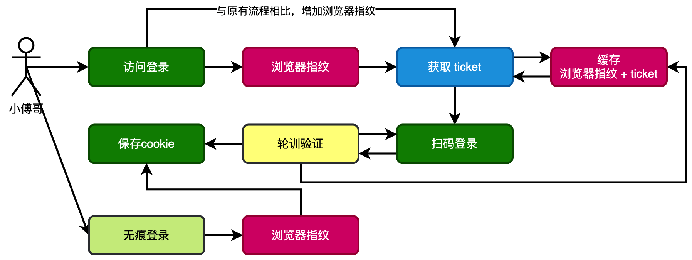
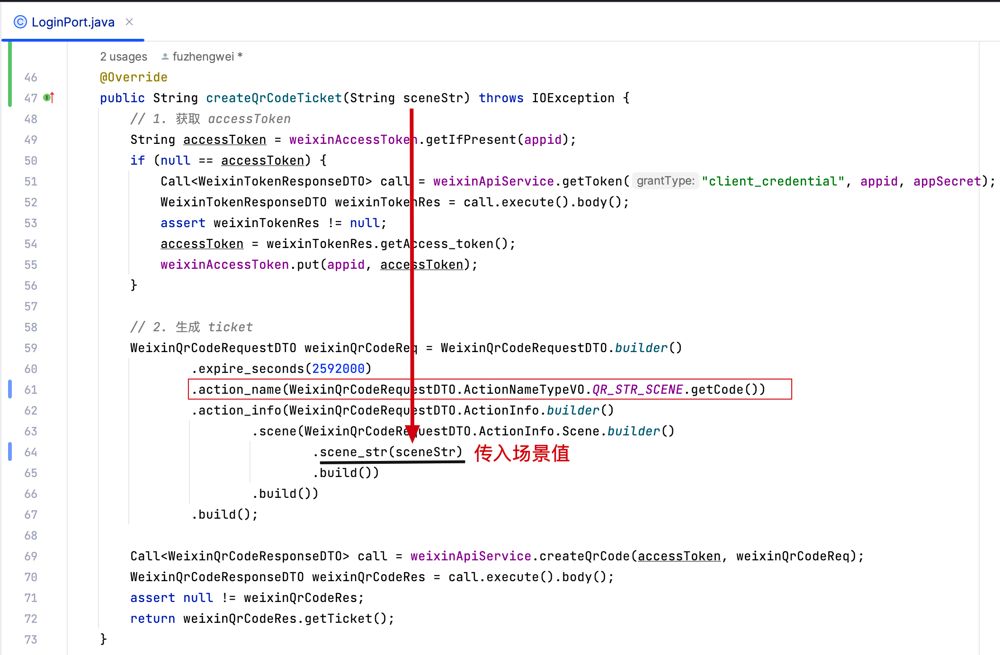
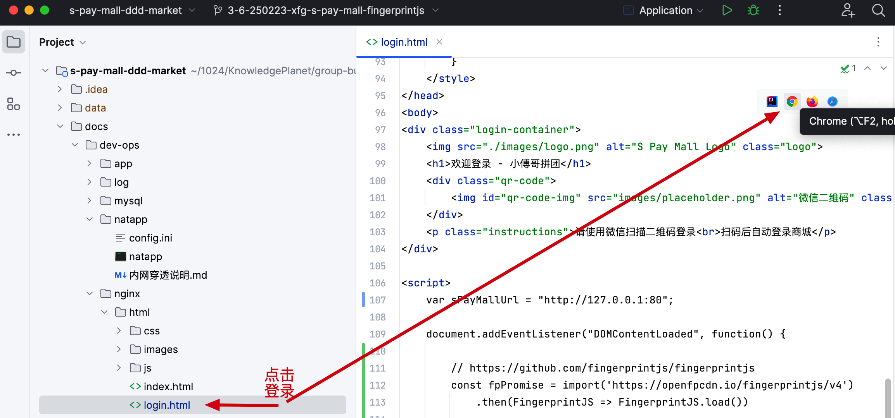
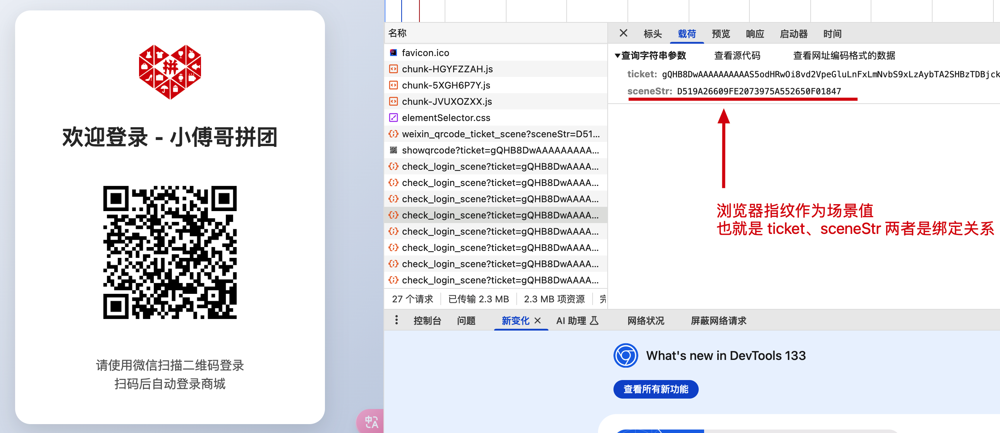
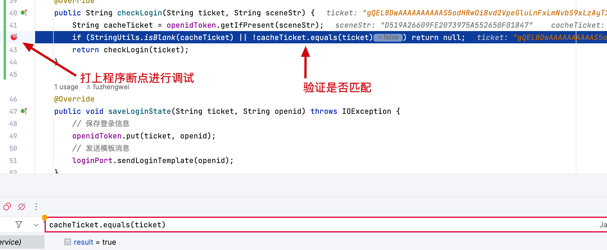

# 通过浏览器指纹获取登录ticket 无痕登录

> 学习序号 29｜小节 3-6｜原文：https://articles.zsxq.com/id_hkn1fgvk47h4.html

**本章重点** ：增强登录安全性，使用浏览器指纹，获取唯一 Ticket 作为登录二维码使用。

- **本章重点** ：★★★☆☆
- **本节分支：** [https://gitcode.net/KnowledgePlanet/s-pay-mall-ddd-market/-/tree/3-6-250223-xfg-s-pay-mall-fingerprintjs](https://gitcode.net/KnowledgePlanet/s-pay-mall-ddd-market/-/tree/3-6-250223-xfg-s-pay-mall-fingerprintjs)
- **课程视频** ：[https://t.zsxq.com/8Oa5K](https://t.zsxq.com/8Oa5K)

**版权说明** ：©本项目与星球签约合作，受[《中华人民共和国著作权法实施条例》](https://www.gov.cn/gongbao/content/2013/content_2339485.htm) 版权法保护，禁止任何理由和任何方式公开(public)源码、资料、视频等小傅哥发布的星球内容到Github、Gitee等各类平台，违反可追究进一步的法律责任。

作者：小傅哥

博客：[https://bugstack.cn](https://bugstack.cn)

> 沉淀、分享、成长，让自己和他人都能有所收获！😄

- 一、本章诉求
- 二、业务流程
- 三、编码实现
  - 1. 鉴权接口 - 获取Ticket
  - 2. 鉴权接口 - 校验Ticket
  - 3. 最终接口实现
  - 4. 前端改动
- 四、测试验证
  - 1. 登录入口
  - 2. 访问页面
  - 3. 断点验证
  - 4. 运行日志
- 五、读者作业

### 一、本章诉求

增强登录安全性，使用浏览器指纹，获取唯一 Ticket 作为登录二维码使用。

本章节属于知识点的扩展，即使没实现，也不影响整体功能。

### 二、业务流程

如图，增加浏览器指纹标识；



- 原有的微信扫码登录拿到的是同一个 Tikcet，这样是满足测试，但对于上线给其他人一起使用是不太安全的。所以我们可以通过浏览器指纹的方式进行处理。
- 浏览器指纹生成唯一标识，通过唯一标识获取ticket，并在轮训验证中使用浏览器指纹加验。确保浏览器指纹缓存的 ticket 和登录后的 ticket 保持一致。

### 三、编码实现

引入 hutool pom，使用工具生成唯一标识。

```
                <dependency>
    <groupId>cn.hutool</groupId>
    <artifactId>hutool-all</artifactId>
    <version>5.8.20</version>
</dependency>
```

- 在没有浏览器指纹的时候（浏览器被限制时），可以使用 hutool 来生成唯一标识。

#### 1. 鉴权接口 - 获取Ticket

##### 1.1 接口定义

```
                public interface IAuthService {

    Response<String> weixinQrCodeTicket();

    Response<String> weixinQrCodeTicket(String sceneStr);
    
}    
```

- 重载一个带有场景值入参的生成 ticket 的接口。这个接口场景值就来自于前端浏览器指纹。

##### 1.2 生成ticket



- 注意 LoginPort 的改动点。设置了字符串入参，并传入场景值。

```
                @Override
public String createQrCodeTicket() throws IOException {
    String sceneStr = IdUtil.getSnowflake().nextIdStr();
    return createQrCodeTicket(sceneStr);
}
```

- 另外一部分是重载进去的方法，兼容旧版逻辑。即使没有场景值，也可以生成唯一ID标识。

##### 1.3 缓存指纹 + ticket

```
                @Slf4j
@Service
public class WeixinLoginService implements ILoginService {

    @Resource
    private ILoginPort loginPort;
    @Resource
    private Cache<String, String> openidToken;

    @Override
    public String createQrCodeTicket() throws Exception {
        return loginPort.createQrCodeTicket();
    }

    @Override
    public String createQrCodeTicket(String sceneStr) throws Exception {
        String ticket = loginPort.createQrCodeTicket(sceneStr);
        // 保存浏览器指纹信息和ticket映射关系
        openidToken.put(sceneStr, ticket);
        return ticket;
    }
  
}
```

- 在 createQrCodeTicket 方法中缓存场景值。这样浏览器在轮训校验的时候，就可以传入浏览器指纹和缓存的ticket先做一轮验证。

#### 2. 鉴权接口 - 校验Ticket

##### 2.1 接口定义

```
                public interface IAuthService {

    Response<String> checkLogin(String ticket);

    Response<String> checkLogin(String ticket, String sceneStr);

}
```

- 重载一个带有场景id的轮训校验方法。原方法保留这样新旧流程都可以兼容。

##### 2.2 校验指纹 + ticket

```
                @Slf4j
@Service
public class WeixinLoginService implements ILoginService {

    @Resource
    private ILoginPort loginPort;
    @Resource
    private Cache<String, String> openidToken;

    @Override
    public String checkLogin(String ticket, String sceneStr) {
        String cacheTicket = openidToken.getIfPresent(sceneStr);
        if (StringUtils.isBlank(cacheTicket) || !cacheTicket.equals(ticket)) return null;
        return checkLogin(ticket);
    }

}
```

- 校验登录时候，通过判断当前场景值ID（浏览器指纹）存储的缓存ticket，看看是不从当前浏览器发起的。
- 之后在校验登录 checkLogin。

#### 3. 最终接口实现

```
                package cn.bugstack.trigger.http;

import cn.bugstack.api.IAuthService;
import cn.bugstack.api.response.Response;
import cn.bugstack.domain.auth.service.ILoginService;
import cn.bugstack.types.common.Constants;
import lombok.extern.slf4j.Slf4j;
import org.apache.commons.lang3.StringUtils;
import org.springframework.web.bind.annotation.*;

import javax.annotation.Resource;

@Slf4j
@RestController()
@CrossOrigin("*")
@RequestMapping("/api/v1/login/")
public class LoginController implements IAuthService {

    @Resource
    private ILoginService loginService;

    /**
     * http://xfg-studio.natapp1.cc/api/v1/login/weixin_qrcode_ticket
     * @return
     */
    @RequestMapping(value = "weixin_qrcode_ticket", method = RequestMethod.GET)
    @Override
    public Response<String> weixinQrCodeTicket() {
        try {
            String qrCodeTicket = loginService.createQrCodeTicket();
            log.info("生成微信扫码登录 ticket:{}", qrCodeTicket);
            return Response.<String>builder()
                    .code(Constants.ResponseCode.SUCCESS.getCode())
                    .info(Constants.ResponseCode.SUCCESS.getInfo())
                    .data(qrCodeTicket)
                    .build();
        } catch (Exception e) {
            log.error("生成微信扫码登录 ticket 失败", e);
            return Response.<String>builder()
                    .code(Constants.ResponseCode.UN_ERROR.getCode())
                    .info(Constants.ResponseCode.UN_ERROR.getInfo())
                    .build();
        }
    }

    /**
     * http://xfg-studio.natapp1.cc/api/v1/login/weixin_qrcode_ticket_scene?sceneStr=
     * @return
     */
    @RequestMapping(value = "weixin_qrcode_ticket_scene", method = RequestMethod.GET)
    @Override
    public Response<String> weixinQrCodeTicket(@RequestParam String sceneStr) {
        try {
            String qrCodeTicket = loginService.createQrCodeTicket(sceneStr);
            log.info("生成微信扫码登录 ticket:{}", qrCodeTicket);
            return Response.<String>builder()
                    .code(Constants.ResponseCode.SUCCESS.getCode())
                    .info(Constants.ResponseCode.SUCCESS.getInfo())
                    .data(qrCodeTicket)
                    .build();
        } catch (Exception e) {
            log.error("生成微信扫码登录 ticket 失败", e);
            return Response.<String>builder()
                    .code(Constants.ResponseCode.UN_ERROR.getCode())
                    .info(Constants.ResponseCode.UN_ERROR.getInfo())
                    .build();
        }
    }

    /**
     * http://xfg-studio.natapp1.cc/api/v1/login/check_login
     */
    @RequestMapping(value = "check_login", method = RequestMethod.GET)
    @Override
    public Response<String> checkLogin(@RequestParam String ticket) {
        try {
            String openidToken = loginService.checkLogin(ticket);
            log.info("扫码检测登录结果 ticket:{} openidToken:{}", ticket, openidToken);
            if (StringUtils.isNotBlank(openidToken)) {
                return Response.<String>builder()
                        .code(Constants.ResponseCode.SUCCESS.getCode())
                        .info(Constants.ResponseCode.SUCCESS.getInfo())
                        .data(openidToken)
                        .build();
            } else {
                return Response.<String>builder()
                        .code(Constants.ResponseCode.NO_LOGIN.getCode())
                        .info(Constants.ResponseCode.NO_LOGIN.getInfo())
                        .build();
            }
        } catch (Exception e) {
            log.error("扫码检测登录结果失败 ticket:{}", ticket, e);
            return Response.<String>builder()
                    .code(Constants.ResponseCode.UN_ERROR.getCode())
                    .info(Constants.ResponseCode.UN_ERROR.getInfo())
                    .build();
        }
    }

    @RequestMapping(value = "check_login_scene", method = RequestMethod.GET)
    @Override
    public Response<String> checkLogin(@RequestParam String ticket, @RequestParam String sceneStr) {
        try {
            String openidToken = loginService.checkLogin(ticket, sceneStr);
            log.info("扫码检测登录结果 ticket:{} openidToken:{} sceneStr:{}", ticket, openidToken, sceneStr);
            if (StringUtils.isNotBlank(openidToken)) {
                return Response.<String>builder()
                        .code(Constants.ResponseCode.SUCCESS.getCode())
                        .info(Constants.ResponseCode.SUCCESS.getInfo())
                        .data(openidToken)
                        .build();
            } else {
                return Response.<String>builder()
                        .code(Constants.ResponseCode.NO_LOGIN.getCode())
                        .info(Constants.ResponseCode.NO_LOGIN.getInfo())
                        .build();
            }
        } catch (Exception e) {
            log.error("扫码检测登录结果失败 ticket:{}", ticket, e);
            return Response.<String>builder()
                    .code(Constants.ResponseCode.UN_ERROR.getCode())
                    .info(Constants.ResponseCode.UN_ERROR.getInfo())
                    .build();
        }
    }

}
```

- 从接口上看，带有 `_scene` 值的为需要使用浏览器透传指纹ID标识。
- weixin_qrcode_ticket_scene，获取登录 ticket
- check_login_scene，轮训校验登录

#### 4. 前端改动

```
                <!DOCTYPE html>
<html lang="zh-CN">
<head>
    <meta charset="UTF-8">
    <meta name="viewport" content="width=device-width, initial-scale=1.0">
    <title>S Pay Mall 商城登录</title>
    <style>
       //... 省略样式代码
    </style>
</head>
<body>
<div class="login-container">
    
    <h1>欢迎登录 - 小傅哥拼团</h1>
    <div class="qr-code">
        
    </div>
    <p class="instructions">请使用微信扫描二维码登录<br>扫码后自动登录商城</p>
</div>

<script>
    var sPayMallUrl = "http://127.0.0.1:80";

    document.addEventListener("DOMContentLoaded", function() {

        // https://github.com/fingerprintjs/fingerprintjs
        const fpPromise = import('https://openfpcdn.io/fingerprintjs/v4')
            .then(FingerprintJS => FingerprintJS.load())

          // Get the visitor identifier when you need it.
          fpPromise
            .then(fp => fp.get())
            .then(result => {
              // This is the visitor identifier:
              const visitorId = result.visitorId

              // 获取场景值
              let sceneStr = visitorId.toUpperCase();

            // 获取二维码 ticket
            fetch(sPayMallUrl + '/api/v1/login/weixin_qrcode_ticket_scene?sceneStr='+sceneStr)
                .then(response => response.json())
                .then(data => {
                    if (data.code === "0000") {
                        const ticket = data.data;
                        const qrCodeImg = document.getElementById('qr-code-img');
                        qrCodeImg.src = `https://mp.weixin.qq.com/cgi-bin/showqrcode?ticket=${ticket}`;
                        qrCodeImg.classList.remove('pulse');

                        // 开始轮询检查登录状态
                        const intervalId = setInterval(() => {
                            checkLoginStatus(ticket, intervalId);
                        }, 3000); // 每3秒检查一次
                    } else {
                        console.error('获取二维码 ticket 失败:', data.info);
                    }
                })
                .catch(error => {
                    console.error('请求失败:', error);
                });

            function checkLoginStatus(ticket, intervalId) {
                fetch(sPayMallUrl + `/api/v1/login/check_login_scene?ticket=${ticket}&sceneStr=`+sceneStr)
                    .then(response => response.json())
                    .then(data => {
                        if (data.code === "0000") {
                            console.info("login success");
                            // 停止轮询
                            clearInterval(intervalId);
                            // 保存登录 token 到 cookie，设置有效期为30天
                            setCookie('loginToken', data.data, 30);
                            // 在这里可以重定向到登录后的页面
                            window.location.href = 'index.html'; // 假设登录成功后跳转到首页
                        } else {
                            console.info("login wait");
                        }
                    })
                    .catch(error => {
                        console.error('请求失败:', error);
                    });
            }

            function setCookie(name, value, days) {
                const date = new Date();
                date.setTime(date.getTime() + (days * 24 * 60 * 60 * 1000));
                const expires = "expires=" + date.toUTCString();
                document.cookie = name + "=" + value + ";" + expires + ";path=/";
            }
 
        });


    });
</script>
</body>
</html>
```

- 浏览器指纹库；[https://github.com/fingerprintjs/fingerprintjs](https://github.com/fingerprintjs/fingerprintjs)
- 通过 FingerprintJS 获取浏览器指纹ID，分别透传给 `'/api/v1/login/weixin_qrcode_ticket_scene?sceneStr='+sceneStr`、`/api/v1/login/check_login_scene?ticket=${ticket}&sceneStr=+sceneStr`两个接口使用。

### 四、测试验证

#### 1. 登录入口



#### 2. 访问页面



#### 3. 断点验证



#### 4. 运行日志

```
                sceneStr:D519A26609FE2073975A552650F01847
25-02-23.13:45:25.478 [http-nio-80-exec-7] INFO  LoginController        - 扫码检测登录结果 ticket:gQHB8DwAAAAAAAAAAS5odHRwOi8vd2VpeGluLnFxLmNvbS9xLzAybTA2SHBzTDBjckcxUlQyeXhEYzAAAgR3tbpnAwQAjScA openidToken:null sceneStr:D519A26609FE2073975A552650F01847
25-02-23.13:45:28.478 [http-nio-80-exec-8] INFO  LoginController        - 扫码检测登录结果 ticket:gQHB8DwAAAAAAAAAAS5odHRwOi8vd2VpeGluLnFxLmNvbS9xLzAybTA2SHBzTDBjckcxUlQyeXhEYzAAAgR3tbpnAwQAjScA openidToken:null sceneStr:D519A26609FE2073975A552650F01847
25-02-23.13:45:31.476 [http-nio-80-exec-9] INFO  LoginController        - 扫码检测登录结果 ticket:gQHB8DwAAAAAAAAAAS5odHRwOi8vd2VpeGluLnFxLmNvbS9xLzAybTA2SHBzTDBjckcxUlQyeXhEYzAAAgR3tbpnAwQAjScA openidToken:null sceneStr:D519A26609FE2073975A552650F01847
25-02-23.13:45:34.475 [http-nio-80-exec-10] INFO  LoginController        - 扫码检测登录结果 ticket:gQHB8DwAAAAAAAAAAS5odHRwOi8vd2VpeGluLnFxLmNvbS9xLzAybTA2SHBzTDBjckcxUlQyeXhEYzAAAgR3tbpnAwQAjScA openidToken:null sceneStr:D519A26609FE2073975A552650F01847
```

- 可以看到验证的信息。之后就可以继续手机扫码登录了。

### 五、读者作业

- 简单作业：学习本节业务流程，增加浏览器指纹使用。
- 复杂作业：可以把这部分功能随着上一节的部署教程，一起打包部署到云服务器使用。
