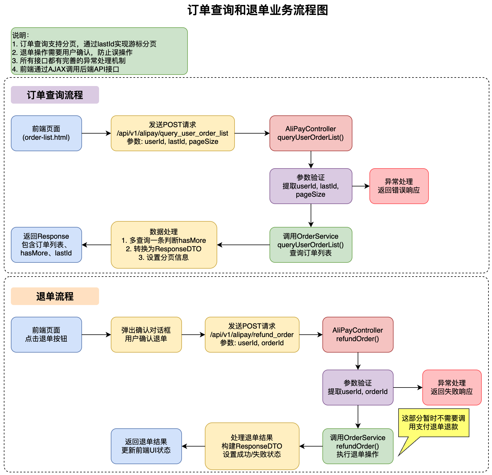
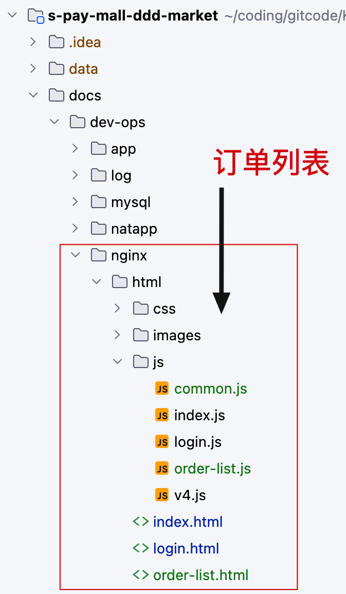
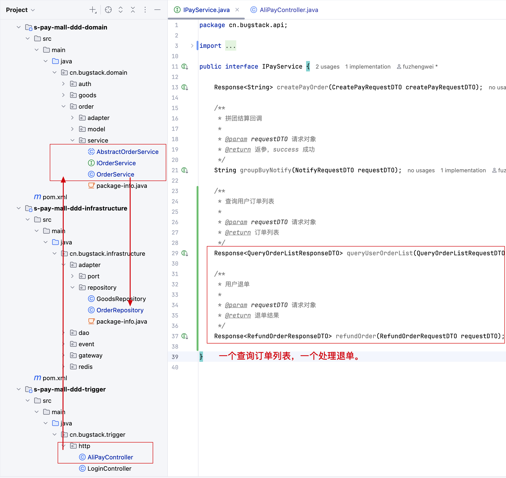
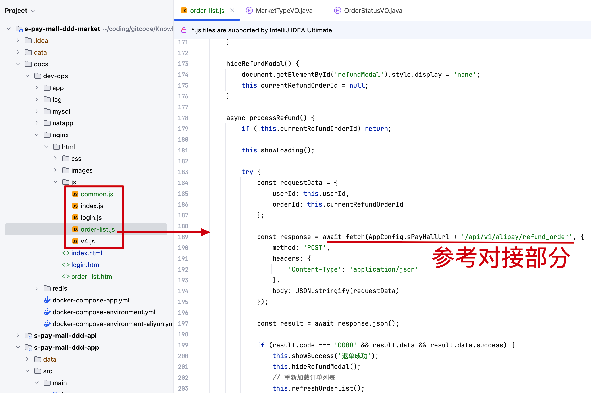
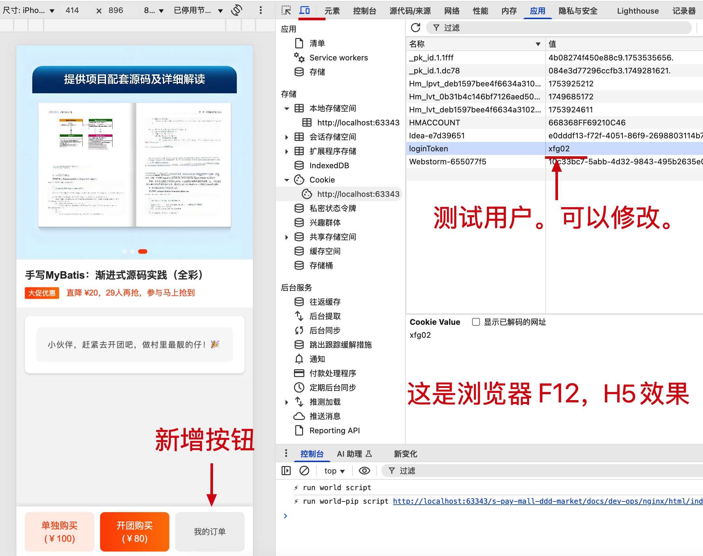
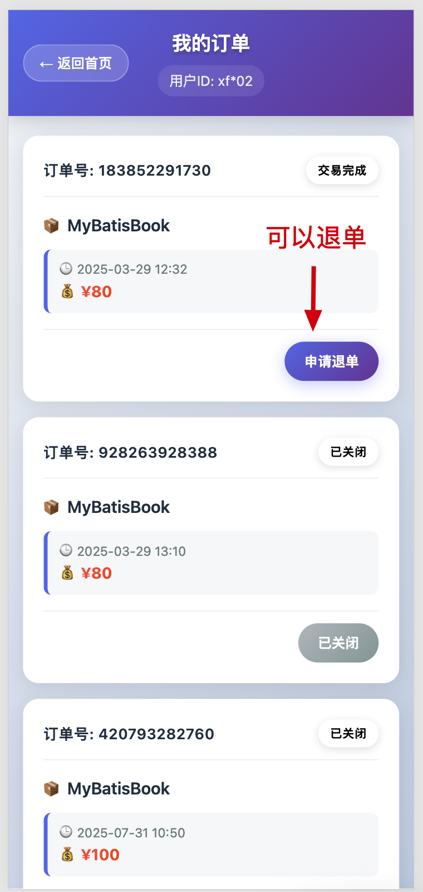

# 用户订单列表和退单UI

> 学习序号 46｜小节 3-7｜原文：https://articles.zsxq.com/id_w9la7lt25u9p.html

**本章重点**   ：给现有的商品拼团下单页面，增加一个`我的订单列表页`，这样用户可以查询订单以及申请退单操作。

- **本章重点**   ：★★☆☆☆
- **本节分支：**  [https://gitcode.net/KnowledgePlanet/s-pay-mall-ddd-market/-/tree/3-7-xfg-order-list](https://gitcode.net/KnowledgePlanet/s-pay-mall-ddd-market/-/tree/3-7-xfg-order-list)
- **课程视频**   : [https://t.zsxq.com/Yng4V](https://t.zsxq.com/Yng4V)

**版权说明**   ：©本项目与星球签约合作，受[《中华人民共和国著作权法实施条例》](https://www.gov.cn/gongbao/content/2013/content_2339485.htm) 版权法保护，禁止任何理由和任何方式公开(public)源码、资料、视频等小傅哥发布的星球内容到Github、Gitee等各类平台，违反可追究进一步的法律责任。

作者：小傅哥

博客：[https://bugstack.cn](https://bugstack.cn)

> 沉淀、分享、成长，让自己和他人都能有所收获！😄

- 一、本章诉求
- 二、业务流程
- 三、编码实现
- 四、功能验证
- 五、读者作业

### 一、本章诉求

给现有的商品拼团下单页面，增加一个`我的订单列表页`，这样用户可以查询订单以及申请退单操作。

本节的操作主要是配和 UI 页面，增加对应的 CRUD 接口，为了后续对接拼团退单使用。难度不大。关于支付（支付宝沙箱）退单，已经有单测案例，可以参考。后续会使用。

### 二、业务流程

如图，查询订单列表和退单的流程；



- 订单查询，查询个人订单记录。这样用户就可以知道下了多少订单了，类似于你京东、淘宝、拼多多查询的个人订单记录。
- 退单流程，在每个订单上，可以点击退单操作。这部分主要为了后续对接拼团进行退单处理。
- 整个本节的内容其实主要是 CURD 来配和 UI 的，难度不大。对于 UI 界面，可以使用 ai 工具进行设计。前端部分就是为了配和整个完整性的，面试中主要考察后端。所以，如果不太会写前端代码也不要太担心。

### 三、编码实现

#### 1. 工程结构

##### 1.1 前端UI



- 这部分 UI 样式是 AI 实现的，小伙伴也可以让 AI 来给你做一套自己的页面。对于这类没有太多复杂流程的前端代码，AI 是非常适合的。

##### 1.2 后端CRUD



- 在 IPayService 增加查询订单列表和退单接口。这部分接口，调用 order 领域。之后到`仓储层`完成数据的处理。

#### 2. 后端接口

##### 2.1 订单列表

```
@RequestMapping(value = "query_user_order_list", method = RequestMethod.POST)
@Override
public Response<QueryOrderListResponseDTO> queryUserOrderList(@RequestBody QueryOrderListRequestDTO requestDTO) {
    try {
        log.info("查询用户订单列表开始 userId:{} lastId:{} pageSize:{}", requestDTO.getUserId(), requestDTO.getLastId(), requestDTO.getPa
        
        String userId = requestDTO.getUserId();
        Long lastId = requestDTO.getLastId();
        Integer pageSize = requestDTO.getPageSize();
        
        // 查询订单列表，多查询一条用于判断是否还有更多数据
        List<OrderEntity> orderList = orderService.queryUserOrderList(userId, lastId, pageSize + 1);
        
        // 判断是否还有更多数据
        boolean hasMore = orderList.size() > pageSize;
        if (hasMore) {
            orderList = orderList.subList(0, pageSize);
        }
        
        // 转换为响应对象
        List<QueryOrderListResponseDTO.OrderInfo> orderInfoList = orderList.stream().map(order -> {
            QueryOrderListResponseDTO.OrderInfo orderInfo = new QueryOrderListResponseDTO.OrderInfo();
            orderInfo.setId(order.getId());
            orderInfo.setUserId(order.getUserId());
            orderInfo.setProductId(order.getProductId());
            orderInfo.setProductName(order.getProductName());
            orderInfo.setOrderId(order.getOrderId());
            orderInfo.setOrderTime(order.getOrderTime());
            orderInfo.setTotalAmount(order.getTotalAmount());
            orderInfo.setStatus(order.getOrderStatusVO() != null ? order.getOrderStatusVO().getCode() : null);
            orderInfo.setPayUrl(order.getPayUrl());
            orderInfo.setMarketType(order.getMarketType());
            orderInfo.setMarketDeductionAmount(order.getMarketDeductionAmount());
            orderInfo.setPayAmount(order.getPayAmount());
            orderInfo.setPayTime(order.getPayTime());
            return orderInfo;
        }).collect(Collectors.toList());
        
        QueryOrderListResponseDTO responseDTO = new QueryOrderListResponseDTO();
        responseDTO.setOrderList(orderInfoList);
        responseDTO.setHasMore(hasMore);
        responseDTO.setLastId(!orderList.isEmpty() ? orderList.get(orderList.size() - 1).getId() : null);
        
        log.info("查询用户订单列表完成 userId:{} 返回订单数量:{} hasMore:{}", userId, orderInfoList.size(), hasMore);
        return Response.<QueryOrderListResponseDTO>builder()
                .code(Constants.ResponseCode.SUCCESS.getCode())
                .info(Constants.ResponseCode.SUCCESS.getInfo())
                .data(responseDTO)
                .build();
    } catch (Exception e) {
        log.error("查询用户订单列表失败 userId:{}", requestDTO.getUserId(), e);
        return Response.<QueryOrderListResponseDTO>builder()
                .code(Constants.ResponseCode.UN_ERROR.getCode())
                .info(Constants.ResponseCode.UN_ERROR.getInfo())
                .build();
    }
}
```

- 其余部分可以看工程代码，都是顺序往下的 CRUD 操作了。

##### 2.2 退单接口

```
@RequestMapping(value = "refund_order", method = RequestMethod.POST)
@Override
public Response<RefundOrderResponseDTO> refundOrder(@RequestBody RefundOrderRequestDTO requestDTO) {
    try {
        log.info("用户退单开始 userId:{} orderId:{}", requestDTO.getUserId(), requestDTO.getOrderId());
        
        String userId = requestDTO.getUserId();
        String orderId = requestDTO.getOrderId();
        
        // 执行退单操作
        boolean success = orderService.refundOrder(userId, orderId);
        
        RefundOrderResponseDTO responseDTO = new RefundOrderResponseDTO();
        responseDTO.setSuccess(success);
        responseDTO.setOrderId(orderId);
        responseDTO.setMessage(success ? "退单成功" : "退单失败，订单不存在、已关闭或不属于该用户");
        
        log.info("用户退单完成 userId:{} orderId:{} success:{}", userId, orderId, success);
        return Response.<RefundOrderResponseDTO>builder()
                .code(Constants.ResponseCode.SUCCESS.getCode())
                .info(Constants.ResponseCode.SUCCESS.getInfo())
                .data(responseDTO)
                .build();
    } catch (Exception e) {
        log.error("用户退单失败 userId:{} orderId:{}", requestDTO.getUserId(), requestDTO.getOrderId(), e);
        
        RefundOrderResponseDTO responseDTO = new RefundOrderResponseDTO();
        responseDTO.setSuccess(false);
        responseDTO.setOrderId(requestDTO.getOrderId());
        responseDTO.setMessage("退单失败，系统异常");
        
        return Response.<RefundOrderResponseDTO>builder()
                .code(Constants.ResponseCode.UN_ERROR.getCode())
                .info(Constants.ResponseCode.UN_ERROR.getInfo())
                .data(responseDTO)
                .build();
    }
}
```

- 退单这部分，主要是调整数据库订单状态，后续还要和拼团对接，之后退单退款。这块你也会想到，咱们拼团部分一直说的，会发一个 MQ 消息，接收后可以执行退款操作。

#### 3. 页面对接

**common.js**

```
// 公共配置和工具函数
const AppConfig = {
    // 基础地址配置
    sPayMallUrl: "http://127.0.0.1:8080",
    groupBuyMarketUrl: "http://127.0.0.1:8091",
    goodsId: "9890001"
};
```



前端部分直接参考这部分代码即可，如果你不想做前端，可以直接修改 common.js 里的对接接口地址即可。

### 四、功能验证

- 启动**拼团**  服务、小型支付服务。
- 从 IntelliJ IDEA 里，以浏览器方式打开 index.html 页面

#### 1. 拼团页面

地址：[http://localhost:63343/s-pay-mall-ddd-market/docs/dev-ops/nginx/html/index.html](http://localhost:63343/s-pay-mall-ddd-market/docs/dev-ops/nginx/html/index.html)



- 打开页面，谷歌浏览器F12，查看页面效果。
- 在 Cookie 里可以设置 loginToken 为 xfg02，其实这个ID就是对应数据库表里的数据，用户的 ID

#### 2. 我的订单



- 我的订单页面，查询的就是后端封装的订单列表接口。这里你可以点击退单。退单后，就变成了已关闭。

### 五、读者作业

- 简单作业：完成本节 CRUD 接口和页面对接流程，可以访问页面效果和退单。
- 复杂作业：尝试与拼团完成整个退单流程，并调用退款操作。
