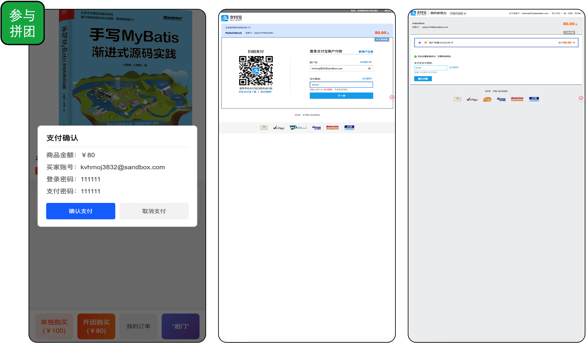
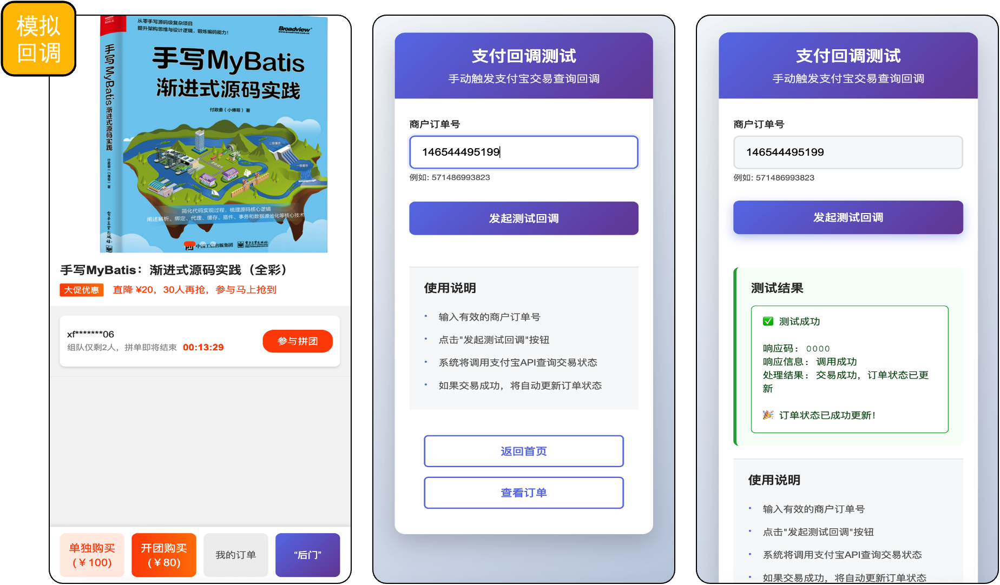
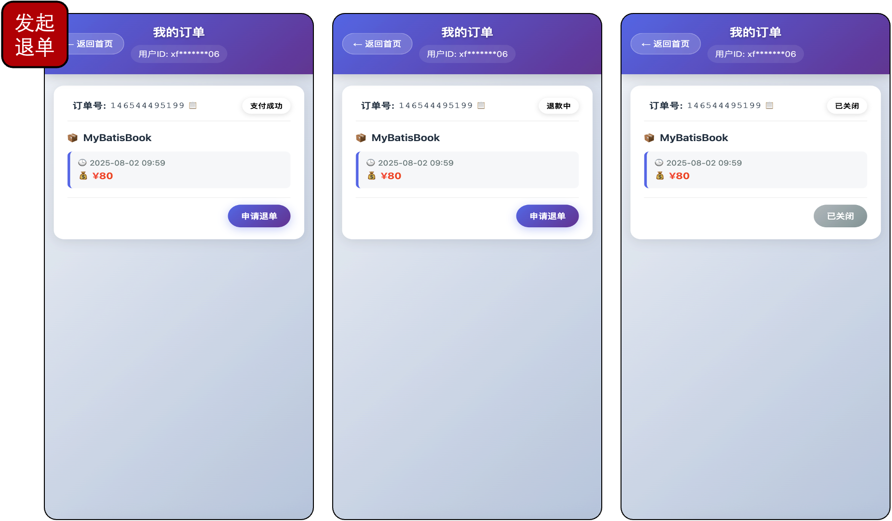
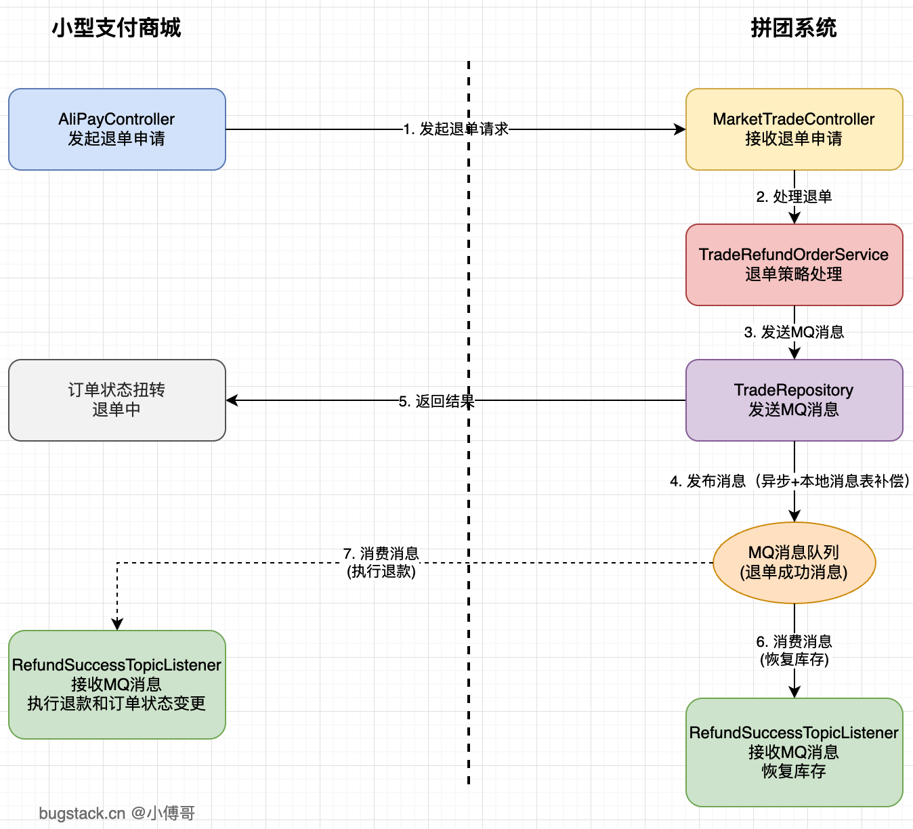
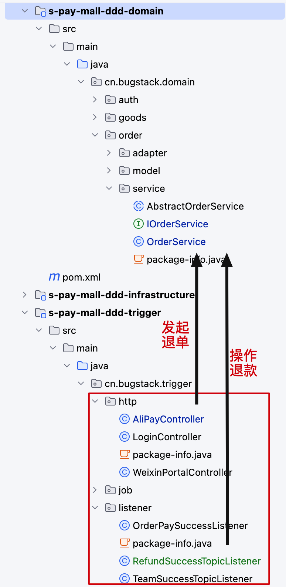
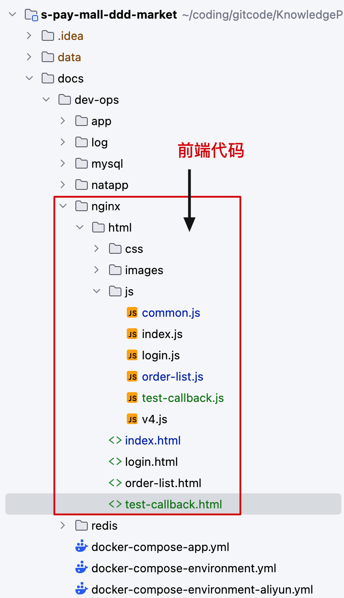
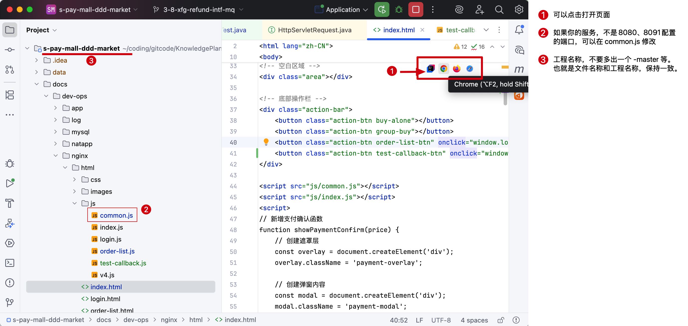
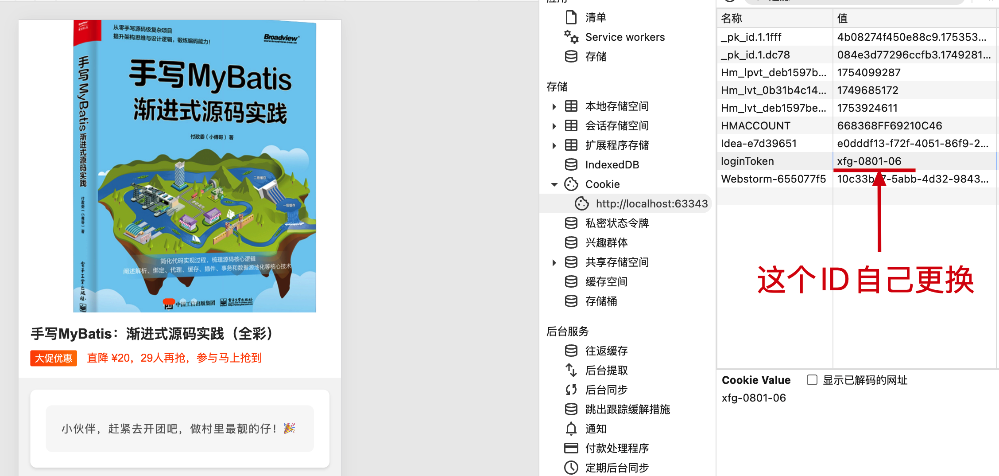

# 退单退款服务对接

> 学习序号 47｜小节 3-8｜原文：https://articles.zsxq.com/id_qgvmus87bf71.html

**本章重点**  ：处理小型支付商城与拼团营销的接口和MQ消息对接，完成退单退款的业务实现。

**本章重点**  ：★★★☆☆

**本节分支**  : [https://gitcode.net/KnowledgePlanet/s-pay-mall-ddd-market/-/tree/3-8-xfg-refund-intf-mq](https://gitcode.net/KnowledgePlanet/s-pay-mall-ddd-market/-/tree/3-8-xfg-refund-intf-mq)

**课程视频**  : [https://t.zsxq.com/ysPNN](https://t.zsxq.com/ysPNN)

**版权说明**  ：©本项目与星球签约合作，受[《中华人民共和国著作权法实施条例》](https://www.gov.cn/gongbao/content/2013/content_2339485.htm) 版权法保护，禁止任何理由和任何方式公开(public)源码、资料、视频等小傅哥发布的星球内容到Github、Gitee等各类平台，违反可追究进一步的法律责任。

作者：小傅哥

博客：[https://bugstack.cn](https://bugstack.cn)

> 沉淀、分享、成长，让自己和他人都能有所收获！😄

- 一、本章诉求
- 二、页面流程（UI）
- 三、业务流程
- 三、编码实现
  - 1. 工程结构
  - 2. 功能实现 - 后端
  - 3. 功能实现 - 前端
- 四、功能测试
  - 1. 启动服务 - 访问页面
  - 2. 请求页面 - 修改cookie
- 五、读者作业

### 一、本章诉求

处理小型支付商城与拼团营销的接口和MQ消息对接，完成退单退款的业务实现。

整个过程会包括从小型支付发起退单申请，调用拼团解除组队锁单量/完成量。由拼团发送的MQ，被小型支付监听，发起退款操作。这部分有接口，也有 MQ 的异步处理，是一个综合的链路调度技术运用。这类设计方案，在互联网公司里的业务场景是非常常见的。

### 二、页面流程（UI）







### 三、业务流程

如图，小型支付和拼团营销对接关系；



- 首先，以小型支付商城发起退单申请，调用拼团进行组队退单，以及变更自己订单为退单中。拼团根据不同场景类型（是否支付、是否成团）进行策略选择退单操作，完成退单后发送MQ驱动后续流程。
- 之后，小型支付商城接收MQ消息，执行退款的处理和订单状态的变更。这时候会调用到支付宝沙箱的退款流程。

### 三、编码实现

#### 1. 工程结构



AliPayController 提供发起退单申请接口，之后 RefundSuccessTopicListener 用于接收来自于拼团推送的退单消息，进行退款操作。

另外在 `docs/dev-ops/nginx/html` 下，还有一些页面的变动，配合咱们的流程处理。

#### 2. 功能实现 - 后端

##### 2.1 增加枚举

```
                @Getter
@AllArgsConstructor
public enum OrderStatusVO {

    CREATE("CREATE", "创建完成 - 如果调单了，也会从创建记录重新发起创建支付单"),
    PAY_WAIT("PAY_WAIT", "等待支付 - 订单创建完成后，创建支付单"),
    PAY_SUCCESS("PAY_SUCCESS", "支付成功 - 接收到支付回调消息"),
    DEAL_DONE("DEAL_DONE", "交易完成 - 商品发货完成"),
    CLOSE("CLOSE", "超时关单 - 超市未支付"),
    MARKET("MARKET", "营销结算 - 拼团组队完成"),
    WAIT_REFUND("WAIT_REFUND", "营销退单待退款"),
    ;

    private final String code;
    private final String desc;

}
```

- 增加一个 `WAIT_REFUND` 等待退款的流程。

##### 2.2 模拟回调

```
                /**
 * 测试回调接口 - 主动查询支付宝交易状态
 * @param outTradeNo 商户订单号
 * @return 处理结果
 */
@RequestMapping(value = "active_pay_notify", method = RequestMethod.POST)
public Response<String> activePayNotify(@RequestParam String outTradeNo) {
    try {
        log.info("测试回调接口，开始查询订单: {}", outTradeNo);
        
        // 构建支付宝交易查询请求
        AlipayTradeQueryModel bizModel = new AlipayTradeQueryModel();
        bizModel.setOutTradeNo(outTradeNo);
        
        AlipayTradeQueryRequest queryRequest = new AlipayTradeQueryRequest();
        queryRequest.setBizModel(bizModel);
        
        // 调用支付宝API查询交易状态
        String body = alipayClient.execute(queryRequest).getBody();
        log.info("支付宝查询结果: {}", body);
        
        // 解析查询结果
        JSONObject responseJson = JSON.parseObject(body);
        JSONObject queryResponse = responseJson.getJSONObject("alipay_trade_query_response");
        
        if (queryResponse != null && "10000".equals(queryResponse.getString("code"))) {
            String tradeStatus = queryResponse.getString("trade_status");
            String tradeNo = queryResponse.getString("trade_no");
            String totalAmount = queryResponse.getString("total_amount");
            String gmtPayment = queryResponse.getString("send_pay_date");
            
            log.info("查询成功 - 交易状态: {}, 支付宝交易号: {}, 金额: {}, 支付时间: {}", 
                    tradeStatus, tradeNo, totalAmount, gmtPayment);
            
            // 如果交易成功，执行后续流程处理
            if ("TRADE_SUCCESS".equals(tradeStatus)) {
                log.info("交易成功，开始处理后续流程，订单号: {}", outTradeNo);
                
                // 调用订单服务更新订单状态
                orderService.changeOrderPaySuccess(outTradeNo, 
                        new SimpleDateFormat("yyyy-MM-dd HH:mm:ss").parse(gmtPayment));
                
                log.info("订单状态更新成功，订单号: {}", outTradeNo);
                
                return Response.<String>builder()
                        .code(Constants.ResponseCode.SUCCESS.getCode())
                        .info(Constants.ResponseCode.SUCCESS.getInfo())
                        .data("交易成功，订单状态已更新")
                        .build();
            } else {
                log.info("交易状态非成功状态: {}, 订单号: {}", tradeStatus, outTradeNo);
                return Response.<String>builder()
                        .code(Constants.ResponseCode.SUCCESS.getCode())
                        .info(Constants.ResponseCode.SUCCESS.getInfo())
                        .data("交易状态: " + tradeStatus)
                        .build();
            }
        } else {
            String errorMsg = queryResponse != null ? queryResponse.getString("msg") : "查询失败";
            log.error("支付宝查询失败: {}, 订单号: {}", errorMsg, outTradeNo);
            return Response.<String>builder()
                    .code(Constants.ResponseCode.UN_ERROR.getCode())
                    .info(Constants.ResponseCode.UN_ERROR.getInfo())
                    .data("查询失败: " + errorMsg)
                    .build();
        }
        
    } catch (Exception e) {
        log.error("测试回调接口异常，订单号: {}", outTradeNo, e);
        return Response.<String>builder()
                .code(Constants.ResponseCode.UN_ERROR.getCode())
                .info(Constants.ResponseCode.UN_ERROR.getInfo())
                .data("系统异常: " + e.getMessage())
                .build();
    }
}
```

- 首先，为了方便大家做测试，并且不需要开 natapp 等内网穿透工具，让支付宝回调。这里小傅哥加了一个用于自己主动回调的接口，并配有页面。也就是**页面流程（UI）** 中的，模拟回调过程。

##### 2.3 对接接口（gateway->拼团）

```
                public interface IGroupBuyMarketService {

    /**
     * 营销锁单
     *
     * @param requestDTO 锁单商品信息
     * @return 锁单结果信息
     */
    @POST("api/v1/gbm/trade/lock_market_pay_order")
    Call<Response<LockMarketPayOrderResponseDTO>> lockMarketPayOrder(@Body LockMarketPayOrderRequestDTO requestDTO);

    /**
     * 营销结算
     *
     * @param requestDTO 结算商品信息
     * @return 结算结果信息
     */
    @POST("api/v1/gbm/trade/settlement_market_pay_order")
    Call<Response<SettlementMarketPayOrderResponseDTO>> settlementMarketPayOrder(@Body SettlementMarketPayOrderRequestDTO requestDTO);

    /**
     * 营销拼团退单
     *
     * @param requestDTO 退单请求信息
     * @return 退单结果信息
     */
    @POST("api/v1/gbm/trade/refund_market_pay_order")
    Call<Response<RefundMarketPayOrderResponseDTO>> refundMarketPayOrder(@Body RefundMarketPayOrderRequestDTO requestDTO);

}
```

- 通过 retrofit2 方式，封装拼团退单接口，refundMarketPayOrder。

##### 2.4 退单接口

**发起退单-http**

```
                @RequestMapping(value = "refund_order", method = RequestMethod.POST)
@Override
public Response<RefundOrderResponseDTO> refundOrder(@RequestBody RefundOrderRequestDTO requestDTO) {
    try {
        log.info("用户退单开始 userId:{} orderId:{}", requestDTO.getUserId(), requestDTO.getOrderId());
        
        String userId = requestDTO.getUserId();
        String orderId = requestDTO.getOrderId();
        
        // 执行退单操作
        boolean success = orderService.refundMarketOrder(userId, orderId);
        
        RefundOrderResponseDTO responseDTO = new RefundOrderResponseDTO();
        responseDTO.setSuccess(success);
        responseDTO.setOrderId(orderId);
        responseDTO.setMessage(success ? "退单成功" : "退单失败，订单不存在、已关闭或不属于该用户");
        
        log.info("用户退单完成 userId:{} orderId:{} success:{}", userId, orderId, success);
        return Response.<RefundOrderResponseDTO>builder()
                .code(Constants.ResponseCode.SUCCESS.getCode())
                .info(Constants.ResponseCode.SUCCESS.getInfo())
                .data(responseDTO)
                .build();
    } catch (Exception e) {
        log.error("用户退单失败 userId:{} orderId:{}", requestDTO.getUserId(), requestDTO.getOrderId(), e);
        
        RefundOrderResponseDTO responseDTO = new RefundOrderResponseDTO();
        responseDTO.setSuccess(false);
        responseDTO.setOrderId(requestDTO.getOrderId());
        responseDTO.setMessage("退单失败，系统异常");
        
        return Response.<RefundOrderResponseDTO>builder()
                .code(Constants.ResponseCode.UN_ERROR.getCode())
                .info(Constants.ResponseCode.UN_ERROR.getInfo())
                .data(responseDTO)
                .build();
    }
}
```

- 封装 refundOrder 接口，调用 refundMarketOrder 进行拼团退单。之后订单状态更新为退单中。

**OrderService.java**

```
                @Override
public boolean refundMarketOrder(String userId, String orderId) {
    // 1. 查询订单信息，验证订单是否存在且属于该用户
    OrderEntity orderEntity = repository.queryOrderByUserIdAndOrderId(userId, orderId);
    if (null == orderEntity) {
        log.warn("退单失败，订单不存在或不属于该用户 userId:{} orderId:{}", userId, orderId);
        return false;
    }
    // 2. 检查订单状态，只有create、pay_wait、pay_success、deal_done状态的订单可以退单
    String status = orderEntity.getOrderStatusVO().getCode();
    if (OrderStatusVO.CLOSE.getCode().equals(status)) {
        log.warn("退单失败，订单已关闭 userId:{} orderId:{} status:{}", userId, orderId, status);
        return false;
    }
    // 3. 对于营销类型的单子，调用拼团执行组队退单
    port.refundMarketPayOrder(userId, orderId);
    // 4. 执行退单操作；CREATE 新创建订单，不需要退款
    if (OrderStatusVO.CREATE.getCode().equals(status) || OrderStatusVO.PAY_WAIT.getCode().equals(status)) {
        return repository.refundOrder(userId, orderId);
    } else {
        boolean result = repository.refundMarketOrder(userId, orderId);
        if (result) {
            log.info("退单成功 userId:{} orderId:{}", userId, orderId);
        } else {
            log.warn("退单失败 userId:{} orderId:{}", userId, orderId);
        }
        return result;
    }
}
```

- 在退单流程中，增加营销场景退单。如果订单状态是未支付的，则可以直接修改订单为结束。否则只把数据库表订单记录更改为退单中。

##### 2.5 退款操作

接收MQ消息，执行退款操作。

**yml配置**

```
              consumer:
# 主题配置 topic 主题，team_success
topic_team_success:
  # 绑定交换机 - 消息提供者的交换机
  exchange: group_buy_market_exchange
  # 消息主题
  routing_key: topic.team_success
  # 消费队列 - 每个系统有自己的消费队列
  queue: s_pay_mall_queue_2_topic_team_success
topic_team_refund:
  # 绑定交换机 - 消息提供者的交换机
  exchange: group_buy_market_exchange
  # 消息主题
  routing_key: topic.team_refund
  # 消费队列
  queue: s_pay_mall_queue_2_topic_team_refund
# 主题配置
topic_order_pay_success:
  # 绑定交换机
  exchange: s_pay_mall_exchange
  # 消费主题
  routing_key: topic.order_pay_success
  # 消费队列
  queue: s_pay_mall_queue_2_order_pay_success
```

- 增加一组消费 topic_team_refund 消费主题。

**消息监听**

```
                @Slf4j
@Component
public class RefundSuccessTopicListener {

    @Resource
    private IOrderService orderService;

    /**
     * 指定消费队列
     */
    @RabbitListener(
            bindings = @QueueBinding(
                    value = @Queue(value = "${spring.rabbitmq.config.consumer.topic_team_refund.queue}"),
                    exchange = @Exchange(value = "${spring.rabbitmq.config.consumer.topic_team_refund.exchange}", type = ExchangeTypes.TOPIC),
                    key = "${spring.rabbitmq.config.consumer.topic_team_refund.routing_key}"
            )
    )
    public void listener(String message) {
        try {
            log.info("退单回调，发起退款 {}", message);
            TeamRefundSuccessRequestDTO requestDTO = JSON.parseObject(message, TeamRefundSuccessRequestDTO.class);
            String type = requestDTO.getType();
            if ("paid_unformed".equals(type) || "paid_formed".equals(type)) {
                orderService.refundPayOrder(requestDTO.getUserId(), requestDTO.getOutTradeNo());
            }
        } catch (AlipayApiException ex) {
            throw new RuntimeException(ex);
        } catch (Exception e) {
            log.error("拼团回调，退单完成，退款失败 {}", message, e);
            throw e;
        }
    }

}
```

- 增加一个 TeamRefundSuccessRequestDTO 对象，用于序列化对象。
- 之后根据 paid_unformed、paid_formed，有支付的，做退款处理。
- 其实也有另外一个方式，就是把这个类型下放到 refundPayOrder 中去判断。这样几个操作方式也都是日常编码中比较常见的。要不就是 MQ 这过滤，要不就是服务里自己过滤。

**退款处理**

```
                @Override
public boolean refundPayOrder(String userId, String orderId) throws AlipayApiException {
    // 1. 查询订单信息，验证订单是否存在且属于该用户
    OrderEntity orderEntity = repository.queryOrderByUserIdAndOrderId(userId, orderId);
    if (null == orderEntity) {
        log.warn("退款失败，订单不存在或不属于该用户 userId:{} orderId:{}", userId, orderId);
        return false;
    }
    AlipayTradeRefundRequest request = new AlipayTradeRefundRequest();
    AlipayTradeRefundModel refundModel = new AlipayTradeRefundModel();
    refundModel.setOutTradeNo(orderEntity.getOrderId());
    refundModel.setRefundAmount(orderEntity.getPayAmount().toString());
    refundModel.setRefundReason("交易退单");
    request.setBizModel(refundModel);
    // 交易退款
    AlipayTradeRefundResponse execute = alipayClient.execute(request);
    if (!execute.isSuccess()) return false;
    // 状态变更
    repository.refundOrder(userId, orderId);
    return true;
}
```

- 调用 `alipayClient.execute(request)` 进行退款操作，之后判断退款是否成功。这部分也可以抛异常，让 MQ 重试。但咱们的开发环境不是太稳定，所以这块没有做抛异常流程。实际公司里会抛异常，让MQ不断重试。
- 退款后，执行 refundOrder 更新订单状态为关单结束。

#### 3. 功能实现 - 前端



- 前端代码部分，参考这块就可以。common.js 里面有配置接口服务地址。

### 四、功能测试

#### 1. 启动服务 - 访问页面

1. 启动 group-buy-market
2. 启动 s-pay-mall-ddd-market



- 确保启动应用没问题，之后访问页面。

#### 2. 请求页面 - 修改cookie

访问页面的时候，选择无痕登录。 - 浏览器 F12 更换下 loginToken 之后就可以测试了。测试效果参考**二、页面流程（UI）**

### 五、读者作业

- 简单作业：完成本节对接功能的实现，把小型支付和拼团对接起来。
- 复杂作业：参考 dubbo 课程，[https://bugstack.cn/md/road-map/dubbo.html](https://bugstack.cn/md/road-map/dubbo.html) 尝试把小型支付对接拼团的 http 接口，替换为 rpc 接口。
