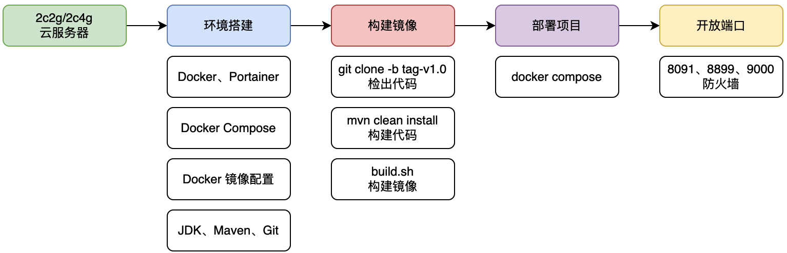
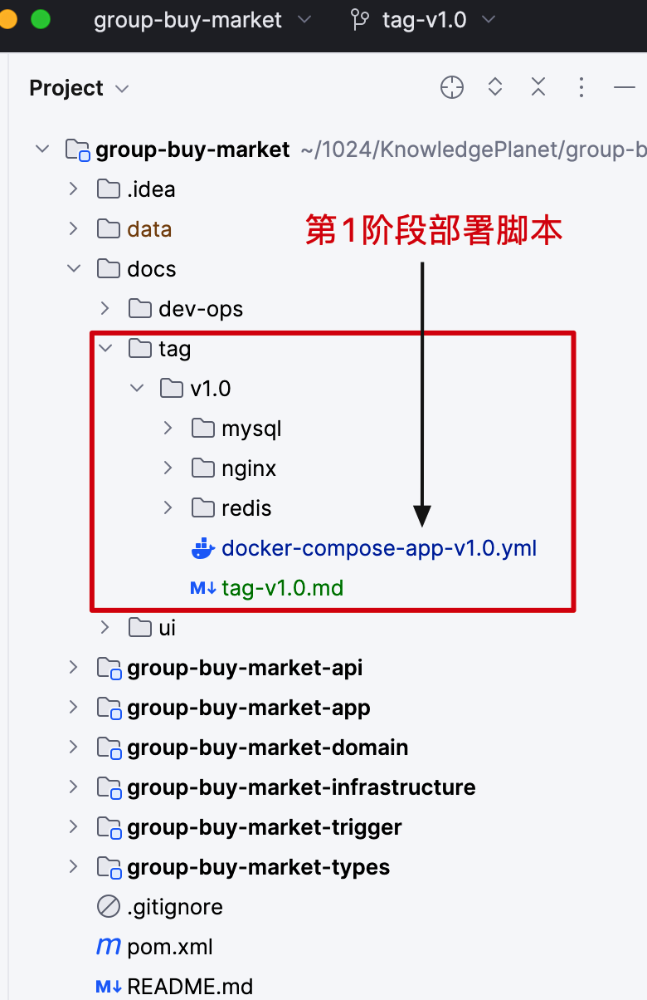
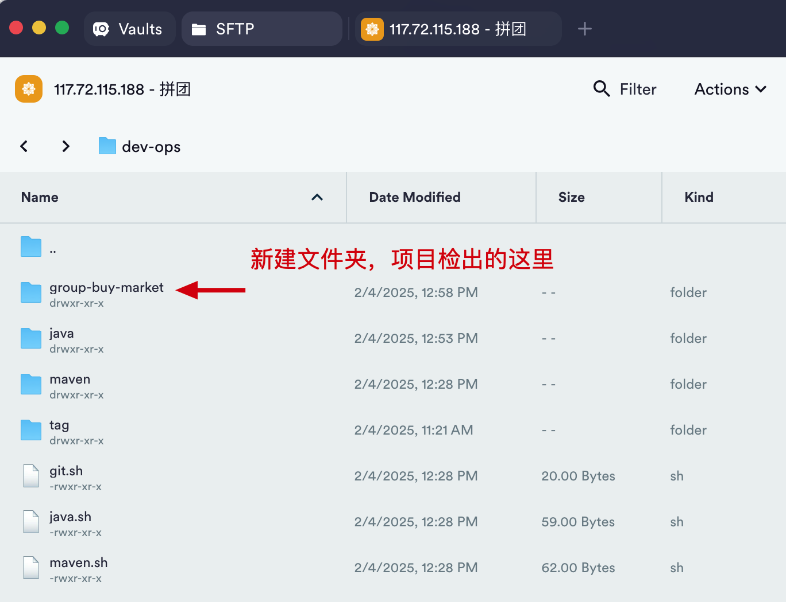
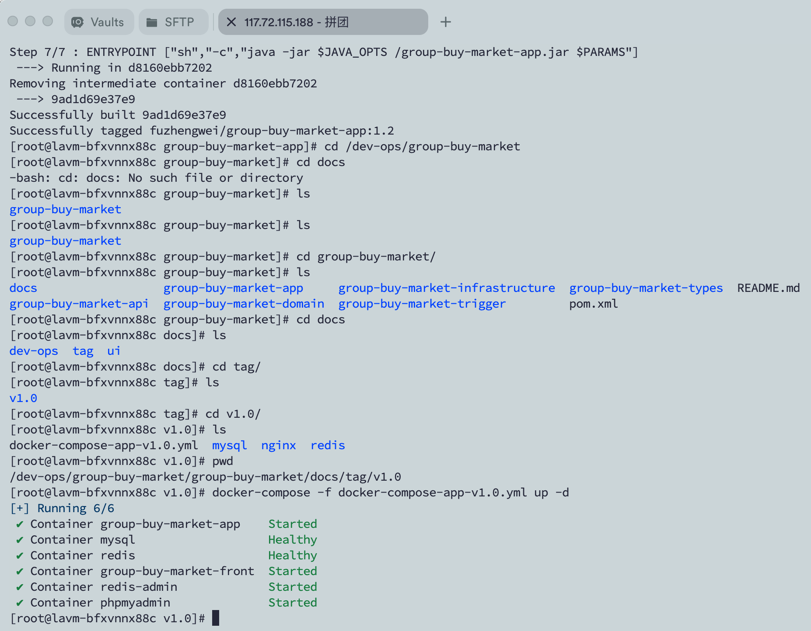
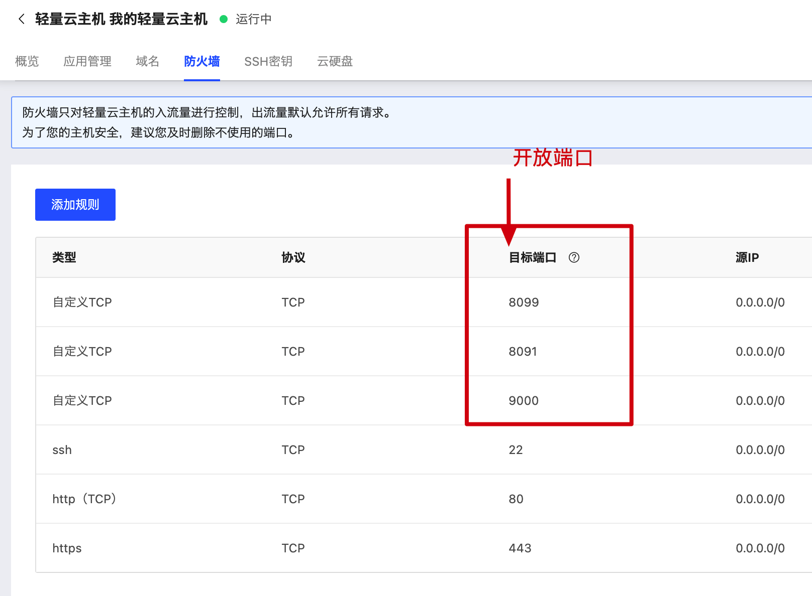
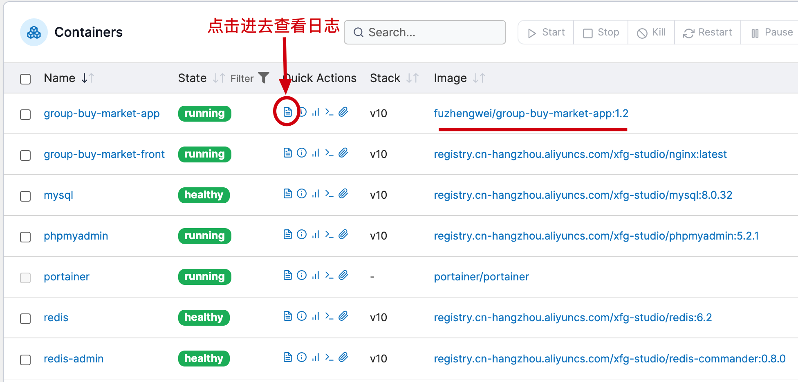
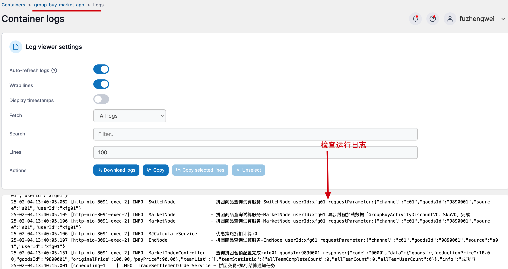
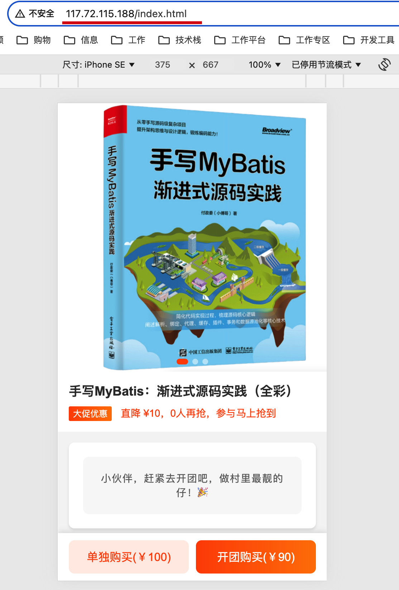

# 第1阶段部署云环境

> 学习序号 24｜小节 4-1｜原文：https://articles.zsxq.com/id_njusa5caqoil.html

**本章重点** ：将项目上线部署到云服务器环境，提供公网IP地址，可以访问体验。

- **本章重点** ：★★★☆☆
- **本节分支：** [https://gitcode.net/KnowledgePlanet/group-buy-market/-/tree/tag-v1.0](https://gitcode.net/KnowledgePlanet/group-buy-market/-/tree/tag-v1.0)
- **课程视频** ：[https://t.zsxq.com/izUPl](https://t.zsxq.com/izUPl)

**版权说明** ：©本项目与星球签约合作，受[《中华人民共和国著作权法实施条例》](https://www.gov.cn/gongbao/content/2013/content_2339485.htm) 版权法保护，禁止任何理由和任何方式公开(public)源码、资料、视频等小傅哥发布的星球内容到Github、Gitee等各类平台，违反可追究进一步的法律责任。

作者：小傅哥

博客：[https://bugstack.cn](https://bugstack.cn)

> 沉淀、分享、成长，让自己和他人都能有所收获！😄

- 一、本章诉求
- 二、部署过程
- 三、工程结构
- 四、前置学习
- 五、部署脚本
  - 1. 检出代码
  - 2. 打包代码
  - 3. 构建镜像
  - 4. 部署项目
- 六、部署完成
  - 1. 防火墙
  - 2. 控制面板
  - 3. 运行效果

### 一、本章诉求

将项目上线部署到云服务器环境，提供公网IP地址，可以访问体验。

现阶段的很多面试，面试官在面试过程中都比较重视考察求职者对于项目学习的完整性，从设计、开发、测试、迭代，再到部署上线，一整套的内容，全都了解清楚是非常好的。

### 二、部署过程

如图，为本次的部署过程；



- 首先，购买云服务器，之后搭建云环境。[http://618.gaga.plus/](http://618.gaga.plus/) 2c2g 很便宜，不过更推荐2c4g也不贵，避免以后部署其他的不够用了。
- 之后，检出项目、构建镜像。以及部署操作。
- 最后，要记得，开放使用的端口。这个过程会使用到 `9000`、`8091`、`8899`

### 三、工程结构



- 本节的部署脚本，已经放到了 tag 下，v1.0 为第1阶段部署。
- 如果你想快速部署小傅哥的代码，可以不需要在 Linux 服务器安装 jdk、maven、git 环境，只需要先修改 nginx/html下你的公网ip（参考视频）之后使用 docker compose ，把 docs 整个传到你的 `linux /` 根目录下，执行 `docker-compose -f docker-compose-app-v1.0.yml up -d`即可部署项目。最后记得开放端口。这些过程你可以参考下面视频，只是不需要自己在执行五中的1~3步。

### 四、前置学习



- 首先，推荐使用 Termius：[https://bugstack.cn/md/road-map/tool.html](https://bugstack.cn/md/road-map/tool.html)
- 之后，链接云服务器，之后搭建环境即可。
- 了解 Docker 是什么；[https://bugstack.cn/md/road-map/docker-what.html](https://bugstack.cn/md/road-map/docker-what.html)
- 安装 Docker 相关环境；`这部分是通用的，你可以对照完成，搭建好服务器环境`
  - [第1节：服务器选配](https://t.zsxq.com/yaeXl)
  - [第2节：Docker安装](https://t.zsxq.com/xLlmb)
  - [第3节；jdk、maven](https://t.zsxq.com/PoiXU)

### 五、部署脚本



#### 1. 检出代码

```
                mkdir group-buy-market
cd group-buy-market        
git clone -b tag-v1.0 https://gitcode.net/KnowledgePlanet/group-buy-market.git
```

#### 2. 打包代码

```
mvn clean install
```

#### 3. 构建镜像

```
                cd group-buy-market-app
chmod +x build.sh
```

#### 4. 部署项目

```
                cd /dev-ops/group-buy-market/group-buy-market/docs/tag/v1.0
docker-compose -f docker-compose-app-v1.0.yml up -d
```

### 六、部署完成

#### 1. 防火墙



- 在你的云服务器[管理后台](https://lavm-console.jdcloud.com/)开放防火墙

#### 2. 控制面板





- 登录控制面板，查看部署情况。
- [http://117.72.115.188:9000/#!/2/docker/containers](http://117.72.115.188:9000/#!/2/docker/containers) - 你要登录你的。

#### 3. 运行效果



- 最后访问你的公网地址，就可以看到拼团了。也可以发给其他伙伴一起测试。
- 我的测试地址(临时一个月有效期，25年3月4日失效)；[http://117.72.115.188/index.html](http://117.72.115.188/index.html)
