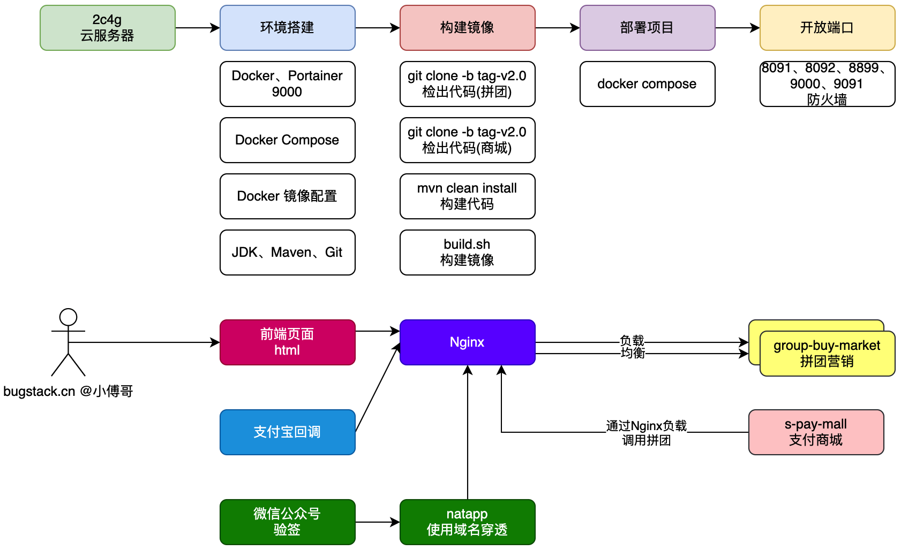
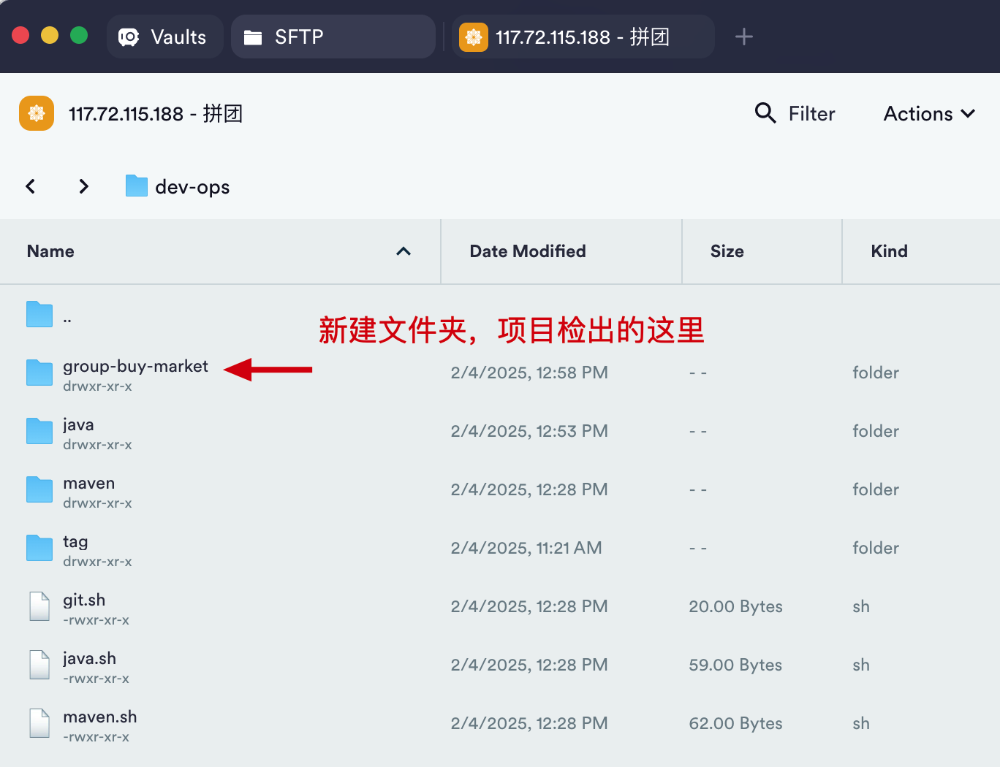
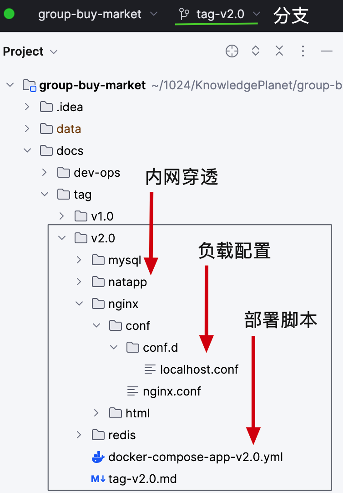
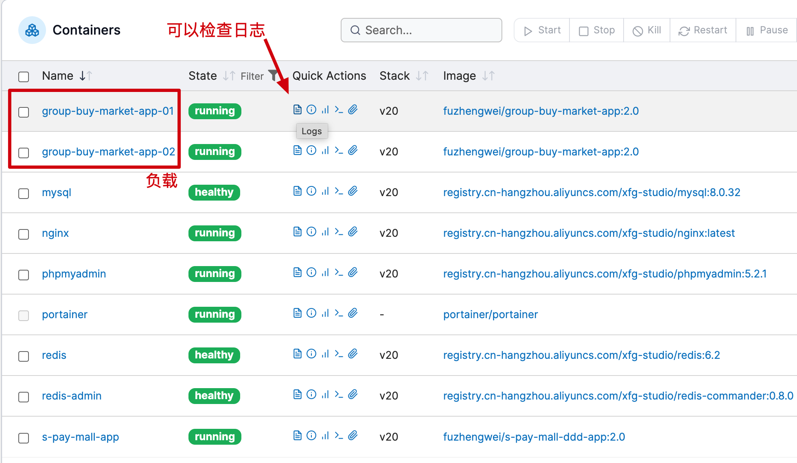
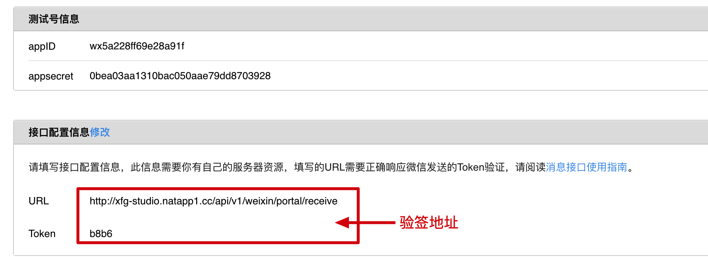
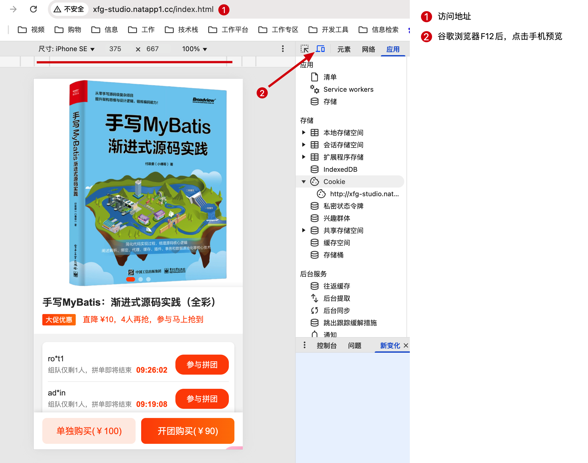
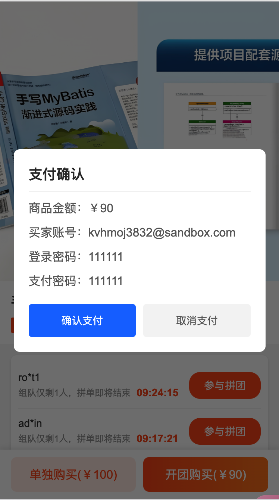
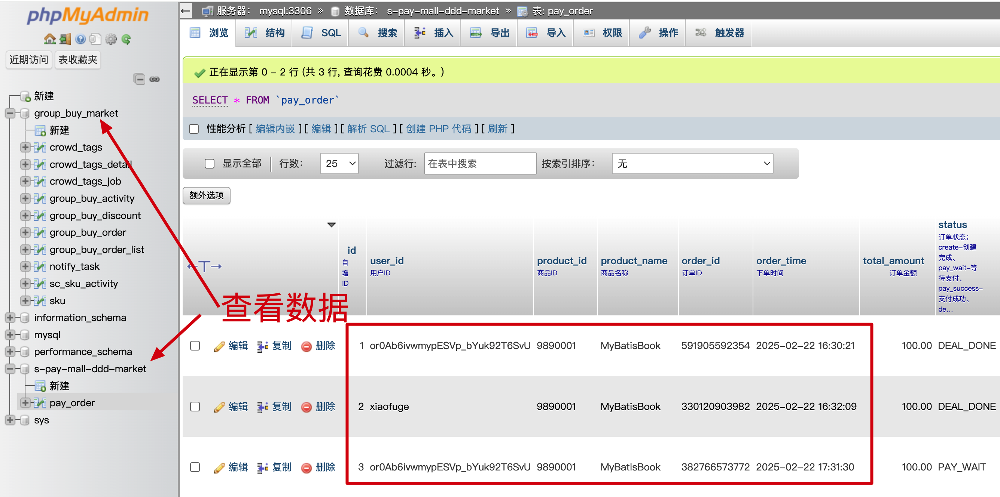
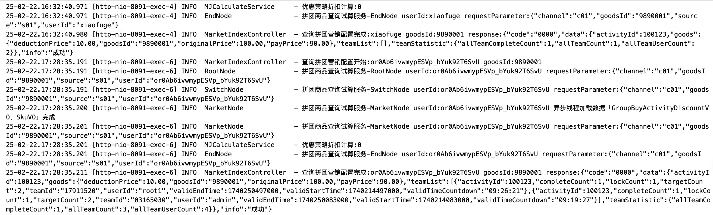

# 第2阶段部署云环境

> 学习序号 28｜小节 4-2｜原文：https://articles.zsxq.com/id_kz4sor0kv07z.html

**本章重点** ：将项目上线部署到云服务器环境，提供公网IP地址，可以访问体验。

- **本章重点** ：★★★☆☆
- **本节分支：** [https://gitcode.net/KnowledgePlanet/group-buy-market/-/tree/tag-v2.0](https://gitcode.net/KnowledgePlanet/group-buy-market/-/tree/tag-v2.0)
- **课程视频** ：[https://t.zsxq.com/Mjr20](https://t.zsxq.com/Mjr20)

**版权说明** ：©本项目与星球签约合作，受[《中华人民共和国著作权法实施条例》](https://www.gov.cn/gongbao/content/2013/content_2339485.htm) 版权法保护，禁止任何理由和任何方式公开(public)源码、资料、视频等小傅哥发布的星球内容到Github、Gitee等各类平台，违反可追究进一步的法律责任。

作者：小傅哥

博客：[https://bugstack.cn](https://bugstack.cn)

> 沉淀、分享、成长，让自己和他人都能有所收获！😄

- 一、本章诉求
- 二、部署过程
- 三、工程结构
- 四、前置学习
- 五、前置准备
- 六、项目部署
  - 1. 工程结构
  - 2. 脚本内容
  - 3. 微信配置
- 七、访问项目
  - 1. 访问首页
  - 2. 下单购买
  - 3. 数据检查
  - 4. 查看日志
- 八、读者作业

### 一、本章诉求

将支付商城 + 拼团，Nginx 负载部署到云服务器，使用穿透映射提供的域名，进行访问体验。

这一阶段部署，就有微服务的体现了。要注意，微服务是微服务，分布式是分布式。不要混淆概念。两个技术方案可以一起使用，也可以单独使用。

### 二、部署过程

如图，为本次的部署过程；



- 首先，购买云服务器，之后搭建云环境。[http://618.gaga.plus/](http://618.gaga.plus/) 需要2c4g部署，本节需要部署2个项目，并进行负载方式多实例部署。
- 之后，检出项目、构建镜像。以及部署操作。
- 最后，要记得，开放使用的端口。这个过程会使用到 `9000`、`8091`、`8092`、`8899`、`9091`等，需要开放的端口

### 三、工程结构

- 本节的部署脚本，已经放到了 tag 下，v2.0 为第2阶段部署。
- 因为本次部署需要结合小型支付商城，那么会涉及到支付宝沙箱的配置、微信公众号测试平台的配置、natapp 内网穿透的配置（主要用它的域名）

### 四、前置学习



- 首先，推荐使用 Termius：[https://bugstack.cn/md/road-map/tool.html](https://bugstack.cn/md/road-map/tool.html)
- 之后，链接云服务器，之后搭建环境即可。
- 了解 Docker 是什么；[https://bugstack.cn/md/road-map/docker-what.html](https://bugstack.cn/md/road-map/docker-what.html)
- 安装 Docker 相关环境；`这部分是通用的，你可以对照完成，搭建好服务器环境`
  - [第1节：服务器选配](https://t.zsxq.com/yaeXl)
  - [第2节：Docker安装](https://t.zsxq.com/xLlmb)
  - [第3节；jdk、maven](https://t.zsxq.com/PoiXU)

### 五、前置准备

1. [https://natapp.cn/](https://natapp.cn/) 购买最便宜的带有域名的隧道，映射端口改为80。如果你有自己的已经备案了的域名，不使用 Natapp 也可以。Nginx 的转发直接配置域名即可。
2. [https://mp.weixin.qq.com/debug/cgi-bin/sandboxinfo?action=showinfo&t=sandbox/index](https://mp.weixin.qq.com/debug/cgi-bin/sandboxinfo?action=showinfo&t=sandbox/index) 申请微信公众号测试平台。很多参数信息来自于这里，你可以参考小型支商城的微信公众号配置来使用。
3. [https://open.alipay.com/develop/manage](https://open.alipay.com/develop/manage) 申请支付宝开放平台使用。在小型支付商城项目有相关教程。
4. [http://618.gaga.plus/](http://618.gaga.plus/) 购买好服务器，安装好Docker等环境。

### 六、项目部署

#### 1. 工程结构



- 切换课程分支到 tag-v2.0 这个下面有部署的脚本。
- natapp 是内网穿透，你需要进入配置自己的 `config.ini` 这个 token 来自于内网穿透上。
- nginx 下是网页和负载配置，负载内容在 localhost.conf
- `docker-compose-app-v2.0.yml` 最终执行按照脚本。

> 以上这些配置会在课程的视频中演示。

#### 2. 脚本内容

首先，你需要使用 SSH 工具链接到 linux 服务器（部分基础已经完成的操作，参考部署1阶段即可）。

##### 2.1 检出代码

```
                git clone -b tag-v2.0 https://gitcode.net/KnowledgePlanet/s-pay-mall-ddd-market.git
git clone -b tag-v2.0 https://gitcode.net/KnowledgePlanet/group-buy-market.git
```

##### 2.2 更新代码

```
git pull origin tag-v2.0
```

##### 2.3 打包代码

```
mvn clean install
```

- 进入进入两个项目进行构建。

##### 2.4 构建镜像

```
                cd s-pay-mall-ddd-market-app
chmod +x build.sh
```

```
                cd group-buy-market-app
chmod +x build.sh
```

- 分别打包镜像。

##### 2. 5 部署项目

```
                [root@lavm-bfxvnnx88c v2.0]# docker-compose -f docker-compose-app-v2.0.yml up -d
[+] Running 8/8
 ✔ Container group-buy-market-app-01  Started                                                                                                                      1.3s 
 ✔ Container mysql                    Healthy                                                                                                                     32.4s 
 ✔ Container group-buy-market-app-02  Started                                                                                                                      1.3s 
 ✔ Container nginx                    Started                                                                                                                      1.2s 
 ✔ Container redis                    Healthy                                                                                                                     11.7s 
 ✔ Container s-pay-mall-app           Started                                                                                                                      1.4s 
 ✔ Container redis-admin              Started                                                                                                                     12.2s 
 ✔ Container phpmyadmin               Started  
```



- 执行脚本后，`docker-compose -f docker-compose-app-v2.0.yml up -d` 会以此拉取镜像并进行部署。
- 部署后可以查看所有的应用。

##### 2.6 启动内网穿透

```
                /dev-ops/group-buy-market/docs/tag/v2.0/natapp
[root@lavm-bfxvnnx88c natapp]# ls
config.ini  natapp  内网穿透说明.md
[root@lavm-bfxvnnx88c natapp]# ./natapp
Powered By NATAPP       Please visit https://natapp.cn                                                                                                  (Ctrl+C to Quit)
                    
Tunnel Status           Online                                           Version                 2.4.0                                             Forwarding              http://xfg-studio.natapp1.cc -> 127.0.0.1:80           Web Interface           Disabled                                         Total Connections       0    
```

- 这样就启动完成了，本地的Nginx的地址，就被 Natapp 的域名代理了。

#### 3. 微信配置



- 官网：[https://mp.weixin.qq.com/debug/cgi-bin/sandboxinfo?action=showinfo&t=sandbox/index](https://mp.weixin.qq.com/debug/cgi-bin/sandboxinfo?action=showinfo&t=sandbox/index)
- 配置 Natapp 穿透地址到微信的验签地址中。

### 七、访问项目

#### 1. 访问首页



- 访问你的 Natapp 地址即可。之后就可以下单购买了。

#### 2. 下单购买



- 用你登录的用户ID，参与拼团即可。
- 还可以让伙伴参与你的拼团。

#### 3. 数据检查



- 可以看到有下的订单数据。查看是否拼团完成。

#### 4. 查看日志



- 查看运行日志，看看系统运行是否正常。

### 八、读者作业

- 简单作业：完成本节功能的部署。
- 复杂作业：期待你做了一个商品库的展示，类似jd首页，之后点商品进来支付拼团。
