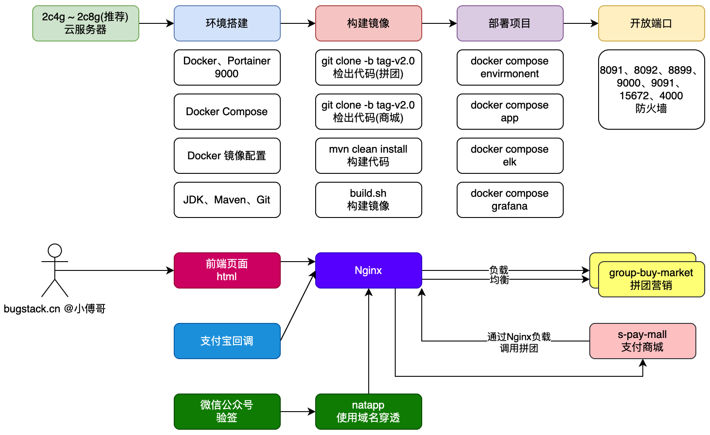
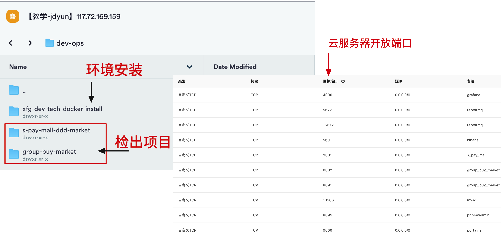
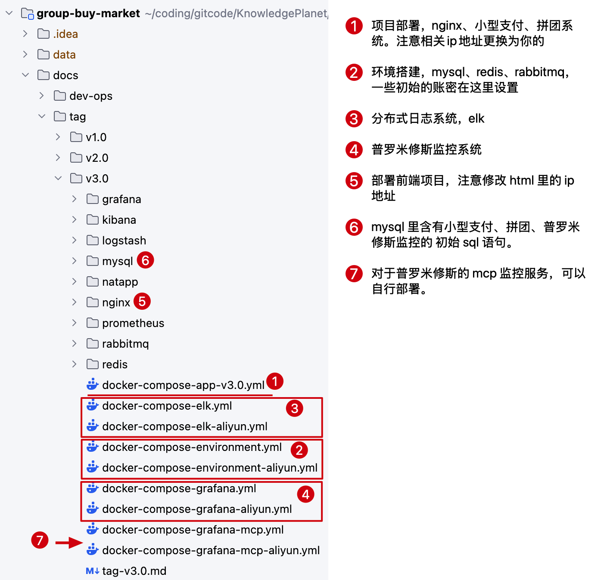
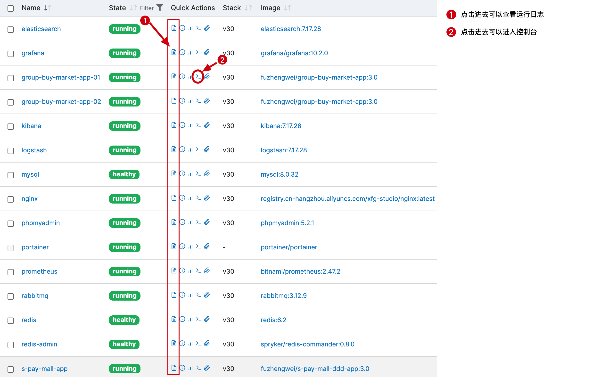
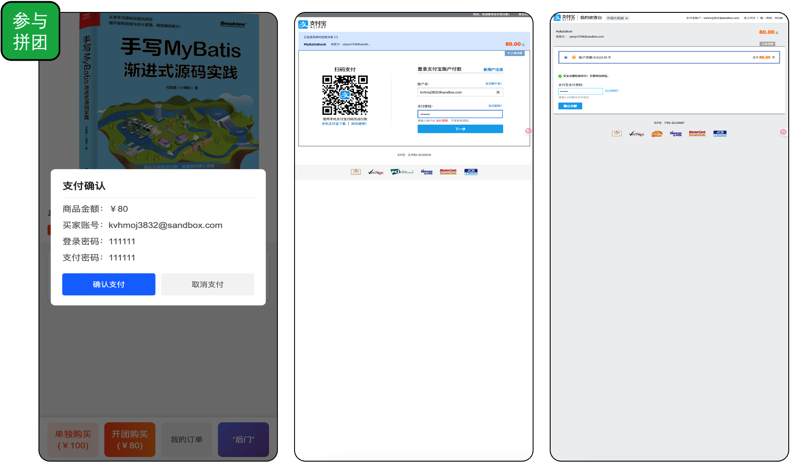
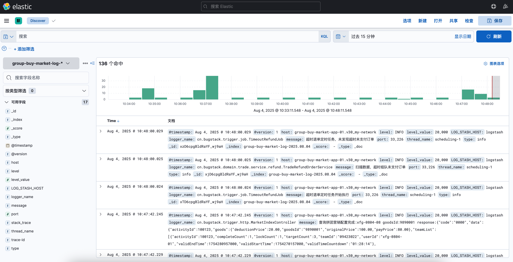
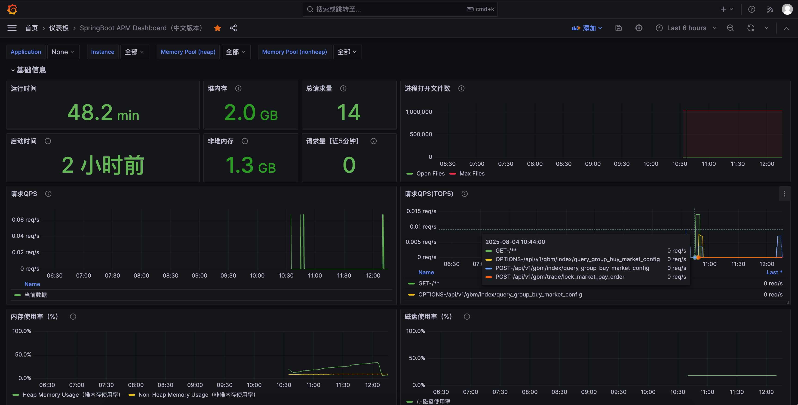

# 第3阶段部署云环境

> 学习序号 48｜小节 4-3｜原文：https://articles.zsxq.com/id_d5zw338wdfs9.html

**本章重点**  ：将项目上线部署到云服务器环境，提供公网IP地址，可以访问体验。

- **本章重点**  ：★★★☆☆
- **本节分支：** [https://gitcode.net/KnowledgePlanet/group-buy-market/-/tree/tag-v3.0](https://gitcode.net/KnowledgePlanet/group-buy-market/-/tree/tag-v3.0)
- **课程视频**  ：[https://t.zsxq.com/kcqaK](https://t.zsxq.com/kcqaK)

**版权说明**  ：©本项目与星球签约合作，受[《中华人民共和国著作权法实施条例》](https://www.gov.cn/gongbao/content/2013/content_2339485.htm) 版权法保护，禁止任何理由和任何方式公开(public)源码、资料、视频等小傅哥发布的星球内容到Github、Gitee等各类平台，违反可追究进一步的法律责任。

作者：小傅哥

博客：[https://bugstack.cn](https://bugstack.cn)

> 沉淀、分享、成长，让自己和他人都能有所收获！😄

- 一、本章诉求
- 二、部署过程
- 三、工程结构
- 四、环境部署
- 五、前置准备
- 六、项目部署
  - 1. 工程结构
  - 2. 脚本内容
  - 3. 项目部署
- 七、访问项目
  - 1. 入口访问
  - 2. 其他页面
  - 3. 日志查看
  - 4. 监控查看

### 一、本章诉求

将支付商城 + 拼团系统，以 Nginx 负载的方式，在云服务器通过 Docker 方式进行部署。

部署包括；环境（mysql、redis、rabbitmq）、监控（prometheus、grafana）、分布式日志（elk）、应用（小型支付、拼团），natapp（内网穿透）、微信公众号、支付宝沙箱

### 二、部署过程

如图，为本次的部署过程；



- 首先，购买云服务器，之后搭建云环境。[http://618.gaga.plus/](http://618.gaga.plus/) 最低2c4g部署（仅部署项目），2c8g全量部署，本节需要部署2个项目，并进行负载方式多实例部署。
- 之后，检出项目、构建镜像。以及部署操作。
- 最后，要记得，开放使用的端口。这个过程会使用到 `9000`、`8091`、`8092`、`8899`、`9091`、`4000`、`15672`等，需要开放的端口。

### 三、工程结构

- 本节的部署脚本，已经放到了 tag 下，v3.0 为第2阶段部署。
- 因为本次部署需要结合小型支付商城，那么会涉及到支付宝沙箱的配置、微信公众号测试平台的配置、natapp 内网穿透的配置（主要用它的域名）

### 四、环境部署

在开始部署之前，你需要在云服务器搭建可用的 Docker 软件环境。



- 首先，推荐使用 Termius：[https://bugstack.cn/md/road-map/tool.html](https://bugstack.cn/md/road-map/tool.html)
- 之后，链接云服务器，之后搭建环境即可。
- 了解 Docker 是什么；[https://bugstack.cn/md/road-map/docker-what.html](https://bugstack.cn/md/road-map/docker-what.html)
- 安装 Docker 相关环境；`这部分是通用的，你可以对照完成，搭建好服务器环境`
  - [第1节：购买云服务器](https://t.zsxq.com/WxCdC)
  - [第2节：SSH连接云服务器](https://t.zsxq.com/0jAXf)
  - [第3节：Docker一键安装脚本](https://t.zsxq.com/AlnQA)
  - [第4节：Docker镜像方案安装](https://t.zsxq.com/AP53A)
  - [第5节：JDK、Maven安装](https://t.zsxq.com/icSbf)

### 五、前置准备

1. [https://natapp.cn/](https://natapp.cn/) 购买最便宜的带有域名的隧道，映射端口改为80。如果你有自己的已经备案了的域名，不使用 Natapp 也可以。Nginx 的转发直接配置域名即可。
2. [https://mp.weixin.qq.com/debug/cgi-bin/sandboxinfo?action=showinfo&t=sandbox/index](https://mp.weixin.qq.com/debug/cgi-bin/sandboxinfo?action=showinfo&t=sandbox/index) 申请微信公众号测试平台。很多参数信息来自于这里，你可以参考小型支商城的微信公众号配置来使用。
3. [https://open.alipay.com/develop/manage](https://open.alipay.com/develop/manage) 申请支付宝开放平台使用。在小型支付商城项目有相关教程。
4. [http://618.gaga.plus/](http://618.gaga.plus/) 购买好服务器，安装好Docker等环境。

### 六、项目部署

#### 1. 工程结构



- 切换课程分支到 tag-v3.0 这个下面有部署的脚本。
- natapp 是内网穿透，你需要进入配置自己的 `config.ini` 这个 token 来自于内网穿透上。
- nginx 下是网页和负载配置，负载内容在 localhost.conf
- `docker-compose-app-v3.0.yml` 最终执行按照脚本。

> 以上这些配置会在课程的视频中演示。

#### 2. 脚本内容

##### 2.1 检出代码

```
                git clone -b tag-v3.0 https://gitcode.net/KnowledgePlanet/s-pay-mall-ddd-market.git
git clone -b tag-v3.0 https://gitcode.net/KnowledgePlanet/group-buy-market.git
```

- 拉取项目教程，[https://bugstack.cn/md/road-map/git.html](https://bugstack.cn/md/road-map/git.html)
- 云服务器拉取代码后，可以检查下工程的相关配置是否正确。

##### 2.2 更新代码

```
git pull origin tag-v3.0
```

##### 2.3 打包代码

```
mvn clean install
```

- 进入进入两个项目进行构建。

##### 2.4 构建镜像

```
                cd s-pay-mall-ddd-market-app
chmod +x build.sh
```

```
                cd group-buy-market-app
chmod +x build.sh
```

- 分别打包镜像。

#### 3. 项目部署

##### 3.1 环境部署

```
                [root@lavm-6q54cpdtsy v3.0]# docker-compose -f docker-compose-environment.yml up -d
WARN[0000] Found orphan containers ([s-pay-mall-app group-buy-market-app-01 group-buy-market-app-02 nginx logstash kibana elasticsearch]) for this project. If you removed or renamed this service in your compose file, you can run this command with the --remove-orphans flag to clean it up. 
[+] Running 5/5
 ✔ Container rabbitmq     Started                                                                   0.4s 
 ✔ Container redis        Healthy                                                                   0.0s 
 ✔ Container redis-admin  Running                                                                   0.0s 
 ✔ Container mysql        Healthy                                                                   0.0s 
 ✔ Container phpmyadmin   Running 
```

##### 3.2 项目部署

```
                [root@lavm-6q54cpdtsy v3.0]# docker-compose -f docker-compose-app-v3.0.yml up -d
WARN[0000] Found orphan containers ([rabbitmq logstash kibana elasticsearch redis-admin phpmyadmin mysql redis]) for this project. If you removed or renamed this service in your compose file, you can run this command with the --remove-orphans flag to clean it up. 
[+] Running 4/4
 ✔ Container group-buy-market-app-01  Started                                                       0.9s 
 ✔ Container group-buy-market-app-02  Started                                                       0.7s 
 ✔ Container s-pay-mall-app           Started                                                       0.9s 
 ✔ Container nginx                    Running                                                       0.0s 
```

##### 3.3 日志部署

```
                [root@lavm-6q54cpdtsy v3.0]# docker-compose -f docker-compose-elk.yml up -d
WARN[0753] Found orphan containers ([s-pay-mall-app group-buy-market-app-01 group-buy-market-app-02 nginx redis-admin phpmyadmin mysql redis rabbitmq]) for this project. If you removed or renamed this service in your compose file, you can run this command with the --remove-orphans flag to clean it up. 
[+] Running 3/3
 ✔ Container elasticsearch  Started                                                                 2.9s 
 ✔ Container kibana         Started                                                                 1.4s 
 ✔ Container logstash       Started                                                                 1.4s 
```

##### 3.4 监控部署

```
                [root@lavm-6q54cpdtsy v3.0]# docker-compose -f docker-compose-grafana.yml up -d
WARN[0000] Found orphan containers ([group-buy-market-app-01 group-buy-market-app-02 s-pay-mall-app rabbitmq nginx logstash kibana elasticsearch redis-admin phpmyadmin mysql redis]) for this project. If you removed or renamed this service in your compose file, you can run this command with the --remove-orphans flag to clean it up. 
[+] Running 2/2
 ✔ Container prometheus  Started                                                                    1.1s 
 ✔ Container grafana     Started         
```



- 部署后可以在 portainer 查看各个服务的部署效果。

##### 3.5 内网穿透

```
                [root@lavm-6q54cpdtsy v3.0]# cd natapp/
[root@lavm-6q54cpdtsy natapp]# chmod +x natapp 
[root@lavm-6q54cpdtsy natapp]# ls
config.ini  natapp  内网穿透说明.md
[root@lavm-6q54cpdtsy natapp]# ./natapp

Powered By NATAPP       Please visit https://natapp.cn                                   (Ctrl+C to Quit)
                                                                                                         
Tunnel Status           Online                                                                           
                                                                                                         
Version                 2.4.0                                                                            
                                                                                                         
Forwarding              http://xfg-studio.natapp1.cc -> 127.0.0.1:80                                     
                                                                                                         
Web Interface           Disabled                                                                         
                                                                                                         
Total Connections       18                                                                               
                                                                                                       

HTTP Requests                                                         
-------------                                                         
                                                                      
POST /api/v1/weixin/portal/rec          200                           
GET /js/index.js                        200 OK                        
GET /js/common.js                       200 OK                        
GET /images/sku-13811216-03.p           200 OK                        
GET /css/index.css                      200 OK                        
GET /images/sku-13811216-02.p           200 OK                        
GET /images/sku-13811216-01.p           200 OK                        
GET /index.html                         200 OK                        
GET /js/order-list.js                   200 OK  
```

- 部署后，就可以看到自己的 [http://xfg-studio.natapp1.cc](http://xfg-studio.natapp1.cc) -> 127.0.0.1:80 服务了。
- 注意，natapp 这里配置的映射端口是 80，做的 nginx 转发。
- 部署后，elk 配置教程 [https://t.zsxq.com/AV4Jp](https://t.zsxq.com/AV4Jp) 普罗米修斯配置教程 [https://t.zsxq.com/Gz6PG](https://t.zsxq.com/Gz6PG)

##### 3.6 微信配置

- 官网：[https://mp.weixin.qq.com/debug/cgi-bin/sandboxinfo?action=showinfo&t=sandbox/index](https://mp.weixin.qq.com/debug/cgi-bin/sandboxinfo?action=showinfo&t=sandbox/index)
- 配置 Natapp 穿透地址到微信的验签地址中。

### 七、访问项目

#### 1. 入口访问

#### 2. 其他页面

整个拼团交易的流程非常细腻，包括了，一套小型支付 + 拼团营销平台的完整对接，涵盖；`验签`、`扫码/无痕登录`、`试算`、`锁单`、`支付+结算`、`退单+退单`的完整链路流程。如图；




- 你可以部署后体验这些页面流程，并关注服务端日志。

#### 3. 日志查看



- 访问地址：[http://117.72.169.159:5601/app/discover](http://117.72.169.159:5601/app/discover) - `注意用你的IP地址`

#### 4. 监控查看



- 访问地址：[http://117.72.169.159:4000/](http://117.72.169.159:4000/) - `注意用你的IP地址`

---

好啦，到这里，本套课程就结束啦，但你的学习不是结束，而是开始啦。你可以基于这些学习，结合 [bugstack.cn](https://bugstack.cn/md/road-map/road-map.html) 编程路书，做很多其他事项。也可以参考课程目录下的扩展点，尝试自行实现。
