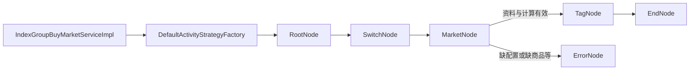
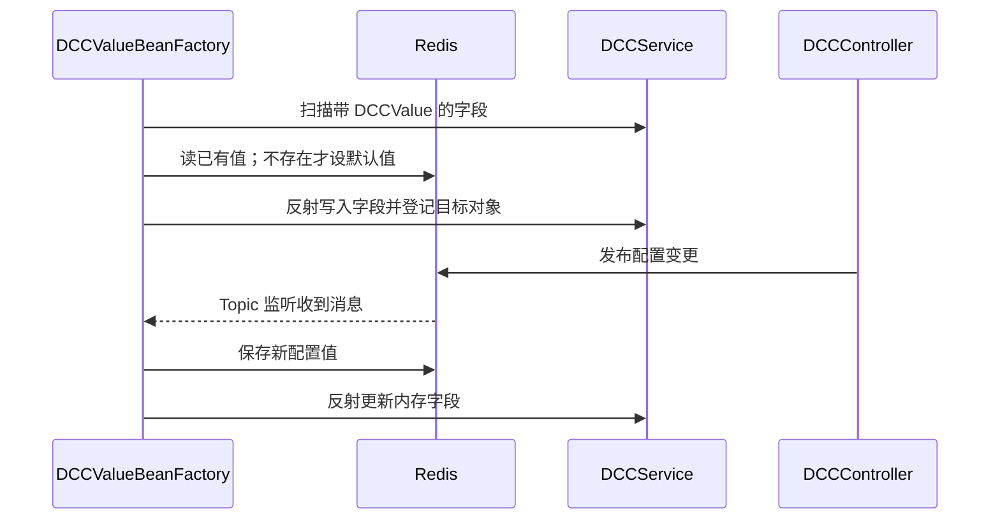
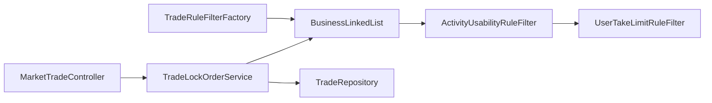
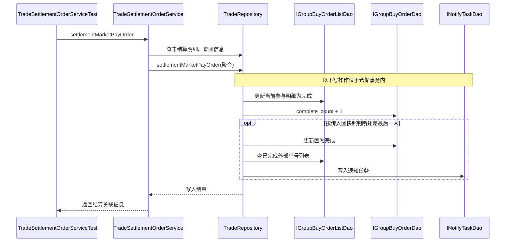

# 串联复习：一笔拼团交易，如何从报价走到成团

> 覆盖作者学习序号 01–15：1-1「拼团需求分析」至 2-12「拼团组队结算统计」。
> 这是额外的一节复习，不占用作者章节号。下一节仍是 16 / 2-13「交易结算责任链过滤」。
> 阅读对象是本仓库的 `com.sirius` 实现；参考代码固定到 `2-12-250128-xfg-trade-settlement`，不是 reference 的 master。

## 0. 先说明这节怎么学

你已经写到 2-12，当前任务不是重新抄十五节，而是恢复三种联系：

1. **业务到数据**：用户做一个动作，哪些数据发生变化？
2. **数据到代码**：谁负责查、谁负责决定、谁负责落库？
3. **问题到设计**：如果不这样拆，会遇到什么具体问题？

这是一节课，下面只是同一节的阅读路标，不是另起课程编号。先顺着主线读，遇到不熟的 Java / Spring 内容，再停下来读旁边的小灶。

建议分段阅读，不必一口气背完：

| 阅读段 | 内容 | 停下来做什么 |
| --- | --- | --- |
| 第一段 | 第 1–2 部分：业务、表、分层 | 用自己的话区分活动、团、明细 |
| 第二段 | 第 3–6 部分：试算、路由、异步、策略 | 在 IDEA 找到一次试算的价格来源 |
| 第三段 | 第 7 部分：人群与开关 | 分清活动人群、折扣人群、动态放量 |
| 第四段 | 第 8–9 部分：锁单与结算 | 手推三人团，指出两处事务边界 |
| 第五段 | 第 10–14 部分：跟读、自测、证据、口述 | 独立作答，再核对参考分析 |

第一遍先抓正常业务链路；每段中的并发反例与实现边界可第二遍回看，但在验收和写简历前要能解释。

### 当你读不下去时，怎样问我

不要只说“这块没懂”，也不必整理成正式报告。给我：**小标题 + 类/方法 + 你预测的执行顺序 + 实际卡住的一步**。例如：“我以为 `next()` 会调用第二个过滤器，但这里直接返回 null，为什么还能继续？”我们就从那一步展开，不整章重讲。

### 本节完成标准

- 能不看代码解释“试算、锁单、结算、成团”的区别。
- 能在 IDEA 中从试算测试找到折扣策略，从锁单入口找到 SQL，从结算服务找到通知任务写入。
- 能手推三人团中 `lock_count`、`complete_count`、明细状态的变化。
- 能解释规则树、策略、模板方法、责任链分别解决什么问题，而不是只背名字。
- 能指出“事务能解决什么、不能解决什么”，不把课堂的顺序执行等同于并发正确。

**运行基线**：此前没有可核对的实测测试条数，本轮也未执行全量业务测试。文末单列本次真实验证记录，不用源码中 `@Test` 的数量冒充通过数量。

### 教材与代码导航

| 资料 | 入口 |
| --- | --- |
| 原文按节索引 | [原文 AGENTS.md](../orgin-tutorial/AGENTS.md) |
| 章节与参考分支 | [branch-map.md](../branch-map.md) |
| 本轮进度与约定 | [learning-guide.md](../learning-guide.md) |
| 当前根工程 | [pom.xml](../../pom.xml) |
| 试算测试 | [IIndexGroupBuyMarketServiceTest.java](../../group-buy-market-app/src/test/java/com/sirius/test/domain/activity/IIndexGroupBuyMarketServiceTest.java) |
| 锁单测试 | [ITradeLockOrderServiceTest.java](../../group-buy-market-app/src/test/java/com/sirius/test/domain/trade/ITradeLockOrderServiceTest.java) |
| 结算测试 | [ITradeSettlementOrderServiceTest.java](../../group-buy-market-app/src/test/java/com/sirius/test/domain/trade/ITradeSettlementOrderServiceTest.java) |
| 当前建表脚本，只读核对 | [group_buy_market.sql](../dev-ops/mysql/sql/group_buy_market.sql) |

注意：建表脚本包含 `DROP TABLE` 与预置数据，**这里不是让你重新导入或清空现有库**。需要集成验证时先使用独立测试库和 Redis 数据范围；工程副本并不能隔离数据库。

## 1. 先不看框架：我们到底做的是哪个系统

### 1.1 一笔交易，分成两个系统的责任

假设一件商品原价 100 元，拼团优惠 10 元，实付 90 元，三人支付后成团。

- **商城 / 支付侧**：商品交易、创建支付单、调用支付渠道、接收真实支付结果、履约发货。
- **拼团营销侧，也就是当前项目**：算优惠、控制参与资格、占用团名额、记录支付后的拼团进度、在成团后准备通知。

这是业务示例，不是声称当前库里恰好存在这份配置。当前库的价格、人数、活动日期要实际查询。

用户看到“拼团购买”，背后至少有四个不同问题：

| 阶段 | 用户语言 | 系统要回答的问题 | 当前侧是否真的收款 |
| --- | --- | --- | --- |
| 试算 | 我现在能便宜多少？ | 商品关联什么活动、优惠怎么算、是否可见可参与 | 否 |
| 锁单 | 我要用这个优惠下单 | 是否允许参加、是否还有名额、记录这笔营销订单 | 否 |
| 支付后结算 | 这笔订单已经付了钱 | 把哪个用户的哪一笔锁单计为完成 | 接收支付成功信息，不负责扣款 |
| 成团 | 三个人都付完了 | 团是否完成、应为哪些外部订单准备通知 | 否 |

**锁单成功，不等于支付成功；支付成功，也不等于整个团完成。**

2-12 的“结算”不是银行清结算，不涉及给商家分账；这里指支付成功后，对营销参与明细和团进度记账。

### 1.2 把术语变成你能区分的对象

| 术语 | 大白话 | 本项目中的例子 |
| --- | --- | --- |
| 活动 `activityId` | 一套能被很多人使用的营销规则 | 三人成团、哪些商品可用、什么时间生效 |
| 团 `teamId` | 按活动规则临时组成的一支具体队伍 | 小王发起、还差两人支付的这个团 |
| 营销订单 `orderId` | 拼团系统自己的参与记录编号 | 本系统生成的锁单明细号 |
| 外部单号 `outTradeNo` | 商城拿来对账的编号 | 同一笔商城交易在营销侧的关联键 |
| SKU / 商品 | 用于取得商品信息和原价 | `SkuVO`、`sku` 表 |
| 幂等 | 同一业务操作重试，不重复产生效果 | 同一笔交易不应重复占名额或计支付完成 |
| 聚合对象 | 把本次业务必须一起处理的数据装成一个整体 | `GroupBuyOrderAggregate` |
| 上下文 | 这一次请求沿途携带的资料袋 | 前面查出的活动，后面直接取用 |

活动不是团。一个活动可以有许多个团；同一团下有多条用户参与明细。`orderId` 不是商城的 `outTradeNo`，更不是支付渠道流水号。

### 1.3 如果最开始只写一个大方法

你大概会顺着写：

```text
查商品 → 查活动 → 判断开关 → 算价格 → 查标签 → 校验活动和次数
→ 建团或参团 → 写参与明细 → 等支付消息 → 更新人数 → 通知商城
```

问题不是“这样不优雅”，而是：

- 只问价格也得经过写订单的逻辑吗？报价和占位的副作用混在一起。
- 新增一个折扣类型，要不要改这个大方法？
- 同一个用户来两次，资料暂存在单例 Service 字段里会不会串？
- 更新人数成功、写订单失败怎么办？
- 查的时候还差一个位置，真正写时是否仍然有位置？

后面的分层与模式，分别回答这些问题。**不是先背一套 DDD 名词，再把类往里面塞。**

## 2. 从需求找到表，再找到模块

对应原文：01 / 1-1、02 / 1-2、03 / 1-3、04 / 2-1、09 / 2-6。

### 2.1 先把“配置”和“发生过的交易”分开

配置描述“允许发生什么”，交易记录描述“实际发生了什么”。运营改配置，不应该顺手改掉已经锁定的历史订单金额。

| 表 | 回答的问题 | 关键联系 |
| --- | --- | --- |
| `sku` | 商品叫什么、原价多少 | `goods_id` |
| `sc_sku_activity` | 这个来源、渠道、商品关联哪个活动 | `source + channel + goods_id → activity_id` |
| `group_buy_activity` | 几人成团、何时生效、限制次数、活动人群 | `activity_id`、`discount_id` |
| `group_buy_discount` | 用哪种优惠算法、表达式是什么 | `discount_id`、`market_plan`、`market_expr` |
| `crowd_tags_job` | 某个标签批次打算按什么规则采集 | 标签与批次 |
| `crowd_tags` / `crowd_tags_detail` | 标签定义、统计及具体成员 | `tag_id`、`user_id` |
| `group_buy_order` | 一支团要几人、锁了几人、完成几人 | `team_id` |
| `group_buy_order_list` | 哪个用户、哪笔外部交易参加了哪个团 | `team_id`、`user_id`、`out_trade_no` |
| `notify_task` | 成团后，有什么通知尚待处理 | `team_id`、通知参数与状态 |

这是逻辑关联，不是声称所有联系都建了数据库外键。原文早期设计里提到的账户等设想，也不代表当前代码已实现对应完整模块。

### 2.2 为什么 2-6 要加关联表

先试着把 `goods_id` 直接放在活动里：一个活动绑一个商品，演示很快。

现在运营要把相同规则用于十个商品。如果复制十套活动，那么修改团人数、时间、折扣都要改十份，且容易不一致。

于是拆出：

```text
(source, channel, goodsId) → sc_sku_activity → activityId
activityId → group_buy_activity → discountId → group_buy_discount
```

收益是商品关联与活动规则分开维护；代价是多一次映射查询和关联配置的完整性维护。

**不要过度推导**：拆出折扣表不等于当前已经支持任意优惠叠加；本轮实际路径是活动取一个 `discountId`，再取这份折扣。设计留出的可能性，不是已经实现的功能。

当前 `sc_sku_activity_mapper.xml` 同时按商品、来源、渠道过滤，这比只看早期原文片段更准确。明确指定 `activityId` 时，任务会优先按活动查询，不走商品关联查找；因此不能把这个快捷分支当作已经校验商品与活动绑定关系的证据。

方法名也不是全部契约：试算使用的 `queryValidGroupBuyActivityByActivityId` 在当前 XML 中只筛 `status = 1`，没有按日期过滤；锁单规则链另做时间检查。于是“能算出价格”和“现在允许锁单”仍是两层判断。

### 2.3 再把职责放回六模块

| 模块 | 你读代码时问什么 | 真实例子 |
| --- | --- | --- |
| api | 外部调用者需要知道什么协议？ | `IMarketTradeService`、请求与响应 DTO |
| trigger | 谁触发业务、怎样编排和转换？ | `MarketTradeController` |
| domain | 业务规则和流程到底是什么？ | `TradeLockOrderService`、`TradeSettlementOrderService` |
| infrastructure | 怎样从具体存储取得、写入数据？ | `TradeRepository`、DAO、Redis |
| app | Spring 怎样启动、连接并组装这些对象？ | `Application`、线程池和 DCC 配置、Mapper 资源 |
| types | 哪些结构不属于具体拼团业务？ | 规则树、责任链、异常和通用枚举 |

**Java / Spring 小灶：接口调用为什么会进到另一个模块？**

`TradeLockOrderService` 只声明依赖 `ITradeRepository`；这个接口在 domain 中，实现 `TradeRepository` 在 infrastructure 中。app 引入相关模块后，Spring 创建实现对象，再注入到依赖接口的服务里。

- 编译时：domain 不需要引用基础设施实现类。
- 运行时：调用接口方法，实际执行注入对象的方法。

这就是此处的**依赖倒置**：业务声明自己需要什么能力，基础设施来满足它。收益是业务少知道 SQL、Redis 的细节；代价是多了接口、模型转换和跳转层级。

**DTO / Entity / VO / PO 不靠后缀判断价值**：DTO 面向接口传输，PO 面向表字段，领域 Entity / VO 面向业务表达。当前一些领域类主要是数据载体，不能仅凭名字宣称实现了完整充血模型。聚合也不是“任意几个对象装一起就是严格的 DDD 聚合根”，要看一致性边界。

**遇到 `builder()` 不必找手写方法**：当前工程使用 Lombok 的 `@Builder` 生成建造入口，`@Getter` / `@Data` 等生成访问方法。IDEA 与 Maven 都需要正确处理这些注解；看到源码没有 getter，却能调用，不是 Spring 在运行时替你补方法。`@Service`、`@Repository` 负责声明容器组件，和 Lombok 不是同一层机制。

## 3. 先跑一个探针：只问报价，暂时别创建订单

### 3.1 在 IDEA 先定位这些文件

用 Search Everywhere 搜类名，或直接按前面的文件链接打开。按你的键位方案进入方法实现；第一次不需要单步钻进 Spring、MyBatis 框架源码。

1. `IIndexGroupBuyMarketServiceTest.test_indexMarketTrial`。
2. `IndexGroupBuyMarketServiceImpl.indexMarketTrial`。
3. `AbstractMultiThreadStrategyRouter.apply`。
4. `MarketNode.MultiThread` 与 `MarketNode.doApply`。
5. `TagNode.doApply`、`EndNode.doApply`。

先看测试的真实参数：用户 `sirius`、商品 `9890001`、来源 `s01`、渠道 `c01`。这是源码里的固定输入，不保证符合你今天的库和标签数据。

**运行前核对**：IDEA 实际启用的 profile、对应库、Redis、Project SDK 与测试运行 JRE。Spring 测试启动会装配 DCC，初始化时可能写 Redis 默认配置，所以“这个测试方法只查询”也不意味着整个启动过程绝无副作用。

确认环境后只 Debug 这个方法，不运行整个测试包。若配置不匹配，先读错误，不通过清库来绕过。

### 3.2 观察结果前，先写下预测

| 观察点 | 应看到的东西 |
| --- | --- |
| 请求对象 | 这次是谁、哪个商品、从哪里来 |
| 动态上下文 | 活动与 SKU 何时被放进去 |
| 策略 Map | `marketPlan` 对应哪一个 Bean |
| 金额 | 原价、优惠金额、实付金额分别是多少 |
| 人群结果 | `isVisible` 与 `isEnable` 的实际布尔值 |
| 数据副作用 | 试算业务不应新增参与明细或增加锁单数 |

本轮备课没有运行你的业务数据库，这里给的是**观察判据，不是实测输出**。如果你最终看到异常，也可能是有效探针：例如活动配置缺失、开关拦截、标签数据不同。

### 3.3 从这个探针列账

| 缺口 / 疑问 | 不弄清的后果 | 接下来读哪里 |
| --- | --- | --- |
| 为什么经过这么多节点？ | 只知道一路点进去，不知道谁控制执行顺序 | 第 4 部分 |
| 两个 Future 都 get，为何还叫并发？ | 把阻塞等待误认为串行查询 | 第 5 部分 |
| calculate 返回的是减免金额吗？ | 金额含义写反 | 第 6 部分 |
| 标签与开关是否同一件事？ | 把灰度、人群资格、折扣人群混为一谈 | 第 7 部分 |
| 报价有了，为何还不能直接算完成？ | 锁单量、支付量混淆 | 第 8–9 部分 |

## 4. 规则树与模板方法：节点管业务，路由管去哪里

对应原文：05 / 2-2、06 / 2-3。

### 4.1 从流水方法推导出节点

如果参数校验、开关判断、数据准备、折扣、人群资格都写在一个方法里，增加“没有活动时走另一种结果”会引入更多分支，也难以单独理解某个步骤。

先把有独立职责的步骤拆开，再明确两个问题：

- **这个节点做什么**：`apply`，具体业务在 `doApply`。
- **下一步去哪里**：`get` 返回下一节点，`router` 负责调用。

这里的规则树是项目自己的轻量路由模型，不等于引入了 Drools，也不是所有“树”都必须递归遍历左右子树。



正常路径看起来像链，但 `MarketNode` 可以选择不同后继，这是使用可路由结构的理由。并非所有错误都经过 `ErrorNode`；参数、开关和策略缺失等位置也会直接抛异常。

### 4.2 真正绕的地方：apply、doApply、router 不是同一层动作

看你现有的 `AbstractMultiThreadStrategyRouter`：

```text
apply(请求, 上下文)
  → MultiThread(请求, 上下文)
  → doApply(请求, 上下文)
```

`doApply` 在需要继续时调用：

```text
router(请求, 上下文)
  → get(请求, 上下文)，取得下一节点
  → 下一节点.apply(请求, 同一个上下文)
```

注意是**下一节点的 apply**，因此新节点仍先经过它自己的数据准备钩子。`AbstractGroupBuyMarketSupport` 给 `MultiThread` 默认空实现，不是每个节点都启动线程。

`EndNode.doApply` 直接构建并返回结果，没有继续调用 `router`。不要把 `EndNode.get` 中的默认 Handler 当成本次返回结果的实际来源。

你当前方法名是首字母大写的 `MultiThread`，原文常用 `multiThread`。阅读和打断点要按真实源码；本次不为命名统一改代码。

### 4.3 Java 小灶：为什么泛型有 T、D、R

- `T`：这次输入，如 `MarketProductEntity`。
- `D`：这次沿途共享的资料，如 `DefaultActivityStrategyFactory.DynamicContext`。
- `R`：最终返回，如 `TrialBalanceEntity`。

通用框架不必知道拼团有多少钱，它只需要知道：给节点一个输入与上下文，节点会返回某种结果。

**模板方法模式**在这里固定“先准备数据、后业务受理”的骨架，让子类填具体步骤；**路由机制**再决定后继。两者叠在一起，但解决的是两个不同问题。

代价是调用不再线性地写在一个方法中，需要跨父类、子类和节点阅读。你现在觉得绕，往往是把这些动作都理解成“执行”，没有分清它们各自的层级。

### 4.4 单例服务为什么没有把不同用户的数据混在一起

Spring 的普通 Service 默认是容器内单例，可以被许多线程同时调用。**单例不等于自动线程安全，也不等于每个请求创建一个 Service。**

`IndexGroupBuyMarketServiceImpl` 在每次调用时新建 DynamicContext，再作为参数传下去。因此本次试算资料属于本次请求，不放在节点成员字段里。

想一想：如果把 `currentUserId`、`payPrice` 放成 `MarketNode` 的可变成员字段，两个请求交错执行会发生什么？这就是“节点共享、请求状态不共享”的实际意义。

## 5. 异步查数据：先把两个活派出去，再等结果

对应原文：06 / 2-3，关联查询调整来自 09 / 2-6。

### 5.1 先问：这里到底哪两个查询可以同时做

折扣计算至少需要：

- 商品资料：商品原价等。
- 活动与折扣配置：该套什么算法。

商品查询不依赖活动查询完成，所以可以并发。活动任务内部如果需要先查商品渠道关联、再查活动、再查折扣，这几步有数据依赖，仍按顺序执行。

查看 `MarketNode.MultiThread`：

1. 创建活动查询的 `FutureTask`，交给线程池。
2. 创建商品查询的 `FutureTask`，交给线程池。
3. 调用两个 `get` 等待结果。
4. 在当前调用线程中把结果放入上下文。
5. 进入 `doApply` 算折扣。

### 5.2 Java 小灶：Callable、FutureTask、线程池各干什么

| 对象 | 大白话 |
| --- | --- |
| `Callable<V>` | 一份能产生结果、也可能失败的工作说明 |
| `FutureTask<V>` | 包住这份工作，保存完成状态与结果，可等待获取 |
| `ThreadPoolExecutor` | 调度有限的工作线程来执行任务 |
| `get(...)` | 当前线程等结果，不是“再执行一遍查询” |

调用 `get` 是阻塞的，但两个任务已经先后提交，等待第一个时第二个也可能正在跑。相反，如果提交 A、get A、再提交 B、get B，就没有这种重叠。

假设 A 80ms、B 120ms，忽略排队、连接池与调度开销，串行接近 200ms，并发理想情况接近 120ms。**这只是解释并发的示例数字，不是本项目的性能测试结果。**

### 5.3 这里的优化有什么代价和边界

- 多占工作线程和数据库连接，线程池忙时仍会排队，不能说“并发一定更快”。
- `get` 可能抛 `ExecutionException`、`InterruptedException`、`TimeoutException`；失败不能当作成功报价。
- 等待超时不代表后台任务自动取消，更不等于 SQL 已经中止。
- 当前 `timeout = 500L` 搭配的是 `TimeUnit.MINUTES`，即单次等待上限 500 分钟，不是 500 毫秒。不要根据变量数值猜单位；本次不修改它。
- 两次分别计时的 get，不等于为整个请求统一设定一个严格总超时。
- 此处并发查询与后面的数据库写事务是两个机制。不要推断“主线程加事务，线程池里的任务就自动共享同一事务”。

**IDEA 观察建议**：在两个任务 `call` 的入口与 `get` 后观察线程名。断点如果挂起所有线程，会扭曲并发时序；不要用一次单步停顿推断性能或稳定执行顺序。

## 6. 折扣策略：算法可以替换，金额含义必须稳定

对应原文：07 / 2-4，金额语义修正在 14 / 2-11。

### 6.1 为什么从 if/else 走向策略

只有直减时，直接减就够了。加入满减、折扣、N 元购后，如果每次都修改一个大计算方法，算法之间容易互相影响。

于是定义相同入口 `IDiscountCalculateService.calculate`，把每种算法放在独立实现里，再按配置选一个。

| `market_plan` | 实现 | 看配置时怎样理解 |
| --- | --- | --- |
| `ZJ` | `ZJCalculateService` | 直减，例如减 10 |
| `MJ` | `MJCalculateService` | 满减，例如 `100,10` |
| `ZK` | `ZKCalculateService` | 按折扣表达式计算 |
| `N` | `NCalculateService` | N 元购，最终价来自配置 |

收益是算法分开改与测试；代价是类和配置更多，`market_plan` 必须与注册名称匹配。只有两种稳定分支时，普通条件判断也可能更易读；不是策略模式天然高于 if/else。

### 6.2 Spring 小灶：Map 不是你手动填的，为何能取到策略

`MarketNode` 依赖 `Map<String, IDiscountCalculateService>`，实现类用 `@Service("MJ")` 等名字注册。Spring 能按类型收集候选实现，Map 的键使用 Bean 名。

在 IDEA 直接看这个 Map：拿到哪些键、每个值是什么实现，比背“Spring 自动注入”更具体。当前使用 `@Resource`，它有按名称解析等规则；不要因此泛化成“任何 Map 都会自动收集所有 Bean”。本例是否满足预期，以容器中实际注入对象为准。

### 6.3 这节最容易讲错的一句话

**当前 `calculate` 返回的是优惠后的实付价格，不是减免金额。**

`MarketNode.doApply` 的核心含义是：

```text
payPrice = 策略计算结果
deductionPrice = originalPrice - payPrice
```

原价 100、直减 10：

| 字段 | 正确含义 | 示例 |
| --- | --- | --- |
| `originalPrice` | 原价 | 100 |
| `deductionPrice` | 减免多少 | 10 |
| `payPrice` | 要付多少 | 90 |

读早期 2-4、2-9 原文时会遇到旧命名和金额填充问题，2-11 已明确修正。**本节以当前代码语义为准**，不把早期片段直接粘回工程。

Java 小灶：钱用 `BigDecimal`；`new BigDecimal("0.1")` 与从二进制浮点值构造的效果不同。比较金额大小用 `compareTo`；`equals` 还涉及 scale，`1.0` 和 `1.00` 不一定 equals。当前算法的最低价、取整方式需看每个实现，不用一句“所有优惠都这样”概括。

### 6.4 折扣模板方法还做了一次人群检查

`AbstractDiscountCalculateService.calculate` 先检查折扣类型是否为特定人群优惠；若用户不在折扣人群里，返回原价，否则调用 `doCalculate`。

这是另一处模板方法：把“先判断能否享受这份优惠，再执行算法”固定下来，避免每个算法复制一套人群过滤。

**注意区分两种人群问题**：

- 折扣上的 `tagId`：有没有资格享受这份特殊折扣？
- 活动上的 `tagId + tagScope`：能不能看见、能不能参加这个活动？

它们不是重复逻辑，也不要求一定使用同一个标签。能看到活动，不保证享受某个特定人群价。

## 7. 标签与动态开关：谁适合参加，今天放多少流量

对应原文：08 / 2-5、10 / 2-7、11 / 2-8。

### 7.1 先造出“人群”，再在请求中查它

`TagService.execTagBatchJob` 读取批次任务，随后遍历用户列表，交给 `TagRepository` 写人群明细并设置 Redis Bitmap 的位，再更新统计量。

**截至当前，采集用户列表仍是代码中固定的演示数据**。读了任务配置，不代表已实现根据真实消费数据自动筛出高价值用户，更不是完成了数仓系统。

Bitmap 可以理解成一排开关：某个用户映射到一个位置，把该位设为 1，请求来时读这一位。

- 数据库明细保存具体成员记录。
- Redis Bitmap 支持快速成员判断。
- 字符串用户 ID 需要映射成位下标，映射策略、碰撞与内存开销都是取舍，不能声称散列后就是严格无碰撞的集合。

当前写入是“先 DB，后 Redis”，不是跨 MySQL / Redis 的原子事务。若 DB 已存在明细、Redis 位却丢了，再执行添加可能因唯一键冲突直接结束，未必恢复 Redis；重复批次与统计口径也要单独验证。不要按原文演示建议清空你的现有记录来绕过。

### 7.2 可见和可参加为什么分两个字段

有的活动允许所有人看到，但只有目标人群能参加。因此需要两个答案：`visible`、`enable`。

`TagNode` 的核心公式：

```text
最终可见 = 未配置可见限制 OR 用户在人群内
最终可参与 = 未配置参与限制 OR 用户在人群内
```

这里的初始布尔值更像“这一项是否不受限”，而不是“已查完用户资格”。

| 未配置该项限制 | 是否在人群内 | 最终是否允许 |
| --- | --- | --- |
| true | false | true |
| true | true | true |
| false | false | false |
| false | true | true |

**按真实代码讲边界，不按理想设计补全**：

- 当前 `isEnable` 要求 `split.length == 2` 且第二项是 `"2"`。单独写 `tagScope="2"`，不能按注释直接认定会限制参与。先使用已知格式理解流程，其他格式列为欠账。
- 当前 `TagNode` 在空标签分支设置默认值后，没有像原文那样直接 return；仍会进入标签查询。空标签路径需要验证，不能说“已经完全跳过 Redis”。
- `ActivityRepository.isTagCrowdRange` 在 Bitmap 不存在时返回 true，是缺标签数据时放行。**缺失与用户不在集合内不是同一个结果**，也不能把“权限默认拒绝”套到当前实现上。

这些是源码可见的行为或风险，本轮没有对你的 Redis 做破坏实验，不宣称已实机复现。

### 7.3 为什么还要动态开关

人群标签回答“哪类用户符合运营规则”，动态开关回答“当前这套能力是否开放、开放多少”。

`SwitchNode` 在查活动、商品前进行拦截：

1. `downgradeSwitch` 开启则拒绝当前拼团流程。
2. 根据 `cutRange` 判断用户是否在放量范围内。
3. 通过才进入 `MarketNode`。

这里所谓“降级”当前表现为业务异常拦截，不是自动切换成另一个报价系统，也不是 Redis 故障时自动回 DB。

### 7.4 从一个字段推导出 DCC 机制

如果开关写死在字段里，每次改都要改配置、重启；如果每次请求都直接查 Redis，则请求链路多一份依赖与开销。

当前选择“启动时装载、收到变更时更新内存”：



Spring 小灶：`BeanPostProcessor` 是 Bean 生命周期的扩展点；自定义注解只是标记，不会自己执行更新。真正扫描和赋值的是处理器。Java 反射允许运行时找到字段并写值；如果对象经过 AOP 代理，还要区分代理对象、目标类与目标对象。

代价包括：消息可能错过、多个实例刷新时点不一致、字段的跨线程可见性需要设计、当前一个配置键只登记一个对象。普通 Redis 发布订阅不是持久消息队列，所以不能据此承诺配置绝不丢失且强一致。

当前内存字段是普通 String，不能因为反射已经写入就推断其他业务线程必然立即看到；这属于后续应设计并验证的可见性边界。另外 DCC 是管理入口，真实部署必须考虑鉴权和可修改范围，不能因为本地能调用就当作可公开暴露的接口。

`DCCService` 的分桶使用 `Math.abs(hashCode) % 100` 并用 `<= cutRange` 判断，不是严格的百分比函数；例如 0 阈值仍可能放过落在 0 桶的用户，极端负值也有边界。此处先掌握稳定按用户分桶的目的，不把配置值等同于精确测量出的流量比例。

## 8. 从报价走向锁单：记录一笔承诺，但钱还没付

对应原文：12 / 2-9、13 / 2-10、14 / 2-11。

### 8.1 先从真实入口看执行顺序

打开 [MarketTradeController.java](../../group-buy-market-trigger/src/main/java/com/sirius/trigger/http/MarketTradeController.java)。顺序是：

1. 校验必填参数。
2. 以 `userId + outTradeNo` 查未支付营销订单，有则返回旧记录。
3. 指定 `teamId` 时检查团锁单进度。
4. 调试算，得到价格和活动人群资格。
5. 不可见或不可参与则拦截。
6. 把用户、活动、价格信息转换成领域输入，调用锁单服务。
7. 把领域结果转为接口响应。

所以 Controller 不只是把 HTTP 参数原样转给一个 DAO；它在编排 activity 与 trade 两个领域。这是当前工程的实际做法，不要假装存在一个并未实现的 application 用例服务。

**IDEA / Spring 小灶**：现有 Controller 测试直接调用 Java 方法，这与真实发 HTTP 请求不同，不会验证 HTTP 参数绑定。当前该方法没有 `@RequestBody`，不要未经核对就以为发送任意 JSON 会按同样方式绑定。

### 8.2 交易规则为什么换成责任链

有效活动、时间窗口、次数限制，都是“逐项检查，通过后往下走”。它们不像试算那样需要节点随时选择不同后继。

直接写几个 if 完全能工作；规则变多、不同场景需要复用和组合时，才需要独立处理器与链的装配。



图中的 A → U 表示链按次序调度，不表示 mode2 中 A 持有 U 并直接调用。

- `ActivityUsabilityRuleFilter` 查活动状态与时间，写入当前链上下文。
- `UserTakeLimitRuleFilter` 复用活动配置，查已有参与数，与次数上限比较。
- 终点返回 `TradeRuleFilterBackEntity`，锁单服务用里面的次数构造后续业务唯一标识。

### 8.3 两版责任链真正的差别

| 问题 | mode1 | mode2，当前交易链使用 |
| --- | --- | --- |
| 下一个是谁，存在哪里 | 处理器自身的 `next` 字段 | 独立链表节点里 |
| 谁调度下一步 | 当前处理器调用下一处理器 | `BusinessLinkedList` 循环调度 |
| 同一单例处理器放进两条不同链 | 改写 next 可能互相覆盖 | 两条链的结构可独立 |
| 代价 | 结构直观，但处理器与链接耦合 | 多一层链表、装配和结果约定 |

**mode2 的 `next()` 特别容易看错**：`ILogicHandler.next` 默认只是返回 null，表示“本节点继续”；不是递归调用下一个节点。

`BusinessLinkedList.apply` 的约定：

- 返回 null：循环继续。
- 返回非 null：短路，整条链返回该结果。
- 抛异常：退出，不会继续执行后续检查。

“多例链”不代表所有 Bean 都自动变成 Spring prototype，也不代表可变处理器状态天然安全。它解决的是**链结构和业务处理器分离**。

### 8.4 数据落库：新开团与加入已有团

打开 [TradeRepository.java](../../group-buy-market-infrastructure/src/main/java/com/sirius/infrastructure/adapter/repository/TradeRepository.java) 的 `lockMarketPayOrder`。

| 输入 | 团主记录 | 用户参与明细 |
| --- | --- | --- |
| `teamId` 空 | 生成团 ID，新增目标人数、锁单量 1、完成量 0 的团 | 新增 status=0 的明细 |
| `teamId` 非空 | 更新已有团的锁单量 | 新增 status=0 的明细 |

新开团时产生的团 ID 与参与明细关联；当前锁单返回值主要返回营销 `orderId` 等，不要以为新建结果一定包含 `teamId`。调试可从变量或 DB 取得，后续参团必须用这支团的真实 ID。

### 8.5 为什么必须是一个事务

假设参团时先把 `lock_count` 从 1 加到 2，然后写明细失败。如果两步各自提交，就出现“占了位置却查不到参与者”。

因此这两类操作要么一起成功，要么一起回滚。当前事务在仓储的公共方法 `@Transactional(timeout = 500)` 上，通过 Spring 管理的仓储对象调用。

Spring 小灶：注解本身不是数据库事务。常见机制是代理拦截调用、开启事务、执行、提交或回滚。当前 `AppException` 是运行时异常，沿调用抛出时可触发默认回滚；自己 `new` 仓储对象或绕过代理，不等同于当前调用链。

Controller 在外层捕获业务异常并转换成响应，不代表仓储事务失效：异常先穿过仓储代理，事务拦截器处理回滚，再向外传递。但如果在事务方法内部把异常吞掉后正常返回，就不能仍按同样逻辑保证回滚。

事务 timeout 默认单位为秒，这里的 500 不是前面 Future 的 500 分钟，更不是毫秒。**相同数字在不同 API 中不能共享单位假设。**

### 8.6 别把“先查再写”当作并发保护

设某团目标 3，已锁 2。两个人同时请求，都先查到 2，然后都认为能参与。

正确性的关键必须落到原子写入条件等约束上，而不是只靠 Controller 的查询。

当前 `group_buy_order_mapper.xml` 的真实条件是：

```sql
update group_buy_order
set lock_count = lock_count + 1, update_time = now()
where team_id = #{teamId} and lock_count > 0
```

它没有 `lock_count < target_count` 条件。方法旁“更新不等于 1 表示满团”的注释，并不能证明 SQL 实际会在满团时拒绝。

Controller 还使用等于判断是否已满；如果数据已超过目标，等于也不是大于等于。这些是静态可见的防线缺口，**本轮没有对真实库并发压测，也不修正当前业务代码**。你需要知道问题在哪里，而不是照着讲“已经彻底防超卖”。

### 8.7 幂等有三层，不能只讲第一层

1. **前置查询**：已有未支付记录就返回，减少重复处理。
2. **数据库约束**：两个请求都没查到时，唯一约束才可能守住重复写入。
3. **冲突后响应**：重复请求应得到什么结果，是否能重读原单，是否返回可理解的状态。

`bizId = activityId + '_' + userId + '_' + (count + 1)` 的意图，是给某用户在某活动的第几次参与建立唯一槽位；但字符串长得唯一，不等于数据库建立了唯一索引。

本仓库建表脚本中，明细表只有 `order_id` 的唯一索引和用户活动普通索引，**没有 `biz_id`、`out_trade_no` 的唯一索引**。这只能证明本地脚本如此，不能证明你当前实际数据库也如此。

请先在 IDEA Database 或数据库工具做只读核对：

```sql
SHOW INDEX FROM group_buy_order_list;
```

不要现在直接加索引或删重复数据。实际索引、历史数据与重复响应语义要一起评估；这是待验收项，不是本节偷偷增加的改造任务。

## 9. 支付后结算：明细完成，才增加成团进度

对应原文：15 / 2-12。

### 9.1 为什么从一个 TradeOrderService 拆成两类服务

锁单服务回答“能否参加、如何占位”，结算服务回答“哪笔已锁单的交易完成了支付、怎么记进度”。它们的输入、规则和变化原因不同。

因此 2-12 拆成 `ITradeLockOrderService` 与 `ITradeSettlementOrderService`，并建立 `lock`、`settlement` 的业务目录。

这是单一职责的应用，收益是避免交易接口不断膨胀；代价是类与接口变多。单一职责不是“一个类只能有一个方法”，也不意味着接口越碎越好。

### 9.2 现有结算流程，按五步跟读

打开 [TradeSettlementOrderService.java](../../group-buy-market-domain/src/main/java/com/sirius/domain/trade/service/settlement/TradeSettlementOrderService.java)。

1. 用 `userId + outTradeNo` 查询尚待结算的营销明细。
2. 查不到则返回 null；查不到可能是无此单，也可能是状态已改变，不能只按日志一种解释认定。
3. 根据明细的 `teamId` 查询团信息。
4. 构造 `GroupBuyTeamSettlementAggregate`，交给仓储执行写入。
5. 构建 `TradePaySettlementEntity` 返回此次关联信息。



注意上游传入的是支付成功信息，但当前这段方法本身不是支付回调验签器，不验证支付渠道真实性、到账金额等全部支付条件。2-12 也没有完成商城对接与发货闭环。

### 9.3 三个人依次支付，手推一次

假设目标人数 3，甲乙丙按顺序锁单与结算，期间没有退款、超时释放、并发或失败；这是**顺序执行的教学推演，不是运行结果**。

| 动作后 | `lock_count` | `complete_count` | 甲明细 | 乙明细 | 丙明细 | 团状态 / 通知 |
| --- | --- | --- | --- | --- | --- | --- |
| 甲开团锁单 | 1 | 0 | 0 锁定 | 无 | 无 | 进行中 |
| 乙加入锁单 | 2 | 0 | 0 | 0 锁定 | 无 | 进行中 |
| 丙加入锁单 | 3 | 0 | 0 | 0 | 0 锁定 | 位置占满，但尚未完成 |
| 甲支付结算 | 3 | 1 | 1 完成 | 0 | 0 | 进行中 |
| 乙支付结算 | 3 | 2 | 1 | 1 完成 | 0 | 进行中 |
| 丙支付结算 | 3 | 3 | 1 | 1 | 1 完成 | 团完成，并写通知任务 |

**最重要的细节**：当前结算没有递减 `lock_count`。因此不能把这个字段解释成“只包括尚未付款的人数”。在本阶段这条正向路径中，它保留占用的团名额，支付完成量是其中已经完成的部分。

三人都锁单后即使一个人没付钱，也不能据此把团标为支付达成。至于多久释放未支付名额、退款后怎么恢复，当前还没有完成对应流程，不先把后续章节算进来。

### 9.4 为什么通知任务也必须放进这个事务

假设团已经完成，但程序在创建通知任务前失败。如果两个动作不在一个事务，会得到“业务完成了，却没有任何后续通知待办”。

当前把明细更新、完成量更新、最后一人时的团状态更新与任务插入放在一起，试图保证本地数据库中的一致性。

这个思路接近**本地消息表 / Outbox 的一部分**：先把要通知的事实保存下来。但 2-12 的 `notifyUrl` 仍是“暂无”，没有在本节完成任务调度、重试与对外送达，不能说已经实现完整可靠通知系统。

### 9.5 事务不是并发魔法：看两个反例

先记住当前已有的两条数据库防线，不能只看缺口：

- 完成量更新带 `complete_count < target_count`，防止这条 SQL 继续增加已经达到目标的完成量。
- 团状态更新带 `where team_id = #{teamId} and status = 0`，限制从进行中迁移到完成。仓储检查更新行数，不等于 1 时抛运行时异常，回滚本次事务。

这些防线不等于“同一订单只能计一次”，也不会刷新事务前读取的团快照。下面分别看它们尚未覆盖的问题。

#### 反例一：同一笔支付同时通知两次

两次调用都可能在写事务前查到 status=0 的同一明细。当前更新明细 SQL：

```sql
update group_buy_order_list
set status = 1, update_time = now()
where out_trade_no = #{outTradeNo} and user_id = #{userId}
```

它没有“旧状态必须为 0”的条件。顺序重试通常会被前面的 status=0 查询挡住，但这不等于两个并发请求只能有一个完成首次状态迁移。更新行数语义还受驱动与更新内容影响，不能无实测就断言每次一定加两次。

要记住的原则：**查询只是当时看到的事实，写入时的条件才是竞争裁判。**

#### 反例二：不同订单同时完成，谁负责最后成团

目标 3、完成量原为 1。乙丙同时在事务外读取到 complete=1，随后各自完成量 +1，数据库最终可能到 3。

但程序判断是否最后一人的依据是之前传入的 `groupBuyTeamEntity`：两边都计算 `3 - 1 != 1`，都可能不进入成团分支。

这里展示的是根据当前读取与判断位置推导出的并发时序风险，**没有执行真实数据库复现**。数据库写同一行时加锁，不会自动让 Java 里旧对象的值刷新。

将来讨论修正时，应在事务内围绕最新数据库状态与条件更新确定谁完成状态迁移，而不是简单把整个方法包事务就宣称解决。此节只理解边界，不把后续改造提前实现。

### 9.6 事务能与不能，用一张表收口

| 诉求 | 本地事务是否自动解决 |
| --- | --- |
| 计数成功但明细失败，需要一起回滚 | 正确参与同一事务时可以 |
| 通知任务插入失败，团完成状态也应回滚 | 正确参与同一事务时可以 |
| 两次请求都读到旧值 | 不自动解决 |
| 不完整的 SQL 条件导致重复状态迁移 | 不自动解决 |
| MySQL 提交与商城 HTTP 处理同时成功 | 不可以 |
| Redis 标签写入和 MySQL 明细原子提交 | 当前不可以 |
| 外部支付消息是真的且金额正确 | 不负责，需要支付侧与接口边界保证 |

## 10. 再打开 IDEA，把整条主线走一遍

### 10.1 推荐断点，不要求一次全部开启

| 轮次 | 入口 / 断点 | 你要解释的现象 |
| --- | --- | --- |
| ① 试算 | `test_indexMarketTrial` → `AbstractMultiThreadStrategyRouter.apply` | 为什么会先准备数据再执行节点业务 |
| ② 数据与价格 | `MarketNode.MultiThread`、`doApply`、选中的 `doCalculate` | 两个任务已经提交；策略返回实付价 |
| ③ 资格 | `TagNode.doApply`、`EndNode.doApply` | 标签限制怎样变成两个输出布尔值 |
| ④ 锁单入口，只先阅读 | `MarketTradeController.lockMarketPayOrder` | 重试、团进度、试算、资格、锁单的顺序 |
| ⑤ 锁单事务，独立数据后运行 | `TradeLockOrderService` → 两个过滤器 → `TradeRepository.lockMarketPayOrder` | 规则通过后是怎样开团、占位、记明细 |
| ⑥ 结算事务，独立数据后运行 | `TradeSettlementOrderService` → `TradeRepository.settlementMarketPayOrder` | 谁改状态、谁加数量、何时写任务 |

**先走通成功路径，再选一个失败分支**。例如试算无关联配置时进入 `ErrorNode`，或非生效活动被规则链拒绝。不要一开始同时改价格、标签、日期、开关和团人数，否则你不知道究竟哪项改变导致现象。

### 10.2 交易测试为什么不能盲目点击绿色箭头

- 锁单测试固定 `activityId=100123`、`teamId="26482544"`、用户 `xfg03`、外部单号 `909000098114`。
- 结算测试固定用户 `xfg02`、外部单号 `909000098113`，并不自动使用上一方法刚返回的新订单。
- 种子脚本含 2025 年结束的活动；今天是 2026-10-23，活动时间校验可能先拦截。实际库是否更新要查，不改系统时钟去“修复”。
- 交易测试主要打印结果，缺少对业务状态的断言；结算返回 null 仍可能显示测试通过。
- 直接调用锁单 Service 的测试，绕过了 Controller 的资格和团进度检查；它不能证明整条 HTTP 入口正确。
- 标签任务会写 DB / Redis，DCC 测试会改变开关，其他测试还可能长时间等待。不要一次执行全包。
- `DCCControllerTest.test_updateConfig2indexMarketTrial` 把降级开关设成 `1`，等待一秒后调用试算；若异步配置已生效，应在 `SwitchNode` 抛出 `E0003`。测试没有断言该异常，届时会以未处理异常失败，而不是成功返回报价；若消息未及时生效，现象又可能不同。这里是按源码解释，未实际运行，更不能把固定 sleep 当作同步保证。

**本轮练习不要求你为运行先修改工程**。如果旧数据不可用，先把代码跟读和手推做完；下一轮我们确认独立测试库，再按一个团、三个用户、三笔唯一外部单号准备测试数据，逐笔记录前后状态。不要把全库脚本导入当成初始化小测试的默认步骤。

### 10.3 真正验收时要记录什么

| 场景 | 通过判据 |
| --- | --- |
| 正常试算 | 实付 + 减免 = 原价；活动与商品正确；两个资格值符合已核对配置 |
| 缺配置试算 | 明确定位拦截节点与业务码，而不只是笼统出现异常 |
| 新开团 | 团记录一条、该用户明细一条、锁单 1、完成 0 |
| 加入同一团 | 团 ID 不变，参与明细增加，锁单量变化符合动作 |
| 顺序重复锁单 | 观察旧 orderId 是否返回、是否新增明细，单独核对数据库索引 |
| 单笔支付结算 | 对应明细完成、完成量增加，未达目标不应产生完成通知任务 |
| 最后一笔顺序结算 | 团完成、通知任务保存，参数外部单号集合与本团已完成明细相符 |
| 顺序重复结算 | 进度不再增加，并如实记录当前是返回 null 还是其他结果 |

并发锁单、并发重复结算、并发最后两单、事务故障回滚、DB/Redis 不一致恢复，均是**尚未运行的专项验证**。不能用上面的顺序表代替它们的结论。

## 11. 对照原作者：十五节各自补了哪块拼图

本表用于回查，不要求重新从头读原文。具体路径见原文索引，分支全名见章节映射。

| 作者序号 / 小节 | 原课解决的问题 | 你现在应能定位的证据 |
| --- | --- | --- |
| 01 / 1-1 | 为什么做平台化拼团营销 | 能说清营销侧与商城支付侧边界 |
| 02 / 1-2 | 配置、人群、交易、通知需要哪些数据 | 能区分活动、团、用户明细、任务 |
| 03 / 1-3 | 从用例和事件走向领域与架构 | activity、tag、trade 的职责与调用 |
| 04 / 2-1 | 搭建可启动可访问数据的六模块工程 | 根与各模块 POM、DAO、Mapper |
| 05 / 2-2 | 通用节点处理与策略路由 | `StrategyHandler`、`StrategyMapper`、路由器 |
| 06 / 2-3 | 把独立数据查询并发执行 | `MarketNode.MultiThread`、两个 Callable |
| 07 / 2-4 | 独立折扣算法，共用计算入口 | `IDiscountCalculateService` 与四个策略 |
| 08 / 2-5 | 生成人群成员数据 | `TagService`、`TagRepository`、Bitmap |
| 09 / 2-6 | 商品绑定与活动配置解耦 | `sc_sku_activity`、活动查询任务 |
| 10 / 2-7 | 把活动人群限制加入试算结果 | `TagNode`、visible / enable |
| 11 / 2-8 | 程序不重启时调整开关与放量 | `DCCValueBeanFactory`、`DCCService`、`SwitchNode` |
| 12 / 2-9 | 下单前占名额并记录营销订单 | Controller → 锁单仓储 → 两张订单表 |
| 13 / 2-10 | 统一轻量规则链的结构与执行 | mode1 / mode2、`BusinessLinkedList` |
| 14 / 2-11 | 活动可用、次数限制与价格语义修正 | 两个锁单过滤器、`bizId`、实付与减免 |
| 15 / 2-12 | 支付后记进度，最后一笔写成团任务 | 结算 Service、仓储事务与 `notify_task` |

### Spring 机制的补充依据

本节关于泛型 Map 收集候选 Bean 的说明，结合 Spring 5.3 文档核对：[Spring 5.3.4 核心容器文档](https://docs.spring.io/spring-framework/docs/5.3.4/reference/html/core.html)。它用于补充框架机制，不替代本工程 `@Resource` 的真实注入结果与调试观察。当前 Boot 版本从根 POM 读取，不能把本链接的小版本当作已解析出来的项目依赖版本。

### 当前实现与参考不能混为一谈

| 维度 | 原文 / 2-12 的意图 | 用户当前实现 | 本轮处理 |
| --- | --- | --- | --- |
| 命名 | 原文多使用 `multiThread`、`cn.bugstack` | `MultiThread`、`com.sirius` | 按当前真实名称讲解，不为对齐改名 |
| 渠道商品映射 | 原文早期片段仅按 goodsId 查询 | 当前 XML 还按 source、channel 限定 | 讲当前 SQL，不照抄旧片段 |
| 空标签 | 原文 `TagNode` 空标签分支提前返回 | 当前设置默认值后继续查询 | 记录差异，列为待验证 |
| 价格字段 | 早期片段混用，2-11 修正 | 当前 MarketNode 分开记录减免与实付 | 以当前正确语义讲解 |
| 锁单上限、并发结算 | 业务意图是限额与准确计数 | 当前 SQL 条件与快照判断有边界 | 分清设计意图、静态推演和实测 |
| 通知完成 | 后续章节继续实现 | 当前只写任务，URL 仍占位 | 不声称已完成可靠回调 |

参考快照可只读查看，不需要切分支：

```bash
git -C reference/group-buy-market diff 2-11-250125-xfg-trade-rule-link 2-12-250128-xfg-trade-settlement --stat
git -C reference/group-buy-market show 2-12-250128-xfg-trade-settlement:group-buy-market-domain/src/main/java/cn/bugstack/domain/trade/service/settlement/TradeSettlementOrderService.java
```

分支 `2-12-250129-xfg-settlement-rule` 实际指向 2-13 的重复快照，不要因名字含 2-12 就选它。

## 12. 自测：先合上讲义，再回答

不要求一次答得很漂亮。答不上来的位置，就是接下来需要我们单独练的机制。

### A. 业务与数据

1. 原价 100、直减 10，三个价格字段各是多少？哪一个是策略 `calculate` 的返回值？
2. 为什么一个活动下需要很多个团、一个团下又需要很多条明细？三个 ID 各指什么？
3. 三个人已经锁单，只有两人支付：锁单量、完成量分别是多少？能不能发出“目标达成”的通知？
4. 2-12 已经写入通知任务，是否能说商城已经收到通知、完成发货？为什么？

### B. 代码定位与设计

5. 从 `test_indexMarketTrial` 出发，说出正常节点顺序，以及谁选择下一节点。
6. 为什么 `get` 会阻塞，但两项数据查询仍可能并发？需要怎样的提交顺序？
7. DynamicContext 为什么每次请求新建？把其中的价格改成单例节点字段会怎样？
8. 折扣策略、人群折扣模板、活动 TagNode 分别管什么？
9. mode2 的 `next()` 返回 null 为什么还能进入后续节点？换成非 null 会怎样？
10. domain 不依赖 infrastructure，为什么仓储调用仍能落到数据库？

### C. 正确性与简历追问

11. 锁单写主表成功、明细失败，为什么要回滚主表？事务在哪里开启？
12. Controller 已经查过剩余人数，为什么还需要 SQL 限制？当前 SQL 是否真的包含上限？
13. 代码构造了 `bizId`，为什么仍要 `SHOW INDEX`？它能证明你实际数据库有什么约束吗？
14. 支付成功重复调用一次和同时调用两次，有什么不同？当前明细更新条件缺少什么？
15. 目标 3、原完成量 1，两笔不同订单同时结算，为什么可能计数满了却没有成团任务？

### 参考分析：先答完再看

1. 原价 100，减免 10，实付 90；calculate 返回 90。
2. 活动是规则、团是一次组队、明细是一笔用户参与；activityId / teamId / orderId 不可互换，外部还另有 outTradeNo。
3. 本节无退款无释放的顺序场景下锁单量 3、完成量 2；按人数达成条件还不能成团。
4. 不能。当前只把待办持久化，送达、重试和商城履约尚不是本节实现。
5. RootNode → SwitchNode → MarketNode → TagNode → EndNode；节点 get 决定后继，router 调下一节点 apply；MarketNode 可转 ErrorNode。
6. 两个任务都先提交，等待第一个期间第二个可能在执行；get 不是把任务重新串行执行。
7. 请求状态隔离；单例可变字段会被不同请求覆盖，出现用户或价格串用。
8. 策略算钱；折扣模板决定能否享受该人群折扣；活动节点产生可见、可参与结果。
9. 循环调度器把 null 视为继续，非 null 视为整链返回；不是 next 真在调用后继。
10. domain 声明接口，infrastructure 实现，Spring 在启动组装时把实现注入服务。
11. 否则产生幽灵占位；当前是仓储公共方法上的 Spring 声明式事务。
12. 两次请求能同时读到旧值；当前加锁单 SQL 只有 lock_count > 0，不含小于目标条件。
13. 字符串格式不等于唯一约束；本地脚本缺这两种关键唯一索引，只有读取实际库才能确认真实结构。
14. 顺序第二次通常查不到 status=0；并发时两边可能都已查到。当前 update 没限定旧状态为 0，不能据此前置查询承诺只计一次。
15. 两边拿到旧 complete=1，各自加一后都按旧对象判断还差两人，不进入最后一人分支；事务不会刷新之前读到的 Java 快照。

## 13. 本次备课的验证记录

日期：2026-10-23。这里区分“教材核对”“编译”“机制探针”“业务验证”。

### 13.1 已做与没做

| 项目 | 状态 | 证据 / 限制 |
| --- | --- | --- |
| 原文与当前源码核对 | 已核对 | 读取 01–15 的诉求与核心实现，并检查当前 Controller、服务、仓储、XML、DDL 与测试 |
| 2-12 参考增量 | 已核对 | 只读 diff 2-11 → 2-12，看到锁单分层拆分、新结算服务、SQL 与任务表增量 |
| 根工程 Maven 构建 | 失败，停在模型依赖解析 | 不是 Java 编译错误；不能计为构建通过 |
| 当前真实框架类的无 DB 探针 | 3 项通过 | 实际编译副本中的路由与责任链类，验证模板顺序、非空短路和异常中止 |
| 机制探针破坏性验证 | 预期失败后已还原 | 仅改项目外副本；短路条件反转能触发断言 |
| 原有全量测试 | 未运行 | Maven 阻塞；测试含外部依赖、真实写入与持续等待风险 |
| 试算 / 锁单 / 结算 DB 集成 | 未运行 | 未确认独立测试库与数据，不擅自改现有业务数据 |
| 并发、回滚、故障恢复 | 未运行 | 文中给的是静态时序推演，不是复现报告 |
| 教程代码抽取 | 不适用 | 本节没有要求写入业务工程的实现代码块 |
| 学习者复习验收 | 尚未完成 | 阅读与回答自测后再更新学习进度 |

### 13.2 构建环境和真实失败

终端检测为 Java 21.0.8、Maven 3.9.4；根 POM 目标为 Java 8。验证选用了本机已有 `D:/develop/JDK/jdk8`，将根 POM 和六个模块复制到项目外临时目录，未修改用户工程或参考实现。

在副本执行的命令形态：

```bash
JAVA_HOME="D:/develop/JDK/jdk8" PATH="/d/develop/JDK/jdk8/bin:$PATH" mvn -o -f "<项目外副本>/pom.xml" -DskipTests package
```

`<项目外副本>` 是说明占位符，不能原样复制执行。关键报错原文：

```text
Non-resolvable import POM:
com.datastax.oss:java-driver-bom:pom:4.14.1 (present, but unavailable)
Cannot access mirror (https://maven.aliyun.com/nexus/content/groups/public) in offline mode
and the artifact ... has not been downloaded from it before.
```

Maven 还提示部分缓存来自当前构建不可用的 remote repository ID。结论是**离线仓库来源记录 / 依赖解析不满足本次构建**，不是据此判定业务实现错误。未擅自修改 Maven 全局配置、删除本地缓存或安装依赖。

另外 app 的 Surefire 配置硬编码 `skipTests=true`，即使 package 成功也不能证明执行过测试；本次命令本来就明确跳过测试，不能拿它验收业务。

### 13.3 三项机制探针与破坏性实验

在项目外编写轻量 Java main 探针，直接使用副本的 `AbstractMultiThreadStrategyRouter`、`BusinessLinkedList` 等真实类；不启动 Spring、不连接 DB / Redis。它不是原有 JUnit 套件，也不增加项目测试基线。

真实输出：

```text
PASS tree-order load>business>choose>end
PASS chain-short-circuit A>B>
PASS chain-exception reject>
```

分别验证：

1. 模板先加载、后业务，再选择并执行后继。
2. A 返回 null 继续，B 返回非 null 后 C 不执行。
3. 处理器异常向上传播，后续处理器不执行。

随后仅把副本 `BusinessLinkedList` 的 `if (null != apply) return apply;` 改成 `==`，先搜索确认改动确实生效，重新编译运行，真实失败：

```text
java.lang.AssertionError: chain result expected=stop actual=null
```

还原后重新编译运行，三项恢复通过。原工程文件与还原副本的 SHA-256 一致：

```text
36147558dab18a7d508130f81b1c60da990fe8c54232b1b0ff23e18fb76668ed
```

这证明的是**探针确实守住了短路条件**，不证明现有交易测试足以覆盖并发、幂等和数据库回滚。探针文件在项目外，不需要用户复制或重写；将来卡在这两个框架机制时，再单独展开对应小练习。

## 14. 小结：现在怎样讲这个项目才可信

### 如果只记三件事

1. **报价、占位、支付记账是三件事**：不要把试算成功说成支付成功，也不要把锁单满员说成支付达成。
2. **设计是被具体变化逼出来的**：路由拆流程，策略换算法，模板固定骨架，责任链组合规则，分层隔离业务与存储细节。
3. **正确性最终要落到状态、写入条件和验证证据**：前置查询不是并发裁判，注释不是约束，事务不是分布式与幂等的万能答案。

### 一段可以练习的项目口述

> 这是我基于课程学习并动手实现的拼团营销项目，营销侧与商城支付侧分离。我目前完成到支付后拼团结算统计：试算阶段通过节点路由组织开关、人群与报价，商品和活动查询并发准备，多种折扣用策略切换；下单时通过规则链检查活动和参与次数，再在事务中创建或加入团并记录营销明细。支付成功后更新明细和团完成量，顺序最后一笔结算时写入成团通知待办。现阶段通知送达、退款和更完整的并发保障还不能当作已完成能力来讲。

这是口述练习，不是直接让你贴上简历的“最终项目成果”。在你能运行、解释和回答自测后，再压缩成自己的项目描述。

**现在不要写**：百万级真实用户、生产上线收益、已达成某个 QPS、响应提升百分比、完整高可用配置中心、绝不超卖、Exactly Once、可靠通知已闭环、完全独立原创。代码里的机制、课程假设和未经测量的结果要分开。

### 交作业方式

先告诉我你在哪段卡住。读完后，不需要重新写整个工程，把下面三项发来即可：

1. 用自己的话复述“100 元商品三人成团”的报价 → 锁单 → 结算路径。
2. 自测第 5、9、11、12、15 题的答案，并说明对应代码位置。
3. IDEA 已实际跑了什么、输入与结果是什么；没跑就明确说没跑，不必为了全绿改现有数据。

我们据此补薄弱机制、核对必要的运行证据。**复习验收后再进入 16 / 2-13**：把结算前置校验从流程中整理出来。下一节不是再加一条锁单链，而是给支付后的结算流程建立自己的规则边界。
