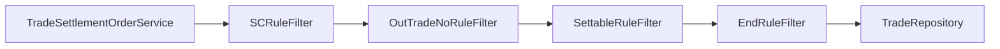

# 16 / 2-13：交易结算责任链过滤

> 上一节解决“收到支付成功信息后，如何记账并统计成团”。本节补上前置问题：**这笔支付有没有资格进入结算？**
>
> 对应原文：[16-2-13-交易结算责任链过滤](../orgin-tutorial/2.第2部分：服务实现/16-2-13-交易结算责任链过滤.md)。参考仓库 `reference/group-buy-market`，分支 `2-13-250129-xfg-settlement-rule`，对比上一节 `2-12-250128-xfg-trade-settlement`。本文是本地学习笔记，不是原文转载。

## 0. 先确定这一节做到哪里

### 本节能力目标

完成后，你应该能够：

1. 从“按时付款但回调晚到”的场景解释为什么需要 `outTradeTime`。
2. 区分活动有效期、单个团有效期、支付完成时间、消息接收时间。
3. 画出四节点结算责任链，并说明每个节点读写哪些上下文。
4. 从 Controller 传参一路追到实体、仓储、PO、Mapper 和数据库，避免“代码写了字段，SQL 却没落库”。
5. 解释规则过滤、事务、幂等是不同的保障，不把责任链说成并发控制工具。

**本节改代码由你手敲。** 不重抄试算与锁单主流程。先读第 1–4 部分，再按第 5 部分完成一次改造；代码较多是因为字段要穿过多层，不是新增了一套系统。

### 范围与边界

| 本节必须完成 | 本节不实现 |
| --- | --- |
| 渠道黑名单、有效外部单号、团截止时间过滤 | 支付渠道验签、核对实收金额 |
| 保存团有效期快照，结算记录支付时间 | 通知调度与重试，下一节再学 |
| 使用已有 `mode2` 模板装配另一条链 | 新写责任链框架、改成规则树 |
| 区分 Lock / Settlement 命名 | 顺手修锁单并发上限或结算幂等历史问题 |

测试基线：上一节没有原工程 JUnit 实测条数基线。本节实际验证情况见文末；任何项目外局部测试都不等于原工程业务集成通过。

## 1. 先看一个业务问题，不急着新建类

假设活动从 10 月 1 日持续到 10 月 31 日，每个团允许等待 30 分钟。甲在 14:00 开团，那么这个团应保存：

- `validStartTime = 14:00`；
- `validEndTime = 14:30`。

这里的时间是教学示例，不是你数据库中的实际配置。

乙在 14:29 支付完成，商城的通知在 14:32 才到达营销系统。

**如果用营销系统接收时的 `new Date()` 判断，乙会被判超时；如果用真实支付时间 14:29 判断，就可以进入结算。**

再看另外两个请求：

- 一个被运营暂停结算的渠道，仍不断发来结算请求。
- 一个从未锁过营销单的外部单号，也声称支付成功。

上一节服务里只做了部分订单查询。随着这些规则增长，直接全写在一个服务里，会让“校验什么”与“怎么记账”纠缠在一起。本节先把前置判断拆开，再复用已有记账事务。

### 四种时间，别叫成同一个“结束时间”

| 数据 | 本项目字段 | 含义 |
| --- | --- | --- |
| 活动开放范围 | 活动的 `startTime / endTime` | 是否允许参加这个活动 |
| 单个团窗口 | 团的 `validStartTime / validEndTime` | 某个具体团从何时开始、何时截止 |
| 支付完成时间 | 入参 `outTradeTime`，落库 `out_trade_time` | 上游提供的这笔支付实际完成时间 |
| 接收/处理时间 | 营销进程当前时间 | 消息什么时候到、我们什么时候处理 |

当前 `PayActivityEntity.startTime / endTime` 来自活动配置，不能因为旧注释写“拼团开始时间”就误当作新团窗口。

### 为什么把团时间存下来，而不每次查活动重算

如果运营明天把 `valid_time` 从 30 分钟改成 60 分钟，昨天已经开出的团要不要跟着延长？当前方案选择：**开团时保存承诺，结算时读团快照。**

收益是可追溯、不会被后续活动配置静默改变；代价是多存字段，旧数据需要迁移，而且保存规则本身必须定义清楚。

参考本节开团时按当前时间加 `validTime` 分钟计算截止，**没有自动取活动结束时间与团截止时间的较小值**。不要自行把这个额外规则当成已实现。

## 2. 先在 IDEA 看现状，建立探针

这一阶段不改业务代码、不运行整个测试包。

1. 打开 `TradeSettlementOrderService.settlementMarketPayOrder`：当前先查未结算订单，找不到返回 `null`，再查团，最后调用仓储。
2. 打开 `TradePaySuccessEntity`：当前只有来源、渠道、用户和外部单号，没有支付时间。
3. 打开 `TradeRepository.lockMarketPayOrder`：新团初始锁单量为 1，但还没有保存团窗口。
4. 打开 `group_buy_order_mapper.xml`：核对查询列、插入列、`resultMap`，都还没有团窗口。
5. 打开 `BusinessLinkedList.apply`：处理器返回 `null` 时继续，非空时短路返回；抛异常则离开整条调用链。

定位路径均相对仓库根目录：

| 位置 | 路径 |
| --- | --- |
| 结算服务 | `group-buy-market-domain/src/main/java/com/sirius/domain/trade/service/settlement/TradeSettlementOrderService.java` |
| 支付成功入参 | `group-buy-market-domain/src/main/java/com/sirius/domain/trade/model/entity/TradePaySuccessEntity.java` |
| 交易仓储 | `group-buy-market-infrastructure/src/main/java/com/sirius/infrastructure/adapter/repository/TradeRepository.java` |
| 团 Mapper | `group-buy-market-app/src/main/resources/mybatis/mapper/group_buy_order_mapper.xml` |
| 链执行器 | `group-buy-market-types/src/main/java/com/sirius/types/design/framework/link/mode2/chain/BusinessLinkedList.java` |

### 从现状列账

| 缺口 | 后果 | 本节如何处理 |
| --- | --- | --- |
| 支付成功入参没有支付时间 | 无法判断支付是否按时完成 | 增加 `outTradeTime` 并落库 |
| 团没有自己的有效期 | 活动时间与团窗口混淆 | 新团保存时间快照 |
| 校验逐渐堆在服务里 | 改规则容易碰记账流程 | 拆为四节点责任链 |
| 渠道缺少动态禁用入口 | 不能按渠道管控结算 | DCC 新增黑名单属性 |
| 查无订单返回 null | 上游不清楚为什么未结算 | 规则明确抛业务码 E0104 |

## 3. 先推导直接写法，再看责任链

照直写，一个结算服务会依次做：

```text
判断渠道是否禁用
查询这位用户的未结算营销订单
查询这个订单所属的团
比较支付时间与团截止时间
构造记账聚合
在事务里更新明细、完成量及必要的通知任务
```

这些判断不是不能写在一个方法里。拆分的理由是：渠道管控、订单存在性、时间规则有不同变化原因，而且后续可以单独验证每个拒绝分支。

已有 `mode2` 执行器已经能按序执行并短路，不需要再造框架：



最后一条箭头表示结果返回服务后，再由服务调用仓储；**EndRuleFilter 自己不写库**。

| 节点 | 职责 | 上下文变化 | 正常返回 |
| --- | --- | --- | --- |
| `SCRuleFilter` | 渠道黑名单 | 无 | null，继续 |
| `OutTradeNoRuleFilter` | 查询有效未结算订单 | 放入 `marketPayOrderEntity` | null，继续 |
| `SettableRuleFilter` | 查团并校验支付截止时间 | 放入 `groupBuyTeamEntity` | null，继续 |
| `EndRuleFilter` | 组装规则反馈 | 读取团对象 | 非空，结束 |

顺序不是随便排的：查团需要先知道订单的 teamId。把时间节点放到单号节点前，上下文还没数据就会空指针。它是**有数据依赖的流水线**。

### 三个对象分别干什么

- `TradeSettlementRuleCommandEntity`：本次请求的输入，像一张申请表。
- `DynamicContext`：这一趟流水线的临时托盘，前面节点查到的对象交给后面用。
- `TradeSettlementRuleFilterBackEntity`：流水线给服务的明确结果，不让服务依赖节点内部细节。

节点通常是 Spring 单例，不能把“本次用户、订单、团”放到节点成员变量里。每次调用 `new DynamicContext()`，才能避免两笔请求共用同一个托盘。

### Java / Spring 小灶

- 泛型 `<T,D,R>` 在这里分别被替换为命令、上下文和反馈；不是运行时自动改造业务，而是编译期约束参数和返回类型。
- `next(request, context)` 在 `mode2.ILogicHandler` 中只是返回 null；真正循环到下一项的是 `BusinessLinkedList`。不要把它和 `mode1` 的递归 next 混淆。
- `@Bean` 方法参数由 Spring 注入，工厂按写出的顺序组装链。服务用 `@Resource(name = "tradeSettlementRuleFilter")` 明确拿结算链，避免与锁单链混淆。
- 执行器声明 `throws Exception`，所以服务接口、实现及调用它的测试方法都要处理这个受检异常；不是写个 `@Service` 就能省略 Java 编译规则。

Spring 注入语义查阅了 [Spring 5.3 文档](https://docs.spring.io/spring-framework/docs/5.3.4/reference/html/core.html)，本文仍按工程的 Spring Boot 2.7 / `javax.annotation.Resource` 写法，不混入新版 Jakarta 包。

## 4. 本节与参考版本的对齐约定

为了和原课对应，保留四个节点名字，包括原作者的 `SettableRuleFilter`，不顺手改拼写或重做框架。

| 维度 | 本节采取的做法 |
| --- | --- |
| 原锁单规则命名 | 用 IDEA Rename 加 `Lock`；同步类型引用和 Bean 注入 |
| 团窗口 | 开团时 `new Date()`，加 `validTime` 分钟；加入已有团不延长窗口 |
| 截止边界 | 仅允许 `outTradeTime.before(validEndTime)`；恰好等于截止也拒绝 |
| 下界 | 参考本节没有校验 `outTradeTime >= validStartTime`，记录为边界，不冒充双向窗口校验 |
| 渠道配置 | 保留参考的 `source + channel` 拼接和逗号分割后的列表精确匹配，明确编码局限 |
| SQL 映射 | 显式补齐本节新字段的映射、插入和查询，避免只改 Java 字段 |
| 幂等 | 不把本节规则链当作幂等修复；上一轮讨论的 SQL 旧状态防线未在这里擅自加入 |

黑名单检查是运营管控，不是身份认证；检查请求传来的 source/channel 是否在黑名单，也**不等于核验它们与锁单记录的来源渠道一致**。

**已存在的参考差异，不顺手修**：你的 `group_buy_order_mapper.xml` 的 `updateAddLockCount` 条件为 `lock_count > 0`；参考 2-13 快照是 `lock_count < target_count`。前者不限制继续加到目标以上，影响并发锁单上限。它不是本节新增结算规则带来的问题，本教程保留你的旧实现，把它记入学习指南欠账；不据此宣称本地版本“并发零超卖”。

## 5. 按依赖顺序动手

建议分成三轮：数据准备 → 规则链 → 服务接入与调试。每轮完成先检查再继续，不一次粘贴所有内容。

### 5.1 数据库：只对独立测试库做增量变更

先用 IDEA Database 的表结构查看或 `SHOW COLUMNS` 确认字段是否已经存在；已存在就核对类型，不重复 ADD。下面仅是给独立测试库的迁移语句，**本次备课未连接数据库执行**：

```sql
alter table group_buy_order
    add column valid_start_time datetime default null comment '团有效开始时间',
    add column valid_end_time datetime default null comment '团有效结束时间';
alter table group_buy_order_list
    add column out_trade_time datetime default null comment '外部支付完成时间';
```

这里允许 null 是为了不把已有记录伪造为“已经有正确时间”。这不是完整上线迁移方案。旧团没有真实时间快照，**不要用随意当前时间回填**；本节验证新开测试团即可。原 SQL 导出含清表操作，不要为了三个字段整份重导覆盖你已有数据。

### 5.2 让时间字段贯穿实体和 PO

以下是逐处修改用的完整字段/调用片段，不是让你重写已有类，所以不加整文件抽取标记。

| 文件（相对根目录） | 修改 |
| --- | --- |
| `group-buy-market-domain/src/main/java/com/sirius/domain/trade/model/entity/PayActivityEntity.java` | 类内加 `private Integer validTime;`，单位分钟 |
| 同目录 `GroupBuyTeamEntity.java` | 导入 `java.util.Date`，类内加下面两个 Date 字段 |
| 同目录 `TradePaySuccessEntity.java` | 导入 `java.util.Date`，类内加 `private Date outTradeTime;` |
| `group-buy-market-infrastructure/src/main/java/com/sirius/infrastructure/dao/po/GroupBuyOrder.java` | 已导入 Date，类内加下面两个 Date 字段 |
| 同目录 `GroupBuyOrderList.java` | 类内加 `private Date outTradeTime;` |

```java
/** 开团时保存的团有效开始时间 */
private Date validStartTime;
/** 开团时保存的团有效结束时间 */
private Date validEndTime;
```

在 `MarketTradeController.lockMarketPayOrder` 构建 `PayActivityEntity` 时，紧接 targetCount 加：

```java
.validTime(groupBuyActivityDiscountVO.getValidTime())
```

`ITradeLockOrderServiceTest` 中直接构建 `PayActivityEntity` 的路径也加同一句。**Controller 改了不代表绕过 Controller 的测试也传了值。**

### 5.3 Mapper：不是只有 resultMap 要改

`group-buy-market-app/src/main/resources/mybatis/mapper/group_buy_order_mapper.xml`：

1. `dataMap` 中加：

```xml
<result column="valid_start_time" property="validStartTime"/>
<result column="valid_end_time" property="validEndTime"/>
```

2. 将 `insert` 整个语句替换为：

```xml
<insert id="insert" parameterType="com.sirius.infrastructure.dao.po.GroupBuyOrder">
    insert into group_buy_order(
        team_id, activity_id, source, channel, original_price,
        deduction_price, pay_price, target_count, complete_count, lock_count,
        status, valid_start_time, valid_end_time, create_time, update_time
    ) values(
        #{teamId}, #{activityId}, #{source}, #{channel}, #{originalPrice},
        #{deductionPrice}, #{payPrice}, #{targetCount}, #{completeCount}, #{lockCount},
        0, #{validStartTime}, #{validEndTime}, now(), now()
    )
</insert>
```

3. 将 `queryGroupBuyTeamByTeamId` 整个语句替换为：

```xml
<select id="queryGroupBuyTeamByTeamId" parameterType="java.lang.String" resultMap="dataMap">
    select team_id, activity_id, source, channel, original_price, deduction_price,
           pay_price, target_count, complete_count, lock_count, status,
           valid_start_time, valid_end_time
    from group_buy_order
    where team_id = #{teamId}
</select>
```

在 `group_buy_order_list_mapper.xml` 的 `dataMap` 中加：

```xml
<result column="out_trade_time" property="outTradeTime"/>
```

将 **你工程当前名字** `updateOrderListStatus2COMPLETE` 的语句替换为：

```xml
<update id="updateOrderListStatus2COMPLETE" parameterType="com.sirius.infrastructure.dao.po.GroupBuyOrderList">
    update group_buy_order_list
    set status = 1, out_trade_time = #{outTradeTime}, update_time = now()
    where out_trade_no = #{outTradeNo} and user_id = #{userId}
</update>
```

这里特意保留原有 where 范围，未悄悄修并发幂等。增加 `out_trade_time` 的映射也不代表每条 select 都会读它；当前按未结算订单查询不需要读取已完成支付时间。

### 5.4 增加业务码和渠道仓储能力

`group-buy-market-types/src/main/java/com/sirius/types/enums/ResponseCode.java` 的 E0103 后追加：

```java
E0104("E0104", "不存在有效的拼团锁单订单"),
E0105("E0105", "渠道黑名单拦截"),
E0106("E0106", "支付时间不在团截止时间之前"),
```

不要在终止分号后追加枚举项。

`ITradeRepository` 接口类体增加：

```java
boolean isSCBlackIntercept(String source, String channel);
```

`DCCService` 导入 `java.util.Arrays` 和 `com.sirius.types.common.Constants`，在现有属性旁增加：

```java
@DCCValue("scBlacklist:s02c02")
private String scBlacklist;

public boolean isSCBlackIntercept(String source, String channel) {
    return Arrays.asList(scBlacklist.split(Constants.SPLIT)).contains(source + channel);
}
```

配置 `s02c02` 将拦截这组 SC；多组用逗号分隔，列表 contains 按完整元素匹配，**不是 String.contains 子串匹配**。但 source/channel 拼接没有分隔符，仍有编码歧义的局限，也不会自动 trim 配置空格。本节对齐参考实现，不额外扩展格式。

**动态更新的旧限制**：字段解析支持多组，不代表当前 DCC 消息链路支持多组。现有 `DCCValueBeanFactory` 把整条消息按逗号拆开，只取 `split[1]` 作为值；动态下发多组时后面的组会被截断。本节只用单组验证，不修改这个历史消息协议。

`TradeRepository` 导入 `com.sirius.infrastructure.dcc.DCCService` 和 `java.util.Date`、`java.util.Calendar`，在现有 DAO 属性旁增加：

```java
@Resource
private DCCService dccService;
```

类体增加完整方法：

```java
@Override
public boolean isSCBlackIntercept(String source, String channel) {
    return dccService.isSCBlackIntercept(source, channel);
}
```

领域只依赖自己定义的 `ITradeRepository`，不直接 import infrastructure 的 DCCService。这是在具体业务里应用依赖倒置，不是为了多套一层。

### 5.5 仓储：开团写快照，结算写支付时间

在 `TradeRepository.lockMarketPayOrder` 的新团分支内、`GroupBuyOrder.builder()` 之前加入：

```java
Date validStartTime = new Date();
Calendar calendar = Calendar.getInstance();
calendar.setTime(validStartTime);
calendar.add(Calendar.MINUTE, payActivityEntity.getValidTime());
Date validEndTime = calendar.getTime();
```

新团 builder 在 `lockCount(1)` 后加入：

```java
.validStartTime(validStartTime)
.validEndTime(validEndTime)
```

`Calendar.MINUTE` 明确分钟单位；只改新团分支，后加入的用户复用原团截止，不能每加入一人就再续 30 分钟。

在 `TradeRepository.queryGroupBuyTeamByTeamId` 的返回 builder 中，紧接 status 加：

```java
.validStartTime(groupBuyOrder.getValidStartTime())
.validEndTime(groupBuyOrder.getValidEndTime())
```

在 `TradeRepository.settlementMarketPayOrder` 中，调用明细 DAO 更新之前加：

```java
groupBuyOrderListReq.setOutTradeTime(tradePaySuccessEntity.getOutTradeTime());
```

到此自行按这条链检查一遍：

```text
活动 validTime → PayActivityEntity → 新团时间计算 → GroupBuyOrder
→ insert SQL → 表字段 → select SQL → resultMap → GroupBuyTeamEntity

支付 outTradeTime → TradePaySuccessEntity → GroupBuyOrderList → update SQL
```

有一段漏传，后面的校验就不是“自动会有数据”。

### 5.6 新增结算命令、反馈与四个节点

以下标记代码块是完整文件，可按路径新建。先读懂职责再手敲，不需要背 builder 字段。

**文件**：`group-buy-market-domain/src/main/java/com/sirius/domain/trade/model/entity/TradeSettlementRuleCommandEntity.java`

```java
package com.sirius.domain.trade.model.entity;

import lombok.AllArgsConstructor;
import lombok.Builder;
import lombok.Data;
import lombok.NoArgsConstructor;
import java.util.Date;

@Data
@Builder
@NoArgsConstructor
@AllArgsConstructor
public class TradeSettlementRuleCommandEntity {
    private String source;
    private String channel;
    private String userId;
    private String outTradeNo;
    private Date outTradeTime;
}
```

**文件**：`group-buy-market-domain/src/main/java/com/sirius/domain/trade/model/entity/TradeSettlementRuleFilterBackEntity.java`

```java
package com.sirius.domain.trade.model.entity;

import com.sirius.types.enums.GroupBuyOrderEnumVO;
import lombok.AllArgsConstructor;
import lombok.Builder;
import lombok.Data;
import lombok.NoArgsConstructor;
import java.util.Date;

@Data
@Builder
@NoArgsConstructor
@AllArgsConstructor
public class TradeSettlementRuleFilterBackEntity {
    private String teamId;
    private Long activityId;
    private Integer targetCount;
    private Integer completeCount;
    private Integer lockCount;
    private GroupBuyOrderEnumVO status;
    private Date validStartTime;
    private Date validEndTime;
}
```

**文件**：`group-buy-market-domain/src/main/java/com/sirius/domain/trade/service/settlement/filter/SCRuleFilter.java`

```java
package com.sirius.domain.trade.service.settlement.filter;

import com.sirius.domain.trade.adapter.repository.ITradeRepository;
import com.sirius.domain.trade.model.entity.TradeSettlementRuleCommandEntity;
import com.sirius.domain.trade.model.entity.TradeSettlementRuleFilterBackEntity;
import com.sirius.domain.trade.service.settlement.factory.TradeSettlementRuleFilterFactory;
import com.sirius.types.design.framework.link.mode2.handler.ILogicHandler;
import com.sirius.types.enums.ResponseCode;
import com.sirius.types.exception.AppException;
import org.springframework.stereotype.Service;
import javax.annotation.Resource;

@Service
public class SCRuleFilter implements ILogicHandler<TradeSettlementRuleCommandEntity,
        TradeSettlementRuleFilterFactory.DynamicContext, TradeSettlementRuleFilterBackEntity> {
    @Resource
    private ITradeRepository repository;

    @Override
    public TradeSettlementRuleFilterBackEntity apply(TradeSettlementRuleCommandEntity requestParameter,
            TradeSettlementRuleFilterFactory.DynamicContext dynamicContext) {
        if (repository.isSCBlackIntercept(requestParameter.getSource(), requestParameter.getChannel())) {
            throw new AppException(ResponseCode.E0105);
        }
        return next(requestParameter, dynamicContext);
    }
}
```

**文件**：`group-buy-market-domain/src/main/java/com/sirius/domain/trade/service/settlement/filter/OutTradeNoRuleFilter.java`

```java
package com.sirius.domain.trade.service.settlement.filter;

import com.sirius.domain.trade.adapter.repository.ITradeRepository;
import com.sirius.domain.trade.model.entity.MarketPayOrderEntity;
import com.sirius.domain.trade.model.entity.TradeSettlementRuleCommandEntity;
import com.sirius.domain.trade.model.entity.TradeSettlementRuleFilterBackEntity;
import com.sirius.domain.trade.service.settlement.factory.TradeSettlementRuleFilterFactory;
import com.sirius.types.design.framework.link.mode2.handler.ILogicHandler;
import com.sirius.types.enums.ResponseCode;
import com.sirius.types.exception.AppException;
import org.springframework.stereotype.Service;
import javax.annotation.Resource;

@Service
public class OutTradeNoRuleFilter implements ILogicHandler<TradeSettlementRuleCommandEntity,
        TradeSettlementRuleFilterFactory.DynamicContext, TradeSettlementRuleFilterBackEntity> {
    @Resource
    private ITradeRepository repository;

    @Override
    public TradeSettlementRuleFilterBackEntity apply(TradeSettlementRuleCommandEntity requestParameter,
            TradeSettlementRuleFilterFactory.DynamicContext dynamicContext) {
        MarketPayOrderEntity order = repository.queryMarketPayOrderEntityByOutTradeNo(
                requestParameter.getUserId(), requestParameter.getOutTradeNo());
        if (order == null) {
            throw new AppException(ResponseCode.E0104);
        }
        dynamicContext.setMarketPayOrderEntity(order);
        return next(requestParameter, dynamicContext);
    }
}
```

**文件**：`group-buy-market-domain/src/main/java/com/sirius/domain/trade/service/settlement/filter/SettableRuleFilter.java`

```java
package com.sirius.domain.trade.service.settlement.filter;

import com.sirius.domain.trade.adapter.repository.ITradeRepository;
import com.sirius.domain.trade.model.entity.GroupBuyTeamEntity;
import com.sirius.domain.trade.model.entity.TradeSettlementRuleCommandEntity;
import com.sirius.domain.trade.model.entity.TradeSettlementRuleFilterBackEntity;
import com.sirius.domain.trade.service.settlement.factory.TradeSettlementRuleFilterFactory;
import com.sirius.types.design.framework.link.mode2.handler.ILogicHandler;
import com.sirius.types.enums.ResponseCode;
import com.sirius.types.exception.AppException;
import org.springframework.stereotype.Service;
import javax.annotation.Resource;

@Service
public class SettableRuleFilter implements ILogicHandler<TradeSettlementRuleCommandEntity,
        TradeSettlementRuleFilterFactory.DynamicContext, TradeSettlementRuleFilterBackEntity> {
    @Resource
    private ITradeRepository repository;

    @Override
    public TradeSettlementRuleFilterBackEntity apply(TradeSettlementRuleCommandEntity requestParameter,
            TradeSettlementRuleFilterFactory.DynamicContext dynamicContext) {
        GroupBuyTeamEntity team = repository.queryGroupBuyTeamByTeamId(
                dynamicContext.getMarketPayOrderEntity().getTeamId());
        if (!requestParameter.getOutTradeTime().before(team.getValidEndTime())) {
            throw new AppException(ResponseCode.E0106);
        }
        dynamicContext.setGroupBuyTeamEntity(team);
        return next(requestParameter, dynamicContext);
    }
}
```

这里没有偷偷给空时间填 `new Date()`。上游必须提供支付时间，新团必须有有效期快照。缺失会暴露为错误；当前原课也不是一套完整的外部输入校验器。以后接 HTTP/消息边界时需要明确校验和可信来源，不能允许用户任意伪造支付时间。

**文件**：`group-buy-market-domain/src/main/java/com/sirius/domain/trade/service/settlement/filter/EndRuleFilter.java`

```java
package com.sirius.domain.trade.service.settlement.filter;

import com.sirius.domain.trade.model.entity.GroupBuyTeamEntity;
import com.sirius.domain.trade.model.entity.TradeSettlementRuleCommandEntity;
import com.sirius.domain.trade.model.entity.TradeSettlementRuleFilterBackEntity;
import com.sirius.domain.trade.service.settlement.factory.TradeSettlementRuleFilterFactory;
import com.sirius.types.design.framework.link.mode2.handler.ILogicHandler;
import org.springframework.stereotype.Service;

@Service
public class EndRuleFilter implements ILogicHandler<TradeSettlementRuleCommandEntity,
        TradeSettlementRuleFilterFactory.DynamicContext, TradeSettlementRuleFilterBackEntity> {
    @Override
    public TradeSettlementRuleFilterBackEntity apply(TradeSettlementRuleCommandEntity requestParameter,
            TradeSettlementRuleFilterFactory.DynamicContext dynamicContext) {
        GroupBuyTeamEntity team = dynamicContext.getGroupBuyTeamEntity();
        return TradeSettlementRuleFilterBackEntity.builder()
                .teamId(team.getTeamId())
                .activityId(team.getActivityId())
                .targetCount(team.getTargetCount())
                .completeCount(team.getCompleteCount())
                .lockCount(team.getLockCount())
                .status(team.getStatus())
                .validStartTime(team.getValidStartTime())
                .validEndTime(team.getValidEndTime())
                .build();
    }
}
```

### 5.7 工厂装配，不让节点自己拼装下一节点

**文件**：`group-buy-market-domain/src/main/java/com/sirius/domain/trade/service/settlement/factory/TradeSettlementRuleFilterFactory.java`

```java
package com.sirius.domain.trade.service.settlement.factory;

import com.sirius.domain.trade.model.entity.GroupBuyTeamEntity;
import com.sirius.domain.trade.model.entity.MarketPayOrderEntity;
import com.sirius.domain.trade.model.entity.TradeSettlementRuleCommandEntity;
import com.sirius.domain.trade.model.entity.TradeSettlementRuleFilterBackEntity;
import com.sirius.domain.trade.service.settlement.filter.EndRuleFilter;
import com.sirius.domain.trade.service.settlement.filter.OutTradeNoRuleFilter;
import com.sirius.domain.trade.service.settlement.filter.SCRuleFilter;
import com.sirius.domain.trade.service.settlement.filter.SettableRuleFilter;
import com.sirius.types.design.framework.link.mode2.LinkArmory;
import com.sirius.types.design.framework.link.mode2.chain.BusinessLinkedList;
import lombok.Data;
import org.springframework.context.annotation.Bean;
import org.springframework.stereotype.Service;

@Service
public class TradeSettlementRuleFilterFactory {
    @Bean("tradeSettlementRuleFilter")
    public BusinessLinkedList<TradeSettlementRuleCommandEntity, DynamicContext,
            TradeSettlementRuleFilterBackEntity> tradeSettlementRuleFilter(
            SCRuleFilter scRuleFilter, OutTradeNoRuleFilter outTradeNoRuleFilter,
            SettableRuleFilter settableRuleFilter, EndRuleFilter endRuleFilter) {
        return new LinkArmory<>("交易结算规则过滤链", scRuleFilter,
                outTradeNoRuleFilter, settableRuleFilter, endRuleFilter).getLogicLink();
    }

    @Data
    public static class DynamicContext {
        private MarketPayOrderEntity marketPayOrderEntity;
        private GroupBuyTeamEntity groupBuyTeamEntity;
    }
}
```

### 5.8 接入结算服务

先把接口的方法声明改为带 `throws Exception`。完整接口如下：

**文件**：`group-buy-market-domain/src/main/java/com/sirius/domain/trade/service/ITradeSettlementOrderService.java`

```java
package com.sirius.domain.trade.service;

import com.sirius.domain.trade.model.entity.TradePaySettlementEntity;
import com.sirius.domain.trade.model.entity.TradePaySuccessEntity;

public interface ITradeSettlementOrderService {
    TradePaySettlementEntity settlementMarketPayOrder(TradePaySuccessEntity tradePaySuccessEntity) throws Exception;
}
```

服务不再重复查单、查团，而是消费链反馈，构建聚合再记账：

**文件**：`group-buy-market-domain/src/main/java/com/sirius/domain/trade/service/settlement/TradeSettlementOrderService.java`

```java
package com.sirius.domain.trade.service.settlement;

import com.sirius.domain.trade.adapter.repository.ITradeRepository;
import com.sirius.domain.trade.model.aggregate.GroupBuyTeamSettlementAggregate;
import com.sirius.domain.trade.model.entity.*;
import com.sirius.domain.trade.service.ITradeSettlementOrderService;
import com.sirius.domain.trade.service.settlement.factory.TradeSettlementRuleFilterFactory;
import com.sirius.types.design.framework.link.mode2.chain.BusinessLinkedList;
import lombok.extern.slf4j.Slf4j;
import org.springframework.stereotype.Service;
import javax.annotation.Resource;

@Slf4j
@Service
public class TradeSettlementOrderService implements ITradeSettlementOrderService {
    @Resource
    private ITradeRepository repository;

    @Resource(name = "tradeSettlementRuleFilter")
    private BusinessLinkedList<TradeSettlementRuleCommandEntity,
            TradeSettlementRuleFilterFactory.DynamicContext, TradeSettlementRuleFilterBackEntity> tradeSettlementRuleFilter;

    @Override
    public TradePaySettlementEntity settlementMarketPayOrder(TradePaySuccessEntity tradePaySuccessEntity) throws Exception {
        log.info("拼团交易-支付订单结算 userId:{} outTradeNo:{}",
                tradePaySuccessEntity.getUserId(), tradePaySuccessEntity.getOutTradeNo());
        TradeSettlementRuleFilterBackEntity back = tradeSettlementRuleFilter.apply(
                TradeSettlementRuleCommandEntity.builder()
                        .source(tradePaySuccessEntity.getSource())
                        .channel(tradePaySuccessEntity.getChannel())
                        .userId(tradePaySuccessEntity.getUserId())
                        .outTradeNo(tradePaySuccessEntity.getOutTradeNo())
                        .outTradeTime(tradePaySuccessEntity.getOutTradeTime())
                        .build(),
                new TradeSettlementRuleFilterFactory.DynamicContext());

        GroupBuyTeamEntity team = GroupBuyTeamEntity.builder()
                .teamId(back.getTeamId())
                .activityId(back.getActivityId())
                .targetCount(back.getTargetCount())
                .completeCount(back.getCompleteCount())
                .lockCount(back.getLockCount())
                .status(back.getStatus())
                .validStartTime(back.getValidStartTime())
                .validEndTime(back.getValidEndTime())
                .build();
        repository.settlementMarketPayOrder(GroupBuyTeamSettlementAggregate.builder()
                .userEntity(UserEntity.builder().userId(tradePaySuccessEntity.getUserId()).build())
                .groupBuyTeamEntity(team)
                .tradePaySuccessEntity(tradePaySuccessEntity)
                .build());

        return TradePaySettlementEntity.builder()
                .source(tradePaySuccessEntity.getSource())
                .channel(tradePaySuccessEntity.getChannel())
                .userId(tradePaySuccessEntity.getUserId())
                .teamId(team.getTeamId())
                .activityId(team.getActivityId())
                .outTradeNo(tradePaySuccessEntity.getOutTradeNo())
                .build();
    }
}
```

**行为变化要注意**：当前旧版“查不到未结算单返回 null”，新版本抛 `E0104`。重复完成后的再次结算，也可能由于查询只找 `status=0` 而得到 E0104；它并不精确区分“不存在、已完成、其他不可结算原因”。不能仅看提示文字就认定发生退款。

### 5.9 锁单命名收口：用 IDEA Rename，不复制出第二份 Bean

按作者本节对齐，使用 Refactor → Rename，开启引用更新：

| 原名 | 新名 |
| --- | --- |
| `TradeRuleCommandEntity` | `TradeLockRuleCommandEntity` |
| `TradeRuleFilterBackEntity` | `TradeLockRuleFilterBackEntity` |
| `TradeRuleFilterFactory` | `TradeLockRuleFilterFactory` |

同步检查 `TradeLockOrderService`、`ActivityUsabilityRuleFilter`、`UserTakeLimitRuleFilter` 的泛型、import、builder 和 DynamicContext。它们业务判断不变。

下面的 Bean 名改动是本教程的命名明确化，参考 2-13 仍保留 `tradeRuleFilter`；不是原作者分支的原样改动。最后将工厂 `@Bean("tradeRuleFilter")` 改成 `@Bean("tradeLockRuleFilter")`，服务注入字段改名为 `tradeLockRuleFilter`，并将该字段上的注解明确写成：

```java
@Resource(name = "tradeLockRuleFilter")
```

执行 `.apply` 的位置也改成新字段名。不要只改注解不改调用，也不要保留旧工厂再新建一个工厂，导致两份链重复注册。原来方法名 `tradeRuleFiler` 可保留，本节不为拼写另做无关修改，Bean 名由注解决定。

### 5.10 旧结算测试补齐支付时间

`ITradeSettlementOrderServiceTest.java` 导入 `java.util.Date`，测试方法加 `throws Exception`。在调用结算之前加：

```java
tradePaySuccessEntity.setOutTradeTime(new Date());
```

这仅用于模拟“此刻支付”，不代表生产回调可以随意用当前时间。固定 userId 和 outTradeNo 必须替换为**你在独立测试库新建的未结算记录**。原方法只打印日志，不能据此证明所有分支被保护。

## 6. 验证：先用五个小测试，看懂你刚写的代码

**你现在不用先研究数据库，也不用运行原来的锁单/结算测试。** 我们先做一件事：给真实的四个过滤器喂几种固定输入，看它们在哪一步放行、在哪一步拒绝。

这一节新增的测试由你手敲，**只新建一个测试类，不改业务实现，不连接 MySQL / Redis**。

### 6.1 先认识测试里仅有的三个动作

把责任链想成门禁：我们要测的是门禁，不是先把整座商场启动起来。

- **准备**：让仓储暂时回答“渠道没被禁、订单存在、团在 14:30 截止”。
- **调用**：真的执行你写的结算服务、四个过滤器及链执行器。
- **检查**：让测试自动判断结果，不靠你从一堆日志里猜。

仓储替身用 Mockito 创建。它实现 `ITradeRepository` 接口，但不会执行真实 SQL：

| 写法 | 大白话 |
| --- | --- |
| `mock(ITradeRepository.class)` | 找一个“只按约定回答”的假仓储 |
| `when(调用).thenReturn(结果)` | 约定被这样询问时，给出这个结果 |
| `assertEquals(期望, 实际)` | 不一样就把测试标红 |
| `assertThrows(AppException.class, () -> 调用)` | 这次应该被拒绝；没抛预期异常才是失败 |
| `verify(repository).某方法(...)` | 检查这个动作恰好做了一次 |
| `verifyNoMoreInteractions(repository)` | 除了前面已核对的动作，不许再偷偷调用仓储 |

**只是假仓储，规则不是假的。** 所以我们能检查“被第一道门拒绝后，后面有没有继续查订单或写库”。但不能用这种测试证明真实 SQL 和事务正确。

### 6.2 在 IDEA 新建一个普通 JUnit 测试

1. 展开 `group-buy-market-app → src → test → java → com.sirius.test.domain.trade`。
2. 右键 `trade` 包 → New → Java Class，名称填 `TradeSettlementRuleLearningTest`。
3. 按下面的完整文件手敲。先看注释，不用背 import。
4. **不要加 `@SpringBootTest` 或 `@RunWith(SpringRunner.class)`**。这次我们自己 new 对象，不启动应用。

这里用已有 `spring-boot-starter-test` 提供的 Mockito 和 Spring 测试工具，以及工程已有的 JUnit 4。**不需要添加依赖或更改 POM**。若 `org.mockito` / `org.junit` 报无法解析，先重新加载 IDEA 的 Maven 工程；仍不行，把第一条错误发我，不要临时升级库。

**文件**：`group-buy-market-app/src/test/java/com/sirius/test/domain/trade/TradeSettlementRuleLearningTest.java`

```java
package com.sirius.test.domain.trade;

import com.sirius.domain.trade.adapter.repository.ITradeRepository;
import com.sirius.domain.trade.model.aggregate.GroupBuyTeamSettlementAggregate;
import com.sirius.domain.trade.model.entity.GroupBuyTeamEntity;
import com.sirius.domain.trade.model.entity.MarketPayOrderEntity;
import com.sirius.domain.trade.model.entity.TradePaySettlementEntity;
import com.sirius.domain.trade.model.entity.TradePaySuccessEntity;
import com.sirius.domain.trade.service.settlement.TradeSettlementOrderService;
import com.sirius.domain.trade.service.settlement.factory.TradeSettlementRuleFilterFactory;
import com.sirius.domain.trade.service.settlement.filter.EndRuleFilter;
import com.sirius.domain.trade.service.settlement.filter.OutTradeNoRuleFilter;
import com.sirius.domain.trade.service.settlement.filter.SCRuleFilter;
import com.sirius.domain.trade.service.settlement.filter.SettableRuleFilter;
import com.sirius.types.exception.AppException;
import org.junit.Before;
import org.junit.Test;
import org.mockito.ArgumentCaptor;
import org.springframework.test.util.ReflectionTestUtils;

import java.text.SimpleDateFormat;
import java.util.Date;

import static org.junit.Assert.*;
import static org.mockito.Mockito.*;

public class TradeSettlementRuleLearningTest {
    private ITradeRepository repository;
    private TradeSettlementOrderService service;
    private Date deadline;

    @Before
    public void setUp() throws Exception {
        // 每个测试开始前重建：上一题的“黑名单”不会污染下一题。
        repository = mock(ITradeRepository.class);
        deadline = new SimpleDateFormat("yyyy-MM-dd HH:mm:ss")
                .parse("2026-01-01 14:30:00");

        // 普通题的默认场景：渠道允许，当前用户有一笔未结算锁单。
        when(repository.isSCBlackIntercept("s01", "c01")).thenReturn(false);
        when(repository.queryMarketPayOrderEntityByOutTradeNo("learner", "pay-001"))
                .thenReturn(MarketPayOrderEntity.builder().teamId("team-001").build());
        when(repository.queryGroupBuyTeamByTeamId("team-001"))
                .thenReturn(GroupBuyTeamEntity.builder()
                        .teamId("team-001").activityId(100123L)
                        .targetCount(3).completeCount(1).lockCount(3)
                        .validStartTime(new Date(deadline.getTime() - 30 * 60_000L))
                        .validEndTime(deadline).build());

        // 这些是你的真实节点，不是 mock；不启动 Spring，就手动放入仓储依赖。
        SCRuleFilter sc = new SCRuleFilter();
        OutTradeNoRuleFilter order = new OutTradeNoRuleFilter();
        SettableRuleFilter time = new SettableRuleFilter();
        EndRuleFilter end = new EndRuleFilter();
        ReflectionTestUtils.setField(sc, "repository", repository);
        ReflectionTestUtils.setField(order, "repository", repository);
        ReflectionTestUtils.setField(time, "repository", repository);

        // 调用你自己的工厂，验证的就是项目中定义的那条链及其顺序。
        TradeSettlementRuleFilterFactory factory = new TradeSettlementRuleFilterFactory();
        service = new TradeSettlementOrderService();
        ReflectionTestUtils.setField(service, "repository", repository);
        ReflectionTestUtils.setField(service, "tradeSettlementRuleFilter",
                factory.tradeSettlementRuleFilter(sc, order, time, end));
    }

    // 这里统一组装支付入参；各测试分别调整支付时间或仓储回答，模拟不同场景。
    private TradePaySuccessEntity payment(Date paidAt) {
        return TradePaySuccessEntity.builder()
                .source("s01").channel("c01").userId("learner")
                .outTradeNo("pay-001").outTradeTime(paidAt).build();
    }

    @Test
    public void test_01_beforeDeadline_shouldSettle() throws Exception {
        // 准备：比截止早一分钟。调用真实服务，四个节点都应放行。
        Date paidAt = new Date(deadline.getTime() - 60_000L);
        TradePaySettlementEntity result = service.settlementMarketPayOrder(payment(paidAt));

        // 检查返回值来自这个订单所属的团，不是某个固定空对象。
        assertEquals("team-001", result.getTeamId());
        assertEquals(Long.valueOf(100123L), result.getActivityId());

        // 捕获服务交给仓储的“记账申请”，检查支付时间和团号没有丢。
        ArgumentCaptor<GroupBuyTeamSettlementAggregate> captor =
                ArgumentCaptor.forClass(GroupBuyTeamSettlementAggregate.class);
        verify(repository).settlementMarketPayOrder(captor.capture());
        assertEquals("team-001", captor.getValue().getGroupBuyTeamEntity().getTeamId());
        assertEquals(paidAt, captor.getValue().getTradePaySuccessEntity().getOutTradeTime());
        // 这里只证明申请记账一次；假仓储不会更新真实数据库。
    }

    @Test
    public void test_02_blacklisted_shouldStopImmediately() {
        // 只改变一个条件：这次渠道被禁用。
        when(repository.isSCBlackIntercept("s01", "c01")).thenReturn(true);
        AppException error = assertThrows(AppException.class,
                () -> service.settlementMarketPayOrder(payment(deadline)));
        assertEquals("E0105", error.getCode());

        // 只能查一次渠道；若继续查订单、查团或申请记账，下面就会报红。
        verify(repository).isSCBlackIntercept("s01", "c01");
        verifyNoMoreInteractions(repository);
    }

    @Test
    public void test_03_missingOrder_shouldStopBeforeQueryingTeam() {
        // 渠道仍允许，但仓储说：没有这笔用户的未结算订单。
        when(repository.queryMarketPayOrderEntityByOutTradeNo("learner", "pay-001"))
                .thenReturn(null);
        AppException error = assertThrows(AppException.class,
                () -> service.settlementMarketPayOrder(payment(deadline)));
        assertEquals("E0104", error.getCode());

        verify(repository).isSCBlackIntercept("s01", "c01");
        verify(repository).queryMarketPayOrderEntityByOutTradeNo("learner", "pay-001");
        verifyNoMoreInteractions(repository);
    }

    @Test
    public void test_04_equalDeadline_shouldReject() {
        // “不晚于”与“早于”不同：当前规则要求严格早于，等于也拒绝。
        AppException error = assertThrows(AppException.class,
                () -> service.settlementMarketPayOrder(payment(deadline)));
        assertEquals("E0106", error.getCode());

        verify(repository).isSCBlackIntercept("s01", "c01");
        verify(repository).queryMarketPayOrderEntityByOutTradeNo("learner", "pay-001");
        verify(repository).queryGroupBuyTeamByTeamId("team-001");
        verifyNoMoreInteractions(repository);
    }

    @Test
    public void test_05_afterDeadline_shouldReject() {
        // 比截止晚一分钟。已经查到团，但不能再申请记账。
        Date paidAt = new Date(deadline.getTime() + 60_000L);
        AppException error = assertThrows(AppException.class,
                () -> service.settlementMarketPayOrder(payment(paidAt)));
        assertEquals("E0106", error.getCode());

        verify(repository).isSCBlackIntercept("s01", "c01");
        verify(repository).queryMarketPayOrderEntityByOutTradeNo("learner", "pay-001");
        verify(repository).queryGroupBuyTeamByTeamId("team-001");
        verifyNoMoreInteractions(repository);
    }
}
```

这份代码只有三个测试工具知识点需要先理解：

1. `@Before`：JUnit 在**每个** `@Test` 前运行一遍准备方法，不是整个类只执行一次。
2. `ReflectionTestUtils.setField`：不启动 Spring，就用测试工具把假仓储放进私有字段，相当于这次由测试接替 `@Resource` 的装配工作。只用于测试，不要求你给业务类增加 setter。
3. `ArgumentCaptor`：像接住快递，看看服务究竟交给仓储什么。它不执行真实仓储，也不验证事务。

`assertThrows` 中的 `() -> ...` 表示“这段调用交给断言工具执行”。异常被正确断言时测试是绿的，**不是出现异常就都算测试失败**。这份写法使用 JUnit 4.13.2；不要误 import JUnit 5 的 Test。

### 6.3 不要一次跑完：按这个顺序点

先点击方法 `test_01_beforeDeadline_shouldSettle` 左侧绿色三角 → **Run**（不是点原有 Spring 测试类）。预期它为绿色；这只是预期，你的实际结果以 IDEA 窗口为准。

看懂第一个再运行后面的，每次仍点对应方法左边的按钮：

| 方法 | 你在模拟什么 | 正确结果及理由 |
| --- | --- | --- |
| 01 | 14:29 付款，14:30 截止 | 绿；返回团号，向假仓储申请记账一次 |
| 02 | 渠道被禁 | 绿；抓到 E0105，连订单都没继续查 |
| 03 | 没有未结算订单 | 绿；抓到 E0104，没有查团或记账 |
| 04 | 恰好 14:30 付款 | 绿；抓到 E0106，没有记账 |
| 05 | 14:31 付款 | 绿；抓到 E0106，没有记账 |

全部单独跑过后，才点新类名旁的三角运行整个**新测试类**，应显示 5 个测试通过，不是整个 app 包通过。

若报红，先按错误类型区分，不要靠修改期望值凑绿：

- `expected ... E0106` 或“没有抛 AppException”：时间判断/规则顺序需要检查。
- `NoInteractionsWanted`：按它指出的调用定位，某个拒绝分支居然继续查或记账了。
- `NullPointerException`：看第一条你自己包名的栈帧，检查上下文是否先写后读、测试是否把仓储放到了节点。
- 出现 Spring 启动横幅、数据库连接错误：检查是否误运行旧测试，或给新类加了 `@SpringBootTest`。本类不应启动应用。
- 找不到 `assertThrows`：确认 `import static org.junit.Assert.*` 及 IDEA 实际解析的 JUnit 版本；把报错发我，不要自己改 POM。

### 6.4 用一次 Debug，把“我为什么加四个类”看见

1. 在 `SCRuleFilter.apply` 的 if、`OutTradeNoRuleFilter.apply` 查询后的 if、`SettableRuleFilter.apply` 的时间 if、`EndRuleFilter.apply` 的 builder 各点一个断点。
2. 在测试 01 方法左侧三角选择 **Debug**。断点设置的 Suspend 选 Thread（默认即可），不用多线程操作。
3. 到渠道节点，仓储回答 false：没有理由拒绝，返回 null，执行器继续下一节点。
4. 到单号节点，查看右侧 Variables 中的 `dynamicContext`：先没有订单，执行 set 后出现 `team-001`。
5. 按 Resume（继续执行；常见快捷键 F9，可直接用调试窗口按钮）到时间节点：它靠刚才的订单找到团，比较 `outTradeTime` 与 `validEndTime`，随后把团放进托盘。
6. 到 End 节点，看到它把团数据包装成非空反馈。回到服务后，构造聚合并交给假仓储。
7. 再 Debug 测试 02：它会在第一节点抛出预期异常，**不会到达后面三个断点**，JUnit 抓住后标绿。

现在回看设计过程：先需要“判断渠道、找单、查时间”，才拆出三个各司其职的检查；后面需要把检查得到的数据交回服务，才有 End 节点。**不是先背四个类名，再给它们找事情做。**

### 6.5 最后才测真实写库：这是另一关

五个小测试绿了，只说明规则与服务配合正确，不能证明表里真的保存了时间。真实测试需要独立库和 Redis 范围；**未确认隔离前先停在这里，把五个测试结果发我**。下面是确认隔离后再执行的步骤，我没有替你连接数据库。

1. 在 IDEA Database 选择你给测试应用配置的独立数据库，查看 `group_buy_order` 是否有 `valid_start_time / valid_end_time`，`group_buy_order_list` 是否有 `out_trade_time`。没有就先按 5.1 增量建列，不导入会清表的整个脚本。
2. 打开你现有的 `ITradeLockOrderServiceTest.test_lockMarketPayOrder`。保留确实存在且当前生效的 activityId、goodsId、用户及渠道；把 `.teamId("26482544")` 改成 `.teamId(null)`，**这次要新开团，不用历史团**。把 outTradeNo 换成这个独立测试库里未用过的值，例如 `learn-213-001`。这些是你手动做的测试输入调整，不改业务方法。
3. 先记下测试中实际的 userId 和 outTradeNo，再只 Run 这个锁单方法。若活动过期、用户次数达限、标签/DCC 拦截，先停下发我业务码；不要不断清数据或绕过规则来跑绿。
4. 在独立库执行下面的只读查询。示例 userId 对应当前锁单测试的 `xfg03`，如果你改了用户，这里也同步改。应只有本次的一条明细，且 status=0；记下它的 team_id。

```sql
select user_id, out_trade_no, team_id, status, out_trade_time
from group_buy_order_list
where user_id = 'xfg03' and out_trade_no = 'learn-213-001';
```

5. 把上一步查到的真实 team_id 填进下面引号，执行前不要保留提示文字。记下 complete_count 和 valid_end_time。两个有效时间都应非空；如果是 null，先检查开团 builder、Mapper 插入与查询，别直接改数据库凑结果。

```sql
select team_id, lock_count, complete_count, status,
       valid_start_time, valid_end_time
from group_buy_order
where team_id = '这里填刚查到的team_id';
```

6. 打开 `ITradeSettlementOrderServiceTest.test_settlementMarketPayOrder`，把 userId 和 outTradeNo 改为刚才锁单那一笔；source、channel 也与锁单一致。**刚完成锁单且还没到截止时**，保留 `setOutTradeTime(new Date())` 来模拟此刻付款，只 Run 这一个结算方法。若已超时，重新走新单流程，不伪造过去付款时间。
7. 重跑步骤 4、5 的两个查询：明细 status 应从 0 变 1，out_trade_time 有值，团 complete_count 应比刚记录的增加 1，lock_count 不因结算递减。如果目标人数大于 1 且目前只有这一笔支付，新团不应直接成团；若你配置的目标本身就是 1，则完成成团是正常的。
8. 给我两组查询的前后结果即可；不发数据库密码或连接地址。不手动清表。真实 DCC 修改、最后一人通知任务和事务回滚，等这条最小路径跑通后再逐项带你验证，不一次让你处理所有环境分支。

如果锁单测试直接返回旧单，说明外部单号已经使用，不能把“方法没报错”当作新开团成功。换一个未用过的测试单号后重做。

## 7. 你现在只需要交回什么

先完成无数据库的五个测试，告诉我：

1. 五个方法哪些绿、哪些红；若红，贴第一段错误和你包名下的第一条栈帧。
2. 用自己的话说：**为什么测试 02 明明抛异常，却应该是绿色？为什么它不应该继续查订单？**
3. 指出订单与团分别由哪个节点放入 DynamicContext。不会的地方说出来，我再针对这一小段讲，不要求背整条链。

不用现在写一段“面试标准答案”。能用运行结果解释代码，比照着术语复述更重要。

## 8. 收口：这一节到底新增了什么

一句话：**把“这笔支付能不能结算”从记账流程前面拆出来，并用支付完成时间检查团的截止时间。**

- SC 节点决定渠道能不能进；单号节点确认有这笔锁单；时间节点检查截止；End 节点把查到的数据交还服务。
- 规则链是门禁，仓储事务是记账。门禁通过不代表数据库已经更新，更不代表并发幂等已经解决。
- 原文只用来核对本节范围：我们仍学习同一节，但新增这五个教学测试，不照搬原文“只打印结果”的测试方式。

下一节是 17 / 2-14《拼团回调通知任务》。先完成本节验证和验收，不提前写下一节。

## 9. 验证证据（供核对，不是让你照抄输出）

本节第一版备课曾完成项目外 8 项自定义探针及时间边界破坏实验；那是历史证据，**不是你本轮的测试结果，也不是下面新增 JUnit 测试的执行结果**。

本次修订：

- 保留第 0–5 部分内容，业务代码和原有测试文件未修改；测试仅写在讲义里，供你手敲。
- 按用户当前真实实现验证，而不是套用第一版教程的业务代码。
- 已从本节第 6 部分的标记代码块抽取 **1 个新测试文件**，放到项目外的用户当前实现副本；未用讲义前半部分覆盖用户业务代码。JDK 8 + 已有缓存 JAR 对 types/domain 和新测试局部编译通过，实际运行 JUnit 4.13.2：

```text
JUnit version 4.13.2
.....
OK (5 tests)
```

- 本轮这 5 个测试通过，范围是当前真实规则/工厂/服务 + Mockito 仓储替身；**不是原有全量测试，也不是 DB 集成通过**。Mockito 4.5.1、Spring 测试工具使用已有缓存，无依赖安装。运行有 SLF4J 无日志绑定警告、使用 NOP 日志，不影响断言。
- 破坏实验只改项目外时间过滤器：把 `!before(end)` 改为 `after(end)`，先确认改动生效，再编译运行。第 04 个测试实际失败，证据：

```text
test_04_equalDeadline_shouldReject
java.lang.AssertionError: expected com.sirius.types.exception.AppException to be thrown, but nothing was thrown
Tests run: 5,  Failures: 1
```

- 还原后与用户文件逐字节一致，SHA-256 为 `29ea582e2a0cde8d3042841b9ff2f990ade12df6a8bb3e574ddb2d88c568826c`；复跑恢复 `OK (5 tests)`。
- 第 0–5 部分原始字节未变，SHA-256 为 `5d7f5ddf56fcda22dad767ba273372c94522d5847478cea6f528fdab6831a07f`。这些是备课结果，用户自己的手敲和运行仍待验收。
- 完整 Maven 构建、原测试全包、真实 DB/Redis、事务回滚及并发：本轮未运行，不计通过。历史离线构建曾因依赖解析失败，不冒充已解决。
