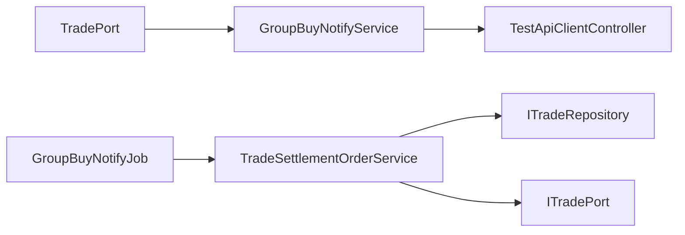

# 17 / 2-14：拼团完成了，怎么告诉商城？

> 对应原文学习序号 17 / 2-14。参考仓库 `reference/group-buy-market`，分支 `2-14-250131-xfg-notify-job`，只用来核对本节边界。
> 你上一节已经亲眼看到：明细完成、团完成量加一。本节接着问：**最后一人付款，团完成后，商城怎么知道可以继续处理订单？**

## 0. 这节先记一条主线

```text
开团保存回调地址 → 最后一人结算时保存通知任务
→ 事务提交后立即尝试通知 → 失败留给定时任务再试
```

只实现这一条，不引入 MQ、线程池或新的规则框架。先读第 1 部分，再按第 2–5 部分逐步手敲，第 6 部分用不联网的测试看结果。**不要先开启定时任务。**

前置：2-13 的五个教学测试已通过，单笔锁单/结算截图已核对。上节没有验证的真实并发、事务回滚仍是欠账，不因进入新课变成已通过。

## 1. 如果我自己设计，怎么一步步想出来？

### 第一个想法：团完成后，直接调用商城 HTTP

HTTP 回调就是“向对方指定地址发一个 POST 请求，告诉它哪个团、哪些订单完成了”。商城返回正文 `success` 表示收到，`error` 表示未处理成功；这只是本节约定，不是 HTTP 自带的协议。

问题：如果团已经完成，通知时断网了，怎么办？不能要求用户重新付款。

### 第二个想法：把“待通知”先记在数据库

上一节的 `notify_task` 已经是这张待办单。团完成与待办单在**同一个本地事务**写入：要么都有，要么都没有。

然后 HTTP 在事务结束后调用。否则对方慢十秒，数据库事务也跟着等待；而且数据库回滚不了对方已经执行的发货动作。

### 第三个想法：失败后让定时任务捡起来

立即尝试是为了快，定时扫描是为了失败后再试。两条入口调用同一个方法，避免两套发送逻辑。

| 数据/类 | 为什么需要 |
| --- | --- |
| `notifyUrl` | 不知道地址就没法通知；开团时保存它 |
| `NotifyTaskEntity` | 领域服务读到的通知待办，不依赖数据库 PO |
| `ITradePort` | 领域说“帮我发送”，不 import OkHttp / Redis |
| `TradePort` | 基础设施把领域请求翻译成 HTTP，并做抢锁 |
| `GroupBuyNotifyService` | 只负责一次 HTTP 请求，不管重试次数 |
| `GroupBuyNotifyJob` | 定时叫醒已有通知方法，不再复制发送逻辑 |

这不是为了凑类：**地址、待办、一次发送、失败后再试，先有这四个问题，才拆出这些职责。**



`TestApiClientController` 暂时代替商城，放本机模拟，不是真的发货服务。

### 先说清一个参考缺陷，免得你被名字带偏

数据库既有约定：`0待处理、1成功、2等待重试、3失败停止`，扫描的是 `(0,2)`。

参考本节服务却在 `notifyCount < 5` 时调用写状态 3 的 Error 方法，会使任务提前停止；反过来在大于等于 5 时写 2，又能被继续扫描。**不能照着这段代码宣称“失败最多重试五次”。**

本教程明确采用下表，与你要学习的补偿目标一致；这是相对参考的修正，不是原样照搬：

| 本次结果 | 更新后状态 | 次数 |
| --- | --- | --- |
| 正文 `success` | 1 | +1 |
| 正文 `error`，本次是第 1–4 次尝试 | 2，稍后再试 | +1 |
| 正文 `error`，本次是第 5 次尝试 | 3，停止自动尝试 | +1 |
| 另一进程持锁，本次没发送 | 不更新 | 不增加 |

这里是**最多五次尝试**，不是首次之外又重试五次。旧失败记录是否人工重发，不在本节实现。

## 2. 先创建依赖，再写调用方

下面按你手敲时能逐步解析的顺序排列。已有文件只改指定位置，不重抄无关内容。

### 2.1 新增通知待办与返回约定

先建这两个类型，后面的接口才有参数可用。

**文件**：`group-buy-market-domain/src/main/java/com/sirius/domain/trade/model/entity/NotifyTaskEntity.java`

```java
package com.sirius.domain.trade.model.entity;

import lombok.AllArgsConstructor;
import lombok.Builder;
import lombok.Data;
import lombok.NoArgsConstructor;

@Data
@Builder
@NoArgsConstructor
@AllArgsConstructor
public class NotifyTaskEntity {
    /** 发送的是整个团完成的信息，一团一份任务。 */
    private String teamId;
    private String notifyUrl;
    /** 已尝试次数；本次发送前读取这个数。 */
    private Integer notifyCount;
    /** 已经生成好的 JSON，不在 HTTP 网关里重新拼订单。 */
    private String parameterJson;

    public String lockKey() {
        return "notify_job_lock_key_" + teamId;
    }
}
```

**文件**：`group-buy-market-types/src/main/java/com/sirius/types/enums/NotifyTaskHTTPEnumVO.java`

```java
package com.sirius.types.enums;

import lombok.AllArgsConstructor;
import lombok.Getter;

@Getter
@AllArgsConstructor
public enum NotifyTaskHTTPEnumVO {
    SUCCESS("success"), ERROR("error"), NULL("null");

    /** NULL 表示本次没拿到锁，不等于通知成功。 */
    private final String code;
}
```

### 2.2 先定义“发送”接口

**文件**：`group-buy-market-domain/src/main/java/com/sirius/domain/trade/adapter/port/ITradePort.java`

```java
package com.sirius.domain.trade.adapter.port;

import com.sirius.domain.trade.model.entity.NotifyTaskEntity;

public interface ITradePort {
    /** 只返回本次发送结果；是否再试由领域服务决定。 */
    String groupBuyNotify(NotifyTaskEntity notifyTask) throws Exception;
}
```

在现有 `ITradeRepository` 导入 `NotifyTaskEntity`、`java.util.List`，类体内新增这些完整声明：

```java
List<NotifyTaskEntity> queryUnExecutedNotifyTaskList();
List<NotifyTaskEntity> queryUnExecutedNotifyTaskList(String teamId);
int updateNotifyTaskStatusSuccess(String teamId);
int updateNotifyTaskStatusRetry(String teamId);
int updateNotifyTaskStatusError(String teamId);
```

原来的结算方法从 `void` 改成：

```java
boolean settlementMarketPayOrder(GroupBuyTeamSettlementAggregate groupBuyTeamSettlementAggregate);
```

为什么要 boolean？仓储刚写完事务，最清楚本次有没有产生通知任务；返回 true，服务才立即尝试通知。未成团不必每笔支付都查通知表。

**此时 TradeRepository 的旧 void 实现会短暂报签名不匹配；先按第 3 部分同步仓储，再回头编译。** 这是已有接口与实现必须一起迁移，不是让你引用一个尚不存在的类。

## 3. 让回调地址走完全程，再保存待办

### 3.1 地址从哪里来

在下表类体分别追加这一行，Lombok 会生成 getter/setter 或 builder；不要新建一组同名类。

```java
/** 开团时约定的通知地址。 */
private String notifyUrl;
```

| 文件 | 所在模块/包 |
| --- | --- |
| `LockMarketPayOrderRequestDTO.java` | api 的 `com.sirius.api.dto` |
| `PayDiscountEntity.java` | domain 的 `com.sirius.domain.trade.model.entity` |
| `GroupBuyTeamEntity.java` | 同上 |
| `TradeSettlementRuleFilterBackEntity.java` | 同上 |
| `GroupBuyOrder.java` | infrastructure 的 `com.sirius.infrastructure.dao.po` |

只对独立测试库核对字段，若不存在再执行增量 SQL；不重新导入整份建表脚本：

```sql
alter table group_buy_order
    add column notify_url varchar(255) default null comment '拼团完成回调地址';
```

### 3.2 透传链，每一处都有用途

以下是已有 builder 的新增一行，不是新方法，放 `.build()` 之前：

| 位置 | 新增代码 |
| --- | --- |
| `MarketTradeController` 的 `PayDiscountEntity.builder()` | `.notifyUrl(lockMarketPayOrderRequestDTO.getNotifyUrl())` |
| `TradeRepository.lockMarketPayOrder` **新团** `GroupBuyOrder.builder()` | `.notifyUrl(payDiscountEntity.getNotifyUrl())` |
| `TradeRepository.queryGroupBuyTeamByTeamId` 的返回 builder | `.notifyUrl(groupBuyOrder.getNotifyUrl())` |
| `EndRuleFilter` 的反馈 builder | `.notifyUrl(team.getNotifyUrl())` |
| `TradeSettlementOrderService` 的团 builder | `.notifyUrl(back.getNotifyUrl())` |

只有开团时决定地址。加入旧团不覆盖原地址；本节也不支持不同商家任意混进同一团，不能把这个简化设计当多租户隔离。

`group_buy_order_mapper.xml` 的 `dataMap` 加：

```xml
<result column="notify_url" property="notifyUrl"/>
```

在 `insert` 列表的 `valid_end_time` 后加 `notify_url`，values 对应位置加 `#{notifyUrl}`；`queryGroupBuyTeamByTeamId` 的 select 列表也加 `notify_url`。列和参数要一一对应。

在 `TradeRepository.settlementMarketPayOrder`：

1. 返回类型改成 `boolean`，`@Transactional` 保留。
2. 原 `notifyTask.setNotifyUrl("暂无")` 替换成：

```java
notifyTask.setNotifyUrl(groupBuyTeamEntity.getNotifyUrl());
```

3. 在原 `notifyTaskDao.insert(notifyTask);` 后、最后一人成团的 if 内加 `return true;`。
4. 在 if 结束后、方法结束前加 `return false;`。

因此返回 true 的前提是：本次确实走完团完成分支并写入任务。事务回滚会抛异常，不会把 true 当成功返回。

### 3.3 先让 DAO 能读写任务

`INotifyTaskDao` 类体新增，方法名与下面 XML id 一致：

```java
java.util.List<NotifyTask> queryUnExecutedNotifyTaskList();
java.util.List<NotifyTask> queryUnExecutedNotifyTaskByTeamId(String teamId);
int updateNotifyTaskStatusSuccess(String teamId);
int updateNotifyTaskStatusRetry(String teamId);
int updateNotifyTaskStatusError(String teamId);
```

`group-buy-market-app/src/main/resources/mybatis/mapper/nofify_task_mapper.xml` 保留原拼写，不另建重复 mapper。在原 `</mapper>` 前追加：

```xml
<select id="queryUnExecutedNotifyTaskList" resultMap="dataMap">
    select activity_id, team_id, notify_url, notify_count, notify_status, parameter_json
    from notify_task where notify_status in (0, 2) limit 50
</select>
<select id="queryUnExecutedNotifyTaskByTeamId" resultMap="dataMap">
    select activity_id, team_id, notify_url, notify_count, notify_status, parameter_json
    from notify_task where team_id = #{teamId} and notify_status in (0, 2)
</select>
<update id="updateNotifyTaskStatusSuccess" parameterType="java.lang.String">
    update notify_task set notify_status = 1, notify_count = notify_count + 1, update_time = now()
    where team_id = #{teamId} and notify_status in (0, 2)
</update>
<update id="updateNotifyTaskStatusRetry" parameterType="java.lang.String">
    update notify_task set notify_status = 2, notify_count = notify_count + 1, update_time = now()
    where team_id = #{teamId} and notify_status in (0, 2)
</update>
<update id="updateNotifyTaskStatusError" parameterType="java.lang.String">
    update notify_task set notify_status = 3, notify_count = notify_count + 1, update_time = now()
    where team_id = #{teamId} and notify_status in (0, 2)
</update>
```

比参考多了更新时的旧状态限制，不让已完成任务被顺序改回重试；**它仍不是完整并发抢占机制**，两个已读到待办的进程仍有竞争窗口。

### 3.4 回到仓储，实现刚才新增的接口

`TradeRepository` 导入 `java.util.ArrayList`，类体追加以下完整方法：

```java
@Override
public List<NotifyTaskEntity> queryUnExecutedNotifyTaskList() {
    return toNotifyEntities(notifyTaskDao.queryUnExecutedNotifyTaskList());
}

@Override
public List<NotifyTaskEntity> queryUnExecutedNotifyTaskList(String teamId) {
    return toNotifyEntities(notifyTaskDao.queryUnExecutedNotifyTaskByTeamId(teamId));
}

// 两个查询共用映射，避免同一字段在两处漏传。
private List<NotifyTaskEntity> toNotifyEntities(List<NotifyTask> tasks) {
    List<NotifyTaskEntity> result = new ArrayList<>();
    for (NotifyTask task : tasks) {
        result.add(NotifyTaskEntity.builder()
                .teamId(task.getTeamId()).notifyUrl(task.getNotifyUrl())
                .notifyCount(task.getNotifyCount()).parameterJson(task.getParameterJson())
                .build());
    }
    return result;
}

@Override
public int updateNotifyTaskStatusSuccess(String teamId) {
    return notifyTaskDao.updateNotifyTaskStatusSuccess(teamId);
}

@Override
public int updateNotifyTaskStatusRetry(String teamId) {
    return notifyTaskDao.updateNotifyTaskStatusRetry(teamId);
}

@Override
public int updateNotifyTaskStatusError(String teamId) {
    return notifyTaskDao.updateNotifyTaskStatusError(teamId);
}
```

到这里先检查 IDEA 没有未实现方法。待办仍没发送，下一步才补“怎么发”。

## 4. 补上一次发送，再回到服务做重试

### 4.1 用现有依赖能拿到的 OkHttp，不引入 SSE

本节只要普通 POST，不需要参考引入的 SSE 与日志拦截器。根 POM 的 `dependencyManagement/dependencies` 增加：

```xml
<dependency>
    <groupId>com.squareup.okhttp3</groupId>
    <artifactId>okhttp</artifactId>
    <version>4.9.3</version>
</dependency>
```

`group-buy-market-infrastructure/pom.xml` 的 dependencies 也增加同一 dependency，但不写 version。app 已依赖 infrastructure，可以传递获得它，不重复加依赖。

重新加载 Maven；若依赖解析报错先发第一条错误，不自行升级 JDK 或下载一堆新组件。本机缓存存在 4.9.3，本节用它做局部验证；不等于整个 Maven 构建必然通过。

**文件**：`group-buy-market-app/src/main/java/com/sirius/config/OKHttpClientConfig.java`

```java
package com.sirius.config;

import okhttp3.OkHttpClient;
import org.springframework.context.annotation.Bean;
import org.springframework.context.annotation.Configuration;
import java.util.concurrent.TimeUnit;

@Configuration
public class OKHttpClientConfig {
    @Bean
    public OkHttpClient httpClient() {
        return new OkHttpClient.Builder()
                // 一次尝试不能无限等；失败让待办机制稍后处理。
                .callTimeout(5, TimeUnit.SECONDS)
                // 本地教学只请求明确指定的地址，不跟随重定向到其他服务。
                .followRedirects(false).followSslRedirects(false)
                .build();
    }
}
```

### 4.2 网关：只发一次，不写数据库

**本节地址仅限本机模拟接口。** 任意接收外部传来的 URL 然后访问，是 SSRF 风险；真实平台还需要可信商家配置、域名/IP/重定向等校验。本课用固定本机白名单限制实验范围，不开放公网；这是相对参考的安全约束，不是完整生产方案。

**文件**：`group-buy-market-infrastructure/src/main/java/com/sirius/infrastructure/gateway/GroupBuyNotifyService.java`

```java
package com.sirius.infrastructure.gateway;

import okhttp3.MediaType;
import okhttp3.OkHttpClient;
import okhttp3.Request;
import okhttp3.RequestBody;
import okhttp3.Response;
import org.springframework.stereotype.Service;
import javax.annotation.Resource;
import java.io.IOException;

@Service
public class GroupBuyNotifyService {
    @Resource
    private OkHttpClient okHttpClient;

    public String groupBuyNotify(String apiUrl, String parameterJson) throws IOException {
        // 本地实验只允许这一个接收端，不能拿来对任意 URL 发请求。
        if (!"http://127.0.0.1:8091/api/v1/test/group_buy_notify".equals(apiUrl)) {
            return "error";
        }
        Request request = new Request.Builder().url(apiUrl)
                .post(RequestBody.create(parameterJson, MediaType.get("application/json; charset=utf-8")))
                .build();
        // response 持有连接资源，离开代码块即关闭，避免反复补偿造成泄漏。
        try (Response response = okHttpClient.newCall(request).execute()) {
            if (!response.isSuccessful() || response.body() == null) return "error";
            return "success".equals(response.body().string()) ? "success" : "error";
        }
    }
}
```

HTTP 200 不等于业务收到：正文也必须是约定的 `success`。对方返回 JSON `{"code":0}`，本节会判失败，因为双方没按同一个协议说话。

### 4.3 端口适配：把真实发送放在领域接口背后

**文件**：`group-buy-market-infrastructure/src/main/java/com/sirius/infrastructure/adapter/port/TradePort.java`

```java
package com.sirius.infrastructure.adapter.port;

import com.sirius.domain.trade.adapter.port.ITradePort;
import com.sirius.domain.trade.model.entity.NotifyTaskEntity;
import com.sirius.infrastructure.gateway.GroupBuyNotifyService;
import com.sirius.infrastructure.redis.IRedisService;
import org.redisson.api.RLock;
import org.springframework.stereotype.Service;
import javax.annotation.Resource;
import java.util.concurrent.TimeUnit;

@Service
public class TradePort implements ITradePort {
    @Resource
    private GroupBuyNotifyService groupBuyNotifyService;
    @Resource
    private IRedisService redisService;

    @Override
    public String groupBuyNotify(NotifyTaskEntity task) {
        RLock lock = redisService.getLock(task.lockKey());
        boolean acquired = false;
        try {
            // 多个实例可能扫到同一任务；没拿到锁就跳过，不记发送次数。
            // 不指定固定 leaseTime，沿用 Redisson 看门狗续期；不是“锁永不过期”。
            acquired = lock.tryLock(0, TimeUnit.SECONDS);
            if (!acquired) return "null";
            return groupBuyNotifyService.groupBuyNotify(task.getNotifyUrl(), task.getParameterJson());
        } catch (InterruptedException e) {
            Thread.currentThread().interrupt();
            return "null";
        } catch (Exception e) {
            // 包括网络异常：本次未确认送达，交给通知状态机记失败尝试。
            return "error";
        } finally {
            if (acquired && lock.isHeldByCurrentThread()) lock.unlock();
        }
    }
}
```

这里补偿失败而不是吞成成功；与参考“空地址也算成功”不同，本教程空地址会被网关判 error。

**锁的边界**：锁只包住发送，状态更新在服务里；其他实例可能拿着旧待办再发一次。所以这是减少竞争，不是“恰好一次送达”。商城接收端必须按团/订单幂等处理，这里模拟端仅打印，尚未实现真实发货幂等。

### 4.4 回到结算服务：现在所有依赖都有了

在 `ITradeSettlementOrderService` 导入 `java.util.Map`，追加：

```java
Map<String, Integer> execSettlementNotifyJob() throws Exception;
Map<String, Integer> execSettlementNotifyJob(String teamId) throws Exception;
```

在 `TradeSettlementOrderService` 导入 `ITradePort`、`NotifyTaskHTTPEnumVO`、`java.util.List / Map / HashMap`，类属性增加：

```java
@Resource
private ITradePort port;
```

把原 `repository.settlementMarketPayOrder(...)` 那段调用接收为 boolean，聚合 builder 内容不变：

```java
boolean isNotify = repository.settlementMarketPayOrder(GroupBuyTeamSettlementAggregate.builder()
        .userEntity(UserEntity.builder().userId(tradePaySuccessEntity.getUserId()).build())
        .groupBuyTeamEntity(team).tradePaySuccessEntity(tradePaySuccessEntity).build());
if (isNotify) {
    // 仓储代理方法已经返回，通常本地事务已提交；这里不把 HTTP 包在数据库事务里。
    execSettlementNotifyJob(team.getTeamId());
}
```

不要给整个领域服务再套事务，否则这个提交边界会改变。当前没有外层事务；将来若改变调用环境需重新核对。

再追加以下完整方法：

```java
@Override
public Map<String, Integer> execSettlementNotifyJob() throws Exception {
    return executeNotifyTasks(repository.queryUnExecutedNotifyTaskList());
}

@Override
public Map<String, Integer> execSettlementNotifyJob(String teamId) throws Exception {
    return executeNotifyTasks(repository.queryUnExecutedNotifyTaskList(teamId));
}

private Map<String, Integer> executeNotifyTasks(List<NotifyTaskEntity> tasks) throws Exception {
    int success = 0, retry = 0, error = 0;
    for (NotifyTaskEntity task : tasks) {
        String response = port.groupBuyNotify(task);
        if (NotifyTaskHTTPEnumVO.SUCCESS.getCode().equals(response)) {
            success += repository.updateNotifyTaskStatusSuccess(task.getTeamId());
        } else if (NotifyTaskHTTPEnumVO.ERROR.getCode().equals(response)) {
            // notifyCount 是已经尝试的数量，加1才是“本次是第几次”。
            if (task.getNotifyCount() + 1 >= 5) {
                error += repository.updateNotifyTaskStatusError(task.getTeamId());
            } else {
                retry += repository.updateNotifyTaskStatusRetry(task.getTeamId());
            }
        }
        // null标记表示没抢到锁：不发送、不增加次数，下一轮再查。
    }
    Map<String, Integer> result = new HashMap<>();
    result.put("waitCount", tasks.size());
    result.put("successCount", success);
    result.put("retryCount", retry);
    result.put("errorCount", error);
    return result;
}
```

至此“谁负责重试”清楚了：一次 HTTP 失败返回 error，领域决定更新到 2 或 3，SQL 增加次数，下一次扫描只捡 0/2。

## 5. 最后才接收 HTTP、开启调度

### 5.1 先有接收 DTO，再写模拟商城

**文件**：`group-buy-market-api/src/main/java/com/sirius/api/dto/NotifyRequestDTO.java`

```java
package com.sirius.api.dto;

import lombok.Data;
import java.util.List;

@Data
public class NotifyRequestDTO {
    private String teamId;
    private List<String> outTradeNoList;
}
```

**文件**：`group-buy-market-trigger/src/main/java/com/sirius/trigger/http/TestApiClientController.java`

```java
package com.sirius.trigger.http;

import com.sirius.api.dto.NotifyRequestDTO;
import lombok.extern.slf4j.Slf4j;
import org.springframework.web.bind.annotation.*;

@Slf4j
@RestController
@RequestMapping("/api/v1/test/")
public class TestApiClientController {
    @PostMapping("group_buy_notify")
    public String groupBuyNotify(@RequestBody NotifyRequestDTO request) {
        // 本机模拟商城：只能证明收到内容，不代表真实发货成功。
        log.info("模拟商城收到拼团完成通知 teamId:{} orders:{}",
                request.getTeamId(), request.getOutTradeNoList());
        return "success";
    }
}
```

### 5.2 调度只做一件事：定期调用通知服务

**文件**：`group-buy-market-trigger/src/main/java/com/sirius/trigger/job/GroupBuyNotifyJob.java`

```java
package com.sirius.trigger.job;

import com.sirius.domain.trade.service.ITradeSettlementOrderService;
import lombok.extern.slf4j.Slf4j;
import org.springframework.scheduling.annotation.Scheduled;
import org.springframework.stereotype.Component;
import javax.annotation.Resource;

@Slf4j
@Component
public class GroupBuyNotifyJob {
    @Resource
    private ITradeSettlementOrderService tradeSettlementOrderService;

    @Scheduled(cron = "0/15 * * * * ?")
    public void exec() {
        try {
            log.info("通知任务执行结果:{}", tradeSettlementOrderService.execSettlementNotifyJob());
        } catch (Exception e) {
            // 一轮失败要能看到原因，而不是让调度入口直接消失。
            log.error("通知任务执行失败", e);
        }
    }
}
```

cron 是六段：秒、分、时、日、月、星期；这句表示每分钟的第 0/15/30/45 秒触发，不是“上次执行完再等15秒”。

**现在先不启用**。先完成第 6 部分无外部测试；只有确认使用独立库和隔离 Redis 范围，才在 `Application` 导入 `org.springframework.scheduling.annotation.EnableScheduling` 并在类上加 `@EnableScheduling`。它会让所有 Spring 测试上下文也可能启动扫描，不要在未隔离的库上直接加完运行整个测试包。

## 6. 用六个小测试看懂通知，不连接外部服务

你上节已经学会 `mock / when / verify`。这次只把 HTTP 发送接口也换成替身：**真实通知服务负责分支，假 port 回答 success/error/null，假仓储记录更新动作。** 不启动 Spring、Redis、MySQL 或 HTTP。

在 IDEA 的 `com.sirius.test.domain.trade` 包右键 New → Java Class，新建下列文件。不是修改上一节测试。

**文件**：`group-buy-market-app/src/test/java/com/sirius/test/domain/trade/TradeNotifyLearningTest.java`

```java
package com.sirius.test.domain.trade;

import com.sirius.domain.trade.adapter.port.ITradePort;
import com.sirius.domain.trade.adapter.repository.ITradeRepository;
import com.sirius.domain.trade.model.entity.NotifyTaskEntity;
import com.sirius.domain.trade.service.settlement.TradeSettlementOrderService;
import org.junit.Before;
import org.junit.Test;
import org.springframework.test.util.ReflectionTestUtils;
import java.util.Collections;
import java.util.Map;
import static org.junit.Assert.*;
import static org.mockito.Mockito.*;

public class TradeNotifyLearningTest {
    private ITradeRepository repository;
    private ITradePort port;
    private TradeSettlementOrderService service;
    private NotifyTaskEntity task;

    @Before
    public void setUp() {
        repository = mock(ITradeRepository.class);
        port = mock(ITradePort.class);
        service = new TradeSettlementOrderService();
        ReflectionTestUtils.setField(service, "repository", repository);
        ReflectionTestUtils.setField(service, "port", port);
        task = NotifyTaskEntity.builder().teamId("team-001").notifyCount(0)
                .notifyUrl("http://127.0.0.1:8091/api/v1/test/group_buy_notify")
                .parameterJson("{\"teamId\":\"team-001\",\"outTradeNoList\":[\"pay-001\"]}")
                .build();
        // 固定只返回这一张待办单，测试不会扫描你的真实数据库。
        when(repository.queryUnExecutedNotifyTaskList()).thenReturn(Collections.singletonList(task));
    }

    @Test
    public void test_01_success_shouldFinish() throws Exception {
        when(port.groupBuyNotify(task)).thenReturn("success");
        when(repository.updateNotifyTaskStatusSuccess("team-001")).thenReturn(1);
        Map<String, Integer> result = service.execSettlementNotifyJob();
        assertEquals(Integer.valueOf(1), result.get("successCount"));
        verify(port).groupBuyNotify(task);
        verify(repository).queryUnExecutedNotifyTaskList();
        verify(repository).updateNotifyTaskStatusSuccess("team-001");
        verifyNoMoreInteractions(repository, port);
    }

    @Test
    public void test_02_firstFailure_shouldRetry() throws Exception {
        // 之前0次，本次第1次失败，应保留自动重试资格。
        when(port.groupBuyNotify(task)).thenReturn("error");
        when(repository.updateNotifyTaskStatusRetry("team-001")).thenReturn(1);
        Map<String, Integer> result = service.execSettlementNotifyJob();
        assertEquals(Integer.valueOf(1), result.get("retryCount"));
        verify(repository).queryUnExecutedNotifyTaskList();
        verify(repository).updateNotifyTaskStatusRetry("team-001");
        verifyNoMoreInteractions(repository);
    }

    @Test
    public void test_03_fifthFailure_shouldStop() throws Exception {
        // 之前4次，本次第5次也失败；不能再写状态2无限重试。
        task.setNotifyCount(4);
        when(port.groupBuyNotify(task)).thenReturn("error");
        when(repository.updateNotifyTaskStatusError("team-001")).thenReturn(1);
        Map<String, Integer> result = service.execSettlementNotifyJob();
        assertEquals(Integer.valueOf(1), result.get("errorCount"));
        verify(repository).queryUnExecutedNotifyTaskList();
        verify(repository).updateNotifyTaskStatusError("team-001");
        verifyNoMoreInteractions(repository);
    }

    @Test
    public void test_04_withoutLock_shouldNotCountAttempt() throws Exception {
        when(port.groupBuyNotify(task)).thenReturn("null");
        Map<String, Integer> result = service.execSettlementNotifyJob();
        assertEquals(Integer.valueOf(0), result.get("successCount"));
        assertEquals(Integer.valueOf(0), result.get("retryCount"));
        assertEquals(Integer.valueOf(0), result.get("errorCount"));
        verify(repository).queryUnExecutedNotifyTaskList();
        verifyNoMoreInteractions(repository);
    }

    @Test
    public void test_05_specificTeam_shouldNotScanAllTeams() throws Exception {
        when(repository.queryUnExecutedNotifyTaskList("team-001"))
                .thenReturn(Collections.singletonList(task));
        when(port.groupBuyNotify(task)).thenReturn("success");
        when(repository.updateNotifyTaskStatusSuccess("team-001")).thenReturn(1);
        service.execSettlementNotifyJob("team-001");
        verify(repository).queryUnExecutedNotifyTaskList("team-001");
        verify(repository).updateNotifyTaskStatusSuccess("team-001");
        verifyNoMoreInteractions(repository);
    }

    @Test
    public void test_06_emptyTasks_shouldNotSend() throws Exception {
        when(repository.queryUnExecutedNotifyTaskList()).thenReturn(Collections.emptyList());
        Map<String, Integer> result = service.execSettlementNotifyJob();
        assertEquals(Integer.valueOf(0), result.get("waitCount"));
        verifyNoInteractions(port);
    }
}
```

### 按方法逐个点 Run

| 方法 | 预期绿色时证明什么 |
| --- | --- |
| 01 | 收到 success 后选择完成更新 |
| 02 | 第一次失败选择重试，不是直接停止 |
| 03 | 第五次失败停止，不是无限再试 |
| 04 | 没抢到锁不会被当一次失败计数 |
| 05 | 立即通知只查询指定团 |
| 06 | 没有待办就不发送 |

先单独跑 01，再跑 02、03。Debug 时在 `executeNotifyTasks` 的 if 打断点，看 notifyCount=0 和 4 分别走哪里。最后点类旁三角，应为六项绿。**这些测试验证选择了哪个状态更新方法，不会证明 SQL 真写对了状态值。**

上一节五个测试也重新 Run：仓储 boolean 的 Mockito 默认值为 false，不触发新 port；正常仍应五项通过。若你修改了旧测试让结算返回 true，就必须为新增通知依赖提供测试数据，不能靠删断言回避。

## 7. 最后验证本机链路：先手动，再定时

前提仍是独立测试库、Redis 隔离范围；**不要让扫描器碰到库里来历不明的旧 notify_task**，否则会尝试访问旧地址或改变历史状态。

1. 先不加 `@EnableScheduling`，运行 `Application`，确认启动端口是 8091。这个进程充当接收端；原有单元测试不需要启动它。
2. 在现有 `ITradeLockOrderServiceTest` 的 `PayDiscountEntity.builder()` 加 `.notifyUrl("http://127.0.0.1:8091/api/v1/test/group_buy_notify")`。使用独立测试数据，第一笔设 `.teamId(null)`，换一个未用过的 outTradeNo，只 Run 这个锁单方法。**新锁单返回值没有 teamId，不能从返回日志直接取得团号。** 在 IDEA Database 选中独立测试库，把下面的用户和单号改成你本轮输入，再执行只读查询：

```sql
select user_id, out_trade_no, team_id
from group_buy_order_list
where user_id = '这里填本轮开团用户'
  and out_trade_no = '这里填本轮新单号';
```

   应查到唯一一条本轮明细，复制它的 `team_id`。回到锁单测试，将 `.teamId(null)` 改成 `.teamId("这里填查到的真实团号")`，后续每笔换匹配用户和未用过的 outTradeNo，再逐次 Run，直到达到真实目标人数。若未查到记录或返回旧单，先排查本次锁单结果，不凭空填团号；不修改业务返回值来绕过这一步。
3. 只对这些新单逐个运行结算测试。未凑齐目标人数时不应通知；最后一笔完成后，接收进程日志应出现“模拟商城收到拼团完成通知”。不要把你上一节只付了1人的团当作已经完成。
4. 用准确团号只读查询：

```sql
select team_id, status, complete_count, target_count, notify_url
from group_buy_order where team_id = '这里填本轮新团号';
select team_id, notify_status, notify_count, notify_url, parameter_json
from notify_task where team_id = '这里填同一团号';
```

应是团完成、任务状态1、尝试次数1，JSON 中含本团实际订单号。若通知失败，先检查地址贯通及接收端日志；失败任务应进入2而不是被当成功。

5. 看失败再试：只在独立环境，将模拟接收端方法暂时改为 `return "error";`，重启接收进程，为**另一个新完成团**测试。应先留下状态2。恢复接收端 `return "success"` 并重启；在现有结算测试类中增加以下手动方法，使用刚才失败的真实团号：

```java
@Test
public void test_notify_one_team() throws Exception {
    // 换成你新完成且处于状态2的测试团，不对历史数据执行。
    System.out.println(tradeSettlementOrderService.execSettlementNotifyJob("这里填失败团号"));
}
```

只 Run 这个方法，再查任务应从2变1，次数+1。若已完成或已停止，按当前查询会是0条待办，不要为了看效果随便重置历史状态。

6. 手动路径跑通后，才按5.2开启调度，启动**一个** Application 实例观察扫描日志。每15秒触发一次，不等于每15秒一定有待办；没任务的结果应为0。不要同时启动多个 Spring 测试上下文来验证调度，先让最小场景清楚。

**真实环境这轮由你操作，备课未连接你的数据库或访问回调地址。** 发结果时只需要新团的任务行与日志，不发密码。失败时贴第一条异常，不反复重付、清表或改状态凑绿。

## 8. 只问你三件事

1. 为什么通知任务要和成团一起落库，但 HTTP 要放在仓储事务返回之后？
2. 第一次通知失败、第五次通知失败、没抢到锁，分别写什么状态、是否增加次数？
3. 如果商城已收到，但返回 success 的响应在网络上丢失，营销侧会怎样？为什么商城还得做幂等？

<details><summary>回答后再看</summary>

1. 一起落库避免团完成但没有待办；HTTP不能被本地事务回滚，也不该占住数据库事务等待网络。
2. 第一次失败写2且+1，第五次失败写3且+1，未拿锁不更新。
3. 可能重发；本节只做到可补偿尝试，不是恰好一次。商城要按业务唯一标识避免重复履约。

</details>

小结：**先记录承诺，再尝试送达，失败留下下一次机会。** 参考原文帮助确认边界，但本课修正了重试分支、收紧了本机URL、释放HTTP资源并区分中断；未引入参考master后续能力。当前仍缺完整并发任务认领、接收端幂等、退避/退单等生产保障，不能写成“可靠消息恰好一次”。

下一节按作者顺序是 **18 / 3-1《DeepSeek设计拼团UI》**，不是按小节号直接跳到2-15；本节验收后再开始。

## 9. 本轮验证记录

- 2-13验收：用户当前手敲五项JUnit在项目外复跑 `OK (5 tests)`；边界破坏使1项按预期失败，恢复源文件一致后重跑5项通过。用户截图提供单笔真实SQL前后变化；代理未连接数据库。
- 本节 **10 个整文件标记块**已抽取到项目外当前工程副本；地址字段、接口签名、仓储/服务片段、Mapper及POM修改按正文同步应用，未写入用户业务工作区。
- JDK8与已有缓存JAR局部编译 types/domain/api、DAO/PO、交易仓储、DCC、HTTP网关/配置、两个相关Controller、调度类和两个教学测试：通过。初次误纳入旧DCCController因缺Redisson依赖失败，缩到上述范围后成功。**TradePort、IRedisService及真实Redis依赖未编译验证**：默认缓存未找到Redisson JAR，不伪造接口桩凑通过。
- JUnit实际输出（上节5项 + 本节6项，不是全项目测试）：

```text
JUnit version 4.13.2
...........
OK (11 tests)
```

- 破坏副本第五次停止条件 `>= 5` 为 `> 5`，确认修改生效后复跑：`test_03_fifthFailure_shouldStop` 失败，实际 `Tests run: 11, Failures: 1`。还原后核对服务方法与教材片段一致，重编恢复11项通过。
- POM及两个Mapper XML解析通过，不代表SQL执行通过。JUnit出现SLF4J无绑定/NOP日志警告，不影响这些断言。
- 本轮副本使用JDK8执行 `mvn -o -DskipTests package`：**失败于依赖模型解析，尚未进入Java编译**，代表信息为 `java-driver-bom:4.14.1 (present, but unavailable)`，offline下仓库来源不可用。未自动安装依赖或改本机配置。
- Spring调度启动、真实SQL/Redis锁、真实HTTP通知及并发：未运行；不将替身测试当成这些验证。
- 工具文档核对：Spring 5.3的EnableScheduling/六段cron，OkHttp请求与Response关闭约定；实际兼容性以项目外JDK8+本机已有4.9.3编译为准。
